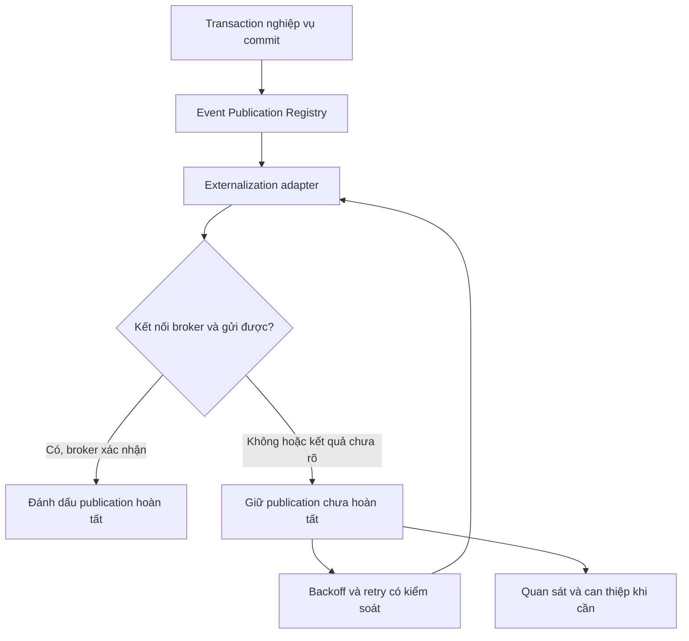

# Xử lý lỗi kết nối broker trong Spring Modulith

Khi application event được externalize tới Kafka, RabbitMQ hoặc một message broker khác, ứng dụng phải xử lý trường hợp broker tạm thời không thể kết nối. Sự cố có thể xuất hiện khi broker bảo trì, mạng gián đoạn, DNS lỗi, chứng chỉ TLS hết hạn, thông tin xác thực bị thay đổi hoặc broker từ chối quyền ghi. Nếu ứng dụng chỉ gửi message trong bộ nhớ rồi bỏ qua lỗi, một sự kiện nghiệp vụ đã commit có thể không bao giờ tới được hệ thống nhận.

Trong module `SPRING_MODULITH_APPLICATION_EVENTS`, lỗi kết nối cần được xử lý cùng với Event Publication Registry và adapter của broker. Registry có thể giữ trạng thái những publication chưa hoàn tất khi được cấu hình lưu trữ bền vững; adapter chịu trách nhiệm chuyển event tới đích; chính sách retry và quan sát giúp hệ thống phục hồi có kiểm soát. Mục tiêu là không đánh mất dấu vết giao sự kiện khi broker tạm thời không sẵn sàng, đồng thời tránh tạo tải retry quá mức hoặc tác động nghiệp vụ trùng lặp.

## 1. Lỗi kết nối broker ảnh hưởng tới luồng nào?

Một luồng externalization thường bắt đầu từ transaction nghiệp vụ:

1. Module nguồn cập nhật dữ liệu nghiệp vụ.
2. Publisher phát application event, ví dụ `OrderCompleted`.
3. Spring Modulith ghi nhận publication cần giao cho listener hoặc externalization adapter theo cấu hình.
4. Adapter chuyển event tới broker.
5. Broker xác nhận việc nhận message theo cơ chế của nó.
6. Publication được đánh dấu hoàn tất khi bước giao được coi là thành công.

Nếu broker không kết nối được ở bước 4, listener/adapter có thể thất bại. Với persistent Event Publication Registry và cấu hình phù hợp, publication còn dang dở có thể tiếp tục được theo dõi và thử lại sau. Điều này đặc biệt quan trọng khi transaction nghiệp vụ đã commit trước thời điểm adapter gửi message: lỗi gửi ra ngoài không nên làm mất thông tin rằng vẫn còn một event cần giao.



Sơ đồ mô tả nguyên tắc vận hành. Trạng thái thực tế phụ thuộc adapter, transaction phase, cơ chế xác nhận của broker và repository registry mà ứng dụng đã cấu hình. Một repository chỉ lưu trong bộ nhớ không giữ được publication qua restart.

## 2. Phân loại lỗi trước khi retry

Không phải lỗi nào cũng có thể khắc phục bằng cách gửi lại ngay. Cần phân biệt lỗi kết nối tạm thời, lỗi cấu hình kéo dài và kết quả gửi không xác định.

| Nhóm lỗi | Ví dụ | Hướng xử lý |
| --- | --- | --- |
| Broker chưa sẵn sàng | Broker restart, đang nâng cấp hoặc chưa mở cổng | Chờ kết nối phục hồi, retry có backoff |
| Lỗi mạng | DNS không phân giải được, connection refused, timeout, mất route | Kiểm tra DNS, firewall, network policy và địa chỉ broker; retry nếu lỗi tạm thời |
| Lỗi TLS hoặc xác thực | Chứng chỉ hết hạn, truststore sai, username/password không hợp lệ | Sửa chứng chỉ hoặc credential; tránh retry dày đặc khi cấu hình chưa đổi |
| Lỗi phân quyền hoặc định tuyến | Producer không có quyền ghi, topic/exchange không tồn tại, routing key không khớp | Sửa ACL, destination hoặc topology trước khi gửi lại |
| Lỗi payload | Serializer thất bại, message vượt giới hạn, schema không hợp lệ | Sửa hợp đồng hoặc dữ liệu; cách ly publication cần xử lý thủ công |
| Kết quả gửi không xác định | Timeout sau khi gửi, kết nối đứt trước khi nhận acknowledgement | Xem như message có thể đã tới broker; retry phải đi cùng idempotency |

Phân loại này giúp chọn đúng hành động. Retry có thể hữu ích khi broker vừa khởi động lại, nhưng không thể sửa chứng chỉ TLS sai, quyền ghi bị thu hồi hoặc một payload không thể serialize.

## 3. Phân biệt lỗi kết nối và lỗi xác nhận

Một producer có thể gặp hai tình huống khác nhau:

- **Không thể thiết lập kết nối hoặc gửi request:** client biết rằng thao tác chưa thể hoàn thành do không tiếp cận được broker.
- **Đã gửi nhưng không nhận được xác nhận:** broker có thể đã nhận message, nhưng acknowledgement bị mất hoặc đến sau timeout.

Tình huống thứ hai có kết quả không xác định. Nếu producer gửi lại, broker có thể nhận một bản sao. Vì vậy, không nên coi timeout là bằng chứng chắc chắn rằng message chưa tới broker.

Đối với Kafka, cần phân biệt việc client đưa record vào luồng gửi với việc broker xác nhận theo cấu hình producer. Với AMQP, publisher confirm và việc message được định tuyến tới queue là các tín hiệu khác nhau; xác nhận publish thành công không nhất thiết chứng minh consumer đã xử lý message. Cách adapter Spring Modulith tích hợp các tín hiệu này cần được kiểm tra theo phiên bản và cấu hình cụ thể.

Một adapter tùy chỉnh cần quan sát kết quả gửi bất đồng bộ và chỉ báo thành công cho registry khi điều kiện xác nhận đã định được đáp ứng. Nếu phương thức gửi trả về future hoặc callback nhưng adapter không chờ hoặc không xử lý lỗi của kết quả đó, listener có thể kết thúc thành công quá sớm và publication bị đánh dấu hoàn tất dù broker chưa nhận message.

## 4. Vai trò của Event Publication Registry

Event Publication Registry theo dõi publication của event tới các listener liên quan. Trong luồng externalization, registry giúp ứng dụng nhận diện những lần giao chưa hoàn tất khi adapter thất bại, với điều kiện event được theo dõi bằng registry và repository được cấu hình phù hợp.

Để có khả năng phục hồi sau restart, cần dùng persistent repository tương thích với Spring Modulith và bảo đảm transaction manager cùng datasource được cấu hình đúng. Nếu registry chỉ lưu trong bộ nhớ, tiến trình dừng sẽ làm mất trạng thái theo dõi. Khi đó, retry trong cùng vòng đời tiến trình có thể vẫn hoạt động, nhưng không thể dựa vào dữ liệu RAM để phục hồi sau khi ứng dụng khởi động lại.

Registry và broker có trách nhiệm khác nhau:

| Thành phần | Trách nhiệm |
| --- | --- |
| Event Publication Registry | Theo dõi event cần giao cho listener/externalization và trạng thái publication |
| Externalization adapter | Chuyển event sang broker theo hợp đồng và cấu hình đích |
| Message broker | Nhận, lưu hoặc định tuyến message theo bảo đảm của broker |
| Consumer | Xử lý message và quản lý tính idempotent trong hệ thống nhận |

Registry không thay thế broker và cũng không phải một message queue tổng quát. Nó lưu dấu vết publication trong ứng dụng để có thể biết việc giao event đã hoàn tất hay còn dang dở.

## 5. Thiết kế retry theo nhiều lớp

Một chính sách retry hiệu quả cần phối hợp client broker, cơ chế phục hồi publication và quy trình vận hành. Không nên để nhiều lớp cùng retry nhanh và không giới hạn vì số lần gửi thực tế có thể tăng rất lớn.

### Retry ngắn ở client

Client Kafka hoặc AMQP thường có cơ chế thử lại một số lỗi truyền thông tạm thời. Cấu hình cần giới hạn thời gian chờ và tổng thời gian gửi để request không treo vô hạn. Các giá trị cụ thể phụ thuộc broker, Spring Boot, client library và SLO của hệ thống.

Retry ở client phù hợp với lỗi ngắn như kết nối vừa bị ngắt trong lúc broker chuyển node. Nó không nên trở thành vòng lặp vô hạn che giấu sự cố kéo dài.

### Retry publication ở tầng ứng dụng

Nếu adapter thất bại và publication vẫn được đánh dấu chưa hoàn tất, ứng dụng có thể thực hiện retry ở tầng publication sau một khoảng chờ. Spring Modulith cung cấp cơ chế làm việc với publication chưa hoàn tất; API và cách kích hoạt cụ thể cần theo phiên bản đang sử dụng.

Với persistent registry, ứng dụng có thể cấu hình phát lại các publication còn dang dở khi khởi động. Ví dụ property thường dùng:

```yaml
spring:
  modulith:
    events:
      republish-outstanding-events-on-restart: true
```

Hãy xác nhận property và hành vi khởi động theo dòng Spring Modulith của dự án. Phát lại khi restart là một cơ chế phục hồi; nó không thay thế retry có backoff trong lúc ứng dụng đang chạy và không tự khắc phục lỗi cấu hình broker.

### Retry có backoff và jitter

Thay vì retry liên tục, hãy tăng dần khoảng cách giữa các lần thử và thêm jitter để nhiều instance không cùng kết nối lại tại một thời điểm.

Ví dụ minh họa lịch chờ có giới hạn:

| Lần thử | Khoảng chờ tham khảo |
| --- | ---: |
| 1 | 1 giây |
| 2 | 2 giây |
| 3 | 4 giây |
| 4 | 8 giây |
| 5 trở đi | Tối đa 30 giây, cộng jitter |

Đây là ví dụ để hình dung exponential backoff, không phải giá trị mặc định của Spring Modulith hay khuyến nghị cố định cho mọi broker. Hãy chọn giới hạn theo thời gian chịu lỗi, lưu lượng, timeout và năng lực broker.

### Retry thủ công

Một số publication có thể thất bại do lỗi dữ liệu hoặc cấu hình kéo dài. Khi đó, người vận hành cần xem thông tin event, listener, thời điểm phát hành và exception, khắc phục nguyên nhân rồi mới phát lại. Spring Modulith có abstraction `IncompleteEventPublications` để xây dựng quy trình quản lý publication chưa hoàn tất; cần dùng API phù hợp với phiên bản dự án thay vì tự sửa trạng thái bằng SQL.

## 6. Tránh retry gây quá tải

Khi broker ngừng hoạt động, mọi instance producer có thể đồng thời thử kết nối lại. Nếu mỗi instance retry liên tục, broker có thể bị quá tải ngay khi vừa phục hồi. Hiện tượng này thường được gọi là retry storm hoặc thundering herd.

Các biện pháp giảm tải:

- Dùng exponential backoff có giới hạn và jitter.
- Giới hạn số request đang chờ gửi và số lần retry đồng thời.
- Đặt timeout kết nối, timeout gửi và timeout xác nhận phù hợp.
- Dùng circuit breaker nếu cần ngừng gọi adapter trong thời gian broker lỗi kéo dài; khi circuit mở, lỗi vẫn phải được phản ánh để publication không bị đánh dấu hoàn tất nhầm.
- Tách lỗi tạm thời khỏi lỗi cấu hình không thể tự hồi phục.
- Theo dõi tốc độ tăng của publication chưa hoàn tất và dung lượng lưu trữ.
- Tránh khởi động lại toàn bộ ứng dụng liên tục chỉ vì broker tạm thời mất kết nối.

Circuit breaker chỉ giúp giảm lời gọi tới một đích đang lỗi. Nó không lưu event và không thay thế Event Publication Registry. Nếu adapter bắt exception rồi trả về như thể gửi thành công, registry có thể không còn cơ hội biết publication chưa hoàn tất. Khi thất bại, adapter cần truyền kết quả lỗi theo hợp đồng để cơ chế theo dõi hoạt động đúng.

## 7. Cấu hình theo loại broker

Spring Modulith có integration cho các công nghệ nhắn tin như Kafka và AMQP. Cấu hình kết nối thuộc về client tương ứng; integration externalization chịu trách nhiệm nối event publication với broker. Hãy chọn đúng adapter, quản lý phiên bản dependency qua BOM tương thích và kiểm tra cách adapter xác nhận kết quả gửi.

### Kafka

Với Kafka, cần quan tâm tới bootstrap servers, DNS, TLS/SASL, producer acknowledgement, timeout, retry và idempotence của producer. Ví dụ cấu hình khái quát:

```yaml
spring:
  kafka:
    bootstrap-servers: ${KAFKA_BOOTSTRAP_SERVERS}
    producer:
      acks: all
      properties:
        enable.idempotence: true
```

Đây là cấu hình minh họa cho producer. `acks=all` và idempotence giúp tăng độ tin cậy trong phạm vi producer/broker theo cấu hình Kafka, nhưng không tạo exactly-once cho toàn bộ chuỗi từ transaction database của ứng dụng tới side effect ở consumer. Cần cấu hình thêm timeout và retry phù hợp, đồng thời xác minh broker có đủ replica và chính sách replication tương ứng.

Khi gặp lỗi, kiểm tra bootstrap address, DNS, trạng thái broker, ACL của topic, TLS/SASL và log producer. Nếu lỗi là authorization hoặc topic không tồn tại, retry không giới hạn chỉ làm kéo dài thời gian phục hồi.

### AMQP và RabbitMQ

Với AMQP, cần quan tâm tới địa chỉ broker, virtual host, credential, TLS, exchange, routing key, queue binding và publisher confirms. Một ví dụ cấu hình Spring Boot có thể bật publisher confirms và returns:

```yaml
spring:
  rabbitmq:
    addresses: ${RABBITMQ_ADDRESSES}
    publisher-confirm-type: correlated
    publisher-returns: true
```

Tên property và hành vi cần xác nhận theo phiên bản Spring Boot/Spring AMQP đang dùng. Publisher confirm giúp producer biết broker đã xác nhận publish; publisher return giúp phát hiện message không được định tuyến theo cấu hình phù hợp. Confirm và return không đồng nghĩa consumer đã xử lý message.

Khi lỗi, kiểm tra DNS và cổng broker, credential, quyền publish, exchange tồn tại, routing key và queue binding. Nếu broker đã nhận message nhưng acknowledgement bị mất, lần gửi lại vẫn có thể tạo message trùng.

### Không trộn cấu hình của nhiều broker

Một ứng dụng chỉ nên cấu hình adapter tương ứng với broker đang sử dụng cho luồng đó. Không sao chép nguyên cấu hình Kafka sang AMQP hoặc ngược lại. Mỗi client có mô hình xác nhận, retry, định tuyến và phục hồi kết nối riêng.

## 8. Phân biệt lỗi broker với lỗi consumer

Broker nhận được message không có nghĩa consumer đã xử lý thành công. Có thể producer kết nối bình thường nhưng consumer đang dừng, mất quyền đọc, bị lag hoặc liên tục lỗi khi deserialize.

| Triệu chứng | Vùng cần kiểm tra trước |
| --- | --- |
| Producer không mở được connection | DNS, network, broker listener, TLS và credential |
| Producer kết nối được nhưng publish bị từ chối | ACL, topic/exchange, routing và giới hạn broker |
| Producer nhận confirm nhưng consumer không thấy message | Routing, subscription, consumer group, queue binding và offset |
| Consumer nhận message nhưng xử lý thất bại | Schema, deserialize, logic nghiệp vụ, database và dependency của consumer |
| Message được xử lý lặp | Timeout/acknowledgement, retry và idempotency của consumer |

Việc tách các triệu chứng giúp tránh retry nhầm ở producer khi lỗi nằm ở consumer. Nếu consumer dừng, message có thể vẫn nằm trong topic hoặc queue theo retention và durability của broker. Khi consumer hoạt động lại, nó cần tiếp tục từ vị trí phù hợp theo mô hình của broker.

## 9. Xử lý message có kết quả không xác định

Một trường hợp khó là producer gửi message, broker có thể đã nhận, nhưng kết nối bị ngắt trước khi producer nhận được xác nhận. Ứng dụng không thể biết chắc message đã được ghi nhận hay chưa chỉ từ timeout.

Chính sách an toàn thường chấp nhận khả năng giao lặp và yêu cầu consumer idempotent. Mỗi event nên có định danh ổn định như `eventId`. Consumer có thể lưu định danh này trong bảng inbox với unique constraint và thực hiện thay đổi nghiệp vụ trong cùng transaction:

```java
@Transactional
public void handle(OrderCompleted event) {
    if (inboxRepository.existsById(event.eventId())) {
        return;
    }

    orderProjection.apply(event.orderId());
    inboxRepository.save(new InboxEntry(event.eventId()));
}
```

Đây là ví dụ minh họa. Trong triển khai thật, thao tác kiểm tra và ghi inbox cần được bảo vệ bởi ràng buộc duy nhất để hai lần xử lý đồng thời không cùng vượt qua bước kiểm tra. Nếu consumer gọi một hệ thống bên ngoài, hãy dùng idempotency key mà hệ thống đó hỗ trợ hoặc quy trình đối soát riêng.

Kafka producer idempotence có thể loại bỏ một số bản ghi trùng do retry nội bộ của producer trong phạm vi session và cấu hình được hỗ trợ. Nó không thay thế idempotency ở consumer khi ứng dụng gửi lại publication sau một lần restart hoặc khi có kết quả acknowledgement không xác định.

## 10. Readiness, liveness và khả năng tiếp nhận nghiệp vụ

Broker không sẵn sàng không nhất thiết có nghĩa toàn bộ ứng dụng phải dừng. Nếu transaction nghiệp vụ và persistent registry vẫn ghi được vào cùng database, ứng dụng có thể tiếp tục nhận yêu cầu và giữ publication chờ giao. Khi broker phục hồi, adapter tiếp tục xử lý các publication còn dang dở.

Quyết định tiếp tục nhận yêu cầu cần dựa trên yêu cầu nghiệp vụ:

- Nếu event có thể giao trễ trong giới hạn cho phép, ứng dụng có thể tiếp tục phục vụ khi registry lưu bền vững và backlog còn trong ngưỡng.
- Nếu một thao tác chỉ hợp lệ khi hệ thống ngoài đã nhận thông điệp, cần chặn thao tác đó hoặc dùng một quy trình xác nhận rõ ràng.
- Nếu registry/database không lưu được publication, ứng dụng có thể không còn bảo đảm giữ lại event để giao sau; đây là một tình trạng nghiêm trọng hơn lỗi broker đơn lẻ.
- Nếu backlog vượt ngưỡng hoặc thời gian chờ quá dài, có thể giảm hoặc ngừng nhận một số yêu cầu phụ thuộc vào luồng event.

Liveness probe nên phản ánh tiến trình có còn hoạt động hay không. Không nên tự động làm ứng dụng restart liên tục chỉ vì broker tạm thời không kết nối được. Readiness có thể bao gồm trạng thái broker hoặc backlog nếu chính sách phục vụ yêu cầu điều đó, nhưng cần tránh biến một dependency bất đồng bộ thành điểm làm ngừng mọi chức năng không liên quan.

## 11. Quan sát lỗi kết nối và backlog

Để phát hiện sự cố sớm, cần theo dõi cả kết nối broker và trạng thái publication. Chỉ nhìn log exception là chưa đủ để biết còn bao nhiêu event đang chờ giao.

Những metric hữu ích gồm:

- Trạng thái kết nối và số lần reconnect của producer.
- Số lần publish thất bại theo broker, destination và loại exception.
- Thời gian gửi và thời gian chờ acknowledgement.
- Số publication chưa hoàn tất và tuổi của publication lâu nhất.
- Tốc độ tạo publication mới so với tốc độ hoàn tất.
- Kích thước backlog và tốc độ backlog tăng/giảm.
- Số lần retry, số publication cần can thiệp thủ công và kết quả phục hồi.
- Consumer lag, queue depth và dead-letter count theo khả năng quan sát của broker.

Log nên có event type, `eventId`, publication ID nếu có, destination, correlation ID, broker endpoint đã loại bỏ thông tin nhạy cảm và exception class. Không ghi password, token, connection string chứa credential hoặc toàn bộ payload nếu payload có dữ liệu nhạy cảm.

Nên cảnh báo khi publication chưa hoàn tất tăng liên tục, publication lâu nhất vượt ngưỡng SLO, reconnect tăng bất thường hoặc broker từ chối publish do xác thực/phân quyền. Cảnh báo nên chỉ rõ destination và nhóm lỗi để người vận hành có thể tìm đúng nơi cần kiểm tra.

## 12. Quy trình phục hồi sự cố

Khi broker mất kết nối, người vận hành có thể đi theo quy trình sau:

1. **Xác định phạm vi:** broker nào, destination nào, producer instance nào và thời điểm bắt đầu lỗi.
2. **Phân loại lỗi:** network, DNS, TLS, authentication, authorization, routing, timeout hay payload.
3. **Kiểm tra registry:** số publication chưa hoàn tất, tuổi publication lâu nhất và exception tương ứng.
4. **Khắc phục nguyên nhân:** phục hồi broker/network, sửa credential/certificate, ACL hoặc topology.
5. **Xác nhận broker sẵn sàng:** kiểm tra producer có thể kết nối và publish thử theo quy trình an toàn.
6. **Cho retry tiếp tục:** dùng cơ chế retry có backoff hoặc API phục hồi publication được hỗ trợ.
7. **Kiểm tra giao lặp:** xác nhận consumer idempotent và theo dõi message trùng nếu có.
8. **Theo dõi backlog:** xác nhận tốc độ hoàn tất cao hơn tốc độ tạo mới cho tới khi backlog trở về ngưỡng bình thường.
9. **Ghi nhận nguyên nhân:** lưu lại thời gian gián đoạn, ảnh hưởng, cách khắc phục và hành động phòng ngừa.

Không xóa publication chưa hoàn tất chỉ để giảm cảnh báo. Không đánh dấu publication hoàn tất bằng SQL nếu chưa có bằng chứng broker đã nhận message theo điều kiện xác nhận của hệ thống. Khi cần xử lý thủ công, dùng API hoặc công cụ vận hành được thiết kế cho registry và ghi nhận người thực hiện cùng kết quả.

## 13. Kiểm thử tình huống connection failure

Kiểm thử happy path chỉ xác nhận broker nhận được message khi mọi thành phần đều sẵn sàng. Cần tạo các tình huống lỗi có kiểm soát để kiểm tra khả năng phục hồi.

| Tình huống | Điều cần xác nhận |
| --- | --- |
| Broker không chạy lúc ứng dụng khởi động | Ứng dụng phản ứng theo chính sách readiness/startup đã chọn; lỗi được quan sát rõ |
| Broker dừng sau khi ứng dụng hoạt động | Publication chưa hoàn tất được giữ trong persistent registry |
| DNS hoặc network tạm thời lỗi | Client retry có giới hạn, không tạo vòng lặp gọi dày đặc |
| Credential hoặc TLS sai | Lỗi được phân loại là cấu hình cần sửa, cảnh báo rõ và không retry vô hạn |
| Broker từ chối publish | Adapter phản ánh lỗi để registry không đánh dấu thành công nhầm |
| Timeout sau khi gửi | Hệ thống chấp nhận khả năng message đã tới broker và consumer xử lý idempotent |
| Broker phục hồi | Publication còn dang dở được giao lại và backlog giảm |
| Ứng dụng restart khi còn publication | Persistent registry giữ dữ liệu và cơ chế phục hồi hoạt động theo cấu hình |
| Consumer xử lý lặp | Unique constraint/inbox ngăn tác động nghiệp vụ trùng |

Nên kiểm thử với broker thật trong môi trường cô lập, chẳng hạn container test hoặc broker integration environment. Mock có thể hữu ích cho unit test phân loại lỗi, nhưng không chứng minh reconnect, acknowledgement, routing và transaction behavior của adapter thực tế.

## 14. Những lỗi thiết kế thường gặp

| Lỗi | Hệ quả | Cách xử lý |
| --- | --- | --- |
| Chỉ giữ event trong bộ nhớ | Restart làm mất event đang chờ giao | Dùng persistent Event Publication Registry khi cần phục hồi |
| Bắt exception rồi bỏ qua | Registry có thể coi listener đã hoàn tất dù message chưa được giao | Truyền lỗi theo hợp đồng để publication còn dang dở |
| Retry liên tục không có backoff | Tạo retry storm và làm broker khó phục hồi | Exponential backoff, jitter và giới hạn retry |
| Retry lỗi credential/TLS như lỗi tạm thời | Tốn tài nguyên nhưng không thể tự phục hồi | Phân loại lỗi cấu hình và yêu cầu sửa nguyên nhân |
| Coi timeout là chắc chắn chưa gửi | Có thể tạo message trùng khi gửi lại | Thiết kế at-least-once và consumer idempotent |
| Đánh dấu publication hoàn tất ngay sau khi enqueue vào client buffer | Mất dấu message nếu gửi bất đồng bộ thất bại sau đó | Chờ tín hiệu hoàn tất theo semantics của adapter |
| Restart ứng dụng mỗi khi broker lỗi | Tăng gián đoạn và tạo vòng lặp khởi động | Dùng reconnect và publication persistence |
| Xóa publication lỗi bằng SQL | Mất dấu event chưa giao | Phục hồi qua API và quy trình vận hành |
| Chỉ theo dõi connection status | Không biết backlog có đang tăng hay không | Theo dõi publication chưa hoàn tất và tuổi backlog |

Một sai lầm khác là cho rằng broker phục hồi đồng nghĩa mọi event đã được giao. Sau khi kết nối trở lại, backlog có thể cần thời gian để xử lý. Cần theo dõi tốc độ drain, giới hạn concurrency và năng lực consumer; nếu tăng tải đột ngột, broker hoặc consumer có thể tiếp tục quá tải.

## 15. Quy trình thiết kế cho một module

Khi chuẩn bị một luồng externalization có khả năng chịu lỗi kết nối, hãy thực hiện theo thứ tự:

1. Xác định broker, destination và yêu cầu thời gian giao event.
2. Chọn event nghiệp vụ cần externalize và khai báo hợp đồng payload ổn định.
3. Cấu hình persistent Event Publication Registry nếu cần giữ publication qua restart.
4. Chọn adapter Kafka/AMQP phù hợp và cấu hình kết nối, TLS, credential, ACL, routing cùng acknowledgement.
5. Xác định timeout, retry ngắn ở client, backoff ở tầng publication và giới hạn retry.
6. Đảm bảo lỗi gửi được truyền về cơ chế theo dõi; không nuốt exception hoặc đánh dấu hoàn tất quá sớm.
7. Thiết kế consumer idempotent để xử lý trường hợp acknowledgement không xác định và giao lặp.
8. Xác định chính sách readiness và khả năng tiếp nhận nghiệp vụ khi broker gián đoạn.
9. Kiểm thử broker outage, network failure, timeout, restart, retry và backlog recovery.
10. Thiết lập dashboard, cảnh báo và quy trình vận hành publication chưa hoàn tất.

Spring Modulith giúp ứng dụng theo dõi publication của application event và tổ chức việc externalize qua adapter. Khi kết hợp persistent registry, xác nhận gửi phù hợp với broker, retry có backoff, consumer idempotent và quan sát backlog, hệ thống có thể chịu được những lần broker mất kết nối mà vẫn giữ được khả năng phục hồi giao sự kiện theo yêu cầu nghiệp vụ.
