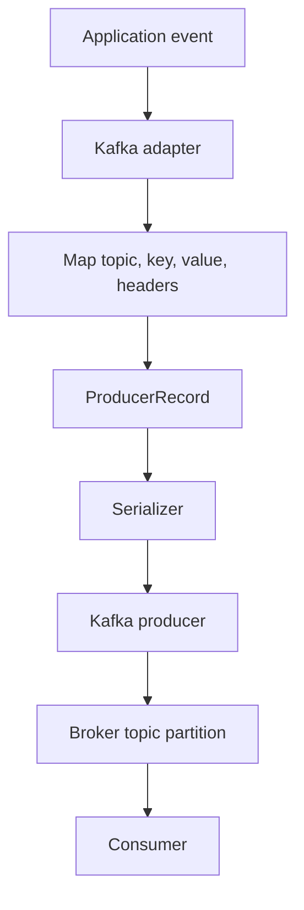

# Kafka `ProducerRecord` trong Spring Modulith

Khi một application event cần được gửi tới Kafka, lớp tích hợp phải chuyển sự kiện nghiệp vụ thành một Kafka record có đủ thông tin để broker định tuyến và consumer hiểu được. Trong Kafka Java Client, `ProducerRecord<K, V>` là đối tượng mô tả message sắp gửi: topic, partition tùy chọn, timestamp tùy chọn, key, value và headers.

Trong kiến trúc Spring Modulith, module nghiệp vụ nên phát application event theo ngôn ngữ nghiệp vụ. Một adapter ở ranh giới tích hợp mới quyết định cách ánh xạ event thành `ProducerRecord`. Nhờ đó, module phát sự kiện không phải phụ thuộc Kafka client, tên topic, serializer hoặc cấu hình partition.

## 1. `ProducerRecord` là gì?

`ProducerRecord<K, V>` thuộc Kafka Java Client (`org.apache.kafka.clients.producer`). Đây là một class mô tả một bản ghi mà producer gửi tới Kafka. Chữ *record* ở đây có nghĩa là bản ghi message của Kafka; nó không đồng nghĩa với Java `record` declaration.

Một producer record có các thành phần chính:

| Thành phần | Ý nghĩa |
|---|---|
| `topic` | Topic nhận message; đây là thông tin bắt buộc |
| `partition` | Partition đích; có thể bỏ trống để producer partitioner lựa chọn |
| `timestamp` | Thời điểm gắn với record; có thể để producer tự gán |
| `key` | Khóa định danh hoặc phân vùng message; có thể null |
| `value` | Nội dung message; có thể null trong trường hợp tombstone hoặc message không có payload |
| `headers` | Metadata dạng key và byte value gắn với message |

Luồng cơ bản:



`ProducerRecord` là mô tả đầu vào cho producer. Nó không tự gửi message, không tự bảo đảm message đã được broker lưu và cũng không định nghĩa toàn bộ hợp đồng nghiệp vụ của event.

## 2. Tạo một producer record

Có thể tạo record với topic và value:

```java
ProducerRecord<String, String> record =
    new ProducerRecord<>("orders", "order completed");
```

Hoặc cung cấp key và value:

```java
ProducerRecord<String, String> record =
    new ProducerRecord<>("orders", "order-1042", "completed");
```

Khi cần kiểm soát partition và timestamp, có thể dùng constructor đầy đủ hơn:

```java
ProducerRecord<String, String> record =
    new ProducerRecord<>(
        "orders",
        null,                   // để partitioner chọn partition
        System.currentTimeMillis(),
        "order-1042",
        "completed"
    );
```

Các ví dụ trên dùng `String` cho dễ đọc. Trong ứng dụng thực tế, kiểu key/value phải khớp với serializer được cấu hình cho producer. Chỉ định partition là một quyết định vận hành có ảnh hưởng tới ordering và phân tải; không nên điền partition cố định nếu chưa có lý do rõ ràng.

## 3. Chọn topic

Topic xác định luồng dữ liệu logic mà message sẽ đi vào. Với event tích hợp, topic nên được ánh xạ từ event type hoặc target logic bằng cấu hình tập trung.

Ví dụ:

| Event type | Target logic | Topic minh họa |
|---|---|---|
| `order.completed` | `orders` | `orders.events` |
| `payment.authorized` | `payments` | `payments.events` |
| `shipment.dispatched` | `shipping` | `shipping.events` |

Tên topic trong bảng là ví dụ; ứng dụng cần thống nhất naming convention với nền tảng Kafka. Không ghép tên topic trực tiếp từ dữ liệu không tin cậy trong payload. Nếu cần định tuyến động, hãy dùng một registry cấu hình đã được quản trị và kiểm tra event type được phép gửi tới target nào.

Với Spring Modulith, `@Externalized` có thể khai báo event nào được externalize và target logic tương ứng. Target logic cần được ánh xạ sang topic vật lý bởi integration adapter hoặc cấu hình transport. Không mặc định chuỗi trong annotation luôn là tên topic Kafka ở mọi môi trường.

## 4. Key và lựa chọn partition

Key là byte sequence sau khi serialize, được dùng bởi partitioner để quyết định record đi vào partition nào khi partition chưa được chỉ định rõ. Với partitioner mặc định, key ổn định thường giúp các record có cùng key được đưa vào cùng partition, nhờ đó consumer có thể quan sát thứ tự của chúng trong partition đó.

Ví dụ dùng aggregate ID làm key:

```java
ProducerRecord<String, byte[]> record = new ProducerRecord<>(
    "orders.events",
    event.orderId().toString(),
    payload
);
```

Chọn key theo aggregate thường hữu ích khi các event của cùng một đơn hàng cần được xử lý theo thứ tự. Một số lựa chọn khác:

- `orderId`: giữ các event của cùng đơn hàng trong cùng partition.
- `customerId`: gom sự kiện theo khách hàng nếu nghiệp vụ cần ordering theo khách hàng.
- `tenantId`: gom sự kiện theo tenant, nhưng tenant có lưu lượng lớn có thể tạo hot partition.
- `null`: không có key; partitioner quyết định cách phân phối theo cấu hình và phiên bản Kafka.

Không nên dùng một key duy nhất cho toàn bộ message vì nó có thể dồn tải vào một partition. Cũng không nên dùng random UUID mới cho mỗi message nếu mục tiêu là giữ ordering theo aggregate, vì các event của cùng aggregate có thể bị phân tán.

Nếu ứng dụng chỉ định `partition` trực tiếp trong `ProducerRecord`, partitioner không còn quyết định partition đích cho record đó. Cần bảo đảm partition tồn tại trong topic và cấu hình không bị lỗi khi số partition thay đổi. Chỉ định partition bằng số cố định làm tăng coupling với topology Kafka và thường khó vận hành hơn dùng key.

Ordering của Kafka chỉ được đảm bảo trong phạm vi một partition. Key không tạo ra thứ tự toàn cục giữa nhiều partition hoặc giữa nhiều topic. Nếu nghiệp vụ yêu cầu thứ tự theo aggregate, producer và consumer cần dùng cùng quy ước key và xử lý offset/processing phù hợp.

## 5. Timestamp

Timestamp trong `ProducerRecord` là thời điểm gắn với record. Nếu không chỉ định, producer có thể gán timestamp khi gửi. Cách broker lưu và diễn giải timestamp phụ thuộc cấu hình topic/broker, đặc biệt loại timestamp được dùng như thời điểm do producer tạo (`CreateTime`) hay thời điểm broker nhận (`LogAppendTime`).

Với event nghiệp vụ, `occurredAt` trong payload thể hiện thời điểm nghiệp vụ xảy ra. Timestamp Kafka phục vụ semantics của record và vận hành broker. Hai giá trị này có thể khác nhau: event được tạo lúc 10:00 nhưng worker gửi lại lúc 10:05. Khi cần đo độ trễ hoặc audit, nên giữ `occurredAt` trong event contract và hiểu rõ timestamp broker đang đại diện cho điều gì.

Không dùng timestamp làm event ID hoặc khóa chống trùng. Nhiều event có thể có cùng millisecond timestamp; clock của các máy cũng có thể lệch nhau.

## 6. Headers và metadata

Headers cho phép gắn metadata mà không cần nhồi mọi thông tin vào payload. Mỗi header có key và value dạng byte array; cùng một header key có thể xuất hiện nhiều lần. Producer và consumer phải thống nhất tên header, encoding và cách xử lý header lặp.

Ví dụ:

```java
import java.nio.charset.StandardCharsets;
import org.apache.kafka.common.header.internals.RecordHeader;

record.headers().add(new RecordHeader(
    "event-id",
    event.eventId().toString().getBytes(StandardCharsets.UTF_8)
));

record.headers().add(new RecordHeader(
    "event-type",
    "order.completed".getBytes(StandardCharsets.UTF_8)
));
```

Các header thường hữu ích:

| Header | Mục đích |
|---|---|
| `event-id` | Nhận diện event qua retry và deduplication |
| `event-type` | Chọn handler hoặc DTO tương ứng |
| `schema-version` | Chọn schema/mapper để deserialize |
| `content-type` | Mô tả định dạng payload, ví dụ JSON hoặc Avro |
| `correlation-id` | Liên kết các bước xử lý cùng một luồng nghiệp vụ |
| `traceparent` | Truyền trace context theo chuẩn tracing được hỗ trợ |
| `tenant-id` | Định tuyến hoặc áp dụng tenant scope nếu hợp đồng cho phép |

Header là metadata vận chuyển, không tự xác thực danh tính hoặc quyền truy cập. Consumer không nên tin `tenant-id`, `producer` hay `event-type` chỉ vì chúng nằm trong header. Producer phải có quyền publish và consumer phải xác thực nguồn, kiểm tra hợp đồng cùng tenant scope.

Không đưa access token, password, secret hoặc payload lớn vào headers. Metadata nhạy cảm có thể bị lộ qua broker tooling, logs và tracing. Chỉ truyền dữ liệu cần thiết và bảo vệ broker bằng TLS/ACL.

## 7. Serializer cho key và value

Kafka producer gửi bytes. `ProducerRecord<K, V>` có kiểu generic, nhưng key và value phải được serializer chuyển thành byte array trước khi ghi lên broker.

Producer thường cấu hình hai serializer riêng:

- `key.serializer`: chuyển key thành bytes.
- `value.serializer`: chuyển payload thành bytes.

Ví dụ cấu hình dạng properties:

```properties
key.serializer=org.apache.kafka.common.serialization.StringSerializer
value.serializer=org.apache.kafka.common.serialization.ByteArraySerializer
```

Với JSON, ứng dụng có thể serialize DTO thành `byte[]` bằng Jackson trước khi tạo record, hoặc dùng serializer JSON phù hợp với Spring Kafka và cấu hình hiện tại. Nếu dùng Schema Registry với Avro/Protobuf, producer và consumer cần thống nhất schema subject, version và compatibility policy.

Không serialize trực tiếp JPA entity hoặc object có lazy relation. Hãy chuyển thành integration DTO ổn định, tránh proxy và dữ liệu nội bộ. Khi schema thay đổi, cần kiểm tra consumer cũ có đọc được message mới không.

Serialization có thể thất bại trước khi message được gửi, ví dụ do kiểu dữ liệu không được hỗ trợ hoặc payload sai schema. Lỗi serialize cần được phân biệt với lỗi broker timeout. Retry broker không sửa được payload không thể serialize.

## 8. Gửi `ProducerRecord` bằng `KafkaTemplate`

Trong Spring Kafka, `KafkaTemplate` cung cấp API gửi message và có overload nhận trực tiếp `ProducerRecord`. Điều này hữu ích khi adapter cần chỉ định key, partition, timestamp hoặc headers một cách rõ ràng.

Ví dụ với Spring Kafka 3.x:

```java
import java.nio.charset.StandardCharsets;
import java.util.concurrent.CompletableFuture;

import org.apache.kafka.clients.producer.ProducerRecord;
import org.apache.kafka.common.header.internals.RecordHeader;
import org.springframework.kafka.core.KafkaTemplate;
import org.springframework.kafka.support.SendResult;

public class OrderKafkaPublisher {

    private final KafkaTemplate<String, byte[]> kafkaTemplate;
    private final ObjectMapper objectMapper;

    public OrderKafkaPublisher(
        KafkaTemplate<String, byte[]> kafkaTemplate,
        ObjectMapper objectMapper
    ) {
        this.kafkaTemplate = kafkaTemplate;
        this.objectMapper = objectMapper;
    }

    public CompletableFuture<SendResult<String, byte[]>> publish(
        OrderCompleted event
    ) throws JsonProcessingException {
        byte[] payload = objectMapper.writeValueAsBytes(event);

        ProducerRecord<String, byte[]> record = new ProducerRecord<>(
            "orders.events",
            null,
            event.occurredAt().toEpochMilli(),
            event.orderId().toString(),
            payload
        );

        record.headers().add(new RecordHeader(
            "event-id",
            event.eventId().toString().getBytes(StandardCharsets.UTF_8)
        ));
        record.headers().add(new RecordHeader(
            "event-type",
            "order.completed".getBytes(StandardCharsets.UTF_8)
        ));

        return kafkaTemplate.send(record);
    }
}
```

Ví dụ minh họa cách ánh xạ event thành record và gửi bằng `KafkaTemplate`; `OrderCompleted`, `ObjectMapper` và các import ứng dụng cần được khai báo trong project thực tế. Spring Kafka 3.x dùng `CompletableFuture` cho kết quả gửi; các phiên bản cũ có API future khác, vì vậy cần đối chiếu phiên bản dependency đang dùng.

Nếu không cần tùy chỉnh headers hoặc partition, các overload tiện ích như `send(topic, key, value)` có thể đủ dùng. Chúng vẫn tạo ra record ở bên dưới. Dùng `ProducerRecord` trực tiếp khi muốn thể hiện đầy đủ metadata ở ranh giới adapter.

## 9. Xử lý kết quả gửi bất đồng bộ

Lệnh gửi thường trả về future vì Kafka producer gửi bất đồng bộ. Khi hoàn tất, kết quả của Spring Kafka `SendResult` cung cấp record đã gửi và `RecordMetadata` từ broker. Metadata có thể cho biết topic, partition, offset và timestamp của record được ghi.

Ví dụ:

```java
return kafkaTemplate.send(record)
    .whenComplete((result, error) -> {
        if (error != null) {
            log.error(
                "Kafka send failed: eventId={}",
                event.eventId(),
                error
            );
            return;
        }

        var metadata = result.getRecordMetadata();
        log.info(
            "Kafka event sent: eventId={}, topic={}, partition={}, offset={}",
            event.eventId(),
            metadata.topic(),
            metadata.partition(),
            metadata.offset()
        );
    });
```

Không ghi log toàn bộ payload. Với lỗi gửi, cần lưu event ID, topic, attempt và nguyên nhân. Với thành công, metadata broker hữu ích cho tracing và điều tra. Không nên block thread nghiệp vụ để chờ kết quả gửi nếu kiến trúc đã thiết kế xử lý bất đồng bộ; nếu cần đồng bộ, hãy xác định timeout và tác động tới throughput.

Một future hoàn tất thành công thể hiện producer nhận được kết quả theo acknowledgement policy đã cấu hình. Ý nghĩa durability phụ thuộc `acks`, replication, ISR và cấu hình broker. `acks=0`, `acks=1` và `acks=all` có mức xác nhận khác nhau. Hãy chọn policy theo yêu cầu mất dữ liệu, độ trễ và khả năng chịu lỗi.

## 10. Retry, idempotence và producer reliability

Kafka producer có cấu hình retry và idempotence để xử lý lỗi gửi trong phạm vi producer session. `enable.idempotence` giúp Kafka loại bỏ duplicate do producer retry theo cơ chế hỗ trợ của broker. Nó không làm cho toàn bộ luồng database → application event → Kafka → consumer trở thành exactly-once.

Các cấu hình cần hiểu cùng nhau:

- `acks`: mức xác nhận broker cần trả về trước khi send được coi là thành công.
- `retries`: số lần producer thử lại khi gặp lỗi có thể retry; hành vi cụ thể phụ thuộc version và cấu hình liên quan.
- `enable.idempotence`: hỗ trợ tránh duplicate do retry của producer trong phạm vi semantics Kafka cung cấp.
- `delivery.timeout.ms`: giới hạn thời gian producer cố gắng hoàn tất gửi.
- `request.timeout.ms`: thời gian chờ phản hồi cho một request.
- `max.in.flight.requests.per.connection`: số request chưa hoàn tất trên một connection; cần cấu hình tương thích khi quan tâm ordering và idempotence.

Với Kafka client hiện đại, idempotence có thể được bật mặc định trong nhiều cấu hình, nhưng ứng dụng nên xác minh behavior theo phiên bản và cấu hình thực tế. Không sao chép properties từ một hướng dẫn cũ mà không kiểm tra tương thích.

Ở cấp ứng dụng, có thể vẫn gửi trùng nếu broker đã nhận record nhưng ứng dụng bị dừng trước khi ghi nhận publication hoàn tất. Nếu Spring Modulith Event Publication Registry hoặc worker phục hồi gửi lại event, cùng event ID có thể xuất hiện lần nữa. Consumer cần idempotency theo event ID để tránh lặp tác động nghiệp vụ.

## 11. Gắn `ProducerRecord` với Spring Modulith

Spring Modulith tổ chức giao tiếp giữa module thông qua application event và Event Publication Registry. Một event được externalize có thể được chuyển tới adapter Kafka; adapter chịu trách nhiệm chuyển event thành message và gửi đi.

Luồng trách nhiệm điển hình:

1. Module nghiệp vụ phát event như `OrderCompleted`.
2. Event Publication Registry ghi nhận publication theo cấu hình persistence.
3. Externalization integration hoặc adapter chọn event cần gửi ra ngoài.
4. Adapter ánh xạ event type/target sang topic.
5. Adapter tạo `ProducerRecord` với key, value, timestamp và headers.
6. `KafkaTemplate` hoặc Kafka producer gửi record.
7. Kết quả gửi được phản ánh vào vòng đời publication theo integration đang dùng.

Không nhúng `ProducerRecord` vào domain event và không để module nghiệp vụ import `KafkaTemplate`. Những kiểu này thuộc hạ tầng vận chuyển. Nếu thay Kafka bằng một broker khác, event contract và module phát không nên phải thay đổi.

Event Publication Registry và Kafka record là hai khái niệm khác nhau. Registry theo dõi publication ở phía ứng dụng; `ProducerRecord` mô tả một message sẽ gửi tới Kafka. Registry không phải Kafka topic, còn việc tạo một `ProducerRecord` không tự động đăng ký hoặc hoàn tất publication trong Spring Modulith.

Khi dùng externalization integration có sẵn, hãy dùng extension point được hỗ trợ bởi đúng phiên bản Spring Modulith/Spring Kafka. Nếu tự xây adapter, cần xác định rõ transaction boundary, acknowledgement, retry và cách báo kết quả cho publication lifecycle. Không giả định pseudocode của adapter là API framework.

## 12. Transaction và khoảng trống giữa database với Kafka

Một database transaction và một Kafka send là hai tài nguyên khác nhau. Nếu service cập nhật database rồi gửi Kafka trực tiếp, có thể xảy ra hai tình huống:

- Database commit nhưng Kafka send thất bại: hệ thống ngoài không nhận được event.
- Kafka nhận record nhưng database rollback hoặc publication state không được ghi nhận: hệ thống ngoài thấy event không tương ứng với trạng thái đã commit hoặc event được gửi lại.

Spring Modulith Event Publication Registry giúp theo dõi publication và hỗ trợ phục hồi theo cấu hình persistence. Nó không biến một database transaction thông thường và một Kafka send độc lập thành một atomic transaction chung. Kafka transactions có semantics riêng và không tự bao trùm transaction database.

Với yêu cầu tin cậy cao, hãy thiết kế luồng dựa trên publication persistence, retry có kiểm soát và consumer idempotent; hoặc dùng outbox/CDC phù hợp với kiến trúc. Chỉ dùng Kafka transaction khi cần atomicity giữa các thao tác Kafka trong phạm vi mà Kafka transaction hỗ trợ. Đừng gọi toàn bộ giải pháp là exactly-once nếu database hoặc external side effect nằm ngoài transaction đó.

## 13. Xử lý lỗi và phân loại failure

Các lỗi khi gửi record có thể xảy ra ở nhiều giai đoạn:

| Giai đoạn | Ví dụ | Cách xử lý |
|---|---|---|
| Tạo payload | Mapping lỗi, dữ liệu bắt buộc thiếu | Sửa event contract hoặc mapper; không retry vô hạn |
| Serialize key/value | Serializer không hỗ trợ kiểu dữ liệu | Sửa serializer/schema và kiểm thử fixture |
| Resolve metadata | Topic chưa tồn tại hoặc metadata broker không sẵn sàng | Kiểm tra topic/configuration; retry lỗi tạm thời |
| Gửi request | Timeout, network exception, broker unavailable | Retry theo policy và delivery timeout |
| Authorization | ACL hoặc credential sai | Sửa quyền/secret, tránh retry dày đặc |
| Broker reject | Record quá lớn hoặc quota | Sửa kích thước/ quota hoặc cách phân phối |
| Consumer decode | Schema không tương thích | Giữ contract tương thích hoặc nâng consumer |

Lỗi serialize thường có thể phát sinh ngay khi producer chuẩn bị gửi, trước khi broker lưu record. Lỗi mạng và broker tạm thời có thể retry; lỗi payload hoặc authorization cần xử lý nguyên nhân. Không bắt mọi exception rồi coi như gửi thành công, vì điều đó có thể làm publication bị đánh dấu hoàn tất trong khi message chưa được lưu.

## 14. Kích thước record và giới hạn payload

Record gồm key, value và headers; tổng kích thước cần nằm trong giới hạn producer, broker, topic và consumer. Một payload lớn làm tăng memory pressure, network cost, thời gian replication và khả năng gặp lỗi message size.

Các thực hành nên dùng:

- Chỉ gửi trường consumer cần, không gửi toàn bộ entity graph.
- Tránh nhúng file hoặc blob lớn trực tiếp trong event; lưu object ở storage và gửi reference có quyền truy cập phù hợp.
- Thống nhất giới hạn kích thước ở producer, broker và consumer.
- Theo dõi kích thước p95/p99 của record theo event type.
- Kiểm tra header count và header size; không dùng headers như nơi chứa payload thứ hai.
- Nếu cần nén, đánh giá CPU, khả năng tương thích và cấu hình compression của producer/broker.

Không tăng giới hạn message size một cách đơn lẻ ở producer. Các giới hạn liên quan ở broker và consumer cũng phải tương thích, và thay đổi có thể ảnh hưởng đến bộ nhớ cùng độ trễ của toàn cụm.

## 15. Bảo mật record

Kafka record có thể được lưu trên broker, replicate, giữ theo retention và xuất hiện trong tooling vận hành. Vì vậy, không đưa secret hoặc dữ liệu nhạy cảm không cần thiết vào value hay headers.

- Dùng TLS cho kết nối producer-broker.
- Cấp ACL publish tối thiểu theo topic.
- Quản lý credential qua secret manager hoặc cơ chế cấu hình bảo mật.
- Xác định quyền consumer theo topic và môi trường.
- Mã hóa hoặc token hóa dữ liệu nhạy cảm khi hợp đồng yêu cầu.
- Không ghi payload/credential vào logs hoặc exception không được kiểm soát.
- Có retention và quy trình xử lý dữ liệu theo chính sách của tổ chức.

Headers cũng có thể bị đọc bởi broker tooling và tracing. Không coi header là kênh bí mật. Với tenant routing, tenant ID chỉ là metadata; consumer vẫn cần xác minh producer và áp dụng tenant authorization trước khi truy cập dữ liệu.

## 16. Kiểm thử producer record

Kiểm thử adapter nên xác minh đúng từng trường của record, không chỉ xác nhận phương thức send đã được gọi.

| Trường hợp | Điều cần xác minh |
|---|---|
| Event hợp lệ | Topic, key và value được ánh xạ đúng |
| Aggregate có nhiều event | Key giữ ổn định theo aggregate để hỗ trợ ordering |
| Partition không chỉ định | Partitioner có thể chọn theo key/configuration |
| Header metadata | Event ID, event type và schema version đúng encoding |
| Timestamp | Thể hiện đúng thời điểm theo quy ước đã chọn |
| Payload serialize lỗi | Không giả lập thành send success |
| Broker timeout | Failure được ghi nhận và xử lý theo retry policy |
| Broker xác nhận | Metadata topic/partition/offset được quan sát đúng |
| Event gửi lại | Consumer idempotency ngăn lặp tác động nghiệp vụ |
| Topic mapping sai | Adapter từ chối hoặc báo lỗi có thể quan sát |

Ở unit test, có thể mock `KafkaTemplate` và capture `ProducerRecord` để kiểm tra topic, key, partition, timestamp, value và headers. Ở integration test, dùng Kafka broker test hoặc Testcontainers để kiểm tra serializer, partitioning, acknowledgement và consumer thực tế. Mock không chứng minh được behavior partitioner hoặc broker.

Khi kiểm thử async send, chờ future hoàn tất bằng cơ chế đồng bộ của test thay vì dùng `Thread.sleep` tùy ý. Test cần xác nhận cả nhánh thành công lẫn nhánh exception để tránh mất lỗi do callback không được quan sát.

## 17. Observability và chẩn đoán

Theo dõi producer ở cả mức ứng dụng và broker:

- Số record gửi thành công/thất bại theo topic và event type.
- Send latency và tỷ lệ timeout.
- Retry count, record size và số lỗi serialization.
- Phân bố message theo partition và key hot spot.
- Số record bị broker reject do authorization hoặc size limit.
- Publication tồn đọng ở Event Publication Registry nếu registry đang quản lý luồng gửi.

Khi send thành công, `RecordMetadata` cung cấp topic, partition, offset và timestamp hữu ích cho điều tra. Log nên có event ID, topic, key đã được chuẩn hóa nếu không nhạy cảm, partition, offset, attempt và correlation/trace ID. Tránh dùng event ID hoặc customer ID làm metric label không giới hạn vì cardinality cao.

Nếu nhiều record dồn vào một partition, xem lại key và partition count. Nếu send latency tăng, xem broker availability, replication, buffer pressure, network và acknowledgement policy. Nếu lỗi tăng ngay sau deploy, kiểm tra serializer, schema version, topic mapping và ACL.

## 18. Checklist trước khi phát hành Kafka adapter

- [ ] Module nghiệp vụ phát application event độc lập với Kafka client.
- [ ] Adapter ánh xạ event type/target sang topic được cấu hình rõ ràng.
- [ ] Key được chọn theo yêu cầu ordering và phân tải.
- [ ] Không hardcode partition nếu không có lý do vận hành.
- [ ] Timestamp và `occurredAt` có ý nghĩa được phân biệt rõ.
- [ ] Headers có encoding, naming và semantics thống nhất.
- [ ] Key/value serializer tương thích với consumer và schema.
- [ ] Payload nhỏ, ổn định và không chứa dữ liệu nhạy cảm không cần thiết.
- [ ] `acks`, idempotence, retries và delivery timeout phù hợp yêu cầu.
- [ ] Async send result được quan sát và lỗi không bị nuốt.
- [ ] Event Publication Registry/outbox và consumer idempotency xử lý được trường hợp gửi lại.
- [ ] Có kiểm thử record mapping và integration test với Kafka.
- [ ] Có metric/log cho latency, failure, partition skew và publication backlog.
- [ ] TLS, ACL và secret management được cấu hình theo môi trường.

`ProducerRecord` là điểm chuyển tiếp giữa event contract của ứng dụng và message model của Kafka. Chọn đúng topic, key, partition, timestamp, value và headers giúp broker định tuyến và consumer xử lý đúng. Đặt việc tạo record trong adapter, kết hợp serializer tương thích, acknowledgement rõ ràng, retry có kiểm soát và idempotency ở consumer để giữ cho tích hợp Kafka đáng tin cậy mà không kéo Kafka vào module nghiệp vụ.
