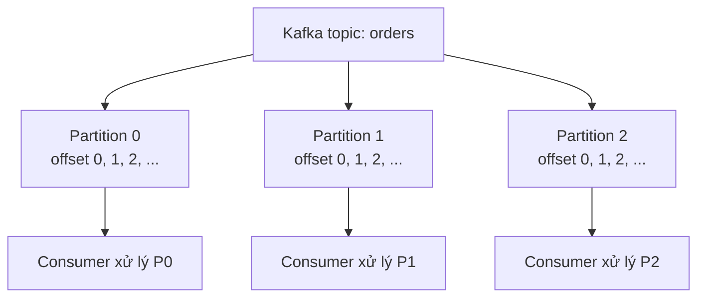
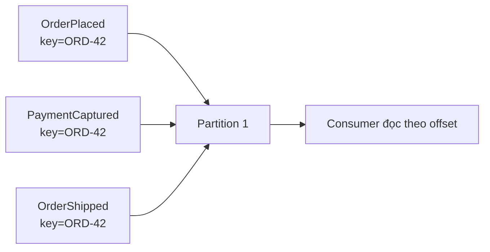
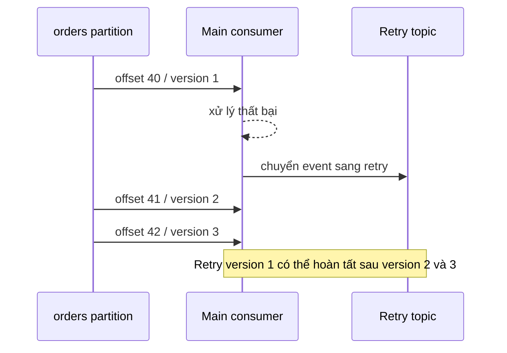

# Partition ordering

Trong hệ thống Spring Modulith có tích hợp Kafka, một application event có thể được externalize thành record để các consumer bên ngoài xử lý. Nhiều event của cùng một nghiệp vụ thường cần được quan sát theo đúng thứ tự: `OrderPlaced` phải đến trước `PaymentCaptured`, và `PaymentCaptured` phải đến trước `OrderShipped`. Kafka cung cấp thứ tự record trong từng partition. Vì vậy, thiết kế partition key, producer và consumer quyết định liệu thứ tự nghiệp vụ có được giữ trong luồng xử lý hay không.

Kafka không cung cấp một thứ tự toàn cục cho mọi record trên một topic có nhiều partition. Nếu hai event được ghi vào hai partition khác nhau, consumer có thể đọc hoặc hoàn tất chúng theo thứ tự khác nhau. Muốn giữ thứ tự cho một aggregate, các event liên quan cần được định tuyến vào cùng partition và consumer phải xử lý chúng theo thứ tự phù hợp.

## 1. Kafka bảo đảm thứ tự ở phạm vi nào?

Mỗi partition là một log append-only. Record được ghi vào partition có offset tăng dần; consumer đọc record theo thứ tự offset trong partition đó. Nếu record A được ghi trước record B vào cùng partition, consumer đọc A trước B.

Giả sử topic `orders` có ba partition:



Kafka có thể xử lý các partition song song. Không có quan hệ thứ tự được bảo đảm giữa offset 15 của partition 0 và offset 8 của partition 2. Thời điểm ghi, thời điểm consumer nhận và thời điểm nghiệp vụ hoàn tất ở hai partition có thể khác nhau.

| Phạm vi | Bảo đảm thứ tự |
| --- | --- |
| Một partition | Record được đọc theo thứ tự offset. |
| Nhiều partition trong cùng topic | Không có thứ tự tổng thể giữa các partition. |
| Nhiều topic | Không có thứ tự tổng thể giữa các topic. |
| Một business key được giữ trong cùng partition | Có thể giữ thứ tự các record của key đó trong partition, nếu producer và consumer không phá vỡ thứ tự. |

Do đó, trước khi cấu hình Kafka, hãy xác định chính xác đơn vị nghiệp vụ cần thứ tự. Đó có thể là `orderId`, `accountId`, `customerId` hoặc một aggregate ID khác. Không nên yêu cầu thứ tự toàn cục nếu nghiệp vụ chỉ cần thứ tự theo từng aggregate, vì cách làm đó sẽ hạn chế khả năng song song của hệ thống.

## 2. Partition key giữ các event liên quan cùng luồng

Kafka producer gửi record với một key. Với partitioner mặc định và key khác null, Kafka dùng key để chọn partition. Các record có cùng key thường được định tuyến tới cùng partition khi số partition và cấu hình partitioner không đổi.

Ví dụ, mọi event của cùng đơn hàng dùng `orderId` làm key:

```java
String key = event.orderId().toString();

kafkaTemplate.send("orders", key, event);
```

Nếu đơn hàng `ORD-42` phát ba event, các record có key `ORD-42` sẽ được đưa vào cùng partition theo partitioner đang cấu hình:



Điều này giúp consumer quan sát chuỗi sự kiện của một đơn hàng theo thứ tự ghi vào partition. Các đơn hàng khác có thể được phân phối sang partition khác và xử lý song song.

Chọn key theo ranh giới nhất quán của nghiệp vụ:

- `orderId` nếu cần giữ thứ tự vòng đời đơn hàng.
- `accountId` nếu các giao dịch của một tài khoản phải được áp dụng tuần tự.
- `aggregateId` nếu event được phát ra từ một aggregate có trạng thái cần cập nhật tuần tự.

Không chọn key ngẫu nhiên hoặc timestamp nếu các event cần được gom theo cùng aggregate. Nếu key thay đổi giữa các event, Kafka có thể định tuyến chúng sang các partition khác nhau và mất bảo đảm thứ tự theo nghiệp vụ.

Key cũng ảnh hưởng đến phân bố tải. Nếu một key có lưu lượng quá lớn, partition nhận key đó có thể trở thành điểm nóng. Hãy đo phân bố key và throughput trước khi thay đổi cách partition. Không chia một aggregate sang nhiều key chỉ để cân bằng tải nếu nghiệp vụ cần thứ tự tuần tự cho aggregate đó.

## 3. Thiết kế event để có thứ tự nghiệp vụ rõ ràng

Thứ tự offset phản ánh thứ tự record được ghi vào partition, không nhất thiết là thứ tự nghiệp vụ nếu producer phát event từ nhiều luồng cạnh tranh. Cần có quy tắc xác định thứ tự ở nơi sở hữu aggregate.

Một event nên mang định danh aggregate và metadata đủ để consumer kiểm tra tiến trình:

```java
import java.time.Instant;
import java.util.UUID;

public record OrderEvent(
        UUID eventId,
        UUID orderId,
        long aggregateVersion,
        Instant occurredAt,
        String eventType) {
}
```

`orderId` là partition key; `aggregateVersion` là số phiên bản tăng theo từng thay đổi trạng thái của đơn hàng. Consumer có thể dùng version để phát hiện event bị thiếu, trùng hoặc đến sai thứ tự nghiệp vụ. `occurredAt` hữu ích cho quan sát nhưng không nên được dùng một mình để sắp xếp vì đồng hồ giữa các instance có thể lệch và nhiều event có thể có timestamp giống nhau.

Một luồng hợp lệ có thể là:

| Aggregate version | Event | Ý nghĩa |
| --- | --- | --- |
| 1 | `OrderPlaced` | Đơn hàng được tạo. |
| 2 | `PaymentCaptured` | Thanh toán được xác nhận. |
| 3 | `OrderShipped` | Đơn hàng được bàn giao vận chuyển. |

Consumer nhận version 3 khi trạng thái hiện tại mới là version 1 có thể phát hiện version 2 đang thiếu. Tùy nghiệp vụ, consumer có thể chờ, truy vấn lại nguồn dữ liệu có thẩm quyền hoặc đưa event vào luồng xử lý lỗi. Không nên áp dụng event version 3 ngay rồi giả định trạng thái trung gian đã xảy ra.

Version aggregate là metadata nghiệp vụ do ứng dụng quản lý; Kafka offset là vị trí record trong một partition. Hai giá trị này không thay thế nhau. Offset không cho biết event có hợp lệ với trạng thái aggregate hay không.

## 4. Producer phải bảo toàn thứ tự khi gửi

Ngay cả khi dùng cùng partition key, producer vẫn cần tránh phát record sai thứ tự. Nếu nhiều thread hoặc nhiều instance đồng thời phát event cho cùng aggregate, thứ tự gửi tới Kafka có thể không phản ánh thứ tự thay đổi trạng thái đã commit.

Một số nguyên tắc phía producer:

1. Tạo event sau khi đã xác định thay đổi nghiệp vụ và aggregate version.
2. Dùng key ổn định theo aggregate cho tất cả event thuộc cùng luồng.
3. Phát event theo thứ tự version của aggregate.
4. Tránh gửi đồng thời các event cùng aggregate từ nhiều luồng không có cơ chế tuần tự hóa.
5. Bật producer idempotence và cấu hình retry phù hợp để giảm nguy cơ ghi trùng hoặc đảo thứ tự khi gửi lại.

Với Kafka producer, `enable.idempotence=true` giúp producer tránh tạo duplicate record do retry trong phạm vi bảo đảm của producer idempotence. Khi cấu hình `max.in.flight.requests.per.connection`, hãy tuân theo giới hạn tương thích của phiên bản Kafka client; với producer idempotent hiện đại, giá trị không vượt quá 5 được hỗ trợ để duy trì thứ tự khi retry. Cấu hình thực tế nên được quản lý tập trung và xác nhận theo phiên bản client/broker.

Ví dụ cấu hình Spring Boot cho Kafka producer:

```yaml
spring:
  kafka:
    producer:
      properties:
        enable.idempotence: true
        acks: all
        max.in.flight.requests.per.connection: 5
```

Đây là cấu hình minh họa cho Kafka producer. `acks=all` yêu cầu broker xác nhận theo cấu hình replication hiện hành; nó không tự tạo thứ tự nghiệp vụ giữa các producer độc lập. Idempotence cũng không loại bỏ duplicate do ứng dụng chủ động gửi cùng event nhiều lần với các lần gọi `send` khác nhau.

Nếu có nhiều producer instance cùng phát event cho một aggregate, Kafka không tự biết thứ tự commit của aggregate ở database. Cần có một cơ chế duy nhất hóa việc phát theo aggregate, chẳng hạn transactional outbox với thứ tự rõ ràng, một dispatcher phân vùng theo aggregate key hoặc cơ chế điều phối khác. Nếu không, producer A có thể gửi version 3 trước producer B gửi version 2.

## 5. Kết hợp Spring Modulith externalization với partition key

Spring Modulith cho phép đánh dấu application event để externalize. `@Externalized` xác định target logic; adapter tích hợp chịu trách nhiệm gửi event sang broker. Event Publication Registry theo dõi publication tới transactional listener và hỗ trợ phục hồi publication nội bộ theo cấu hình.

Ví dụ event trong module nguồn:

```java
import java.time.Instant;
import java.util.UUID;

import org.springframework.modulith.events.Externalized;

@Externalized("orders")
public record OrderPlaced(
        UUID eventId,
        UUID orderId,
        long aggregateVersion,
        Instant occurredAt) {
}
```

Trong ví dụ, `orders` là target externalization. Adapter Kafka phải được cấu hình để ánh xạ target này tới topic và chọn record key dựa trên `orderId`. Không nên giả định `@Externalized("orders")` tự động dùng `orderId` làm Kafka key; target và key là hai khái niệm riêng.

Nếu adapter đang dùng không cung cấp cách cấu hình key theo event payload, cần mở rộng adapter hoặc triển khai đường gửi phù hợp với kiến trúc. Dù chọn cách nào, hãy bảo đảm việc gửi ra broker nằm trong chiến lược publication đáng tin cậy, có xử lý lỗi và có thể quan sát. Không phát trực tiếp message từ một callback tùy ý sau commit rồi coi thao tác database và broker đã trở thành một transaction nguyên tử.

Event Publication Registry và Kafka partition giải quyết hai vấn đề khác nhau:

| Thành phần | Trách nhiệm |
| --- | --- |
| Event Publication Registry | Theo dõi publication của application event tới transactional listener trong ứng dụng Spring Modulith. |
| Externalization adapter | Chuyển application event được chọn sang broker theo cấu hình tích hợp. |
| Kafka partition | Lưu record theo thứ tự offset trong một luồng partition. |
| Partition key | Định tuyến các record liên quan vào cùng partition theo partitioner. |
| Consumer group | Chia partition giữa các instance của cùng workload logic. |

Có registry không đồng nghĩa đã bảo đảm thứ tự trong Kafka. Thứ tự còn phụ thuộc key, producer concurrency, adapter, retry và consumer processing.

## 6. Consumer cần xử lý tuần tự trong partition

Kafka consumer nhận record theo thứ tự offset trong từng partition. Nhưng ứng dụng có thể phá vỡ thứ tự sau khi nhận nếu gửi mỗi record sang một thread pool và xử lý bất đồng bộ không giới hạn.

Ví dụ lỗi thường gặp:

```java
@KafkaListener(topics = "orders", groupId = "order-projection")
void onOrderEvent(OrderEvent event) {
    executor.submit(() -> projection.apply(event));
}
```

Listener trả về ngay sau khi submit. Event version 2 có thể hoàn tất trước version 1 nếu tác vụ thứ nhất chậm hơn. Offset có thể được xác nhận theo thời điểm listener trả về trong khi công việc thực tế vẫn đang chạy, tùy acknowledgement mode và container configuration. Đây là rủi ro mất thứ tự và mất tác dụng phụ khi restart.

Nếu cần xử lý tuần tự theo partition, hãy xử lý đồng bộ trong listener hoặc dùng một cơ chế tuần tự hóa theo partition/key có quản lý offset và acknowledgement rõ ràng. Ví dụ đơn giản:

```java
import org.springframework.kafka.annotation.KafkaListener;
import org.springframework.stereotype.Component;

@Component
class OrderProjectionConsumer {

    private final OrderProjection projection;

    OrderProjectionConsumer(OrderProjection projection) {
        this.projection = projection;
    }

    @KafkaListener(topics = "orders", groupId = "order-projection")
    void consume(OrderEvent event) {
        projection.applyInTransaction(event);
    }
}
```

Với listener đồng bộ, container xử lý các record của một partition theo trình tự nhận. Các partition khác vẫn có thể được xử lý song song bằng các consumer thread khác nhau. `applyInTransaction` là phương thức minh họa; cần thiết kế transaction database và offset acknowledgement phù hợp để tránh commit offset trước khi thay đổi nghiệp vụ được lưu bền vững.

Trong Spring Kafka, thuộc tính `concurrency` của listener container có thể tạo nhiều consumer thread. Mỗi partition tại một thời điểm chỉ được gán cho một member trong group, vì vậy tăng concurrency chỉ giúp tới giới hạn số partition được gán. Đừng tăng concurrency hoặc offload bất đồng bộ mà không đánh giá tác động đến thứ tự và offset.

## 7. Rebalance và xử lý dở dang

Khi consumer group rebalance, partition có thể được thu hồi từ consumer hiện tại và giao cho member khác. Nếu consumer đang xử lý một record, ứng dụng cần bảo đảm record đó không bị xác nhận đã hoàn tất trước khi tác dụng phụ bền vững.

Các nguyên tắc quan trọng:

- Dừng nhận thêm công việc và hoàn tất hoặc hủy an toàn tác vụ đang xử lý khi partition bị thu hồi.
- Không commit offset vượt qua record chưa hoàn tất.
- Dùng idempotency để xử lý tình huống record được giao lại sau rebalance.
- Cấu hình thời gian xử lý, poll và heartbeat phù hợp với latency thực tế.
- Theo dõi rebalance liên tục vì rebalance thường xuyên làm giảm throughput và tăng xác suất xử lý lặp.

Nếu một record mất thời gian dài, hãy thiết kế listener container và worker phù hợp thay vì giữ partition trong trạng thái không poll quá lâu. Với xử lý bất đồng bộ, cần dùng cơ chế acknowledgement/offset thủ công đúng cách và chỉ xác nhận offset liên tục sau khi các record trước đó trong partition đã hoàn tất.

## 8. Retry có thể ảnh hưởng đến thứ tự

Retry là một trong những nguyên nhân phổ biến làm thay đổi thứ tự quan sát được. Giả sử partition chứa:

```text
offset 40: OrderPlaced (version 1)
offset 41: PaymentCaptured (version 2)
offset 42: OrderShipped (version 3)
```

Nếu consumer xử lý offset 40 thất bại, có hai hướng thường gặp:

**Retry trên partition gốc:** consumer tạm dừng tiến độ partition và thử lại record lỗi trước khi tiếp tục. Cách này có thể giữ thứ tự, nhưng một record lỗi sẽ chặn các record phía sau trong partition, kể cả các key khác.

**Retry topic hoặc dead-letter flow:** record lỗi được chuyển sang topic khác để thử lại sau. Consumer gốc có thể tiếp tục offset 41 và 42 trước khi version 1 được xử lý thành công. Điều này tăng khả năng tiếp tục xử lý nhưng có thể phá thứ tự nghiệp vụ theo aggregate.



Nếu thứ tự theo aggregate là bắt buộc, cần chọn retry strategy giữ được thứ tự cho key đó. Một số lựa chọn là retry blocking trên partition, tạm dừng partition/key, hoặc thiết kế retry topic có cơ chế giữ các event sau của cùng key cho đến khi event trước hoàn tất. Retry topic thông thường không tự bảo đảm thứ tự xuyên topic.

Với nghiệp vụ không yêu cầu strict ordering, có thể cho phép retry bất đồng bộ nhưng consumer phải kiểm tra aggregate version và trạng thái hiện tại. Event đến muộn hoặc thiếu version cần được phát hiện và xử lý có chủ đích, thay vì áp dụng mù quáng.

## 9. Idempotency và kiểm tra aggregate version

Giữ thứ tự record không đồng nghĩa loại bỏ duplicate. Producer retry, consumer restart, rebalance hoặc offset commit trễ đều có thể khiến một event được xử lý nhiều lần. Consumer cần idempotent để một event lặp lại không tạo ra thay đổi nghiệp vụ trùng.

Có thể lưu event ID đã xử lý cùng với cập nhật projection:

```sql
CREATE TABLE processed_event (
    consumer_name VARCHAR(100) NOT NULL,
    event_id UUID NOT NULL,
    processed_at TIMESTAMP NOT NULL,
    PRIMARY KEY (consumer_name, event_id)
);
```

Đây là schema minh họa do ứng dụng sở hữu. Trong cùng transaction, consumer ghi `event_id` vào bảng này và cập nhật dữ liệu nghiệp vụ. Nếu unique constraint báo event đã được xử lý, consumer có thể nhận diện duplicate theo quy tắc đã thiết kế.

Ngoài event ID, aggregate version giúp phát hiện event sai trình tự:

```java
void apply(OrderEvent event) {
    long currentVersion = repository.currentVersion(event.orderId());

    if (event.aggregateVersion() <= currentVersion) {
        return; // duplicate hoặc event cũ đã được áp dụng
    }

    if (event.aggregateVersion() != currentVersion + 1) {
        throw new MissingAggregateVersionException(
                event.orderId(), currentVersion, event.aggregateVersion());
    }

    repository.apply(event);
}
```

Đây là pseudocode minh họa; cần xử lý đồng thời bằng optimistic/pessimistic locking hoặc cập nhật có điều kiện để hai consumer không cùng áp dụng một version. Chính sách với version gap tùy nghiệp vụ: chờ event còn thiếu, đọc lại nguồn dữ liệu có thẩm quyền, retry hoặc chuyển sang luồng điều tra. Không bỏ qua gap nếu event chứa thay đổi trạng thái bắt buộc.

## 10. Thay đổi số partition có thể ảnh hưởng thứ tự

Với partitioner hash theo key, việc tăng số partition có thể làm cùng một key được ánh xạ sang partition khác so với trước. Record lịch sử vẫn nằm trong partition cũ, trong khi record mới của cùng aggregate có thể nằm trong partition mới. Khi consumer đọc song song hai partition, thứ tự tổng thể của aggregate không còn được bảo đảm.

Trước khi tăng partition cho topic có yêu cầu ordering, hãy đánh giá:

- Có aggregate nào cần thứ tự xuyên suốt toàn bộ vòng đời không?
- Consumer có thể nhận event cũ từ partition cũ và event mới từ partition mới cùng lúc không?
- Có thể tạm dừng producer/consumer, drain topic hoặc chuyển sang topic phiên bản mới không?
- Có thể dùng routing version/stable partition mapping để duy trì vị trí của aggregate không?
- Consumer có kiểm tra aggregate version để phát hiện event đến sai thứ tự không?

Nếu cần giữ thứ tự nghiêm ngặt, một phương án triển khai có thể là tạo topic mới với partition count đã tính trước, chuyển consumer/producer theo một giai đoạn được điều phối và giữ ánh xạ key ổn định. Việc chuyển đổi cần có kế hoạch cho record đang tồn đọng, offset và rollback. Không tăng partition như một thao tác tối ưu vô hại khi topic mang event có thứ tự nghiệp vụ.

## 11. Nhiều producer và thứ tự nhân quả

Kafka đảm bảo thứ tự append trong một partition, nhưng không tự thiết lập thứ tự nhân quả giữa các producer độc lập. Nếu hai instance cùng phát event cho một aggregate, thứ tự tới broker phụ thuộc thời điểm gửi và cách producer được điều phối.

Ví dụ database đã commit version 7 rồi version 8, nhưng producer xử lý bất đồng bộ khiến version 8 được gửi trước version 7. Cả hai record cùng key vẫn nằm trong một partition, nhưng offset phản ánh thứ tự broker nhận được: version 8 trước version 7.

Để tránh tình huống này:

- Phát event từ một luồng có thứ tự theo aggregate.
- Dùng transactional outbox có sequence/version và dispatcher đọc theo thứ tự cần thiết.
- Phân công một publisher/worker cho từng shard key khi cần tuần tự hóa.
- Đưa aggregate version vào event và để consumer phát hiện thứ tự bất thường.

Event Publication Registry của Spring Modulith theo dõi trạng thái publication nội bộ; nó không tự giải quyết race condition giữa nhiều publisher hoặc thiết lập thứ tự aggregate cho Kafka. Cơ chế tuần tự hóa cần được thiết kế ở tầng phát event/adapter và xác minh qua integration test.

## 12. Kiểm thử partition ordering

Unit test cho listener có thể xác nhận logic xử lý một event, nhưng không chứng minh key được định tuyến đúng hoặc consumer giữ thứ tự trong broker. Cần integration test với topic nhiều partition và consumer group thực tế.

Các kịch bản nên có:

- **Same key:** gửi nhiều event của cùng `orderId`; xác nhận chúng đi vào cùng partition và được đọc theo offset.
- **Different keys:** gửi nhiều aggregate; xác nhận chúng có thể được phân phối song song.
- **Producer retry:** mô phỏng lỗi gửi và xác nhận cấu hình producer không làm đảo thứ tự trong phạm vi bảo đảm đã chọn.
- **Concurrent producers:** hai producer cùng phát event cho một aggregate; xác nhận cơ chế tuần tự hóa hoặc phát hiện version gap hoạt động.
- **Consumer concurrency:** tăng số consumer thread; xác nhận record cùng partition không bị hoàn tất sai thứ tự.
- **Rebalance:** dừng một consumer khi đang xử lý; xác nhận record được giao lại an toàn và không bỏ qua tác dụng phụ.
- **Retry topic:** làm event giữa chuỗi thất bại; xác nhận hệ thống có xử lý đúng các event sau của cùng aggregate hay không.
- **Partition expansion:** kiểm tra chiến lược khi số partition thay đổi và key có thể được ánh xạ khác.
- **Duplicate delivery:** phát lại cùng event ID; xác nhận idempotency ngăn tác dụng phụ trùng.

Test cần kiểm tra cả partition/offset của record lẫn trạng thái nghiệp vụ cuối cùng. Chỉ assert rằng listener được gọi theo một thứ tự trong một test đơn luồng sẽ không phát hiện lỗi khi chạy nhiều partition, nhiều producer hoặc retry bất đồng bộ.

## 13. Quan sát thứ tự trong production

Khi điều tra event đến sai thứ tự, cần đủ metadata để tái dựng luồng:

- `eventId` và `aggregateId`/business key.
- `aggregateVersion` hoặc sequence number.
- Topic, partition và offset.
- Producer instance và thời điểm gửi.
- Consumer group, consumer member và thời điểm bắt đầu/kết thúc xử lý.
- Retry count, retry topic hoặc DLT reference.

Các metric hữu ích:

| Metric | Điều cần phát hiện |
| --- | --- |
| Consumer lag theo partition | Partition nào đang chậm hoặc bị nghẽn. |
| Processing duration theo key/partition | Một key nóng hoặc listener xử lý quá lâu. |
| Rebalance frequency | Consumer group không ổn định. |
| Retry/DLT count | Event lỗi làm chậm hoặc phá chuỗi xử lý. |
| Aggregate version gap | Consumer nhận thiếu hoặc sai thứ tự version. |
| Duplicate event count | Producer/consumer đang phát lại hoặc retry nhiều. |

Không ghi payload nhạy cảm chỉ để quan sát ordering. Metadata đủ để liên kết log và trace thường đã hữu ích. Cảnh báo nên gắn với tác động nghiệp vụ, ví dụ aggregate version gap tồn tại quá lâu hoặc partition lag vượt thời gian xử lý được chấp nhận.

## 14. Những nhầm lẫn thường gặp

- **Cùng topic không có nghĩa cùng thứ tự.** Thứ tự chỉ được bảo đảm trong một partition.
- **Cùng key không tự giải quyết mọi vấn đề.** Producer cạnh tranh, retry và consumer xử lý bất đồng bộ vẫn có thể làm sai thứ tự nghiệp vụ.
- **Timestamp không thay thế sequence.** Đồng hồ giữa các instance có thể lệch; dùng aggregate version nếu cần phát hiện thứ tự.
- **Tăng partition có thể thay đổi key mapping.** Cần đánh giá tác động tới aggregate đang có lịch sử trên topic.
- **Retry topic có thể phá thứ tự.** Event lỗi được xử lý sau event phía sau nếu consumer tiếp tục partition gốc.
- **Consumer concurrency không phải lúc nào cũng an toàn.** Xử lý bất đồng bộ không kiểm soát có thể hoàn tất record sai thứ tự.
- **Event Publication Registry không phải Kafka ordering mechanism.** Registry theo dõi publication nội bộ; Kafka partition và key quyết định thứ tự record ở broker.
- **Idempotency không đồng nghĩa ordering.** Idempotency chống tác dụng phụ trùng; aggregate version/sequence giúp phát hiện thứ tự sai hoặc thiếu.

## Checklist thiết kế ordering

- [ ] Đã xác định aggregate/business key cần giữ thứ tự.
- [ ] Tất cả event của cùng aggregate dùng partition key ổn định.
- [ ] Producer phát event theo aggregate version hoặc sequence đã xác định.
- [ ] Cấu hình producer idempotence/retry phù hợp với phiên bản Kafka client.
- [ ] Nhiều producer không thể gửi event cùng aggregate theo thứ tự ngẫu nhiên mà không bị phát hiện.
- [ ] Consumer không offload xử lý theo cách làm đảo thứ tự trong cùng partition.
- [ ] Retry/DLT strategy được đánh giá về tác động tới event phía sau cùng key.
- [ ] Consumer idempotent và có thể kiểm tra aggregate version.
- [ ] Đã đánh giá tác động của việc tăng partition hoặc thay đổi partitioner.
- [ ] Integration test bao phủ same key, concurrency, rebalance, retry và duplicate delivery.
- [ ] Có metric/log cho topic, partition, offset, aggregate version và retry.

Partition ordering là sự kết hợp giữa cách producer ghi record, cách Kafka định tuyến key và cách consumer hoàn tất công việc. Khi chọn đúng aggregate key, phát event theo version, kiểm soát concurrency và thiết kế retry phù hợp, hệ thống có thể giữ thứ tự cần thiết cho từng nghiệp vụ mà vẫn tận dụng xử lý song song giữa các partition.
