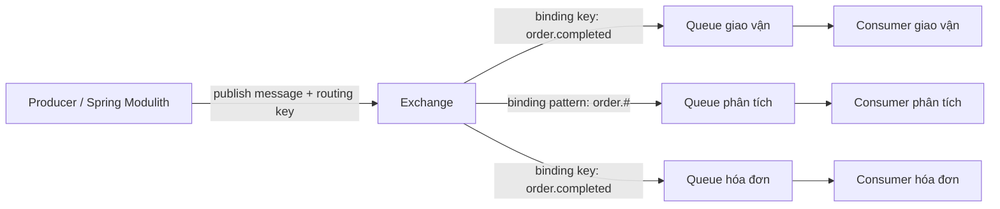

# Exchange trong RabbitMQ và Spring Modulith

Trong AMQP, producer gửi message tới một **exchange**. Exchange nhận message, đọc routing key và các binding đã khai báo, sau đó định tuyến message tới một hoặc nhiều queue phù hợp. Consumer đọc message từ queue; nó không đọc trực tiếp từ exchange. Vì vậy, exchange là điểm vào của luồng định tuyến, còn queue là nơi lưu message chờ consumer xử lý.

Khi dùng Spring Modulith để externalize application event qua RabbitMQ, giá trị đích trong `@Externalized` xác định exchange, còn phần routing key xác định cách exchange chọn queue. Hiểu rõ hai khái niệm này giúp thiết kế topology AMQP theo bounded context, phân phối một event tới đúng nhóm consumer và tránh tình trạng producer gửi thành công nhưng message không tới queue nào.

## 1. Exchange nằm ở đâu trong mô hình AMQP?

Một topology AMQP thường có bốn thành phần:

- **Producer:** ứng dụng tạo và gửi message.
- **Exchange:** nhận message và áp dụng quy tắc định tuyến.
- **Binding:** quy tắc kết nối exchange với queue (hoặc exchange khác), có thể chứa binding key và arguments.
- **Queue:** lưu message đã được định tuyến để consumer nhận và xử lý.



Ví dụ, module đơn hàng phát event `OrderCompleted` tới exchange `orders.events` với routing key `order.completed`. Queue giao vận và queue hóa đơn có thể cùng bind vào exchange với key `order.completed`, vì vậy mỗi queue nhận một bản message. Một queue phân tích có thể bind bằng pattern `order.#` để nhận nhiều loại event liên quan đến đơn hàng.

Exchange không phải nơi consumer lấy message và bản thân exchange không hoạt động như một kho lưu message. Nếu không có binding nào phù hợp, message có thể trở thành unroutable. Khả năng lưu bền vững nằm ở queue và message được publish với delivery mode phù hợp, theo cấu hình của broker.

## 2. Binding và routing key

Binding là quy tắc nối một exchange với đích nhận. Với queue binding, quy tắc này cho RabbitMQ biết message nào được chuyển tới queue. Binding có thể có:

- Tên exchange nguồn.
- Tên queue hoặc exchange đích.
- Binding key (nếu exchange type sử dụng routing key).
- Arguments (ví dụ điều kiện đối với headers exchange).

Routing key là giá trị producer gắn vào message khi publish. Binding key là giá trị hoặc pattern được khai báo trên binding. Exchange so sánh hai giá trị theo thuật toán của exchange type.

Ví dụ với direct exchange:

| Thành phần | Giá trị |
| --- | --- |
| Exchange | `orders.direct` |
| Queue | `shipping.order-completed` |
| Binding key | `order.completed` |
| Routing key của message | `order.completed` |
| Kết quả | Message được route tới queue |

Nếu producer gửi routing key `order.cancelled`, binding trên không khớp. Nếu nhiều queue có binding key giống nhau, direct exchange có thể route message tới tất cả queue khớp, không phải chỉ một queue duy nhất.

## 3. Bốn exchange type thường dùng

RabbitMQ cung cấp bốn exchange type chuẩn thường gặp: `direct`, `topic`, `fanout` và `headers`. Exchange type quyết định cách binding được dùng để định tuyến.

### Direct exchange

Direct exchange route message khi routing key của message khớp chính xác với binding key của queue. Đây là lựa chọn phù hợp khi muốn định tuyến theo tên sự kiện hoặc nhóm công việc đã xác định.

Ví dụ:

```text
Exchange: orders.direct

Queue shipping.order-completed
  binding key: order.completed

Queue billing.order-completed
  binding key: order.completed

Queue order-cancelled
  binding key: order.cancelled
```

Message có routing key `order.completed` sẽ tới hai queue đầu. Message có key `order.cancelled` sẽ tới queue thứ ba. Nếu nhiều queue cùng bind với một key, mỗi queue đều nhận bản sao riêng.

### Topic exchange

Topic exchange so khớp routing key theo từng segment được ngăn cách bởi dấu chấm (`.`). Binding key có thể dùng hai wildcard:

- `*` khớp chính xác một segment.
- `#` khớp không segment hoặc nhiều segment.

Ví dụ với exchange `orders.events`:

| Queue | Binding pattern | Message được nhận |
| --- | --- | --- |
| `shipping.events` | `order.completed` | Chỉ `order.completed` |
| `order.lifecycle` | `order.*` | `order.created`, `order.completed`, `order.cancelled` |
| `all.order.events` | `order.#` | `order`, `order.completed`, `order.item.added` |
| `all.completed` | `#.completed` | Các key kết thúc bằng segment `completed` |

Topic exchange phù hợp khi có nhiều loại event theo một quy ước tên phân cấp. Ví dụ `order.completed`, `order.cancelled`, `payment.authorized` và `payment.failed`. Consumer có thể đăng ký một pattern rộng hoặc một event cụ thể mà không cần producer biết danh sách consumer.

### Fanout exchange

Fanout exchange bỏ qua routing key và gửi một bản message tới mọi queue đang bind với exchange. Nó phù hợp cho broadcast, ví dụ phát một event tới các hệ thống audit, analytics và notification cùng lúc.

```text
Exchange: platform.events (fanout)

Queue audit.events       <- nhận mọi message
Queue analytics.events   <- nhận mọi message
Queue notification.events <- nhận mọi message
```

Fanout exchange không lọc theo loại event. Nếu mỗi consumer chỉ cần một tập event nhỏ, hãy cân nhắc topic exchange hoặc tách exchange theo bounded context để tránh gửi quá nhiều message không cần thiết.

### Headers exchange

Headers exchange định tuyến dựa trên message headers và arguments của binding thay vì routing key. Binding có thể khai báo các header cần khớp và chế độ `x-match`:

- `all`: mọi header được khai báo phải khớp.
- `any`: chỉ cần một header được khai báo khớp.

Ví dụ một queue chỉ nhận message có `event-category=order` và `region=apac`. Headers exchange hữu ích khi điều kiện định tuyến dựa trên metadata; nếu chỉ cần phân loại theo tên event, direct hoặc topic exchange thường dễ đọc hơn.

### Chọn exchange type

| Nhu cầu | Exchange type nên xem xét | Lý do |
| --- | --- | --- |
| Định tuyến theo key chính xác | Direct | Quy tắc đơn giản, dễ kiểm tra |
| Định tuyến theo nhóm event và wildcard | Topic | Hỗ trợ pattern theo segment |
| Phát cùng message tới mọi consumer độc lập | Fanout | Broadcast, bỏ qua routing key |
| Định tuyến dựa trên metadata header | Headers | Điều kiện dựa trên header và `x-match` |

Không có exchange type nào tự tạo queue. Producer và consumer vẫn cần thống nhất topology, binding và chính sách lưu trữ ở broker.

## 4. Default exchange

RabbitMQ có một default exchange đặc biệt, có tên rỗng (`""`) và có kiểu direct. Khi một queue được tạo, RabbitMQ tự động bind queue đó vào default exchange bằng tên queue làm routing key. Vì vậy, producer có thể publish trực tiếp tới queue bằng cách gửi tới exchange rỗng và đặt routing key bằng tên queue.

Ví dụ về mặt AMQP:

```text
exchange    = ""
routing key = "shipping.order-completed"
```

Message được route tới queue `shipping.order-completed` nhờ binding mặc định. Cơ chế này tiện cho trường hợp gửi tới một queue cụ thể, nhưng không thay thế topology exchange có tên khi cần định tuyến linh hoạt tới nhiều queue. Với event integration, một named exchange thường thể hiện ranh giới và quy tắc định tuyến rõ ràng hơn.

## 5. Exchange và queue có các thuộc tính gì?

Khi khai báo exchange, các thuộc tính quan trọng gồm:

- **Name:** tên duy nhất trong một virtual host.
- **Type:** `direct`, `topic`, `fanout`, `headers` hoặc exchange type do plugin cung cấp.
- **Durable:** exchange có được giữ lại qua broker restart hay không.
- **Auto-delete:** exchange có bị xóa khi binding cuối cùng bị gỡ hay không.
- **Internal:** exchange chỉ được dùng để định tuyến nội bộ từ exchange khác, không nhận publish trực tiếp từ client.
- **Arguments:** tham số mở rộng như alternate exchange hoặc tính năng riêng của exchange type.

Queue có thuộc tính riêng như durable, exclusive, auto-delete, TTL, giới hạn độ dài, dead-letter exchange và loại queue. Cần phân biệt độ bền của từng thành phần:

| Cấu hình | Ý nghĩa |
| --- | --- |
| Durable exchange | Metadata của exchange tồn tại qua broker restart |
| Durable queue | Queue được khôi phục sau broker restart |
| Persistent message | Message được publish với delivery mode persistent để broker có thể lưu bền vững theo chính sách queue |
| Replicated/quorum queue | Queue có cơ chế sao chép và chịu lỗi theo semantics của loại queue |

Durable exchange không lưu message. Muốn message còn lại sau restart, cần queue phù hợp và publish message persistent; với yêu cầu độ sẵn sàng cao, cần chọn loại queue và replication policy phù hợp. Độ bền end-to-end còn phụ thuộc acknowledgement, publisher confirms, broker storage và consumer acknowledgement.

## 6. Khai báo exchange, queue và binding bằng Spring AMQP

Spring AMQP cung cấp các abstraction `Exchange`, `Queue` và `Binding`. Có thể khai báo chúng thành Spring beans để `RabbitAdmin` tự động tạo topology trên broker khi kết nối được thiết lập.

Ví dụ dùng topic exchange:

```java
@Configuration
class OrderRabbitTopology {

    @Bean
    TopicExchange orderEventsExchange() {
        return new TopicExchange("orders.events", true, false);
    }

    @Bean
    Queue shippingOrderEventsQueue() {
        return QueueBuilder.durable("shipping.order-events").build();
    }

    @Bean
    Binding shippingOrderCompletedBinding(
            Queue shippingOrderEventsQueue,
            TopicExchange orderEventsExchange
    ) {
        return BindingBuilder
                .bind(shippingOrderEventsQueue)
                .to(orderEventsExchange)
                .with("order.completed");
    }
}
```

Trong ví dụ này, exchange `orders.events` là durable và không auto-delete. Queue `shipping.order-events` là durable. Binding chỉ route message có routing key `order.completed` tới queue đó.

Khi có nhiều queue hoặc binding, có thể khai báo từng bean riêng hoặc gom các đối tượng `Declarable` vào `Declarables`. Ví dụ:

```java
@Configuration
class OrderEventBindings {

    @Bean
    Declarables orderEventTopology() {
        TopicExchange exchange = new TopicExchange("orders.events", true, false);

        Queue shipping = QueueBuilder.durable("shipping.order-events").build();
        Queue analytics = QueueBuilder.durable("analytics.order-events").build();

        return new Declarables(
                exchange,
                shipping,
                analytics,
                BindingBuilder.bind(shipping).to(exchange).with("order.completed"),
                BindingBuilder.bind(analytics).to(exchange).with("order.#")
        );
    }
}
```

Khi `RabbitAdmin` được cấu hình và tự động khai báo được bật, các bean topology được khai báo lên broker khi kết nối được thiết lập, bao gồm các lần khôi phục kết nối theo cơ chế của Spring AMQP. Trong môi trường nhiều broker hoặc topology được quản lý bởi đội vận hành, cần cấu hình rõ admin nào được phép khai báo đối tượng nào.

### Khai báo topology ngoài ứng dụng

Không bắt buộc ứng dụng phải tự tạo exchange và queue. Một số tổ chức quản lý topology bằng Terraform, Ansible, Helm, RabbitMQ definitions hoặc quy trình vận hành riêng. Khi đó, ứng dụng chỉ cần biết tên exchange và routing key đã thống nhất; quyền khai báo có thể bị giới hạn để tránh ứng dụng vô tình thay đổi topology dùng chung.

Điều quan trọng là exchange, queue và binding phải tồn tại trước khi producer publish event và consumer bắt đầu nhận message. Cần quản lý topology như một phần của hợp đồng tích hợp, có versioning và quy trình thay đổi an toàn.

## 7. Externalize event tới exchange bằng Spring Modulith

Spring Modulith hỗ trợ externalization qua AMQP bằng artifact `spring-modulith-events-amqp`, sử dụng Spring AMQP để tương tác với broker. Ứng dụng cần khai báo dependency Spring Rabbit phù hợp với môi trường, chẳng hạn `spring-boot-starter-amqp` trong ứng dụng Spring Boot dùng RabbitMQ.

Ví dụ dependency:

```xml
<dependency>
    <groupId>org.springframework.modulith</groupId>
    <artifactId>spring-modulith-events-amqp</artifactId>
</dependency>

<dependency>
    <groupId>org.springframework.boot</groupId>
    <artifactId>spring-boot-starter-amqp</artifactId>
</dependency>
```

Quản lý phiên bản Spring Modulith thông qua BOM tương thích với Spring Boot của dự án. Dependency cụ thể cần khớp với dòng phiên bản đang dùng.

Đánh dấu event cần externalize và chỉ rõ exchange cùng routing key bằng cú pháp `$target::$key` trong `@Externalized`:

```java
import java.time.Instant;
import java.util.UUID;

import org.springframework.modulith.events.Externalized;

@Externalized("orders.events::order.completed")
public record OrderCompleted(
        UUID eventId,
        UUID orderId,
        Instant occurredAt
) {}
```

Với AMQP integration:

- `orders.events` là routing target, được dùng làm tên exchange.
- `order.completed` là routing key gửi tới exchange.
- Binding trên exchange quyết định queue nào nhận message.

Publisher chỉ phát application event:

```java
@Service
class OrderApplicationService {

    private final ApplicationEventPublisher events;
    private final OrderRepository orders;

    OrderApplicationService(
            ApplicationEventPublisher events,
            OrderRepository orders
    ) {
        this.events = events;
        this.orders = orders;
    }

    @Transactional
    public void complete(UUID orderId) {
        Order order = orders.findById(orderId).orElseThrow();
        order.complete();

        events.publishEvent(new OrderCompleted(
                UUID.randomUUID(),
                order.getId(),
                Instant.now()
        ));
    }
}
```

Trong ví dụ này, Spring Modulith externalize event tới exchange `orders.events` với routing key `order.completed`. Queue giao vận nhận message vì binding khớp. Queue analytics có binding `order.#` cũng nhận message đó. Producer không cần biết queue cụ thể hoặc danh sách consumer.

Giá trị `$target::$key` là cú pháp cấu hình định tuyến của Spring Modulith. Cả target và key có thể được biểu diễn bằng SpEL theo event instance khi cần routing động. Ví dụ:

```java
@Externalized("orders.events::#{#this.orderType}")
public record OrderCompleted(
        UUID orderId,
        String orderType
) {}
```

Routing key động cần được giới hạn trong tập giá trị hợp lệ. Không nên lấy trực tiếp chuỗi tùy ý từ input bên ngoài làm routing key nếu điều đó có thể làm message đi vào queue ngoài dự kiến hoặc tạo quá nhiều nhánh topology.

## 8. Exchange và ranh giới trách nhiệm của consumer

Một exchange có thể route cùng một message tới nhiều queue. Mỗi queue là một luồng lưu trữ độc lập, có consumer, tốc độ xử lý và chính sách retry riêng.

Ví dụ, `OrderCompleted` được route tới:

- Queue giao vận để tạo yêu cầu vận chuyển.
- Queue hóa đơn để tạo chứng từ.
- Queue analytics để cập nhật chỉ số.

Ba consumer có thể xử lý cùng một event ở các thời điểm khác nhau. Producer không cần chờ cả ba consumer hoàn thành. Nếu một consumer dừng, message trong queue của nó có thể chờ theo durability và retention policy, trong khi các consumer khác tiếp tục xử lý.

Đây là lý do nên dùng một queue riêng cho mỗi nhóm consumer độc lập. Nếu nhiều instance của cùng một consumer cùng đọc một queue, broker thường phân phối message giữa các instance theo cơ chế consumer của queue. Nếu nhiều hệ thống độc lập cùng bind vào một queue, chúng có thể cạnh tranh nhận message và mỗi message chỉ được một consumer xử lý theo cơ chế phân phối queue; điều này không phải broadcast.

Muốn mỗi hệ thống nhận bản sao của event, hãy tạo queue riêng và bind từng queue vào exchange. Exchange fanout hoặc topic/direct với nhiều binding phù hợp sẽ route một bản sao tới mỗi queue.

## 9. Message không được route tới queue nào

Một message có thể được publish tới exchange hợp lệ nhưng không có binding nào khớp. Khi đó, message là **unroutable**. Đây là lỗi topology hoặc routing, khác với lỗi kết nối broker.

Các nguyên nhân thường gặp:

- Producer dùng sai tên exchange.
- Routing key không khớp với binding key hoặc pattern.
- Queue chưa được tạo hoặc binding chưa được khai báo.
- Producer và consumer đang kết nối tới các virtual host khác nhau.
- Thay đổi topology chưa được triển khai đồng bộ.

RabbitMQ có thể xử lý message unroutable theo nhiều cách tùy publish flags và topology. Nếu producer không yêu cầu xử lý message không route được, message có thể bị loại bỏ. Có thể dùng publisher returns/mandatory publishing để nhận thông báo message không route tới queue, hoặc cấu hình alternate exchange để chuyển message không khớp sang một exchange dự phòng.

### Alternate exchange

Alternate exchange là một exchange dự phòng được cấu hình trên exchange chính. Khi exchange chính không route được message tới đích phù hợp, RabbitMQ thử route message qua alternate exchange. Cách này hữu ích để thu thập message không có binding phù hợp hoặc hỗ trợ thay đổi topology.

Ví dụ topology:

```text
orders.events (topic)
  alternate-exchange: orders.unrouted
  binding: order.completed -> shipping.order-events

orders.unrouted (fanout)
  binding: all -> orders.unrouted.messages
```

Alternate exchange xử lý tình huống không route được tại exchange. Nó khác dead-letter exchange (DLX), thường được cấu hình ở queue để nhận message bị dead-letter do reject, hết TTL hoặc vượt giới hạn queue. Hai cơ chế có thể cùng tồn tại nhưng giải quyết những tình huống khác nhau.

## 10. Durability, publisher confirms và acknowledgement

Để event đi qua broker đáng tin cậy, cần xét cả producer, exchange, queue và consumer.

- **Durable exchange:** giữ metadata exchange qua restart.
- **Durable queue:** giữ queue declaration qua restart.
- **Persistent message:** đánh dấu message cần lưu bền vững theo semantics broker.
- **Publisher confirm:** producer nhận xác nhận từ broker về quá trình publish theo cơ chế AMQP.
- **Consumer acknowledgement:** consumer xác nhận message đã xử lý để broker có thể loại khỏi queue theo semantics tương ứng.

Publisher confirm không đồng nghĩa consumer đã xử lý thành công. Consumer acknowledgement cũng không thay thế publisher confirm. Hai tín hiệu nằm ở hai chặng khác nhau.

Với Spring Modulith, Event Publication Registry theo dõi việc externalize và cho phép resubmit các publication chưa hoàn tất qua API tương ứng. Điều này giúp phục hồi khi tương tác với broker thất bại. Cần cấu hình persistent registry và kiểm tra adapter, publisher confirm cùng transaction behavior của phiên bản đang dùng. Không nên mặc định annotation `@Externalized` tạo exactly-once delivery xuyên suốt database, broker và consumer.

Khi broker đã nhận message nhưng producer mất kết nối trước khi nhận confirm, producer có thể gửi lại. Consumer vì vậy cần idempotent, ví dụ ghi `eventId` vào inbox với unique constraint trong cùng transaction với thay đổi nghiệp vụ nội bộ.

## 11. Kiểm thử exchange topology

Kiểm thử một phương thức publisher được gọi chưa chứng minh message tới đúng queue. Cần xác nhận topology và routing trên broker thực tế hoặc môi trường integration cô lập.

Các tình huống nên kiểm tra:

| Tình huống | Kết quả mong đợi |
| --- | --- |
| Direct exchange, key khớp | Message tới queue có binding key bằng routing key |
| Direct exchange, key không khớp | Message không tới queue đó; cơ chế unroutable được quan sát theo cấu hình |
| Topic exchange, `order.*` | Nhận `order.created` và `order.completed`, không nhận `order.item.added` |
| Topic exchange, `order.#` | Nhận các routing key bắt đầu bằng `order` theo quy tắc segment |
| Fanout exchange | Mọi queue được bind đều nhận một bản sao |
| Headers exchange | Chỉ queue có binding arguments khớp `x-match` nhận message |
| Nhiều queue | Mỗi queue độc lập nhận bản sao theo binding tương ứng |
| Exchange không tồn tại | Publish bị từ chối theo giao thức; lỗi được quan sát |
| Queue/binding chưa được tạo | Message có thể unroutable; cảnh báo và alternate exchange/return hoạt động nếu cấu hình |
| Broker restart | Durable topology được khai báo/khôi phục theo cấu hình |
| Consumer xử lý lặp | Idempotency ngăn tác động nghiệp vụ trùng |

Có thể dùng Testcontainers hoặc broker integration environment để kiểm tra exchange, queue, binding và listener thật. Unit test với mock chỉ phù hợp để xác nhận logic tạo routing key hoặc lựa chọn event, không đủ để xác nhận thuật toán định tuyến của broker.

## 12. Quan sát exchange và topology

Khi vận hành RabbitMQ, nên theo dõi:

- Danh sách exchange, loại exchange, durable và arguments.
- Binding count và routing key/pattern của từng exchange.
- Queue depth, consumer count và message publish/deliver/ack rate.
- Số message unroutable và kết quả publisher returns.
- Số message được chuyển qua alternate exchange hoặc dead-letter exchange.
- Connection/channel errors và lỗi declaration topology.
- Publication chưa hoàn tất trong Event Publication Registry của ứng dụng.

RabbitMQ Management UI và metrics của broker giúp kiểm tra exchange, queue, binding và luồng message. Log ứng dụng nên có event type, `eventId`, exchange, routing key và correlation ID. Không ghi credential hoặc toàn bộ payload chứa dữ liệu nhạy cảm.

Một dấu hiệu cần chú ý là producer publish thành công nhưng queue depth không tăng. Khi đó, hãy kiểm tra binding và routing key, không chỉ kiểm tra trạng thái connection. Nếu exchange declaration thất bại vì exchange cùng tên đã tồn tại với loại hoặc thuộc tính không tương thích, cần thống nhất topology thay vì liên tục restart producer.

## 13. Những lỗi thiết kế thường gặp

| Lỗi | Hệ quả | Cách xử lý |
| --- | --- | --- |
| Nghĩ exchange lưu message | Không hiểu vì sao message không được giữ lại khi chưa có queue | Dùng queue để lưu message; exchange chỉ định tuyến |
| Publish tới exchange nhưng không tạo binding | Message không tới consumer nào | Khai báo và kiểm thử binding |
| Dùng direct exchange nhưng kỳ vọng wildcard | Routing key không khớp pattern | Chọn topic exchange khi cần `*` hoặc `#` |
| Dùng fanout khi cần lọc theo event type | Consumer nhận nhiều message không cần thiết | Chọn topic/direct hoặc tách exchange |
| Nhiều consumer độc lập dùng chung một queue để mong broadcast | Các consumer cạnh tranh nhận message | Tạo queue riêng cho từng nhóm consumer |
| Chỉ khai báo durable exchange | Message vẫn có thể mất vì queue/message không bền vững | Cấu hình queue durable, persistent message và confirms phù hợp |
| Không xử lý unroutable message | Message có thể bị loại bỏ mà producer không nhận ra | Mandatory/returns hoặc alternate exchange |
| Để ứng dụng tự khai báo topology không kiểm soát | Khai báo xung đột hoặc thay đổi topology dùng chung | Quản lý topology có chủ đích và phân quyền |
| Đổi exchange type hoặc durability trên exchange đang tồn tại | Broker từ chối declaration không tương thích | Thực hiện migration topology có kế hoạch |
| Coi publisher confirm là consumer acknowledgement | Hiểu sai trạng thái xử lý ở hệ thống nhận | Theo dõi riêng producer confirm và consumer ack |

## 14. Quy trình thiết kế exchange cho event

Khi thiết kế một luồng Spring Modulith externalize qua RabbitMQ, hãy thực hiện theo thứ tự:

1. Xác định bounded context và nhóm consumer cần nhận event.
2. Chọn named exchange thể hiện phạm vi tích hợp, ví dụ `orders.events`.
3. Chọn exchange type theo cách định tuyến: direct, topic, fanout hoặc headers.
4. Quy ước routing key theo tên event hoặc nhóm nghiệp vụ, ví dụ `order.completed`.
5. Tạo queue riêng cho mỗi nhóm consumer độc lập.
6. Khai báo binding và xác định chính sách unroutable/alternate exchange.
7. Đánh dấu event bằng `@Externalized("exchange::routing-key")`.
8. Cấu hình `spring-modulith-events-amqp`, Spring Rabbit và broker connection phù hợp.
9. Chọn durability, publisher confirms, queue type, message persistence và consumer acknowledgement theo yêu cầu.
10. Kiểm thử routing, restart, message không khớp binding, retry và consumer idempotency.
11. Theo dõi queue depth, unroutable rate, publication chưa hoàn tất và lỗi topology.

Exchange là trung tâm định tuyến của RabbitMQ. Khi exchange type, routing key và binding được thiết kế rõ, Spring Modulith có thể externalize application event tới đúng exchange mà không cần publisher biết các queue hay consumer cụ thể. Mỗi consumer giữ queue và vòng đời xử lý riêng, nhờ đó các hệ thống có thể nhận cùng một sự kiện theo cách độc lập, dễ mở rộng và dễ vận hành.

## Tài liệu tham khảo

- [Spring Modulith – Working with Application Events](https://docs.spring.io/spring-modulith/reference/events.html)
- [Spring AMQP – AMQP Abstractions](https://docs.spring.io/spring-amqp/reference/4.2/amqp/abstractions.html)
- [Spring AMQP – Configuring the Broker](https://docs.spring.io/spring-amqp/reference/amqp/broker-configuration.html)
- [RabbitMQ – Exchanges](https://www.rabbitmq.com/docs/exchanges)
- [RabbitMQ – AMQP 0-9-1 Model Explained](https://www.rabbitmq.com/tutorials/amqp-concepts)
- [RabbitMQ – Alternate Exchanges](https://www.rabbitmq.com/docs/ae)
