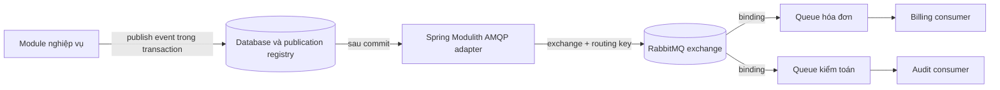

# Binding và routing key

*Định tuyến application event đến queue bằng RabbitMQ và AMQP*

Khi ứng dụng Spring Modulith gửi một application event ra RabbitMQ, broker cần biết queue nào sẽ nhận message đó. RabbitMQ thực hiện việc này thông qua **exchange**, **binding** và **routing key**. Producer gửi message đến exchange cùng routing key; binding nối exchange với queue và quy định message nào được chuyển vào queue đó.

Ba thành phần này tách trách nhiệm phát sự kiện khỏi cấu trúc tiêu thụ. Module nghiệp vụ chỉ công bố một event có ý nghĩa; adapter AMQP chuyển event thành message; topology RabbitMQ quyết định queue nhận message. Nhờ vậy, có thể thêm nhóm consumer hoặc thay đổi cách định tuyến mà không buộc service nghiệp vụ phải biết tên từng queue.

## 1. Vai trò của exchange, binding và routing key

Trong AMQP 0-9-1, producer publish message vào exchange. Exchange không lưu message như queue; nó áp dụng loại exchange và các binding để định tuyến message đến queue phù hợp.

- **Exchange** là điểm nhận message từ producer. Loại exchange quyết định cách xét routing key hoặc header.
- **Queue** lưu message chờ consumer nhận và xử lý.
- **Binding** là liên kết giữa exchange và queue, có thể kèm binding key hoặc điều kiện binding.
- **Routing key** là chuỗi producer gắn vào message khi publish. Exchange so sánh routing key với binding theo quy tắc của loại exchange.
- **Binding key** là giá trị hoặc pattern gắn với binding. Với direct exchange, nó thường phải khớp chính xác routing key; với topic exchange, nó là pattern có wildcard.

Ví dụ, producer gửi `OrderCompleted` đến exchange `orders.events` với routing key `orders.completed`. Queue hóa đơn và queue phân tích có thể được bind với cùng điều kiện để mỗi nhóm nhận một bản message độc lập.

```text
Producer
   |
   | message, routing key = orders.completed
   v
+--------------------------+
| Exchange: orders.events  |
+--------------------------+
       | binding: orders.completed
       +--------------------------> Queue: billing.order-completed
       |
       | binding: orders.completed
       +--------------------------> Queue: analytics.order-events
```

Binding được khai báo ở broker hoặc qua công cụ quản trị/API cấu hình. Producer không tự tạo queue chỉ bằng cách đặt routing key; exchange chỉ định tuyến đến queue đã tồn tại và có binding phù hợp.

## 2. Direct exchange: khớp chính xác

Direct exchange chuyển message đến queue có binding key trùng chính xác với routing key. Đây là lựa chọn phù hợp khi muốn định tuyến theo một loại event hoặc một đích cụ thể.

Ví dụ:

| Routing key từ producer | Binding key của queue | Kết quả |
|---|---|---|
| `orders.completed` | `orders.completed` | Khớp |
| `orders.cancelled` | `orders.completed` | Không khớp |
| `orders.completed.eu` | `orders.completed` | Không khớp |

Một exchange có thể có nhiều queue được bind cùng một key. Khi đó message được định tuyến đến các queue đó, mỗi queue có vòng đời tiêu thụ riêng. Direct exchange không có nghĩa là chỉ một queue được nhận message; nó chỉ quy định cách so khớp chính xác.

## 3. Topic exchange: định tuyến theo pattern

Topic exchange so khớp routing key với binding key dạng pattern. Routing key thường gồm các đoạn từ (word) phân tách bằng dấu chấm, chẳng hạn `orders.payment.failed`.

Hai wildcard chính:

- `*` khớp đúng một đoạn.
- `#` khớp không hoặc nhiều đoạn.

Ví dụ:

| Binding key | Routing key | Khớp? | Giải thích |
|---|---|---|---|
| `orders.*` | `orders.completed` | Có | `*` khớp đoạn `completed` |
| `orders.*` | `orders.payment.failed` | Không | Có hai đoạn sau `orders` |
| `orders.#` | `orders.completed` | Có | `#` khớp một đoạn |
| `orders.#` | `orders.payment.failed` | Có | `#` khớp nhiều đoạn |
| `*.completed` | `orders.completed` | Có | Mỗi wildcard khớp một đoạn |
| `*.completed` | `eu.orders.completed` | Không | Có thêm một đoạn ở đầu |

Topic exchange phù hợp khi hệ thống có quy ước routing key phân cấp. Ví dụ `orders.completed`, `orders.cancelled`, `orders.payment.failed`; một queue kiểm toán có thể bind `orders.#`, trong khi queue hóa đơn chỉ bind `orders.completed`.

Hãy thống nhất quy ước đoạn từ trước khi tạo binding. Nếu routing key dùng dấu chấm không nhất quán, pattern sẽ khó hiểu và có thể nhận thừa hoặc bỏ sót message. Không đưa thông tin bí mật hoặc dữ liệu cá nhân vào routing key vì nó thường hiển thị trong công cụ quản trị và log broker.

## 4. Fanout và headers exchange

**Fanout exchange** bỏ qua routing key và gửi message đến mọi queue được bind với exchange. Mô hình này phù hợp khi mọi queue đăng ký đều cần nhận cùng một loại thông báo, ví dụ sự kiện vô hiệu hóa cache hoặc thông báo cấu hình.

**Headers exchange** xét header của message thay vì routing key. Binding có thể yêu cầu tất cả điều kiện khớp (`x-match=all`) hoặc chỉ cần một điều kiện khớp (`x-match=any`). Mô hình này hữu ích khi định tuyến dựa trên metadata có cấu trúc, nhưng thường phức tạp hơn topic exchange nếu chỉ cần phân loại theo chủ đề.

| Loại exchange | Quy tắc chính | Khi nên dùng |
|---|---|---|
| Direct | Routing key bằng binding key | Đích hoặc loại event có tên chính xác |
| Topic | Routing key khớp pattern `*` và `#` | Chủ đề phân cấp và nhiều nhóm nhận |
| Fanout | Gửi đến mọi queue được bind | Phát thông báo đến tất cả subscriber |
| Headers | So khớp các header theo điều kiện | Định tuyến theo metadata nhiều thuộc tính |

RabbitMQ cũng có default exchange không tên (`""`). Đây là direct exchange được broker cung cấp sẵn; mỗi queue tự động có binding với routing key bằng chính tên queue. Producer có thể publish đến default exchange và dùng tên queue làm routing key để gửi trực tiếp đến queue đó. Cách này tiện cho trường hợp đơn giản, nhưng làm producer biết tên queue và giảm mức tách biệt giữa producer với topology.

## 5. Khai báo topology bằng Spring AMQP

Trong Spring AMQP, có thể khai báo exchange, queue và binding bằng các bean. Ví dụ sau tạo topic exchange `orders.events`, queue hóa đơn và queue kiểm toán:

```java
import org.springframework.amqp.core.Binding;
import org.springframework.amqp.core.BindingBuilder;
import org.springframework.amqp.core.Queue;
import org.springframework.amqp.core.QueueBuilder;
import org.springframework.amqp.core.TopicExchange;
import org.springframework.context.annotation.Bean;
import org.springframework.context.annotation.Configuration;

@Configuration
class OrdersAmqpTopology {

    @Bean
    TopicExchange ordersExchange() {
        return new TopicExchange("orders.events", true, false);
    }

    @Bean
    Queue billingOrderCompletedQueue() {
        return QueueBuilder.durable("billing.order-completed").build();
    }

    @Bean
    Queue auditOrdersQueue() {
        return QueueBuilder.durable("audit.orders").build();
    }

    @Bean
    Binding billingOrderCompletedBinding(
            Queue billingOrderCompletedQueue,
            TopicExchange ordersExchange) {
        return BindingBuilder.bind(billingOrderCompletedQueue)
            .to(ordersExchange)
            .with("orders.completed");
    }

    @Bean
    Binding auditOrdersBinding(
            Queue auditOrdersQueue,
            TopicExchange ordersExchange) {
        return BindingBuilder.bind(auditOrdersQueue)
            .to(ordersExchange)
            .with("orders.#");
    }
}
```

Khi topology được khai báo qua Spring AMQP, các thành phần cấu hình có thể được khai báo lên broker khi ứng dụng khởi tạo, tùy cách cấu hình `RabbitAdmin` và môi trường. Cần bảo đảm tài khoản kết nối có quyền khai báo exchange, queue và binding; ở môi trường production, topology cũng có thể được quản lý bằng quy trình hạ tầng riêng.

Hai queue trong ví dụ là durable. Durability của queue và exchange giúp các thành phần topology tồn tại qua lần restart broker, nhưng không tự bảo đảm mọi message được lưu bền. Producer còn phải cấu hình message delivery mode phù hợp, broker phải xác nhận publish theo semantics mong muốn và consumer phải acknowledge đúng thời điểm.

## 6. Gửi message với routing key

Spring AMQP cung cấp `RabbitTemplate` để publish message. Ví dụ sau gửi payload đến exchange và routing key đã chọn:

```java
import org.springframework.amqp.rabbit.core.RabbitTemplate;
import org.springframework.stereotype.Component;

@Component
class OrderEventSender {

    private final RabbitTemplate rabbitTemplate;

    OrderEventSender(RabbitTemplate rabbitTemplate) {
        this.rabbitTemplate = rabbitTemplate;
    }

    void send(OrderCompleted event) {
        rabbitTemplate.convertAndSend(
            "orders.events",
            "orders.completed",
            event
        );
    }
}
```

`convertAndSend` dùng message converter được cấu hình cho `RabbitTemplate` để chuyển object thành message. Với JSON, cần cấu hình converter tương ứng và thống nhất schema giữa producer với consumer. Nên đưa event ID, event type, content type, schema version và correlation metadata vào payload hoặc header theo hợp đồng đã chọn.

Ví dụ trên minh họa trực tiếp Spring AMQP. Trong ứng dụng dùng Spring Modulith, service nghiệp vụ thường phát application event và đánh dấu event cần externalize bằng `@Externalized`; adapter AMQP đảm nhiệm publish. Hãy cấu hình integration để target externalization được ánh xạ đến exchange và routing key mong muốn. Không gọi `RabbitTemplate` trực tiếp trong service nghiệp vụ nếu mục tiêu là giữ module phát độc lập với RabbitMQ.

## 7. Consumer nhận message từ queue

Consumer đăng ký lắng nghe queue cụ thể. Ví dụ:

```java
import org.springframework.amqp.rabbit.annotation.RabbitListener;
import org.springframework.stereotype.Component;

@Component
class BillingOrderConsumer {

    private final BillingService billingService;

    BillingOrderConsumer(BillingService billingService) {
        this.billingService = billingService;
    }

    @RabbitListener(queues = "billing.order-completed")
    void on(OrderCompleted event) {
        billingService.createInvoice(event.orderId());
    }
}
```

Một queue có thể có nhiều consumer cùng cạnh tranh nhận message. RabbitMQ phân phối message đến consumer theo trạng thái tải và prefetch; một message chưa được acknowledge có thể được giao lại nếu channel hoặc connection đóng. Nếu mỗi nhóm nghiệp vụ cần nhận một bản riêng, hãy tạo queue riêng cho nhóm đó và bind từng queue vào exchange. Không để nhiều nhóm nghiệp vụ dùng chung một queue nếu tất cả đều phải nhận mọi event.

## 8. Định tuyến không thành công: mandatory, return và alternate exchange

Message publish đến exchange nhưng không khớp binding nào được gọi là unroutable. Theo cấu hình mặc định, RabbitMQ có thể loại bỏ message không được định tuyến. Vì vậy, producer cần có chính sách phát hiện và xử lý trường hợp này.

Với cờ `mandatory`, broker trả lại message không thể định tuyến qua cơ chế publisher return. Ứng dụng có thể cấu hình callback trên `RabbitTemplate` để ghi nhận, cảnh báo hoặc chuyển xử lý. Publisher confirm và publisher return giải quyết hai vấn đề khác nhau:

- **Publisher confirm** cho biết broker đã xử lý publish theo cơ chế confirm; nó không tự chứng minh message đã vào queue mong muốn.
- **Publisher return** thông báo message mandatory không được định tuyến đến queue nào.

Có thể cấu hình alternate exchange làm đích dự phòng cho message không khớp binding của exchange chính. Alternate exchange cũng cần binding và queue nhận phù hợp; nó không thay thế việc giám sát và xử lý message lỗi.

Khi thiết kế fallback, hãy xác định ai chịu trách nhiệm xem xét message, thời gian lưu giữ và cách replay sau khi sửa topology. Không âm thầm bỏ message chỉ vì routing key sai chính tả hoặc queue chưa được khai báo.

## 9. Durability, acknowledgement, retry và dead-letter

Định tuyến đúng mới là một phần của giao sự kiện đáng tin cậy. Cần phối hợp durability của topology, độ bền message, publisher confirm, acknowledgement của consumer và chính sách retry.

- **Durable exchange và queue:** topology được giữ qua restart broker.
- **Persistent message:** message được đánh dấu để broker lưu bền theo cấu hình và semantics của broker.
- **Publisher confirms:** producer nhận xác nhận broker đã xử lý publish.
- **Consumer acknowledgement:** consumer báo message đã được xử lý; chỉ ack sau khi side effect nghiệp vụ đã hoàn tất theo transaction phù hợp.
- **Prefetch:** giới hạn số message broker giao trước cho consumer chưa được acknowledge, giúp kiểm soát tải.
- **Dead-letter exchange (DLX):** nhận message bị reject không requeue, hết TTL hoặc vượt giới hạn queue theo cấu hình.

Retry có thể được thực hiện ở consumer, qua queue retry có TTL và dead-letter routing, hoặc bằng cơ chế retry khác của ứng dụng. Chọn một chính sách có backoff, giới hạn lần thử và cảnh báo; tránh requeue liên tục không có khoảng nghỉ vì có thể tạo vòng lặp nóng.

RabbitMQ có thể giao lại message trong một số tình huống lỗi. Consumer cần idempotent. Lưu `eventId` đã xử lý cùng transaction cập nhật dữ liệu nghiệp vụ và dùng unique constraint để ngăn hai worker áp dụng cùng event đồng thời. Nếu gọi hệ thống bên ngoài, truyền idempotency key hoặc dùng quy trình đối soát.

## 10. Kết nối routing với Spring Modulith

Trong Spring Modulith, event nội bộ mô tả sự kiện nghiệp vụ; `@Externalized` đánh dấu event cần được chuyển ra ngoài và cung cấp target identifier. Adapter AMQP kết nối target đó với cấu hình RabbitMQ.

```java
import java.time.Instant;
import java.util.UUID;
import org.springframework.modulith.events.Externalized;

@Externalized("orders.completed")
public record OrderCompleted(
    UUID eventId,
    UUID orderId,
    Instant completedAt
) {}
```

Target `orders.completed` là định danh logic của event externalization. Cách ánh xạ target thành exchange, routing key hoặc destination phụ thuộc integration module và cấu hình của ứng dụng. Không mặc định rằng chuỗi target luôn là tên exchange hay routing key; hãy kiểm tra contract của phiên bản Spring Modulith AMQP đang sử dụng hoặc viết adapter rõ ràng nếu cần mapping riêng.

Event publication registry theo dõi publication cho externalization target. Nếu transaction nghiệp vụ rollback, publication tương ứng không được xem là event đã commit để giao. Sau commit, adapter thực hiện publish; khi gửi lỗi, publication chưa hoàn tất có thể được phát hiện để retry hoặc resubmit theo chính sách ứng dụng. Nếu broker nhận message nhưng ứng dụng chưa ghi nhận kết quả, lần gửi lại có thể tạo duplicate; consumer phải xử lý lặp an toàn.

Luồng tổng quát:



## 11. Quy ước routing key và tên queue

Routing key nên mô tả chủ đề event, thường theo cấu trúc phân cấp như `<domain>.<aggregate>.<event>`. Ví dụ `orders.order.completed`, `orders.payment.failed` hoặc `customers.profile.updated`. Tên queue nên mô tả mục đích tiêu thụ, ví dụ `billing.order-completed`, `analytics.order-events`.

Giữ nhất quán giữa:

| Thành phần | Ví dụ | Vai trò |
|---|---|---|
| Event type | `OrderCompleted` | Hợp đồng nghiệp vụ |
| Target logic | `orders.completed` | Đích externalization trong ứng dụng |
| Exchange | `orders.events` | Điểm nhận message |
| Routing key | `orders.order.completed` | Chủ đề message để so khớp binding |
| Binding key | `orders.order.*` | Pattern queue đăng ký nhận |
| Queue | `billing.order-completed` | Hàng đợi của consumer hóa đơn |

Không đưa tên queue của mọi consumer vào event class. Việc thêm queue mới nên là thay đổi topology; producer chỉ cần tiếp tục phát event theo hợp đồng ổn định. Nếu target logic được dùng trực tiếp làm routing key, ghi rõ quy ước đó và kiểm thử mapping.

## 12. Kiểm thử binding và routing

Kiểm thử cần xác nhận message đến đúng queue, message không khớp được phát hiện và lỗi giao nhận có thể phục hồi. Các trường hợp nên có:

1. **Direct binding:** routing key khớp chính xác thì queue nhận message; key khác không khớp.
2. **Topic binding:** kiểm tra `*` khớp một đoạn và `#` khớp không hoặc nhiều đoạn.
3. **Fanout/header:** xác nhận fanout gửi đến mọi queue đã bind hoặc headers exchange áp dụng đúng điều kiện.
4. **Nhiều queue:** một event được route đến tất cả queue độc lập theo binding dự kiến.
5. **Unroutable:** bật mandatory và xác nhận publisher return được xử lý; kiểm tra alternate exchange nếu sử dụng.
6. **Durability và redelivery:** restart broker hoặc ngắt consumer để xác nhận message chưa ack được giao lại theo cấu hình.
7. **Retry và DLX:** lỗi xử lý được thử lại có giới hạn và message hết retry được chuyển đến dead-letter destination.
8. **Idempotency:** gửi cùng event ID nhiều lần nhưng side effect nghiệp vụ chỉ áp dụng một lần.
9. **Spring Modulith:** transaction rollback không externalize event; publication lỗi có thể được retry/resubmit.

Unit test có thể kiểm tra quy tắc tạo routing key và mapping target. Integration test với RabbitMQ tương thích cần xác nhận exchange, queue, binding, converter, confirm/return, acknowledgement và dead-letter. Mock `RabbitTemplate` không chứng minh topology thực tế được khai báo đúng.

## 13. Quan sát và xử lý sự cố

Khi consumer không nhận được event, kiểm tra theo đường đi:

1. Transaction nghiệp vụ đã commit và publication có được registry ghi nhận không?
2. Adapter đã chọn đúng exchange và routing key chưa?
3. Exchange có tồn tại và đúng loại không?
4. Queue có tồn tại và binding key có khớp routing key không?
5. Message có bị return vì unroutable hoặc được chuyển sang alternate exchange không?
6. Queue có message ready hay unacknowledged? Consumer có kết nối, đủ quyền và lắng nghe đúng queue không?
7. Message có bị reject, requeue hoặc dead-letter do lỗi deserialize/nghiệp vụ không?

Theo dõi queue depth, message ready, unacknowledged, redelivery, consumer count, publish/ack rate, publisher return, dead-letter count và tuổi message lâu nhất. Gắn event ID, correlation ID và trace ID để nối log từ module phát đến consumer. Không ghi toàn bộ payload vào log nếu chứa dữ liệu nhạy cảm.

Không purge queue hoặc xóa binding như bước khắc phục đầu tiên. Trước khi thay topology, xác định message nào bị ảnh hưởng và cách khôi phục. Khi replay message, giữ event ID để consumer nhận diện duplicate.

## 14. Những điểm cần nhớ

- Producer publish đến exchange với routing key; binding nối exchange với queue và xác định điều kiện nhận.
- Direct exchange khớp chính xác, topic exchange dùng `*` và `#`, fanout gửi đến mọi queue bind, headers exchange xét metadata.
- Một event có thể được route đến nhiều queue độc lập; một queue có thể có nhiều consumer cạnh tranh xử lý.
- Spring AMQP có thể khai báo topology bằng `Exchange`, `Queue`, `Binding` và gửi message qua `RabbitTemplate`.
- Spring Modulith `@Externalized` khai báo target logic; adapter AMQP ánh xạ target theo cấu hình của ứng dụng.
- Durability, publisher confirms, mandatory returns, acknowledgement, retry và DLX cần được thiết kế cùng nhau.
- Consumer phải idempotent vì redelivery và resubmission có thể tạo message trùng.

Khi quy ước routing key rõ ràng, binding phản ánh đúng nhóm consumer và adapter AMQP giữ module nghiệp vụ độc lập với RabbitMQ, ứng dụng Spring Modulith có thể mở rộng giao sự kiện qua nhiều queue với khả năng quan sát và phục hồi đáng tin cậy.
