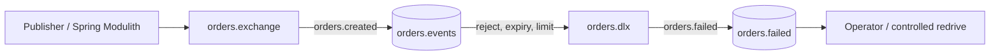
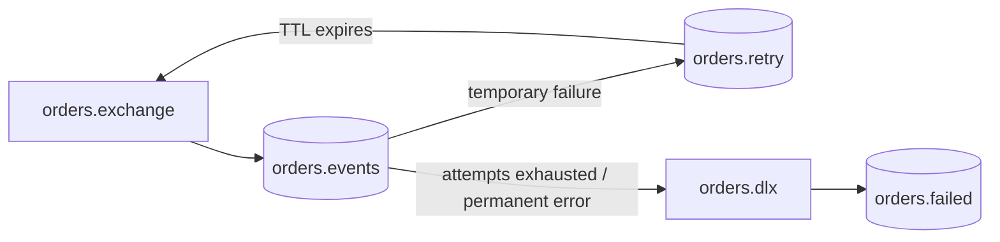
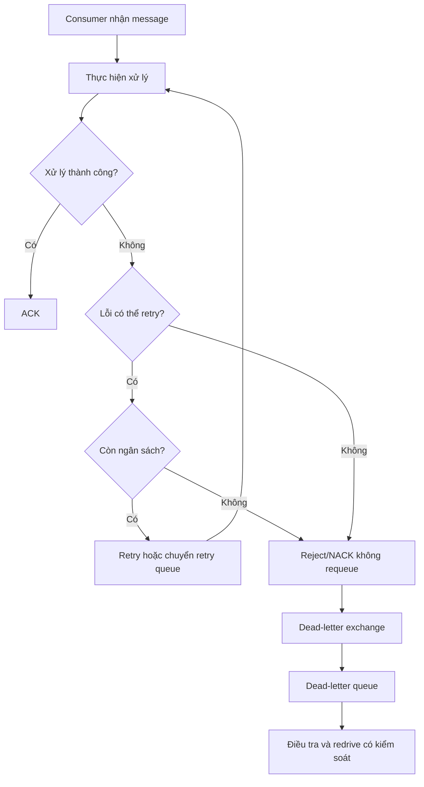

# Dead-letter exchange

Trong hệ thống dùng RabbitMQ, một message có thể tới queue nhưng consumer không thể xử lý nó. Payload sai schema, dữ liệu nghiệp vụ không hợp lệ, phụ thuộc bên ngoài liên tục lỗi hoặc message đã hết hạn đều có thể khiến message không được xử lý thành công. Nếu message cứ quay lại queue chính và được giao lặp vô hạn, consumer có thể mắc kẹt ở cùng một lỗi và làm giảm khả năng xử lý các message khác.

Dead-letter exchange (DLX) cung cấp một đường định tuyến riêng cho message bị loại khỏi queue theo những điều kiện nhất định. RabbitMQ chuyển message đó tới exchange được cấu hình; exchange tiếp tục định tuyến tới một hoặc nhiều queue đích, thường là dead-letter queue (DLQ) để kiểm tra, đối soát hoặc xử lý lại có kiểm soát.

Trong ứng dụng Spring Modulith, DLX thường nằm ở phía RabbitMQ sau khi integration event đã được externalize và đưa vào queue. Event Publication Registry theo dõi việc gửi event từ ứng dụng tới externalizer; DLX xử lý message đã nằm trong broker nhưng bị dead-letter trong quá trình tiêu thụ. Hiểu rõ hai ranh giới này giúp xác định đúng nơi cần retry, quan sát và khôi phục.

## Mục tiêu

Sau bài này, bạn có thể:

- Giải thích DLX, DLQ và các điều kiện khiến RabbitMQ dead-letter message.
- Khai báo exchange, queue, binding và routing key cho luồng dead-letter.
- Chọn queue policy hoặc queue argument để cấu hình DLX.
- Kết hợp Spring AMQP listener retry với reject/nack để chuyển message sang DLQ.
- Phân biệt retry queue, DLQ và Event Publication Registry của Spring Modulith.
- Kiểm soát vòng lặp dead-letter, khả năng mất message và quy trình redrive.
- Kiểm thử và quan sát message lỗi trong môi trường vận hành.

## 1. DLX và DLQ hoạt động như thế nào?

DLX là một exchange mà RabbitMQ dùng để publish lại message đã bị dead-letter từ queue nguồn. DLQ là queue nhận các message được exchange đó định tuyến tới. DLX không phải queue lưu message và cũng không tự tạo ra queue đích.

Một topology cơ bản có thể gồm:

- Exchange nghiệp vụ `orders.exchange` nhận message đơn hàng.
- Queue nguồn `orders.events` nhận message theo routing key `orders.created`.
- Dead-letter exchange `orders.dlx` nhận message bị dead-letter.
- Dead-letter queue `orders.failed` nhận message theo routing key `orders.failed`.



Queue nguồn chứa message đang chờ consumer xử lý. Khi message trở thành dead letter, RabbitMQ dùng DLX và routing key đã cấu hình để định tuyến message tới queue đích. Nếu DLX không có binding phù hợp, message có thể không tới được DLQ mong muốn.

| Thuật ngữ | Vai trò |
|---|---|
| Exchange nghiệp vụ | Nhận message từ publisher và định tuyến vào queue xử lý |
| Queue nguồn | Giữ message để consumer xử lý bình thường |
| DLX | Exchange nhận message bị dead-letter |
| DLQ | Queue lưu message lỗi sau khi được DLX định tuyến |
| Routing key | Quyết định binding nào của exchange nhận message |
| Redrive | Quy trình gửi lại message từ DLQ sau khi đã điều tra hoặc sửa lỗi |

## 2. Điều kiện khiến RabbitMQ dead-letter message

RabbitMQ có thể dead-letter message từ một queue khi xảy ra một trong các điều kiện sau:

1. Consumer reject message với `requeue=false`.
2. Consumer nack message với `requeue=false`.
3. Message hết thời gian sống (TTL) trong queue.
4. Queue vượt giới hạn độ dài hoặc dung lượng và chính sách overflow khiến message bị loại bỏ theo semantics của queue.
5. Quorum queue vượt delivery limit được cấu hình hoặc áp dụng theo phiên bản RabbitMQ.

Reject/nack với `requeue=true` đưa message trở lại queue nguồn để giao lại; thao tác đó không kích hoạt DLX. Vì vậy, nếu consumer luôn requeue một message lỗi không thể phục hồi, message có thể tạo vòng lặp giao lại và chiếm tài nguyên.

Không phải mọi lỗi của consumer đều tự động đưa message vào DLQ. Listener phải kết thúc delivery bằng cách reject/nack không requeue, hoặc message phải gặp một điều kiện dead-letter khác như TTL hay delivery limit. Nếu queue không cấu hình DLX, message bị dead-letter có thể bị loại bỏ thay vì được lưu vào một DLQ.

## 3. Khai báo topology DLX bằng Spring AMQP

Ví dụ dưới đây tạo direct exchange nghiệp vụ, queue nguồn, direct DLX và DLQ. Queue nguồn được cấu hình để chuyển message bị dead-letter tới `orders.dlx` với routing key `orders.failed`:

```java
import org.springframework.amqp.core.Binding;
import org.springframework.amqp.core.BindingBuilder;
import org.springframework.amqp.core.DirectExchange;
import org.springframework.amqp.core.Queue;
import org.springframework.amqp.core.QueueBuilder;
import org.springframework.context.annotation.Bean;
import org.springframework.context.annotation.Configuration;

@Configuration
class OrdersRabbitTopology {

    @Bean
    DirectExchange ordersExchange() {
        return new DirectExchange("orders.exchange", true, false);
    }

    @Bean
    DirectExchange ordersDeadLetterExchange() {
        return new DirectExchange("orders.dlx", true, false);
    }

    @Bean
    Queue ordersQueue() {
        return QueueBuilder.durable("orders.events")
            .deadLetterExchange("orders.dlx")
            .deadLetterRoutingKey("orders.failed")
            .build();
    }

    @Bean
    Queue ordersDeadLetterQueue() {
        return QueueBuilder.durable("orders.failed").build();
    }

    @Bean
    Binding ordersBinding(Queue ordersQueue, DirectExchange ordersExchange) {
        return BindingBuilder.bind(ordersQueue)
            .to(ordersExchange)
            .with("orders.created");
    }

    @Bean
    Binding deadLetterBinding(
            Queue ordersDeadLetterQueue,
            DirectExchange ordersDeadLetterExchange) {
        return BindingBuilder.bind(ordersDeadLetterQueue)
            .to(ordersDeadLetterExchange)
            .with("orders.failed");
    }
}
```

Trong ví dụ này, `QueueBuilder.deadLetterExchange` và `deadLetterRoutingKey` khai báo queue arguments tương ứng. Tên exchange và routing key phải khớp với topology broker. Khi queue đã tồn tại với arguments khác, việc khai báo lại có thể gây lỗi `PRECONDITION_FAILED`; thay đổi cấu hình queue cần được triển khai có kế hoạch.

Đối với môi trường vận hành, RabbitMQ policy thường linh hoạt hơn việc hard-code queue arguments trong ứng dụng. Policy có thể được cập nhật trên broker mà không cần redeploy ứng dụng hoặc xóa queue để khai báo lại. Ví dụ policy áp dụng cho queue tên `orders.events`:

```bash
rabbitmqctl set_policy orders-dlx "^orders\\.events$" \
  '{"dead-letter-exchange":"orders.dlx","dead-letter-routing-key":"orders.failed"}' \
  --apply-to queues
```

Chọn một nơi làm nguồn cấu hình có thẩm quyền cho mỗi queue. Nếu queue argument do client khai báo và policy cùng đặt một giá trị, quy tắc ưu tiên của RabbitMQ có thể khiến thay đổi policy không có tác dụng như mong đợi. Hãy kiểm tra effective policy và queue arguments thực tế sau khi triển khai.

## 4. Cấu hình consumer để đưa message lỗi vào DLQ

Với Spring AMQP, listener có thể throw exception khi xử lý thất bại. `SimpleMessageListenerContainer` hoặc listener container factory quyết định delivery được requeue hay reject. Một retry interceptor có thể thử lại một số lần trong cùng lần giao; khi hết lượt, recoverer reject message mà không requeue để RabbitMQ kích hoạt DLX.

```java
import org.springframework.amqp.rabbit.config.SimpleRabbitListenerContainerFactory;
import org.springframework.amqp.rabbit.connection.ConnectionFactory;
import org.springframework.amqp.rabbit.retry.RejectAndDontRequeueRecoverer;
import org.springframework.context.annotation.Bean;
import org.springframework.context.annotation.Configuration;
import org.springframework.amqp.rabbit.config.RetryInterceptorBuilder;
import org.springframework.retry.interceptor.RetryOperationsInterceptor;

@Configuration
class OrdersListenerConfiguration {

    @Bean
    RetryOperationsInterceptor ordersRetryInterceptor() {
        return RetryInterceptorBuilder.stateless()
            .maxAttempts(3)
            .backOffOptions(1_000, 2.0, 10_000)
            .recoverer(new RejectAndDontRequeueRecoverer())
            .build();
    }

    @Bean
    SimpleRabbitListenerContainerFactory rabbitListenerContainerFactory(
            ConnectionFactory connectionFactory,
            RetryOperationsInterceptor ordersRetryInterceptor) {
        var factory = new SimpleRabbitListenerContainerFactory();
        factory.setConnectionFactory(connectionFactory);
        factory.setAdviceChain(ordersRetryInterceptor);
        factory.setDefaultRequeueRejected(false);
        return factory;
    }
}
```

Listener xử lý message:

```java
import org.springframework.amqp.rabbit.annotation.RabbitListener;
import org.springframework.stereotype.Component;

@Component
class OrderConfirmedConsumer {

    @RabbitListener(
        queues = "orders.events",
        containerFactory = "rabbitListenerContainerFactory"
    )
    void handle(OrderConfirmed message) {
        orderApplicationService.apply(message);
    }
}
```

Trong cấu hình này, `maxAttempts(3)` tính cả lần xử lý đầu tiên: tối đa ba lần gọi listener trong một chu kỳ retry interceptor. Sau khi hết lượt, `RejectAndDontRequeueRecoverer` reject delivery không requeue. Nếu queue nguồn có DLX hợp lệ, RabbitMQ chuyển message tới DLQ.

`defaultRequeueRejected(false)` cũng khiến exception thoát khỏi listener mà không được xử lý bởi retry advice bị reject thay vì requeue. Cần phân loại lỗi cẩn thận: lỗi vĩnh viễn nên chuyển sang DLQ; lỗi tạm thời nên retry có giới hạn hoặc dùng retry queue với TTL. Nếu bỏ retry advice và đặt mặc định này, một lỗi thoáng qua cũng có thể bị đưa vào DLQ ngay lần đầu.

Spring AMQP còn cung cấp `AmqpRejectAndDontRequeueException` để yêu cầu reject không requeue từ listener hoặc recoverer. `ImmediateRequeueAmqpException` có thể yêu cầu requeue ngay. Tránh dùng requeue vô hạn cho message độc hại hoặc lỗi dữ liệu không thể sửa bằng thời gian.

Retry interceptor stateless thường giới hạn số lần thử trong một lần giao được xử lý bởi interceptor. Nếu consumer process chết, broker giao lại message và chu kỳ retry phía ứng dụng có thể bắt đầu lại. Khi cần giới hạn delivery xuyên suốt qua restart, hãy lưu retry state bền vững hoặc dùng delivery limit của quorum queue theo phiên bản và cấu hình RabbitMQ đang vận hành.

## 5. Phân loại lỗi trước khi dead-letter

Không nên chuyển mọi exception vào DLQ theo cùng một quy tắc. Một chính sách phù hợp cần phân biệt:

| Loại lỗi | Ví dụ | Cách xử lý |
|---|---|---|
| Lỗi tạm thời | Timeout dịch vụ, kết nối database ngắt ngắn hạn | Retry có giới hạn; nếu vẫn lỗi, chuyển DLQ hoặc retry queue |
| Lỗi dữ liệu | Payload thiếu trường, schema không tương thích | Reject không requeue và lưu vào DLQ để điều tra |
| Lỗi nghiệp vụ không thể xử lý | Đơn hàng đã hủy, mã khách hàng không hợp lệ | Chuyển DLQ hoặc luồng xử lý nghiệp vụ riêng; không retry vô hạn |
| Lỗi cấu hình | Sai credential, exchange hoặc binding | Cảnh báo vận hành; DLQ chỉ giữ message nếu broker nhận được message và queue dead-letter được cấu hình đúng |
| Quá số lần giao | Consumer liên tục crash hoặc không ack | Áp dụng delivery limit phù hợp, đặc biệt với quorum queue |

DLQ là nơi cô lập message cần điều tra, không phải nơi sửa lỗi tự động. Mỗi message ở DLQ cần có quy trình quyết định: sửa dữ liệu rồi redrive, sửa consumer rồi phát lại, chuyển sang xử lý thủ công hoặc loại bỏ có kiểm soát theo chính sách lưu trữ.

## 6. Retry queue và DLQ giải quyết hai việc khác nhau

Retry queue dùng để trì hoãn một lần thử lại khi lỗi có khả năng tự hết. DLQ dùng để giữ message đã bị loại khỏi luồng xử lý bình thường và cần điều tra hoặc hành động có kiểm soát.

Một mô hình retry bằng TTL có thể hoạt động như sau:

1. Consumer nhận message từ `orders.events` và xử lý thất bại.
2. Ứng dụng hoặc recoverer chuyển message sang `orders.retry`.
3. Queue retry giữ message trong khoảng TTL đã định.
4. Khi TTL hết, queue retry dead-letter message về exchange nghiệp vụ với routing key của queue chính.
5. Nếu message vẫn thất bại sau ngân sách retry, chuyển nó tới `orders.failed` qua DLX cuối cùng.



Queue retry cần TTL và dead-letter route riêng. Ví dụ, queue retry có thể được khai báo với `x-message-ttl` và `x-dead-letter-exchange` trỏ về exchange nghiệp vụ. Hãy đặt routing key quay về queue chính và lưu số lần thử trong metadata đáng tin cậy. Khi vượt giới hạn, chuyển message sang DLQ cuối cùng thay vì quay lại queue chính mãi mãi.

Không tạo vòng lặp `orders.failed` → `orders.exchange` → `orders.events` → `orders.failed` mà không có giới hạn và dấu vết attempt. RabbitMQ có cơ chế phát hiện một số dead-letter cycle và có thể loại bỏ message trong chu kỳ không có lần reject; không nên dựa vào cơ chế này như một retry policy. Dùng số lần thử, thời gian trì hoãn và trạng thái redrive rõ ràng.

## 7. Metadata dead-letter và điều tra message

RabbitMQ bổ sung header `x-death` khi message bị dead-letter. Header này chứa lịch sử dead-letter, bao gồm queue nguồn, exchange, routing key, lý do và thời điểm. Các lần dead-letter có cùng queue và reason có thể được gộp vào một entry với counter tăng dần.

Các giá trị reason thường gặp gồm:

- `rejected`: consumer reject hoặc nack không requeue.
- `expired`: message hoặc queue TTL hết hạn.
- `maxlen`: queue vượt giới hạn độ dài hoặc dung lượng.
- `delivery_limit`: message vượt delivery limit của quorum queue.

Khi điều tra DLQ, cần giữ lại cả header broker và metadata ứng dụng như event ID, correlation ID, schema version, aggregate ID và thời điểm phát sinh. `x-death` giúp hiểu message đã đi qua queue nào và vì sao bị dead-letter; event ID giúp liên kết với log của producer và consumer.

Không sửa hoặc xóa header lịch sử một cách tùy tiện khi redrive. Nếu cần tạo message mới sau khi sửa payload, hãy giữ event ID gốc hoặc thêm một redrive ID riêng để có thể truy vết cả message ban đầu và lần phát lại.

## 8. Độ tin cậy khi RabbitMQ chuyển message sang DLX

Một điểm quan trọng trong RabbitMQ là dead-lettering mặc định không phải lúc nào cũng bảo đảm message được xác nhận an toàn bởi exchange đích. Với cơ chế dead-letter thông thường, RabbitMQ có thể republish nội bộ message mà không dùng publisher confirms cho đích. Nếu exchange đích không tồn tại hoặc queue đích không khả dụng, message có thể bị mất trong quá trình dead-letter.

Với quorum queue, RabbitMQ hỗ trợ chiến lược at-least-once dead-lettering trong các phiên bản hỗ trợ. Cấu hình này yêu cầu quorum queue, `dead-letter-strategy=at-least-once` và `overflow=reject-publish`, cùng DLX được khai báo. Kiểm tra tài liệu phiên bản RabbitMQ đang chạy trước khi bật; chiến lược này giữ message chờ cho tới khi đích xác nhận, nhưng có thể dùng thêm tài nguyên khi đích bị lỗi.

Điều đó dẫn đến một số nguyên tắc:

- Khai báo DLX và binding DLQ trước khi đưa queue nguồn vào phục vụ.
- Theo dõi trạng thái queue đích, số message tồn đọng và cảnh báo khi DLQ không nhận được message.
- Chọn classic hay quorum queue theo yêu cầu lưu trữ và delivery guarantee.
- Nếu yêu cầu không mất message khi dead-letter, xác minh và cấu hình at-least-once dead-lettering cho quorum queue tương thích.
- Kiểm thử tình huống DLX hoặc DLQ tạm thời không khả dụng.

Publisher confirms cho message do ứng dụng gửi vào exchange nghiệp vụ và cơ chế dead-letter từ queue nguồn là hai chặng khác nhau. Xác nhận publisher thành công không tự động chứng minh mọi lần dead-letter sau đó đều được chuyển an toàn. Nếu yêu cầu publication chỉ hoàn tất sau khi broker xác nhận, hãy bật publisher confirms và xử lý callback/confirm trước khi coi thao tác gửi là thành công; lời gọi gửi trả về bình thường có thể chỉ cho biết client đã nhận thao tác.

## 9. DLX trong luồng Spring Modulith

Khi Spring Modulith externalize một application event qua adapter AMQP, adapter gửi message vào RabbitMQ theo target và cấu hình routing. Event Publication Registry theo dõi việc externalizer hoàn tất gửi message. Khi lời gọi gửi của adapter hoàn tất theo semantics đã cấu hình, publication externalization có thể được đánh dấu hoàn tất. Chỉ coi đây là xác nhận broker khi publisher confirms được bật và kết quả confirm được chờ, kiểm tra.

Sau đó, RabbitMQ định tuyến message vào queue consumer. Nếu consumer reject message không requeue hoặc message hết TTL, broker có thể chuyển message qua DLX. Việc message xuất hiện trong DLQ không tự động làm publication ban đầu của Spring Modulith trở thành incomplete; registry theo dõi chặng gửi từ ứng dụng, không theo dõi toàn bộ vòng đời xử lý ở hệ thống tiêu thụ bên ngoài.

Vì vậy, hãy theo dõi riêng:

| Chặng | Tín hiệu cần quan sát |
|---|---|
| Spring Modulith externalization | Publication chưa hoàn tất, lỗi gửi, số lần resubmit |
| RabbitMQ exchange/queue nguồn | Publish rate, unroutable message, ready/unacked count |
| Consumer | Tỷ lệ xử lý thành công, retry, reject/nack và thời gian xử lý |
| DLX/DLQ | Số message dead-letter, lý do `x-death`, tuổi message và redrive |

Nếu ứng dụng dùng Event Publication Registry bền vững, registry có thể giúp khôi phục lỗi gửi ra broker. DLX/DLQ lại giúp đội vận hành điều tra lỗi xảy ra sau khi message đã tới queue. Hai cơ chế bổ sung cho nhau và cần có dashboard hoặc log tương quan để nối event ID qua các chặng.

## 10. Quy trình redrive từ DLQ

Không nên tự động phát lại toàn bộ DLQ vào queue chính theo một lịch vô hạn. Trước khi redrive, hãy xác định nguyên nhân dead-letter và chắc chắn lỗi đã được xử lý. Một quy trình redrive an toàn có thể gồm:

1. Đọc message cùng `x-death`, event ID và correlation ID.
2. Phân loại lỗi: dữ liệu, schema, lỗi consumer, dependency hay topology.
3. Sửa nguyên nhân gốc hoặc sửa payload bằng quy trình được kiểm soát.
4. Xác nhận consumer mới có thể xử lý message và idempotency vẫn bảo vệ tác động trùng.
5. Gửi lại theo batch nhỏ, có giới hạn tốc độ và theo dõi kết quả.
6. Ghi nhận ai đã redrive, thời điểm, lý do và số message thành công/thất bại.
7. Giữ lại hoặc archive message ban đầu theo chính sách audit và retention.

Nếu payload không thể sửa an toàn hoặc nghiệp vụ không còn hợp lệ, chuyển sang xử lý thủ công hoặc kết thúc theo quy trình nghiệp vụ. Không xóa DLQ trước khi xác định dữ liệu cần giữ và yêu cầu audit.

## 11. Kiểm thử DLX và DLQ

Kiểm thử nên bao gồm topology broker, hành vi listener và khả năng phục hồi. Một mock listener không chứng minh exchange, binding hoặc dead-letter policy đã đúng.

| Tình huống | Điều cần xác nhận |
|---|---|
| Listener reject không requeue | Message được chuyển tới DLX và DLQ đúng routing key |
| Listener nack với requeue=true | Message trở lại queue nguồn, không đi vào DLQ ngay |
| Message hết TTL | Message được dead-letter với reason `expired` |
| Queue vượt giới hạn | Hành vi dead-letter/overflow đúng với cấu hình queue |
| Retry interceptor hết lượt | Recoverer reject không requeue và message đi tới DLQ |
| DLX hoặc binding sai | Kiểm thử phát hiện message không tới queue đích |
| DLQ tạm thời không khả dụng | Hành vi mất message hoặc giữ lại đúng theo loại queue và dead-letter strategy |
| Redrive | Message trở lại luồng xử lý có giới hạn và consumer idempotent |
| Spring Modulith gửi event | Registry phản ánh kết quả externalization; DLQ được quan sát độc lập |

Với Testcontainers RabbitMQ hoặc broker test tương đương, khai báo exchange, queue và binding như môi trường thật. Publish message có event ID xác định, làm listener reject, sau đó đọc DLQ và xác minh payload cùng `x-death`. Dùng timeout có giới hạn khi chờ message; không dùng sleep cố định để đoán thời điểm broker hoàn tất.

## 12. Quan sát và cảnh báo

DLQ cần được xem là một hàng đợi vận hành có chủ sở hữu. Theo dõi tối thiểu:

- Số message ready và unacked trong queue nguồn.
- Số message trong DLQ và tốc độ tăng theo thời gian.
- Tuổi của message cũ nhất trong DLQ.
- Phân bố `x-death.reason`, queue nguồn và event type.
- Tỷ lệ reject, nack, redelivery và retry exhaustion của consumer.
- Số lần redrive và tỷ lệ redrive thành công.
- Trạng thái exchange, binding, queue và policy dead-letter.

Đặt cảnh báo khi DLQ có message mới hoặc tăng nhanh, khi tuổi message vượt ngưỡng nghiệp vụ, hoặc khi queue nguồn có redelivery bất thường. Log nên chứa event ID, queue nguồn, DLX target, routing key, `x-death.reason` và correlation ID. Tránh ghi payload nhạy cảm và tránh dùng event ID làm metric label có cardinality cao.

## 13. Những lỗi thường gặp

| Lỗi | Hệ quả | Cách khắc phục |
|---|---|---|
| Reject không requeue nhưng queue không có DLX | Message có thể bị loại bỏ | Khai báo DLX, DLQ và binding trước khi chạy consumer |
| DLX có nhưng thiếu binding | Message không tới DLQ dự kiến | Kiểm tra routing key và topology thực tế |
| Luôn requeue message lỗi | Redelivery loop và consumer bị chiếm tài nguyên | Retry có giới hạn rồi reject không requeue |
| Retry queue quay lại queue chính vô hạn | Message lỗi lặp lại mãi | Giới hạn attempt và chuyển sang DLQ cuối cùng |
| DLQ tự động phát lại không kiểm soát | Tạo vòng lặp dead-letter và tải tăng đột biến | Redrive có phê duyệt, batch và rate limit |
| Cho rằng publisher confirm bảo vệ cả DLX | Có thể mất message ở chặng dead-letter | Chọn dead-letter strategy phù hợp, kiểm thử DLX unavailable |
| Coi DLQ là nơi lưu trữ lâu dài | DLQ tăng không giới hạn và khó quản trị | Có retention, archive và chủ sở hữu xử lý |
| Nhầm DLQ với publication registry | Điều tra sai chặng lỗi | Quan sát registry, queue nguồn và DLQ riêng biệt |

## 14. Quy trình quyết định



DLX là cơ chế cô lập message đã không thể tiếp tục trên queue nguồn. Hãy thiết kế topology và binding rõ ràng, phân loại lỗi trước khi retry, reject không requeue khi đã hết ngân sách và vận hành DLQ như một quy trình có chủ sở hữu. Trong hệ thống Spring Modulith, theo dõi Event Publication Registry cho chặng externalization và theo dõi DLX/DLQ cho chặng tiêu thụ ở RabbitMQ để có thể tìm đúng nguyên nhân và phục hồi an toàn.

## Tài liệu tham khảo

- [RabbitMQ — Dead Letter Exchanges](https://www.rabbitmq.com/docs/dlx)
- [Spring AMQP — Exception Handling](https://docs.spring.io/spring-amqp/reference/amqp/exception-handling.html)
- [Spring Modulith — Working with Application Events](https://docs.spring.io/spring-modulith/reference/events.html)
