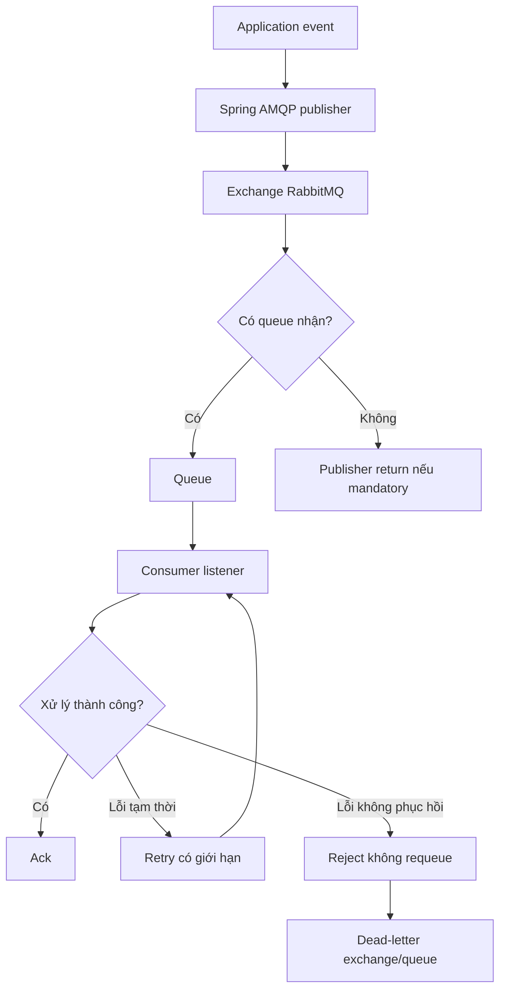
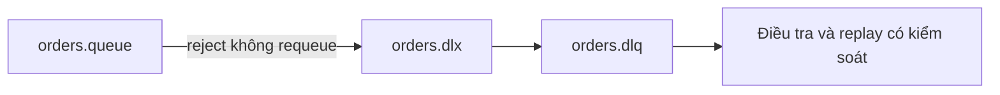
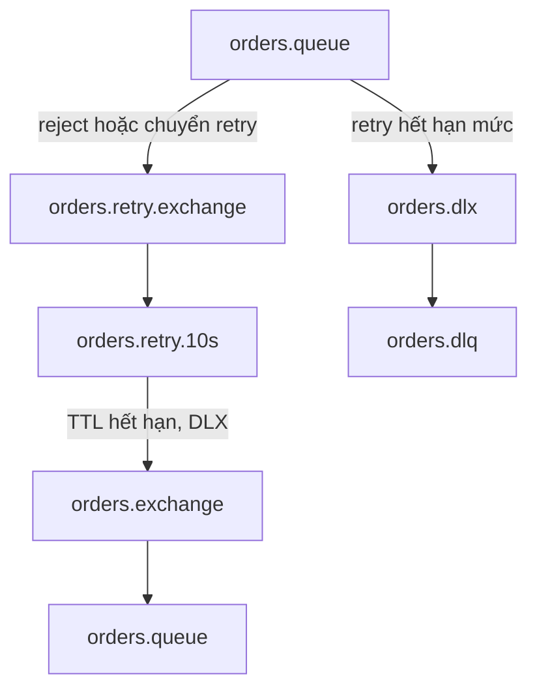

# Retry với RabbitMQ trong Spring AMQP

Khi giao sự kiện qua RabbitMQ, lỗi có thể xảy ra lúc producer gửi message, lúc broker định tuyến message hoặc lúc consumer xử lý message. Một chiến lược retry tốt phải xác định đúng giai đoạn thất bại, phân biệt lỗi tạm thời với lỗi không thể tự hết và giới hạn số lần thử. Nếu mọi lỗi đều được requeue hoặc gửi lại vô hạn, một message lỗi có thể chiếm worker, tạo vòng lặp tải cao và ngăn các message khác được xử lý.

Trong ứng dụng Spring Modulith, application event và Event Publication Registry quản lý vòng đời publication ở phía ứng dụng. Spring AMQP và RabbitMQ đảm nhiệm vận chuyển message, acknowledgement và dead-letter routing. Retry cần kết nối được hai lớp này: biết khi nào publication đã được broker xác nhận, khi nào consumer đã xử lý thành công và khi nào một event cần được cách ly để điều tra.

## 1. Xác định retry ở giai đoạn nào

Một luồng AMQP thường có các bước: ứng dụng tạo message, gửi tới exchange, broker định tuyến tới queue, consumer nhận message, listener xử lý và broker nhận acknowledgement hoặc rejection. Retry ở mỗi bước có semantics khác nhau.



| Giai đoạn | Cơ chế phát hiện | Hướng retry |
|---|---|---|
| Producer gửi | Exception khi publish, publisher confirm nack hoặc timeout | Thử gửi lại theo chính sách publisher; giữ event ID ổn định |
| Định tuyến | Message không tới queue; publisher return khi bật `mandatory` | Sửa exchange, routing key hoặc binding; không retry mù quáng |
| Consumer xử lý | Listener ném exception trước khi ack | Retry listener có giới hạn hoặc requeue theo policy |
| Message không thể xử lý | Retry hết số lần hoặc lỗi không phục hồi | Reject không requeue và đưa qua DLX/DLQ |
| Phục hồi sau sự cố | Message nằm trong DLQ hoặc publication còn incomplete | Điều tra, sửa nguyên nhân rồi replay có kiểm soát |

Không dùng một bộ retry duy nhất cho tất cả các giai đoạn. Ví dụ, retry listener không sửa được message chưa từng được định tuyến tới queue; publisher confirm cũng không cho biết listener đã xử lý nghiệp vụ thành công hay chưa.

## 2. Phân loại lỗi trước khi retry

Retry chỉ hữu ích khi lần thử sau có cơ hội thành công. Nên phân loại exception và xác định chính sách cho từng nhóm:

| Nhóm lỗi | Ví dụ | Chính sách thường phù hợp |
|---|---|---|
| Hạ tầng tạm thời | Mất kết nối broker, channel đóng, network timeout | Retry có backoff và giới hạn |
| Tài nguyên tạm thời | Database deadlock, connection pool hết kết nối trong thời gian ngắn | Retry có backoff; kiểm tra timeout và tải |
| Rate limit/quá tải | Hệ thống đích trả throttling hoặc xử lý chậm | Giảm tốc độ, backoff và giới hạn concurrency |
| Dữ liệu không hợp lệ | Thiếu trường bắt buộc, sai định dạng, vi phạm quy tắc nghiệp vụ | Không retry vô hạn; đưa vào DLQ hoặc luồng xử lý lỗi |
| Schema không hỗ trợ | Event version mới hơn consumer | Cách ly và triển khai consumer tương thích |
| Cấu hình/quyền truy cập | Sai credential, ACL, exchange hoặc binding | Báo động và sửa cấu hình; retry dày đặc không giúp ích |

Có thể định nghĩa exception nghiệp vụ để thể hiện rõ khả năng retry. Chẳng hạn `TemporaryDependencyException` có thể được retry, còn `InvalidOrderEventException` nên được xem là lỗi không phục hồi. Tránh bắt mọi `Exception` rồi retry giống nhau vì điều đó che mất nguyên nhân và có thể làm queue bị kẹt.

## 3. Publisher retry và publisher confirms

Ở phía producer, cần phân biệt ba kết quả:

1. Lệnh gửi không thể thực hiện do lỗi kết nối hoặc channel: ứng dụng có thể nhận exception ngay hoặc lỗi trong quá trình publish.
2. Broker xác nhận nhận publish qua publisher confirm: producer biết broker đã xử lý publish theo semantics confirm.
3. Message không được route tới queue nào: nếu bật mandatory và cấu hình returns callback, producer có thể nhận thông báo message bị trả lại.

Publisher confirm ACK không đồng nghĩa consumer đã xử lý message. Confirm NACK hoặc timeout cũng cần được diễn giải theo trạng thái thực tế: trong một số tình huống timeout, broker có thể đã nhận message nhưng producer chưa nhận được confirm. Gửi lại có thể tạo bản sao, do đó event ID cần ổn định và consumer phải idempotent.

Với Spring AMQP, `RabbitTemplate` hỗ trợ gửi message và publisher confirms/returns khi connection factory được cấu hình tương ứng. Ví dụ minh họa cách gửi kèm correlation data:

```java
CorrelationData correlation = new CorrelationData(event.eventId().toString());

rabbitTemplate.convertAndSend(
    "orders.exchange",
    "order.completed",
    message,
    correlation
);

correlation.getFuture().whenComplete((confirm, error) -> {
    if (error != null) {
        log.error("Publisher confirm failed: eventId={}", event.eventId(), error);
        return;
    }

    if (!confirm.isAck()) {
        log.error(
            "Broker NACK: eventId={}, reason={}",
            event.eventId(),
            confirm.getReason()
        );
        return;
    }

    log.info("Broker confirmed eventId={}", event.eventId());
});
```

Ví dụ dùng API correlated confirm có trong các phiên bản Spring AMQP hiện đại; cần đối chiếu phiên bản dependency và bật publisher confirm type tương ứng. Nếu cần phát hiện message không route, bật `mandatory` và đăng ký returns callback. Confirm và return là hai tín hiệu khác nhau: message có thể được broker confirm nhưng vẫn không có queue nhận nếu ứng dụng không theo dõi returned message.

Một cấu hình connection factory thường cần chọn correlated publisher confirms và publisher returns. Tên property hoặc cách cấu hình có thể khác theo Spring Boot/Spring AMQP version; hãy kiểm tra đúng phiên bản đang chạy. Đặt `CorrelationData` chứa event ID giúp nối kết quả confirm với publication gốc.

### 3.1. Retry khi publish thất bại

Có thể dùng Spring Retry với `RetryTemplate` hoặc retry ở lớp application khi thao tác publish ném lỗi tạm thời. Cần xác định rõ điều gì được coi là thất bại: lỗi gọi publish, NACK, returned message hay timeout chờ confirm. Nếu callback chỉ log NACK nhưng không đưa kết quả về luồng quản lý publication, ứng dụng có thể đánh dấu nhầm publication là hoàn tất.

Không giữ transaction database mở trong lúc chờ mạng hoặc retry kéo dài. Với publication bền vững, lưu trạng thái cần thử lại và thực hiện gửi lại bằng worker phù hợp. Nếu confirm timeout làm kết quả không xác định, gửi lại có thể tạo duplicate; không tạo event ID mới cho cùng một sự kiện nghiệp vụ.

## 4. Consumer acknowledgement và requeue

RabbitMQ giao message tới consumer và chờ acknowledgement để biết message đã được xử lý. Trong Spring AMQP, listener container quản lý acknowledgement theo `AcknowledgeMode`.

- `AUTO`: container ack sau khi listener hoàn tất thành công; nếu listener ném exception, container áp dụng quy tắc reject/requeue.
- `MANUAL`: listener hoặc code ứng dụng chịu trách nhiệm ack/nack qua channel; phải bảo đảm chỉ ack sau khi công việc cần thiết đã hoàn tất.
- `NONE`: broker không chờ acknowledgement từ consumer; message được coi là đã ack khi giao cho consumer. Chế độ này không phù hợp nếu cần retry khi xử lý lỗi.

Tên `AUTO` trong Spring AMQP có nghĩa container tự quản lý acknowledgement, khác với `autoAck=true` ở mức AMQP basic.consume. Khi xử lý message cần độ tin cậy, thường dùng `AUTO` hoặc `MANUAL` với quy tắc rõ ràng.

Khi listener thất bại, message có thể bị reject/nack với `requeue=true` hoặc `requeue=false`. Requeue đưa message trở lại queue để có thể được giao lại. Nếu một lỗi xác định luôn xảy ra, requeue liên tục tạo vòng lặp nóng và làm message khác bị trì hoãn. Với lỗi không phục hồi, reject không requeue để broker dead-letter message nếu queue đã cấu hình DLX.

Trong Spring AMQP, `defaultRequeueRejected` điều khiển hành vi mặc định khi listener ném exception. Giá trị mặc định và cách các exception đặc biệt ảnh hưởng đến requeue cần được xác minh theo phiên bản và container. `AmqpRejectAndDontRequeueException` có thể được dùng để yêu cầu reject mà không requeue.

## 5. Retry listener với Spring Retry

Một cách phổ biến là gắn retry advice vào listener container. Retry interceptor gọi listener lại trong cùng quá trình xử lý trước khi quyết định recovery. Ví dụ:

```java
@Bean
RetryOperationsInterceptor rabbitRetryInterceptor() {
    return RetryInterceptorBuilder.stateless()
        .maxAttempts(4)
        .backOffOptions(1_000, 2.0, 10_000)
        .recoverer(new RejectAndDontRequeueRecoverer())
        .build();
}

@Bean
SimpleRabbitListenerContainerFactory rabbitListenerContainerFactory(
        ConnectionFactory connectionFactory,
        RetryOperationsInterceptor rabbitRetryInterceptor) {
    var factory = new SimpleRabbitListenerContainerFactory();
    factory.setConnectionFactory(connectionFactory);
    factory.setAdviceChain(rabbitRetryInterceptor);
    factory.setDefaultRequeueRejected(false);
    return factory;
}
```

Đây là ví dụ cấu hình cho Spring AMQP với Spring Retry; cần khai báo các dependency và import tương ứng. `maxAttempts(4)` tính cả lần gọi đầu tiên, tức tối đa bốn lần thực thi listener trong một lần giao message. `backOffOptions(1_000, 2.0, 10_000)` biểu diễn khoảng chờ tăng dần, tối đa 10 giây. `RejectAndDontRequeueRecoverer` từ chối message sau khi retry cạn để DLX có thể nhận message nếu queue được cấu hình dead-letter.

Nếu không cấu hình DLX, reject không requeue có thể khiến message bị loại bỏ. Vì vậy, cần thiết kế dead-letter topology trước khi bật recovery strategy này ở production.

### 5.1. Stateless và stateful retry

**Stateless retry** thực hiện các lần thử trong cùng một lần gọi listener. Nó phù hợp khi thao tác có thể lặp ngay và không cần giữ trạng thái retry giữa nhiều lần giao message.

**Stateful retry** lưu trạng thái retry theo khóa message qua các lần giao lại. Nó hữu ích khi xử lý cần rollback transaction trước khi message được redeliver, nhưng yêu cầu message có định danh ổn định để xác định đúng trạng thái. Nếu thiếu message ID hoặc key ổn định, stateful retry có thể không nhận diện được cùng một message.

Không chọn stateful chỉ vì muốn retry nhiều lần. Hãy xem xét transaction boundary, listener container, message ID, redelivery behavior và khả năng lưu retry state.

## 6. Backoff, jitter và giới hạn retry

Retry dồn dập làm tăng áp lực lên broker, database và dependency đang lỗi. Exponential backoff tăng thời gian chờ giữa các lần thử:

```text
delay = min(max_delay, initial_delay * multiplier^(attempt - 1))
```

Có thể thêm jitter ngẫu nhiên để nhiều consumer không cùng retry tại một thời điểm. Ví dụ, với `initial_delay=1s`, multiplier `2` và `max_delay=10s`, khoảng chờ tăng xấp xỉ 1s, 2s, 4s rồi 8s; lần tiếp theo bị giới hạn ở 10s.

Chọn `maxAttempts`, khoảng chờ và tổng thời gian retry dựa trên SLA của event. Một message cần xử lý trong vài giây không nên bị retry hàng giờ mà không có cảnh báo. Cũng cần giới hạn concurrency để retry không chiếm hết listener threads.

Backoff trong retry interceptor thường diễn ra trong lần xử lý hiện tại và giữ message chưa được ack trong thời gian chờ. Với khoảng chờ dài hoặc tải cao, cân nhắc delayed retry queue/TTL thay vì giữ consumer thread. Mỗi cách có trade-off về ordering, queue topology và dead-letter cycle.

## 7. Dead-letter exchange và dead-letter queue

Dead-letter exchange (DLX) nhận message bị dead-letter từ queue nguồn. Message có thể bị dead-letter khi consumer reject/nack với `requeue=false`, hết TTL, queue vượt giới hạn hoặc theo các điều kiện dead-letter khác của RabbitMQ.

Một topology minh họa:



Ví dụ khai báo queue và binding bằng Spring AMQP:

```java
@Bean
Queue ordersQueue() {
    return QueueBuilder.durable("orders.queue")
        .deadLetterExchange("orders.dlx")
        .deadLetterRoutingKey("orders.failed")
        .build();
}

@Bean
DirectExchange ordersDeadLetterExchange() {
    return new DirectExchange("orders.dlx");
}

@Bean
Queue ordersDeadLetterQueue() {
    return QueueBuilder.durable("orders.dlq").build();
}

@Bean
Binding ordersDeadLetterBinding() {
    return BindingBuilder.bind(ordersDeadLetterQueue())
        .to(ordersDeadLetterExchange())
        .with("orders.failed");
}
```

Đây là cấu hình topology minh họa. Với môi trường vận hành, cần quyết định ai quản lý exchange/queue, quyền khai báo, durability, TTL, max length, queue type và chính sách dead-letter. RabbitMQ hỗ trợ cấu hình DLX bằng queue arguments hoặc policies; policies thường linh hoạt hơn khi cần thay đổi cấu hình mà không redeploy ứng dụng. Nếu queue đã được khai báo với arguments khác, khai báo lại không tương thích có thể gây `PRECONDITION_FAILED`.

DLQ không phải nơi lưu trữ vô thời hạn không cần quản trị. Cần có retention, cảnh báo số lượng, quy trình phân loại nguyên nhân và quyền truy cập. Không tự động replay toàn bộ DLQ liên tục vì có thể tái tạo lỗi ban đầu hoặc gây duplicate nghiệp vụ.

## 8. Delayed retry bằng TTL và dead-letter routing

Khi không muốn giữ listener thread trong lúc chờ backoff, có thể đưa message sang retry queue có TTL. Khi TTL hết hạn, queue retry dead-letter message về exchange/queue xử lý ban đầu.



Có thể tạo nhiều retry queue với TTL khác nhau, chẳng hạn 5 giây, 30 giây và 2 phút. Mỗi lần retry cần tăng attempt counter trong header hoặc metadata ứng dụng, giữ nguyên event ID và kiểm tra giới hạn trước khi gửi vào retry queue tiếp theo.

RabbitMQ thêm header `x-death` khi message bị dead-letter. Header này hữu ích để điều tra queue, reason và số lần dead-letter theo lịch sử. Tuy nhiên, không nên dùng một mình `x-death` làm bộ đếm retry nghiệp vụ nếu topology có nhiều dead-letter cycle; hãy định nghĩa rõ queue nào, reason nào và attempt nào được tính.

TTL queue không đảm bảo chính xác thời điểm giao lại tới từng millisecond. Với queue có nhiều message, expired message có thể chỉ được dead-letter khi nó tới đầu queue theo semantics của queue. Nếu cần delay chính xác theo từng message, cân nhắc plugin delayed message phù hợp với môi trường hoặc một scheduler riêng; kiểm tra trạng thái hỗ trợ và khả năng vận hành trước khi phụ thuộc vào plugin.

## 9. Poison message và giới hạn redelivery

Poison message là message luôn làm consumer thất bại, chẳng hạn payload sai schema, dữ liệu vi phạm invariant hoặc event version chưa được hỗ trợ. Nếu `requeue=true` vô hạn, message có thể quay lại queue liên tục và tiêu thụ tài nguyên mà không tiến triển.

Để tránh vòng lặp:

- Phân loại exception để biết lỗi nào retry được.
- Đặt số lần thử tối đa hoặc thời hạn xử lý.
- Khi hết retry, reject không requeue để đưa message vào DLQ.
- Lưu event ID, exception type, queue, attempt và thời điểm lỗi.
- Giữ payload gốc có kiểm soát để có thể điều tra.
- Chỉ replay sau khi đã sửa dữ liệu, schema hoặc code gây lỗi.

Một số phiên bản RabbitMQ và queue type có hỗ trợ poison message handling hoặc delivery limit riêng, đặc biệt với quorum queues. Đây là lớp bảo vệ broker; cần xác minh version, queue type và cấu hình cụ thể. Không nhầm delivery limit của broker với retry interceptor của ứng dụng: hai lớp có thể cùng tác động và tạo tổng số lần giao khác với dự kiến.

## 10. Idempotency khi message được giao lại

RabbitMQ thường cung cấp delivery theo hướng at-least-once khi consumer acknowledgement được sử dụng. Nếu listener thực hiện thay đổi database rồi ứng dụng mất kết nối trước khi ack, broker có thể giao message lại. Retry cũng có thể khiến cùng event được xử lý nhiều lần.

Consumer cần idempotency theo event ID. Một bảng Inbox minh họa:

```sql
CREATE TABLE processed_event (
    consumer_name VARCHAR(200) NOT NULL,
    event_id UUID NOT NULL,
    processed_at TIMESTAMP NOT NULL,
    PRIMARY KEY (consumer_name, event_id)
);
```

Trong cùng transaction với cập nhật nghiệp vụ, consumer ghi event ID vào Inbox. Nếu ID đã tồn tại, bỏ qua tác động nghiệp vụ lặp và hoàn tất acknowledgement. Nếu chưa tồn tại, thực hiện thay đổi nghiệp vụ rồi commit cả hai.

Nếu Inbox commit tách khỏi thay đổi nghiệp vụ, có thể đánh dấu event đã xử lý dù tác động nghiệp vụ thất bại. Nếu thay đổi nghiệp vụ commit trước Inbox, message redelivery có thể tạo tác động lặp. Với side effect ngoài database, dùng idempotency key của hệ thống đích nếu có hoặc lưu trạng thái để đối soát.

Không coi publisher confirm, consumer ack hay DLQ là cơ chế exactly-once. Chúng giải quyết các phần khác nhau của luồng. Idempotency là trách nhiệm cần có ở consumer để xử lý an toàn duplicate và replay.

## 11. Kết hợp retry với Spring Modulith Event Publication Registry

Spring Modulith Event Publication Registry theo dõi publication của application event tới listener và hỗ trợ nhận biết publication chưa hoàn tất theo persistence implementation đang dùng. RabbitMQ publisher confirm cho biết broker đã xử lý publish; consumer acknowledgement cho biết message đã được consumer xác nhận. Ba trạng thái này không đồng nghĩa.

Khi externalize event sang RabbitMQ, cần xác định rõ:

- Publication được đánh dấu hoàn tất ở thời điểm nào: sau khi `RabbitTemplate` trả về, sau publisher confirm ACK hay sau khi consumer hoàn tất?
- Publisher NACK, mandatory return hoặc confirm timeout được chuyển thành trạng thái lỗi như thế nào?
- Nếu broker đã nhận message nhưng ứng dụng không nhận được confirm, publication có thể được gửi lại; consumer phải idempotent.
- Listener nội bộ thất bại có ảnh hưởng tới publication externalization riêng hay không, tùy cách tích hợp và listener được đăng ký.
- Cơ chế retry/recovery của Spring Modulith và Spring AMQP có thể chồng lấn; cần tránh retry vô hạn ở cả hai tầng.

Event Publication Registry không thay thế DLX/DLQ của RabbitMQ. Registry lưu trạng thái publication ở phía ứng dụng; DLQ giữ message bị dead-letter ở phía broker. Cần có quy trình đối soát giữa event ID trong registry, publisher confirm và message ở DLQ để điều tra đầy đủ.

Nếu dùng integration có sẵn của Spring Modulith, hãy kiểm tra semantics xác nhận gửi và extension point theo đúng phiên bản. Nếu tự xây adapter, chỉ hoàn tất publication khi đã đạt điều kiện gửi được định nghĩa; không nuốt lỗi callback hoặc đánh dấu thành công trước khi confirm được xử lý.

## 12. Retry có transaction và stateful processing

Khi listener chạy trong transaction, lỗi có thể làm transaction rollback. Nếu retry ngay trong cùng transaction, lần thử tiếp theo có thể tiếp tục dùng transaction đã ở trạng thái rollback-only hoặc giữ tài nguyên lâu hơn dự kiến. Cần đặt retry advice, transaction interceptor và listener container theo đúng thứ tự để mỗi lần thử có transaction boundary phù hợp.

Một số trường hợp cần stateful retry: message phải được rollback và redeliver để lần thử tiếp theo chạy trong một transaction mới. Khi đó message cần key ổn định, thường dựa trên message ID. Cần kiểm tra số lần redelivery, retry cache, transaction manager và container behavior theo cấu hình thực tế.

Không dùng `MANUAL` acknowledgement rồi ack trước khi transaction database commit. Nếu ack trước commit và transaction rollback, message đã bị broker loại khỏi queue trong khi thay đổi nghiệp vụ không được lưu. Với manual ack, chỉ ack sau khi các công việc bắt buộc đã hoàn tất; nếu cần atomicity giữa DB và broker, hãy thiết kế outbox/inbox hoặc transaction coordination đúng phạm vi.

## 13. Backpressure, concurrency và fairness

Retry không chỉ là số lần thử. Một consumer có concurrency quá cao có thể làm database hoặc dịch vụ phụ thuộc quá tải; concurrency quá thấp làm queue backlog tăng. Prefetch quyết định số message broker có thể giao trước cho consumer chưa ack. Prefetch lớn có thể tăng throughput nhưng cũng làm nhiều message bị giữ trên consumer chậm.

Khi điều chỉnh:

- Chọn prefetch dựa trên thời gian xử lý và kích thước message.
- Giới hạn concurrency theo khả năng database và downstream service.
- Không để message retry dài chiếm toàn bộ listener threads.
- Theo dõi ready messages và unacknowledged messages riêng biệt.
- Tách queue hoặc nhóm consumer cho workload có SLA khác nhau.
- Cân nhắc delayed retry queue để đưa message chờ ra khỏi luồng xử lý chính.

Nếu một loại event lỗi hàng loạt, giảm tốc độ tiêu thụ hoặc tạm dừng consumer có thể an toàn hơn tiếp tục retry làm hệ thống quá tải. Việc pause/resume cần có cảnh báo, người chịu trách nhiệm và điều kiện mở lại rõ ràng.

## 14. Kiểm thử retry và dead-letter

Kiểm thử cần bao phủ cả producer và consumer, xác nhận message không bị mất hoặc xử lý lặp khi có lỗi.

| Tình huống | Điều cần xác minh |
|---|---|
| Publish thành công | Broker confirm được nhận và publication lifecycle cập nhật đúng |
| Publish NACK hoặc timeout | Lỗi được quan sát và retry theo policy |
| Message không route | Mandatory return được phát hiện; mapping được sửa |
| Listener lỗi tạm thời | Retry có giới hạn, sau đó xử lý thành công |
| Listener lỗi vĩnh viễn | Không requeue vô hạn; message vào DLQ |
| Retry hết số lần | Recovery strategy được gọi đúng |
| TTL retry queue | Message quay lại luồng chính theo topology đã định nghĩa |
| Consumer chết trước ack | Message được redeliver và idempotency ngăn tác động lặp |
| Database rollback | Message không bị ack nhầm trước commit |
| Replay từ DLQ | Event ID giữ nguyên và consumer xử lý an toàn |
| Broker hoặc downstream quá tải | Backoff, prefetch và concurrency giữ tải trong giới hạn |

Ở unit test, có thể kiểm tra exception classification, retry policy và mapping. Ở integration test, dùng RabbitMQ test broker hoặc Testcontainers để kiểm tra confirm, return, ack/nack, DLX, TTL và redelivery thực tế. Không chỉ mock `RabbitTemplate` rồi kết luận broker đã định tuyến hoặc dead-letter đúng.

## 15. Observability và vận hành

Theo dõi ít nhất các chỉ số:

- Số publisher confirm ACK/NACK và confirm timeout.
- Số returned message do không route được.
- Số message ready, unacknowledged và consumer utilization.
- Số lần retry, số message redelivered và số message vào DLQ.
- Tuổi của message lâu nhất trong queue chính, retry queue và DLQ.
- Listener processing latency và tỷ lệ lỗi theo event type.
- Số publication incomplete trong Event Publication Registry.
- Số lần replay và kết quả replay.

Log nên có event ID, message ID, exchange, routing key, queue, attempt, redelivered flag, exception type và correlation/trace ID. Không log credential hoặc payload nhạy cảm. Dùng metric label có cardinality giới hạn; không gắn ID đơn hàng hoặc khách hàng làm label không giới hạn.

Đặt cảnh báo khi DLQ tăng đột biến, queue backlog vượt ngưỡng, confirm NACK/timeout tăng, returned message xuất hiện hoặc publication incomplete tồn đọng quá lâu. Dashboard nên phân biệt lỗi producer, routing, listener và dependency để người trực vận hành biết điểm cần xử lý.

## 16. Checklist thiết kế retry

- [ ] Phân biệt publisher retry, consumer retry và delayed retry.
- [ ] Phân loại exception transient và permanent.
- [ ] Publisher confirms và returns được cấu hình, quan sát đúng.
- [ ] Correlation/event ID ổn định qua retry và replay.
- [ ] Consumer acknowledgement chỉ xảy ra sau khi công việc cần thiết hoàn tất.
- [ ] Requeue có giới hạn; poison message không lặp vô hạn.
- [ ] Backoff, jitter, max attempts và tổng thời gian retry phù hợp SLA.
- [ ] DLX/DLQ có binding, retention, quyền truy cập và quy trình điều tra.
- [ ] TTL retry queue có topology và attempt counter rõ ràng nếu được sử dụng.
- [ ] Consumer idempotent để xử lý redelivery và replay.
- [ ] Transaction boundary không ack trước database commit.
- [ ] Spring Modulith Registry và RabbitMQ confirm/DLQ có semantics riêng, được đối soát rõ.
- [ ] Prefetch/concurrency không làm quá tải dependency.
- [ ] Có integration test cho confirm, return, nack, redelivery, DLX và replay.
- [ ] Có metric, log và cảnh báo cho backlog, retry và DLQ.

Retry với RabbitMQ cần kết hợp publisher confirms, consumer acknowledgement, retry có backoff và dead-letter routing. Publisher confirm xác nhận broker xử lý publish; consumer ack xác nhận listener đã hoàn tất theo cấu hình; DLQ giữ message không thể xử lý để điều tra. Giữ event ID ổn định, giới hạn retry và làm consumer idempotent giúp luồng application event phục hồi sau lỗi mà không tạo vòng lặp vô hạn hoặc lặp tác động nghiệp vụ.
