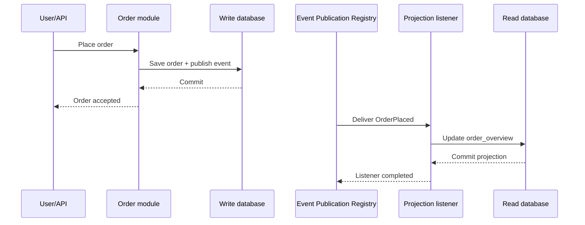

# Read model

## Mục tiêu

Trong một ứng dụng Spring Modulith, module nghiệp vụ thường tổ chức dữ liệu theo aggregate để bảo vệ quy tắc và tính nhất quán khi ghi. Nhưng nhu cầu đọc của màn hình, báo cáo hoặc API có thể khác hẳn cách dữ liệu được tổ chức để ghi. Một trang quản lý đơn hàng có thể cần tên khách hàng, trạng thái thanh toán, trạng thái giao hàng và tổng tiền trong một lần truy vấn, dù các dữ liệu đó thuộc nhiều module.

**Read model** là cấu trúc dữ liệu được tối ưu cho một hoặc một nhóm nhu cầu truy vấn cụ thể. Nó có thể được xây dựng từ application events do các module phát ra. Module sở hữu dữ liệu ghi vẫn kiểm soát aggregate và quy tắc nghiệp vụ; module/read side nhận event để cập nhật projection phục vụ truy vấn.

Sau bài học, bạn có thể:

- Phân biệt write model và read model trong một ứng dụng modular.
- Thiết kế projection từ application events và giữ ranh giới module rõ ràng.
- Hiểu eventual consistency, độ trễ cập nhật và cách hiển thị trạng thái cho người dùng.
- Làm projection idempotent, xử lý duplicate và event đến sai thứ tự.
- Thiết kế truy vấn, rebuild/replay, kiểm thử và quan sát read model.

## 1. Vì sao cần read model?

Write model thường được thiết kế để bảo vệ quy tắc nghiệp vụ. Một aggregate `Order` có thể lưu trạng thái đơn, dòng hàng và các invariant liên quan. Khi truy vấn danh sách đơn hàng, người dùng lại cần lọc theo trạng thái, khoảng thời gian, tên khách hàng, trạng thái giao hàng và tổng tiền. Nếu mỗi request phải gọi tuần tự nhiều module rồi ghép dữ liệu, API dễ phát sinh nhiều truy vấn, phụ thuộc runtime và khó phân trang.

Read model giải quyết nhu cầu đó bằng cách tạo một cấu trúc đọc đã được chuẩn bị trước. Ví dụ, projection `order_overview` có thể chứa:

- Mã đơn và thời điểm tạo.
- Tên hoặc mã khách hàng phù hợp với quyền hiển thị.
- Tổng tiền và đơn vị tiền.
- Trạng thái đơn, thanh toán và giao hàng.
- Số lượng dòng hàng hoặc một số thông tin tóm tắt.

Khi một module phát event như `OrderPlaced`, `PaymentCaptured` hoặc `ShipmentDispatched`, read side nhận event và cập nhật projection. Request đọc chỉ cần truy vấn một bảng/view được tối ưu cho màn hình đó.

Read model không phải bản sao tùy tiện của toàn bộ database. Mỗi projection nên có mục đích truy vấn rõ ràng, trường dữ liệu tối thiểu và một module chịu trách nhiệm xây dựng, cập nhật, kiểm tra và vận hành.

## 2. Write model và read model

Hai mô hình phục vụ hai loại công việc khác nhau:

| Khía cạnh | Write model | Read model |
| --- | --- | --- |
| Mục tiêu | Bảo vệ quy tắc và thay đổi trạng thái nghiệp vụ. | Trả lời truy vấn nhanh, thuận tiện cho người dùng. |
| Cấu trúc | Aggregate, entity, value object và quan hệ theo miền nghiệp vụ. | Bảng phẳng, denormalized view, document hoặc projection chuyên biệt. |
| Thao tác chính | Command và transaction ghi. | Query và cập nhật projection từ event. |
| Quy tắc | Enforce invariant và quyền thay đổi. | Tối ưu lọc, sắp xếp, phân trang và tổng hợp. |
| Nhất quán | Thường được bảo vệ trong transaction ghi. | Thường eventual consistent với write model. |
| Chủ sở hữu | Module sở hữu nghiệp vụ và aggregate. | Module/query component sở hữu projection tương ứng. |

Tách read model không có nghĩa mọi truy vấn đều cần một database riêng. Có thể bắt đầu bằng một bảng projection trong cùng database, sau đó tách schema, datasource hoặc storage khi tải đọc và yêu cầu vận hành đòi hỏi. Điều quan trọng là quyền sở hữu dữ liệu và luồng cập nhật phải rõ ràng.

### Khi nào nên tạo projection?

Read model hữu ích khi:

- Một màn hình cần dữ liệu ghép từ nhiều module.
- Truy vấn cần lọc/sắp xếp trên nhiều thuộc tính hoặc phân trang ổn định.
- Báo cáo cần tổng hợp thường xuyên và việc tính toán tại request quá tốn kém.
- Dữ liệu nguồn có cấu trúc chuẩn hóa phù hợp cho ghi nhưng không phù hợp cho truy vấn.
- Có thể chấp nhận độ trễ cập nhật đã được xác định và truyền đạt rõ.

Không nên tạo projection chỉ để nhân đôi mọi bảng. Truy vấn đơn giản, ít tải và có thể được phục vụ tốt từ API/repository hiện có thì chưa cần thêm một luồng dữ liệu phải duy trì.

## 3. Xây dựng read model từ application events

Giả sử module Đơn hàng sở hữu aggregate `Order`. Khi đơn được xác nhận, module phát application event mô tả điều đã xảy ra. Một projection listener nhận event và cập nhật bảng đọc.

```java
public record OrderPlaced(
        UUID eventId,
        UUID orderId,
        String orderNumber,
        UUID customerId,
        long totalAmountMinor,
        String currency,
        Instant occurredAt,
        long aggregateVersion) {}
```

Module Đơn hàng phát event trong transaction nghiệp vụ:

```java
@Service
class OrderApplicationService {

    private final OrderRepository orders;
    private final ApplicationEventPublisher events;

    OrderApplicationService(
            OrderRepository orders,
            ApplicationEventPublisher events) {
        this.orders = orders;
        this.events = events;
    }

    @Transactional
    public void place(PlaceOrder command) {
        Order order = Order.place(command);
        orders.save(order);

        events.publishEvent(new OrderPlaced(
                UUID.randomUUID(),
                order.getId(),
                order.getOrderNumber(),
                order.getCustomerId(),
                order.getTotalAmountMinor(),
                order.getCurrency(),
                Instant.now(),
                order.getVersion()));
    }
}
```

Read side có thể lắng nghe bằng `@ApplicationModuleListener`:

```java
@Component
class OrderOverviewProjection {

    private final OrderOverviewRepository repository;

    OrderOverviewProjection(OrderOverviewRepository repository) {
        this.repository = repository;
    }

    @ApplicationModuleListener
    void on(OrderPlaced event) {
        repository.insertPlaced(
                event.orderId(),
                event.orderNumber(),
                event.customerId(),
                event.totalAmountMinor(),
                event.currency(),
                event.occurredAt(),
                event.aggregateVersion());
    }
}
```

Ví dụ lược bỏ repository implementation và phần xử lý duplicate để tập trung vào luồng. `@ApplicationModuleListener` cung cấp mô hình listener bất đồng bộ sau commit trong Spring Modulith. Event Publication Registry có thể theo dõi publication tới listener và ghi nhận listener hoàn tất; publication chưa hoàn tất có thể được resubmit theo cơ chế ứng dụng cấu hình.

Việc xử lý projection thường nằm trong transaction riêng của listener. Nếu projection update thất bại, publication chưa hoàn tất có thể được retry. Nếu update thành công nhưng tiến trình dừng trước khi registry ghi nhận hoàn tất, listener có thể nhận lại event. Vì vậy, projection phải xử lý duplicate an toàn.

## 4. Thiết kế cấu trúc projection

Một read model nên phản ánh câu hỏi cần trả lời. Ví dụ màn hình danh sách đơn hàng có thể dùng bảng phẳng:

```sql
CREATE TABLE order_overview (
    order_id              UUID PRIMARY KEY,
    order_number          VARCHAR(80) NOT NULL,
    customer_id           UUID NOT NULL,
    customer_display_name VARCHAR(200),
    total_amount_minor    BIGINT NOT NULL,
    currency              CHAR(3) NOT NULL,
    order_status          VARCHAR(30) NOT NULL,
    payment_status        VARCHAR(30),
    shipment_status       VARCHAR(30),
    placed_at             TIMESTAMP WITH TIME ZONE NOT NULL,
    aggregate_version     BIGINT NOT NULL,
    updated_at            TIMESTAMP WITH TIME ZONE NOT NULL
);

CREATE INDEX ix_order_overview_status_placed
    ON order_overview (order_status, placed_at DESC);

CREATE INDEX ix_order_overview_customer
    ON order_overview (customer_id, placed_at DESC);
```

Các trường trên chỉ là ví dụ. Nếu màn hình không cần tên khách hàng, không nên sao chép trường đó vào projection. Nếu tên khách hàng cần thay đổi theo sự kiện từ module Khách hàng, projection phải nhận event cập nhật tương ứng hoặc truy vấn qua một API phù hợp. Mỗi trường được lưu trong projection đều kéo theo một trách nhiệm đồng bộ và chính sách dữ liệu.

### Denormalize có chủ đích

Denormalization giúp giảm join và số lần gọi giữa module ở thời điểm đọc. Tuy nhiên, nó làm phát sinh các câu hỏi:

- Module nào là nguồn sự thật của mỗi trường?
- Event nào cập nhật trường đó?
- Điều gì xảy ra nếu event đến trùng hoặc sai thứ tự?
- Projection phản ứng thế nào khi dữ liệu nguồn bị xóa hoặc ẩn danh hóa?
- Khi rebuild, có thể lấy lại đầy đủ dữ liệu từ nguồn nào?

Hãy ghi rõ nguồn dữ liệu và event cập nhật cho từng trường quan trọng. Đừng để projection trở thành nơi chỉnh sửa dữ liệu nghiệp vụ trực tiếp; thay đổi nghiệp vụ phải đi qua command/API của module sở hữu dữ liệu.

### Một projection hay nhiều projection?

Có thể có nhiều read model cho cùng một write model:

- `order_overview` phục vụ màn hình danh sách.
- `order_detail` phục vụ trang chi tiết.
- `daily_order_metrics` phục vụ dashboard tổng hợp.

Mỗi projection có thể chọn trường, chỉ mục và chiến lược cập nhật riêng. Tránh một bảng khổng lồ phục vụ mọi truy vấn nếu điều đó khiến schema khó hiểu và cập nhật quá phức tạp.

## 5. Eventual consistency và trải nghiệm người dùng

Với listener bất đồng bộ, transaction ghi đơn hàng có thể commit trước khi projection được cập nhật. Trong khoảng thời gian đó, truy vấn read model có thể chưa thấy đơn mới hoặc vẫn hiển thị trạng thái cũ. Đây là eventual consistency.



Độ trễ phụ thuộc tải, scheduler, retry và khả năng sẵn sàng của read side. Không nên mặc định event listener hoàn tất ngay trước khi API trả response.

### Chọn cách phản hồi cho command

Nếu người dùng tạo đơn và ngay sau đó mở trang chi tiết, read model có thể chưa cập nhật. Có một số cách xử lý:

- Trả về dữ liệu tối thiểu từ command response (ví dụ order ID và trạng thái vừa commit), không buộc client đọc lại projection ngay lập tức.
- Cho phép query theo read model sau một khoảng ngắn và hiển thị trạng thái đang đồng bộ nếu chưa thấy dữ liệu.
- Với luồng cần read-your-writes, trả về projection version/checkpoint và cho phép query chờ tới khi read side đạt version đó trong một thời hạn ngắn.
- Với thao tác cần quyết định nghiệp vụ tức thời, đọc write model/API của module sở hữu dữ liệu thay vì dựa vào projection eventual consistent.

Không nên biến mọi query thành thao tác chờ projection. Một projection chậm không nên khiến command giữ transaction hoặc thread chờ vô thời hạn.

### Đo độ trễ projection

Có thể đo thời gian từ `occurredAt` tới thời điểm projection ghi nhận event, nhưng cần lưu ý đồng hồ giữa các máy có thể lệch. Một cách khác là đo từ lúc consumer bắt đầu xử lý tới lúc commit projection, kết hợp với consumer lag và tuổi publication chưa hoàn tất.

Hãy đặt SLO theo nhu cầu màn hình. Dashboard vận hành có thể chấp nhận vài giây; một luồng quyết định tồn kho có thể cần dữ liệu nhất quán mạnh hơn và không nên dựa vào read model trễ.

## 6. Idempotency và xử lý event sai thứ tự

Projection listener có thể nhận lại cùng event khi listener đã cập nhật read database nhưng registry chưa ghi nhận publication hoàn tất. Nếu cộng dồn số tiền hoặc tăng counter mà không chống duplicate, dữ liệu đọc sẽ sai.

### Lưu event ID đã áp dụng

Một cách là lưu inbox/checkpoint cho projection:

```sql
CREATE TABLE projection_processed_event (
    projection_name VARCHAR(160) NOT NULL,
    event_id        UUID NOT NULL,
    processed_at    TIMESTAMP WITH TIME ZONE NOT NULL,
    PRIMARY KEY (projection_name, event_id)
);
```

Ghi inbox và cập nhật projection trong cùng transaction:

```text
BEGIN
    INSERT projection_processed_event(projection_name, event_id)
    nếu event_id đã tồn tại:
        COMMIT và bỏ qua duplicate
    nếu là event mới:
        cập nhật projection
COMMIT
```

Unique constraint là hàng rào chống hai worker cùng áp dụng một event. Không ghi `processed_event` trong transaction độc lập với projection update; nếu một bên commit còn bên kia rollback, hệ thống có thể bỏ mất hoặc áp dụng lặp event.

### Dùng aggregate version để phát hiện thứ tự

Giả sử `OrderPlaced` có version 1, `PaymentCaptured` có version 2 và `OrderCancelled` có version 3. Nếu projection nhận version 3 trước version 2, một update không có kiểm tra có thể ghi đè trạng thái mới bằng dữ liệu cũ khi version 2 đến sau.

Có thể áp dụng điều kiện version khi cập nhật:

```sql
UPDATE order_overview
SET order_status = :orderStatus,
    aggregate_version = :incomingVersion,
    updated_at = :now
WHERE order_id = :orderId
  AND aggregate_version < :incomingVersion;
```

Điều kiện này ngăn event có version cũ ghi đè trạng thái mới. Tuy nhiên, nó chỉ phù hợp khi version tăng đơn điệu theo aggregate và mỗi event mang snapshot/delta đủ để áp dụng độc lập. Nếu event là delta phụ thuộc thứ tự, bỏ qua một version có thể làm mất thay đổi. Khi đó cần phát hiện khoảng trống version và chờ, retry hoặc tải lại trạng thái nguồn theo API được phép.

Không dùng timestamp làm thứ tự tuyệt đối nếu nhiều event có thể cùng timestamp hoặc đồng hồ không đồng bộ. Aggregate version/sequence do nguồn sở hữu thường đáng tin cậy hơn.

### Cập nhật projection dạng snapshot và dạng delta

- **Snapshot event** chứa trạng thái đủ để ghi đè projection của aggregate tới một version. Có thể bỏ qua snapshot cũ nếu đã có version mới hơn.
- **Delta event** chỉ chứa thay đổi (ví dụ `QuantityIncreased` +2). Cần xử lý đúng thứ tự và chống duplicate; bỏ qua một delta có thể làm projection sai.

Hãy xác định rõ semantics của từng event. Không xử lý một delta như snapshot hoặc ngược lại.

## 7. Truy vấn read model

Read model nên có API truy vấn theo nhu cầu người dùng, không để controller truy cập trực tiếp bảng projection ở nhiều nơi.

Ví dụ query service:

```java
public record OrderOverviewItem(
        UUID orderId,
        String orderNumber,
        String customerDisplayName,
        long totalAmountMinor,
        String currency,
        String orderStatus,
        String paymentStatus,
        Instant placedAt) {}

@Service
class OrderOverviewQueries {

    private final OrderOverviewRepository repository;

    OrderOverviewQueries(OrderOverviewRepository repository) {
        this.repository = repository;
    }

    Page<OrderOverviewItem> search(
            OrderSearchCriteria criteria,
            Pageable pageable) {
        return repository.search(criteria, pageable);
    }
}
```

Query criteria nên có giới hạn hợp lý, whitelist field được sort, phân trang ổn định và áp dụng authorization. Không cho client truyền tên cột tùy ý vào SQL. Nếu dữ liệu projection chứa trường từ nhiều module, quyền hiển thị cần được xác định theo quy tắc bảo mật của ứng dụng, không chỉ theo việc trường đã có sẵn trong bảng.

### Phân trang và chỉ mục

Với danh sách lớn, dùng index khớp điều kiện lọc/sắp xếp phổ biến. Offset pagination dễ triển khai nhưng có thể chậm ở offset lớn và kết quả có thể dịch chuyển khi dữ liệu thay đổi. Keyset/cursor pagination dựa trên cặp khóa sắp xếp ổn định (ví dụ `placed_at` và `order_id`) có thể phù hợp hơn cho luồng dữ liệu lớn.

Đừng tạo index cho mọi field. Index làm tăng chi phí cập nhật projection; hãy dựa trên truy vấn thực tế và đo bằng execution plan của database.

## 8. Rebuild và replay projection

Projection có thể bị sai do bug mapper, thay đổi quy tắc tổng hợp hoặc migration schema. Cần có kế hoạch xây dựng lại.

Nguồn để rebuild có thể là:

- Event log/event store do ứng dụng chủ động lưu giữ.
- Kafka topic có retention đủ dài hoặc một luồng archive có thể đọc lại.
- Dữ liệu authoritative từ module sở hữu, thông qua API/export được thiết kế cho việc rebuild.
- Snapshot kết hợp event log từ một checkpoint.

**Event Publication Registry không phải event store.** Registry theo dõi trạng thái publication tới listener và hỗ trợ phát lại publication chưa hoàn tất theo cơ chế được cấu hình; nó không mặc định lưu toàn bộ lịch sử event đã hoàn tất để rebuild projection từ đầu. Nếu cần rebuild toàn bộ, phải có nguồn lịch sử hoặc cách đọc lại dữ liệu authoritative.

### Rebuild có kiểm soát

Một quy trình rebuild có thể gồm:

1. Xác định phiên bản projection/schema mới và nguồn dữ liệu authoritative.
2. Tạo bảng hoặc projection generation mới, không xóa read model đang phục vụ người dùng.
3. Đọc event/data theo checkpoint và áp dụng theo thứ tự cần thiết.
4. Ghi event ID/version đã xử lý để replay không tạo duplicate.
5. Theo dõi số bản ghi, tổng hợp, lỗi và độ trễ so với projection hiện hành.
6. Đồng bộ phần event phát sinh trong lúc rebuild bằng checkpoint/watermark.
7. Chuyển query service sang projection mới khi đã xác minh đạt yêu cầu.
8. Giữ projection cũ trong khoảng rollback phù hợp rồi mới dọn.

Với projection lớn, blue-green hoặc shadow rebuild giúp tránh phục vụ dữ liệu chưa hoàn chỉnh. Cần tính đến event đến trong lúc snapshot/replay; nếu không có checkpoint nhất quán, projection mới có thể bỏ sót hoặc áp dụng trùng thay đổi.

### Thay đổi logic projection

Khi thay đổi cách tính trường, hãy ghi rõ version logic projection. Nếu cùng event được replay bằng logic mới, kết quả có thể khác projection cũ. Việc chuyển generation nên có kiểm tra số liệu và khả năng quay lại. Không chỉnh tay vài dòng trong projection production nếu không có cách tái tạo cùng thay đổi từ nguồn dữ liệu authoritative.

## 9. Ranh giới module và quyền sở hữu dữ liệu

Spring Modulith giúp module giao tiếp qua application events và API công khai. Một read model có thể thuộc module Query/Reporting hoặc thuộc module nghiệp vụ phục vụ các truy vấn của chính module đó. Dù ở đâu, cần xác định chủ sở hữu rõ ràng.

Các nguyên tắc:

- Module nguồn phát event mô tả thay đổi đã commit; không để module khác đọc trực tiếp bảng nội bộ của nó để xây projection.
- Projection listener chỉ phụ thuộc vào hợp đồng event công khai và repository của read side.
- Query controller gọi query API của module sở hữu projection.
- Module khác không tự cập nhật bảng projection; thay đổi phải đi qua listener/projection service có trách nhiệm.
- Nếu projection cần dữ liệu từ nhiều nguồn, mỗi module nguồn phát event có đủ dữ liệu theo hợp đồng hoặc cung cấp API công khai được phép.

Không nên phát event quá chi tiết gắn với từng thao tác persistence như `OrderRowUpdated`. Event nên mô tả thay đổi có ý nghĩa nghiệp vụ và mang đủ thông tin để consumer cập nhật projection. Đồng thời, tránh biến event thành một bản sao toàn bộ aggregate nếu điều đó làm lộ dữ liệu hoặc khóa chặt consumer vào cấu trúc nội bộ.

## 10. Kiểm thử read model

Kiểm thử nên xác nhận projection phản ánh đúng chuỗi event, xử lý duplicate/sai thứ tự và có thể phục hồi sau lỗi.

| Tình huống | Điều cần xác minh |
| --- | --- |
| Event tạo mới | Projection có đúng ID, trạng thái, số tiền và version. |
| Event cập nhật | Chỉ các trường liên quan thay đổi; dữ liệu không liên quan được giữ nguyên. |
| Duplicate event | Event ID đã xử lý không làm thay đổi projection lần thứ hai. |
| Event cũ đến muộn | Version cũ không ghi đè snapshot mới; delta có khoảng trống được xử lý theo policy. |
| Projection update rollback | Inbox và projection cùng rollback để event có thể được retry. |
| Listener lỗi | Publication chưa hoàn tất có thể được retry/resubmit theo cấu hình. |
| Rebuild | Projection mới khớp dữ liệu authoritative/checkpoint đã chọn. |
| Quyền truy cập | Query chỉ trả các trường và bản ghi người dùng được phép xem. |
| Pagination | Thứ tự ổn định, không lặp/mất bản ghi trong điều kiện đã xác định. |

Ví dụ unit test cho mapper/projection handler:

```java
@Test
void appliesOrderPlacedToOverview() {
    OrderPlaced event = new OrderPlaced(
            eventId,
            orderId,
            "ORD-1001",
            customerId,
            125000L,
            "VND",
            occurredAt,
            1L);

    projection.on(event);

    verify(repository).insertPlaced(
            orderId,
            "ORD-1001",
            customerId,
            125000L,
            "VND",
            occurredAt,
            1L);
}
```

Unit test xác nhận mapping và quyết định handler. Integration test cần chạy với transaction/database thật hoặc Testcontainers khi cần kiểm tra unique constraint, upsert, locking và rollback. Test listener sau commit phải tạo transaction commit rõ ràng; transaction test rollback mặc định có thể khiến listener không được kích hoạt như mong đợi.

## 11. Quan sát và vận hành

Read model cần được theo dõi như một pipeline dữ liệu. Các chỉ số hữu ích gồm:

- Số publication đang chờ hoặc chưa hoàn tất theo listener projection.
- Tuổi event chưa áp dụng lâu nhất và độ trễ từ event tới projection commit.
- Số event đã xử lý, duplicate, lỗi, retry và resubmission.
- Số event bị bỏ qua do version cũ hoặc bị giữ lại do thiếu version.
- Kích thước projection, tốc độ cập nhật, thời gian query và tỷ lệ query lỗi.
- Trạng thái rebuild, checkpoint/watermark và sai khác giữa projection generation.

Log nên có `event_id`, `aggregate_id`, `aggregate_version`, `projection_name`, `listener_id` và correlation ID. Tránh ghi payload nhạy cảm. Dashboard cần phân biệt projection chậm do backlog, projection lỗi do handler, và query chậm do index/SQL.

Đặt cảnh báo theo SLO đọc. Ví dụ, nếu đơn mới cần xuất hiện trên màn hình trong 5 giây, cảnh báo khi tuổi event chưa áp dụng vượt ngưỡng đó. Nếu projection dùng cho báo cáo cuối ngày, có thể theo dõi checkpoint theo lịch thay vì cảnh báo từng giây.

## 12. Những lỗi thiết kế thường gặp

| Lỗi | Hậu quả | Cách xử lý |
| --- | --- | --- |
| Dùng read model để quyết định invariant cần nhất quán mạnh | Dữ liệu eventual consistent có thể dẫn tới quyết định sai. | Đưa quyết định về module sở hữu write model. |
| Sao chép quá nhiều trường | Projection khó cập nhật, tăng dữ liệu nhạy cảm và coupling. | Chỉ giữ trường phục vụ query đã xác định. |
| Không chống duplicate | Retry làm cộng dồn hoặc cập nhật lặp. | Inbox/event ID trong cùng transaction projection. |
| Không xử lý event sai thứ tự | Dữ liệu cũ ghi đè dữ liệu mới. | Aggregate version/sequence và policy cho gap. |
| Coi Event Publication Registry là event store | Không thể rebuild lịch sử đã hoàn tất. | Dùng nguồn event/data authoritative có retention phù hợp. |
| Rebuild trực tiếp bảng đang phục vụ | Người dùng thấy dữ liệu rỗng hoặc không nhất quán. | Dùng generation/shadow projection và chuyển đổi có kiểm soát. |
| Module khác ghi trực tiếp projection | Phá vỡ quyền sở hữu và khó truy vết. | Cập nhật qua projection handler/API của owner. |
| Không đo độ trễ read side | Người dùng thấy dữ liệu cũ mà vận hành không phát hiện. | Theo dõi backlog, event age và projection lag. |

## 13. Quy trình áp dụng

Khi xây dựng read model trong một module Spring Modulith:

1. Xác định màn hình/query và SLO cần phục vụ.
2. Chọn module sở hữu projection và định nghĩa API truy vấn.
3. Xác định event công khai từ write model cùng các field projection cần nhận.
4. Thiết kế bảng/document/index phù hợp với filter, sort và pagination thực tế.
5. Xây listener/projection handler cập nhật read side sau commit.
6. Ghi inbox/event ID và aggregate version cùng transaction với projection update.
7. Xác định cách xử lý eventual consistency, duplicate, event sai thứ tự và lỗi listener.
8. Chọn nguồn authoritative, checkpoint và quy trình rebuild/replay.
9. Kiểm thử mapping, transaction, concurrency, query, quyền truy cập và rebuild.
10. Theo dõi projection lag, publication status, query latency và sai khác dữ liệu.

Read model tách cách tổ chức dữ liệu để đọc khỏi cách bảo vệ dữ liệu để ghi. Khi projection được xây dựng từ application events có hợp đồng rõ, cập nhật idempotent và có khả năng rebuild, các module Spring Modulith có thể phục vụ truy vấn hiệu quả mà vẫn giữ quyền sở hữu nghiệp vụ và ranh giới module.
