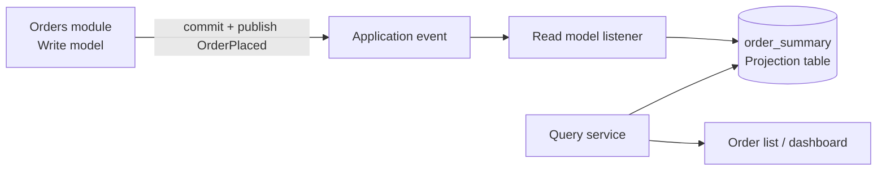
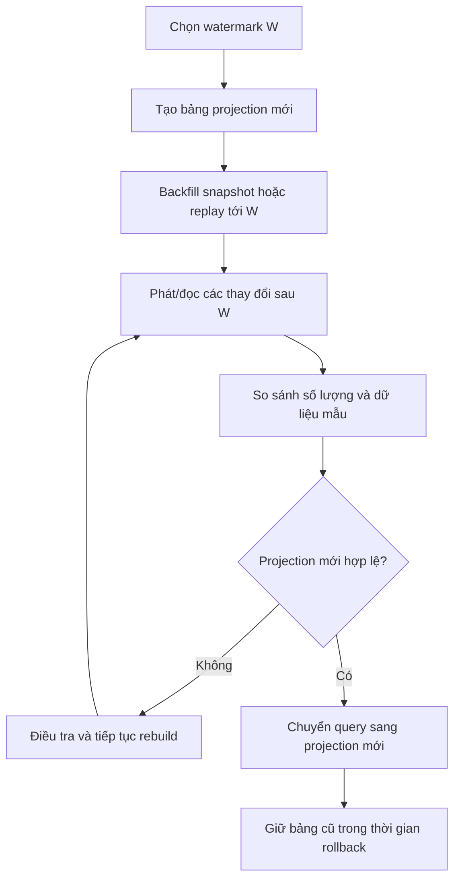

# Materialized view

Materialized view là một cách lưu sẵn kết quả đã tính toán để truy vấn nhanh hơn. Thay vì mỗi lần đọc đều join nhiều bảng, tính tổng hoặc tổng hợp dữ liệu từ đầu, hệ thống chuẩn bị một cấu trúc đọc chứa dữ liệu đã được biến đổi theo nhu cầu truy vấn. Trong kiến trúc Spring Modulith, application events có thể giúp cập nhật cấu trúc này sau khi nghiệp vụ ở module nguồn đã commit.

Ví dụ, module `orders` sở hữu dữ liệu đơn hàng chuẩn hóa. Màn hình vận hành cần hiển thị tên khách hàng, trạng thái thanh toán, trạng thái giao hàng và tổng tiền trong một danh sách. Nếu mỗi lần tải màn hình đều truy vấn nhiều bảng hoặc gọi nhiều module, truy vấn có thể chậm và tạo phụ thuộc giữa các module. Một read model được materialize có thể lưu sẵn dữ liệu hiển thị để truy vấn bằng một câu SQL đơn giản.

## 1. Materialized view giải quyết vấn đề gì?

Mô hình ghi thường được chuẩn hóa để bảo vệ tính nhất quán và quy tắc nghiệp vụ. Mô hình đọc lại cần phục vụ một hoặc nhiều truy vấn cụ thể. Hai mục tiêu này khác nhau:

- Mô hình ghi tối ưu cho việc thay đổi trạng thái hợp lệ và bảo vệ invariant.
- Mô hình đọc tối ưu cho việc tìm kiếm, lọc, sắp xếp, phân trang và hiển thị dữ liệu.

Khi dữ liệu đọc được tạo từ nhiều aggregate hoặc nhiều module, một truy vấn trực tiếp có thể cần nhiều phép join, tính toán hoặc lời gọi liên module. Điều này làm tăng độ trễ và khiến module đọc phụ thuộc vào cấu trúc nội bộ của các module khác.

Materialized view lưu kết quả đã được chuẩn bị trước. Ví dụ, một hàng trong `order_summary` có thể chứa `orderId`, `customerName`, `totalAmount`, `paymentStatus`, `shippingStatus` và `lastUpdatedAt`. Màn hình danh sách chỉ cần đọc bảng này thay vì tự tổng hợp từ nhiều nguồn mỗi lần.

Đổi lại, hệ thống phải cập nhật read model khi dữ liệu nguồn thay đổi và chấp nhận một mức độ trễ đồng bộ nếu việc cập nhật diễn ra bất đồng bộ. Vì vậy, materialized view là một lựa chọn thiết kế dựa trên mẫu truy vấn và yêu cầu nhất quán, không phải một bản sao đầy đủ của mọi bảng ghi.

## 2. Phân biệt database materialized view và projection table

Thuật ngữ materialized view thường được dùng cho hai cách triển khai có liên quan nhưng khác nhau:

| Cách triển khai | Cách dữ liệu được cập nhật | Điểm cần cân nhắc |
| --- | --- | --- |
| Materialized view do database quản lý | Database lưu kết quả của một câu truy vấn và làm mới theo cơ chế của hệ quản trị, chẳng hạn refresh định kỳ hoặc theo lệnh. | Cách refresh, khóa, mức độ mới của dữ liệu và khả năng refresh đồng thời phụ thuộc database. |
| Projection table do ứng dụng quản lý | Application event hoặc tiến trình đồng bộ cập nhật một bảng được thiết kế riêng cho truy vấn. | Ứng dụng phải xử lý thứ tự event, duplicate, retry, rebuild và quan sát độ trễ. |

Trong Spring Modulith, một cách phổ biến là dùng application event và transactional listener để cập nhật projection table. Bảng này thường được gọi là materialized read model. Nó không tự động là một native materialized view của database, và Spring Modulith cũng không tự tạo hay refresh bảng đó chỉ vì module phát event.

Nếu chọn native materialized view, hãy dùng khả năng và giới hạn của hệ quản trị database đang triển khai. Nếu chọn projection table do ứng dụng quản lý, hãy thiết kế listener và quy trình phục hồi như một phần của luồng giao sự kiện.

## 3. Vị trí của materialized view trong Spring Modulith

Spring Modulith giúp các module giao tiếp qua application event. Module nguồn phát event mô tả một thay đổi nghiệp vụ đã xảy ra; module sở hữu read model nhận event và cập nhật dữ liệu đọc của mình.



Một luồng điển hình:

1. Module `orders` xác thực lệnh và lưu thay đổi vào write model trong transaction.
2. Module nguồn phát `OrderPlaced` trong transaction đó.
3. Sau khi transaction commit, listener cập nhật projection table.
4. Query service đọc projection table để trả dữ liệu cho giao diện hoặc API.

Với listener cần xử lý sau commit và được theo dõi publication, `@ApplicationModuleListener` là một lựa chọn phù hợp. Annotation này cung cấp listener bất đồng bộ và transaction riêng theo cơ chế của Spring Modulith. Event Publication Registry theo dõi publication tới transactional listener để ứng dụng có thể biết publication nào đã hoàn tất và publication nào còn dang dở.

Registry giúp theo dõi việc giao event; nó không tự định nghĩa cấu trúc read model, quy tắc tổng hợp hoặc câu truy vấn. Module sở hữu projection vẫn chịu trách nhiệm cập nhật dữ liệu đúng và có thể chạy lại an toàn.

## 4. Thiết kế read model theo truy vấn

Hãy bắt đầu từ các câu hỏi mà màn hình hoặc API cần trả lời, rồi mới thiết kế bảng projection. Ví dụ, trang danh sách đơn hàng cần:

- Lọc theo trạng thái thanh toán và trạng thái giao hàng.
- Tìm theo mã đơn hoặc tên khách hàng.
- Sắp xếp theo thời điểm tạo hoặc thời điểm cập nhật gần nhất.
- Hiển thị tổng tiền và trạng thái mà không gọi từng module khác.

Một bảng có thể được thiết kế như sau:

```sql
CREATE TABLE order_summary (
    order_id UUID PRIMARY KEY,
    customer_name VARCHAR(200) NOT NULL,
    total_amount DECIMAL(19, 2) NOT NULL,
    currency_code CHAR(3) NOT NULL,
    payment_status VARCHAR(30) NOT NULL,
    shipping_status VARCHAR(30) NOT NULL,
    aggregate_version BIGINT NOT NULL,
    created_at TIMESTAMP NOT NULL,
    last_updated_at TIMESTAMP NOT NULL
);

CREATE INDEX idx_order_summary_payment_created
    ON order_summary (payment_status, created_at DESC);

CREATE INDEX idx_order_summary_shipping_created
    ON order_summary (shipping_status, created_at DESC);
```

Đây là schema minh họa; kiểu UUID, timestamp và cú pháp index cần điều chỉnh theo database của ứng dụng. Chỉ đưa vào projection những trường cần cho truy vấn. Nếu một trường không được dùng để lọc, sắp xếp hoặc hiển thị, hãy cân nhắc có thực sự cần lưu nó hay không.

Projection có thể phi chuẩn hóa dữ liệu từ nhiều module. Ví dụ `customerName` có thể đến từ event khách hàng hoặc snapshot tên tại thời điểm đặt hàng. Cần xác định rõ ý nghĩa: tên tại thời điểm đặt hàng hay tên hiện tại của khách hàng. Nếu ý nghĩa không rõ, projection có thể hiển thị dữ liệu hợp lệ về kiểu nhưng sai về nghiệp vụ.

Các chỉ mục cần dựa trên truy vấn thật. Tạo index cho mọi cột sẽ làm tăng chi phí ghi và dung lượng. Đo truy vấn thường dùng, phân trang và phân bố dữ liệu trước khi thêm index.

## 5. Phát event chứa đủ dữ liệu cho projection

Event nên là một DTO bất biến, mang dữ liệu cần thiết để listener cập nhật read model mà không phải truy cập entity đang được quản lý ở transaction nguồn.

```java
import java.math.BigDecimal;
import java.time.Instant;
import java.util.UUID;

public record OrderPlaced(
        UUID eventId,
        UUID orderId,
        long aggregateVersion,
        String customerName,
        BigDecimal totalAmount,
        String currencyCode,
        Instant occurredAt) {
}
```

Module nguồn phát event sau khi tạo đơn hàng:

```java
@Transactional
public UUID placeOrder(OrderRequest request) {
    Order order = orders.save(Order.create(request));

    events.publishEvent(new OrderPlaced(
            UUID.randomUUID(),
            order.getId(),
            order.getVersion(),
            order.getCustomerNameAtPlacement(),
            order.totalAmount(),
            order.currencyCode(),
            clock.instant()));

    return order.getId();
}
```

Các kiểu `Order`, `OrderRepository`, `OrderRequest` và `clock` là thành phần minh họa của ứng dụng. Trong hệ thống thực tế, event ID nên được tạo một lần cho lần phát logic và giữ ổn định khi retry hoặc externalize. Không tạo event ID mới mỗi lần gửi lại cùng một event.

Payload cần có đủ dữ liệu để listener cập nhật projection. Nếu listener phải gọi ngược vào module nguồn để tải entity, read model sẽ phụ thuộc vào trạng thái hiện tại thay vì snapshot của event. Cách đó có thể làm mất ý nghĩa lịch sử hoặc tạo thêm coupling. Chỉ truy vấn nguồn khi nghiệp vụ thật sự yêu cầu dữ liệu hiện tại và ranh giới module cho phép.

## 6. Cập nhật projection bằng transactional listener

Module sở hữu read model đăng ký listener để cập nhật bảng projection sau commit:

```java
import org.springframework.modulith.events.ApplicationModuleListener;
import org.springframework.stereotype.Component;

@Component
class OrderSummaryProjection {

    private final OrderSummaryRepository summaries;

    OrderSummaryProjection(OrderSummaryRepository summaries) {
        this.summaries = summaries;
    }

    @ApplicationModuleListener
    void on(OrderPlaced event) {
        summaries.createFrom(event);
    }
}
```

Ví dụ cho thấy listener thuộc module sở hữu projection. `OrderSummaryRepository.createFrom` là phương thức ứng dụng định nghĩa để lưu dữ liệu đọc. Nó cần chạy trong transaction của listener để các thay đổi projection có tính nguyên tử.

Khi transaction nguồn rollback, event và publication đăng ký trong transaction đó không được commit như một công việc cần giao. Khi transaction nguồn commit, listener được thực hiện theo cơ chế after-commit. Nếu listener lỗi trước khi publication được đánh dấu hoàn tất, registry có thể giữ trạng thái chưa hoàn tất để xử lý lại theo cấu hình và quy trình phục hồi của ứng dụng.

Không nên giả định mọi `@EventListener` thông thường đều có cùng bảo đảm với `@ApplicationModuleListener`. Hãy chọn loại listener phù hợp và xác nhận cấu hình transaction, persistence adapter cùng phiên bản Spring Modulith đang dùng.

## 7. Idempotency và xử lý event trùng

Listener có thể được gọi lại nếu tiến trình dừng sau khi đã cập nhật projection nhưng trước khi registry ghi nhận publication hoàn tất. Vì vậy, cập nhật read model phải idempotent: cùng một event được xử lý nhiều lần vẫn cho ra cùng kết quả đúng.

Một cách là lưu event ID đã xử lý cùng transaction với thay đổi projection:

```sql
CREATE TABLE projection_processed_event (
    projection_name VARCHAR(100) NOT NULL,
    event_id UUID NOT NULL,
    processed_at TIMESTAMP NOT NULL,
    PRIMARY KEY (projection_name, event_id)
);
```

Trong transaction listener, ứng dụng ghi nhận event ID, cập nhật projection và commit cả hai cùng nhau. Nếu event được giao lại, unique constraint cho biết event đã được áp dụng. Cần xử lý duplicate key theo cách không làm transaction bị đánh dấu thành công khi projection chưa được cập nhật đúng.

Một lựa chọn khác là cập nhật projection theo kiểu set-state từ event snapshot. Ví dụ, `OrderPlaced` có thể tạo hoặc cập nhật cùng một hàng với các giá trị xác định. Tuy nhiên, thao tác tăng counter hoặc cộng tiền như `total = total + event.amount` không idempotent nếu không có khóa chống trùng.

## 8. Thứ tự event và aggregate version

Nếu projection nhận nhiều event của cùng một aggregate, chúng có thể đến trùng hoặc sai thứ tự do retry, xử lý bất đồng bộ hoặc thay đổi thứ tự giao nhận. Nên đưa aggregate version hoặc sequence vào event để projection có thể phát hiện event cũ và event bị thiếu.

Ví dụ chuỗi event:

| Aggregate version | Event | Thay đổi read model |
| --- | --- | --- |
| 1 | `OrderPlaced` | Tạo hàng đơn hàng với trạng thái mới. |
| 2 | `PaymentCaptured` | Cập nhật `payment_status`. |
| 3 | `OrderShipped` | Cập nhật `shipping_status`. |

Với các event là snapshot đầy đủ và mỗi event mô tả toàn bộ trạng thái cần lưu, projection có thể bỏ qua event có version cũ hơn version hiện tại. Với event mô tả delta hoặc một chuyển đổi bắt buộc, bỏ qua version ở giữa có thể làm sai kết quả; projection cần phát hiện gap và chờ, retry hoặc điều tra.

Một thao tác cập nhật có điều kiện có thể dùng SQL theo kiểu PostgreSQL:

```sql
INSERT INTO order_summary (
    order_id, customer_name, total_amount, currency_code,
    payment_status, shipping_status, aggregate_version,
    created_at, last_updated_at
)
VALUES (
    :orderId, :customerName, :totalAmount, :currencyCode,
    'PENDING', 'NOT_SHIPPED', :version,
    :createdAt, :updatedAt
)
ON CONFLICT (order_id) DO UPDATE
SET customer_name = EXCLUDED.customer_name,
    total_amount = EXCLUDED.total_amount,
    currency_code = EXCLUDED.currency_code,
    aggregate_version = EXCLUDED.aggregate_version,
    last_updated_at = EXCLUDED.last_updated_at
WHERE order_summary.aggregate_version < EXCLUDED.aggregate_version;
```

Đây là cú pháp PostgreSQL minh họa cho cập nhật có điều kiện theo version, không phải SQL portable. Với delta event, repository cần kiểm tra version kế tiếp theo một thao tác nguyên tử và không áp dụng version 3 khi version 2 còn thiếu nếu cả hai đều cần thiết.

Nếu projection chỉ nhận một phần event của aggregate, không nhất thiết version phải tăng liên tiếp trong những event mà projection thấy. Hãy chọn sequence riêng cho projection hoặc thiết kế logic gap dựa trên tập event thực sự cần thiết; không áp dụng quy tắc `currentVersion + 1` một cách máy móc.

## 9. Cập nhật và xóa dữ liệu trong read model

Projection thường được cập nhật bởi nhiều loại event:

- `OrderPlaced` tạo hàng mới.
- `PaymentCaptured` cập nhật trạng thái thanh toán.
- `PaymentRefunded` cập nhật thông tin hoàn tiền.
- `OrderShipped` cập nhật trạng thái vận chuyển.
- `OrderCancelled` cập nhật trạng thái đơn hàng.

Với event cập nhật một phần, repository chỉ thay đổi những trường thuộc trách nhiệm event đó. Tránh ghi đè toàn bộ hàng bằng dữ liệu thiếu, khiến các trường do event khác quản lý bị đặt về null hoặc giá trị mặc định.

Khi một aggregate bị xóa, cần quyết định projection sẽ xóa hàng, giữ tombstone hay hiển thị trạng thái đã xóa. Nếu xóa vật lý, một event cũ được retry có thể tạo lại hàng đã xóa. Tombstone có thể giữ aggregate ID, version cuối và thời điểm xóa để chặn event cũ đến muộn.

Nếu dữ liệu projection được dùng cho audit hoặc báo cáo lịch sử, không nên xóa chỉ vì write model đã xóa bản ghi. Cần xác định retention và quy tắc ẩn dữ liệu riêng cho từng read model.

## 10. Query service đọc từ materialized view

Query service nên trả dữ liệu từ projection theo nhu cầu của người đọc và tránh đưa logic ghi nghiệp vụ vào đường đọc.

```java
import java.util.UUID;
import org.springframework.stereotype.Service;

@Service
class OrderQueryService {

    private final OrderSummaryRepository summaries;

    OrderQueryService(OrderSummaryRepository summaries) {
        this.summaries = summaries;
    }

    OrderSummaryView getOrder(UUID orderId) {
        return summaries.findViewByOrderId(orderId)
                .orElseThrow(() -> new OrderSummaryNotFoundException(orderId));
    }
}
```

`OrderSummaryView` có thể là DTO projection của Spring Data hoặc một kiểu dữ liệu đọc do ứng dụng định nghĩa. Query service không cần tải aggregate đầy đủ nếu màn hình chỉ cần một số trường đã materialize.

Với danh sách lớn, hãy dùng phân trang ổn định, sắp xếp theo cột có index và thêm tie-breaker duy nhất như `order_id`. Tránh offset pagination quá sâu nếu dữ liệu tăng nhanh; keyset pagination có thể phù hợp hơn. Bộ lọc và index phải khớp với các truy vấn thực tế.

Giữ quyền sở hữu dữ liệu rõ ràng: module sở hữu projection có thể cung cấp query API hoặc một interface đọc ổn định. Module khác không nên tự truy cập bảng nội bộ của projection nếu điều đó tạo phụ thuộc vào schema lưu trữ.

## 11. Eventual consistency và trải nghiệm đọc

Vì listener thường chạy sau commit và bất đồng bộ, write model có thể đã cập nhật trong khi read model chưa nhận event. Đây là eventual consistency. Độ trễ có thể chỉ vài mili giây khi hệ thống bình thường, nhưng có thể tăng khi listener chậm, database bận hoặc publication cần retry.

Ví dụ người dùng tạo đơn hàng và ngay lập tức tải trang chi tiết. Nếu trang đọc từ `order_summary`, hàng có thể chưa tồn tại. Cần quyết định hành vi sản phẩm:

- Trả kết quả từ write request để giao diện hiển thị ngay mã đơn và thông tin vừa tạo.
- Trả trạng thái `processing` hoặc `projection_pending` cho đến khi read model sẵn sàng.
- Cho phép truy vấn tạm thời từ nguồn có thẩm quyền đối với màn hình cần read-after-write.
- Poll hoặc subscribe trạng thái projection nếu trải nghiệm cần cập nhật tự động.

Không nên giả định query ngay sau command luôn nhìn thấy dữ liệu projection. Nếu cần bảo đảm đọc được phiên bản đã ghi, có thể trả aggregate version từ command và cho query service chờ tới khi projection đạt version đó trong một thời hạn rõ ràng. Hết thời hạn cần trả trạng thái chờ hoặc fallback phù hợp, không chặn request vô hạn.

## 12. Rebuild và backfill materialized view

Projection có thể sai do bug, thay đổi quy tắc tổng hợp hoặc cần thêm trường mới. Hệ thống cần cách xây dựng lại read model.

Có hai nguồn thường dùng:

- **Nguồn dữ liệu có thẩm quyền:** đọc write model hoặc các bảng nghiệp vụ và tạo lại projection theo snapshot hiện tại. Cách này phù hợp với read model biểu diễn trạng thái hiện tại, nhưng không thể tái tạo lịch sử đã bị xóa nếu nguồn không lưu.
- **Event log được lưu bền vững:** phát lại event theo thứ tự cần thiết để xây dựng projection. Cách này có thể tái tạo lịch sử phong phú hơn, nhưng đòi hỏi event được lưu đủ lâu, schema cũ còn đọc được và replay có kiểm soát.

Event Publication Registry của Spring Modulith là cơ chế theo dõi trạng thái giao publication tới listener; không nên xem nó mặc nhiên là event store lưu toàn bộ lịch sử event đã hoàn tất để rebuild projection. Nếu cần replay toàn bộ lịch sử, hãy có nguồn event log/outbox/archive được thiết kế rõ ràng.

Một quy trình rebuild an toàn có thể dùng bảng shadow:



Watermark giúp xác định ranh giới giữa dữ liệu snapshot và event cần phát lại. Nếu backfill và event live không có điểm cắt nhất quán, một thay đổi có thể bị bỏ sót hoặc áp dụng hai lần. Hãy thiết kế cách capture thay đổi trong lúc backfill và dùng event ID/version để chống trùng.

## 13. Migration khi thay đổi cấu trúc projection

Khi thêm trường hoặc thay đổi cách tổng hợp, có thể cần schema migration và backfill dữ liệu cũ. Tránh đổi trực tiếp cấu trúc đang được query trong khi listener và API vẫn chạy theo giả định cũ.

Một trình tự expand-contract:

1. Thêm cột hoặc bảng mới theo cách tương thích với code hiện tại.
2. Cập nhật listener để ghi dữ liệu mới, đồng thời duy trì các trường cũ trong giai đoạn chuyển tiếp.
3. Backfill dữ liệu hiện có bằng batch có giới hạn và có thể tiếp tục sau lỗi.
4. So sánh dữ liệu projection với nguồn có thẩm quyền và kiểm tra các truy vấn quan trọng.
5. Chuyển query service sang cấu trúc mới.
6. Ngừng ghi và xóa cấu trúc cũ sau khi đã hết thời gian rollback.

Nếu read model được dùng bởi nhiều module hoặc ứng dụng, schema của nó là một hợp đồng cần quản lý. Ưu tiên query API ổn định thay vì cho consumer phụ thuộc trực tiếp vào bảng vật lý.

## 14. Kiểm thử materialized view

Kiểm thử cần xác nhận cả cách cập nhật và cách truy vấn projection:

- **Commit:** khi command commit, event được đăng ký và listener có thể cập nhật projection sau commit.
- **Rollback:** khi transaction nguồn rollback, projection không được cập nhật từ event của transaction đó.
- **Projection mapping:** mỗi event tạo hoặc cập nhật đúng trường trong read model.
- **Duplicate:** cùng event được xử lý nhiều lần nhưng không tạo kết quả trùng.
- **Out-of-order:** event cũ hoặc version gap được phát hiện theo chính sách đã chọn.
- **Partial update:** event cập nhật một trường không xóa nhầm dữ liệu do event khác quản lý.
- **Delete/tombstone:** event xóa ngăn event cũ đến muộn tạo lại dữ liệu sai.
- **Query contract:** bộ lọc, sắp xếp, phân trang và quyền truy cập trả kết quả đúng.
- **Rebuild:** projection mới được tạo từ snapshot/event log và có thể chuyển đổi mà không bỏ sót thay đổi.
- **Failure recovery:** listener lỗi không làm publication bị đánh dấu hoàn tất sai và có thể được phục hồi.

Với listener after-commit, test bị bọc trong transaction rồi rollback có thể không kích hoạt listener như môi trường chạy thật. Hãy tạo ranh giới transaction rõ ràng và xác nhận transaction nguồn thực sự commit trước khi kiểm tra projection.

## 15. Quan sát độ mới và sức khỏe projection

Một read model có thể truy vấn nhanh nhưng dữ liệu đã cũ. Vì vậy, cần quan sát cả hiệu năng truy vấn và độ mới của projection.

Các chỉ số hữu ích:

| Chỉ số | Ý nghĩa |
| --- | --- |
| Projection lag | Khoảng thời gian từ lúc event xảy ra đến khi projection cập nhật. |
| Tuổi event chưa xử lý lâu nhất | Phát hiện publication đang bị kẹt. |
| Số publication chưa hoàn tất theo listener | Đo backlog cần xử lý hoặc điều tra. |
| Listener processing duration/error rate | Xác định listener chậm hoặc lỗi. |
| Projection row count và version watermark | Phát hiện thiếu dữ liệu hoặc rebuild chưa theo kịp. |
| Query latency và rows scanned | Đánh giá read model có thực sự phục vụ truy vấn hiệu quả. |
| Rebuild duration và mismatch count | Theo dõi chất lượng và tiến độ tái tạo projection. |

Log nên mang event ID, aggregate ID, aggregate version, projection name và correlation ID để liên kết command, publication và query. Tránh ghi toàn bộ payload nếu chỉ metadata là đủ để điều tra.

Có thể cung cấp trường `projectionUpdatedAt` hoặc watermark để giao diện và operator biết dữ liệu đọc được cập nhật tới thời điểm nào. Không dùng timestamp duy nhất để xác nhận đầy đủ event đã được áp dụng; version hoặc sequence đáng tin cậy hơn khi cần phát hiện gap.

## 16. Khi nào nên dùng materialized view?

Materialized view phù hợp khi một hoặc nhiều truy vấn đọc có chi phí cao, cấu trúc dữ liệu nguồn không phù hợp với cách hiển thị, hoặc cần tổng hợp dữ liệu từ nhiều module mà vẫn giữ ranh giới sở hữu rõ ràng.

Nó có thể chưa cần thiết nếu truy vấn hiện tại đơn giản, dữ liệu nhỏ hoặc yêu cầu đọc phải luôn phản ánh trạng thái mới nhất trong cùng transaction. Mỗi projection thêm một cấu trúc cần đồng bộ, giám sát, migration và rebuild. Hãy đo query hiện tại và xác định yêu cầu consistency trước khi tạo thêm read model.

Không nên dùng projection làm nguồn dữ liệu chuẩn cho lệnh ghi. Nếu người dùng cần thay đổi trạng thái đơn hàng, command phải đi qua module sở hữu aggregate và kiểm tra invariant trên write model. Read model chỉ phục vụ đọc và có thể được xây dựng lại từ nguồn có thẩm quyền.

## Những sai lầm thường gặp

- Coi projection table do ứng dụng cập nhật là native materialized view của database.
- Đưa JPA entity hoặc aggregate đang được quản lý vào payload event.
- Cập nhật projection bằng phép cộng hoặc tăng counter mà không có idempotency.
- Giả định event luôn đến đúng thứ tự và không bao giờ được giao lại.
- Dùng Event Publication Registry như một event store để replay toàn bộ lịch sử.
- Không có quy trình rebuild khi projection bị sai hoặc cần thay đổi schema.
- Không xử lý eventual consistency ở màn hình đọc ngay sau khi ghi.
- Để module khác truy cập trực tiếp bảng nội bộ và phụ thuộc vào schema projection.
- Xóa projection row mà không có tombstone/version để chặn event cũ đến muộn.
- Chỉ theo dõi query latency mà bỏ qua projection lag và publication backlog.

## Checklist thiết kế và vận hành

- [ ] Read model được thiết kế từ truy vấn thực tế và chỉ chứa dữ liệu cần thiết.
- [ ] Đã chọn rõ native database materialized view hay application-managed projection table.
- [ ] Module sở hữu projection và query API được xác định.
- [ ] Event DTO bất biến, đủ dữ liệu và có event ID/aggregate version phù hợp.
- [ ] Listener after-commit được cấu hình theo cơ chế transactional phù hợp.
- [ ] Projection update idempotent và xử lý duplicate/out-of-order theo chính sách.
- [ ] Các cập nhật nhiều trường được lưu trong transaction nhất quán.
- [ ] Đã xác định hành vi eventual consistency và read-after-write cho giao diện/API.
- [ ] Có nguồn dữ liệu và quy trình backfill/rebuild với watermark rõ ràng.
- [ ] Migration projection có chiến lược expand-contract và khả năng rollback.
- [ ] Có kiểm thử commit, rollback, duplicate, ordering, query và recovery.
- [ ] Có metric cho projection lag, backlog, lỗi listener và query performance.

Materialized view giúp biến dữ liệu nghiệp vụ thành cấu trúc đọc phù hợp với nhu cầu truy vấn. Khi projection được cập nhật bằng application events sau commit, có idempotency, kiểm soát version và quy trình rebuild rõ ràng, các module có thể phục vụ truy vấn nhanh mà vẫn giữ quyền sở hữu write model và ranh giới nghiệp vụ.
