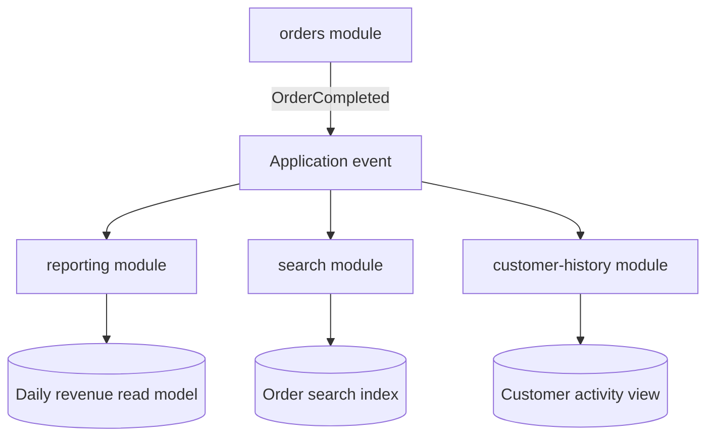

# Projection theo module

*Tổ chức read model theo quyền sở hữu dữ liệu và ranh giới module Spring Modulith*

Trong một ứng dụng Spring Modulith, mỗi module nên sở hữu dữ liệu và quy tắc nghiệp vụ của mình. Khi một module khác cần thông tin để phục vụ truy vấn, báo cáo hoặc tìm kiếm, việc đọc trực tiếp bảng dữ liệu hay repository nội bộ của module nguồn sẽ tạo phụ thuộc vào cách triển khai của module đó. **Projection theo module** giải quyết vấn đề bằng cách để module cần dữ liệu tự xây dựng read model từ application event mà module sở hữu dữ liệu phát ra.

Module nguồn tiếp tục quản lý aggregate và transaction ghi. Nó phát event mô tả sự kiện nghiệp vụ đã xảy ra. Module tiêu thụ nhận event và cập nhật read model thuộc quyền sở hữu của chính nó. Cách tổ chức này giữ ranh giới dữ liệu rõ ràng, cho phép mỗi module tối ưu truy vấn theo nhu cầu riêng và giảm phụ thuộc giữa các module.

## 1. Vì sao projection nên thuộc về module tiêu thụ?

Giả sử ứng dụng có các module `orders`, `customers` và `reporting`. Module `orders` quản lý đơn hàng và trạng thái thanh toán. Module `reporting` cần hiển thị tổng doanh thu theo ngày và số đơn hàng theo trạng thái. Nếu `reporting` truy vấn trực tiếp bảng `orders` hoặc dùng repository nội bộ của `orders`, cấu trúc lưu trữ của module nguồn trở thành hợp đồng ngầm.

Khi `orders` đổi cách lưu aggregate, đổi schema hoặc tách bảng, `reporting` có thể bị ảnh hưởng dù quy tắc báo cáo không đổi. Thay vào đó, `orders` phát event như `OrderCompleted`; `reporting` nhận event và cập nhật bảng tổng hợp riêng. Module `reporting` chỉ phụ thuộc vào ý nghĩa của event contract.

| Trách nhiệm | Module sở hữu | Ví dụ |
|---|---|---|
| Dữ liệu nghiệp vụ chuẩn và quy tắc ghi | `orders` | Aggregate đơn hàng, trạng thái thanh toán |
| Event mô tả thay đổi đã commit | `orders` | `OrderCompleted`, `OrderCancelled` |
| Read model phục vụ báo cáo | `reporting` | Tổng doanh thu theo ngày, số đơn theo trạng thái |
| Read model phục vụ tìm kiếm | `search` | Tài liệu tìm kiếm đơn hàng theo khách hàng |
| API truy vấn read model | Module tiêu thụ | `ReportingQueryService`, `OrderSearchQuery` |

Read model là dữ liệu được dẫn xuất. Nó không trở thành nguồn dữ liệu chuẩn cho quy tắc ghi của module nguồn. Khi cần thay đổi trạng thái đơn hàng, lệnh nghiệp vụ vẫn phải đi qua API hoặc use case của `orders`.

## 2. Phân biệt projection nội bộ và projection liên module

Projection có thể được dùng ngay trong module sở hữu dữ liệu hoặc được xây dựng trong module khác:

- **Projection nội bộ:** module dùng event hoặc dữ liệu của chính mình để tạo cấu trúc đọc phù hợp với truy vấn. Module vẫn kiểm soát cả nguồn và read model.
- **Projection liên module:** module tiêu thụ nhận event từ module nguồn và tạo bản chiếu riêng. Module tiêu thụ chỉ biết event contract, không truy cập repository hoặc entity nội bộ của nguồn.

Ví dụ, `orders` có thể tạo `OrderListView` nội bộ để hiển thị danh sách đơn hàng. `reporting` có thể nhận `OrderCompleted` và tạo `DailyRevenueView`. Hai projection phục vụ mục đích khác nhau và có vòng đời triển khai riêng.

Không nên tạo một read model trung tâm chứa mọi bảng và quy tắc của tất cả module. Một mô hình như vậy dễ trở thành nơi phụ thuộc chéo, khiến mỗi thay đổi cần phối hợp nhiều nhóm. Hãy để module tiêu thụ sở hữu projection đúng với nhu cầu truy vấn của nó; nếu giao diện cần ghép dữ liệu từ nhiều module, có thể tổng hợp ở lớp truy vấn hoặc API composition phù hợp.

## 3. Thiết kế event contract từ module nguồn

Event liên module là hợp đồng giao tiếp. Nó nên mô tả một sự kiện nghiệp vụ đã xảy ra, có tên và dữ liệu ổn định, không phơi bày cấu trúc lưu trữ nội bộ.

Ví dụ module `orders` công bố event:

```java
package com.acme.orders;

import java.math.BigDecimal;
import java.time.Instant;
import java.util.UUID;

public record OrderCompleted(
    UUID eventId,
    UUID orderId,
    UUID customerId,
    BigDecimal total,
    Instant occurredAt,
    int schemaVersion
) {}
```

Các trường có mục đích rõ ràng:

- `eventId` định danh lần phát event, dùng cho idempotency và truy vết.
- `orderId` và `customerId` là định danh nghiệp vụ ổn định.
- `total` là giá trị cần cho consumer; phải thống nhất currency và quy tắc scale nếu nhiều loại tiền tệ được hỗ trợ.
- `occurredAt` biểu thị thời điểm nghiệp vụ xảy ra, không phải thời điểm consumer nhận event.
- `schemaVersion` giúp consumer nhận biết phiên bản hợp đồng khi cần chuyển đổi.

Không đưa JPA entity, lazy relationship, repository, internal status object hoặc toàn bộ aggregate vào event. Consumer không nên phải biết package persistence hay cấu trúc bảng của `orders`. Chỉ phát các trường cần thiết và đã được phép chia sẻ; dữ liệu nhạy cảm nên được giảm thiểu hoặc thay bằng định danh tham chiếu.

Tên event nên mô tả điều đã xảy ra (`OrderCompleted`) thay vì yêu cầu module khác làm điều gì đó (`CreateInvoice`). Lệnh và sự kiện có ý nghĩa khác nhau: command yêu cầu hành động; event ghi nhận một sự thật đã xảy ra.

## 4. Phát event trong module sở hữu dữ liệu

Module nguồn cập nhật aggregate và phát event trong cùng transaction nghiệp vụ. Với Spring, có thể dùng `ApplicationEventPublisher`:

```java
package com.acme.orders;

import java.time.Clock;
import java.util.UUID;
import org.springframework.context.ApplicationEventPublisher;
import org.springframework.stereotype.Service;
import org.springframework.transaction.annotation.Transactional;

@Service
class CompleteOrder {

    private final OrderRepository orders;
    private final ApplicationEventPublisher events;
    private final Clock clock;

    CompleteOrder(
            OrderRepository orders,
            ApplicationEventPublisher events,
            Clock clock) {
        this.orders = orders;
        this.events = events;
        this.clock = clock;
    }

    @Transactional
    void complete(UUID orderId) {
        Order order = orders.findById(orderId).orElseThrow();
        order.complete();

        events.publishEvent(new OrderCompleted(
            UUID.randomUUID(),
            order.getId(),
            order.getCustomerId(),
            order.getTotal(),
            clock.instant(),
            1
        ));
    }
}
```

Event được phát trong transaction cập nhật đơn hàng. Transaction rollback thì thay đổi nghiệp vụ và publication tương ứng không được xem là đã commit. Với transactional listener của Spring Modulith, việc xử lý thường diễn ra sau commit theo cấu hình listener.

Event type cần nằm ở phần contract mà module tiêu thụ được phép phụ thuộc. Module nguồn không cần công khai repository hoặc entity chỉ để consumer tạo read model. Cách tổ chức package và named interface tùy cấu trúc module của ứng dụng, nhưng cần giữ API event nhỏ và có chủ đích.

## 5. Consumer xây dựng read model của chính module mình

Module `reporting` định nghĩa projection và listener riêng. Bảng read model thuộc quyền sở hữu của `reporting`; nó có thể được tối ưu cho truy vấn báo cáo mà không làm thay đổi schema của `orders`.

```java
package com.acme.reporting;

import com.acme.orders.OrderCompleted;
import org.springframework.modulith.events.ApplicationModuleListener;
import org.springframework.stereotype.Component;

@Component
class OrderCompletedProjectionListener {

    private final DailyRevenueProjection projection;

    OrderCompletedProjectionListener(DailyRevenueProjection projection) {
        this.projection = projection;
    }

    @ApplicationModuleListener
    void on(OrderCompleted event) {
        projection.apply(event);
    }
}
```

`@ApplicationModuleListener` là lựa chọn thường dùng cho listener xử lý bất đồng bộ sau commit trong transaction riêng. Listener chỉ gọi thành phần projection của `reporting`; nó không truy cập `OrderRepository` hay entity của `orders`.

Projection có thể cập nhật bảng tổng hợp:

```java
@Transactional
public void apply(OrderCompleted event) {
    if (processedEvents.existsById(event.eventId())) {
        return;
    }

    dailyRevenue.add(
        event.occurredAt().atZone(ZoneOffset.UTC).toLocalDate(),
        event.total()
    );
    processedEvents.save(new ProcessedEvent(event.eventId()));
}
```

Ví dụ giả định `dailyRevenue` và `processedEvents` được lưu trong cùng cơ sở dữ liệu và transaction. Cần dùng unique constraint trên event ID để bảo vệ trường hợp hai worker xử lý trùng đồng thời. Nếu cập nhật read model thất bại, transaction rollback để listener có thể được retry theo cơ chế đã cấu hình.

## 6. Giữ ranh giới module khi truy vấn

Module tiêu thụ nên truy vấn read model mà nó sở hữu. Ví dụ `reporting` cung cấp `ReportingQueryService` đọc `DailyRevenueView`; `search` cung cấp `OrderSearchQuery` đọc index tìm kiếm của `search`. Các module khác gọi API truy vấn được công khai thay vì truy cập repository hoặc bảng dữ liệu nội bộ.

Một số nguyên tắc giúp giữ ranh giới:

- Không import entity, repository hoặc persistence adapter nội bộ của module nguồn.
- Không tạo foreign key hoặc join trực tiếp giữa các bảng thuộc quyền sở hữu của các module khác nhau như một cách giao tiếp mặc định.
- Dùng ID nghiệp vụ trong event để consumer tham chiếu dữ liệu cần thiết.
- Nếu consumer cần thêm dữ liệu, đánh giá xem event contract có nên chứa trường đó hay module nguồn nên cung cấp một API truy vấn được công khai.
- Không để consumer cập nhật ngược bảng của module nguồn; thay đổi nghiệp vụ phải đi qua command/API của module sở hữu.

Ranh giới này không cấm mọi truy vấn đồng bộ. Có những trường hợp cần phản hồi tức thời hoặc dữ liệu không phù hợp để sao chép; khi đó dùng API công khai của module nguồn. Projection theo event phù hợp khi consumer cần dữ liệu đọc riêng, chấp nhận độ trễ nhất quán và muốn giảm phụ thuộc runtime.

## 7. Eventual consistency và trải nghiệm truy vấn

Projection liên module thường được cập nhật sau khi transaction của module nguồn commit. Vì listener có thể chạy bất đồng bộ, lệnh hoàn tất đơn hàng có thể trả về trước khi báo cáo hoặc tìm kiếm phản ánh thay đổi mới nhất. Đây là **eventual consistency**.

Ứng dụng cần thể hiện điều này trong hợp đồng API và giao diện:

- Trang chi tiết đơn hàng có thể đọc trạng thái chuẩn từ `orders` nếu cần kết quả mới nhất ngay sau command.
- Dashboard báo cáo có thể chấp nhận cập nhật chậm vài giây và hiển thị thời điểm dữ liệu được cập nhật gần nhất.
- Tìm kiếm có thể tạm thời chưa thấy đơn hàng vừa tạo; giao diện có thể dùng trạng thái chờ hoặc truy vấn lại sau một khoảng thời gian.
- Nếu cần xác nhận read-your-writes, command có thể trả về phiên bản hoặc event ID để client chờ projection bắt kịp vị trí tương ứng.

Không giả định rằng publish event đồng nghĩa tất cả projection đã cập nhật. Hãy xác định mức trễ chấp nhận được, cách phát hiện projection lag và hành vi khi consumer ngừng hoạt động.

## 8. Idempotency, thứ tự và sửa sai

Một listener có thể nhận lại event nếu xử lý thất bại hoặc tiến trình dừng trước khi publication được ghi nhận hoàn tất. Projection cần idempotent để event trùng không cộng doanh thu hai lần hoặc tạo bản ghi lặp.

Các cách thường dùng:

- Lưu `eventId` đã áp dụng trong bảng inbox có unique constraint.
- Cập nhật read model và ghi dấu event trong cùng transaction.
- Dùng aggregate sequence hoặc version để phát hiện event đến thiếu hoặc sai thứ tự khi projection phụ thuộc thứ tự.
- Dùng phép cập nhật idempotent như upsert trạng thái theo version thay vì tăng giá trị không kiểm soát.
- Với event sửa sai, phát event bù trừ hoặc event điều chỉnh có định danh riêng; không âm thầm sửa lịch sử đã phát.

Nếu projection là phép cộng dồn, cần xác định cách xử lý `OrderCancelled`, hoàn tiền hoặc điều chỉnh giá. Không thể chỉ cộng `OrderCompleted` rồi bỏ qua các sự kiện sau đó. Read model phải phản ánh vòng đời nghiệp vụ mà nó cần hiển thị.

## 9. Nhiều consumer và nhiều read model

Một event có thể phục vụ nhiều module, mỗi module xây dựng một projection riêng. Ví dụ:



Các consumer độc lập có tiến độ và chính sách lỗi riêng. Listener `reporting` thất bại không nên làm module `search` mất khả năng cập nhật projection của nó. Event publication registry của Spring Modulith theo dõi publication theo listener; nhờ đó trạng thái hoàn tất và lỗi có thể được quan sát theo từng consumer.

Không nên để một listener tổng hợp gọi trực tiếp nhiều module và cập nhật mọi read model trong một transaction lớn. Mỗi module tiêu thụ nên chịu trách nhiệm cho projection của mình, giúp giới hạn phạm vi lỗi và cho phép mở rộng độc lập.

## 10. Versioning event và tiến hóa read model

Event contract cần tương thích trong thời gian producer và consumer được triển khai ở các nhịp khác nhau. Khi thêm field, định nghĩa rõ nullability và giá trị mặc định. Khi đổi ý nghĩa hoặc kiểu dữ liệu không tương thích, phát hành schema/event version mới và duy trì reader cho phiên bản cũ trong giai đoạn chuyển tiếp.

Projection cũng có version riêng. Khi thay đổi logic tổng hợp, có thể cần rebuild read model từ nguồn event. Tạo generation mới và checkpoint riêng giúp dựng lại dữ liệu mà không ghi đè projection đang phục vụ truy vấn. Chỉ chuyển truy vấn sang generation mới sau khi replay đến vị trí phù hợp và đã đối chiếu invariant nghiệp vụ.

Publication registry theo dõi việc giao event cho listener; nó không mặc nhiên là event store lưu toàn bộ lịch sử vô thời hạn. Nếu cần rebuild nhiều tháng hoặc nhiều năm, phải xác định nguồn lịch sử có thể replay như event store, broker retention, archive hoặc snapshot kết hợp event còn lại.

## 11. Kiểm thử projection theo module

Kiểm thử nên xác nhận cả hành vi nghiệp vụ, read model và ranh giới phụ thuộc:

1. **Producer contract:** module nguồn phát event với ID, dữ liệu và schema version đúng khi thay đổi nghiệp vụ commit.
2. **Transaction rollback:** nếu transaction nguồn rollback, consumer không cập nhật projection từ thay đổi chưa commit.
3. **Projection update:** listener của module tiêu thụ cập nhật read model đúng theo event.
4. **Idempotency:** gửi cùng event nhiều lần không tạo kết quả cộng dồn hoặc bản ghi trùng.
5. **Out of order:** event đến sai thứ tự được xử lý theo sequence/version hoặc chính sách đã chọn.
6. **Eventual consistency:** kiểm tra projection cập nhật sau commit và API phản ánh trạng thái chờ nếu cần.
7. **Consumer isolation:** lỗi một projection không làm mất publication của listener độc lập khác.
8. **Module boundary:** module tiêu thụ không phụ thuộc repository, entity hoặc package persistence nội bộ của module nguồn.
9. **Rebuild:** generation mới có thể replay từ nguồn lịch sử và đạt trạng thái nhất quán.

Spring Modulith cung cấp công cụ kiểm tra cấu trúc module để phát hiện phụ thuộc không hợp lệ. Bên cạnh kiểm tra cấu trúc, cần kiểm thử tích hợp listener với transaction và persistence thực tế để xác nhận publication cùng projection được cập nhật đúng.

## 12. Quan sát projection và vận hành

Mỗi module tiêu thụ nên theo dõi tình trạng projection của mình. Các chỉ số hữu ích gồm:

- Số event đã xử lý và số publication còn chưa hoàn tất theo listener.
- Độ trễ từ `occurredAt` đến lúc read model được cập nhật.
- Event ID trùng, sequence gap, event lỗi schema và số lần retry.
- Thời điểm checkpoint gần nhất, projection version và generation đang hoạt động.
- Số lượng bản ghi read model và các invariant như tổng số đơn, tổng tiền hoặc trạng thái hợp lệ.

Log nên có module consumer, projection name, event ID, aggregate ID, event type, schema version và correlation ID. Không ghi toàn bộ payload nếu chứa dữ liệu nhạy cảm. Cảnh báo khi publication tồn đọng tăng, projection không tiến triển hoặc độ trễ vượt ngưỡng nghiệp vụ.

Khi listener lỗi, xác định nguyên nhân trước khi resubmit. Lỗi tạm thời có thể retry; lỗi schema hoặc dữ liệu nghiệp vụ cần xử lý tương thích hoặc đối soát. Sau khi phục hồi, kiểm tra read model và event publication state để chắc chắn projection đã bắt kịp.

## 13. Những điểm cần nhớ

- Module nguồn sở hữu aggregate và phát event mô tả sự kiện đã commit.
- Module tiêu thụ sở hữu read model của mình và cập nhật nó từ event contract.
- Không truy cập entity, repository hoặc bảng nội bộ của module khác để dựng projection.
- Projection liên module thường có eventual consistency; cần xác định độ trễ và hành vi truy vấn khi dữ liệu chưa bắt kịp.
- Listener phải idempotent, có quy tắc xử lý thứ tự và event sửa sai.
- Publication registry theo dõi việc giao theo listener; nguồn replay lịch sử cần được thiết kế riêng.
- Kiểm thử cả projection, transaction, consumer isolation và ranh giới module.

Khi mỗi module sở hữu read model phù hợp với truy vấn của mình và chỉ trao đổi qua event contract ổn định, Spring Modulith giúp tổ chức projection mà không làm rò rỉ dữ liệu nội bộ. Event publication registry, idempotency và quan sát độ trễ giúp các read model duy trì tính nhất quán trong điều kiện xử lý bất đồng bộ.
