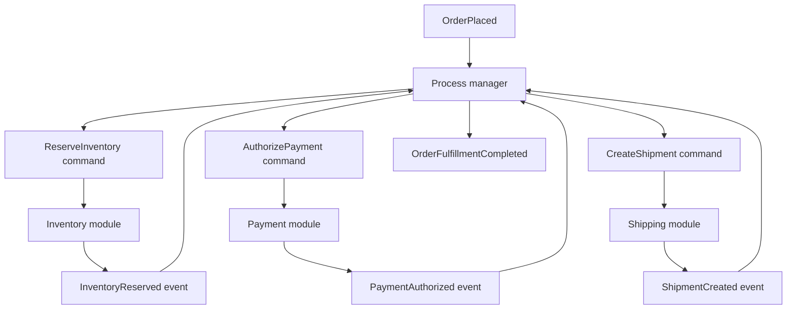
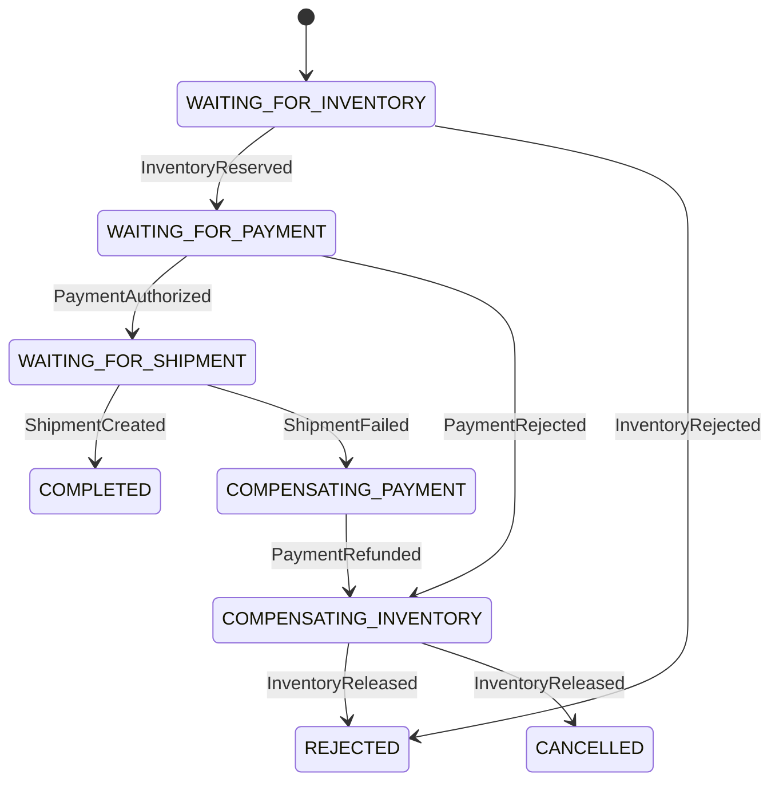
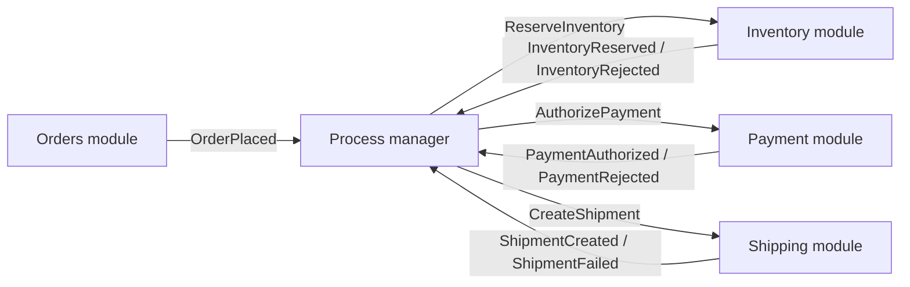

# Process manager là gì?

Trong một hệ thống hướng sự kiện, một nghiệp vụ có thể cần nhiều module cùng tham gia và hoàn thành qua nhiều bước. Ví dụ, khi khách hàng đặt hàng, hệ thống phải giữ hàng trong kho, xác nhận thanh toán, tạo yêu cầu giao hàng rồi mới đánh dấu đơn hàng hoàn tất. Mỗi bước có thể chạy ở một thời điểm khác nhau, có thể thất bại và có thể cần hoàn tác một phần công việc đã thực hiện.

**Process manager** là thành phần điều phối một quy trình nghiệp vụ kéo dài qua nhiều bước. Nó nhận các sự kiện mô tả kết quả đã xảy ra, lưu trạng thái hiện tại của quy trình, quyết định bước tiếp theo và gửi yêu cầu tới module chịu trách nhiệm thực hiện bước đó. Khi nhận kết quả, process manager cập nhật trạng thái và tiếp tục điều phối cho đến khi quy trình hoàn tất, bị hủy hoặc cần can thiệp.

Trong module Spring Modulith, application events giúp các module trao đổi những sự kiện như `OrderPlaced`, `InventoryReserved` hay `PaymentAuthorized`. Process manager sử dụng các sự kiện này để theo dõi tiến trình. Nó không thay thế trách nhiệm nghiệp vụ của từng module: module Kho vẫn quyết định cách giữ hàng, module Thanh toán vẫn quyết định cách xử lý thanh toán, còn process manager quản lý trình tự và trạng thái của quy trình tổng thể.

## 1. Vì sao cần process manager?

Một quy trình đơn giản có thể hoàn thành trong một transaction và một lần gọi service. Nhưng khi quy trình đi qua nhiều module hoặc hệ thống, mỗi bước có transaction, độ trễ và khả năng lỗi riêng. Không thể giữ một transaction database mở trong suốt vài phút chờ kho, cổng thanh toán và đơn vị vận chuyển.

Ví dụ quy trình đặt hàng:

1. Đơn hàng được tạo.
2. Kho giữ số lượng sản phẩm.
3. Thanh toán được xác nhận.
4. Đơn vị vận chuyển nhận yêu cầu giao hàng.
5. Đơn hàng chuyển sang trạng thái hoàn tất.

Các bước có thể thất bại. Kho có thể hết hàng; cổng thanh toán có thể từ chối; hệ thống vận chuyển có thể tạm ngừng hoạt động. Nếu một bước sau thất bại, hệ thống phải biết những bước nào đã thành công và cần thực hiện hành động bù nào.

Nếu mỗi listener tự phát sự kiện cho bước tiếp theo mà không có nơi lưu trạng thái chung, luồng điều phối dễ bị phân tán. Khi cần thêm bước, thay đổi thứ tự, xử lý timeout hoặc khôi phục sau restart, nhóm phát triển phải lần theo nhiều listener và các nhánh điều kiện. Process manager tập trung những quyết định này vào một mô hình quy trình có trạng thái.

## 2. Định nghĩa và trách nhiệm chính

Process manager là một bộ điều phối có trạng thái (*stateful coordinator*). Nó thường có các trách nhiệm sau:

- Nhận sự kiện bắt đầu quy trình và tạo một process instance.
- Gắn các sự kiện tiếp theo với đúng process instance.
- Lưu trạng thái hiện tại, dữ liệu cần cho bước tiếp theo và phiên bản trạng thái.
- Quyết định command hoặc hành động kế tiếp theo quy tắc nghiệp vụ.
- Theo dõi kết quả thành công, thất bại và timeout.
- Phát lệnh bù khi quy trình không thể tiếp tục.
- Chống xử lý trùng và xử lý sự kiện đến sai thứ tự.
- Kết thúc quy trình hoặc chuyển sang trạng thái cần con người can thiệp.

Process manager không nên thực hiện thay công việc của participant. Nó không trực tiếp giữ hàng trong kho bằng cách sửa bảng của module Kho, cũng không tự ghi trạng thái thanh toán vào database của module Thanh toán. Nó gửi yêu cầu qua contract được công bố và chờ kết quả từ module sở hữu hành vi đó.

Một process manager tốt lưu đủ thông tin để trả lời: quy trình nào đang chạy, đang ở bước nào, đã nhận kết quả nào, đang chờ ai, lần thử tiếp theo là gì và vì sao quy trình bị dừng.

## 3. Process manager trong mô hình Saga

Saga là cách tổ chức một nghiệp vụ phân tán thành chuỗi các transaction cục bộ. Mỗi participant cập nhật dữ liệu thuộc quyền sở hữu của mình và phát sự kiện kết quả. Nếu một bước không thể hoàn thành, saga có thể chạy các hành động bù để đưa hệ thống về một trạng thái nghiệp vụ chấp nhận được.

Process manager thường là cơ chế điều phối một saga theo kiểu orchestration. Nó giữ trạng thái và quyết định participant nào được gọi tiếp theo. Không phải mọi process manager đều nhất thiết là saga: một process manager cũng có thể điều phối quy trình không cần compensation, chẳng hạn quy trình phê duyệt nhiều bước. Ngược lại, saga có thể được điều phối bằng choreography mà không có một process manager trung tâm.



Process manager nhận các event đầu vào, cập nhật process state và phát command tiếp theo. Các module tham gia vẫn sở hữu dữ liệu và logic của mình. Điều này giúp ranh giới module rõ ràng trong một modular monolith và cũng tạo nền tảng cho việc tách participant thành dịch vụ riêng khi cần.

## 4. Choreography và orchestration

Hai cách phổ biến để phối hợp các bước trong saga là choreography và orchestration.

**Choreography** để các participant phản ứng với event của nhau. Ví dụ, module Đơn hàng phát `OrderPlaced`; module Kho nghe event và phát `InventoryReserved`; module Thanh toán nghe `InventoryReserved` rồi phát `PaymentAuthorized`; module Giao hàng nghe sự kiện thanh toán và bắt đầu giao hàng.

**Orchestration** dùng một process manager làm nơi quyết định bước tiếp theo. Participant nhận command, thực hiện nghiệp vụ và phát event kết quả về cho process manager.

| Tiêu chí | Choreography | Orchestration bằng process manager |
|---|---|---|
| Quyết định bước tiếp theo | Nằm trong các participant/listener | Tập trung trong process manager |
| Trạng thái toàn quy trình | Có thể phân tán qua các participant | Được lưu trong process instance |
| Luồng đơn giản | Ít thành phần điều phối | Có thêm coordinator và state |
| Quy trình nhiều nhánh | Dễ khó theo dõi khi event nối tiếp nhiều tầng | Có thể biểu diễn rõ bằng state machine |
| Thay đổi thứ tự bước | Có thể phải sửa nhiều listener | Thường tập trung hơn trong điều phối |
| Điểm phụ thuộc | Các participant phụ thuộc event contract của nhau | Participant phụ thuộc command/event contract với process manager |
| Quan sát tiến trình | Cần tổng hợp từ nhiều nơi | Có thể xem trạng thái tại process instance |

Choreography phù hợp với luồng ngắn, ít nhánh và các participant phản ứng độc lập. Process manager hữu ích khi quy trình có nhiều bước, điều kiện, timeout, compensation hoặc yêu cầu truy vấn trạng thái tổng thể.

Không nên đưa mọi event vào một process manager duy nhất. Điều phối tập trung quá nhiều quy trình không liên quan sẽ tạo một thành phần lớn, khó triển khai và trở thành điểm nghẽn thay đổi. Hãy tạo process manager theo một quy trình nghiệp vụ có ranh giới và vòng đời rõ ràng.

## 5. Process instance và state machine

Mỗi lần một quy trình nghiệp vụ bắt đầu, process manager tạo một **process instance**. Instance có một ID riêng và liên kết với aggregate hoặc nghiệp vụ khởi tạo, ví dụ `orderId`.

Một process instance thường lưu:

| Trường | Ý nghĩa |
|---|---|
| `processId` | Định danh duy nhất của lần chạy quy trình |
| `businessKey` | ID nghiệp vụ liên quan, ví dụ `orderId` |
| `state` | Trạng thái hiện tại của quy trình |
| `version` | Phiên bản để phát hiện cập nhật đồng thời |
| `createdAt` | Thời điểm bắt đầu |
| `updatedAt` | Thời điểm thay đổi gần nhất |
| `deadlineAt` | Hạn chờ bước hiện tại nếu có |
| `lastError` | Thông tin lỗi đã được chuẩn hóa để điều tra |
| `completedAt` | Thời điểm kết thúc nếu đã hoàn tất |

Ví dụ state machine cho quy trình đặt hàng:



Mỗi event chỉ hợp lệ ở một số trạng thái. Ví dụ, `PaymentAuthorized` chỉ nên chuyển instance đang `WAITING_FOR_PAYMENT` sang `WAITING_FOR_SHIPMENT`. Nếu event tới khi instance đã `CANCELLED`, process manager phải áp dụng chính sách rõ ràng: bỏ qua như duplicate, ghi nhận event đến muộn hoặc khởi động quy trình xử lý bù. Không chuyển trạng thái chỉ vì một event có tên phù hợp.

## 6. Phân biệt event và command

Event mô tả điều đã xảy ra hoặc đã được xác nhận, ví dụ `InventoryReserved`. Command mô tả việc một participant được yêu cầu thực hiện, ví dụ `ReserveInventory`.

| Khái niệm | Ví dụ | Ý nghĩa |
|---|---|---|
| Event | `OrderPlaced` | Đơn hàng đã được tạo |
| Command | `ReserveInventory` | Yêu cầu module Kho giữ hàng |
| Event | `InventoryReserved` | Kho đã giữ hàng thành công |
| Command | `AuthorizePayment` | Yêu cầu module Thanh toán xác nhận thanh toán |
| Event | `PaymentRejected` | Thanh toán bị từ chối |
| Command bù | `ReleaseInventory` | Yêu cầu Kho giải phóng hàng đã giữ |

Event có thể có nhiều subscriber. Command thường có một owner chịu trách nhiệm thực hiện. Nếu dùng Spring application event để truyền command, cần giữ quy ước command type và bảo đảm chỉ participant sở hữu command đó xử lý. Với thao tác cần gọi một module API trực tiếp trong cùng ứng dụng, có thể dùng interface công khai của module thay vì broadcast một command như event.

Không đặt tên command như thể kết quả đã xảy ra. `PaymentAuthorized` là event; `AuthorizePayment` là command. Phân biệt rõ giúp process manager biết khi nào đang yêu cầu hành động và khi nào participant đã xác nhận kết quả.

## 7. Ví dụ hợp đồng sự kiện và command

Các contract có thể là Java record bất biến, chỉ chứa dữ liệu cần thiết để participant thực hiện hoặc báo kết quả:

```java
public record OrderPlaced(
    UUID eventId,
    UUID orderId,
    String customerId,
    List<OrderLine> lines,
    Instant occurredAt
) {}

public record OrderLine(
    UUID productId,
    int quantity,
    BigDecimal unitPrice
) {}

public record ReserveInventoryCommand(
    UUID processId,
    UUID orderId,
    List<OrderLine> lines,
    Instant requestedAt
) {}

public record InventoryReserved(
    UUID eventId,
    UUID processId,
    UUID orderId,
    String reservationId,
    Instant occurredAt
) {}

public record InventoryRejected(
    UUID eventId,
    UUID processId,
    UUID orderId,
    String reasonCode,
    Instant occurredAt
) {}
```

`processId` giúp liên kết event với đúng lần chạy quy trình. `orderId` là business key để tra cứu nghiệp vụ. `eventId` nhận diện một event cụ thể và cần ổn định qua retry. `reasonCode` nên là mã lỗi có ý nghĩa ổn định, tránh phụ thuộc vào câu thông báo tự do hoặc exception message.

Trong hệ thống lớn hơn, contract có thể cần `correlationId`, `causationId`, `schemaVersion` và trace metadata. Chỉ đưa vào những trường có semantics rõ ràng và được consumer sử dụng.

## 8. Luồng xử lý trong Spring Modulith

Trong modular monolith, process manager có thể là một module/application service lắng nghe các event công khai từ các module tham gia. Các participant nhận command qua module API hoặc event contract được định tuyến rõ ràng, sau đó phát event kết quả.

Một cách tổ chức trách nhiệm:

1. Module Orders commit đơn hàng và phát `OrderPlaced`.
2. Process manager nhận event, tạo process instance ở trạng thái `WAITING_FOR_INVENTORY`.
3. Process manager phát `ReserveInventoryCommand` hoặc gọi port của module Inventory.
4. Inventory thực hiện giữ hàng trong transaction riêng và phát `InventoryReserved` hoặc `InventoryRejected`.
5. Process manager nhận kết quả, kiểm tra state và phát command kế tiếp.
6. Quy trình tiếp tục đến trạng thái terminal như `COMPLETED`, `REJECTED` hoặc `CANCELLED`.

Sơ đồ module:



Spring Modulith giúp giữ ranh giới module và hỗ trợ công bố application event. `@ApplicationModuleListener` có thể được dùng cho listener bất đồng bộ với transaction boundary phù hợp theo cấu hình và phiên bản. Event Publication Registry hỗ trợ theo dõi publication và phục hồi publication chưa hoàn tất theo persistence implementation.

Spring Modulith không tự cung cấp một engine saga/process manager tổng quát chỉ bằng cách thêm annotation. Ứng dụng vẫn phải định nghĩa process state, transition, correlation, timeout, compensation và persistence. Nếu quy trình cần workflow engine chuyên dụng, hãy đánh giá công cụ tương ứng thay vì cố nhồi mọi khả năng vào listener.

## 9. Ví dụ process manager tối giản

Ví dụ sau minh họa cách nhận event bắt đầu, lưu process state và phát command. Các entity/repository/command contract là thành phần do ứng dụng định nghĩa; đây là skeleton kiến trúc, không phải API saga engine có sẵn của Spring Modulith.

```java
@Component
class OrderProcessListener {

    private final OrderProcessManager processManager;

    OrderProcessListener(OrderProcessManager processManager) {
        this.processManager = processManager;
    }

    @ApplicationModuleListener
    void on(OrderPlaced event) {
        processManager.start(event);
    }
}

@Service
class OrderProcessManager {

    private final OrderProcessRepository processes;
    private final ApplicationEventPublisher events;

    OrderProcessManager(
        OrderProcessRepository processes,
        ApplicationEventPublisher events
    ) {
        this.processes = processes;
        this.events = events;
    }

    @Transactional
    public void start(OrderPlaced event) {
        if (processes.existsByOrderId(event.orderId())) {
            return;
        }

        var process = OrderProcess.waitingForInventory(
            UUID.randomUUID(),
            event.orderId(),
            event.eventId()
        );
        processes.save(process);

        events.publishEvent(new ReserveInventoryCommand(
            process.id(),
            event.orderId(),
            event.lines(),
            Instant.now()
        ));
    }
}
```

Ví dụ giả định `OrderPlaced` chứa hoặc cho phép truy xuất các dòng hàng cần giữ. Trong code thực tế, `existsByOrderId` cần có ràng buộc unique ở database để hai event bắt đầu đến đồng thời không tạo hai process instance. Việc phát command trong cùng transaction cần được bảo đảm bền vững bằng event publication persistence/outbox phù hợp; không gửi side effect ra ngoài trước khi trạng thái process được commit.

Nếu command được biểu diễn bằng Spring application event, cần bảo đảm chỉ module Inventory đăng ký handler cho command type đó. Nếu command là lời gọi module API, hãy đặt interface tại module boundary và gọi qua port. Chọn cách giao tiếp dựa trên yêu cầu bất đồng bộ và mức độ coupling chấp nhận được.

## 10. Xử lý event kết quả và transition

Khi participant phát `InventoryReserved`, process manager tìm instance theo `processId`, kiểm tra state hiện tại rồi chuyển sang chờ thanh toán:

```java
@ApplicationModuleListener
void on(InventoryReserved event) {
    processManager.inventoryReserved(event);
}

@Transactional
public void inventoryReserved(InventoryReserved event) {
    var process = processes.findById(event.processId()).orElseThrow();

    if (process.state() != WAITING_FOR_INVENTORY) {
        handleUnexpectedOrDuplicate(process, event);
        return;
    }

    process.recordReservation(event.reservationId());
    process.moveTo(WAITING_FOR_PAYMENT);

    events.publishEvent(new AuthorizePaymentCommand(
        process.id(),
        process.orderId(),
        process.paymentAmount()
    ));
}
```

`recordReservation`, `moveTo` và `paymentAmount` là hành vi của entity process do ứng dụng thiết kế. Việc cập nhật state và tạo publication cho command cần được phối hợp trong cùng transaction hoặc thông qua outbox để tránh hai lỗi: state đã chuyển nhưng command bị mất, hoặc command được gửi dù state rollback.

Mỗi transition nên là một quyết định nghiệp vụ có điều kiện. Không cập nhật state bằng cách gán tùy ý từ payload. Hãy kiểm tra event thuộc process nào, trạng thái nào được phép nhận event đó và event đã được xử lý chưa.

## 11. Lưu trạng thái bền vững

Process manager cần sống sót qua restart và deploy. Không chỉ giữ state trong biến instance, `Map` hoặc `ConcurrentHashMap` trong bộ nhớ. Hãy lưu process instance trong database hoặc một kho bền vững phù hợp.

Một bảng đơn giản có thể có cấu trúc:

```sql
CREATE TABLE order_process (
    process_id UUID PRIMARY KEY,
    order_id UUID NOT NULL UNIQUE,
    state VARCHAR(64) NOT NULL,
    reservation_id VARCHAR(128),
    payment_id VARCHAR(128),
    shipment_id VARCHAR(128),
    version BIGINT NOT NULL,
    created_at TIMESTAMP NOT NULL,
    updated_at TIMESTAMP NOT NULL,
    deadline_at TIMESTAMP,
    completed_at TIMESTAMP
);
```

Đây là schema minh họa; cần bổ sung các cột nghiệp vụ và index phù hợp. `order_id` unique bảo đảm một đơn hàng chỉ có một process instance theo quy tắc ví dụ. `version` hỗ trợ optimistic locking khi nhiều listener hoặc worker có thể cập nhật cùng instance.

Có thể dùng JPA `@Version`:

```java
@Entity
class OrderProcess {

    @Id
    private UUID id;

    @Column(nullable = false, unique = true)
    private UUID orderId;

    @Version
    private long version;

    @Enumerated(EnumType.STRING)
    private OrderProcessState state;
}
```

Optimistic locking giúp phát hiện hai transaction cùng cập nhật một instance. Khi có conflict, ứng dụng cần retry thao tác đọc/transition theo chính sách và kiểm tra event có còn hợp lệ không. Không retry mù quáng một transition đã bị process khác hoàn tất.

## 12. Correlation và định danh quy trình

Một event có thể thuộc nhiều luồng nghiệp vụ hoặc được phát nhiều lần. Process manager cần tìm đúng instance để xử lý. Thường dùng:

- `processId`: định danh lần chạy quy trình.
- `businessKey`: định danh nghiệp vụ như `orderId`.
- `eventId`: định danh duy nhất của event.
- `correlationId`: liên kết các message thuộc cùng một luồng nghiệp vụ hoặc request chain.
- `causationId`: chỉ ra event/command nào trực tiếp gây ra message hiện tại.

Không nhầm `correlationId` với `processId`. Một correlation có thể bao gồm nhiều process hoặc nhiều loại event; một process ID xác định một lần chạy quy trình cụ thể. Chọn khóa correlation rõ ràng trong contract và lưu lại trong process state hoặc event metadata cần thiết.

Khi event không có `processId`, process manager có thể tra cứu bằng business key. Nếu business key không duy nhất theo thời gian hoặc một nghiệp vụ có thể khởi chạy nhiều quy trình, cần thêm loại quy trình hoặc sequence để tránh ghép nhầm event.

## 13. Idempotency và event đến trùng

Application event có thể được xử lý lại khi listener lỗi, publication được phục hồi hoặc message được broker redeliver. Process manager phải idempotent để cùng một event không làm chuyển state hai lần hoặc phát command lặp ngoài ý muốn.

Một bảng Inbox có thể lưu event đã xử lý:

```sql
CREATE TABLE process_inbox (
    process_id UUID NOT NULL,
    event_id UUID NOT NULL,
    received_at TIMESTAMP NOT NULL,
    PRIMARY KEY (process_id, event_id)
);
```

Trong transaction xử lý, process manager ghi `event_id` vào Inbox cùng với state transition và publication của command tiếp theo. Nếu event ID đã tồn tại, bỏ qua tác động lặp. Việc ghi Inbox và cập nhật process state phải nguyên tử; nếu tách transaction, có thể đánh dấu event đã xử lý dù transition thất bại hoặc transition hai lần khi retry.

Ngoài Inbox, state machine cũng cần kiểm tra trạng thái. Ví dụ, nếu process đã ở `WAITING_FOR_PAYMENT`, một bản `InventoryReserved` lặp không được phát `AuthorizePaymentCommand` lần nữa. Hai lớp kiểm soát này bổ trợ nhau: Inbox phát hiện event ID trùng; state transition bảo vệ invariant nghiệp vụ.

Participant cũng cần idempotency cho command. Nếu process manager gửi `ReserveInventoryCommand` hai lần do confirm timeout, module Inventory nên nhận diện cùng `processId`/command ID và không giữ hàng hai lần.

## 14. Xử lý event đến sai thứ tự và đến muộn

Hệ thống bất đồng bộ không bảo đảm mọi event đến đúng thứ tự tạo ra, đặc biệt khi có nhiều partition, retry hoặc nhiều listener. Process manager phải xác định event nào hợp lệ trong state hiện tại.

Ví dụ, `PaymentAuthorized` có thể tới sau khi process đã timeout và bắt đầu hủy đơn hàng. Khi đó, bỏ qua event có thể làm khoản thanh toán đã được xác nhận không được hoàn tiền. Process manager cần lưu trạng thái và áp dụng chính sách cho event đến muộn: phát lệnh refund, mở quy trình bù hoặc chuyển sang trạng thái cần can thiệp.

Một số cách xử lý:

- Kiểm tra transition hợp lệ trước khi cập nhật state.
- Gắn sequence/version vào event nếu participant phát nhiều kết quả theo thứ tự.
- Lưu event không thể xử lý ngay vào trạng thái pending khi thiếu sự kiện trước đó.
- Phân biệt duplicate, stale event và event không mong đợi.
- Ghi log/audit cho event bị từ chối hoặc đến muộn.

Không tự động bỏ mọi event đến sai thứ tự. Với các event có tác động tài chính hoặc tài nguyên, cần có quy tắc bù để không bỏ sót nghĩa vụ đã phát sinh.

## 15. Timeout và lịch nhắc việc

Một participant có thể không trả lời: message bị mất, consumer dừng, hệ thống ngoài không phản hồi hoặc kết quả bị lỗi. Process manager cần deadline cho bước đang chờ.

Ví dụ, sau khi gửi `AuthorizePaymentCommand`, process chuyển sang `WAITING_FOR_PAYMENT` và đặt `deadlineAt`. Một scheduler hoặc cơ chế timeout bền vững quét các process quá hạn và phát `PaymentAuthorizationTimedOut` hoặc trực tiếp yêu cầu bước bù.

Timeout phải được lưu bền vững. Không dùng `Thread.sleep` hoặc một timer trong bộ nhớ làm cơ chế duy nhất, vì ứng dụng restart sẽ mất lịch. Với nhiều instance, scheduler cần claim công việc an toàn hoặc dùng cơ chế phân phối lock để tránh nhiều node cùng phát timeout.

Timeout không chứng minh participant thất bại. Có thể response chỉ đến muộn. Trước khi bù, cần xác định cách xử lý kết quả đến sau deadline. Với thanh toán, chẳng hạn, timeout có thể khiến process bắt đầu hủy nhưng payment gateway vẫn có thể xác nhận thành công sau đó. Cần hỗ trợ inquiry/status check hoặc compensation khi kết quả cuối cùng xuất hiện.

## 16. Compensation và hành động bù

Trong saga, không thể rollback một transaction database duy nhất xuyên qua nhiều participant. Thay vào đó, process manager yêu cầu các participant thực hiện hành động bù để đạt trạng thái nghiệp vụ chấp nhận được.

Ví dụ:

| Hành động đã thành công | Hành động bù có thể dùng |
|---|---|
| Giữ hàng | Giải phóng hàng đã giữ |
| Thu tiền | Hoàn tiền hoặc tạo yêu cầu refund |
| Tạo shipment | Hủy shipment nếu đơn vị vận chuyển còn cho phép |
| Cấp quyền sử dụng | Thu hồi quyền hoặc ghi nhận điều chỉnh |

Compensation không nhất thiết khôi phục chính xác trạng thái vật lý ban đầu. Ví dụ, một khoản hoàn tiền có thể là giao dịch mới và cần thời gian xử lý; một shipment đã rời kho có thể không thể hủy. Vì vậy, hành động bù là một nghiệp vụ độc lập, có thể thất bại và cũng cần retry/idempotency.

Process manager nên lưu những bước đã hoàn thành và tiến trình bù tương ứng. Không phát lệnh bù dựa trên suy đoán; chỉ bù những hành động đã được xác nhận hoặc những hành động có kết quả không xác định đã được điều tra theo policy.

## 17. Kết thúc và trạng thái terminal

Một process manager cần định nghĩa rõ trạng thái kết thúc. Ví dụ:

- `COMPLETED`: mọi bước bắt buộc đã hoàn thành.
- `REJECTED`: quy trình bị từ chối trước khi phát sinh hành động cần bù.
- `CANCELLED`: các bước bù đã hoàn thành và quy trình được hủy.
- `COMPENSATION_FAILED`: một hành động bù thất bại và cần retry hoặc can thiệp.
- `MANUAL_INTERVENTION`: quy trình cần người vận hành quyết định.

Trạng thái terminal nên không nhận thêm transition thông thường. Tuy nhiên, hệ thống vẫn cần xử lý message đến muộn hoặc duplicate một cách an toàn. Có thể lưu audit event ngay cả khi process đã terminal để điều tra và quyết định hành động tiếp theo.

Đừng gộp mọi trường hợp lỗi vào `FAILED`. Phân biệt thất bại nghiệp vụ, lỗi kỹ thuật tạm thời, timeout và compensation failure giúp dashboard và quy trình vận hành phản ánh đúng tình hình.

## 18. Transaction boundary và độ tin cậy của command/event

Một rủi ro quan trọng là process manager cập nhật state nhưng command kế tiếp không được gửi, hoặc command được gửi nhưng transaction cập nhật state rollback.

Ví dụ:

- Process manager commit `WAITING_FOR_PAYMENT` nhưng ứng dụng dừng trước khi gửi `AuthorizePaymentCommand`: quy trình bị treo.
- Command tới module Payment nhưng transaction lưu process state rollback: participant làm việc trong khi process manager vẫn nghĩ chưa gửi lệnh.

Để giảm khoảng trống này, có thể phối hợp state update và publication persistence trong cùng database transaction, dùng Event Publication Registry hoặc outbox theo kiến trúc. Nếu gửi qua broker, publisher confirm và retry giúp biết tình trạng publish theo semantics của broker, nhưng timeout vẫn có thể tạo kết quả không xác định. Consumer/participant cần idempotency.

Không giữ transaction database mở trong suốt thời gian chờ participant hoặc hệ thống ngoài. Mỗi bước process manager và mỗi participant nên có transaction cục bộ ngắn. Khi cần gửi command bền vững, lưu intent gửi trong transaction và để dispatcher thực hiện sau commit.

## 19. Quan sát và vận hành process manager

Process manager giúp trạng thái quy trình có thể truy vấn. Nên theo dõi:

- Số process instance đang hoạt động theo loại quy trình và state.
- Tuổi của process lâu nhất ở từng trạng thái chờ.
- Số process quá deadline và số timeout được xử lý.
- Tỷ lệ hoàn tất, bị từ chối, bị hủy và cần can thiệp.
- Số lần retry của command/participant và số compensation thất bại.
- Số event duplicate, stale hoặc đến sai thứ tự.
- Thời gian hoàn tất end-to-end và thời gian ở từng bước.

Log và trace nên có `processId`, business key, `eventId`, `correlationId`, state trước/sau, command type, participant và attempt. Không đưa payload nhạy cảm hoặc dữ liệu cá nhân không cần thiết vào log. Metric label cần cardinality giới hạn; ID từng process nên nằm trong log/tracing hoặc công cụ tra cứu riêng.

Dashboard nên giúp người vận hành tìm process bị treo, biết đang chờ participant nào, đã thử bao nhiêu lần và có hành động bù nào đang chạy. Với trạng thái `MANUAL_INTERVENTION`, cần có owner, hướng dẫn xử lý và audit cho quyết định của con người.

## 20. Kiểm thử process manager

Kiểm thử cần tập trung vào state transition và các tình huống bất đồng bộ, không chỉ kiểm tra một listener được gọi.

| Tình huống | Điều cần xác minh |
|---|---|
| Event bắt đầu hợp lệ | Tạo đúng một process instance và phát command đầu tiên |
| Event bắt đầu trùng | Không tạo process hoặc command lặp |
| Kết quả participant thành công | Chuyển state và phát đúng command kế tiếp |
| Participant từ chối | Chuyển sang nhánh lỗi hoặc compensation đúng |
| Event ID được giao lại | Inbox/state guard ngăn transition lặp |
| Event đến sai thứ tự | Không vi phạm invariant; được giữ hoặc xử lý theo policy |
| Event đến sau timeout | Kích hoạt quy tắc xử lý kết quả muộn |
| Process quá deadline | Timeout được phát một lần theo cơ chế claim an toàn |
| Compensation thành công | Quy trình đi tới trạng thái terminal phù hợp |
| Compensation thất bại | Lưu trạng thái lỗi và retry/can thiệp đúng |
| Hai worker cập nhật cùng instance | Optimistic locking hoặc claim ngăn lost update |
| Restart giữa hai bước | Process được phục hồi và command chưa gửi được phát lại an toàn |

Ở unit test, có thể kiểm tra state machine bằng các event đầu vào và assert state/command đầu ra. Ở integration test, dùng database và event publication persistence phù hợp để xác nhận state cùng publication được commit đúng. Kiểm thử concurrency nên chạy hai transaction hoặc worker độc lập để xác minh process instance không bị tạo/cập nhật trùng.

## 21. Khi nào nên dùng process manager?

Process manager phù hợp khi:

- Quy trình đi qua nhiều module hoặc dịch vụ và kéo dài qua nhiều transaction.
- Có nhiều nhánh điều kiện, timeout hoặc compensation.
- Cần biết trạng thái tổng thể của từng lần chạy.
- Cần retry, phục hồi sau restart và audit tiến trình.
- Quy tắc điều phối cần thay đổi độc lập với logic của participant.

Choreography đơn giản có thể phù hợp hơn khi các bước ít, độc lập và không cần một trạng thái quy trình trung tâm. Một process manager không nên được tạo chỉ để chuyển tiếp một event duy nhất mà không có state hoặc quy tắc điều phối đáng kể.

Nếu quy trình có hàng trăm bước, timer phức tạp, tác vụ con, human task và yêu cầu quản lý workflow nâng cao, hãy cân nhắc workflow engine chuyên dụng. Spring Modulith cung cấp nền tảng module và event publication; state machine và process persistence vẫn là thiết kế của ứng dụng nếu không tích hợp engine riêng.

## 22. Checklist thiết kế

- [ ] Quy trình có business purpose, owner và điểm bắt đầu/kết thúc rõ ràng.
- [ ] Mỗi process instance có `processId` và business key phù hợp.
- [ ] State machine định nghĩa transition hợp lệ và trạng thái terminal.
- [ ] Event và command được phân biệt về ý nghĩa và quyền sở hữu.
- [ ] Participant sở hữu dữ liệu và logic nghiệp vụ của chính nó.
- [ ] Process state được lưu bền vững, không chỉ nằm trong memory.
- [ ] Correlation, event ID và causation metadata đủ để ghép đúng message.
- [ ] Event duplicate, stale và out-of-order có policy cụ thể.
- [ ] Command/participant idempotent khi có retry hoặc gửi lại.
- [ ] Timeout được lưu bền vững và an toàn khi chạy nhiều instance.
- [ ] Compensation được định nghĩa, có thể thất bại và có retry riêng.
- [ ] State update và command publication được phối hợp transaction/outbox phù hợp.
- [ ] Có cơ chế phục hồi sau restart và xử lý process bị treo.
- [ ] Có metric, log, trace và quy trình manual intervention.
- [ ] Kiểm thử transition, duplicate, timeout, compensation và concurrency.

Process manager là bộ điều phối có trạng thái cho một quy trình nghiệp vụ kéo dài. Nó nhận event, cập nhật process instance, quyết định command kế tiếp và xử lý lỗi hoặc compensation theo state machine. Trong Spring Modulith, application events và Event Publication Registry hỗ trợ giao tiếp cùng phục hồi publication; ứng dụng vẫn phải thiết kế state, correlation, idempotency, timeout và quy tắc bù để quy trình có thể tiếp tục an toàn sau lỗi hoặc restart.
