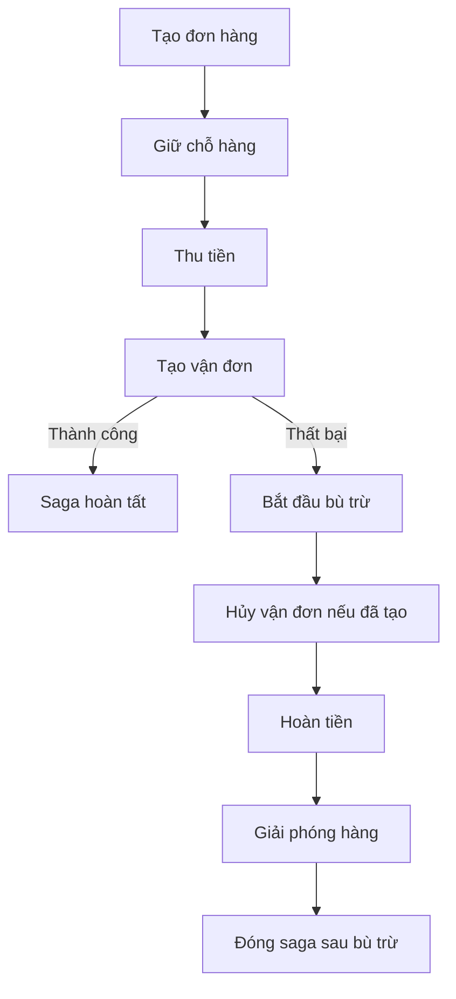
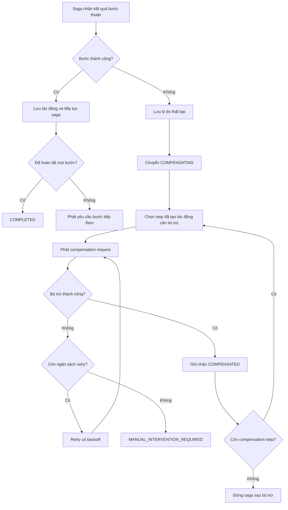

# Tác vụ bù trừ

Trong một quy trình nghiệp vụ chạy qua nhiều module, mỗi bước có thể commit ở một transaction riêng. Ví dụ, module đơn hàng tạo đơn, module kho hàng giữ chỗ sản phẩm, module thanh toán thu tiền và module vận chuyển tạo yêu cầu giao hàng. Nếu bước sau thất bại, transaction của bước trước đã commit nên không thể dùng một lệnh rollback cơ sở dữ liệu để đưa toàn bộ hệ thống về trạng thái ban đầu.

Saga giải quyết tình huống này bằng các tác vụ bù trừ (compensating actions). Mỗi bước nghiệp vụ có thể có một hành động bù trừ tương ứng để đưa hệ thống về trạng thái được chấp nhận theo quy tắc kinh doanh. Process manager theo dõi tiến trình, quyết định khi nào bắt đầu bù trừ và phát các yêu cầu tiếp theo. Trong Spring Modulith, application events giúp các module phối hợp mà không phải gọi trực tiếp implementation của nhau.

## Mục tiêu

Sau bài này, bạn có thể:

- Giải thích vì sao bù trừ là hành động nghiệp vụ mới chứ không phải rollback transaction.
- Xác định tác vụ bù trừ cho từng bước đã hoàn tất trong saga.
- Thiết kế trạng thái saga và process manager để theo dõi tiến trình bù trừ.
- Phát event hoặc command cho module sở hữu hành động bù trừ.
- Bảo đảm bù trừ có tính idempotent, retry có giới hạn và xử lý được kết quả đến trễ.
- Kiểm thử các trường hợp bù trừ thành công, thất bại, lặp và cần can thiệp thủ công.
- Quan sát tiến trình bù trừ qua event ID, saga ID, trạng thái và số lần thử.

## 1. Bù trừ khác rollback như thế nào?

Rollback hoàn tác các thay đổi nằm trong cùng transaction trước khi transaction commit. Bù trừ được thực hiện sau khi một hoặc nhiều bước đã commit, có thể qua nhiều module hoặc hệ thống độc lập. Bù trừ không xóa lịch sử đã xảy ra; nó tạo ra một hành động mới để điều chỉnh kết quả nghiệp vụ.

Ví dụ, khi một đơn hàng đã được giữ chỗ hàng và thanh toán đã được xác nhận, bước tạo vận đơn thất bại. Hệ thống có thể cần giải phóng hàng đã giữ và hoàn tiền. Hai hành động đó không phải rollback transaction của kho hàng hoặc cổng thanh toán. Chúng là các giao dịch mới, có thể tiếp tục thất bại và cần được theo dõi riêng.

| Khía cạnh | Rollback transaction | Tác vụ bù trừ |
|---|---|---|
| Thời điểm | Trước khi transaction commit | Sau khi một bước hoặc nhiều bước đã commit |
| Phạm vi | Transaction và resource tham gia transaction | Một hoặc nhiều module/hệ thống độc lập |
| Cách thực hiện | Cơ sở dữ liệu khôi phục thay đổi chưa commit | Chạy hành động nghiệp vụ mới |
| Tính nguyên tử | Theo ranh giới transaction | Không nguyên tử trên toàn saga |
| Kết quả | Transaction không được commit | Có thể thành công, thất bại hoặc cần can thiệp |
| Lịch sử | Thay đổi chưa commit bị loại bỏ | Hành động ban đầu và hành động bù trừ đều được ghi nhận |

Không phải lúc nào cũng có thể khôi phục chính xác trạng thái ban đầu. Email đã gửi không thể thu hồi; hàng đã giao không thể đơn giản biến mất; tỷ giá hoặc giá bán có thể đã thay đổi. Vì vậy, mục tiêu của bù trừ là đạt một trạng thái nghiệp vụ hợp lệ, ví dụ tạo khoản hoàn tiền, phát hành credit note hoặc mở quy trình trả hàng.

## 2. Xác định hành động bù trừ theo nghiệp vụ

Trước khi viết process manager, hãy liệt kê các bước thuận của saga và tác động mà mỗi bước tạo ra. Với mỗi tác động, xác định hành động bù trừ, điều kiện thực hiện, dữ liệu cần thiết và trường hợp không thể bù trừ tự động.

Ví dụ quy trình đặt hàng:

| Bước thuận | Tác động đã commit | Hành động bù trừ có thể dùng |
|---|---|---|
| Tạo đơn hàng | Đơn hàng ở trạng thái `PENDING` | Hủy đơn hoặc chuyển sang `CANCELLED` |
| Giữ chỗ hàng | Số lượng khả dụng bị giữ | Giải phóng reservation |
| Xác nhận thanh toán | Tiền đã được thu hoặc ủy quyền | Hoàn tiền hoặc hủy authorization |
| Tạo vận đơn | Đơn giao hàng đã được tạo | Hủy vận đơn nếu hãng vận chuyển cho phép |
| Gửi thông báo | Email hoặc SMS đã được gửi | Gửi thông báo điều chỉnh nếu cần; không thể thu hồi thông báo cũ |

Không suy ra hành động bù trừ chỉ bằng cách đảo ngược tên phương thức. `reserveStock()` có thể được bù bằng `releaseReservation()`, nhưng `chargePayment()` có thể cần `refundPayment()` thay vì một thao tác xóa giao dịch. Hành động bù trừ phải tuân theo quy tắc của hệ thống sở hữu tác động.

Với mỗi bước, hãy trả lời:

- Bước đã tạo ra tác động gì và tác động đó đã commit ở đâu?
- Điều kiện nào cho phép bù trừ?
- Có thể bù trừ toàn bộ hay chỉ một phần?
- Hành động bù trừ có thể được thực hiện nhiều lần an toàn không?
- Có thời hạn hoặc điều kiện bên ngoài khiến bù trừ không còn khả dụng không?
- Nếu bù trừ thất bại, có thể retry, chọn phương án khác hay cần người vận hành quyết định?

## 3. Thứ tự bù trừ

Một quy tắc thường gặp là bù trừ các bước đã hoàn tất theo thứ tự ngược với thứ tự thực hiện. Nếu saga đã giữ chỗ hàng, thu tiền và tạo vận đơn, khi bước sau thất bại có thể hủy vận đơn trước, hoàn tiền sau đó và cuối cùng giải phóng hàng. Thứ tự ngược giúp tháo gỡ các phụ thuộc được tạo ra trong quá trình tiến về phía trước.

Tuy nhiên, không phải saga nào cũng cần đảo ngược tuần tự. Nếu các tác động độc lập, một số hành động bù trừ có thể chạy song song. Nếu một hành động bù trừ phụ thuộc kết quả của hành động khác, process manager phải biểu diễn quan hệ đó rõ ràng. Quy tắc phải đến từ nghiệp vụ và phụ thuộc dữ liệu, không phải giả định chung rằng mọi compensation đều chạy ngược thứ tự.

Ví dụ đơn giản:



Nếu một bước thuận chưa từng thành công, không cần bù trừ tác động chưa xảy ra. Process manager phải dựa vào trạng thái đã ghi nhận, không gửi compensation mù quáng cho mọi bước trong sơ đồ.

## 4. Lưu trạng thái saga và tiến trình bù trừ

Process manager cần lưu trạng thái bền vững để tiếp tục sau khi ứng dụng khởi động lại. Một bản ghi saga thường có `sagaId`, định danh aggregate hoặc đơn hàng, trạng thái tổng thể, bước hiện tại, thời điểm bắt đầu, thời điểm cập nhật và thông tin lỗi. Mỗi bước nên có trạng thái riêng để process manager biết tác động nào đã xảy ra và tác vụ bù trừ nào đã hoàn tất.

Một mô hình trạng thái tham khảo:

| Trạng thái saga | Ý nghĩa |
|---|---|
| `RUNNING` | Đang thực hiện các bước thuận |
| `COMPENSATING` | Đang chạy một hoặc nhiều tác vụ bù trừ |
| `COMPLETED` | Tất cả bước thuận cần thiết đã hoàn tất |
| `COMPENSATED` | Các tác động cần bù trừ đã được xử lý thành công |
| `COMPENSATION_FAILED` | Bù trừ thất bại và còn khả năng retry hoặc xử lý tiếp |
| `MANUAL_INTERVENTION_REQUIRED` | Không thể tự phục hồi theo chính sách hiện tại |

Trạng thái của từng bước có thể gồm `PENDING`, `SUCCEEDED`, `COMPENSATION_PENDING`, `COMPENSATING`, `COMPENSATED` và `COMPENSATION_FAILED`. Không nên chỉ lưu một boolean `failed`: process manager cần phân biệt bước thuận thất bại, bước đã tạo tác động, compensation đang chờ và compensation đã hoàn tất.

Ví dụ cấu trúc dữ liệu ở mức khái niệm:

```text
SagaInstance
  sagaId
  businessId
  status
  currentStep
  version
  startedAt
  updatedAt
  failureReason

SagaStep
  sagaId
  stepName
  forwardStatus
  compensationStatus
  externalReference
  attemptCount
  lastError
```

Lưu `externalReference` như reservation ID, payment ID hoặc shipment ID. Khi cần bù trừ, module sở hữu tác động thường cần định danh này để giải phóng hoặc hoàn tác đúng resource. Không phụ thuộc vào việc tái tạo định danh từ dữ liệu hiện tại vì dữ liệu có thể đã thay đổi.

## 5. Process manager điều phối compensation bằng application events

Trong Spring Modulith, process manager có thể là một bean trong module sở hữu quy trình. Nó lắng nghe các event kết quả từ module tham gia, cập nhật trạng thái saga và phát event hoặc command tiếp theo. Các module tham gia giữ quyền sở hữu logic thực hiện hành động của mình.

Ví dụ event contract:

```java
import java.util.UUID;

public record PaymentDeclined(
    UUID sagaId,
    UUID orderId,
    String reason
) {}

public record InventoryReleaseRequested(
    UUID sagaId,
    UUID orderId,
    UUID reservationId,
    String compensationId
) {}

public record InventoryReleased(
    UUID sagaId,
    UUID orderId,
    String compensationId
) {}
```

`InventoryReleaseRequested` là yêu cầu một module thực hiện hành động. Trong ứng dụng nhỏ, có thể dùng application event với một consumer được xác định rõ. Nếu cần phản hồi tức thời hoặc định tuyến command có đích duy nhất, cân nhắc module API công khai. Dù chọn cách nào, module inventory vẫn là nơi quyết định cách giải phóng reservation.

Process manager nhận kết quả thanh toán thất bại và khởi động bù trừ:

```java
import org.springframework.modulith.events.ApplicationModuleListener;
import org.springframework.context.ApplicationEventPublisher;
import org.springframework.stereotype.Component;

@Component
class OrderSagaProcessManager {

    private final OrderSagaRepository sagas;
    private final ApplicationEventPublisher events;

    OrderSagaProcessManager(
            OrderSagaRepository sagas,
            ApplicationEventPublisher events) {
        this.sagas = sagas;
        this.events = events;
    }

    @ApplicationModuleListener
    void on(PaymentDeclined event) {
        OrderSaga saga = sagas.findRequired(event.sagaId());

        if (!saga.beginCompensation(event.reason())) {
            return;
        }

        sagas.save(saga);
        events.publishEvent(new InventoryReleaseRequested(
            saga.id(),
            saga.orderId(),
            saga.reservationId(),
            saga.nextCompensationId("release-inventory")
        ));
    }
}
```

`beginCompensation` cần là phép chuyển trạng thái có điều kiện: chỉ saga đang ở trạng thái cho phép mới chuyển sang `COMPENSATING`. Nếu cùng một `PaymentDeclined` được giao lại, handler không được phát một yêu cầu bù trừ mới ngoài ý muốn. Có thể bảo vệ bằng version optimistic locking, unique constraint cho compensation ID hoặc bảng inbox lưu event đã xử lý.

`@ApplicationModuleListener` cung cấp listener bất đồng bộ với transaction riêng theo semantics của Spring Modulith. Trong ví dụ, trạng thái saga và publication của event tiếp theo được ghi trong cùng transaction listener. Khi Event Publication Registry dùng kho lưu trữ tham gia transaction đó, publication có thể được theo dõi và khôi phục nếu việc giao event tiếp theo chưa hoàn tất. Không được phát event rồi chỉ lưu trạng thái ở một transaction độc lập mà không có cơ chế bảo vệ; nếu ứng dụng dừng giữa hai thao tác, process manager có thể quên rằng compensation cần được gửi hoặc gửi lặp mà không nhận diện được.

## 6. Module tham gia thực hiện hành động bù trừ

Module inventory nhận yêu cầu và tự thực hiện giải phóng reservation:

```java
import org.springframework.modulith.events.ApplicationModuleListener;
import org.springframework.context.ApplicationEventPublisher;
import org.springframework.stereotype.Component;

@Component
class InventoryCompensationHandler {

    private final InventoryReservations reservations;
    private final ApplicationEventPublisher events;

    InventoryCompensationHandler(
            InventoryReservations reservations,
            ApplicationEventPublisher events) {
        this.reservations = reservations;
        this.events = events;
    }

    @ApplicationModuleListener
    void release(InventoryReleaseRequested request) {
        reservations.releaseIfActive(
            request.reservationId(),
            request.compensationId()
        );

        events.publishEvent(new InventoryReleased(
            request.sagaId(),
            request.orderId(),
            request.compensationId()
        ));
    }
}
```

`releaseIfActive` là API nghiệp vụ minh họa. Nó cần xử lý trường hợp reservation đã được giải phóng trước đó và bảo đảm cùng một `compensationId` không giải phóng hai lần. Nếu reservation không tồn tại hoặc đã ở trạng thái không thể giải phóng, module inventory phải trả về kết quả nghiệp vụ rõ ràng thay vì giả định thành công.

Process manager tiếp nhận kết quả:

```java
@ApplicationModuleListener
void on(InventoryReleased event) {
    OrderSaga saga = sagas.findRequired(event.sagaId());

    if (!saga.markCompensated("release-inventory", event.compensationId())) {
        return;
    }

    if (saga.allRequiredCompensationsCompleted()) {
        saga.markCompensated();
        events.publishEvent(new OrderCompensationCompleted(
            saga.id(), saga.orderId()
        ));
    }

    sagas.save(saga);
}
```

Đây là đoạn minh họa cho một compensation step. Saga thực tế có thể cần nhiều bước, ví dụ hoàn tiền và hủy vận đơn. Process manager chỉ đánh dấu `COMPENSATED` khi tất cả hành động bắt buộc đã hoàn tất hoặc khi một quy tắc nghiệp vụ cho phép kết thúc với kết quả khác.

## 7. Bù trừ phải idempotent

Event có thể được giao lại do retry, timeout, restart hoặc phục hồi publication. Compensation handler vì vậy phải chịu được cùng yêu cầu được xử lý nhiều lần. Một lần giải phóng reservation không được làm tồn kho tăng hai lần; một lần hoàn tiền không được tạo hai giao dịch hoàn tiền.

Hãy tạo `compensationId` ổn định cho từng hành động bù trừ. Module sở hữu tác động lưu ID này với kết quả thực hiện. Nếu nhận lại cùng ID, module trả lại kết quả đã có thay vì thực hiện lại tác động.

Ví dụ bảng lưu dấu xử lý:

```text
CompensationExecution
  compensationId  UNIQUE
  sagaId
  actionType
  resourceId
  status
  completedAt
  externalReference
```

Việc kiểm tra ID và thực hiện thay đổi nghiệp vụ phải được bảo vệ nguyên tử trong cùng transaction nếu resource nằm trong cùng database. Nếu hành động gọi hệ thống ngoài, truyền idempotency key sang API ngoài khi có hỗ trợ và lưu external reference để đối soát. Nếu dịch vụ ngoài không hỗ trợ idempotency, cần bước truy vấn trạng thái trước khi gửi lại một hành động có tác động tài chính hoặc không thể đảo ngược.

Đừng dùng một event ID duy nhất cho tất cả compensation step. Một saga có thể giải phóng hàng, hoàn tiền và hủy vận đơn; mỗi hành động cần định danh riêng để theo dõi retry và kết quả độc lập. Có thể tạo ID từ saga ID cùng tên step và số lần phát sinh logic, nhưng giá trị phải ổn định qua các lần giao lại cùng một yêu cầu.

## 8. Compensation cũng có thể thất bại

Không nên giả định hành động bù trừ luôn thành công. Cổng thanh toán có thể tạm thời không truy cập được khi hoàn tiền; reservation có thể đã được dùng cho một quy trình khác; hãng vận chuyển có thể từ chối hủy vận đơn sau khi hàng đã được bàn giao.

Process manager cần chính sách cho từng nhóm lỗi:

| Kết quả compensation | Hướng xử lý |
|---|---|
| Thành công | Ghi nhận step `COMPENSATED` và chuyển sang bước tiếp theo |
| Lỗi tạm thời | Retry có giới hạn với backoff và giữ trạng thái đang bù trừ |
| Đã thực hiện trước đó | Xem là hoàn tất nếu idempotency record xác nhận cùng compensation ID |
| Không còn điều kiện bù trừ | Áp dụng phương án nghiệp vụ thay thế hoặc chuyển xử lý thủ công |
| Lỗi dữ liệu hoặc vi phạm nghiệp vụ | Ghi nhận nguyên nhân, không retry vô hạn |
| Hết ngân sách retry | Chuyển `MANUAL_INTERVENTION_REQUIRED` và phát cảnh báo |

Không đánh dấu saga `COMPENSATED` khi một compensation step vẫn đang chờ hoặc thất bại. Trạng thái `COMPENSATION_FAILED` nên giữ lại thông tin lỗi cuối, số lần thử, thời điểm retry tiếp theo và dữ liệu cần thiết để người vận hành tiếp tục xử lý.

Nếu compensation không thể khôi phục trạng thái mong muốn, có thể cần một hành động nghiệp vụ thay thế: tạo khoản tín dụng, phát hành voucher, tạo yêu cầu trả hàng hoặc chuyển sang xử lý bồi hoàn. Đây là quyết định nghiệp vụ cần được định nghĩa trước; không nên để process manager tự suy đoán cách giải quyết.

## 9. Xử lý event đến trễ và cạnh tranh

Trong hệ thống bất đồng bộ, một kết quả thuận có thể đến sau khi process manager đã bắt đầu bù trừ. Ví dụ, module thanh toán phát `PaymentAuthorized` nhưng message bị trì hoãn; process manager đã nhận timeout và bắt đầu giải phóng hàng. Nếu bỏ qua event đến trễ, hệ thống có thể giữ lại khoản thanh toán mà không hoàn tiền.

Mỗi event cần có `sagaId`, event ID và định danh bước. Process manager phải kiểm tra trạng thái hiện tại trước khi áp dụng kết quả. Nếu kết quả thuận đến sau khi saga chuyển sang `COMPENSATING`, ghi nhận tác động đã xảy ra và thêm compensation tương ứng nếu nghiệp vụ yêu cầu.

Các biện pháp thường dùng:

- Dùng version hoặc sequence number cho saga để phát hiện event cũ và cập nhật cạnh tranh.
- Dùng optimistic locking hoặc cập nhật có điều kiện để chỉ một handler chuyển trạng thái saga tại một thời điểm.
- Lưu event ID đã xử lý để chống xử lý trùng.
- Không dựa vào thứ tự giao event của nhiều listener hoặc broker nếu không có bảo đảm ordering rõ ràng.
- Thiết kế trạng thái để chấp nhận kết quả đến trễ, kể cả khi saga đã hoàn tất hoặc đang cần can thiệp.

Timeout không chứng minh bước thuận đã thất bại. Nó chỉ cho biết process manager chưa nhận được kết quả trong khoảng thời gian đã định. Trước khi bù trừ một tác động có thể đã xảy ra, hãy xác minh trạng thái với module sở hữu hoặc hệ thống ngoài khi cần. Nếu gửi lại command, dùng cùng idempotency key để tránh tạo thêm tác động.

## 10. Transaction, publication registry và độ tin cậy

Mỗi module tham gia thường commit dữ liệu trong transaction riêng. Process manager cũng lưu trạng thái saga trong transaction của nó. Khi một handler cập nhật trạng thái rồi publish event tiếp theo, cần bảo đảm việc lưu trạng thái và publication được ghi nhận nhất quán.

Spring Modulith Event Publication Registry theo dõi publication của application event tới từng listener. Khi được cấu hình với persistence bền vững, registry có thể hỗ trợ phát hiện và phục hồi publication chưa hoàn tất sau khi ứng dụng dừng. Nó không tự động lưu toàn bộ trạng thái saga, quyết định thứ tự compensation hoặc bảo đảm một hành động ngoài được thực hiện đúng một lần. Các phần đó thuộc trách nhiệm của process manager và module sở hữu tác động.

Một cách tổ chức thường dùng là lưu saga state và publication record trong cùng database transaction. Khi handler thay đổi trạng thái saga và phát event tiếp theo, registry ghi nhận publication trong transaction tương ứng. Điều này giảm nguy cơ trạng thái đã đổi nhưng event điều phối bị mất. Nếu các phần nằm ở database hoặc hệ thống khác nhau, cần outbox/inbox hoặc cơ chế đồng bộ tương ứng.

Không coi `publishEvent` là bằng chứng consumer đã hoàn tất. Process manager cần chờ event kết quả như `InventoryReleased` hoặc kiểm tra trạng thái đã lưu trước khi chuyển sang compensation step tiếp theo. Khi listener bất đồng bộ, mỗi publication có vòng đời riêng.

## 11. Kiểm thử tác vụ bù trừ

Kiểm thử saga cần xác nhận cả thứ tự nghiệp vụ, trạng thái lưu trữ và hành vi khi giao lại event. Có thể kiểm tra các trường hợp sau:

| Tình huống | Điều cần xác nhận |
|---|---|
| Tất cả bước thuận thành công | Saga chuyển sang `COMPLETED`, không phát compensation |
| Bước thuận thất bại sau khi có tác động trước đó | Chỉ những step đã tạo tác động được bù trừ |
| Nhiều step cần bù trừ | Thứ tự thực hiện tuân theo dependency nghiệp vụ |
| Cùng compensation request được giao hai lần | Tác động chỉ xảy ra một lần theo compensation ID |
| Compensation thất bại tạm thời | Retry có giới hạn và trạng thái vẫn phản ánh đang bù trừ |
| Compensation thất bại vĩnh viễn | Saga chuyển sang trạng thái cần can thiệp, có thông tin lỗi |
| Kết quả thuận đến trễ | Process manager ghi nhận và bù trừ tác động phát sinh muộn nếu cần |
| Process manager khởi động lại | Saga state, attempt count và compensation pending được khôi phục |
| Hai handler cập nhật cùng saga | Version/transaction ngăn chuyển trạng thái cạnh tranh sai |
| Hệ thống ngoài timeout sau khi đã thực hiện | Idempotency và đối soát ngăn hoàn tiền hoặc hủy trùng |

Trong unit test, kiểm tra state transition và quyết định step tiếp theo của process manager. Trong integration test, dùng application context, repository và listener thực để xác nhận event được publish và publication được theo dõi. Với hành động ngoài, dùng test double có thể mô phỏng timeout trước và sau khi hệ thống ngoài đã ghi nhận tác động.

Nên có test cho cả lần chạy lại sau restart. Tạo saga ở trạng thái `COMPENSATING`, lưu một compensation đang chờ, tái tạo process manager và xác nhận hệ thống tiếp tục từ trạng thái đã lưu thay vì chạy lại toàn bộ saga từ đầu.

## 12. Quan sát và vận hành

Process manager là nơi nhìn thấy tiến trình tổng thể, nhưng từng module mới biết chi tiết tác động mà nó sở hữu. Log và metric cần kết nối được cả hai góc nhìn.

Theo dõi tối thiểu:

- Số saga đang `RUNNING`, `COMPENSATING`, `COMPENSATED` và `MANUAL_INTERVENTION_REQUIRED`.
- Số compensation đang chờ, đang retry và đã hết ngân sách.
- Thời gian từ lúc bắt đầu compensation đến khi hoàn tất.
- Tỷ lệ thành công theo action type và module sở hữu.
- Tuổi của compensation pending lâu nhất.
- Số event trùng, event đến trễ và xung đột version.
- Số lần gọi hệ thống ngoài, timeout và kết quả đối soát.

Log nên có saga ID, business ID, event ID, compensation ID, step name, attempt, trạng thái trước/sau và correlation ID. Không dùng saga ID hoặc compensation ID làm metric label có cardinality cao; giữ các định danh này trong log và trace, còn metric dùng các nhãn ổn định như module, action type, status và error category.

Đặt cảnh báo khi saga ở trạng thái bù trừ quá lâu, compensation vượt ngân sách retry, hoặc số saga cần can thiệp tăng bất thường. Dashboard nên cho phép truy từ saga tới các step, publication và external reference để đội vận hành biết tác động nào đã xảy ra và bước nào còn thiếu.

## 13. Những lỗi thiết kế thường gặp

| Lỗi | Hệ quả | Cách khắc phục |
|---|---|---|
| Xem compensation như rollback | Cố xóa lịch sử hoặc giả định hệ thống trở về đúng trạng thái cũ | Mô hình hóa hành động nghiệp vụ mới và kết quả của nó |
| Bù trừ mọi step bất kể đã thành công | Gửi yêu cầu giải phóng hoặc hoàn tiền không có tác động tương ứng | Chỉ bù trừ step đã tạo tác động |
| Không lưu trạng thái saga bền vững | Restart làm mất tiến trình bù trừ | Lưu saga state và từng compensation step |
| Compensation không idempotent | Retry tạo hoàn tiền hoặc giải phóng nhiều lần | Dùng compensation ID và unique constraint |
| Đánh dấu saga hoàn tất quá sớm | Một số tác động vẫn chưa được bù trừ | Chỉ kết thúc khi tất cả compensation bắt buộc đã hoàn tất |
| Retry vô hạn | Saga bị kẹt và tiêu tốn tài nguyên | Giới hạn retry, backoff và chuyển can thiệp thủ công |
| Bỏ qua event đến trễ | Tác động thuận có thể tồn tại sau khi saga đã bù trừ | Kiểm tra trạng thái và xử lý late result |
| Process manager gọi thẳng implementation module khác | Tạo coupling và làm sai quyền sở hữu nghiệp vụ | Gửi event/command qua hợp đồng công khai hoặc module API |
| Chỉ quan sát lỗi listener | Không thấy saga nào đang bù trừ và tác động nào còn tồn tại | Theo dõi saga state và compensation step |

## 14. Quy trình quyết định



Tác vụ bù trừ là một phần của thiết kế nghiệp vụ ngay từ đầu saga. Hãy xác định tác động của từng bước, lưu trạng thái và định danh cần thiết, để module sở hữu tác động thực hiện compensation idempotent, rồi để process manager theo dõi kết quả đến khi hoàn tất hoặc chuyển sang can thiệp thủ công. Với Spring Modulith, application events và Event Publication Registry hỗ trợ giao tiếp và phục hồi publication giữa các module; saga state, quy tắc bù trừ và đối soát vẫn cần được thiết kế rõ ràng trong ứng dụng.

## Tài liệu tham khảo

- [Spring Modulith — Working with Application Events](https://docs.spring.io/spring-modulith/reference/events.html)
- [Microservices.io — Saga pattern](https://microservices.io/patterns/data/saga.html)
