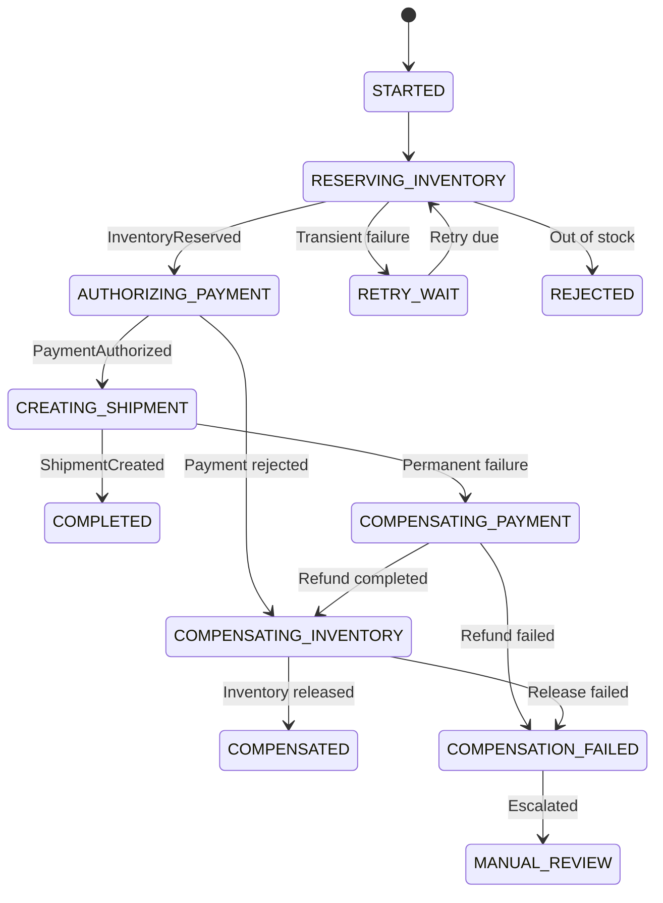

# Saga thất bại

## Mục tiêu

Một quy trình nghiệp vụ có thể đi qua nhiều module và nhiều transaction độc lập. Ví dụ đặt hàng cần giữ tồn kho, thu tiền, tạo yêu cầu giao hàng rồi xác nhận đơn. Mỗi bước có thể commit thành công, nhưng một bước sau đó có thể thất bại. Vì các bước không nằm trong cùng một transaction database, hệ thống không thể chỉ rollback một lần để đưa mọi module về trạng thái ban đầu.

**Saga thất bại** là tình huống một bước trong quy trình saga không thể hoàn thành theo kế hoạch, hoặc một hành động bù trừ cũng gặp lỗi. Hệ thống cần quyết định tiếp tục thử bước hiện tại, chuyển sang nhánh nghiệp vụ khác, bù trừ những bước đã hoàn thành hay đưa quy trình vào trạng thái cần can thiệp.

Sau bài học, bạn có thể:

- Nhận diện các kiểu thất bại trong saga và process manager.
- Chọn forward recovery hoặc compensation theo trạng thái nghiệp vụ.
- Lưu trạng thái saga bền vững và điều phối các bước qua application events.
- Thiết kế retry, timeout, idempotency và xử lý kết quả không xác định.
- Xử lý compensation thất bại, can thiệp thủ công và phục hồi sau restart.
- Kiểm thử, quan sát và vận hành saga trong ứng dụng Spring Modulith.

## 1. Vì sao saga có thể thất bại?

Giả sử quy trình đặt hàng gồm các bước:

1. Module Đơn hàng tạo đơn ở trạng thái `PENDING`.
2. Module Kho giữ hàng.
3. Module Thanh toán thu tiền.
4. Module Giao hàng tạo lệnh giao.
5. Module Đơn hàng chuyển đơn sang `CONFIRMED`.

Mỗi module thực hiện thay đổi của mình trong transaction cục bộ. Nếu bước giữ hàng thành công và thanh toán thành công nhưng dịch vụ giao hàng từ chối tạo lệnh, quy trình đã có side effect ở nhiều nơi. Hệ thống phải quyết định có thử tạo lệnh giao lại, đổi phương thức giao hay hoàn tiền và giải phóng hàng.

Các nguyên nhân thất bại thường gặp:

- **Lỗi tạm thời:** timeout, mất kết nối, deadlock hoặc dependency tạm ngừng.
- **Lỗi dữ liệu/hợp đồng:** message sai schema, thiếu định danh, phiên bản event không được hỗ trợ.
- **Từ chối nghiệp vụ:** hết hàng, hạn mức thanh toán không đủ hoặc địa chỉ giao không phục vụ.
- **Kết quả không xác định:** request đã tới hệ thống ngoài nhưng response bị mất; không biết side effect đã xảy ra hay chưa.
- **Lỗi compensation:** hoàn tiền hoặc giải phóng hàng cũng thất bại.
- **Lỗi điều phối:** process manager dừng giữa lúc ghi trạng thái và phát command/event tiếp theo.

Không phải mọi exception đều có cùng cách xử lý. Retry một timeout có thể hợp lý; retry mãi một yêu cầu bị từ chối vì hết hàng không làm hàng xuất hiện. Ngược lại, coi timeout là thất bại chắc chắn có thể dẫn tới hoàn tiền trong khi khoản thanh toán thực tế đã được thu.

## 2. Mô hình saga và trạng thái thất bại

Saga là chuỗi các transaction cục bộ, mỗi transaction hoàn tất độc lập và có thể phát sinh một hành động bù trừ tương ứng. Saga không cung cấp một transaction ACID phân tán bao trùm tất cả module. Nó điều phối tiến trình dài hạn và chấp nhận trạng thái trung gian.

Một saga cần lưu ít nhất:

- `saga_id`: định danh ổn định của toàn bộ quy trình.
- `saga_type` và `saga_version`: loại quy trình và phiên bản logic điều phối.
- `business_key`: khóa nghiệp vụ như order ID.
- `current_step`: bước đang chờ hoặc đang xử lý.
- `status`: trạng thái tổng thể của saga.
- `completed_steps`: các bước đã được xác nhận hoàn tất.
- `correlation_id`, `causation_id`: liên kết message và sự kiện trong cùng quy trình.
- `deadline`, `attempts`, `last_error`: dữ liệu điều khiển và chẩn đoán.

Ví dụ state machine rút gọn:



Đây là ví dụ trạng thái nghiệp vụ, không phải enum bắt buộc của Spring Modulith. Một hệ thống có thể dùng trạng thái khác hoặc tách trạng thái step và trạng thái saga thành các trường riêng. Trạng thái phải thể hiện rõ quy trình đang tiếp tục, đang chờ retry, đang bù trừ hay cần con người quyết định.

### Trạng thái step và trạng thái saga

Không nên chỉ lưu một cờ `failed`. Một bước có thể thất bại tạm thời rồi thành công sau retry; saga vẫn tiếp tục. Một bước có thể bị từ chối nghiệp vụ và kích hoạt compensation. Một compensation có thể thất bại trong khi saga đã ở nhánh phục hồi.

Hãy phân biệt:

| Trạng thái | Ý nghĩa |
| --- | --- |
| `RUNNING` | Saga đang tiến triển qua các bước. |
| `WAITING_RETRY` | Bước hiện tại gặp lỗi có thể thử lại và đang chờ đến hạn. |
| `COMPENSATING` | Saga đang thực hiện các hành động bù trừ. |
| `COMPENSATED` | Các hành động bù trừ cần thiết đã hoàn tất. |
| `REJECTED` | Quy trình kết thúc theo một kết quả nghiệp vụ không chấp nhận yêu cầu. |
| `COMPLETED` | Tất cả bước cần thiết đã hoàn thành. |
| `COMPENSATION_FAILED` | Ít nhất một hành động bù trừ không hoàn tất theo chính sách. |
| `MANUAL_REVIEW` | Cần người có thẩm quyền điều tra hoặc quyết định bước tiếp theo. |

`REJECTED` và `COMPENSATED` không nhất thiết giống nhau. Một đơn có thể bị từ chối trước khi có side effect nào cần bù trừ; một đơn khác có thể phải hủy sau khi đã giữ hàng và thu tiền.

## 3. Chọn forward recovery hay compensation

Khi một bước thất bại, process manager cần quyết định có tiếp tục tiến về phía trước hay quay lại bằng các hành động bù trừ.

### Forward recovery

Forward recovery tiếp tục đưa saga tới trạng thái hoàn tất bằng cách thử lại hoặc chọn một nhánh khác. Cách này phù hợp khi:

- Lỗi có khả năng tự phục hồi.
- Có thể chọn nhà cung cấp, phương thức giao hoặc nguồn lực thay thế.
- Nghiệp vụ cho phép chờ dependency phục hồi.
- Side effect đã thực hiện vẫn còn hợp lệ và không cần đảo ngược.

Ví dụ dịch vụ giao hàng tạm ngừng. Saga giữ nguyên thanh toán đã được ủy quyền và thử lại sau một khoảng chờ. Nếu quá deadline, saga có thể chuyển sang nhà vận chuyển khác theo chính sách.

### Compensation

Compensation là một hành động nghiệp vụ mới nhằm đưa hệ thống về trạng thái chấp nhận được sau khi một phần quy trình đã hoàn tất. Ví dụ:

- Giải phóng lượng hàng đã giữ.
- Hoàn tiền hoặc hủy ủy quyền thanh toán.
- Hủy lệnh giao hàng đã tạo.
- Gửi thông báo đính chính nếu thông báo trước đó không thể thu hồi.

Compensation không phải rollback kỹ thuật. Một email đã gửi không thể bị xóa khỏi hộp thư người nhận; một khoản thanh toán đã capture có thể cần hoàn tiền bằng một giao dịch mới; một dịch vụ ngoài có thể không hỗ trợ thao tác đảo ngược. Vì vậy, compensation phải được định nghĩa bởi nghiệp vụ và có trạng thái, ID, retry riêng.

### Quy tắc lựa chọn

| Tình huống | Hướng xử lý thường phù hợp |
| --- | --- |
| Timeout ngắn ở dependency, chưa hết deadline | Retry bước hiện tại. |
| Nhà cung cấp đầu tiên không phục vụ nhưng có lựa chọn khác | Forward recovery sang nhà cung cấp thay thế. |
| Hết hàng trước khi thu tiền | Kết thúc theo nhánh từ chối; không cần hoàn tiền nếu chưa có khoản thu. |
| Đã thu tiền nhưng không thể giao hàng | Hủy quy trình và chạy compensation hoàn tiền/giải phóng hàng theo thứ tự nghiệp vụ. |
| Không rõ request ngoài đã tạo side effect hay chưa | Tra cứu bằng idempotency key hoặc trạng thái giao dịch trước khi retry/compensate. |
| Compensation bị lỗi tạm thời | Retry compensation, giữ saga ở `COMPENSATING`. |
| Compensation không thể hoàn tất tự động | Chuyển `MANUAL_REVIEW`, giữ dấu vết và cảnh báo. |

Không bắt đầu compensation chỉ vì client timeout. Hãy xác định kết quả của bước trước bằng cách tra cứu trạng thái hoặc gọi lại với cùng idempotency key. Nếu không, một giao dịch đã thành công có thể bị hoàn tác nhầm hoặc side effect bị thực hiện hai lần.

## 4. Orchestration và choreography khi xử lý lỗi

Hai cách tổ chức saga phổ biến là orchestration và choreography.

**Orchestration:** một process manager giữ trạng thái saga, quyết định bước kế tiếp và gửi command tới module tương ứng. Khi nhận kết quả, nó cập nhật trạng thái rồi tiếp tục hoặc bù trừ. Cách này làm rõ luồng xử lý và thuận tiện cho các quy trình có nhiều nhánh lỗi.

**Choreography:** mỗi module phát event sau khi hoàn tất công việc; module khác phản ứng với event đó và phát event tiếp theo. Không có một bộ điều phối trung tâm, nên luồng được hình thành từ các subscriber. Cách này phù hợp với quy trình ngắn, ít nhánh; khi quy trình có nhiều bước bù trừ và deadline, việc quan sát trạng thái tổng thể có thể khó hơn.

| Khía cạnh | Orchestration | Choreography |
| --- | --- | --- |
| Quyết định bước tiếp theo | Process manager | Các subscriber phản ứng với event |
| Trạng thái saga | Được lưu tập trung theo saga | Phân tán qua state của các module; có thể cần read model tổng hợp |
| Nhánh compensation | Dễ mô tả trong state machine | Có thể phát triển thành chuỗi event phức tạp |
| Phụ thuộc | Các module nhận command từ orchestrator | Các module phụ thuộc vào event contract của nhau |
| Quan sát | Có thể xem tiến trình theo saga ID | Cần liên kết trace/correlation qua nhiều module |

Trong Spring Modulith, process manager có thể là một component/module chuyên trách, nhận application events và phát command qua API hoặc event contract. Spring Modulith cung cấp cơ chế giao tiếp và theo dõi publication; state machine, persistence của saga và policy compensation vẫn là trách nhiệm thiết kế của ứng dụng.

## 5. Lưu trạng thái process manager bền vững

Process manager không nên chỉ giữ trạng thái trong biến bộ nhớ. Nếu ứng dụng restart sau khi giữ hàng nhưng trước khi gửi command thanh toán, nó cần biết saga nào đang ở bước nào để tiếp tục.

Ví dụ schema khái niệm:

```sql
CREATE TABLE saga_instance (
    saga_id          UUID PRIMARY KEY,
    saga_type        VARCHAR(120) NOT NULL,
    saga_version     INTEGER NOT NULL,
    business_key     VARCHAR(160) NOT NULL,
    status           VARCHAR(32) NOT NULL,
    current_step     VARCHAR(80),
    deadline_at      TIMESTAMP WITH TIME ZONE,
    correlation_id   VARCHAR(160),
    created_at       TIMESTAMP WITH TIME ZONE NOT NULL,
    updated_at       TIMESTAMP WITH TIME ZONE NOT NULL,
    version           BIGINT NOT NULL
);

CREATE TABLE saga_step (
    saga_id          UUID NOT NULL,
    step_name        VARCHAR(80) NOT NULL,
    status           VARCHAR(32) NOT NULL,
    attempt_count    INTEGER NOT NULL DEFAULT 0,
    command_id       UUID,
    completed_at     TIMESTAMP WITH TIME ZONE,
    last_error_code  VARCHAR(120),
    last_error       TEXT,
    PRIMARY KEY (saga_id, step_name)
);
```

Schema này chỉ minh họa. Có thể bổ sung bảng lịch sử transition, compensation step, scheduled retry và inbox. Cột `version` hỗ trợ optimistic locking để hai message đồng thời không ghi đè trạng thái saga của nhau.

Mỗi lần nhận kết quả, process manager nên:

1. Tìm saga bằng `saga_id` hoặc business key đã được ánh xạ rõ.
2. Kiểm tra event có đúng bước hiện tại và đúng phiên bản mong đợi không.
3. Deduplicate event/command ID.
4. Cập nhật step và trạng thái saga trong transaction.
5. Ghi command/event tiếp theo vào outbox cùng transaction nếu cần bảo đảm phát lệnh bền vững.
6. Commit rồi để dispatcher gửi message.

Không cập nhật trạng thái saga trong một transaction rồi phát command qua mạng trực tiếp mà không có cơ chế bền vững. Nếu tiến trình dừng giữa hai thao tác, saga có thể bị kẹt hoặc gửi lệnh trùng. Outbox giúp lưu lệnh cần phát cùng transaction với thay đổi trạng thái process manager.

## 6. Tích hợp saga với application events của Spring Modulith

Các module có thể phát event mô tả kết quả của từng bước:

```java
public record InventoryReserved(
        UUID eventId,
        UUID sagaId,
        UUID orderId,
        String reservationId,
        Instant occurredAt) {}

public record PaymentRejected(
        UUID eventId,
        UUID sagaId,
        UUID orderId,
        String reasonCode,
        Instant occurredAt) {}
```

Event nên chứa `sagaId`, `eventId`, `correlationId` và thông tin cần để process manager liên kết kết quả với đúng quy trình. Không để module phát event phải biết toàn bộ trạng thái nội bộ của process manager.

Ví dụ process manager dạng orchestration:

```java
@Component
class OrderSagaProcessManager {

    private final SagaRepository sagas;
    private final SagaCommandOutbox commands;

    OrderSagaProcessManager(
            SagaRepository sagas,
            SagaCommandOutbox commands) {
        this.sagas = sagas;
        this.commands = commands;
    }

    @ApplicationModuleListener
    @Transactional
    void on(InventoryReserved event) {
        SagaInstance saga = sagas.findForUpdate(event.sagaId())
                .orElseThrow(() -> new UnknownSagaException(event.sagaId()));

        if (saga.hasProcessed(event.eventId())) {
            return;
        }

        if (!saga.isWaitingFor("RESERVE_INVENTORY")) {
            saga.recordOutOfSequence(event.eventId());
            return;
        }

        saga.markStepCompleted("RESERVE_INVENTORY", event.reservationId());
        saga.moveTo("AUTHORIZE_PAYMENT");
        sagas.save(saga);

        commands.appendAuthorizePayment(saga);
    }
}
```

Đây là ví dụ minh họa với các abstraction do ứng dụng định nghĩa. Trong triển khai thật, `hasProcessed` cần được bảo vệ bằng unique constraint/inbox, `findForUpdate` hoặc optimistic locking phải xử lý concurrency, và `commands.appendAuthorizePayment` phải ghi outbox trong cùng transaction. Không nên giả định những method này là API có sẵn của Spring Modulith.

### Vai trò của Event Publication Registry

Spring Modulith Event Publication Registry theo dõi publication tới các listener được quản lý và trạng thái hoàn tất của listener. `@ApplicationModuleListener` hỗ trợ xử lý bất đồng bộ sau commit theo semantics của Spring Modulith. Publication chưa hoàn tất có thể được phát hiện và resubmit theo cơ chế ứng dụng cấu hình.

Registry giúp tăng độ tin cậy của việc giao application event tới process manager hoặc listener nội bộ. Tuy nhiên, nó không thay thế bảng `saga_instance`, lịch sử transition, deadline hay trạng thái compensation. Một publication được đánh dấu hoàn tất chỉ cho biết listener đã hoàn thành trách nhiệm xử lý publication đó; không có nghĩa toàn bộ saga đã thành công.

Nếu process manager ghi trạng thái saga thành công nhưng phát command tiếp theo thất bại, cần outbox hoặc cơ chế tương đương để không mất bước tiếp theo. Nếu listener nhận lại cùng event sau crash window, process manager phải idempotent. Hãy tách rõ ba loại trạng thái:

- Publication status: listener đã xử lý application event hay chưa.
- Saga status: quy trình nghiệp vụ đang ở bước nào.
- Step/compensation status: từng hành động đã hoàn tất, đang retry hay thất bại.

## 7. Retry, timeout và kết quả không xác định

Retry phù hợp với lỗi có khả năng phục hồi. Một policy thường dùng exponential backoff có jitter:

\[
  delay_n = \min(delay_{max}, delay_{base} \times 2^{n-1}) + jitter
\]

Mỗi step cần giới hạn attempt hoặc deadline. Nếu lỗi chưa được phân loại, có thể retry trong ngân sách an toàn rồi chuyển sang `MANUAL_REVIEW` hoặc quarantine để điều tra. Không retry vô hạn vì một dependency hỏng có thể giữ tài nguyên và làm backlog tăng liên tục.

### Timeout không đồng nghĩa thất bại

Khi process manager gửi `CapturePayment` và chờ quá thời hạn, có ít nhất ba khả năng:

1. Request chưa tới payment service.
2. Payment service đã nhận nhưng chưa thực hiện giao dịch.
3. Payment service đã capture thành công nhưng response bị mất.

Nếu gửi một command mới với ID mới, khoản tiền có thể bị capture lần thứ hai. Hãy dùng `commandId`/idempotency key ổn định cho cùng một hành động và cung cấp API tra cứu trạng thái. Khi retry, gửi lại cùng key hoặc truy vấn kết quả trước khi quyết định tiếp tục.

### Deadline và timer

Saga thường có deadline nghiệp vụ, ví dụ giữ hàng trong 15 phút hoặc chờ xác nhận thanh toán trong 10 phút. Timer nên được lưu bền vững cùng saga state hoặc dùng scheduler có thể khôi phục sau restart. Không chỉ dùng một `ScheduledExecutorService` trong bộ nhớ nếu việc mất timer có thể làm quy trình không bao giờ kết thúc.

Khi timer hết hạn, process manager cần kiểm tra saga vẫn đang chờ đúng bước và chưa hoàn tất. Timer cũ có thể đến muộn sau khi saga đã chuyển trạng thái; handler phải idempotent và kiểm tra version/state trước khi kích hoạt compensation.

### Circuit breaker và giới hạn tải

Khi dependency lỗi liên tục, circuit breaker có thể tạm ngăn các request mới để tránh làm sự cố nặng hơn. Kết hợp concurrency limit, backoff và queue có giới hạn. Circuit breaker không thay thế trạng thái saga; các saga đang chờ vẫn cần được theo dõi và tiếp tục khi dependency phục hồi.

## 8. Compensation thất bại

Compensation cũng là một bước nghiệp vụ và có thể gặp timeout, từ chối hoặc lỗi dữ liệu. Ví dụ payment service đã capture tiền nhưng refund API đang ngừng hoạt động. Không thể đánh dấu saga `COMPENSATED` chỉ vì đã gửi yêu cầu refund.

Một chiến lược xử lý:

1. Giữ saga ở `COMPENSATING` và ghi compensation step ở trạng thái `RETRY_WAIT`.
2. Retry với cùng compensation ID/idempotency key.
3. Tra cứu trạng thái hệ thống đích nếu kết quả request không xác định.
4. Khi hết retry/deadline, chuyển `COMPENSATION_FAILED` hoặc `MANUAL_REVIEW`.
5. Gửi cảnh báo cho nhóm sở hữu nghiệp vụ, giữ toàn bộ audit trail và cung cấp thao tác xử lý có kiểm soát.

Không xóa trạng thái lỗi hoặc giả lập thành công để đóng saga. Một quy trình compensation chưa hoàn tất là một khoản nợ nghiệp vụ cần được theo dõi cho tới khi giải quyết.

### Compensation theo thứ tự ngược

Nếu các bước thành công theo thứ tự A, B, C và bước D thất bại, một saga thường bù trừ theo thứ tự ngược C, B, A khi các hành động có quan hệ phụ thuộc. Tuy nhiên, thứ tự cụ thể phải do nghiệp vụ quyết định. Có trường hợp cần hủy lệnh giao trước khi hoàn tiền; trường hợp khác phải giải phóng tồn kho trước để tránh giữ tài nguyên.

Mỗi compensation cần:

- ID ổn định, liên kết tới saga và step gốc.
- Điều kiện được phép thực hiện và trạng thái hiện tại của side effect.
- Idempotency key để retry an toàn.
- Kết quả, mã lỗi và lịch sử attempt.
- Quy tắc xử lý khi compensation không thể đảo ngược hoàn toàn.

### Can thiệp thủ công

Một số tình huống cần người có thẩm quyền: hoàn tiền một phần, liên hệ đối tác, thay thế hàng, chấp nhận rủi ro hoặc thực hiện bút toán điều chỉnh. Công cụ vận hành nên hiển thị saga ID, business key, step đã hoàn tất, side effect đã phát sinh, lỗi gần nhất và các hành động được phép.

Mỗi thao tác thủ công cần ghi người thực hiện, thời điểm, lý do, dữ liệu trước/sau và mã tham chiếu hệ thống ngoài. Phân quyền riêng cho retry, replay, bỏ qua step và xác nhận compensation; các thao tác này có thể tạo side effect thực tế.

## 9. Idempotency, duplicate và thứ tự event

Application event có thể được giao lại sau khi listener đã commit nhưng publication registry chưa kịp ghi nhận hoàn tất. Broker externalization cũng có thể giao message trùng. Process manager phải chịu được duplicate ở cả event và command.

Các biện pháp:

- Dùng `eventId` duy nhất cho event và `commandId` ổn định cho một yêu cầu step.
- Dùng inbox/processed-message table với unique key `(consumer_name, message_id)`.
- Ghi inbox và cập nhật saga state trong cùng transaction.
- Ghi command outbox cùng transaction với state transition.
- Dùng optimistic locking hoặc row lock để ngăn hai event đồng thời cập nhật cùng saga.
- Kiểm tra step hiện tại và saga version trước khi áp dụng event.
- Gắn `sagaId`, `correlationId`, `causationId` xuyên suốt chuỗi message.

Event đến sai thứ tự cần được xử lý theo semantics. Nếu event tới trước khi saga tạo xong, có thể lưu vào inbox chờ tra cứu hoặc retry có giới hạn. Nếu event thuộc step đã hoàn tất, deduplicate hoặc ghi nhận là event cũ. Nếu event báo kết quả mâu thuẫn với trạng thái hiện tại, chuyển điều tra thay vì tự ý ghi đè.

Không dùng timestamp làm thứ tự duy nhất nếu có thể có clock skew. Dùng saga version, aggregate version hoặc sequence được tạo tại nguồn. Với các bước độc lập, có thể cho phép hoàn tất song song nhưng process manager phải xác định rõ điều kiện hội tụ và cách xử lý khi một nhánh thất bại.

## 10. Versioning và thay đổi process manager

Saga có thể tồn tại nhiều phút, nhiều giờ hoặc nhiều ngày. Trong thời gian đó, ứng dụng có thể được deploy phiên bản mới. Một saga được khởi tạo bởi logic V1 có thể tiếp tục nhận event khi code V2 đang chạy.

Vì vậy:

- Lưu `saga_version` khi tạo instance.
- Giữ handler tương thích cho các saga đang chạy hoặc cung cấp migration state rõ ràng.
- Không đổi ý nghĩa step/event đang được sử dụng bởi instance cũ mà không có chiến lược chuyển đổi.
- Version hóa command/event contract và giữ khả năng đọc message lịch sử trong thời gian cần thiết.
- Kiểm thử quy trình đang chạy qua nhiều phiên bản deploy.

Nếu cần thay đổi state machine không tương thích, có thể tiếp tục xử lý saga cũ bằng handler V1 tới khi kết thúc, hoặc migrate state bằng một bước có audit và kiểm tra. Không tự động đổi mọi saga đang chạy sang logic mới nếu điều đó làm sai thứ tự compensation.

## 11. Quan sát và vận hành saga

Saga là quy trình dài hạn nên cần theo dõi trạng thái theo business key và saga ID, không chỉ dựa vào log từng service.

Các metric hữu ích:

- Số saga đang `RUNNING`, `WAITING_RETRY`, `COMPENSATING`, `COMPENSATION_FAILED` và `MANUAL_REVIEW`.
- Tuổi saga lâu nhất và số saga vượt deadline.
- Thời gian trung bình/p95 của từng step.
- Retry count, tỷ lệ retry thành công và số kết quả không xác định.
- Số compensation thành công/thất bại, tuổi compensation chưa hoàn tất.
- Số event/command duplicate, event đến sai thứ tự và lỗi optimistic locking.
- Publication chưa hoàn tất trong Event Publication Registry và tuổi publication lâu nhất.

Log/trace nên có `saga_id`, `saga_type`, `saga_version`, `business_key`, `step_name`, `event_id`, `command_id`, `correlation_id`, `attempt` và `compensation_id`. Không log token, dữ liệu thanh toán hoặc payload nhạy cảm. Có thể tạo một màn hình timeline hiển thị từng transition và kết quả của module tham gia.

Đặt cảnh báo theo rủi ro nghiệp vụ. Một saga thanh toán bị treo có thể cần cảnh báo sớm hơn một saga gửi email trễ. Theo dõi cả số lượng và tuổi của trạng thái; số lượng nhỏ nhưng tồn đọng nhiều ngày vẫn có thể là vấn đề nghiêm trọng.

## 12. Kiểm thử saga thất bại

Kiểm thử saga cần tập trung vào transition, crash window và hành động bù trừ, không chỉ kiểm tra happy path.

| Tình huống | Điều cần xác minh |
| --- | --- |
| Tất cả step thành công | Saga chuyển `COMPLETED`, mỗi command chỉ có side effect một lần. |
| Step lỗi tạm thời rồi thành công | Retry theo backoff; saga tiếp tục đúng step. |
| Step bị từ chối nghiệp vụ | Chọn nhánh reject hoặc compensation theo policy. |
| Timeout nhưng side effect đã xảy ra | Tra cứu/idempotency tránh thực hiện trùng hoặc bù trừ nhầm. |
| Process manager restart | Saga tiếp tục từ state đã commit, không mất command cần gửi. |
| Event được giao trùng | Inbox và state transition ngăn áp dụng hai lần. |
| Event đến sai thứ tự | Không chuyển sai step; event được giữ, retry hoặc đưa điều tra theo policy. |
| Compensation lỗi tạm thời | Saga giữ trạng thái compensating và retry an toàn. |
| Compensation không thể hoàn tất | Chuyển manual review, giữ audit và phát cảnh báo. |
| Hai event cập nhật cùng saga đồng thời | Lock/version ngăn ghi đè trạng thái. |
| Deploy process manager phiên bản mới | Saga đang chạy tiếp tục theo version tương thích. |

Ví dụ kiểm thử transition:

```java
@Test
void paymentRejectionStartsInventoryCompensation() {
    SagaInstance saga = sagaWaitingForPayment();
    sagaRepository.save(saga);

    processManager.on(new PaymentRejected(
            paymentEventId,
            saga.id(),
            saga.orderId(),
            "LIMIT_EXCEEDED",
            Instant.now()));

    assertThat(sagaRepository.get(saga.id()).status())
            .isEqualTo(SagaStatus.COMPENSATING);
    verify(commandOutbox).appendReleaseInventory(saga.id());
}
```

Ví dụ minh họa ý định kiểm thử; triển khai thật cần làm mới aggregate từ repository sau transaction commit và xác minh outbox cùng state transition được ghi nguyên tử. Nên có integration test với database để kiểm tra unique constraint, optimistic locking, rollback và khôi phục sau restart.

Với Spring Modulith, kiểm tra publication tới process manager và trạng thái listener trong Event Publication Registry. Khi dùng listener sau commit, test cần commit transaction rõ ràng; transaction test rollback mặc định có thể không kích hoạt listener. Registry test không thay thế kiểm thử state machine và compensation của saga.

## 13. Những lỗi thiết kế thường gặp

| Lỗi | Hậu quả | Cách xử lý |
| --- | --- | --- |
| Coi saga như một transaction phân tán | Giả định rollback toàn bộ trong khi side effect đã commit ở module khác. | Mô hình hóa transaction cục bộ và compensation. |
| Retry mọi lỗi vô hạn | Dependency lỗi làm backlog tăng; lỗi nghiệp vụ không bao giờ kết thúc. | Phân loại lỗi, deadline và retry budget. |
| Compensation ngay khi timeout | Side effect có thể đã thành công; hoàn tác nhầm. | Tra cứu trạng thái và dùng idempotency key. |
| Chỉ lưu state trong memory | Restart làm mất tiến trình đang chạy. | Persist saga/step state và timer. |
| Ghi state rồi publish command trực tiếp | Crash giữa hai thao tác làm saga bị kẹt. | Dùng outbox trong transaction state transition. |
| Không idempotent compensation | Hoàn tiền/giải phóng tài nguyên nhiều lần. | ID ổn định, inbox và unique constraint. |
| Đánh dấu compensated khi mới gửi request | Báo thành công dù hệ thống đích chưa xác nhận. | Chờ kết quả xác nhận và lưu trạng thái từng compensation. |
| Không version hóa saga | Deploy mới làm instance cũ không còn được xử lý đúng. | Lưu saga version và duy trì/migrate handler có kiểm soát. |
| Chỉ quan sát exception | Không biết quy trình nào đang kẹt và side effect nào còn tồn tại. | Dashboard theo saga ID, step, deadline và compensation. |

## 14. Quy trình áp dụng

Khi xây dựng xử lý thất bại cho saga trong Spring Modulith:

1. Liệt kê các step, transaction cục bộ, side effect và compensation tương ứng.
2. Phân loại lỗi transient, non-retryable, business rejection và kết quả không xác định.
3. Chọn forward recovery hoặc compensation cho từng tình huống; định nghĩa deadline và retry budget.
4. Persist saga state, step state, saga version và lịch sử transition.
5. Gắn saga ID, event ID, command ID và correlation metadata vào message.
6. Ghi inbox và state transition cùng transaction; ghi command tiếp theo qua outbox.
7. Phối hợp application events với Event Publication Registry nhưng giữ riêng saga state và compensation state.
8. Làm compensation idempotent, có retry riêng và nhánh manual review.
9. Kiểm thử duplicate, timeout không xác định, restart, concurrency, compensation failure và version migration.
10. Theo dõi saga age, step latency, retry, compensation backlog và các trường hợp cần con người xử lý.

Saga thất bại là một phần bình thường của quy trình phân tán. Khi mỗi bước có trạng thái bền vững, retry có giới hạn, compensation được mô hình hóa như nghiệp vụ riêng và process manager có thể phục hồi sau restart, ứng dụng Spring Modulith có thể xử lý quy trình nhiều module theo cách minh bạch và có thể vận hành.
