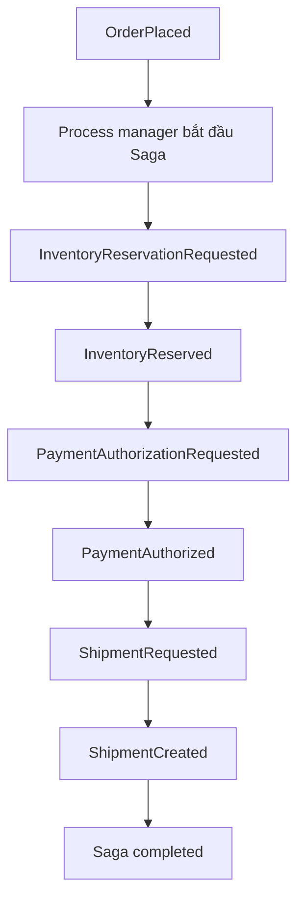
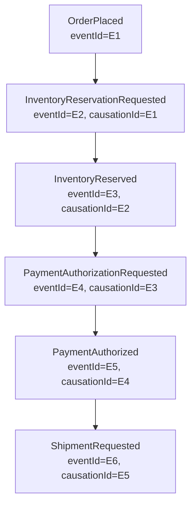

# Theo dõi correlation

Một Saga thường đi qua nhiều module và nhiều bước xử lý bất đồng bộ. Ví dụ, sau khi đơn hàng được tạo, hệ thống cần giữ hàng, xác nhận thanh toán, tạo shipment và gửi thông báo. Mỗi bước có thể phát event mới, chạy ở transaction khác hoặc được xử lý bởi một instance khác. Khi một bước thất bại, nhóm phát triển cần lần theo toàn bộ luồng để biết event bắt đầu từ đâu, process manager đang ở trạng thái nào và tác dụng phụ nào đã xảy ra.

Theo dõi correlation là cách gắn các thông điệp và thao tác liên quan bằng một định danh ổn định. Trong Spring Modulith, application events là phương tiện để các module trao đổi những thay đổi nghiệp vụ; process manager dùng các event đó để điều phối tiến trình. Correlation metadata giúp nối các bước trong cùng một quy trình, còn trạng thái Saga được lưu bền vững để có thể tiếp tục sau restart.

## 1. Vì sao Saga cần correlation?

Một request HTTP có thể kết thúc trước khi Saga hoàn thành. Sau đó, các event như `PaymentAuthorized`, `InventoryReserved` hoặc `ShipmentCreated` được phát ở những thời điểm khác nhau. Nếu chỉ tìm log theo request ID ban đầu, nhóm vận hành có thể không nhìn thấy các bước bất đồng bộ xảy ra sau khi request kết thúc.

Correlation ID tạo một điểm nối xuyên suốt quy trình. Khi mỗi event, log và bản ghi process manager mang cùng correlation ID, người vận hành có thể truy vấn toàn bộ hoạt động thuộc một nghiệp vụ, kể cả khi chúng được xử lý bởi nhiều module hoặc instance.

Ví dụ luồng đặt hàng:



Các thông điệp trong luồng có thể được ghi ở nhiều transaction và nhiều service. Correlation ID giúp nhóm chúng thành một quy trình nghiệp vụ, trong khi từng event vẫn có định danh riêng để chống trùng và xác định quan hệ nhân quả.

## 2. Phân biệt các loại định danh

Không nên dùng một ID cho mọi mục đích. Một Saga thường cần nhiều định danh có vai trò khác nhau:

| Định danh | Phạm vi và mục đích | Có giữ nguyên qua các bước? |
| --- | --- | --- |
| `eventId` | Định danh duy nhất của một event cụ thể; dùng để nhận diện duplicate và audit. | Không. Mỗi event mới có ID mới; retry cùng event giữ nguyên ID. |
| `correlationId` | Nhóm các event và thao tác thuộc cùng một luồng nghiệp vụ hoặc yêu cầu tổng thể. | Có. Giữ nguyên trong toàn bộ luồng cần theo dõi. |
| `causationId` | Cho biết event hoặc command nào trực tiếp gây ra event hiện tại. | Không. Mỗi event mới tham chiếu nguyên nhân trực tiếp của nó. |
| `sagaId` | Định danh một instance process manager/Saga cụ thể. | Có. Giữ nguyên trong vòng đời của instance đó. |
| `aggregateId` | Định danh aggregate sở hữu trạng thái nghiệp vụ, ví dụ `orderId`. | Có trong các event thuộc aggregate đó. |
| `traceId` | Định danh một distributed trace để quan sát các span liên quan. | Thường được truyền theo trace context; có thể thay đổi khi bắt đầu một trace mới hoặc khi tách luồng xử lý. |
| `requestId` | Định danh request ở ranh giới HTTP hoặc API. | Thường chỉ có ý nghĩa trong request; có thể được lưu làm metadata ban đầu. |

Ví dụ: một yêu cầu checkout có thể tạo `correlationId=checkout-123`. Process manager tạo một `sagaId=saga-789`. Event `OrderPlaced` có `eventId=evt-001`; command `PaymentAuthorizationRequested` do process manager phát có `eventId=evt-002` và `causationId=evt-001`. Khi dịch vụ thanh toán trả `PaymentAuthorized`, event đó có ID mới và causation trỏ tới command đã kích hoạt nó.

Một correlation ID có thể bao phủ nhiều Saga con. Vì vậy, không mặc định correlation ID là khóa duy nhất của một hàng Saga. Dùng `sagaId` để định vị một instance; dùng `correlationId` để tìm nhóm các hoạt động có liên quan.

## 3. Tạo và truyền correlation ID

Correlation ID nên được tạo tại ranh giới đầu tiên của luồng nghiệp vụ nếu caller chưa cung cấp một định danh hợp lệ theo hợp đồng API. Sau đó, mọi module tham gia phải giữ nguyên giá trị này khi phát event hoặc command tiếp theo.

Một event có thể mang metadata correlation rõ ràng:

```java
import java.time.Instant;
import java.util.UUID;

public record OrderPlaced(
        UUID eventId,
        UUID orderId,
        UUID correlationId,
        UUID causationId,
        Instant occurredAt) {
}
```

Khi nhận request tạo đơn hàng, application service có thể tạo correlation ID nếu chưa có:

```java
@Transactional
public UUID placeOrder(PlaceOrderCommand command) {
    UUID correlationId = command.correlationId() != null
            ? command.correlationId()
            : UUID.randomUUID();

    Order order = orders.save(Order.create(command));

    events.publishEvent(new OrderPlaced(
            UUID.randomUUID(),
            order.getId(),
            correlationId,
            command.requestEventId(),
            clock.instant()));

    return order.getId();
}
```

Đây là ví dụ minh họa; `PlaceOrderCommand`, `OrderRepository` và `Order` thuộc mô hình của ứng dụng. Trong thực tế, cần xác thực định dạng và phạm vi của correlation ID đến từ caller. Nếu không có correlation ID, hệ thống tạo mới ở ranh giới tin cậy. Không dùng correlation ID như bằng chứng xác thực hoặc quyền truy cập.

Khi process manager phát event tiếp theo, nó sao chép correlation ID từ Saga state và đặt causation ID bằng event đã kích hoạt quyết định hiện tại:

```java
PaymentAuthorizationRequested next = new PaymentAuthorizationRequested(
        UUID.randomUUID(),
        saga.orderId(),
        saga.sagaId(),
        saga.correlationId(),
        received.eventId());

events.publishEvent(next);
```

Nhờ vậy, correlation ID nối toàn bộ quy trình; causation ID cho biết quan hệ trực tiếp giữa hai bước liền nhau.

## 4. Lưu correlation trong trạng thái process manager

Process manager phải có thể khôi phục trạng thái sau khi ứng dụng restart. Không nên chỉ giữ correlation ID hoặc bước hiện tại trong biến instance, thread-local hay HTTP session.

Một bảng trạng thái Saga có thể lưu các trường sau:

```sql
CREATE TABLE saga_instance (
    saga_id UUID PRIMARY KEY,
    correlation_id UUID NOT NULL,
    business_key VARCHAR(120) NOT NULL,
    saga_type VARCHAR(100) NOT NULL,
    current_step VARCHAR(100) NOT NULL,
    status VARCHAR(30) NOT NULL,
    version BIGINT NOT NULL,
    started_at TIMESTAMP NOT NULL,
    updated_at TIMESTAMP NOT NULL,
    completed_at TIMESTAMP,
    last_error_code VARCHAR(100)
);

CREATE INDEX idx_saga_correlation
    ON saga_instance (correlation_id);

CREATE INDEX idx_saga_business_key
    ON saga_instance (saga_type, business_key);
```

Đây là schema minh họa do ứng dụng sở hữu; kiểu UUID, timestamp và index cần điều chỉnh theo database. `saga_id` xác định một tiến trình. `correlation_id` hỗ trợ truy vấn toàn bộ luồng. `business_key` liên kết tiến trình với đơn hàng hoặc nghiệp vụ liên quan. `version` có thể hỗ trợ optimistic locking khi nhiều event cạnh tranh cập nhật cùng Saga.

Nếu một correlation ID có thể bao phủ nhiều Saga, index correlation không nên có unique constraint. Nếu nghiệp vụ bảo đảm mỗi business key chỉ có một Saga đang hoạt động cho một loại quy trình, có thể bổ sung ràng buộc phù hợp cho các trạng thái active; điều kiện cụ thể phụ thuộc database và mô hình vòng đời.

Trạng thái process manager cần được commit cùng với quyết định phát command tiếp theo theo một cơ chế giao nhận đáng tin cậy. Nếu lưu trạng thái Saga và phát message ra broker ở hai tài nguyên không có transaction chung, cần dùng outbox hoặc cơ chế tương đương để tránh trạng thái đã chuyển bước nhưng command không được gửi.

## 5. Tổ chức event envelope và metadata

Với event được truyền giữa nhiều ứng dụng hoặc qua Kafka/RabbitMQ, một envelope giúp thống nhất metadata và payload:

```json
{
  "eventId": "evt-002",
  "eventType": "payments.authorization-requested",
  "occurredAt": "2026-11-25T10:15:30Z",
  "correlationId": "checkout-123",
  "causationId": "evt-001",
  "sagaId": "saga-789",
  "aggregateId": "order-456",
  "traceparent": "00-4bf92f3577b34da6a3ce929d0e0e4736-00f067aa0ba902b7-01",
  "data": {
    "orderId": "order-456",
    "amount": 149.90,
    "currency": "USD"
  }
}
```

Envelope trên là ví dụ hợp đồng do ứng dụng định nghĩa, không phải cấu trúc mặc định mà Spring Modulith tự tạo. Có thể lưu metadata trong payload, message headers hoặc kết hợp cả hai. Cách chọn phụ thuộc yêu cầu persistence, serializer, broker và consumer.

Các metadata nên có ý nghĩa ổn định:

- `eventId`: nhận diện message logic, giữ nguyên khi retry.
- `correlationId`: nối các bước thuộc cùng workflow.
- `causationId`: tham chiếu event/command trực tiếp gây ra message.
- `sagaId`: định tuyến phản hồi về đúng process manager instance.
- `aggregateId`: nhóm các thay đổi của cùng aggregate.
- `traceparent`: mang W3C Trace Context nếu hệ thống tracing sử dụng chuẩn này.

Không nhồi toàn bộ dữ liệu nghiệp vụ hoặc thông tin cá nhân vào metadata. Envelope nên đủ nhỏ, dễ kiểm tra và tương thích schema qua các phiên bản.

## 6. Correlation trong application events của Spring Modulith

Spring Modulith dùng application events để các module giao tiếp qua hợp đồng event. Một event nội bộ có thể chứa correlation ID trực tiếp trong DTO:

```java
import java.util.UUID;
import org.springframework.modulith.events.ApplicationModuleListener;
import org.springframework.stereotype.Component;

public record PaymentAuthorized(
        UUID eventId,
        UUID orderId,
        UUID sagaId,
        UUID correlationId,
        UUID causationId) {
}

@Component
class OrderSagaProcessManager {

    private final SagaRepository sagas;

    OrderSagaProcessManager(SagaRepository sagas) {
        this.sagas = sagas;
    }

    @ApplicationModuleListener
    void on(PaymentAuthorized event) {
        SagaInstance saga = sagas.findById(event.sagaId())
                .orElseThrow(() -> new UnknownSagaException(event.sagaId()));

        if (!saga.correlationId().equals(event.correlationId())) {
            throw new CorrelationMismatchException(event.sagaId());
        }

        saga.paymentAuthorized(event.eventId());
        sagas.save(saga);
    }
}
```

Ví dụ minh họa việc dùng `sagaId` để tìm process manager và kiểm tra correlation ID. Các kiểu `SagaRepository`, `SagaInstance` và exception là thành phần ứng dụng. Listener được khai báo bằng `@ApplicationModuleListener` để xử lý theo cơ chế after-commit/transaction của Spring Modulith; việc lưu Saga state vẫn do ứng dụng triển khai.

Event Publication Registry theo dõi publication tới transactional listener và trạng thái hoàn tất của việc giao event. Registry không tự động tạo correlation ID, không tự gắn `sagaId` vào event và không thay thế bảng trạng thái process manager. Hãy truyền correlation metadata trong event contract hoặc cơ chế header được adapter hỗ trợ.

Nếu event được externalize, `@Externalized` xác định target logic cho adapter. Việc chuyển correlation ID thành broker header hoặc giữ trong payload phụ thuộc cấu hình/khả năng adapter. Cần xác minh mapping cụ thể của adapter thay vì giả định mọi header sẽ tự động được chuyển tiếp.

## 7. Correlation qua HTTP, message broker và thread bất đồng bộ

Một Saga có thể đi qua nhiều ranh giới truyền thông:

| Ranh giới | Cách truyền metadata thường dùng | Lưu ý |
| --- | --- | --- |
| HTTP request | Header như `X-Correlation-ID`; W3C `traceparent` cho tracing. | Tạo ID nếu thiếu; xác thực định dạng và không dùng ID làm quyền truy cập. |
| Spring application event | Trường trong event DTO hoặc context được ánh xạ rõ ràng. | Event phải mang metadata cần thiết sau khi request kết thúc. |
| Kafka | Record header hoặc envelope payload. | Giữ correlation qua retry, retry topic và dead-letter topic. |
| RabbitMQ/AMQP | Message properties/headers hoặc envelope. | Giữ metadata khi publish lại hoặc chuyển qua DLQ. |
| Scheduled job | Lưu correlation ID trong dữ liệu công việc/Saga state. | Không phụ thuộc request thread ban đầu. |
| Executor/thread pool | Context propagation được cấu hình hoặc truyền metadata tường minh. | Thread-local/MDC không tự đảm bảo tồn tại qua async boundary. |

Với công việc bất đồng bộ, không nên chỉ đặt correlation ID trong `ThreadLocal` hoặc MDC rồi kỳ vọng thread khác sẽ tự nhận được. Khi event được serialize, restart hoặc xử lý ở instance khác, thread context ban đầu không còn tồn tại. Dữ liệu correlation cần được lưu trong event hoặc message metadata và được khôi phục khi consumer bắt đầu xử lý.

MDC hữu ích để tự động đưa correlation ID vào log của thread hiện tại. Tuy nhiên, MDC là cơ chế trình bày log, không phải nguồn dữ liệu chuẩn cho Saga. Hãy thiết lập và xóa MDC trong phạm vi xử lý phù hợp để tránh rò context từ message trước sang message tiếp theo trên cùng thread.

## 8. Correlation ID và distributed tracing

Correlation ID và trace ID có liên quan nhưng không thay thế nhau.

- Correlation ID đại diện cho luồng nghiệp vụ cần truy tìm, có thể kéo dài hàng giờ hoặc nhiều ngày.
- Trace ID đại diện cho một distributed trace gồm các span liên quan trong hệ thống quan sát.
- Một Saga có thể tạo nhiều trace qua các lần retry, callback hoặc scheduled action nhưng vẫn giữ một correlation ID.
- Một trace có thể bao gồm nhiều thao tác kỹ thuật trong cùng một lần xử lý event; không nhất thiết tương đương một Saga hoàn chỉnh.

Micrometer Tracing hoặc OpenTelemetry có thể truyền trace context giữa các thành phần được instrument. Khi gửi message bất đồng bộ, producer/consumer có thể tạo span producer/consumer và liên kết qua trace context theo cấu hình instrumentation. Correlation ID vẫn nên được lưu riêng trong event để tìm toàn bộ workflow sau khi trace ban đầu đã kết thúc.

Không tạo trace ID mới rồi ghi đè correlation ID. Cũng không dùng correlation ID làm `traceparent`, vì hai giá trị có định dạng và ngữ nghĩa khác nhau. Khi một retry bắt đầu trace mới, giữ correlation ID cũ và thiết lập quan hệ trace phù hợp theo công cụ quan sát đang dùng.

## 9. Theo dõi quan hệ nhân quả bằng causation ID

Correlation cho biết các thông điệp thuộc cùng một luồng. Causation cho biết vì sao một thông điệp cụ thể xuất hiện. Kết hợp hai giá trị này giúp dựng lại đồ thị nguyên nhân:



Tất cả event trong sơ đồ có thể cùng `correlationId`, nhưng mỗi event có `eventId` riêng và `causationId` trỏ tới nguyên nhân trực tiếp. Nếu một process manager phát nhiều command độc lập từ cùng một event, các command có thể cùng causation ID nhưng có event ID khác nhau.

Không đặt causation ID thành correlation ID chỉ vì muốn giảm số trường. Làm vậy sẽ mất khả năng truy vấn quan hệ cha-con giữa các thông điệp. Nếu một event được tạo bởi nhiều nguyên nhân, cần mô hình hóa quan hệ nhiều nguồn riêng thay vì ép vào một trường causation đơn.

## 10. Correlation trong timeout, retry và compensation

Khi một bước Saga timeout, process manager có thể phát command retry hoặc command bù trừ. Các command mới vẫn thuộc cùng luồng nghiệp vụ nên cần giữ correlation ID và saga ID. Causation ID của command mới tham chiếu event hoặc timeout decision đã kích hoạt nó.

Ví dụ: `PaymentAuthorizationRequested` không nhận phản hồi trong thời hạn. Process manager phát `PaymentAuthorizationTimedOut`, sau đó quyết định phát `PaymentAuthorizationRetryRequested` hoặc `InventoryReleaseRequested`. Các event/command đó giữ correlation ID ban đầu để người vận hành truy vấn toàn bộ quy trình.

Một số nguyên tắc:

- Retry cùng một message giữ nguyên event ID và correlation ID; số lần thử có thể được lưu riêng trong metadata vận hành.
- Một command bù trừ là một hành động nghiệp vụ mới, có event ID mới nhưng giữ saga ID/correlation ID của quy trình gốc.
- Compensation nên có `causationId` trỏ tới timeout/failure decision đã kích hoạt nó.
- Event kết quả compensation tham chiếu command bù trừ tương ứng để xác định chính xác bước nào đã hoàn tất.
- Không mở Saga mới cho mỗi lần retry nếu đó vẫn là cùng một tiến trình; nếu nghiệp vụ tạo một tiến trình con mới, hãy định danh bằng saga ID riêng và giữ correlation ID chung khi cần nhóm.

Ví dụ metadata của command bù trừ:

```java
public record InventoryReleaseRequested(
        UUID eventId,
        UUID sagaId,
        UUID correlationId,
        UUID causationId,
        UUID orderId,
        String reason) {
}
```

Nếu compensation thất bại và cần xử lý thủ công, correlation ID giúp tìm cả chuỗi gốc và các lần bù trừ. Process manager vẫn cần lưu trạng thái của từng bước, kết quả retry và lý do lỗi; log correlation một mình không đủ để khôi phục tiến trình.

## 11. Truy vấn và điều tra theo correlation ID

Khi có sự cố, người vận hành thường bắt đầu từ mã đơn hàng, mã Saga hoặc correlation ID. Hệ thống nên hỗ trợ truy vấn theo cả ba, sau đó liên kết tới event, publication và trace.

Ví dụ truy vấn các Saga cùng một correlation ID:

```sql
SELECT
    saga_id,
    saga_type,
    business_key,
    current_step,
    status,
    started_at,
    updated_at,
    last_error_code
FROM saga_instance
WHERE correlation_id = :correlationId
ORDER BY started_at;
```

Truy vấn các event được process manager ghi nhận:

```sql
SELECT
    event_id,
    causation_id,
    event_type,
    received_at,
    processing_status,
    error_code
FROM saga_event_log
WHERE saga_id = :sagaId
ORDER BY received_at, event_id;
```

Bảng `saga_event_log` là cấu trúc minh họa do ứng dụng sở hữu, không phải bảng mặc định của Spring Modulith. Nếu cần audit hoặc dựng lại lịch sử, hãy xác định retention và tính đầy đủ của dữ liệu log. Timestamp có thể trùng hoặc lệch giữa các máy; nếu cần thứ tự xác định, lưu sequence/version do process manager quản lý.

Để tìm nguyên nhân, người vận hành có thể lần theo:

1. Correlation ID và business key ban đầu.
2. Saga instance tương ứng, trạng thái và bước hiện tại.
3. Event gần nhất đã nhận cùng causation ID.
4. Publication hoặc message delivery đang pending.
5. Trace và log của module phát/nhận event.
6. Command retry/compensation đã phát và kết quả xác nhận.

## 12. Logging có cấu trúc và MDC

Log của mỗi bước nên có các trường metadata riêng thay vì chỉ ghép ID vào một chuỗi tự do:

```json
{
  "level": "INFO",
  "message": "Saga step completed",
  "correlation_id": "checkout-123",
  "saga_id": "saga-789",
  "event_id": "evt-005",
  "causation_id": "evt-004",
  "aggregate_id": "order-456",
  "event_type": "payments.payment-authorized",
  "saga_step": "PAYMENT_AUTHORIZED",
  "trace_id": "4bf92f3577b34da6a3ce929d0e0e4736"
}
```

Với SLF4J MDC, ứng dụng có thể đặt các giá trị trong phạm vi xử lý message:

```java
try {
    MDC.put("correlation_id", event.correlationId().toString());
    MDC.put("saga_id", event.sagaId().toString());
    MDC.put("event_id", event.eventId().toString());

    processManager.handle(event);
} finally {
    MDC.remove("correlation_id");
    MDC.remove("saga_id");
    MDC.remove("event_id");
}
```

Đây là ví dụ minh họa cho xử lý đồng bộ trên một thread. Với executor, reactive pipeline hoặc message listener bất đồng bộ, cần dùng cơ chế context propagation tương ứng hoặc truyền metadata tường minh. Luôn dọn MDC trong `finally` để thread pool không giữ correlation của message trước.

## 13. Metrics và dashboard cho Saga

Correlation ID thường có cardinality rất cao, vì mỗi workflow có thể tạo một giá trị riêng. Không nên dùng correlation ID làm label của Prometheus/Micrometer metric vì số lượng time series có thể tăng không giới hạn. Hãy dùng correlation ID trong log và trace; metric nên nhóm theo loại Saga, bước, trạng thái và loại lỗi.

Các chỉ số hữu ích:

| Chỉ số | Mục đích |
| --- | --- |
| Active Saga count theo `saga_type` | Biết số tiến trình đang chạy. |
| Saga age theo trạng thái | Phát hiện tiến trình bị kẹt lâu hơn SLA. |
| Duration theo Saga type/step | Tìm bước gây độ trễ. |
| Timeout và retry count | Phát hiện phụ thuộc không ổn định. |
| Compensation pending/failed | Theo dõi tiến trình cần can thiệp. |
| Correlation lookup success/failure | Đánh giá khả năng truy vết và lỗi metadata. |
| Event processing error rate | Xác định module hoặc loại event gặp vấn đề. |

Dashboard có thể cung cấp bộ lọc theo correlation ID để người vận hành mở log/trace tương ứng, nhưng không cần tạo metric riêng cho từng correlation ID. Cần phân quyền giao diện điều tra vì kết quả có thể chứa dữ liệu nghiệp vụ nhạy cảm.

## 14. Bảo mật và quản lý vòng đời correlation data

Correlation ID thường không chứa bí mật, nhưng có thể cho phép liên kết nhiều thao tác và tiết lộ hành vi của khách hàng hoặc quy trình nội bộ. Cần xem nó là metadata vận hành có kiểm soát:

- Không đưa tên, email, số điện thoại hoặc dữ liệu cá nhân vào correlation ID.
- Không coi correlation ID do client gửi là bằng chứng xác thực hoặc quyền sở hữu workflow.
- Xác thực độ dài, ký tự và định dạng trước khi ghi log hoặc lưu database.
- Giới hạn quyền truy vấn theo tenant, business scope và vai trò vận hành.
- Áp dụng retention cho log, event metadata và Saga history.
- Tránh hiển thị toàn bộ payload khi operator chỉ cần ID và trạng thái.

Nếu correlation ID được tạo từ bên ngoài, có thể chuẩn hóa hoặc tạo ID nội bộ mới rồi lưu ID ngoài như metadata tham chiếu nếu hợp đồng cần giữ. Không cho phép một caller tùy ý dùng correlation ID của tenant khác để truy vấn trạng thái Saga.

## 15. Kiểm thử correlation xuyên suốt workflow

Unit test cho một process manager method có thể xác nhận quyết định nghiệp vụ, nhưng chưa chứng minh correlation được giữ qua transaction, serialization và message broker. Cần kiểm thử cả chuỗi event.

Các trường hợp nên có:

- **Khởi tạo:** request không có correlation ID được cấp một ID mới; request hợp lệ có ID theo hợp đồng được xử lý đúng.
- **Propagation:** event do module nguồn phát và command do process manager tạo giữ nguyên correlation ID.
- **Causation:** mỗi event mới tham chiếu đúng event/command trực tiếp gây ra nó.
- **Persistence:** sau khi restart, process manager đọc được saga ID, correlation ID và bước hiện tại.
- **Multiple Saga:** nhiều Saga có cùng correlation ID được phân biệt bằng saga ID riêng.
- **Duplicate:** event lặp không tạo thêm bước hoặc command nghiệp vụ trùng.
- **Retry/compensation:** correlation được giữ nguyên qua retry và các hành động bù trừ.
- **Async boundary:** metadata tồn tại khi xử lý qua executor, scheduler hoặc broker.
- **Externalization:** correlation được chuyển đúng qua payload/header theo adapter đã cấu hình.
- **Isolation:** không thể dùng correlation ID để đọc dữ liệu của tenant hoặc workflow không được phép.

Integration test nên kiểm tra dữ liệu đã lưu và metadata message thực tế. Nếu test chỉ xác minh MDC trong cùng thread, nó không chứng minh context được truyền qua một consumer bất đồng bộ hoặc một tiến trình khác.

## 16. Runbook điều tra một Saga theo correlation

Khi operator nhận được correlation ID từ log, ticket hoặc cảnh báo, có thể thực hiện theo trình tự:

1. Tìm Saga instance theo correlation ID và xác định `sagaId`, business key, trạng thái, bước hiện tại.
2. Đọc lịch sử event theo `sagaId`, kiểm tra `eventId`, `causationId` và thứ tự process manager ghi nhận.
3. Xác định event cuối cùng đã hoàn tất và command tiếp theo đã được phát hay chưa.
4. Đối chiếu publication registry, broker message, retry/DLQ và trace của các module liên quan.
5. Kiểm tra timeout, duplicate, correlation mismatch hoặc version conflict.
6. Nếu cần retry hoặc compensation, thực hiện qua quy trình vận hành có kiểm soát và giữ nguyên correlation ID.
7. Xác minh kết quả cuối cùng của Saga và lưu audit trail cho quyết định can thiệp.

Không sửa correlation ID của một Saga đang chạy để làm cho log dễ tìm hơn. Nếu metadata sai, hãy ghi nhận lỗi, xác định nguồn phát và áp dụng quy trình sửa dữ liệu có kiểm soát, bảo đảm vẫn giữ được liên kết với lịch sử cũ.

## 17. Những sai lầm thường gặp

- Dùng một ID cho event ID, correlation ID, causation ID và saga ID.
- Chỉ lưu correlation trong MDC hoặc ThreadLocal, không đưa vào event/persistence.
- Tạo correlation ID mới ở mỗi module khiến một Saga bị tách thành nhiều nhóm log.
- Dùng correlation ID làm khóa duy nhất của Saga dù một workflow có thể chứa nhiều Saga con.
- Nhầm correlation ID với trace ID và kỳ vọng một trace bao phủ toàn bộ Saga dài hạn.
- Không giữ correlation khi retry hoặc phát command compensation.
- Để process manager phát command nhưng không lưu trạng thái/outbox trong cơ chế đáng tin cậy.
- Dùng correlation ID làm metric label gây cardinality cao.
- Ghi PII vào correlation ID hoặc dùng nó như thông tin xác thực.
- Chỉ kiểm tra correlation trong unit test cùng thread mà không kiểm tra qua broker/async boundary.

## Checklist thiết kế và vận hành

- [ ] Correlation ID được tạo tại ranh giới tin cậy và giữ ổn định trong workflow.
- [ ] Event ID, causation ID, saga ID, aggregate ID và trace ID có mục đích riêng.
- [ ] Process manager lưu correlation ID cùng trạng thái Saga bền vững.
- [ ] Event/command chứa đủ metadata để xử lý sau khi request/thread ban đầu kết thúc.
- [ ] Correlation được truyền qua application event và broker theo adapter đã cấu hình.
- [ ] Retry và compensation giữ liên kết với Saga gốc.
- [ ] Causation ID thể hiện đúng quan hệ nguyên nhân trực tiếp.
- [ ] MDC được thiết lập/dọn đúng phạm vi; async context có cơ chế propagation rõ ràng.
- [ ] Log/trace có metadata cần thiết; metric tránh label correlation ID có cardinality cao.
- [ ] Quyền truy vấn correlation được giới hạn theo tenant và vai trò.
- [ ] Integration test bao phủ propagation, persistence, duplicate, retry, compensation và async boundary.
- [ ] Có runbook tìm Saga, event, publication và trace từ correlation ID.

Theo dõi correlation giúp nối các event rời rạc thành một câu chuyện nghiệp vụ có thể điều tra. Khi correlation ID được truyền nhất quán, causation ID giữ quan hệ nhân quả, saga ID định vị đúng process manager và trạng thái được lưu bền vững, nhóm phát triển có thể theo dõi Saga qua nhiều module, transaction và lần retry mà vẫn giữ rõ trách nhiệm của từng thành phần.
