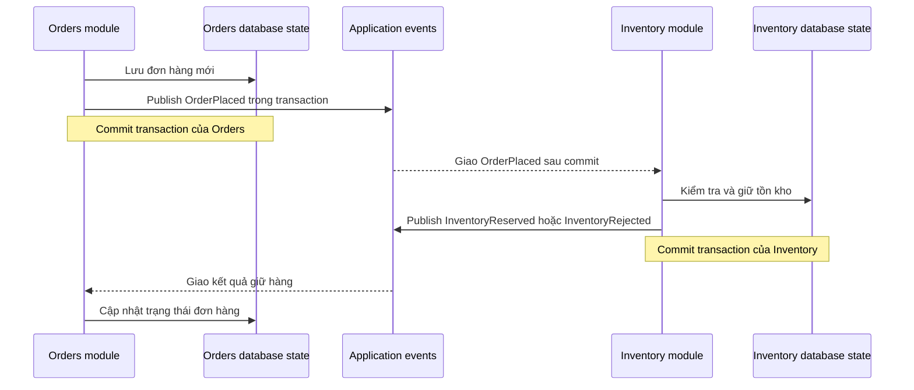
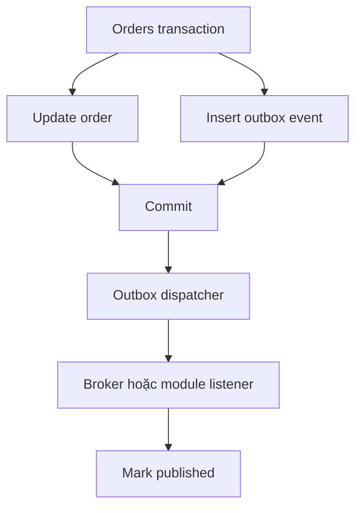

# Consistency boundary

Trong một ứng dụng Spring Modulith, nhiều module cùng tham gia vào một nghiệp vụ nhưng mỗi module nên sở hữu dữ liệu và quy tắc nghiệp vụ của mình. Khi một module thay đổi trạng thái, các module khác có thể cần biết để cập nhật dữ liệu hoặc tiếp tục quy trình. Câu hỏi quan trọng là: phần dữ liệu nào phải nhất quán ngay trong cùng một transaction, và phần nào có thể cập nhật sau khi sự kiện được công bố?

**Consistency boundary** là phạm vi mà trong đó một tập thay đổi dữ liệu phải cùng thành công hoặc cùng rollback để bảo vệ một invariant nghiệp vụ. Ranh giới này giúp xác định nơi cần strong consistency, nơi có thể chấp nhận eventual consistency và module nào chịu trách nhiệm đưa dữ liệu về trạng thái hợp lệ.

Trong kiến trúc hướng module, consistency boundary thường nằm quanh aggregate và transaction do module sở hữu. Module phát event sau khi thay đổi nghiệp vụ được commit; module nhận cập nhật dữ liệu riêng trong transaction của nó. Vì vậy, hệ thống có thể nhất quán mạnh bên trong từng boundary và nhất quán cuối cùng giữa các boundary thông qua application events, publication persistence, retry và các quy trình điều phối khi cần.

## 1. Consistency boundary bảo vệ điều gì?

Một invariant là điều kiện nghiệp vụ phải luôn đúng. Ví dụ:

- Số lượng tồn kho không được âm.
- Một đơn hàng chỉ được xác nhận thanh toán một lần.
- Tổng tiền của đơn hàng phải bằng tổng các dòng hàng theo quy tắc tính giá.
- Một reservation chỉ được giải phóng nếu reservation đó đang tồn tại và còn hiệu lực.
- Một tài khoản không được chi tiêu vượt số dư khả dụng theo quy tắc của sản phẩm.

Nếu nhiều bản ghi cùng tham gia một invariant, việc cập nhật chúng cần được bảo vệ bởi cùng một cơ chế nhất quán. Trong relational database, transaction có thể bảo đảm các thao tác nằm trong transaction cùng commit hoặc rollback. Optimistic locking, row locking, unique constraint và các ràng buộc database bổ sung bảo vệ trước cập nhật đồng thời.

Consistency boundary trả lời ba câu hỏi:

1. **Invariant nào cần được giữ?** Mô tả bằng quy tắc nghiệp vụ có thể kiểm tra.
2. **Ai sở hữu invariant?** Xác định aggregate hoặc module chịu trách nhiệm quyết định trạng thái hợp lệ.
3. **Những thay đổi nào phải nguyên tử?** Xác định dữ liệu và thao tác cần cùng commit để invariant không bị vi phạm.

Nếu không trả lời được ba câu hỏi này, việc đặt `@Transactional` hoặc phát event chỉ là lựa chọn kỹ thuật chưa có cơ sở nghiệp vụ.

## 2. Phân biệt module boundary, aggregate boundary và consistency boundary

Ba loại ranh giới có liên quan nhưng không đồng nghĩa:

| Ranh giới | Trả lời câu hỏi | Vai trò |
|---|---|---|
| Module boundary | Thành phần nào được phép sử dụng API và dữ liệu của module? | Đóng gói trách nhiệm, bảo vệ phụ thuộc và quyền sở hữu |
| Aggregate boundary | Những entity/value object nào được thay đổi qua một aggregate root? | Bảo vệ invariant của mô hình domain trong một transaction |
| Consistency boundary | Những thay đổi nào phải cùng được commit để invariant nghiệp vụ đúng? | Xác định phạm vi strong consistency |

Một module có thể chứa nhiều aggregate, mỗi aggregate có consistency boundary riêng. Một thao tác nghiệp vụ trong module có thể cập nhật nhiều aggregate trong cùng transaction nếu invariant thực sự yêu cầu điều đó và database hỗ trợ. Tuy nhiên, không nên mặc định toàn bộ dữ liệu của module luôn phải được cập nhật trong một transaction lớn.

Trong Spring Modulith, module boundary giúp thể hiện quyền sở hữu và API công khai. Aggregate boundary thuộc thiết kế domain. Consistency boundary được xác định từ invariant và cách giao dịch được thực thi. Các ranh giới này cần hỗ trợ lẫn nhau: module sở hữu dữ liệu mà nó có thể bảo vệ, còn module khác quan sát thay đổi thông qua API hoặc event contract.

## 3. Ví dụ: đơn hàng và kho

Giả sử ứng dụng có module `orders` và module `inventory`.

- `orders` sở hữu đơn hàng, dòng hàng, giá và trạng thái xác nhận đơn.
- `inventory` sở hữu số lượng tồn, reservation và quy tắc giữ hàng.
- Khi đơn hàng được tạo, `orders` cần thông báo cho `inventory` để giữ hàng.

Invariant của đơn hàng như tổng tiền và trạng thái hợp lệ cần được bảo vệ trong transaction của `orders`. Invariant tồn kho như không giữ vượt số lượng khả dụng cần được bảo vệ trong transaction của `inventory`.

Không nên để module `orders` tự cập nhật bảng tồn kho để tạo cảm giác hai module nhất quán ngay lập tức. Làm như vậy khiến `orders` phụ thuộc schema và quy tắc nội bộ của `inventory`; nếu một module thay đổi cách quản lý tồn kho, module kia cũng phải thay đổi.

Thay vào đó, luồng có thể diễn ra như sau:



Trong khoảng thời gian giữa hai transaction, đơn hàng có thể ở trạng thái `PENDING_INVENTORY`. Đây là trạng thái nghiệp vụ được thiết kế rõ ràng, không phải dữ liệu sai. Khi nhận kết quả, `orders` chuyển đơn hàng sang `READY_FOR_PAYMENT` hoặc `REJECTED`.

## 4. Strong consistency bên trong boundary

Strong consistency trong ngữ cảnh này nghĩa là sau khi transaction commit, mọi thay đổi thuộc invariant được bảo vệ đều đã được ghi nhận như một đơn vị nguyên tử theo semantics của database.

Ví dụ, module Inventory giữ hàng cần:

1. Đọc hoặc khóa số lượng khả dụng.
2. Kiểm tra số lượng yêu cầu.
3. Giảm số lượng khả dụng hoặc tăng số lượng đã giữ.
4. Tạo reservation gắn với đơn hàng.
5. Commit tất cả thay đổi cùng nhau.

Nếu bước tạo reservation thất bại, cập nhật số lượng cũng phải rollback. Nếu hai request cùng giữ mặt hàng cuối cùng, database concurrency control phải bảo đảm chỉ một request thành công.

```java
@Service
class InventoryReservationService {

    private final InventoryRepository inventory;
    private final ReservationRepository reservations;
    private final ApplicationEventPublisher events;

    InventoryReservationService(
        InventoryRepository inventory,
        ReservationRepository reservations,
        ApplicationEventPublisher events
    ) {
        this.inventory = inventory;
        this.reservations = reservations;
        this.events = events;
    }

    @Transactional
    public void reserve(ReserveInventoryCommand command) {
        var stock = inventory.findForUpdate(command.productId())
            .orElseThrow();

        stock.reserve(command.quantity());

        var reservation = Reservation.create(
            command.reservationId(),
            command.orderId(),
            command.productId(),
            command.quantity()
        );
        reservations.save(reservation);

        events.publishEvent(new InventoryReserved(
            command.commandId(),
            command.orderId(),
            reservation.id()
        ));
    }
}
```

Đây là ví dụ minh họa; repository, command và event là contract do ứng dụng định nghĩa. `findForUpdate` đại diện cho một cách khóa phù hợp với database, không phải method chuẩn của Spring. Một thiết kế khác có thể dùng optimistic locking hoặc một câu lệnh cập nhật có điều kiện.

Điểm quan trọng là số lượng tồn và reservation được thay đổi trong cùng transaction của module Inventory. Event mô tả kết quả chỉ được công bố như một sự kiện đã xảy ra khi transaction đó commit thành công.

## 5. Vì sao không giữ một transaction cho toàn bộ quy trình?

Một cách tiếp cận tưởng như đơn giản là mở transaction khi tạo đơn hàng, gọi module Inventory, Payment và Shipping, rồi commit khi tất cả hoàn tất. Cách này có thể hoạt động trong một số ứng dụng nhỏ nếu tất cả thao tác cùng database và cùng transaction manager, nhưng nó tạo ra coupling và giới hạn vận hành:

- Transaction có thể kéo dài khi chờ network hoặc hệ thống ngoài.
- Database connection và lock bị giữ lâu.
- Một module có thể vô tình phụ thuộc vào transaction nội bộ của module khác.
- Khi participant được tách thành service riêng, transaction cục bộ không thể bao trùm tất cả hệ thống.
- Một lỗi ở bước cuối có thể rollback các thay đổi trước đó dù chúng thuộc những trách nhiệm nghiệp vụ khác nhau.

Trong modular monolith, một transaction xuyên module vẫn có thể tồn tại về mặt kỹ thuật. Tuy nhiên, nên dùng nó khi invariant thực sự cần atomicity đó và quyền sở hữu nghiệp vụ được thiết kế rõ. Không nên dùng transaction chung chỉ để tránh biểu diễn trạng thái chờ hoặc xử lý thất bại.

Nếu một invariant thường xuyên đòi hỏi dữ liệu của hai module cùng commit, đó có thể là dấu hiệu ranh giới module chưa phù hợp. Hãy cân nhắc chuyển quyền sở hữu invariant và dữ liệu liên quan về một module hoặc aggregate có trách nhiệm rõ ràng.

## 6. Event tạo eventual consistency giữa các boundary

Event cho phép module sở hữu thay đổi công bố một sự kiện sau khi commit. Module nhận xử lý event trong transaction của chính nó. Vì hai transaction xảy ra ở các thời điểm khác nhau, dữ liệu giữa các module có thể tạm thời khác nhau.

**Eventual consistency** có nghĩa là nếu các event được giao và xử lý thành công, các mô hình dữ liệu liên quan sẽ hội tụ về trạng thái nhất quán theo quy tắc nghiệp vụ. Nó không có nghĩa là mọi dữ liệu luôn cập nhật cùng thời điểm hoặc có thể bỏ qua lỗi giao nhận.

Ví dụ, sau khi `OrderPlaced` commit:

- Orders đã biết đơn hàng tồn tại và đang chờ giữ hàng.
- Inventory chưa nhận event nên chưa có reservation.
- Khi Inventory xử lý event, nó tạo reservation hoặc từ chối.
- Orders nhận kết quả và cập nhật trạng thái đơn hàng.

Khoảng thời gian chờ cần được thể hiện bằng state rõ ràng như `PENDING_INVENTORY`, `INVENTORY_RESERVED` hoặc `INVENTORY_REJECTED`. API đọc đơn hàng phải hiểu và trả về những trạng thái này, thay vì giả định mọi dữ liệu đã được đồng bộ ngay khi request tạo đơn trả về.

## 7. Chọn nơi phát event: sau commit

Nếu event được phát trước khi transaction nghiệp vụ commit, listener có thể nhìn thấy một thay đổi sau đó bị rollback. Điều này tạo ra sự kiện mô tả một việc chưa từng xảy ra.

Spring cung cấp `@TransactionalEventListener` để gắn listener với transaction phase. Phase mặc định là `AFTER_COMMIT`. Ví dụ:

```java
@Component
class OrderProjectionListener {

    private final OrderSummaryRepository summaries;

    OrderProjectionListener(OrderSummaryRepository summaries) {
        this.summaries = summaries;
    }

    @TransactionalEventListener(phase = TransactionPhase.AFTER_COMMIT)
    @Transactional(propagation = Propagation.REQUIRES_NEW)
    void on(OrderPlaced event) {
        summaries.createPendingSummary(event.orderId());
    }
}
```

Listener trên chỉ được kích hoạt khi transaction gắn với event commit. `REQUIRES_NEW` tạo transaction riêng cho cập nhật projection. Nếu listener không dùng transaction mới, các thao tác ghi dữ liệu sau commit không còn nằm trong transaction đã kết thúc; cần thiết kế transaction boundary phù hợp với thao tác thực tế.

Một `@EventListener` thông thường được gọi đồng bộ trong thread phát event. Nếu phát event bên trong transaction, listener thông thường có thể chạy trước khi transaction commit. Vì vậy, cần phân biệt rõ listener đồng bộ, transactional event listener và listener bất đồng bộ.

## 8. `@ApplicationModuleListener` trong Spring Modulith

Spring Modulith cung cấp `@ApplicationModuleListener` để biểu diễn listener ở ranh giới module. Annotation này được thiết kế cho xử lý event bất đồng bộ và transaction riêng theo semantics của Spring Modulith/Spring Framework tương ứng. Trong các phiên bản phổ biến, nó kết hợp cơ chế async với transactional event listener sau commit và propagation `REQUIRES_NEW`.

Ví dụ:

```java
@Component
class InventoryOrderListener {

    private final InventoryReservationService reservations;

    InventoryOrderListener(InventoryReservationService reservations) {
        this.reservations = reservations;
    }

    @ApplicationModuleListener
    void on(OrderPlaced event) {
        reservations.reserve(event.toCommand());
    }
}
```

Hãy kiểm tra semantics của đúng phiên bản Spring Modulith đang dùng, cấu hình executor và transaction manager. Bất đồng bộ có nghĩa caller không chờ listener hoàn tất; nó không tự bảo đảm listener sẽ luôn chạy nếu process dừng đột ngột. Để xử lý publication đáng tin cậy, cần persistence và cơ chế phục hồi phù hợp.

## 9. Event Publication Registry và độ tin cậy

Event Publication Registry theo dõi publication của application event tới các listener được quản lý. Với persistence implementation phù hợp, registry ghi nhận publication và trạng thái hoàn tất để ứng dụng nhận diện publication chưa xử lý xong sau lỗi hoặc restart.

Registry giúp giảm khoảng trống giữa việc transaction nghiệp vụ commit và listener xử lý event. Khi một listener chưa hoàn tất, ứng dụng có thể phục hồi publication theo cơ chế được hỗ trợ. Điều này đặc biệt quan trọng khi event là cầu nối giữa các consistency boundary.

Tuy nhiên, registry không tạo một transaction phân tán bao trùm mọi module và hệ thống ngoài. Nó không làm cho database của Orders và database của Inventory cùng commit nguyên tử. Mỗi listener vẫn có transaction cục bộ; event có thể được giao lại nên consumer phải idempotent.

Khi dùng registry, cần xác định:

- Persistence implementation có bền vững qua restart hay chỉ dùng trong bộ nhớ.
- Publication nào được registry theo dõi và listener nào tham gia lifecycle đó.
- Điều kiện nào khiến publication được đánh dấu hoàn tất.
- Cách phục hồi publication incomplete và cách quan sát backlog.
- Cách xử lý event không thể deserialize hoặc listener thất bại liên tục.

Không cập nhật trực tiếp bảng nội bộ của registry để bỏ qua publication lỗi. Dùng API và cơ chế recovery công khai phù hợp với phiên bản đang chạy.

## 10. Outbox khi cần ghi event cùng dữ liệu nghiệp vụ

Một rủi ro khác là ứng dụng commit dữ liệu nhưng không ghi được event vào nơi gửi. Ví dụ, Orders commit đơn hàng rồi process dừng trước khi gửi message tới broker. Khi đó, dữ liệu nghiệp vụ đã tồn tại nhưng module nhận không biết để tiếp tục.

Transactional outbox giải quyết vấn đề bằng cách ghi một bản ghi event/outbox trong cùng database transaction với thay đổi nghiệp vụ. Một dispatcher đọc các bản ghi chưa gửi và chuyển chúng tới broker hoặc hệ thống nhận.



Nếu transaction rollback, cả order update và outbox row đều rollback. Nếu transaction commit, dispatcher có thể gửi event sau đó, kể cả khi ứng dụng đã restart. Dispatcher cần claim an toàn, retry, xử lý message gửi trùng và đánh dấu publication theo kết quả được xác nhận.

Event Publication Registry và outbox có mục đích liên quan nhưng không phải lúc nào cũng là cùng một cơ chế. Registry theo dõi publication tới listener trong Spring Modulith; outbox thường là mô hình lưu intent gửi tới broker hoặc hệ thống ngoài. Hãy dùng đúng persistence/integration được hỗ trợ và tránh tạo hai tầng retry chồng lấn mà không có quy tắc rõ.

## 11. Consistency boundary và quyền sở hữu dữ liệu

Module cần là owner duy nhất của dữ liệu mà nó quản lý. Module khác không nên cập nhật trực tiếp bảng hoặc entity nội bộ để ép trạng thái đồng bộ.

Ví dụ:

| Dữ liệu | Owner | Module khác tương tác qua |
|---|---|---|
| Đơn hàng, trạng thái đơn | Orders | API công khai hoặc event từ Orders |
| Tồn kho, reservation | Inventory | Command/API yêu cầu giữ hàng và event kết quả |
| Thanh toán, refund | Payments | Command/API thanh toán và event kết quả |
| Shipment, tracking | Shipping | Yêu cầu tạo shipment và event cập nhật |

Quyền sở hữu này làm rõ nơi invariant được kiểm tra. Nếu Payments cần biết đơn hàng có hợp lệ hay không, nó nên nhận thông tin hoặc gọi contract công khai phù hợp; không tự đọc bảng `orders` để suy ra quy tắc nội bộ.

Một module có thể cung cấp query API cho module khác nếu cần đọc dữ liệu có thẩm quyền. Nhưng query không đồng nghĩa với quyền ghi. Với truy vấn cần độ trễ thấp hoặc không muốn gọi qua module owner mỗi lần, có thể duy trì projection/read model riêng, chấp nhận eventual consistency và hiển thị rõ thời điểm cập nhật.

## 12. Read model và consistency lag

Một read model là cấu trúc dữ liệu được tối ưu cho truy vấn, có thể được xây dựng từ event của module sở hữu dữ liệu. Read model thường không phải nguồn dữ liệu có thẩm quyền; nó có thể trễ so với write model.

Ví dụ, module Reporting duy trì màn hình tổng hợp đơn hàng bằng cách nghe `OrderPlaced`, `OrderCompleted` và `OrderCancelled`. Nếu event đến trễ, báo cáo có thể chưa phản ánh trạng thái mới nhất. API hoặc giao diện nên xác định rõ mức độ freshness mà người dùng có thể kỳ vọng.

Có thể theo dõi consistency lag bằng:

- Thời gian từ `occurredAt` đến lúc projection cập nhật.
- Tuổi event đang chờ xử lý lâu nhất.
- Số publication incomplete.
- Số event bị retry hoặc chuyển sang trạng thái lỗi.
- Chênh lệch giữa số bản ghi nguồn và projection khi chạy đối soát.

Nếu một thao tác cần dữ liệu mới nhất để quyết định invariant, không dùng projection có thể trễ làm nguồn quyết định duy nhất. Hãy gọi module owner hoặc thực hiện quyết định trong consistency boundary có thẩm quyền.

## 13. Xử lý lỗi giữa các boundary

Event có thể không được xử lý vì lỗi tạm thời, lỗi dữ liệu hoặc lỗi code. Mỗi boundary cần chính sách riêng:

| Loại lỗi | Ví dụ | Cách xử lý |
|---|---|---|
| Tạm thời | Database timeout, executor tạm quá tải | Retry có backoff và giới hạn |
| Lỗi contract | Consumer không đọc được schema version | Compatibility mapping, quarantine hoặc triển khai consumer mới |
| Lỗi nghiệp vụ | Hết hàng, thanh toán bị từ chối | Phát event kết quả nghiệp vụ và chuyển process sang nhánh phù hợp |
| Lỗi lập trình | Null không mong đợi, invariant bị vi phạm | Ghi nhận, cảnh báo và sửa code; không retry vô hạn |
| Publication bị kẹt | Listener không hoàn tất qua nhiều lần thử | Quan sát registry, điều tra và phục hồi có kiểm soát |

Không biến lỗi nghiệp vụ thành exception kỹ thuật để retry liên tục. Ví dụ hết hàng là kết quả hợp lệ của nghiệp vụ; Inventory nên phát `InventoryRejected` với reason code thay vì ném exception khiến listener lặp vô hạn.

Nếu event đã được xử lý ở module nhận nhưng sender không ghi nhận được kết quả, event có thể được giao lại. Vì vậy, consumer phải xử lý duplicate an toàn. Nếu event không thể xử lý sau số lần retry quy định, cần trạng thái cần can thiệp và quy trình replay sau khi sửa nguyên nhân.

## 14. Idempotency tại mỗi consistency boundary

Idempotency bảo đảm việc xử lý cùng một event hoặc command nhiều lần không tạo tác động nghiệp vụ lặp. Đây là yêu cầu quan trọng vì event publication, broker delivery và recovery thường theo semantics at-least-once.

Một consumer có thể lưu event đã xử lý trong Inbox:

```sql
CREATE TABLE processed_event (
    consumer_name VARCHAR(200) NOT NULL,
    event_id UUID NOT NULL,
    processed_at TIMESTAMP NOT NULL,
    PRIMARY KEY (consumer_name, event_id)
);
```

Consumer ghi Inbox và thay đổi dữ liệu nghiệp vụ trong cùng transaction. Nếu event ID đã tồn tại, consumer bỏ qua tác động lặp. Nếu chưa tồn tại, consumer xử lý nghiệp vụ rồi commit cả hai.

Idempotency cũng cần ở participant khi nhận command. Ví dụ, `ReserveInventoryCommand` có thể được gửi lại sau timeout; Inventory cần command ID hoặc reservation ID ổn định để không giữ cùng một lượng hàng hai lần.

Không chỉ dựa vào event ID để bảo vệ invariant. Database vẫn cần unique constraint, optimistic locking hoặc điều kiện cập nhật phù hợp. Event deduplication bảo vệ lần xử lý, còn invariant và constraint bảo vệ dữ liệu trước mọi đường ghi có thể xảy ra.

## 15. Ordering và consistency giữa các event

Event được phát từ cùng aggregate có thể cần được xử lý theo thứ tự. Ví dụ, `OrderPlaced` phải được áp dụng trước `OrderCancelled`. Nhưng khi listener bất đồng bộ, nhiều worker, retry hoặc broker partition cùng tham gia, thứ tự xử lý toàn cục không được đảm bảo tự động.

Các biện pháp thường dùng:

- Gắn `aggregateId` và sequence tăng dần vào event.
- Dùng aggregate ID làm partition/routing key nếu broker hỗ trợ ordering trong phạm vi partition.
- Consumer kiểm tra sequence trước khi cập nhật projection hoặc process state.
- Giữ event đến sau ở trạng thái pending nếu thiếu event trước đó.
- Thiết kế transition để từ chối hoặc xử lý event stale/duplicate rõ ràng.

Không cần ordering toàn cục cho mọi event. Hãy xác định đúng phạm vi invariant: theo aggregate, theo đơn hàng, theo tài khoản hay theo tenant. Ordering quá rộng làm giảm khả năng xử lý song song và tạo bottleneck.

## 16. Khi invariant vượt qua module boundary

Đôi khi một quy tắc nghiệp vụ dường như cần dữ liệu của nhiều module. Ví dụ, việc xác nhận đơn hàng cần biết cả trạng thái thanh toán và reservation tồn kho.

Trước hết, hãy xem invariant đó thuộc về module nào. Có thể một module sở hữu quyết định cuối cùng và nhận các kết quả từ participant khác. Khi đó, process manager hoặc aggregate điều phối sẽ lưu trạng thái cần thiết và chỉ xác nhận đơn hàng khi tất cả điều kiện đã được thỏa mãn.

Nếu không thể có một owner duy nhất cho quyết định tức thời, cần chấp nhận quy trình nhiều bước với eventual consistency và định nghĩa trạng thái trung gian. Một Saga/process manager có thể điều phối:

1. Nhận `OrderPlaced`.
2. Yêu cầu Inventory giữ hàng.
3. Chờ `InventoryReserved`.
4. Yêu cầu Payments xác nhận thanh toán.
5. Chờ `PaymentAuthorized`.
6. Xác nhận đơn hàng hoặc chạy compensation nếu một bước thất bại.

Không nên dùng distributed transaction/XA như lựa chọn mặc định để giữ invariant xuyên qua các hệ thống độc lập. Distributed transaction có thể có chỗ dùng phù hợp, nhưng làm tăng coupling, yêu cầu hỗ trợ từ các resource manager và ảnh hưởng khả năng sẵn sàng. Với event-driven architecture, local transaction cộng với process manager và compensation thường dễ mở rộng và vận hành hơn.

## 17. Đọc dữ liệu trong thời gian eventual consistency

API tạo đơn có thể trả về trạng thái `PENDING_INVENTORY` ngay sau khi transaction Orders commit. Client không nên suy ra rằng tồn kho đã được giữ chỉ vì đơn hàng đã được tạo.

Một số cách thiết kế trải nghiệm đọc:

- Trả về trạng thái tiến trình và cho client truy vấn lại bằng order ID.
- Cung cấp endpoint trạng thái quy trình hoặc trạng thái xử lý event.
- Dùng notification khi trạng thái chuyển sang bước tiếp theo.
- Hiển thị thời điểm cập nhật gần nhất cho read model có thể trễ.
- Với thao tác yêu cầu quyết định tức thời, gọi module owner thay vì dựa trên projection cũ.

Đừng che giấu consistency lag bằng cách trả về trạng thái `COMPLETED` quá sớm. Trạng thái trung gian chính xác giúp người dùng và hệ thống tích hợp hiểu điều gì đã được xác nhận và điều gì vẫn đang chờ.

## 18. Kiểm thử consistency boundary

Kiểm thử cần xác minh invariant ở bên trong boundary và hành vi giao tiếp giữa các boundary.

| Tình huống | Điều cần xác minh |
|---|---|
| Transaction thành công | Mọi thay đổi thuộc invariant cùng commit |
| Transaction rollback | Không còn thay đổi một phần hoặc event mô tả kết quả chưa commit |
| Hai request đồng thời | Invariant vẫn đúng nhờ locking/constraint/version |
| Event được phát sau commit | Listener không nhìn thấy dữ liệu đã rollback |
| Listener lỗi | Publication còn có thể phục hồi theo persistence configuration |
| Event được giao lại | Consumer idempotent, không lặp tác động |
| Event đến sai thứ tự | State machine hoặc projection phát hiện và xử lý đúng |
| Read model trễ | API thể hiện trạng thái và freshness đúng |
| Module khác truy cập dữ liệu | Chỉ dùng API/contract công khai, không ghi trực tiếp dữ liệu owner |
| Quy trình liên module thất bại | Saga/process manager thực hiện nhánh lỗi hoặc compensation |

Trong Spring Modulith, có thể dùng module integration tests để kiểm tra event publication và tương tác module. Kiểm thử persistence registry cần dùng persistence implementation phù hợp. Kiểm thử transaction và concurrency nên chạy trên database tương ứng với môi trường, vì mock không thể xác minh row lock, isolation hoặc unique constraint.

## 19. Kiểm tra module boundary trong Spring Modulith

Spring Modulith hỗ trợ mô tả cấu trúc module và kiểm tra các phụ thuộc giữa module. Việc kiểm tra kiến trúc giúp phát hiện module truy cập package nội bộ hoặc tạo phụ thuộc vòng không phù hợp.

Một test kiến trúc có thể sử dụng `ApplicationModules`:

```java
class ModularityTests {

    @Test
    void moduleBoundariesAreRespected() {
        ApplicationModules.of(Application.class).verify();
    }
}
```

Đây là ví dụ theo API Spring Modulith phổ biến; package và cách khởi tạo application type cần khớp cấu trúc project. Kiểm tra module dependency không tự chứng minh consistency boundary đúng. Nhóm phát triển vẫn phải xác định invariant, owner, transaction scope và event contract bằng thiết kế domain cùng kiểm thử nghiệp vụ.

## 20. Quan sát consistency và publication

Một hệ thống có eventual consistency cần đo được độ trễ và trạng thái chờ. Nên theo dõi:

- Số event publication đang chờ và publication incomplete.
- Tuổi của event lâu nhất chưa được xử lý.
- Thời gian từ commit của module phát tới khi listener hoàn tất.
- Số lần retry, lỗi deserialize và publication cần can thiệp.
- Số event duplicate, stale hoặc sai thứ tự.
- Số process/saga đang chờ participant hoặc quá deadline.
- Độ trễ cập nhật read model và chênh lệch khi đối soát.

Log và trace nên có `eventId`, aggregate/business ID, module phát, listener nhận, correlation ID, thời điểm commit và thời điểm xử lý. Tránh ghi payload nhạy cảm hoặc dùng ID từng entity làm metric label có cardinality cao.

Khi điều tra một dữ liệu không nhất quán, cần lần theo các mốc: transaction nguồn đã commit chưa, publication đã được ghi nhận chưa, listener đã nhận chưa, transaction consumer đã commit chưa và có event nào bị retry hoặc chuyển trạng thái lỗi không. Điều này giúp phân biệt lỗi mất event, lỗi listener, projection lag và lỗi nghiệp vụ.

## 21. Chọn consistency boundary phù hợp

Một số nguyên tắc giúp chọn ranh giới:

1. Đặt invariant cùng với dữ liệu và hành vi có thẩm quyền để bảo vệ invariant đó.
2. Giữ transaction ngắn và chỉ bao gồm các thay đổi cần atomicity.
3. Không cho module khác ghi trực tiếp dữ liệu nội bộ của owner.
4. Dùng event để thông báo sự kiện đã commit và cho phép module khác cập nhật trạng thái riêng.
5. Chấp nhận eventual consistency khi nghiệp vụ có thể biểu diễn trạng thái chờ và kết quả bất đồng bộ.
6. Dùng process manager/Saga khi có nhiều bước, timeout, nhánh lỗi hoặc compensation.
7. Bảo đảm event delivery bền vững, consumer idempotent và có khả năng quan sát.
8. Nếu invariant xuyên module cần atomicity liên tục, xem xét lại ownership và ranh giới module trước khi mở rộng transaction.

## 22. Checklist thiết kế

- [ ] Invariant nghiệp vụ được mô tả rõ và có thể kiểm thử.
- [ ] Module/aggregate sở hữu invariant được xác định.
- [ ] Dữ liệu cần atomicity nằm trong transaction boundary có chủ sở hữu.
- [ ] Locking, version và database constraints bảo vệ cập nhật đồng thời.
- [ ] Event chỉ biểu diễn thay đổi đã commit.
- [ ] Listener có transaction boundary phù hợp và không phụ thuộc transaction đã kết thúc.
- [ ] Event Publication Registry hoặc outbox được cấu hình bền vững khi cần.
- [ ] Consumer idempotent và có chính sách retry/recovery.
- [ ] Event ordering được xác định theo đúng phạm vi invariant.
- [ ] Trạng thái trung gian và consistency lag được thể hiện rõ qua API.
- [ ] Read model không được dùng làm nguồn quyết định invariant nếu có thể trễ.
- [ ] Quy trình liên module có process manager/Saga và compensation khi cần.
- [ ] Module boundary được kiểm tra bằng test kiến trúc.
- [ ] Có metric, log, trace và quy trình xử lý publication bị kẹt.

Consistency boundary xác định nơi dữ liệu cần được thay đổi nguyên tử để bảo vệ invariant nghiệp vụ. Trong Spring Modulith, module sở hữu boundary thực hiện transaction cục bộ và công bố event sau commit; module nhận cập nhật dữ liệu của mình trong transaction riêng. Kết hợp ranh giới module rõ ràng, Event Publication Registry hoặc outbox, idempotency và process manager giúp hệ thống giữ strong consistency ở nơi cần thiết và eventual consistency ở những luồng có thể chấp nhận xử lý bất đồng bộ.
