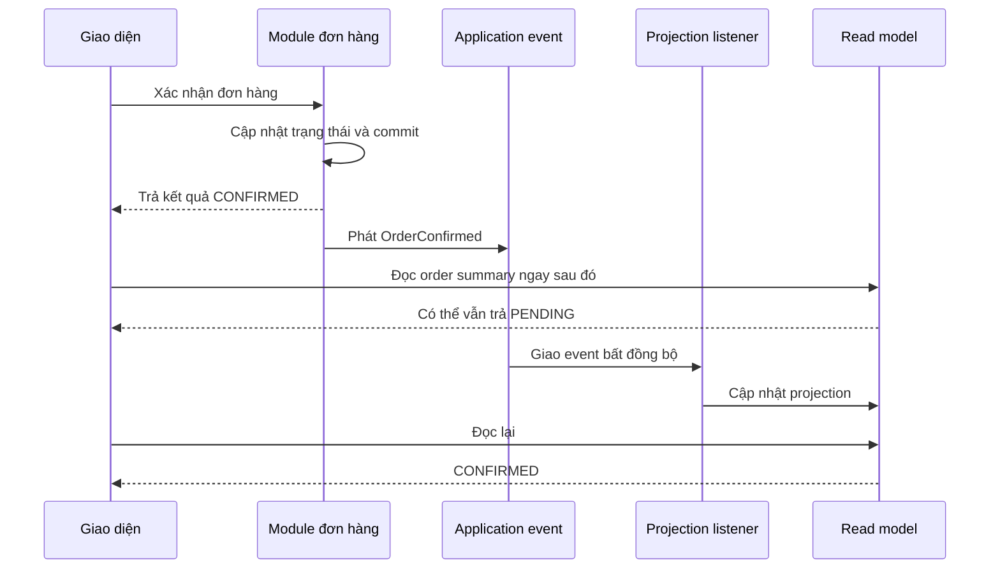

# Đọc dữ liệu cũ trong ứng dụng dùng application events

Một lệnh nghiệp vụ có thể cập nhật dữ liệu thành công nhưng màn hình đọc ngay sau đó vẫn hiển thị trạng thái trước khi cập nhật. Hiện tượng này thường được gọi là **stale read**: truy vấn trả về dữ liệu hợp lệ tại một thời điểm trước đó, nhưng chưa phản ánh thay đổi mới nhất mà người dùng vừa thực hiện. Trong ứng dụng dùng application events, nguyên nhân phổ biến là read model được cập nhật bất đồng bộ sau khi transaction ghi dữ liệu đã commit.

Trong module `SPRING_MODULITH_APPLICATION_EVENTS`, publisher và listener giúp tách các module bằng sự kiện nghiệp vụ. Cách tổ chức này có thể tạo ra eventual consistency giữa write model và read model. Muốn tránh người dùng hiểu nhầm hoặc thực hiện thao tác dựa trên dữ liệu cũ, ứng dụng cần xác định mức nhất quán mà từng luồng đọc yêu cầu, truyền thông tin về phiên bản dữ liệu và cung cấp cách đọc phù hợp khi projection chưa bắt kịp.

## 1. Stale read xuất hiện như thế nào?

Giả sử khách hàng xác nhận một đơn hàng. Module đơn hàng cập nhật trạng thái từ `PENDING` sang `CONFIRMED` trong transaction rồi phát `OrderConfirmed`. Một listener của module báo cáo nhận event và cập nhật bảng `order_summary` để phục vụ trang danh sách.

Transaction cập nhật đơn hàng có thể commit lúc 10:00:00.010. Listener cập nhật projection chạy sau đó vài chục mili giây hoặc vài giây. Nếu trình duyệt gọi API đọc `order_summary` lúc 10:00:00.020, kết quả vẫn có thể là `PENDING`. Dữ liệu chưa nhất thiết sai; nó chỉ chưa phản ánh event mới nhất.



Khoảng thời gian giữa lúc thay đổi nguồn được commit và lúc read model phản ánh thay đổi được gọi là projection lag. Độ trễ có thể rất ngắn khi hệ thống khỏe mạnh, nhưng cũng có thể kéo dài khi listener chậm, database bận, broker gián đoạn hoặc event cần retry.

Điểm cần phân biệt là transaction của lệnh nghiệp vụ đã thành công không có nghĩa mọi read model, cache hoặc hệ thống bên ngoài đã cập nhật xong. API cần thể hiện đúng mức bảo đảm mà nó có thể cung cấp.

## 2. Các nguồn gây dữ liệu cũ

Stale read không chỉ xuất hiện trong kiến trúc event-driven. Cần xác định đúng nguồn gây trễ để chọn cách xử lý phù hợp.

| Nguồn | Cơ chế | Dấu hiệu thường gặp |
| --- | --- | --- |
| Projection bất đồng bộ | Listener chưa xử lý event hoặc chưa commit read model | Write model mới nhưng bảng projection vẫn cũ |
| Database read replica | Replication chưa chuyển thay đổi từ primary sang replica | Đọc primary thấy mới, đọc replica thấy cũ |
| Cache | Cache chưa hết TTL hoặc chưa được invalidation | Database đã mới nhưng API trả kết quả cũ |
| Cập nhật đồng thời | Một request đọc trước khi transaction khác commit | Kết quả phụ thuộc thời điểm và thứ tự transaction |
| Event đến trễ hoặc sai thứ tự | Projection nhận event cũ sau event mới hoặc còn thiếu event | Một số trường đúng, một số trường chưa đồng bộ |
| Client giữ state cũ | Giao diện chưa refetch hoặc dùng dữ liệu đã cache | API đã mới nhưng màn hình vẫn hiển thị cũ |

Một luồng có thể gặp nhiều nguyên nhân cùng lúc. Ví dụ listener cập nhật projection thành công nhưng cache chưa được xóa; lúc đó database projection đã mới mà người dùng vẫn thấy dữ liệu cũ. Quan sát riêng từng tầng giúp tránh tăng retry cho listener khi vấn đề thực tế nằm ở cache.

## 3. Nhất quán mạnh và nhất quán cuối cùng

Ứng dụng cần chọn mức nhất quán theo yêu cầu nghiệp vụ thay vì mặc định mọi truy vấn phải thấy dữ liệu mới nhất ngay lập tức.

- **Strong consistency / linearizable read:** sau khi thao tác ghi thành công, truy vấn tiếp theo quan sát được thay đổi đó theo một thứ tự nhất quán với các thao tác khác. Mức này thường đòi hỏi đọc từ nguồn có bảo đảm tương ứng hoặc phối hợp chặt với transaction.
- **Read-your-writes:** người dùng nhìn thấy thay đổi do chính họ vừa thực hiện, dù các người dùng khác có thể vẫn thấy projection cũ trong một khoảng ngắn.
- **Monotonic reads:** một người dùng không bị trả về phiên bản cũ hơn phiên bản họ đã thấy trước đó trong cùng luồng đọc.
- **Causal consistency:** nếu một thao tác xảy ra sau và phụ thuộc vào thao tác trước, hệ thống bảo đảm kết quả trước đã được quan sát trước khi xử lý kết quả sau theo quan hệ nhân quả.
- **Eventual consistency:** nếu không có cập nhật mới và các event tiếp tục được xử lý thành công, các read model cuối cùng sẽ hội tụ về trạng thái tương ứng với nguồn.

Event Publication Registry giúp theo dõi việc giao event tới listener, nhưng không tự biến một projection bất đồng bộ thành strong consistency. Eventual consistency chỉ là bảo đảm hội tụ khi hệ thống có thể tiếp tục xử lý event, không có lỗi dữ liệu kéo dài và projection áp dụng đúng các thay đổi.

## 4. Xác định truy vấn nào cần thấy dữ liệu mới ngay

Không phải mọi màn hình đều cần cùng một mức nhất quán. Trang báo cáo tổng hợp có thể chấp nhận trễ vài giây. Màn hình xác nhận thanh toán hoặc kiểm tra hạn mức có thể cần dữ liệu mới ngay để tránh quyết định sai.

Trước khi chọn kỹ thuật, hãy trả lời:

1. Ai cần nhìn thấy thay đổi: chính người vừa ghi, mọi người dùng hay một hệ thống khác?
2. Dữ liệu cần mới tới mức nào: ngay sau commit, trong vài giây hay trước lần xử lý tiếp theo?
3. Truy vấn có thể đọc từ write model hay phải dùng projection riêng?
4. Nếu projection chưa bắt kịp, giao diện có thể hiển thị trạng thái đang đồng bộ hay phải chờ?
5. Khi listener thất bại kéo dài, nghiệp vụ cho phép tiếp tục hay phải chặn thao tác phụ thuộc?

Ví dụ, trang danh sách đơn hàng có thể hiển thị projection với thời điểm cập nhật gần nhất. Trang chi tiết ngay sau khi xác nhận đơn hàng có thể dùng kết quả command hoặc đọc trực tiếp write model. Một thao tác thanh toán tiếp theo cần kiểm tra trạng thái có thể phải xác minh trên nguồn dữ liệu có thẩm quyền thay vì dựa vào projection đang trễ.

## 5. Cách đơn giản nhất: trả kết quả command cho người vừa ghi

Sau khi transaction nghiệp vụ commit thành công, command handler thường đã biết trạng thái mới và có thể trả dữ liệu đó cho client. Với thao tác vừa tạo hoặc cập nhật một aggregate, response nên chứa định danh và trạng thái đã commit.

```java
public record ConfirmOrderResult(
        UUID orderId,
        String status,
        long aggregateVersion
) {}
```

```java
@Service
class OrderApplicationService {

    private final OrderRepository orders;
    private final ApplicationEventPublisher events;

    OrderApplicationService(
            OrderRepository orders,
            ApplicationEventPublisher events
    ) {
        this.orders = orders;
        this.events = events;
    }

    @Transactional
    public ConfirmOrderResult confirm(UUID orderId) {
        Order order = orders.findById(orderId).orElseThrow();
        order.confirm();

        events.publishEvent(new OrderConfirmed(
                UUID.randomUUID(),
                order.getId(),
                order.getVersion()
        ));

        return new ConfirmOrderResult(
                order.getId(),
                order.getStatus().name(),
                order.getVersion()
        );
    }
}
```

Response chỉ được gửi thành công sau khi transaction của phương thức commit thành công theo cơ chế transaction của Spring. Client có thể cập nhật ngay trạng thái vừa nhận mà không cần đọc lại projection đã xử lý bất đồng bộ.

Cách này đặc biệt hữu ích cho read-your-writes. Nó không đảm bảo mọi màn hình hoặc mọi client khác lập tức nhìn thấy cùng trạng thái. Nếu client cần dữ liệu tổng hợp từ nhiều module, command response có thể không chứa toàn bộ thông tin và cần một cơ chế tiếp theo.

## 6. Dùng version để yêu cầu read model bắt kịp

Một cách rõ ràng để phối hợp command và query là gắn phiên bản tăng dần vào thay đổi nguồn. Command trả về version đã commit; projection lưu version mới nhất mà nó đã áp dụng. Khi client đọc, nó gửi version tối thiểu mà nó cần quan sát.

Ví dụ event:

```java
public record OrderConfirmed(
        UUID eventId,
        UUID orderId,
        long aggregateVersion
) {}
```

Read model lưu trường `aggregate_version`:

```sql
CREATE TABLE order_summary (
    order_id UUID PRIMARY KEY,
    status VARCHAR(30) NOT NULL,
    aggregate_version BIGINT NOT NULL,
    updated_at TIMESTAMP NOT NULL
);
```

Khi áp dụng event, projector chỉ cập nhật nếu version mới hơn version đang lưu và phải xử lý event theo đúng thứ tự nghiệp vụ:

```java
@Transactional
public void on(OrderConfirmed event) {
    orderSummaryRepository.applyIfNewer(
            event.orderId(),
            event.aggregateVersion(),
            "CONFIRMED"
    );
}
```

`applyIfNewer` là thao tác repository minh họa; implementation cần dùng câu lệnh cập nhật có điều kiện hoặc khóa phù hợp để chống race. Nếu projection phụ thuộc các event trung gian, chỉ so sánh version lớn hơn là chưa đủ: projector phải bảo đảm không bỏ qua event cần thiết hoặc phải tính lại projection từ trạng thái nguồn thích hợp.

Client có thể gửi version mong muốn qua query parameter hoặc header:

```http
GET /orders/7d8.../summary?minVersion=12
```

API đọc projection và so sánh `aggregate_version` với `minVersion`:

- Nếu version projection đạt hoặc vượt mức yêu cầu, trả dữ liệu projection.
- Nếu chưa đạt, trả trạng thái chưa sẵn sàng theo hợp đồng API, hoặc chờ trong giới hạn thời gian đã định.
- Nếu projection lỗi kéo dài, trả trạng thái lỗi có thể quan sát thay vì giả vờ dữ liệu đã mới.

Version là một token nhất quán hữu ích khi nó thuộc cùng aggregate hoặc cùng stream. Không so sánh version của hai aggregate khác nhau như thể chúng nằm trên một trục thứ tự chung.

## 7. Chờ projection trong giới hạn thời gian

Một số luồng cần đợi read model bắt kịp trước khi tiếp tục, nhưng không muốn giữ request vô thời hạn. Có thể chờ có giới hạn bằng polling, notification hoặc cơ chế chờ điều kiện.

Luồng khái quát:

1. Command commit và trả về `aggregateVersion` yêu cầu.
2. Client hoặc API query kiểm tra version của projection.
3. Nếu projection chưa đạt, đợi một khoảng ngắn rồi kiểm tra lại.
4. Dừng khi version đạt, hoặc khi hết deadline.
5. Nếu hết deadline, trả trạng thái đang đồng bộ để client quyết định hiển thị hoặc thử lại sau.

Không nên dùng vòng lặp polling dày đặc. Hãy dùng khoảng chờ tăng dần, jitter nếu có nhiều client và một deadline tổng. Nếu có thể, notification từ projector hoặc cơ chế push giúp giảm truy vấn lặp; tuy nhiên notification cũng cần được xử lý như tín hiệu có thể đến trễ hoặc mất, nên trạng thái projection vẫn là nguồn xác nhận cuối cùng.

Ví dụ hợp đồng HTTP có thể dùng `202 Accepted` khi yêu cầu đã được ghi nhận nhưng projection chưa đạt version cần thiết:

```json
{
  "status": "PROCESSING",
  "resourceId": "7d8...",
  "requiredVersion": 12,
  "currentProjectionVersion": 10,
  "statusUrl": "/orders/7d8.../projection-status"
}
```

Đây là định dạng response do ứng dụng thiết kế, không phải response mặc định của Spring Modulith. API có thể cung cấp `Retry-After` để client không polling quá nhanh. Khi projection đạt version 12, endpoint trạng thái trả dữ liệu mới hoặc đường dẫn tới read model.

Chờ đồng bộ chỉ nên dùng cho luồng có yêu cầu rõ ràng. Nếu mọi request đều chờ projection, độ trễ của listener sẽ chuyển thành độ trễ trực tiếp của API và có thể làm cạn thread hoặc connection pool.

## 8. Đọc từ write model khi cần dữ liệu có thẩm quyền

Nếu truy vấn cần trạng thái mới nhất của chính aggregate vừa được cập nhật, đọc từ write model có thể là lựa chọn hợp lý. Write model là nguồn dữ liệu có thẩm quyền cho nghiệp vụ, trong khi read model được tối ưu cho truy vấn và có thể trễ.

Có thể áp dụng quy tắc:

- Truy vấn cần quyết định nghiệp vụ hoặc cần trạng thái mới nhất: đọc từ nguồn có thẩm quyền và kiểm tra trong transaction phù hợp.
- Truy vấn danh sách, báo cáo hoặc dữ liệu tổng hợp lớn: đọc projection và chấp nhận độ trễ đã định.
- Truy vấn ngay sau command của người dùng: ưu tiên dùng command result hoặc đọc write model cho resource đó.

Không nên biến mọi truy vấn thành đọc trực tiếp write model chỉ để loại bỏ stale read. Điều đó có thể làm mất lợi ích của read model, tăng tải lên database nghiệp vụ và tạo coupling giữa các module. Hãy chỉ dùng đường đọc authoritative cho những trường hợp cần thiết.

Nếu write model và read model nằm ở các database khác nhau, việc đọc write model vẫn không đảm bảo các hệ thống khác đã cập nhật. Nó chỉ bảo đảm truy vấn đang đọc được nguồn dữ liệu được chọn làm thẩm quyền.

## 9. Cẩn trọng với cache và read replica

Version projection đã đạt yêu cầu nhưng API vẫn trả dữ liệu cũ có thể do cache hoặc read replica.

### Cache

Cache cần có chiến lược invalidation hoặc versioning tương ứng với event. Có thể:

- Xóa cache key khi projection commit thành công.
- Gắn version vào cache entry và chỉ thay entry bằng version mới hơn.
- Dùng cache key có generation/version để client không đọc lại entry cũ.
- Đặt TTL ngắn như lớp bảo vệ cuối, không xem TTL là bảo đảm nhất quán.

Invalidation cũng có thể thất bại hoặc đến trễ. Nếu yêu cầu read-your-writes nghiêm ngặt, API cần bypass cache hoặc kiểm tra version từ nguồn đáng tin cậy trước khi trả dữ liệu.

### Read replica

Database replica có thể trễ so với primary. Nếu write model đã commit trên primary nhưng query đọc replica ngay lập tức, kết quả vẫn có thể cũ. Với một số database, có thể dùng cơ chế chờ replica đạt replication position hoặc chuyển truy vấn read-after-write sang primary. Cách làm cụ thể phụ thuộc database.

Không nhầm projection lag với replication lag: hai độ trễ có thể xảy ra độc lập và cần metric riêng.

## 10. Event Publication Registry và stale read

Spring Modulith Event Publication Registry theo dõi publication của event tới các listener. Với persistent repository, ứng dụng có thể giữ publication chưa hoàn tất qua restart và hỗ trợ phát lại theo cơ chế đã cấu hình. Điều này giúp tăng độ tin cậy giao event.

Tuy nhiên, registry không đồng nghĩa projection đã cập nhật ngay khi publisher phát event. Một số mốc cần phân biệt:

1. Transaction nghiệp vụ commit.
2. Event publication được ghi nhận.
3. Listener bắt đầu xử lý.
4. Listener cập nhật read model và commit transaction của nó.
5. Registry ghi nhận listener hoàn tất.
6. Cache hoặc replica liên quan phản ánh thay đổi nếu có.

Chỉ sau khi read model commit ở bước 4, query trực tiếp vào read model mới có thể quan sát phiên bản đó, tùy isolation level và cache. Việc registry đánh dấu publication hoàn tất là tín hiệu listener đã hoàn thành theo ranh giới xử lý được cấu hình; nó không xác nhận mọi cache, replica hoặc consumer bên ngoài đã cập nhật.

Nếu listener thất bại, publication còn dang dở có thể được retry. Trong thời gian đó, API cần tiếp tục thể hiện projection đang trễ. Không nên đánh dấu publication hoàn tất trong `catch` chỉ để tránh retry, vì hành động đó che giấu nguyên nhân stale read.

## 11. Tránh event cũ ghi đè dữ liệu mới

Stale read có thể kéo dài nếu event được xử lý sai thứ tự. Ví dụ projection đã áp dụng `OrderConfirmed` version 8, sau đó nhận lại `OrderPlaced` version 1. Nếu projector ghi đè trạng thái mà không kiểm tra version, read model quay ngược về trạng thái cũ.

Projector nên có quy tắc bảo vệ:

- Dùng sequence/version do aggregate hoặc nguồn event cấp.
- Bỏ qua event đã được áp dụng khi đã xác minh trạng thái projection nhất quán.
- Phát hiện gap nếu projection cần đầy đủ chuỗi event.
- Dùng cập nhật có điều kiện hoặc khóa để tránh hai worker ghi đè lẫn nhau.
- Thiết kế listener idempotent để event giao lại không tạo side effect trùng.

Nếu event chỉ là snapshot đầy đủ trạng thái mới, có thể áp dụng version lớn hơn version hiện tại. Nếu event là delta, chẳng hạn `BalanceDebited(amount)`, bỏ qua các version trung gian có thể làm sai kết quả; cần xử lý đúng thứ tự hoặc tái dựng từ trạng thái chuẩn.

## 12. Thiết kế giao diện khi dữ liệu chưa đồng bộ

Không phải lúc nào cũng cần giữ người dùng chờ. Giao diện có thể thể hiện rõ trạng thái dữ liệu:

- Sau command thành công, hiển thị ngay kết quả từ response command.
- Đánh dấu phần dữ liệu tổng hợp là đang cập nhật nếu projection chưa đạt version mong muốn.
- Tự làm mới khi nhận notification hoặc sau một khoảng chờ có giới hạn.
- Hiển thị thời điểm dữ liệu được cập nhật gần nhất trên báo cáo có eventual consistency.
- Nếu quá thời hạn đồng bộ, thông báo có thể thử lại và cung cấp mã tham chiếu để hỗ trợ.

Tránh hiển thị dữ liệu cũ như thể đó là trạng thái mới nhất. Nếu buộc phải hiển thị dữ liệu cũ để giao diện vẫn dùng được, hãy cho người dùng biết dữ liệu đang trễ và không cho phép thao tác nguy hiểm dựa trên trạng thái chưa xác nhận.

## 13. Kiểm thử stale read và read-your-writes

Kiểm thử cần xác nhận cả thời điểm projection chưa bắt kịp và thời điểm đã đồng bộ. Một số tình huống quan trọng:

| Tình huống | Điều cần xác nhận |
| --- | --- |
| Command commit, listener chưa chạy | Command response chứa trạng thái và version đã commit; API projection có thể báo chưa đạt version |
| Listener xử lý thành công | Projection cập nhật dữ liệu và version trong cùng transaction |
| Listener thất bại | Projection không tiến version; publication được theo dõi theo cấu hình registry |
| Event được retry | Projection không áp dụng side effect hai lần |
| Event đến sai thứ tự | Version cũ không ghi đè dữ liệu mới; gap được phát hiện nếu cần |
| Wait timeout | API trả trạng thái đang xử lý hoặc timeout theo hợp đồng, không chờ vô hạn |
| Cache chưa invalidated | Kiểm thử xác nhận cache không trả dữ liệu cũ khi yêu cầu version cao hơn |
| Read replica bị trễ | Luồng read-after-write dùng nguồn hoặc cơ chế chờ phù hợp |
| Hai request cập nhật cùng aggregate | Version và concurrency control ngăn mất cập nhật |
| Projection phục hồi sau restart | Event còn dang dở được xử lý và projection bắt kịp nguồn |

Với test Spring Modulith, có thể dùng application module test hoặc integration test để phát event, kiểm soát listener và kiểm tra publication. Để kiểm tra stale read, cần chủ động giữ listener chưa xử lý, đọc projection trước, sau đó cho listener chạy và đọc lại. Test chỉ đợi cuối cùng listener được gọi sẽ không chứng minh API xử lý đúng khoảng thời gian projection còn cũ.

## 14. Quan sát projection lag trong vận hành

Stale read thường là vấn đề về độ trễ, vì vậy cần đo độ trễ thay vì chỉ đếm exception.

Các chỉ số nên theo dõi:

- Thời gian từ lúc transaction nguồn commit tới lúc projection commit.
- Số publication chưa hoàn tất và tuổi publication lâu nhất.
- Số event đang chờ, tốc độ xử lý và số lần retry của từng listener.
- Version mới nhất của aggregate so với version projection đã áp dụng.
- Checkpoint hoặc offset của projection theo từng stream/partition nếu có.
- Cache hit, invalidation failure và replication lag nếu các tầng đó tồn tại.
- Số request phải chờ projection, thời gian chờ p95/p99 và tỷ lệ timeout.

Log nên liên kết bằng `eventId`, aggregate ID, aggregate version, correlation ID và tên projection. Metric không nên dùng UUID từng aggregate làm label có cardinality cao; hãy nhóm theo projection, listener, destination hoặc loại lỗi.

Đặt ngưỡng cảnh báo dựa trên SLO nghiệp vụ. Báo cáo doanh thu có thể chấp nhận lag dài hơn trang theo dõi xử lý đơn hàng. Khi lag tăng, cần biết listener nào chậm, event nào đang kẹt và database/broker nào đang giới hạn tốc độ xử lý.

## 15. Những lỗi thiết kế thường gặp

| Lỗi | Hệ quả | Cách xử lý |
| --- | --- | --- |
| Giả định command commit nghĩa mọi projection đã cập nhật | Người dùng thấy dữ liệu cũ ngay sau thao tác | Trả command result hoặc dùng version token |
| Dùng Event Publication Registry như bằng chứng mọi read model đã mới | Bỏ qua độ trễ projection và cache | Theo dõi trạng thái từng listener/projection và tầng đọc |
| Polling liên tục không giới hạn | Tăng tải database và API | Deadline, backoff, jitter và notification nếu phù hợp |
| Dùng timestamp làm version | Không xác định được thứ tự khi timestamp trùng hoặc lệch đồng hồ | Dùng aggregate version hoặc cursor có thứ tự |
| So sánh version giữa các aggregate | Tạo kết luận nhất quán sai | So sánh trong cùng aggregate/stream |
| Chỉ kiểm tra version lớn hơn với event dạng delta | Bỏ qua thay đổi trung gian | Bảo đảm thứ tự hoặc rebuild từ trạng thái chuẩn |
| Dùng cache mà không invalidation | Projection mới nhưng API vẫn cũ | Invalidate hoặc version hóa cache |
| Đọc replica ngay sau write mà không xét lag | Read-after-write không được bảo đảm | Route sang primary hoặc chờ replica theo khả năng database |
| Nuốt exception listener | Projection không cập nhật nhưng hệ thống coi như thành công | Để lỗi được quan sát và publication có thể retry |
| Chờ projection trong mọi request | Tăng latency và làm nghẽn tài nguyên | Chỉ chờ ở luồng cần thiết, còn lại hiển thị trạng thái đồng bộ |

## 16. Quy trình chọn chiến lược đọc

Khi một màn hình hoặc API có thể đọc dữ liệu cũ, hãy thực hiện theo trình tự:

1. Xác định nguồn gây stale read: projection, cache, replica hay client state.
2. Xác định mức nhất quán cần có: read-your-writes, monotonic reads hay eventual consistency.
3. Nếu người vừa ghi cần thấy kết quả ngay, trả trạng thái/version từ command response.
4. Nếu cần đọc projection, lưu version đã commit ở nguồn và version đã áp dụng ở projection.
5. Khi cần, chờ projection đạt version tối thiểu trong deadline có giới hạn.
6. Với quyết định nghiệp vụ cần trạng thái authoritative, đọc từ write model hoặc nguồn có thẩm quyền.
7. Kiểm tra cache và read replica có làm dữ liệu cũ thêm hay không.
8. Bảo vệ projector trước duplicate, gap, event sai thứ tự và xử lý đồng thời.
9. Kiểm thử khoảng thời gian projection chưa bắt kịp, retry và timeout.
10. Theo dõi projection lag, publication chưa hoàn tất và tỷ lệ read-after-write thành công.

Đọc dữ liệu cũ là hệ quả có thể dự đoán của việc tách ghi và đọc bằng application events. Khi ứng dụng xác định rõ mức nhất quán cho từng luồng, dùng command result hoặc version token cho read-your-writes, bảo vệ projection bằng transaction và idempotency, đồng thời đo projection lag, người dùng có thể nhận được dữ liệu phù hợp với yêu cầu nghiệp vụ mà hệ thống vẫn giữ được lợi ích của kiến trúc module độc lập.
