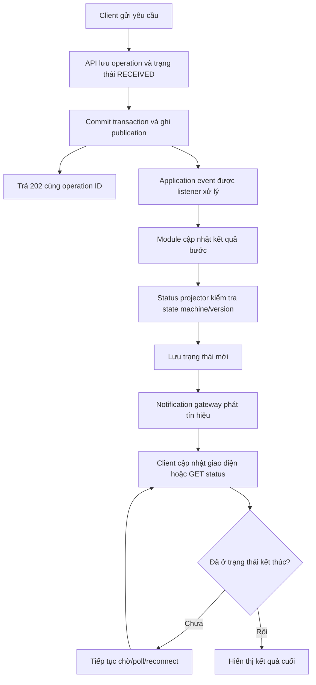

# Thông báo trạng thái tạm thời

Trong một ứng dụng xử lý nghiệp vụ bất đồng bộ, yêu cầu của người dùng có thể được tiếp nhận trước khi toàn bộ công việc hoàn tất. Ví dụ, người dùng gửi yêu cầu tạo đơn hàng; hệ thống ghi nhận yêu cầu, sau đó lần lượt giữ chỗ hàng, xác nhận thanh toán và tạo vận đơn. Những bước này có thể chạy ở các module khác nhau và mất vài giây hoặc lâu hơn. Nếu API trả về ngay một kết quả như thể đơn hàng đã hoàn tất, người dùng sẽ nhìn thấy trạng thái không đúng với dữ liệu thực tế.

Thông báo trạng thái tạm thời giúp giao diện thể hiện tiến trình đang diễn ra: yêu cầu đã được tiếp nhận, đang kiểm tra, đang chờ thanh toán, đang chuẩn bị giao hoặc đang xử lý bù trừ. Trong Spring Modulith, application events giúp các module thông báo kết quả của từng bước; một thành phần theo dõi tiến trình cập nhật trạng thái bền vững để API, giao diện và kênh thông báo cùng đọc được một nguồn dữ liệu nhất quán.

## Mục tiêu

Sau bài này, bạn có thể:

- Phân biệt yêu cầu đã được tiếp nhận với nghiệp vụ đã hoàn tất.
- Thiết kế vòng đời trạng thái tạm thời và trạng thái kết thúc.
- Lưu trạng thái tiến trình như một nguồn dữ liệu có thể truy vấn sau restart.
- Dùng application events để cập nhật trạng thái giữa các module.
- Trả `202 Accepted` cùng mã theo dõi và cung cấp API truy vấn trạng thái.
- Phát thông báo qua polling, Server-Sent Events hoặc WebSocket mà không phụ thuộc vào một kết nối đang mở.
- Xử lý event trùng, event đến trễ, thứ tự cập nhật và thông báo thất bại.
- Kiểm thử và quan sát tính nhất quán của trạng thái được hiển thị.

## 1. Vì sao cần thông báo trạng thái tạm thời?

Trong xử lý đồng bộ, client thường chờ một request kết thúc và nhận kết quả cuối cùng. Nhưng khi công việc cần nhiều bước hoặc phải chờ hệ thống khác, giữ HTTP request mở quá lâu sẽ làm tăng timeout, chiếm connection và khiến client khó biết công việc còn chạy hay đã thất bại.

Một cách phù hợp là tách việc tiếp nhận yêu cầu khỏi việc hoàn tất nghiệp vụ. API xác nhận hệ thống đã nhận và lưu yêu cầu; các bước xử lý tiếp tục bất đồng bộ. Client nhận một mã định danh để truy vấn tiến trình. Trong thời gian đó, hệ thống có thể phát các cập nhật trạng thái ngắn gọn.

Ví dụ vòng đời một đơn hàng:

| Trạng thái | Ý nghĩa với người dùng | Loại trạng thái |
|---|---|---|
| `RECEIVED` | Hệ thống đã nhận yêu cầu | Tạm thời |
| `VALIDATING` | Đang kiểm tra thông tin đơn hàng | Tạm thời |
| `RESERVING_INVENTORY` | Đang giữ chỗ sản phẩm | Tạm thời |
| `AWAITING_PAYMENT` | Đang chờ xác nhận thanh toán | Tạm thời |
| `PREPARING_SHIPMENT` | Đang chuẩn bị giao hàng | Tạm thời |
| `COMPLETED` | Đơn hàng đã hoàn tất bước xử lý cần thiết | Kết thúc thành công |
| `FAILED` | Yêu cầu không thể hoàn tất | Kết thúc thất bại |
| `CANCELLED` | Quy trình đã được hủy | Kết thúc theo yêu cầu hoặc quy tắc nghiệp vụ |
| `COMPENSATING` | Đang thực hiện các hành động bù trừ | Tạm thời, nhánh phục hồi |
| `MANUAL_INTERVENTION_REQUIRED` | Cần người vận hành xử lý | Trạng thái cần can thiệp |

Không phải quy trình nào cũng cần hiển thị mọi trạng thái kỹ thuật. Hãy chọn các trạng thái có ý nghĩa với người dùng và tránh làm giao diện nhấp nháy vì quá nhiều cập nhật nhỏ. Trạng thái kỹ thuật chi tiết có thể được lưu trong lịch sử hoặc log; trạng thái hiển thị nên diễn đạt điều người dùng cần biết.

## 2. Phân biệt tiếp nhận, xử lý và hoàn tất

HTTP `202 Accepted` phù hợp khi server đã tiếp nhận yêu cầu để xử lý nhưng kết quả nghiệp vụ chưa sẵn sàng. Phản hồi nên chứa mã theo dõi hoặc URL để client lấy trạng thái hiện tại:

```http
HTTP/1.1 202 Accepted
Location: /api/operations/8e039b9a-2b77-4d61-a2c9-bc7d23c9e4f0
Content-Type: application/json

{
  "operationId": "8e039b9a-2b77-4d61-a2c9-bc7d23c9e4f0",
  "status": "RECEIVED",
  "statusUrl": "/api/operations/8e039b9a-2b77-4d61-a2c9-bc7d23c9e4f0"
}
```

Phản hồi này xác nhận yêu cầu đã được tiếp nhận. Nó không xác nhận thanh toán đã thành công, hàng đã được giữ hoặc vận đơn đã được tạo. Khi client truy vấn `statusUrl`, server trả trạng thái đã lưu tại thời điểm truy vấn.

Một hợp đồng trạng thái nên làm rõ:

- `operationId`: định danh ổn định để theo dõi một lần xử lý.
- `status`: trạng thái hiện tại theo state machine đã định nghĩa.
- `message`: mô tả ngắn, có thể bản địa hóa ở tầng API hoặc giao diện.
- `updatedAt`: thời điểm trạng thái được cập nhật.
- `version` hoặc `sequence`: số thứ tự tăng đơn điệu để phát hiện cập nhật cũ.
- `completedAt`: có giá trị khi quy trình đã kết thúc.
- `failureCode`: mã lỗi an toàn để client xử lý hoặc hiển thị.

Không đưa stack trace, thông tin xác thực, dữ liệu cá nhân hoặc chi tiết nội bộ của module vào response trạng thái. Client cần một mô tả có thể hành động, không cần toàn bộ exception.

## 3. Lưu trạng thái tạm thời một cách bền vững

Trạng thái tiến trình cần tồn tại độc lập với HTTP request và instance ứng dụng. Không giữ trạng thái duy nhất trong biến bộ nhớ, session của một server hoặc một `SseEmitter` đang mở. Người dùng có thể đóng trình duyệt, mất mạng hoặc kết nối tới instance khác; ứng dụng cũng có thể restart trong lúc xử lý.

Một bảng theo dõi operation có thể gồm:

```text
OperationStatus
  operationId       UNIQUE
  businessId
  operationType
  status
  version
  progressCode
  safeMessage
  createdAt
  updatedAt
  completedAt
  failureCode
```

Nếu cần audit hoặc tái dựng tiến trình, lưu thêm lịch sử chuyển trạng thái:

```text
OperationStatusHistory
  operationId
  sequence
  previousStatus
  newStatus
  eventId
  occurredAt
  recordedAt
```

`OperationStatus` phục vụ truy vấn nhanh trạng thái hiện tại. `OperationStatusHistory` giữ dấu vết các chuyển đổi đã được chấp nhận. Có thể dùng một projection cập nhật từ event thay vì cập nhật trực tiếp bảng nghiệp vụ, miễn là xác định rõ projection có độ trễ eventual consistency và có cách phục hồi.

Nếu operation status và dữ liệu nghiệp vụ nằm trong cùng database, cập nhật chúng trong transaction phù hợp. Nếu trạng thái được xây từ event bất đồng bộ, hãy chấp nhận rằng nó có thể trễ hơn dữ liệu nguồn một khoảng ngắn; giao diện cần thể hiện `updatedAt` hoặc trạng thái đang chờ để người dùng không hiểu nhầm.

## 4. Dùng application events để cập nhật tiến trình

Module tiếp nhận yêu cầu có thể phát event sau khi đã lưu yêu cầu. Event nên mang định danh operation và dữ liệu tối thiểu để consumer tiếp tục xử lý:

```java
import java.time.Instant;
import java.util.UUID;

public record OrderSubmissionReceived(
    UUID operationId,
    UUID orderId,
    Instant occurredAt
) {}
```

Service tiếp nhận yêu cầu:

```java
import org.springframework.context.ApplicationEventPublisher;
import org.springframework.stereotype.Service;
import org.springframework.transaction.annotation.Transactional;

@Service
class OrderSubmissionService {

    private final OrderRepository orders;
    private final OperationStatusRepository statuses;
    private final ApplicationEventPublisher events;

    OrderSubmissionService(
            OrderRepository orders,
            OperationStatusRepository statuses,
            ApplicationEventPublisher events) {
        this.orders = orders;
        this.statuses = statuses;
        this.events = events;
    }

    @Transactional
    UUID submit(CreateOrderRequest request) {
        var order = orders.createPending(request);
        var operationId = UUID.randomUUID();

        statuses.create(
            operationId,
            order.id(),
            "RECEIVED"
        );

        events.publishEvent(new OrderSubmissionReceived(
            operationId,
            order.id(),
            Instant.now()
        ));

        return operationId;
    }
}
```

Trong ví dụ, đơn hàng ở trạng thái pending, operation status và publication event được tạo trong cùng transaction. Nếu transaction rollback, cả dữ liệu tiếp nhận và publication tương ứng đều không được xem là đã commit. Khi Event Publication Registry được cấu hình với persistence phù hợp, publication được ghi nhận cùng transaction để hỗ trợ phục hồi listener chưa hoàn tất.

Controller trả `202 Accepted` sau khi service commit thành công:

```java
import java.net.URI;
import org.springframework.http.ResponseEntity;
import org.springframework.web.bind.annotation.PostMapping;
import org.springframework.web.bind.annotation.RequestBody;
import org.springframework.web.bind.annotation.RestController;

@RestController
class OrderController {

    private final OrderSubmissionService submissions;

    OrderController(OrderSubmissionService submissions) {
        this.submissions = submissions;
    }

    @PostMapping("/api/orders")
    ResponseEntity<AcceptedOperation> submit(
            @RequestBody CreateOrderRequest request) {
        var operationId = submissions.submit(request);
        var location = URI.create("/api/operations/" + operationId);

        return ResponseEntity.accepted()
            .location(location)
            .body(new AcceptedOperation(operationId, "RECEIVED", location.toString()));
    }
}
```

Các kiểu `CreateOrderRequest`, `AcceptedOperation` và repository trong ví dụ là kiểu ứng dụng tự định nghĩa. Với hệ thống có khả năng client gửi lại POST khi timeout, nên hỗ trợ idempotency key để một yêu cầu lặp không tạo nhiều operation hoặc nhiều đơn hàng.

## 5. Cập nhật trạng thái từ listener và process manager

Các module phát event khi hoàn tất bước thuộc trách nhiệm của mình. Ví dụ:

```java
public record InventoryReserved(
    UUID eventId,
    UUID operationId,
    UUID orderId,
    UUID reservationId,
    long sequence,
    Instant occurredAt
) {}

public record PaymentAuthorizationCompleted(
    UUID eventId,
    UUID operationId,
    UUID orderId,
    String paymentReference,
    long sequence,
    Instant occurredAt
) {}
```

Một process manager hoặc status projector nhận các event và chuyển trạng thái operation:

```java
import org.springframework.modulith.events.ApplicationModuleListener;
import org.springframework.stereotype.Component;
import org.springframework.transaction.annotation.Transactional;

@Component
class OrderProgressProjector {

    private final OperationStatusRepository statuses;

    OrderProgressProjector(OperationStatusRepository statuses) {
        this.statuses = statuses;
    }

    @ApplicationModuleListener
    @Transactional
    void on(InventoryReserved event) {
        statuses.transition(
            event.operationId(),
            event.eventId(),
            event.sequence(),
            "RESERVING_INVENTORY",
            "AWAITING_PAYMENT"
        );
    }
}
```

`transition` phải kiểm tra trạng thái hiện tại và version trong cùng transaction, chỉ chấp nhận chuyển đổi hợp lệ. Không cập nhật status bằng một lệnh ghi đè đơn giản nếu event cũ có thể đến sau event mới.

`@ApplicationModuleListener` phù hợp khi muốn xử lý event theo cơ chế listener của Spring Modulith, bao gồm xử lý bất đồng bộ và transaction riêng. Một listener cập nhật status projection có thể thất bại và được phục hồi qua Event Publication Registry nếu registry được cấu hình phù hợp. Nếu có nhiều listener độc lập, mỗi publication có trạng thái riêng; việc projector thành công không chứng minh notification gateway hoặc module khác đã hoàn tất.

## 6. Thiết kế state machine để tránh trạng thái sai

Không nên cho phép mọi trạng thái chuyển sang mọi trạng thái khác. Một state machine rõ ràng ngăn event đến trễ làm operation quay ngược từ `COMPLETED` về `PROCESSING`, hoặc từ `FAILED` về `AWAITING_PAYMENT` mà không có một quy trình retry mới.

Ví dụ các chuyển đổi được phép:

| Trạng thái hiện tại | Event/kết quả | Trạng thái kế tiếp |
|---|---|---|
| `RECEIVED` | Bắt đầu kiểm tra | `VALIDATING` |
| `VALIDATING` | Hợp lệ | `RESERVING_INVENTORY` |
| `VALIDATING` | Dữ liệu không hợp lệ | `FAILED` |
| `RESERVING_INVENTORY` | Giữ chỗ thành công | `AWAITING_PAYMENT` |
| `RESERVING_INVENTORY` | Không đủ hàng | `FAILED` hoặc nhánh xử lý nghiệp vụ khác |
| `AWAITING_PAYMENT` | Thanh toán thành công | `PREPARING_SHIPMENT` |
| `AWAITING_PAYMENT` | Thanh toán thất bại sau khi có tác động trước đó | `COMPENSATING` |
| `PREPARING_SHIPMENT` | Tạo vận đơn thành công | `COMPLETED` |
| `COMPENSATING` | Các bước bù trừ hoàn tất | `CANCELLED` hoặc trạng thái kết thúc tương ứng |

Trạng thái hiển thị và trạng thái nội bộ có thể khác nhau. Ví dụ, một số bước nội bộ như kiểm tra fraud hoặc tính thuế có thể được gộp thành “Đang xử lý”. Giữ state machine chi tiết trong backend và ánh xạ sang nhãn hiển thị ở API để có thể thay đổi giao diện mà không làm thay đổi hợp đồng event.

Với cập nhật cạnh tranh, dùng optimistic locking hoặc câu lệnh cập nhật có điều kiện:

```sql
UPDATE operation_status
SET status = :next_status,
    version = version + 1,
    updated_at = :updated_at
WHERE operation_id = :operation_id
  AND version = :expected_version
  AND status = :expected_status;
```

Nếu số dòng cập nhật bằng 0, trạng thái đã thay đổi hoặc event không còn hợp lệ. Consumer cần đọc lại bản ghi, phân loại event trùng/đến trễ và quyết định có thể bỏ qua hay cần xử lý bù. Không tự động retry vô hạn một xung đột trạng thái vĩnh viễn.

## 7. Cung cấp API truy vấn trạng thái

Một endpoint GET nên trả trạng thái hiện tại từ kho dữ liệu bền vững:

```java
@RestController
class OperationStatusController {

    private final OperationStatusRepository statuses;

    OperationStatusController(OperationStatusRepository statuses) {
        this.statuses = statuses;
    }

    @GetMapping("/api/operations/{operationId}")
    OperationStatusResponse get(@PathVariable UUID operationId) {
        var status = statuses.findVisibleToCurrentUser(operationId)
            .orElseThrow(OperationNotFoundException::new);

        return OperationStatusResponse.from(status);
    }
}
```

Endpoint cần kiểm tra người gọi có quyền xem operation tương ứng. Biết `operationId` không nên tự động cấp quyền truy cập dữ liệu của người khác. Với operation không tồn tại hoặc không thuộc người gọi, chọn phản hồi phù hợp với chính sách bảo mật của API.

Client có thể poll endpoint theo khoảng thời gian tăng dần, ví dụ ban đầu mỗi 1–2 giây rồi giãn ra khi tiến trình kéo dài. Dừng polling khi nhận trạng thái kết thúc. Dùng `ETag`, `If-None-Match` hoặc version để giảm payload khi trạng thái chưa đổi. Đặt giới hạn thời gian polling và cho phép người dùng rời trang rồi quay lại truy vấn sau.

## 8. Đẩy cập nhật bằng SSE hoặc WebSocket

Polling đơn giản và chịu được mất kết nối, nhưng có thể tạo nhiều request nếu số lượng operation lớn. Server-Sent Events (SSE) phù hợp khi server chỉ cần đẩy cập nhật một chiều tới trình duyệt. WebSocket phù hợp khi client và server cần trao đổi hai chiều liên tục.

Một SSE stream có thể gửi sự kiện trạng thái:

```text
id: 12
event: operation-status
data: {"operationId":"8e039b9a-2b77-4d61-a2c9-bc7d23c9e4f0","status":"AWAITING_PAYMENT","version":12}

```

Client nhận event và cập nhật giao diện. Nếu kết nối bị ngắt, trình duyệt có thể gửi `Last-Event-ID` khi kết nối lại; server cần có khả năng truy vấn lại các cập nhật sau ID đó hoặc gửi trạng thái hiện tại. Không nên chỉ giữ event trong bộ nhớ của instance vì client có thể kết nối tới instance khác.

SSE/WebSocket là kênh phân phối thông báo, không phải nguồn dữ liệu có thẩm quyền. Hãy lưu trạng thái trước, sau đó phát tín hiệu cho client. Nếu tín hiệu bị mất, client vẫn có thể GET trạng thái hiện tại. Nếu cần phát lại từng cập nhật, lưu lịch sử status event hoặc dùng một broker/stream có retention phù hợp.

Không mở một kết nối SSE/WebSocket cho mỗi event nội bộ trong hệ thống mà không có giới hạn. Có thể dùng một gateway notification gom cập nhật theo user hoặc operation, quản lý số kết nối, heartbeat, timeout và xác thực quyền truy cập.

## 9. Đảm bảo thứ tự, idempotency và xử lý trùng

Application events có thể được xử lý bất đồng bộ. Một listener có thể nhận lại publication khi phục hồi; các event khác nhau có thể đến không đúng thứ tự dự kiến nếu xử lý song song hoặc qua nhiều transport. Status projector cần bảo vệ trạng thái khỏi cập nhật lặp hoặc lùi version.

Các nguyên tắc quan trọng:

- Mỗi event có event ID duy nhất và operation ID ổn định.
- Mỗi chuyển đổi trạng thái có version hoặc sequence tăng đơn điệu.
- Lưu event ID đã áp dụng hoặc dùng unique constraint để loại trùng.
- Chỉ chấp nhận chuyển đổi hợp lệ theo state machine.
- Event cũ không được ghi đè trạng thái mới hơn.
- Nếu event bị bỏ qua vì đã áp dụng, listener nên hoàn tất bình thường để publication không bị retry vô ích.
- Nếu event cho thấy một tác động nghiệp vụ phát sinh muộn, process manager phải xử lý theo quy tắc nghiệp vụ thay vì chỉ bỏ qua vì sequence cũ.

Ví dụ, `InventoryReserved` có sequence 4 đến sau `PaymentAuthorizationCompleted` sequence 5. Projector không nên đưa trạng thái từ `PREPARING_SHIPMENT` quay lại `AWAITING_PAYMENT`. Có thể ghi nhận event đến trễ trong history và kiểm tra liệu nó phản ánh một tác động thực tế cần bù trừ hay chỉ là thông báo trùng.

## 10. Event Publication Registry và ranh giới nhất quán

Event Publication Registry theo dõi publication của application event tới listener trong ứng dụng. Với kho lưu trữ bền vững, registry hỗ trợ xác định publication chưa hoàn tất và phục hồi việc xử lý sau restart. Nó hữu ích để bảo vệ các bước cập nhật status projection hoặc process manager khỏi việc event bị bỏ quên sau khi transaction nguồn commit.

Registry không bảo đảm người dùng đã nhìn thấy thông báo. Một listener notification có thể hoàn tất khi gửi yêu cầu tới gateway, trong khi trình duyệt đang offline. Nếu cần biết client đã nhận hoặc xác nhận thông báo, đó là một trạng thái delivery riêng và phải được thiết kế riêng; thường không nên làm transaction nghiệp vụ phụ thuộc vào việc người dùng đang online.

Một luồng có thể được tổ chức như sau:

1. Transaction tiếp nhận lưu operation và event publication.
2. Listener xử lý nghiệp vụ cập nhật dữ liệu và phát event kết quả.
3. Status projector cập nhật trạng thái hiện tại và lịch sử.
4. Notification adapter phát tín hiệu SSE/WebSocket hoặc thông báo push.
5. Client nhận tín hiệu hoặc truy vấn lại API trạng thái.

Nếu notification gateway là hệ thống ngoài, hãy xác định retry và idempotency cho việc gửi thông báo. Có thể dùng outbox cho notification delivery nếu cần bảo đảm publication trạng thái và yêu cầu gửi thông báo được ghi nhận cùng transaction. Không dùng Event Publication Registry như một bằng chứng end-to-end rằng thiết bị đã hiển thị thông báo.

## 11. Thiết kế nội dung thông báo an toàn và hữu ích

Thông báo trạng thái nên ngắn, rõ và không tiết lộ chi tiết nội bộ. Ví dụ:

| Mã trạng thái | Thông báo hiển thị |
|---|---|
| `RECEIVED` | Yêu cầu đã được tiếp nhận |
| `VALIDATING` | Đang kiểm tra thông tin |
| `RESERVING_INVENTORY` | Đang xác nhận sản phẩm |
| `AWAITING_PAYMENT` | Đang chờ xác nhận thanh toán |
| `PREPARING_SHIPMENT` | Đang chuẩn bị giao hàng |
| `COMPENSATING` | Đang xử lý điều chỉnh cho yêu cầu |
| `COMPLETED` | Yêu cầu đã hoàn tất |
| `FAILED` | Chưa thể hoàn tất yêu cầu. Vui lòng thử lại hoặc liên hệ hỗ trợ |

API có thể trả `statusCode` ổn định và `messageKey` để client bản địa hóa. Tránh gửi trực tiếp thông báo lấy từ exception vì chúng có thể chứa tên bảng, địa chỉ nội bộ, dữ liệu người dùng hoặc chi tiết bảo mật.

Chỉ hiển thị phần trăm tiến độ khi có thể tính một cách có ý nghĩa. Nếu các bước có thời lượng biến động lớn, một con số như 80% có thể tạo kỳ vọng sai. Trong trường hợp đó, nhãn trạng thái và thời điểm cập nhật thường trung thực hơn.

Nếu operation chờ một hệ thống ngoài lâu hơn ngưỡng dự kiến, hãy thông báo “Đang chờ xác nhận” và có thể cho biết lần cập nhật gần nhất. Đừng liên tục gửi cùng một thông báo nếu trạng thái không đổi; dùng version hoặc so sánh giá trị trước khi phát notification.

## 12. Kiểm thử thông báo trạng thái tạm thời

Kiểm thử cần xác nhận cả dữ liệu bền vững và trải nghiệm client. Một số tình huống nên có:

| Tình huống | Điều cần xác nhận |
|---|---|
| POST tiếp nhận thành công | Trả `202`, operation ID và status URL |
| Transaction tiếp nhận rollback | Không tồn tại operation đã commit hoặc publication tương ứng |
| Listener bắt đầu xử lý | Status chuyển sang trạng thái tạm thời hợp lệ |
| Các module hoàn tất từng bước | Status cập nhật theo state machine và version tăng |
| Event bị giao lại | Không tạo notification hoặc tác động trùng |
| Event đến sai thứ tự | Status không lùi về phiên bản cũ |
| Client polling | GET trả trạng thái đã lưu mới nhất và kiểm tra quyền truy cập |
| Client mất kết nối SSE | Có thể reconnect và lấy trạng thái hiện tại hoặc event còn thiếu |
| Notification gateway lỗi | Trạng thái nghiệp vụ vẫn được lưu; notification có thể retry độc lập |
| Operation kết thúc | Client dừng polling và hiển thị kết quả cuối |
| Người dùng khác truy vấn operation ID | Không đọc được dữ liệu không thuộc quyền của mình |
| Ứng dụng restart | Operation pending và publication chưa hoàn tất được khôi phục |

Trong unit test, kiểm tra state machine và mapping status sang message key. Trong integration test, khởi chạy application context, publish event và kiểm tra status repository cùng Event Publication Registry. Với SSE/WebSocket, kiểm thử reconnect, authorization và việc lấy trạng thái hiện tại sau khi bỏ lỡ event. Không dùng `Thread.sleep` cố định để chờ listener; dùng điều kiện chờ có timeout.

## 13. Quan sát và vận hành

Trạng thái tạm thời có thể trở thành vấn đề vận hành nếu operation bị kẹt mà không ai nhận biết. Theo dõi tối thiểu:

- Số operation theo từng trạng thái.
- Tuổi của operation lâu nhất ở mỗi trạng thái tạm thời.
- Thời gian từ `RECEIVED` đến trạng thái kết thúc.
- Tỷ lệ operation hoàn tất, thất bại, bị hủy và cần can thiệp.
- Số publication chưa hoàn tất theo listener.
- Độ trễ từ event nghiệp vụ tới status projection.
- Số notification gửi lỗi, retry hoặc bị bỏ qua vì version cũ.
- Số client SSE/WebSocket đang kết nối và tỷ lệ reconnect.

Log và trace nên chứa operation ID, business ID, event ID, listener, status trước/sau, version và correlation ID. Không dùng operation ID làm metric label có cardinality cao; dùng nó trong log/trace và nhóm metric theo operation type, status, module và outcome.

Đặt cảnh báo khi một trạng thái tạm thời vượt thời gian dự kiến, publication registry có backlog tăng, hoặc notification gateway liên tục lỗi. Cần có thao tác vận hành để tra cứu operation, xem lịch sử chuyển trạng thái và xác định bước nào đang chờ. Nếu cần can thiệp thủ công, ghi nhận người thực hiện, lý do và kết quả để giữ audit trail.

## 14. Những lỗi thiết kế thường gặp

| Lỗi | Hệ quả | Cách khắc phục |
|---|---|---|
| Trả `200 OK` như thể nghiệp vụ đã xong khi chỉ mới nhận yêu cầu | Client hiểu nhầm trạng thái | Dùng `202 Accepted` và status URL cho xử lý bất đồng bộ |
| Giữ trạng thái chỉ trong bộ nhớ | Restart hoặc đổi instance làm mất tiến trình | Lưu operation status bền vững |
| Xem SSE/WebSocket là nguồn dữ liệu chính | Client offline sẽ mất cập nhật | Lưu status trước, push chỉ là tín hiệu |
| Cho phép event cũ ghi đè trạng thái mới | Giao diện hiển thị lùi tiến trình | Dùng version, sequence và state machine |
| Phát thông báo cho mọi thay đổi kỹ thuật | Giao diện nhiễu và notification spam | Ánh xạ sang trạng thái có ý nghĩa với người dùng |
| Đánh đồng listener hoàn tất với người dùng đã nhận thông báo | Báo cáo delivery sai | Theo dõi notification delivery riêng nếu cần |
| Không kiểm tra quyền truy vấn operation | Lộ trạng thái của người dùng khác | Kiểm tra quyền theo chủ sở hữu operation |
| Không có ngưỡng cho trạng thái tạm thời | Operation bị kẹt không được phát hiện | Theo dõi tuổi trạng thái và cảnh báo |

## 15. Quy trình tổng thể



Thông báo trạng thái tạm thời là một phần của hợp đồng nhất quán giữa backend và người dùng. Hãy xác nhận yêu cầu trước, lưu operation ID và trạng thái bền vững, dùng application events để cập nhật từng bước, kiểm soát chuyển đổi bằng state machine và version, rồi cung cấp API truy vấn làm nguồn dữ liệu chính. Polling, SSE hoặc WebSocket có thể giúp người dùng thấy tiến trình nhanh hơn; chúng không thay thế dữ liệu đã lưu, Event Publication Registry hay quy trình phục hồi khi listener và notification gateway gặp lỗi.

## Tài liệu tham khảo

- [Spring Modulith — Working with Application Events](https://docs.spring.io/spring-modulith/reference/events.html)
- [Spring Framework — Transaction-bound Events](https://docs.spring.io/spring-framework/reference/data-access/transaction/event.html)
- [MDN — 202 Accepted](https://developer.mozilla.org/en-US/docs/Web/HTTP/Status/202)
- [MDN — Server-Sent Events](https://developer.mozilla.org/en-US/docs/Web/API/Server-sent_events)
