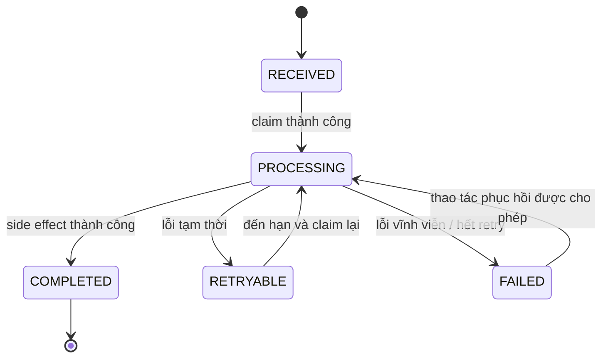

# Kiểm tra trạng thái trước xử lý

*Dùng trạng thái bền vững để quyết định event có được phép thực thi hay cần bỏ qua, chờ hoặc thử lại*

Một event listener có thể nhận cùng một application event nhiều lần do retry, resubmission, broker redelivery hoặc ứng dụng khởi động lại. Trước khi thực hiện side effect, handler thường cần biết event đã được xử lý chưa, đang được worker khác xử lý hay đang chờ retry. **Kiểm tra trạng thái trước xử lý** là bước đọc trạng thái idempotency đã lưu để chọn hành động phù hợp.

Tuy nhiên, kết quả đọc chỉ phản ánh trạng thái tại thời điểm truy vấn. Nếu hai worker cùng đọc thấy event chưa xử lý, cả hai vẫn có thể bắt đầu công việc. Vì vậy, kiểm tra trạng thái chỉ là bước quan sát; quyền xử lý phải được giành bằng một thao tác nguyên tử như insert có unique constraint, conditional update hoặc row lock. Kết quả claim đó mới quyết định worker nào được thực hiện side effect.

## 1. Những câu hỏi cần trả lời trước khi xử lý event

Với mỗi event nhận được, handler cần xác định:

- Event này đã hoàn tất trước đó chưa?
- Một worker khác đang giữ quyền xử lý không?
- Lần xử lý trước thất bại và có thể retry không?
- Trạng thái `PROCESSING` đã quá hạn và cần thu hồi không?
- Event ID có đang được dùng lại với payload khác không?
- Consumer hiện tại có đúng là consumer sở hữu dấu idempotency này không?

Ví dụ module thanh toán nhận `PaymentCaptured`. Nếu event đã được ghi nhận hoàn tất, handler có thể bỏ qua. Nếu event đang được một worker khác xử lý, worker hiện tại nên dừng hoặc lên lịch thử lại. Nếu event thất bại vì lỗi mạng tạm thời và đã đến thời điểm retry, handler có thể claim lại. Nếu cùng `eventId` nhưng nội dung payload khác, cần coi đây là xung đột hợp đồng hoặc dữ liệu và đưa vào điều tra.

## 2. Mô hình trạng thái xử lý

Một bảng idempotency có thể quản lý vòng đời của event theo consumer. Các trạng thái phổ biến:

| Trạng thái | Ý nghĩa | Hành động khi nhận lại event |
|---|---|---|
| `RECEIVED` | Đã ghi nhận event nhưng chưa có worker claim | Có thể thử claim để xử lý |
| `PROCESSING` | Một worker đang giữ quyền xử lý | Không chạy song song; chờ hoặc kiểm tra lease |
| `COMPLETED` | Side effect đã hoàn tất và được ghi nhận | Bỏ qua duplicate |
| `RETRYABLE` | Lần trước thất bại do nguyên nhân có thể thử lại | Chỉ claim khi đã đến `next_attempt_at` |
| `FAILED` | Lỗi không tự phục hồi hoặc đã vượt giới hạn retry | Chuyển xử lý thủ công hoặc dead-letter |

Không nhất thiết mọi ứng dụng phải dùng đủ các trạng thái. Một handler cập nhật read model trong transaction ngắn có thể chỉ cần ghi dấu hoàn tất nguyên tử. Với tác vụ kéo dài hoặc gọi hệ thống bên ngoài, trạng thái `PROCESSING`, lease và lịch retry giúp quản lý tiến độ rõ ràng hơn.

Luồng trạng thái khái quát:



Trạng thái phải được lưu bền vững và có quy tắc chuyển trạng thái rõ ràng. Không dùng một boolean `processed` nếu hệ thống cần phân biệt đang chạy, có thể retry và thất bại vĩnh viễn.

## 3. Lưu trạng thái theo consumer và event ID

Một event có thể được nhiều listener độc lập xử lý. Vì thế, dấu idempotency thường phải gắn với cả consumer và event ID, không chỉ event ID.

```sql
CREATE TABLE event_processing_state (
    consumer_name   VARCHAR(120) NOT NULL,
    event_id        UUID NOT NULL,
    payload_hash    VARCHAR(128) NOT NULL,
    status          VARCHAR(24) NOT NULL,
    attempt_count   INTEGER NOT NULL DEFAULT 0,
    next_attempt_at TIMESTAMP NULL,
    lease_until     TIMESTAMP NULL,
    lease_token     BIGINT NOT NULL DEFAULT 0,
    last_error      VARCHAR(1000) NULL,
    created_at      TIMESTAMP NOT NULL,
    updated_at      TIMESTAMP NOT NULL,
    completed_at    TIMESTAMP NULL,
    PRIMARY KEY (consumer_name, event_id)
);
```

Các trường quan trọng:

- `consumer_name` tách tiến độ của các projection/listener độc lập.
- `event_id` định danh một lần phát event và phải giữ nguyên qua mọi lần giao lại.
- `payload_hash` giúp phát hiện trường hợp cùng event ID nhưng payload thay đổi.
- `status` biểu diễn trạng thái xử lý hiện tại.
- `attempt_count` và `next_attempt_at` điều khiển retry.
- `lease_until` xác định thời điểm quyền xử lý có thể được thu hồi nếu worker mất tích.
- `lease_token` là số phiên tăng dần, hỗ trợ fencing worker cũ khi lease được cấp lại.
- `completed_at` ghi thời điểm xử lý thành công.

Hash chỉ là dấu kiểm tra nội dung; cần chọn thuật toán và cách canonicalize payload nhất quán. Nếu JSON có thứ tự field khác nhau nhưng cùng ý nghĩa, hash trên byte thô có thể khác. Có thể hash dữ liệu canonical hoặc các field nghiệp vụ quan trọng theo hợp đồng.

## 4. Đọc trạng thái trước để chọn hành động

Một truy vấn đọc có thể phân loại tình huống trước khi handler cố claim:

```java
public ProcessingDecision inspect(
        String consumerName,
        UUID eventId,
        String payloadHash) {

    return states.find(consumerName, eventId)
        .map(state -> {
            if (!state.payloadHash().equals(payloadHash)) {
                return ProcessingDecision.PAYLOAD_CONFLICT;
            }

            return switch (state.status()) {
                case COMPLETED -> ProcessingDecision.SKIP_COMPLETED;
                case PROCESSING -> ProcessingDecision.CHECK_LEASE;
                case RETRYABLE -> ProcessingDecision.CHECK_RETRY_TIME;
                case FAILED -> ProcessingDecision.MANUAL_REVIEW;
                case RECEIVED -> ProcessingDecision.TRY_CLAIM;
            };
        })
        .orElse(ProcessingDecision.REGISTER_AND_CLAIM);
}
```

Đây là ví dụ về cách phân loại, không phải thao tác giành quyền xử lý. Sau `inspect`, trạng thái có thể thay đổi do worker khác. Do đó, handler luôn phải thực hiện claim nguyên tử trước khi chạy side effect. Không được dựa riêng vào `SKIP_COMPLETED` hoặc `TRY_CLAIM` nếu cần bảo đảm nhất quán dưới tải đồng thời; quyết định cuối cùng phải được xác nhận trong transaction hoặc conditional update.

## 5. Vì sao kiểm tra rồi mới ghi có race condition?

Giả sử hai worker A và B nhận cùng event gần như đồng thời:

1. A đọc trạng thái và không tìm thấy event.
2. B cũng đọc trạng thái và không tìm thấy event.
3. A bắt đầu tạo hóa đơn.
4. B cũng bắt đầu tạo hóa đơn.
5. Cả hai cùng ghi trạng thái hoàn tất.

Kết quả là hai side effect dù mỗi worker đều đã kiểm tra trạng thái trước xử lý. Đây là lỗi *time-of-check to time-of-use* (TOCTOU): điều kiện có thể thay đổi giữa lúc kiểm tra và lúc sử dụng.

`existsById()` rồi `save()` không giải quyết được race này nếu hai câu lệnh không được bảo vệ bởi unique constraint hoặc khóa phù hợp. Cần kết hợp kiểm tra và claim bằng một thao tác nguyên tử tại database. Worker chỉ được xử lý khi claim thành công.

## 6. Claim nguyên tử bằng insert và unique constraint

Với tác vụ xử lý một lần và transaction ngắn, có thể dùng insert-if-absent. Unique key `(consumer_name, event_id)` bảo đảm chỉ một transaction tạo được dấu xử lý đầu tiên.

Ví dụ SQL theo PostgreSQL:

```sql
INSERT INTO event_processing_state (
    consumer_name, event_id, payload_hash, status,
    attempt_count, lease_token, created_at, updated_at
)
VALUES (
    :consumer, :eventId, :payloadHash, 'PROCESSING',
    1, 1, CURRENT_TIMESTAMP, CURRENT_TIMESTAMP
)
ON CONFLICT (consumer_name, event_id) DO NOTHING;
```

Ứng dụng kiểm tra số dòng được insert. Nếu một dòng được tạo, transaction hiện tại đã claim được event mới. Nếu không có dòng nào, event đã có trạng thái; đọc lại trạng thái mới nhất để quyết định bỏ qua, chờ hoặc retry. Với hệ quản trị khác, dùng cú pháp insert-if-absent tương đương và kiểm tra semantics cạnh tranh của database.

Nếu claim và cập nhật read model diễn ra trong cùng transaction, khi transaction commit thành công cả hai cùng bền vững. Nếu cập nhật read model lỗi, transaction rollback cả claim, cho phép lần giao lại thử lại. Mô hình này phù hợp với side effect nằm trong cùng database.

## 7. Claim bằng conditional update cho retry

Với trạng thái đã tồn tại, worker có thể claim lại khi event đang `RETRYABLE` và đã đến hạn, hoặc `PROCESSING` nhưng lease đã hết. Dùng một conditional update để chỉ một worker thắng:

```sql
UPDATE event_processing_state
SET status = 'PROCESSING',
    attempt_count = attempt_count + 1,
    lease_until = :newLeaseUntil,
    lease_token = lease_token + 1,
    updated_at = CURRENT_TIMESTAMP
WHERE consumer_name = :consumer
  AND event_id = :eventId
  AND (
      (status = 'RETRYABLE' AND next_attempt_at <= CURRENT_TIMESTAMP)
      OR
      (status = 'PROCESSING' AND lease_until < CURRENT_TIMESTAMP)
  );
```

Nếu số dòng cập nhật bằng một, worker đã claim thành công và phải đọc `lease_token` mới để nhận diện phiên xử lý. Nếu bằng không, trạng thái không còn đủ điều kiện hoặc worker khác đã claim trước. Sau đó, worker không được thực hiện side effect.

Điều kiện thời gian cần được đánh giá theo clock thống nhất của database hoặc một nguồn thời gian được kiểm soát. Không so sánh `lease_until` từ đồng hồ máy worker khác nhau nếu độ lệch clock có thể làm hai worker cùng nghĩ lease đã hết.

## 8. Dùng row lock hoặc optimistic locking khi phù hợp

Một lựa chọn khác là đọc bản ghi bằng `SELECT ... FOR UPDATE` trong transaction, kiểm tra trạng thái rồi chuyển sang `PROCESSING`. Row lock tuần tự hóa các transaction cùng thao tác trên bản ghi. Cách này dễ hiểu khi transaction ngắn, nhưng giữ lock trong lúc gọi mạng hoặc chạy tác vụ lâu sẽ làm tăng contention và có thể gây timeout.

Optimistic locking dùng cột `version` để phát hiện hai worker cùng cập nhật một trạng thái. Mỗi lần update yêu cầu version cũ; chỉ một transaction cập nhật thành công, transaction còn lại nhận conflict và phải đọc lại trạng thái. Cách này phù hợp khi xung đột hiếm và thao tác ngắn.

| Cơ chế | Phù hợp khi | Điểm cần chú ý |
|---|---|---|
| Insert + unique constraint | Đăng ký event lần đầu và side effect trong một transaction | Phải xử lý conflict theo kết quả insert |
| Conditional update | Claim trạng thái retry hoặc lease hết hạn | Điều kiện phải nằm trong câu lệnh update nguyên tử |
| Pessimistic row lock | Cần đọc rồi chuyển trạng thái trong transaction ngắn | Không giữ lock trong lúc gọi dịch vụ bên ngoài |
| Optimistic version | Xung đột ít, muốn phát hiện cập nhật cạnh tranh | Phải xử lý version conflict và đọc lại |

Không có một cơ chế tối ưu cho mọi trường hợp. Chọn theo thời gian xử lý, mức cạnh tranh, khả năng của database và việc side effect có nằm trong cùng transaction hay không.

## 9. Xử lý trạng thái PROCESSING bị treo bằng lease

Nếu worker claim event rồi bị dừng đột ngột, trạng thái `PROCESSING` có thể tồn tại mãi. Lease đặt thời hạn cho quyền xử lý. Khi `lease_until` đã qua, worker khác có thể claim lại bằng conditional update.

Lease cần dài hơn thời gian xử lý thông thường hoặc được gia hạn khi tác vụ còn hoạt động. Nếu tác vụ có thời gian không xác định, worker cần heartbeat để cập nhật lease. Không đặt lease quá ngắn vì worker đang chạy bình thường có thể bị thu hồi quyền; không đặt quá dài vì phục hồi sau crash sẽ chậm.

Chỉ kiểm tra lease chưa đủ để ngăn worker cũ tiếp tục sau khi quyền đã được cấp lại. Dùng `lease_token` tăng dần làm fencing token. Mọi cập nhật trạng thái cuối cùng phải kèm token hiện tại:

```sql
UPDATE event_processing_state
SET status = 'COMPLETED',
    completed_at = CURRENT_TIMESTAMP,
    lease_until = NULL,
    updated_at = CURRENT_TIMESTAMP
WHERE consumer_name = :consumer
  AND event_id = :eventId
  AND status = 'PROCESSING'
  AND lease_token = :leaseToken;
```

Nếu worker cũ dùng token đã hết hiệu lực, update không thay đổi dòng nào. Với side effect bên ngoài, hệ thống đích cũng cần hỗ trợ fencing/idempotency nếu muốn ngăn worker cũ tạo tác động sau khi lease bị thu hồi; token trong database không thể tự hủy một HTTP request đã gửi.

## 10. Ghi nhận hoàn tất và xử lý lỗi

Chỉ chuyển sang `COMPLETED` sau khi side effect cần bảo vệ đã được xác nhận bền vững. Với thay đổi trong cùng database, cập nhật dữ liệu nghiệp vụ và trạng thái hoàn tất trong một transaction. Với lời gọi ngoài, cần ghi nhận kết quả có thể đối soát và dùng idempotency key của hệ thống đích.

Khi lỗi xảy ra, phân loại rõ:

- Lỗi tạm thời: chuyển `RETRYABLE`, tính `next_attempt_at` theo backoff và tăng attempt count.
- Lỗi dữ liệu hoặc hợp đồng: chuyển `FAILED` hoặc trạng thái chờ sửa dữ liệu, tránh retry vô hạn.
- Lỗi nghiệp vụ không thể tự phục hồi: ghi lý do và chuyển cho quy trình xử lý thủ công.
- Kết quả lời gọi ngoài không rõ ràng do timeout: tra cứu bằng request/idempotency key trước khi gửi lại.

Không đánh dấu `COMPLETED` chỉ vì handler đã nhận event hoặc đã bắt exception. Trạng thái phải phản ánh side effect thực sự đã hoàn tất. Đồng thời, không xóa bản ghi trạng thái khi chuyển sang `FAILED`; giữ lại lịch sử cần thiết để điều tra và replay có kiểm soát.

## 11. Kết hợp với Spring Modulith

Trong Spring Modulith, `@ApplicationModuleListener` thường được dùng cho listener bất đồng bộ sau commit trong transaction riêng. Event publication registry theo dõi publication cho từng listener và giữ thông tin về publication chưa hoàn tất để phục hồi theo cấu hình.

Một listener có thể đọc trạng thái idempotency và gọi service claim trước khi xử lý:

```java
import org.springframework.modulith.events.ApplicationModuleListener;
import org.springframework.stereotype.Component;

@Component
class PaymentCapturedListener {

    private final PaymentEventHandler handler;

    PaymentCapturedListener(PaymentEventHandler handler) {
        this.handler = handler;
    }

    @ApplicationModuleListener
    void on(PaymentCaptured event) {
        handler.handle(event);
    }
}
```

`handler.handle` chịu trách nhiệm kiểm tra trạng thái, claim nguyên tử, thực hiện side effect và cập nhật kết quả. Nếu event đã `COMPLETED`, handler kết thúc an toàn. Nếu event đang được xử lý hoặc chưa đến hạn retry, handler không chạy side effect lần nữa. Nếu lỗi tạm thời, handler phải để lỗi hoặc trạng thái retry được xử lý theo chính sách đã cấu hình.

Publication registry và bảng trạng thái idempotency có mục đích khác nhau. Registry theo dõi việc giao event đến listener; bảng trạng thái do ứng dụng quản lý tiến độ và quyền thực thi nghiệp vụ. Một publication có thể chưa được registry đánh dấu hoàn tất dù side effect đã xảy ra, vì vậy bảng idempotency giúp lần resubmit không lặp tác động.

## 12. Tách transaction claim khỏi công việc kéo dài

Với tác vụ kéo dài hoặc gọi hệ thống bên ngoài, không giữ transaction database mở trong toàn bộ thời gian xử lý. Một quy trình thường dùng:

1. Transaction ngắn kiểm tra trạng thái và claim event, đặt `PROCESSING`, lease và token.
2. Commit claim để worker khác nhìn thấy quyền xử lý.
3. Thực hiện công việc bên ngoài bằng idempotency key ổn định.
4. Transaction ngắn ghi kết quả `COMPLETED` hoặc `RETRYABLE`, với điều kiện lease token vẫn đúng.

Mô hình này yêu cầu xử lý crash ở giữa các bước. Nếu worker dừng sau khi side effect bên ngoài thành công nhưng trước khi ghi `COMPLETED`, lần claim lại có thể gọi hệ thống đích lần nữa. Vì vậy, bước gọi ngoài vẫn cần idempotency key hoặc khả năng tra cứu trạng thái. Lease giúp thu hồi công việc bị treo, còn idempotency ở hệ thống đích ngăn side effect trùng.

Nếu nhiều bước phải được điều phối, có thể dùng outbox hoặc process manager để lưu ý định công việc và trạng thái từng bước. Không cố gắng giữ một transaction database xuyên qua nhiều hệ thống độc lập.

## 13. Kiểm thử kiểm tra trạng thái trước xử lý

Kiểm thử cần xác nhận quyết định dựa trên trạng thái và bảo đảm claim an toàn dưới cạnh tranh:

1. **Event chưa tồn tại:** trạng thái được tạo và chỉ một worker claim thành công.
2. **Đã COMPLETED:** event được bỏ qua và side effect không chạy lại.
3. **Đang PROCESSING:** worker thứ hai không được thực hiện side effect.
4. **RETRYABLE chưa đến hạn:** chưa cho claim; sau thời điểm retry, một worker có thể claim.
5. **Lease hết hạn:** một worker mới claim được và lease token tăng.
6. **Worker cũ quay lại:** cập nhật hoàn tất với token cũ bị từ chối.
7. **Payload conflict:** cùng event ID nhưng payload hash khác được phát hiện và chuyển điều tra.
8. **Hai worker đồng thời:** unique constraint hoặc conditional update bảo đảm chỉ một worker thắng.
9. **Crash giữa side effect và COMPLETED:** retry không lặp tác động nhờ idempotency key ở hệ thống đích.
10. **Transaction rollback:** claim và thay đổi read model cùng rollback khi dùng transaction chung.

Các test cạnh tranh cần dùng database thật hoặc môi trường tích hợp có unique constraint, isolation và locking tương tự production. Mock repository không chứng minh được thao tác claim là nguyên tử. Cần kiểm thử cả thời điểm timeout, lease hết hạn và worker cũ tiếp tục chạy.

## 14. Quan sát và vận hành

Theo dõi trạng thái giúp phát hiện event bị kẹt và phân biệt duplicate bình thường với sự cố:

- Số event theo `RECEIVED`, `PROCESSING`, `RETRYABLE`, `COMPLETED` và `FAILED`.
- Tuổi lớn nhất của bản ghi `PROCESSING` và số lease hết hạn.
- Tỷ lệ claim thành công, claim bị từ chối và conflict payload hash.
- Attempt count, thời gian chờ retry, tỷ lệ thành công sau retry.
- Số event bị bỏ qua vì đã hoàn tất và số lần gọi side effect ngoài.
- Publication chưa hoàn tất trong event publication registry.

Log nên có `consumerName`, `eventId`, `payloadHash`, trạng thái trước/sau, `leaseToken`, attempt count, correlation ID và mã lỗi. Không ghi toàn bộ payload hoặc dữ liệu bí mật. Cảnh báo khi event ở `PROCESSING` quá lâu, retry tăng bất thường hoặc `FAILED` vượt ngưỡng.

Khi vận hành, chỉ cho phép replay hoặc reset trạng thái sau khi xác định side effect đã xảy ra đến đâu. Chuyển `COMPLETED` về `RECEIVED` một cách tùy tiện có thể tạo tác động trùng. Mọi thao tác sửa trạng thái thủ công nên có người thực hiện, lý do, event ID và dấu vết kiểm toán.

## 15. Những điểm cần nhớ

- Đọc trạng thái trước xử lý giúp chọn hành động, nhưng kết quả đọc đơn lẻ không giành quyền xử lý và không ngăn race condition.
- Dùng `eventId` ổn định cùng phạm vi `consumerName` để theo dõi trạng thái idempotency.
- Claim phải nguyên tử bằng unique constraint, conditional update hoặc lock/version phù hợp.
- Phân biệt `COMPLETED`, `PROCESSING`, `RETRYABLE` và `FAILED`; chỉ đánh dấu hoàn tất sau khi side effect đã bền vững.
- Lease và fencing token hỗ trợ phục hồi worker bị treo, nhưng side effect ngoài vẫn cần idempotency ở hệ thống đích.
- Spring Modulith publication registry theo dõi việc giao listener; trạng thái idempotency do ứng dụng quản lý bảo vệ tác động nghiệp vụ.
- Kiểm thử duplicate, concurrency, lease expiry, crash giữa chừng và payload conflict.

Khi handler kiểm tra trạng thái để hiểu tiến độ, claim quyền xử lý bằng thao tác nguyên tử và chỉ ghi `COMPLETED` sau khi side effect được xác nhận, ứng dụng có thể xử lý event lặp lại an toàn. Kết hợp trạng thái idempotency với event publication registry, retry và quan sát vận hành giúp giao tiếp giữa các module Spring Modulith đáng tin cậy hơn.
