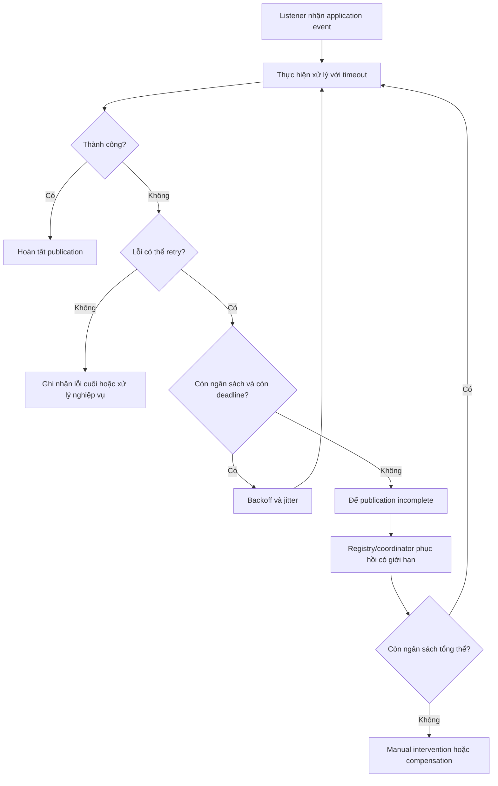

# Lỗi tạm thời

Một application event có thể được publish thành công nhưng listener vẫn thất bại khi xử lý. Ví dụ, module đơn hàng phát `OrderConfirmed`; listener của module kho hàng cần gọi dịch vụ tồn kho, nhưng dịch vụ đó đang timeout trong vài giây. Nếu listener kết luận ngay rằng đơn hàng không thể xử lý, một sự cố hạ tầng ngắn có thể làm gián đoạn nghiệp vụ. Nếu listener thử lại vô hạn, nó có thể chiếm worker, tạo tải lớn hơn lên dịch vụ đang gặp sự cố và giữ publication ở trạng thái chưa hoàn tất quá lâu.

Lỗi tạm thời cần được xử lý bằng chính sách retry có giới hạn. Trong Spring Modulith, application events tách producer khỏi listener; Event Publication Registry theo dõi publication tới từng listener để hỗ trợ phát hiện và phục hồi những lần xử lý chưa hoàn tất. Retry cần phân loại lỗi, đặt ngân sách thử lại, giãn thời gian giữa các lần gọi và bảo đảm listener an toàn khi nhận lại cùng event.

## Mục tiêu

Sau bài này, bạn có thể:

- Phân biệt lỗi tạm thời với lỗi vĩnh viễn trong listener.
- Xác định ngân sách retry theo số lần thử và tổng thời gian chờ.
- Dùng exponential backoff, jitter và timeout để tránh tạo thêm tải khi phụ thuộc gặp sự cố.
- Áp dụng retry trong listener bằng Spring Retry hoặc cơ chế tương đương.
- Kết hợp retry tại listener với Event Publication Registry và resubmit publication chưa hoàn tất.
- Thiết kế idempotency, retry state và xử lý khi đã hết lượt.
- Kiểm thử và quan sát lỗi tạm thời qua publication, listener và phụ thuộc bên ngoài.

## 1. Nhận diện lỗi tạm thời

Lỗi tạm thời là lỗi có khả năng biến mất nếu thử lại sau một khoảng thời gian hợp lý. Nó thường xuất hiện khi một thành phần phụ thuộc đang quá tải, mất kết nối ngắn hạn hoặc chưa sẵn sàng. Không phải mọi exception đều là lỗi tạm thời.

| Nhóm lỗi | Ví dụ | Cách xử lý thường phù hợp |
|---|---|---|
| Kết nối hoặc mạng | Connection reset, DNS tạm thời không phân giải được, socket timeout | Retry có giới hạn; kiểm tra timeout và tình trạng endpoint |
| Dịch vụ quá tải | HTTP 429, HTTP 503, broker tạm thời từ chối kết nối | Backoff; tôn trọng `Retry-After` nếu hợp đồng hỗ trợ |
| Cơ sở dữ liệu tạm bận | Deadlock victim, lock timeout, failover ngắn hạn | Retry transaction phù hợp sau khi rollback |
| Phụ thuộc chưa sẵn sàng | Dịch vụ vừa khởi động, circuit đang phục hồi | Chờ theo backoff, giới hạn tổng thời gian |
| Dữ liệu hoặc quy tắc không hợp lệ | Payload thiếu trường, trạng thái nghiệp vụ không cho phép | Không retry tự động cho đến khi dữ liệu hoặc điều kiện thay đổi |
| Xác thực hoặc cấu hình sai | Credentials hết hạn, sai URL, thiếu quyền | Thường cần sửa cấu hình hoặc quyền; retry liên tục không giải quyết nguyên nhân |

Phân loại theo nguyên nhân và hợp đồng của phụ thuộc, không chỉ theo lớp exception chung. Một `RuntimeException` có thể đại diện cho lỗi dữ liệu vĩnh viễn hoặc lỗi kết nối tạm thời. Nếu không xác định được loại lỗi, hãy xử lý thận trọng và bổ sung thông tin phân loại thay vì retry mọi exception.

Ví dụ listener cập nhật trạng thái kho hàng có thể retry `InventoryServiceUnavailableException`, nhưng không retry `UnknownProductException`. Khi sản phẩm không tồn tại, thời gian chờ không làm dữ liệu tự hợp lệ.

## 2. Xác định ngân sách retry

Retry cần có điểm dừng. Một chính sách cơ bản gồm:

- `maxAttempts`: tổng số lần thực thi tối đa, tính cả lần đầu.
- `initialDelay`: khoảng chờ sau lần thất bại đầu tiên.
- `multiplier`: hệ số tăng khoảng chờ sau mỗi lần thất bại.
- `maxDelay`: mức chờ tối đa cho một lần retry.
- `maxElapsedTime`: tổng thời gian tối đa dành cho retry.
- `timeout`: thời gian tối đa cho mỗi lần gọi phụ thuộc.
- `jitter`: độ ngẫu nhiên thêm vào khoảng chờ để phân tán các lần retry đồng thời.

Với exponential backoff, khoảng chờ cơ sở sau lần thất bại thứ `k` có thể tính:

\[
d_k = \min(d_{max}, d_0 \times m^{k-1})
\]

Trong đó `d0` là `initialDelay`, `m` là `multiplier` và `dmax` là `maxDelay`. Jitter giúp các listener không cùng retry vào một thời điểm sau khi một dịch vụ vừa phục hồi.

Ví dụ `maxAttempts = 4`, `initialDelay = 500 ms`, `multiplier = 2` và `maxDelay = 5 giây`:

| Lần thực thi | Thời điểm tương đối dự kiến | Nếu thất bại |
|---|---:|---|
| 1 — lần đầu | 0 giây | Chờ khoảng 0,5 giây |
| 2 — retry thứ nhất | 0,5 giây | Chờ khoảng 1 giây |
| 3 — retry thứ hai | 1,5 giây | Chờ khoảng 2 giây |
| 4 — retry thứ ba | 3,5 giây | Hết ngân sách; chuyển xử lý lỗi cuối |

Thời gian thực tế còn phụ thuộc thời gian thực thi, jitter và lịch worker. Vì vậy, số lần thử không thay thế giới hạn tổng thời gian. Nếu mỗi lần gọi có timeout 30 giây, bốn lần thử vẫn có thể giữ worker hơn hai phút.

Ngân sách cần phù hợp với SLA nghiệp vụ. Một listener cập nhật projection có thể chờ lâu hơn một listener đang giữ tài nguyên có thời hạn. Nếu reservation sẽ hết hạn sau vài phút, retry trong hàng giờ có thể khiến quy trình mất ý nghĩa.

## 3. Retry trong listener bằng Spring Retry

Spring Retry có thể thực hiện retry ngay trong lần gọi listener. Ví dụ dưới đây chỉ retry một exception đại diện cho lỗi phụ thuộc tạm thời:

```java
import java.util.UUID;

public record OrderConfirmed(UUID eventId, UUID orderId) {}
```

Bean tích hợp chỉ retry exception tạm thời:

```java
import org.springframework.retry.annotation.Backoff;
import org.springframework.retry.annotation.Retryable;
import org.springframework.stereotype.Service;

@Service
class InventoryReservationClient {

    private final InventoryGateway gateway;

    InventoryReservationClient(InventoryGateway gateway) {
        this.gateway = gateway;
    }

    @Retryable(
        retryFor = InventoryServiceUnavailableException.class,
        maxAttempts = 4,
        backoff = @Backoff(
            delay = 500,
            multiplier = 2.0,
            maxDelay = 5_000,
            random = true
        )
    )
    ReservationResult reserve(OrderConfirmed event) {
        return gateway.reserve(
            event.orderId(),
            event.eventId().toString()
        );
    }
}
```

Listener gọi bean retryable qua proxy Spring:

```java
import org.springframework.modulith.events.ApplicationModuleListener;
import org.springframework.stereotype.Component;

@Component
class OrderConfirmedListener {

    private final InventoryReservationClient reservations;

    OrderConfirmedListener(InventoryReservationClient reservations) {
        this.reservations = reservations;
    }

    @ApplicationModuleListener
    void on(OrderConfirmed event) {
        reservations.reserve(event);
    }
}
```

Ứng dụng cần dependency Spring Retry và bật `@EnableRetry` trong cấu hình. Ví dụ dùng thuộc tính `retryFor` của Spring Retry 2.x; với phiên bản cũ hơn, tên thuộc tính chọn exception có thể khác. Đặt phương thức retry trong một bean riêng giúp lời gọi đi qua proxy; gọi một phương thức `@Retryable` khác trong cùng instance (self-invocation) sẽ không kích hoạt interceptor proxy theo cách mong đợi.

`maxAttempts = 4` nghĩa là tối đa bốn lần gọi `reserve`, gồm một lần đầu và ba lần retry. Chỉ `InventoryServiceUnavailableException` được retry. Những exception khác truyền ra khỏi phương thức và listener thất bại ngay, trừ khi có một chính sách khác xử lý chúng.

`eventId` được truyền làm idempotency key để nếu lần gọi đầu đã được gateway chấp nhận nhưng phản hồi bị mất, lần retry không tạo reservation thứ hai. Gateway hoặc dịch vụ kho hàng phải thực sự hỗ trợ và lưu idempotency key; chỉ truyền một chuỗi ID không tự tạo ra tính idempotent.

### Không nuốt exception khi cần publication còn chưa hoàn tất

Khi retry trong listener đã hết lượt, exception cuối cần truyền ra khỏi listener nếu muốn Event Publication Registry ghi nhận publication chưa hoàn tất. Nếu một recovery method bắt exception rồi trả về bình thường, listener được xem là hoàn tất; registry có thể đánh dấu publication thành công dù nghiệp vụ chưa được xử lý.

Nếu ứng dụng chủ động chuyển event lỗi vào một nơi chờ xử lý thủ công hoặc lưu trạng thái thất bại cuối cùng, việc trả về bình thường có thể phù hợp, nhưng phải bảo đảm việc ghi nhận đó đã commit và có thể quan sát. Đó là một kết quả xử lý có chủ đích, không phải cách bỏ qua exception.

## 4. Vai trò của `@ApplicationModuleListener`

`@ApplicationModuleListener` là annotation tiện ích của Spring Modulith cho listener theo module. Nó kết hợp xử lý bất đồng bộ với listener gắn transaction theo semantics của Spring Modulith, thường là transaction mới và chỉ xử lý sau khi transaction phát event commit. Nhờ vậy, listener không đọc dữ liệu từ một transaction nguồn đã rollback.

```java
@Component
class InventoryProjectionListener {

    private final InventoryProjection projection;

    InventoryProjectionListener(InventoryProjection projection) {
        this.projection = projection;
    }

    @ApplicationModuleListener
    void on(OrderConfirmed event) {
        projection.apply(event);
    }
}
```

Nếu listener ném exception, lần xử lý đó thất bại. Với Event Publication Registry được cấu hình phù hợp, publication tương ứng có thể được giữ ở trạng thái chưa hoàn tất để phục hồi. Hãy xác định rõ retry đang xảy ra trong lần gọi listener hay qua việc gửi lại publication; hai cơ chế có thể cộng dồn số lần thực thi.

Listener bất đồng bộ không làm cho tác động bên ngoài trở thành một phần của transaction cơ sở dữ liệu. Nếu listener gọi HTTP hoặc broker, rollback transaction listener không thể thu hồi request đã được hệ thống ngoài chấp nhận. Cần idempotency và đối soát cho các tác động ngoài.

## 5. Kết hợp retry nội bộ với Event Publication Registry

Event Publication Registry theo dõi publication của event tới từng listener. Với kho lưu trữ bền vững, registry ghi nhận publication trong transaction phù hợp và có thể xác định những publication chưa hoàn tất. Khi listener xử lý thành công, publication được đánh dấu hoàn tất; khi listener thất bại và exception truyền ra ngoài, publication có thể tiếp tục ở trạng thái incomplete.

Spring Modulith cung cấp `IncompleteEventPublications` để tìm và resubmit publication chưa hoàn tất. Ví dụ:

```java
import java.time.Duration;
import org.springframework.modulith.events.IncompleteEventPublications;
import org.springframework.scheduling.annotation.Scheduled;
import org.springframework.stereotype.Component;

@Component
class IncompletePublicationRecovery {

    private final IncompleteEventPublications incomplete;

    IncompletePublicationRecovery(IncompleteEventPublications incomplete) {
        this.incomplete = incomplete;
    }

    @Scheduled(fixedDelayString = "PT1M")
    void resubmitOldPublications() {
        incomplete.resubmitIncompletePublicationsOlderThan(
            Duration.ofMinutes(2)
        );
    }
}
```

Ví dụ minh họa một cơ chế phục hồi định kỳ; ứng dụng cần bật scheduling và cấu hình Event Publication Registry có persistence. Chọn ngưỡng tuổi phù hợp để không resubmit một listener vẫn đang xử lý. Trong triển khai nhiều instance, cần xem xét cách scheduler được điều phối để tránh nhiều instance cùng kích hoạt phục hồi một publication.

Lệnh resubmit gửi lại publication chưa hoàn tất; nó không tự tạo một ngân sách retry xuyên suốt cho toàn bộ vòng đời. Nếu listener dùng `maxAttempts = 4` và scheduler resubmit publication nhiều lần, tổng số lần gọi phụ thuộc có thể lớn hơn bốn. Ví dụ, bốn lần thử nội bộ trong mỗi lần giao cộng với ba lần resubmit có thể tạo tối đa mười hai lần gọi.

Nếu cần giới hạn tổng số lần thực thi qua restart và resubmit, lưu retry state bền vững theo publication và listener. Có thể lưu `attemptCount`, `nextAttemptAt`, `lastFailure`, `state` và `updatedAt`. Coordinator chỉ cấp một lượt retry khi còn ngân sách và đến hạn. Cập nhật bộ đếm phải nguyên tử để nhiều instance không cùng cấp một lượt.

## 6. Phân biệt retry, resubmit và xử lý cuối

Ba cơ chế thường bị nhầm lẫn:

| Cơ chế | Phạm vi | Mục đích |
|---|---|---|
| Retry trong listener | Một lần gọi listener | Thử lại nhanh lỗi tạm thời với backoff ngắn |
| Resubmit publication | Một publication chưa hoàn tất | Phục hồi sau lỗi kéo dài, restart hoặc cần chạy lại listener |
| Xử lý cuối | Publication đã hết ngân sách hoặc lỗi không thể retry | Lưu lỗi, cảnh báo, chuyển xử lý thủ công hoặc compensation |

Hãy chỉ định rõ tầng nào sở hữu bộ đếm retry. Nếu cả HTTP client, Spring Retry, job resubmit và broker đều tự retry mà không có ngân sách chung, số lần gọi thực tế có thể nhân lên. Một request có thể được thử bốn lần trong client, bốn lần trong listener và nhiều lần qua resubmit.

Một chính sách thường dùng là retry ngắn trong listener cho lỗi vài trăm mili giây đến vài giây; nếu vẫn thất bại, để exception thoát ra để registry giữ publication incomplete. Một coordinator khác có thể kiểm tra publication cũ, phân loại lỗi và resubmit theo lịch chậm hơn. Khi đạt giới hạn tổng thể, coordinator chuyển sang trạng thái cần can thiệp và phát cảnh báo.

## 7. Idempotency khi listener được gọi lại

Retry và resubmit có nghĩa cùng event có thể đến listener nhiều lần. Consumer cần thiết kế để việc nhận lặp không tạo thêm tác động nghiệp vụ.

Ví dụ với reservation, có thể lưu `eventId` hoặc một operation key cùng kết quả xử lý:

```java
import org.springframework.transaction.annotation.Transactional;

@Transactional
ReservationResult reserveOnce(OrderConfirmed event) {
    var existing = reservations.findByEventId(event.eventId());
    if (existing.isPresent()) {
        return existing.get().toResult();
    }

    var reservation = reservations.create(
        event.orderId(),
        event.eventId()
    );

    return reservation.toResult();
}
```

Ví dụ giả định `eventId` có unique constraint và thao tác tìm/tạo được bảo vệ trước cạnh tranh. Chỉ kiểm tra trước rồi insert mà không có ràng buộc duy nhất có thể tạo hai reservation nếu hai lần giao chạy song song. Khi có xung đột unique, đọc lại kết quả đã lưu và trả về kết quả tương ứng.

Nếu listener gọi dịch vụ ngoài, truyền idempotency key ổn định theo event hoặc theo hành động nghiệp vụ. Lưu external reference để đối soát trường hợp timeout sau khi hệ thống ngoài đã thực hiện tác động nhưng phản hồi chưa về. Không tạo key ngẫu nhiên mới cho mỗi lần retry vì dịch vụ ngoài sẽ xem đó là những yêu cầu khác nhau.

## 8. Timeout, circuit breaker và giới hạn concurrency

Retry không nên là biện pháp duy nhất để xử lý một phụ thuộc đang gặp sự cố. Mỗi lần gọi cần timeout để không giữ worker vô thời hạn. Khi phụ thuộc liên tục thất bại, circuit breaker có thể tạm ngừng gửi request để giảm tải và cho hệ thống thời gian phục hồi. Giới hạn concurrency giúp tránh hàng trăm listener cùng gọi một dịch vụ đang quá tải.

Các cơ chế này có vai trò khác nhau:

- **Timeout:** giới hạn thời gian một lần gọi.
- **Retry:** thử lại lỗi được phân loại là có khả năng phục hồi.
- **Backoff và jitter:** phân tán thời điểm gọi lại.
- **Circuit breaker:** ngăn tiếp tục gọi khi phụ thuộc có tỷ lệ lỗi cao.
- **Concurrency limit/bulkhead:** giới hạn số thao tác đồng thời và cô lập tài nguyên.
- **Rate limit:** giữ lưu lượng dưới ngưỡng mà phụ thuộc có thể phục vụ.

Nếu circuit đang mở, listener có thể nhận exception thể hiện phụ thuộc chưa sẵn sàng. Chỉ retry exception đó theo lịch phù hợp; không tạo vòng lặp nhanh khiến listener liên tục thức dậy rồi thất bại. Khi dùng circuit breaker và retry cùng lúc, xác định thứ tự decorator/interceptor và giới hạn tổng thời gian để không nhân số lần gọi ngoài dự kiến.

## 9. Xử lý khi hết ngân sách retry

Khi lỗi tạm thời kéo dài hoặc đã hết lượt, hệ thống cần một kết quả có thể vận hành. Một số lựa chọn:

1. Giữ publication incomplete để người vận hành hoặc coordinator tiếp tục phục hồi theo chính sách.
2. Lưu event cùng lỗi cuối vào một hàng đợi xử lý thủ công hoặc bảng lỗi có thể truy vấn.
3. Phát cảnh báo cho nhóm sở hữu module và phụ thuộc đang lỗi.
4. Chạy một hành động bù trừ nếu nghiệp vụ đã có quy tắc phù hợp.
5. Đánh dấu operation hoặc saga ở trạng thái cần can thiệp, giữ đầy đủ correlation và external reference.

Không đánh dấu listener thành công khi nghiệp vụ chưa được xử lý chỉ để xóa publication khỏi registry. Nếu quyết định đóng publication sau khi lưu vào nơi xử lý cuối, hãy bảo đảm bản ghi lỗi đã commit và có quy trình theo dõi, redrive hoặc giải quyết thủ công.

Lỗi tạm thời có thể chuyển thành lỗi không thể tự phục hồi sau một khoảng thời gian. Ví dụ, một API đối tác đã ngừng cung cấp trong nhiều giờ hoặc reservation đã hết hạn. Chính sách cần có `maxElapsedTime` hoặc deadline nghiệp vụ, không chỉ đếm số lần thử.

## 10. Kiểm thử retry và phục hồi publication

Kiểm thử nên chứng minh chính sách có giới hạn và publication được giữ đúng trạng thái:

| Tình huống | Điều cần xác nhận |
|---|---|
| Phụ thuộc thành công ngay | Listener chỉ gọi một lần và publication hoàn tất |
| Lỗi tạm thời rồi thành công | Retry đúng số lần cần thiết và backoff theo cấu hình |
| Lỗi vĩnh viễn | Không retry exception không nằm trong danh sách cho phép |
| Thất bại hết `maxAttempts` | Exception truyền ra listener và publication còn incomplete |
| Recovery method xử lý lỗi cuối | Chỉ hoàn tất publication khi lỗi đã được lưu/định tuyến có chủ đích |
| Resubmit publication | Listener được gọi lại và idempotency ngăn tác động trùng |
| Ứng dụng restart | Publication incomplete được khôi phục từ registry bền vững |
| Nhiều instance phục hồi | Không cấp trùng một lượt retry nếu có retry ledger |
| Timeout sau khi hệ thống ngoài đã xử lý | Lần retry dùng cùng idempotency key và không lặp tác động |
| Hết tổng thời gian | Operation chuyển sang trạng thái kết thúc hoặc cần can thiệp |

Ở unit test, dùng mock phụ thuộc để mô phỏng hai lần thất bại rồi thành công; xác nhận số lần gọi và loại exception được retry. Ở integration test, publish event qua application context, cho listener thất bại, rồi kiểm tra publication record và hành vi resubmit. Với registry dùng database, cần xác minh publication còn tồn tại qua lần khởi động lại hoặc tạo lại application context.

Không dùng `Thread.sleep` cố định để chờ listener bất đồng bộ. Dùng Awaitility hoặc điều kiện chờ có timeout. Kiểm thử backoff bằng clock/scheduler có thể điều khiển nếu cơ chế retry hỗ trợ; tránh làm test suite chờ nhiều giây chỉ để xác nhận một phép tính thời gian.

## 11. Quan sát lỗi tạm thời

Một retry policy tốt cần cho đội vận hành biết phụ thuộc nào đang lỗi và publication nào bị giữ lại. Theo dõi tối thiểu:

- Số lần retry theo listener, nhóm exception và phụ thuộc.
- Tỷ lệ thành công sau retry.
- Số publication incomplete và tuổi của publication cũ nhất.
- Số publication được resubmit và kết quả của mỗi đợt phục hồi.
- Thời gian từ lần lỗi đầu tiên tới khi listener hoàn tất hoặc chuyển xử lý cuối.
- Timeout, circuit breaker open/half-open và concurrency đang sử dụng.
- Số event chuyển sang manual intervention hoặc compensation.

Log nên chứa event ID, publication/listener đích, attempt hiện tại, `maxAttempts`, exception type, thời gian chờ dự kiến, correlation ID và external reference. Không dùng event ID làm metric label có cardinality cao; giữ ID trong log và trace, còn metric nhóm theo listener, exception category, dependency và outcome.

Đặt cảnh báo khi tuổi publication incomplete vượt ngưỡng, tỷ lệ retry thất bại tăng nhanh hoặc circuit breaker duy trì trạng thái mở quá lâu. Dashboard nên phân biệt lỗi nội bộ listener, lỗi database, lỗi broker và lỗi HTTP dependency để đội vận hành biết nơi cần xử lý.

## 12. Những lỗi thiết kế thường gặp

| Lỗi | Hệ quả | Cách khắc phục |
|---|---|---|
| Retry mọi exception | Lặp vô ích với lỗi dữ liệu hoặc cấu hình | Chọn rõ exception có thể retry |
| Retry vô hạn | Chiếm worker và giữ publication mãi chưa hoàn tất | Giới hạn attempts và elapsed time |
| Không đặt timeout | Một lần gọi treo giữ worker lâu vô hạn | Đặt timeout theo SLA phụ thuộc |
| Không dùng backoff/jitter | Nhiều listener cùng gọi lại và gây quá tải | Exponential backoff với jitter |
| Nuốt exception sau khi hết lượt | Registry có thể đánh dấu publication hoàn tất dù nghiệp vụ chưa xong | Chỉ recover khi đã lưu kết quả cuối có chủ đích |
| Chỉ retry trong bộ nhớ | Restart làm mất trạng thái retry | Dùng Event Publication Registry bền vững và retry ledger khi cần |
| Cộng dồn retry ở nhiều tầng | Số lần gọi thực tế vượt ngân sách dự kiến | Chỉ định một tầng sở hữu ngân sách tổng thể |
| Listener không idempotent | Resubmit tạo tác động trùng | Dùng event ID và idempotency key ổn định |
| Resubmit quá sớm | Đụng publication vẫn đang xử lý | Chọn ngưỡng tuổi và điều phối nhiều instance |

## 13. Quy trình xử lý lỗi tạm thời



Lỗi tạm thời cần được retry có mục tiêu, có giới hạn và có thể quan sát. Hãy phân loại exception, đặt timeout cho mỗi lần gọi, dùng backoff và jitter, bảo đảm listener idempotent, rồi kết hợp retry ngắn với Event Publication Registry để phục hồi publication chưa hoàn tất. Khi hết ngân sách hoặc deadline, lưu trạng thái lỗi cuối và chuyển sang xử lý có chủ đích để nghiệp vụ không bị mắc kẹt trong vòng lặp retry.

## Tài liệu tham khảo

- [Spring Modulith — Working with Application Events](https://docs.spring.io/spring-modulith/reference/events.html)
- [Spring Modulith — IncompleteEventPublications API](https://docs.spring.io/spring-modulith/docs/current/api/org/springframework/modulith/events/IncompleteEventPublications.html)
- [Spring Retry — Reference Documentation](https://github.com/spring-projects/spring-retry)
