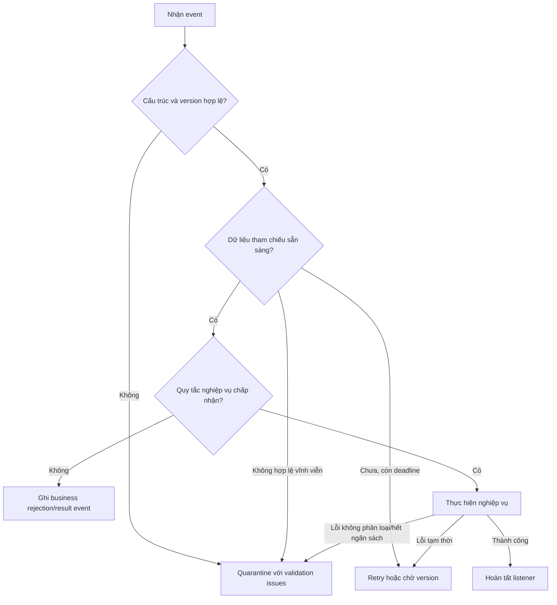

# Lỗi dữ liệu

## Mục tiêu

Application event mang thông tin từ module phát tới các listener. Nếu dữ liệu trong event sai cấu trúc, thiếu thông tin hoặc không còn phù hợp với trạng thái nghiệp vụ, listener có thể thất bại. Việc xử lý mọi trường hợp bằng cùng một cách retry dễ khiến một event không thể xử lý chiếm tài nguyên, tạo backlog và làm chậm các event hợp lệ.

**Lỗi dữ liệu** là lỗi phát sinh khi dữ liệu event không đáp ứng hợp đồng hoặc điều kiện cần thiết để listener xử lý. Cần xác định lỗi nằm ở cấu trúc payload, ý nghĩa nghiệp vụ, tham chiếu tới dữ liệu khác hay thứ tự cập nhật. Mỗi nhóm có cách khắc phục khác nhau: từ chối ngay ở đầu vào, retry có giới hạn, chờ dữ liệu đến, cách ly để sửa hoặc phát một sự kiện nghiệp vụ mới.

Sau bài học, bạn có thể:

- Phân biệt lỗi cấu trúc, lỗi schema, lỗi ngữ nghĩa và lỗi tham chiếu dữ liệu.
- Kiểm tra event ở ranh giới publish/consume mà vẫn giữ trách nhiệm nghiệp vụ trong module sở hữu dữ liệu.
- Phân loại lỗi dữ liệu có thể phục hồi và lỗi không thể retry với cùng payload.
- Lưu failure record hoặc quarantine bền vững và phối hợp với Event Publication Registry.
- Sửa dữ liệu, replay event có kiểm soát, kiểm thử và quan sát lỗi dữ liệu.

## 1. Nhận diện các loại lỗi dữ liệu

Không phải mọi event listener thất bại đều do dữ liệu sai. Hãy phân loại theo nguyên nhân trước khi chọn hành động.

| Nhóm lỗi | Ví dụ | Hướng xử lý thường phù hợp |
| --- | --- | --- |
| Lỗi cấu trúc | Thiếu `orderId`, sai kiểu timestamp, chuỗi vượt giới hạn. | Từ chối ở ranh giới đầu vào hoặc cách ly message đã được nhận. |
| Lỗi schema/version | Event dùng phiên bản chưa hỗ trợ, enum có giá trị mới mà consumer không hiểu. | Nâng cấp consumer/mapper hoặc cách ly để xử lý theo version. |
| Lỗi ngữ nghĩa | Số tiền âm, currency không hợp lệ, trạng thái không được phép. | Kiểm tra quy tắc trong module sở hữu nghiệp vụ; từ chối hoặc ghi kết quả nghiệp vụ. |
| Thiếu tham chiếu | `customerId` chưa tồn tại vì event tạo khách hàng chưa được xử lý. | Có thể retry/chờ trong thời hạn nếu dữ liệu có khả năng xuất hiện. |
| Dữ liệu lỗi thời hoặc sai thứ tự | Event version 4 tới sau version 5; snapshot cũ ghi đè dữ liệu mới. | Kiểm tra sequence/version, bỏ qua snapshot cũ hoặc chờ gap theo semantics. |
| Dữ liệu không còn hợp lệ | Đơn đã hủy trước khi listener xử lý event giữ hàng. | Đọc trạng thái authoritative và xử lý theo quy tắc nghiệp vụ hiện tại. |

### Lỗi xác định và lỗi có thể phục hồi

Một lỗi xác định (deterministic) thường tiếp tục xảy ra nếu gửi lại cùng payload trong cùng điều kiện. Ví dụ payload thiếu field bắt buộc hoặc mã tiền tệ không nằm trong hợp đồng. Retry ngay không làm payload hợp lệ hơn.

Một lỗi có thể phục hồi (transient/eventually resolvable) có thể hết khi dependency hoặc dữ liệu liên quan sẵn sàng. Ví dụ tham chiếu khách hàng chưa được tạo do event đến sai thứ tự, hoặc service tra cứu đang tạm thời không truy cập được. Trường hợp này có thể retry với backoff và deadline.

Không nên kết luận một lỗi là vĩnh viễn chỉ từ một exception tổng quát. `EntityNotFoundException` có thể là dữ liệu sai thật, nhưng cũng có thể là event tới trước event tạo entity. Cần xét hợp đồng, thứ tự phát sinh và khả năng phục hồi của dữ liệu.

### Phân biệt lỗi dữ liệu với từ chối nghiệp vụ

Một yêu cầu không được chấp nhận có thể là kết quả hợp lệ. Ví dụ module Kho xác định không đủ hàng, hoặc module Thanh toán từ chối giao dịch do hạn mức. Đây không nhất thiết là lỗi kỹ thuật của listener. Hãy biểu diễn kết quả bằng event/response nghiệp vụ như `InventoryUnavailable` hoặc `PaymentRejected` thay vì ném exception rồi retry vô hạn.

## 2. Đặt validation ở đúng ranh giới

Validation nên diễn ra ở nơi dữ liệu đi vào một hợp đồng. Mục tiêu là phát hiện dữ liệu sai sớm và cung cấp lỗi có thể hiểu được, đồng thời không biến listener thành nơi sở hữu quy tắc của module khác.

### Trước khi publish event

Module phát event phải bảo đảm event phản ánh một thay đổi nghiệp vụ đã được chấp nhận. Nếu command đầu vào không hợp lệ, từ chối command trước khi thay đổi aggregate hoặc phát event.

Ví dụ:

```java
public record PlaceOrder(
        UUID customerId,
        List<OrderLineInput> lines) {}

@Service
class OrderApplicationService {

    private final OrderRepository orders;
    private final ApplicationEventPublisher events;

    OrderApplicationService(
            OrderRepository orders,
            ApplicationEventPublisher events) {
        this.orders = orders;
        this.events = events;
    }

    @Transactional
    public UUID place(PlaceOrder command) {
        if (command.customerId() == null || command.lines().isEmpty()) {
            throw new InvalidOrderCommandException("Order data is incomplete");
        }

        Order order = Order.place(command);
        orders.save(order);
        events.publishEvent(OrderPlaced.from(order));
        return order.getId();
    }
}
```

Đây là ví dụ minh họa. Trong ứng dụng thực tế, cần kiểm tra cả trường hợp `lines` là `null`, validate từng dòng và để aggregate/domain service thực thi invariant. Nếu transaction rollback, event được phát trong transaction đó không được xử lý như một thay đổi đã commit khi dùng listener sau commit.

### Khi nhận event

Listener nên xác nhận cấu trúc và version của event trước khi gọi logic nghiệp vụ. Với application event nội bộ có kiểu Java, compiler giúp kiểm tra một phần cấu trúc; nhưng dữ liệu vẫn có thể sai ngữ nghĩa, đến từ phiên bản cũ hoặc được tạo bởi code không tuân thủ contract. Với message từ broker, adapter còn phải decode và validate payload trước khi chuyển thành application command/event.

Ví dụ event contract:

```java
public record OrderPlaced(
        UUID eventId,
        int schemaVersion,
        UUID orderId,
        UUID customerId,
        long totalAmountMinor,
        String currency,
        Instant occurredAt,
        long aggregateVersion) {}
```

Một validator có thể trả về danh sách lỗi thay vì dừng ở lỗi đầu tiên:

```java
public record DataIssue(String field, String code, String detail) {}

@Component
class OrderPlacedValidator {

    List<DataIssue> validate(OrderPlaced event) {
        List<DataIssue> issues = new ArrayList<>();

        if (event.eventId() == null) {
            issues.add(new DataIssue("eventId", "REQUIRED", "Event ID is missing"));
        }
        if (event.orderId() == null) {
            issues.add(new DataIssue("orderId", "REQUIRED", "Order ID is missing"));
        }
        if (event.totalAmountMinor() < 0) {
            issues.add(new DataIssue("totalAmountMinor", "OUT_OF_RANGE", "Amount cannot be negative"));
        }
        if (event.currency() == null || !event.currency().matches("[A-Z]{3}")) {
            issues.add(new DataIssue("currency", "INVALID_FORMAT", "Expected a 3-letter currency code"));
        }
        if (event.schemaVersion() != 1) {
            issues.add(new DataIssue("schemaVersion", "UNSUPPORTED", "Unsupported event version"));
        }

        return List.copyOf(issues);
    }
}
```

Đoạn code chỉ minh họa cách thu thập lỗi cấu trúc. Không nên đặt mọi quy tắc nghiệp vụ vào validator dùng chung. Ví dụ việc một đơn có được phép chuyển sang `CONFIRMED` hay không phải do module Đơn hàng quyết định dựa trên trạng thái authoritative của aggregate.

## 3. Schema validation và semantic validation

Hai lớp validation có mục đích khác nhau:

| Lớp | Câu hỏi | Ví dụ |
| --- | --- | --- |
| Schema/structural validation | Payload có đúng hình dạng hợp đồng không? | `eventId` có đúng UUID, `occurredAt` có parse được, field bắt buộc có mặt? |
| Semantic validation | Giá trị có ý nghĩa và hợp lệ trong miền nghiệp vụ không? | Đơn có tồn tại, số tiền có khớp, trạng thái có cho phép thao tác? |

Schema validation thường được thực hiện ở adapter/serialization boundary. Semantic validation cần gọi API hoặc domain logic của module sở hữu dữ liệu. Tránh để module nhận event truy cập trực tiếp bảng nội bộ của module phát chỉ để kiểm tra dữ liệu.

### Phiên bản event

Event contract có thể thay đổi theo thời gian. Khi thêm field, đổi enum hoặc thay đổi ý nghĩa, consumer cần biết version nào được hỗ trợ. Có thể dùng field `schemaVersion`, event type version hoặc metadata do serializer/schema registry cung cấp.

Nguyên tắc:

- Giữ consumer đọc được các version còn nằm trong thời gian hỗ trợ.
- Thêm field mới theo cách tương thích và có default khi định dạng cho phép.
- Không đổi ý nghĩa của field nhưng giữ nguyên tên/kiểu.
- Khi gặp version chưa hỗ trợ, ghi nhận rõ `UNSUPPORTED_VERSION`; không thử parse bằng một DTO khác một cách đoán mò.
- Lưu payload gốc hoặc reference đủ để có thể xử lý lại sau khi consumer được nâng cấp, theo chính sách dữ liệu.

### Giá trị enum mới

Nếu producer phát `shipmentStatus = "RETURNING"` nhưng consumer chỉ biết `CREATED`, `IN_TRANSIT` và `DELIVERED`, consumer có thể lỗi khi deserialize hoặc xử lý switch. Hãy quyết định rõ cách xử lý giá trị chưa biết: từ chối và cách ly, ánh xạ sang `UNKNOWN` nếu hợp đồng cho phép, hoặc nâng cấp consumer trước khi producer phát giá trị mới.

Không nên âm thầm ánh xạ mọi giá trị lạ sang một trạng thái có ý nghĩa khác. Điều đó có thể làm projection hoặc quyết định nghiệp vụ sai mà không tạo lỗi rõ ràng.

## 4. Thiếu tham chiếu và event đến sai thứ tự

Một event có thể hợp lệ về cấu trúc nhưng tham chiếu tới dữ liệu chưa tồn tại. Ví dụ `OrderPlaced` tới module Báo cáo trước khi projection khách hàng nhận `CustomerRegistered`. Đây có thể là vấn đề thứ tự delivery chứ không phải payload hỏng.

Trước khi đánh dấu event là không thể retry, hãy xác định:

- Dữ liệu tham chiếu có thể được tạo bởi event khác đang trên đường xử lý không?
- Hai event có dùng cùng partition/key hoặc có thứ tự được bảo đảm không?
- Có thể tra cứu lại qua API công khai của module sở hữu không?
- Có deadline nghiệp vụ sau đó tham chiếu được xem là không hợp lệ không?

### Chính sách chờ dữ liệu

Nếu tham chiếu có thể xuất hiện trong thời gian ngắn, có thể retry với backoff và giới hạn thời gian. Khi hết deadline, chuyển sang quarantine với mã như `REFERENCE_NOT_FOUND_TIMEOUT` để người vận hành xem xét.

Nếu event phụ thuộc thứ tự theo aggregate, dùng sequence/version do nguồn phát quản lý. Consumer phát hiện version gap có thể giữ event chờ version còn thiếu thay vì áp dụng event sau rồi làm sai trạng thái.

Nếu event là snapshot đầy đủ, một snapshot version mới hơn có thể thay thế snapshot cũ. Nếu event là delta, bỏ qua một delta có thể làm mất thay đổi; cần giữ thứ tự hoặc tải lại trạng thái authoritative qua API được phép.

Không dùng timestamp làm thứ tự duy nhất nếu đồng hồ giữa các instance có thể lệch. Aggregate version hoặc sequence tăng đơn điệu thường là căn cứ tốt hơn.

## 5. Phân loại và định tuyến lỗi dữ liệu

Sau validation, listener hoặc adapter cần chọn một hành động rõ ràng. Một policy đơn giản:



Các hành động chính:

- **Reject tại đầu vào:** dùng khi producer/API đang gửi dữ liệu không hợp lệ và có thể trả lỗi trực tiếp cho caller trước khi tạo event.
- **Retry/chờ:** dùng khi dữ liệu phụ thuộc có thể sẵn sàng hoặc lỗi phát sinh tạm thời.
- **Business rejection:** ghi nhận kết quả nghiệp vụ hợp lệ, ví dụ `OrderRejected`, thay vì xem đó là lỗi listener.
- **Quarantine/dead-letter:** lưu event và lỗi khi payload không thể xử lý tự động hoặc đã hết ngân sách retry.
- **Manual review:** yêu cầu người có thẩm quyền sửa dữ liệu, nâng cấp consumer hoặc quyết định cách xử lý tiếp.

Không nên retry vô hạn một payload sai schema hoặc thiếu field bắt buộc. Cũng không nên quarantine mọi lỗi `not found` ngay lập tức nếu event có thể đến trước dữ liệu tham chiếu.

## 6. Lưu failure record và quarantine bền vững

Khi listener không thể xử lý event tự động, cần lưu đủ thông tin để tìm nguyên nhân và quyết định replay. Một failure record có thể có cấu trúc:

```sql
CREATE TABLE event_data_failure (
    id                UUID PRIMARY KEY,
    event_id          UUID NOT NULL,
    listener_id       VARCHAR(160) NOT NULL,
    event_type        VARCHAR(200) NOT NULL,
    schema_version    INTEGER,
    failure_category  VARCHAR(40) NOT NULL,
    error_code        VARCHAR(120) NOT NULL,
    issues_json       JSON,
    payload_reference VARCHAR(500),
    attempt_count     INTEGER NOT NULL,
    first_failed_at   TIMESTAMP WITH TIME ZONE NOT NULL,
    last_failed_at    TIMESTAMP WITH TIME ZONE NOT NULL,
    quarantined_at    TIMESTAMP WITH TIME ZONE,
    resolution_status VARCHAR(32) NOT NULL
);

CREATE UNIQUE INDEX ux_event_data_failure_listener
    ON event_data_failure (event_id, listener_id);
```

Các trường giúp xác định event, listener, version hợp đồng, loại lỗi, danh sách validation issue và trạng thái xử lý. Nếu cần lưu payload, cân nhắc lưu ở kho riêng và chỉ ghi `payload_reference`; giới hạn kích thước và kiểm soát quyền truy cập.

Nếu cần lịch sử từng lần thử, dùng bảng `event_data_failure_attempt` riêng thay vì ghi đè mọi thông tin vào một dòng. Mỗi attempt nên có thời điểm, error code, route đã chọn và phiên bản consumer.

### Không làm mất lỗi khi ghi quarantine

Failure record phải được commit bền vững trước khi listener kết thúc theo nhánh quarantine. Nếu listener bắt exception, ghi record rồi trả về, Event Publication Registry có thể ghi nhận listener đã hoàn tất. Đây chỉ là xác nhận listener đã chuyển giao trách nhiệm xử lý sang quarantine; không có nghĩa nghiệp vụ thành công.

Nếu ghi failure record thất bại, phải để lỗi truyền ra để publication còn có thể được retry/resubmit theo cấu hình. Không nuốt lỗi ghi quarantine rồi kết thúc listener, vì như vậy event có thể bị coi là đã xử lý trong khi không còn dấu vết lỗi.

Tùy transaction boundary, có thể cần một transaction riêng cho failure record. Chỉ dùng `REQUIRES_NEW` khi đã xác định rõ transaction hiện tại và hiểu rằng failure record có thể commit độc lập với transaction listener. Cần kiểm thử thực tế để bảo đảm record không bị rollback ngoài ý muốn và cũng không ghi nhận một trạng thái sai khi transaction nghiệp vụ khác thất bại.

## 7. Phối hợp với Spring Modulith Event Publication Registry

Spring Modulith Event Publication Registry theo dõi publication của application event tới các listener được quản lý và trạng thái hoàn tất của từng publication. Với listener như `@ApplicationModuleListener`, publication chưa hoàn tất có thể được phát hiện và resubmit theo cơ chế ứng dụng cấu hình.

Khi xử lý lỗi dữ liệu, cần phân biệt hai tình huống:

1. **Listener chưa thể xử lý và chưa bàn giao bền vững:** để exception truyền ra. Publication còn chưa hoàn tất để retry/resubmission có thể tiếp tục.
2. **Listener đã ghi failure record/quarantine thành công:** listener có thể kết thúc theo policy vì trách nhiệm đã được chuyển giao bền vững. Failure record vẫn giữ trạng thái lỗi dữ liệu riêng.

Ví dụ:

```java
@Component
class OrderPlacedProjectionListener {

    private final OrderPlacedValidator validator;
    private final OrderProjection projection;
    private final EventDataFailureRecorder failures;

    OrderPlacedProjectionListener(
            OrderPlacedValidator validator,
            OrderProjection projection,
            EventDataFailureRecorder failures) {
        this.validator = validator;
        this.projection = projection;
        this.failures = failures;
    }

    @ApplicationModuleListener
    void on(OrderPlaced event) {
        List<DataIssue> issues = validator.validate(event);
        if (!issues.isEmpty()) {
            failures.quarantine(event, "order-overview", issues);
            return;
        }

        projection.apply(event);
    }
}
```

Ví dụ giả định `quarantine` chỉ trả về sau khi failure record đã được lưu bền vững. Nếu phương thức này ném lỗi khi lưu, exception phải thoát khỏi listener. `projection.apply` cũng cần transaction và idempotency để xử lý trường hợp listener được giao lại sau crash window.

Event Publication Registry không phải kho lưu toàn bộ event lịch sử và không thay thế failure record. Registry trả lời câu hỏi publication tới listener đã hoàn tất hay chưa; failure record trả lời event bị lỗi dữ liệu như thế nào và đang được xử lý ra sao.

## 8. Sửa dữ liệu và replay event

Replay chỉ an toàn khi đã hiểu nguyên nhân và xác định side effect trước đó. Quy trình gợi ý:

1. Tìm event theo `event_id`, `listener_id`, event type và error code.
2. Đọc payload gốc hoặc reference, schema version, validation issues và lịch sử attempt.
3. Xác định nguồn dữ liệu authoritative và nguyên nhân: producer bug, dữ liệu nguồn sai, consumer chưa hỗ trợ version hay event đến sai thứ tự.
4. Sửa nguyên nhân ở nguồn hoặc nâng cấp consumer/mapper.
5. Kiểm tra event đã tạo side effect một phần chưa; xác minh inbox/idempotency và trạng thái nghiệp vụ.
6. Ghi người yêu cầu, lý do, thời điểm và phạm vi replay.
7. Replay có kiểm soát, theo dõi kết quả và giữ liên kết với failure record ban đầu.

### Có nên sửa payload gốc không?

Không nên âm thầm chỉnh sửa lịch sử event như thể producer đã phát dữ liệu khác. Nếu event gốc sai, có hai lựa chọn tùy nghiệp vụ:

- Nếu chỉ cần chạy lại cùng một event sau khi consumer được sửa, replay payload gốc và giữ `eventId` gốc để idempotency nhận diện duplicate.
- Nếu dữ liệu nghiệp vụ được sửa và tạo ra một sự kiện mới, phát event mới với `eventId` mới, đồng thời liên kết `causationId` hoặc `correctionOf` tới event gốc.

Ví dụ, sửa tên hiển thị khách hàng có thể tạo `CustomerProfileCorrected`; không nên viết lại event `CustomerRegistered` cũ. Việc lưu correction event giữ được lịch sử và giúp các consumer khác biết thay đổi nào đã xảy ra.

Nếu cần biến đổi payload cũ để consumer mới đọc, thực hiện qua một adapter/translator có version và audit rõ ràng. Không sửa trực tiếp message trong Kafka topic đang lưu trữ.

## 9. Bảo vệ dữ liệu và quyền riêng tư

Failure record và quarantine thường chứa payload hoặc thông tin lỗi chi tiết, vì vậy có thể trở thành nơi tập trung dữ liệu nhạy cảm.

- Chỉ lưu field cần thiết để điều tra và replay.
- Không ghi token, mật khẩu, thông tin xác thực hoặc dữ liệu thanh toán đầy đủ vào log/error message.
- Mã hóa payload lưu trữ và giới hạn quyền đọc quarantine.
- Có retention/cleanup policy cho failure record, payload và attempt history.
- Audit mọi thao tác xem payload, replay, sửa dữ liệu và bỏ qua event.
- Khi dữ liệu nguồn bị xóa/ẩn danh hóa, xác định cách cập nhật các projection và bản quarantine còn lưu.

Không nên dùng toàn bộ payload làm label của metric hoặc log key vì có thể lộ dữ liệu và tạo cardinality rất lớn. Dùng event type, listener, error code và version làm dimension; định danh cụ thể có thể nằm trong log/trace có kiểm soát.

## 10. Kiểm thử lỗi dữ liệu

Kiểm thử cần chứng minh cả validation, lựa chọn route, transaction và khả năng replay.

| Tình huống | Điều cần xác minh |
| --- | --- |
| Thiếu field bắt buộc | Validator trả đúng field/code; event không đi vào projection. |
| Sai định dạng hoặc schema version | Event được từ chối/cách ly với lý do cụ thể. |
| Giá trị sai ngữ nghĩa | Module sở hữu nghiệp vụ từ chối theo quy tắc; không bị coi nhầm là lỗi transport. |
| Tham chiếu chưa xuất hiện | Retry/chờ theo deadline; không quarantine quá sớm. |
| Tham chiếu không tồn tại sau deadline | Quarantine với error code và attempt history. |
| Event cũ đến muộn | Version/sequence ngăn ghi đè dữ liệu mới. |
| Ghi failure record thất bại | Exception truyền ra; publication không bị coi là đã bàn giao. |
| Quarantine commit thành công | Listener hoàn tất theo policy; failure record vẫn giữ trạng thái lỗi. |
| Replay sau khi sửa nguyên nhân | Event được xử lý theo policy, lịch sử lỗi và replay còn liên kết. |
| Duplicate khi replay | Idempotency ngăn lặp side effect. |

Ví dụ unit test validator:

```java
@Test
void reportsInvalidAmountAndCurrency() {
    OrderPlaced event = new OrderPlaced(
            UUID.randomUUID(),
            1,
            UUID.randomUUID(),
            UUID.randomUUID(),
            -100L,
            "vnd",
            Instant.now(),
            1L);

    List<DataIssue> issues = validator.validate(event);

    assertThat(issues)
            .extracting(DataIssue::code)
            .contains("OUT_OF_RANGE", "INVALID_FORMAT");
}
```

Ví dụ kiểm tra router:

```java
@Test
void quarantinesDeterministicValidationFailure() {
    List<DataIssue> issues = List.of(
            new DataIssue("currency", "INVALID_FORMAT", "Invalid currency"));

    listener.on(invalidOrderPlaced);

    verify(failures).quarantine(
            invalidOrderPlaced,
            "order-overview",
            issues);
    verifyNoInteractions(projection);
}
```

Unit test xác nhận logic validator/router. Integration test cần kiểm tra failure record commit, transaction rollback, Event Publication Registry và resubmission. Với listener chạy sau commit, test phải commit transaction rõ ràng; transaction test rollback mặc định có thể không kích hoạt listener như mong đợi.

## 11. Quan sát và vận hành

Theo dõi lỗi dữ liệu như một luồng vận hành riêng. Các chỉ số hữu ích:

- Số event bị quarantine theo event type, listener, schema version và error code.
- Tỷ lệ lỗi validation trên tổng số event nhận được.
- Tuổi event trong quarantine lâu nhất và thời gian trung bình tới resolution.
- Số event chờ tham chiếu, số event hết deadline và số event sai thứ tự.
- Số lần retry/replay, tỷ lệ replay thành công và số event bị quarantine lại.
- Số publication chưa hoàn tất trong Event Publication Registry.
- Số lần ghi failure record thất bại.

Log/trace nên có `event_id`, `event_type`, `listener_id`, `schema_version`, `aggregate_id`, `aggregate_version`, `correlation_id`, `attempt`, `error_code` và route đã chọn. Không log toàn bộ payload nếu chứa dữ liệu nhạy cảm.

Đặt cảnh báo theo tác động: event thanh toán sai dữ liệu cần cảnh báo nhanh hơn một event cập nhật mô tả không quan trọng. Dashboard nên cho phép tìm theo event ID, xem validation issues, trạng thái publication, lịch sử attempt và quyết định resolution.

Quy trình vận hành cần quy định ai chịu trách nhiệm cho từng event type, khi nào được replay, khi nào cần sửa dữ liệu ở nguồn và ai có quyền bỏ qua event. Mọi thao tác thủ công phải có lý do và audit trail.

## 12. Những lỗi thiết kế thường gặp

| Lỗi | Hậu quả | Cách xử lý |
| --- | --- | --- |
| Retry vô hạn payload sai schema | Một event lỗi tạo backlog và log liên tục. | Phân loại deterministic/transient; quarantine khi không thể phục hồi tự động. |
| Đặt mọi validation trong listener dùng chung | Module nhận event vô tình sở hữu quy tắc của module phát. | Tách schema validation khỏi semantic validation; gọi API/domain owner. |
| Coi mọi `not found` là lỗi vĩnh viễn | Event đến sai thứ tự bị cách ly quá sớm. | Xác định khả năng xuất hiện của reference và deadline. |
| Nuốt exception khi ghi quarantine | Publication có thể hoàn tất dù không có failure record. | Chỉ kết thúc sau khi bàn giao bền vững; nếu ghi lỗi thì ném exception. |
| Sửa payload gốc không audit | Mất khả năng truy vết dữ liệu producer thực sự đã phát. | Dùng correction event hoặc translator có version và audit. |
| Replay mà không kiểm tra side effect | Có thể thực hiện nghiệp vụ hai lần. | Kiểm tra trạng thái và dùng event ID/idempotency key ổn định. |
| Nhầm Event Publication Registry với kho lỗi | Không biết nguyên nhân và lịch sử xử lý dữ liệu sai. | Lưu failure record/quarantine riêng. |
| Lưu payload nhạy cảm không giới hạn | Tăng rủi ro lộ dữ liệu và chi phí lưu trữ. | Tối thiểu hóa, mã hóa, phân quyền và đặt retention. |

## 13. Quy trình áp dụng

Khi xây dựng xử lý lỗi dữ liệu cho application events trong Spring Modulith:

1. Xác định event contract, schema version và module sở hữu từng quy tắc nghiệp vụ.
2. Validate command trước khi publish và validate cấu trúc/version tại ranh giới nhận event.
3. Tách schema validation, semantic validation, lỗi tham chiếu và business rejection.
4. Xác định lỗi deterministic, lỗi có thể phục hồi và deadline chờ dữ liệu.
5. Chọn reject, retry, business result hoặc quarantine cho từng nhóm lỗi.
6. Ghi failure record bền vững với event ID, listener, version, error code và validation issues.
7. Phối hợp với Event Publication Registry; chỉ kết thúc listener khi đã xử lý hoặc bàn giao bền vững.
8. Thiết kế correction/replay có idempotency, giữ lịch sử và audit.
9. Kiểm thử dữ liệu sai, event sai thứ tự, rollback, ghi quarantine thất bại và replay.
10. Theo dõi validation failure rate, quarantine age, retry/replay và publication chưa hoàn tất.

Xử lý lỗi dữ liệu hiệu quả bắt đầu từ việc hiểu chính xác dữ liệu sai ở đâu và ai sở hữu quy tắc đó. Khi validation đặt đúng ranh giới, lỗi được phân loại, quarantine được lưu bền vững và replay có kiểm soát, các module Spring Modulith có thể tiếp tục giao tiếp qua application events mà vẫn giữ được tính toàn vẹn và khả năng truy vết của dữ liệu nghiệp vụ.
