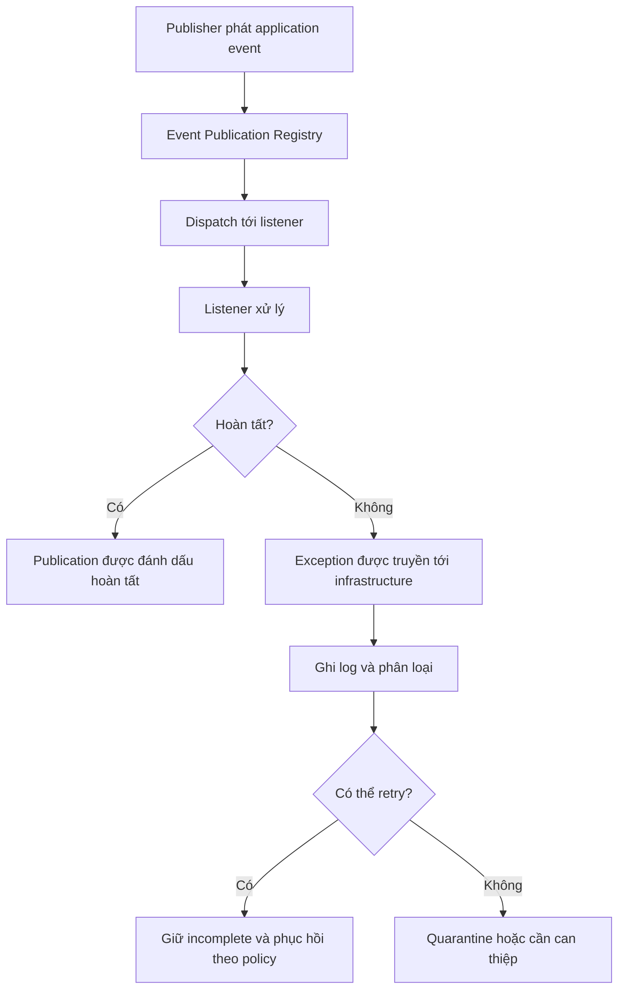

# Bắt và ghi nhận exception

Trong một ứng dụng Spring Modulith, application event thường được xử lý bởi listener đồng bộ hoặc bất đồng bộ. Khi listener gặp lỗi, hệ thống cần biết event nào thất bại, listener nào gây lỗi, lỗi có thể tự phục hồi hay không và publication cần được retry hay chuyển sang điều tra. Nếu exception bị bỏ qua hoặc log thiếu ngữ cảnh, một event có thể bị coi là đã xử lý dù nghiệp vụ chưa hoàn tất.

**Bắt và ghi nhận exception** là việc xử lý lỗi tại đúng ranh giới, giữ nguyên nguyên nhân gốc, bổ sung ngữ cảnh đủ để chẩn đoán và truyền kết quả thất bại tới cơ chế transaction hoặc event publication. Với Spring Modulith, cách listener được gọi ảnh hưởng trực tiếp tới nơi exception xuất hiện và khả năng phục hồi publication.

## 1. Phân biệt lỗi nghiệp vụ và exception kỹ thuật

Không phải mọi kết quả không thành công đều là exception. Một module có thể từ chối yêu cầu vì quy tắc nghiệp vụ bình thường, ví dụ kho không đủ hàng hoặc thanh toán bị từ chối. Đây là kết quả nghiệp vụ mà consumer có thể xử lý bằng một event khác.

Ngược lại, database timeout, mất kết nối tới dịch vụ thanh toán, lỗi deserialize hoặc vi phạm invariant ngoài dự kiến là lỗi kỹ thuật cần được ghi nhận và xử lý theo chính sách phục hồi.

| Loại kết quả | Ví dụ | Cách biểu diễn phù hợp |
|---|---|---|
| Kết quả nghiệp vụ hợp lệ | Hết hàng, thanh toán bị từ chối, đơn hàng không đủ điều kiện | Event kết quả như `InventoryRejected` hoặc `PaymentDeclined` |
| Lỗi kỹ thuật tạm thời | Database deadlock, network timeout, broker tạm mất kết nối | Exception có thể retry |
| Lỗi dữ liệu/hợp đồng | Payload thiếu field bắt buộc, schema không hỗ trợ | Exception không retry vô hạn; quarantine hoặc sửa contract |
| Lỗi lập trình | Null ngoài dự kiến, invariant bị phá vỡ | Ghi nhận đầy đủ, cảnh báo và sửa nguyên nhân |
| Lỗi cấu hình | Thiếu credential, sai destination, bean chưa được cấu hình | Ghi nhận và khắc phục cấu hình; tránh retry dày đặc |

Ví dụ, nếu một đơn hàng không giữ được hàng vì tồn kho bằng không, module Inventory nên phát `InventoryRejected` với reason code. Không nên ném `RuntimeException` chỉ để buộc listener retry một kết quả không thể thay đổi bằng cách thử lại.

## 2. Exception đi qua những ranh giới nào?

Trong Spring Modulith, exception có thể xuất hiện ở nhiều giai đoạn:

1. **Publisher:** lỗi khi tạo event, serialize payload hoặc publish application event.
2. **Event dispatch:** lỗi khi framework gọi listener.
3. **Listener:** lỗi trong logic xử lý, truy cập database hoặc gọi dependency.
4. **Publication persistence:** lỗi khi ghi nhận hoặc cập nhật trạng thái publication.
5. **Externalization:** lỗi khi chuyển event sang broker hoặc hệ thống bên ngoài.
6. **Recovery:** lỗi khi đọc lại publication chưa hoàn tất hoặc thử xử lý lại.



Hãy xác định lỗi phát sinh ở bước nào trước khi thay đổi retry. Ví dụ, lỗi serialize xảy ra trước khi listener chạy; retry listener không sửa được payload không thể deserialize. Tương tự, exception trong một listener bất đồng bộ không nhất thiết truyền về thread đã phát event.

## 3. Hành vi exception của các loại listener

### `@EventListener` đồng bộ

Listener đồng bộ được gọi trong luồng xử lý event. Nếu listener ném exception và không có tầng xử lý phù hợp, exception có thể truyền ngược về nơi gọi `publishEvent()`. Khi event được phát trong transaction, exception có thể khiến transaction rollback tùy loại exception và cấu hình transaction.

```java
@Component
class OrderAuditListener {

    @EventListener
    void on(OrderPlaced event) {
        auditService.record(event);
    }
}
```

Nếu `auditService.record()` thất bại, publisher đồng bộ có thể nhận exception. Điều này phù hợp khi listener là một phần bắt buộc của thao tác hiện tại và caller cần biết thất bại ngay. Nếu listener chỉ là tác vụ phụ, cần cân nhắc transaction phase và cơ chế publication bền vững.

### `@TransactionalEventListener`

`@TransactionalEventListener` gắn listener với transaction phase, mặc định là `AFTER_COMMIT`. Khi listener chạy sau commit, transaction nguồn đã hoàn tất. Nếu listener ném exception, không thể rollback transaction nguồn đã commit. Lỗi cần được ghi nhận và phục hồi ở phía listener.

```java
@TransactionalEventListener(phase = TransactionPhase.AFTER_COMMIT)
void on(OrderPlaced event) {
    projectionService.update(event);
}
```

Nếu listener cần ghi database sau commit, hãy xác định transaction riêng phù hợp, chẳng hạn một service được gọi với `REQUIRES_NEW`. Không giả định transaction nguồn vẫn mở để bao bọc các thao tác ghi của listener.

### `@ApplicationModuleListener`

Spring Modulith cung cấp `@ApplicationModuleListener` cho listener ở ranh giới module. Annotation này được thiết kế cho xử lý bất đồng bộ và transaction riêng theo semantics của phiên bản Spring Modulith/Spring Framework đang dùng; các phiên bản phổ biến kết hợp async, `AFTER_COMMIT` và `REQUIRES_NEW`.

```java
@Component
class InventoryListener {

    private final InventoryService inventory;

    InventoryListener(InventoryService inventory) {
        this.inventory = inventory;
    }

    @ApplicationModuleListener
    void on(OrderPlaced event) {
        inventory.reserve(event.orderId(), event.lines());
    }
}
```

Do listener chạy bất đồng bộ, caller phát event không chờ listener hoàn tất và không thể dựa vào exception để nhận kết quả trực tiếp. Exception phải được xử lý tại listener infrastructure, publication registry hoặc cơ chế quan sát lỗi tương ứng. Hãy kiểm tra executor, transaction manager và persistence configuration của phiên bản đang sử dụng.

## 4. Chỉ bắt exception khi có hành động cụ thể

Một `catch` có ích khi nó làm được ít nhất một việc: bổ sung ngữ cảnh, chuyển exception sang loại phù hợp, thực hiện compensation, ghi nhận lỗi bền vững hoặc quyết định retry/quarantine. Bắt exception chỉ để log rồi tiếp tục bình thường thường làm mất tín hiệu thất bại.

Ví dụ không nên dùng:

```java
@ApplicationModuleListener
void on(OrderPlaced event) {
    try {
        inventory.reserve(event.orderId(), event.lines());
    } catch (Exception exception) {
        log.error("Cannot reserve inventory", exception);
    }
}
```

Trong ví dụ này, listener kết thúc bình thường sau khi log. Infrastructure có thể xem lần xử lý là thành công và đánh dấu publication hoàn tất, mặc dù tồn kho chưa được giữ. Event có thể bị mất khỏi luồng phục hồi.

Nếu lỗi cần được retry, hãy truyền exception ra ngoài sau khi bổ sung ngữ cảnh:

```java
@ApplicationModuleListener
void on(OrderPlaced event) {
    try {
        inventory.reserve(event.orderId(), event.lines());
    } catch (TransientInventoryException exception) {
        log.warn(
            "Temporary inventory failure: eventId={}, orderId={}",
            event.eventId(),
            event.orderId(),
            exception
        );
        throw exception;
    }
}
```

Việc ném lại exception cho phép listener infrastructure nhận biết lần xử lý thất bại. Cơ chế retry hoặc phục hồi cụ thể còn phụ thuộc cấu hình Spring Modulith và ứng dụng; không mặc định mọi exception đều tự được retry ngay lập tức.

## 5. Bảo toàn nguyên nhân gốc khi chuyển exception

Đôi khi cần chuyển exception từ thư viện hoặc module phụ thuộc thành exception có ý nghĩa trong module hiện tại. Hãy giữ exception gốc làm `cause` để không mất stack trace và chi tiết chẩn đoán.

```java
try {
    paymentGateway.authorize(request);
} catch (SocketTimeoutException exception) {
    throw new PaymentGatewayUnavailableException(
        "Payment gateway did not respond in time",
        exception
    );
}
```

Không tạo exception mới chỉ với message rồi bỏ mất `cause`. Cũng không nên đưa toàn bộ nội dung response, token hoặc dữ liệu thanh toán vào exception message vì message thường được ghi vào log.

Một exception tùy chỉnh có thể mang metadata an toàn:

```java
public class EventHandlingException extends RuntimeException {

    private final String eventType;
    private final UUID eventId;

    public EventHandlingException(
        String eventType,
        UUID eventId,
        String message,
        Throwable cause
    ) {
        super(message, cause);
        this.eventType = eventType;
        this.eventId = eventId;
    }

    public String eventType() {
        return eventType;
    }

    public UUID eventId() {
        return eventId;
    }
}
```

Metadata nên giới hạn ở định danh và loại event cần cho chẩn đoán. Payload đầy đủ nên được lấy từ nguồn có phân quyền khi cần điều tra.

## 6. Phân loại exception để quyết định retry

Một cách rõ ràng là dùng các loại exception riêng cho lỗi tạm thời và lỗi không thể tự phục hồi:

```java
public class RetryableEventException extends RuntimeException {
    public RetryableEventException(String message, Throwable cause) {
        super(message, cause);
    }
}

public class InvalidEventPayloadException extends RuntimeException {
    public InvalidEventPayloadException(String message) {
        super(message);
    }
}
```

Chính sách có thể được mô tả như sau:

| Exception | Retry? | Hành động |
|---|---|---|
| `RetryableEventException` | Có giới hạn | Giữ publication chưa hoàn tất và thử lại theo policy |
| `InvalidEventPayloadException` | Không retry vô hạn | Quarantine payload, ghi reason code và cảnh báo |
| `AccessDeniedException` do cấu hình | Không retry dày đặc | Báo động, sửa ACL/credential rồi phục hồi có kiểm soát |
| Business rejection | Không phải lỗi kỹ thuật | Phát event kết quả nghiệp vụ |
| Lỗi lập trình ngoài dự kiến | Không nên lặp vô hạn | Ghi nhận, cảnh báo và điều tra |

Không dùng tên exception thay cho policy. Một lỗi network có thể retry được ở lần đầu nhưng cần chuyển sang trạng thái cần can thiệp sau khi vượt quá thời gian hoặc số lần thử. Ngược lại, một exception có tên `RuntimeException` không đủ thông tin để quyết định retry.

## 7. Ghi nhận lỗi có cấu trúc

Log cần giúp người vận hành xác định event, listener, process và lần thử mà không phải đọc toàn bộ payload. Với event handler, các trường hữu ích gồm:

- `eventId`: định danh event ổn định qua retry.
- `eventType`: loại event theo hợp đồng nghiệp vụ.
- `listener`: tên listener hoặc handler.
- `aggregateId` hoặc business key: định danh nghiệp vụ liên quan.
- `correlationId` và `causationId`: liên kết chuỗi xử lý.
- `attempt`: lần thử nếu ứng dụng quản lý bộ đếm.
- `durationMs`: thời gian xử lý trước khi thất bại.
- `exceptionType` và root cause: loại lỗi và nguyên nhân sâu nhất.

Ví dụ dùng SLF4J với placeholder:

```java
try {
    orderProjection.update(event);
} catch (ProjectionStoreUnavailableException exception) {
    log.error(
        "Event listener failed: eventId={}, eventType={}, orderId={}, listener={}",
        event.eventId(),
        "order.placed",
        event.orderId(),
        "OrderProjectionListener",
        exception
    );
    throw exception;
}
```

Truyền exception làm đối số cuối để logger ghi stack trace. Placeholder giúp log có cấu trúc và tránh tạo chuỗi tốn kém khi log level không được bật. Không log cùng một stack trace ở mọi tầng nếu mỗi tầng không bổ sung thông tin; điều đó tạo log trùng và làm khó tìm lỗi gốc.

## 8. Correlation ID và MDC trong xử lý bất đồng bộ

`correlationId` giúp liên kết log của một luồng nghiệp vụ qua nhiều listener hoặc module. Có thể đưa ID vào MDC để logger tự thêm vào mỗi dòng log trong phạm vi xử lý.

```java
@ApplicationModuleListener
void on(OrderPlaced event) {
    try {
        MDC.put("correlationId", event.correlationId().toString());
        MDC.put("eventId", event.eventId().toString());

        orderService.process(event);
    } catch (RuntimeException exception) {
        log.error(
            "Order event processing failed: orderId={}",
            event.orderId(),
            exception
        );
        throw exception;
    } finally {
        MDC.remove("correlationId");
        MDC.remove("eventId");
    }
}
```

Đoạn code minh họa việc đặt và xóa MDC trong thread xử lý. Với thread pool, luôn xóa context trong `finally` để tránh dữ liệu của event trước rò sang event tiếp theo trên cùng thread. MDC không tự động được truyền qua mọi executor; nếu cần truyền context qua async boundary, cấu hình `TaskDecorator` hoặc cơ chế context propagation phù hợp. Cách đáng tin cậy nhất vẫn là đưa correlation metadata vào event contract hoặc header đã được kiểm soát.

Không dùng `ThreadLocal` hoặc MDC làm nguồn dữ liệu nghiệp vụ. Chúng chỉ phục vụ quan sát trong thời gian xử lý; event phải chứa định danh cần thiết để phục hồi sau restart.

## 9. Exception trong listener bất đồng bộ

Với phương thức `@Async` trả về `void`, exception không thể được truyền về caller như lời gọi đồng bộ. Spring có `AsyncUncaughtExceptionHandler` để nhận exception chưa được biểu diễn qua `Future` hoặc `CompletableFuture`.

Ví dụ cấu hình cho async methods sử dụng executor tương ứng:

```java
@Configuration
@EnableAsync
class AsyncConfiguration implements AsyncConfigurer {

    @Override
    public AsyncUncaughtExceptionHandler getAsyncUncaughtExceptionHandler() {
        return (exception, method, parameters) ->
            log.error(
                "Uncaught async exception: method={}",
                method.toGenericString(),
                exception
            );
    }
}
```

Đây là cơ chế xử lý exception cho các async invocation phù hợp với cấu hình Spring. Không mặc định `AsyncConfigurer` là nơi duy nhất nhận lỗi từ mọi `@ApplicationModuleListener`; listener infrastructure và Event Publication Registry có lifecycle riêng. Hãy xác định executor thực tế mà Spring Modulith sử dụng và cấu hình error handling theo đúng phiên bản.

Nếu async method trả về `CompletableFuture`, lỗi thường được thể hiện qua trạng thái exceptional completion và phải được quan sát bằng `whenComplete`, `handle` hoặc `exceptionally`. Không bỏ qua future đã hoàn tất lỗi.

## 10. Event Publication Registry và exception

Event Publication Registry theo dõi publication của application event tới các listener được quản lý. Với persistence implementation phù hợp, registry lưu publication và trạng thái hoàn tất để ứng dụng có thể nhận biết publication chưa xử lý xong.

Khi listener ném exception, publication tương ứng không nên bị đánh dấu hoàn tất như một lần xử lý thành công. Registry có thể giữ publication ở trạng thái chưa hoàn tất để ứng dụng quan sát và phục hồi theo cơ chế được hỗ trợ. Hành vi chi tiết và API recovery cần được kiểm tra theo phiên bản Spring Modulith cùng persistence implementation đang dùng.

Các điểm cần lưu ý:

- Registry không tự sửa exception hoặc payload không hợp lệ.
- Publication incomplete không có nghĩa là framework sẽ retry liên tục ngay lập tức trong mọi cấu hình.
- Cần xác định cách phát hiện, resubmit và giới hạn số lần phục hồi.
- Nếu listener bắt exception rồi trả về bình thường, infrastructure có thể xem listener đã hoàn tất.
- Không đánh dấu publication hoàn tất chỉ để xóa lỗi khỏi backlog.
- Không cập nhật trực tiếp bảng registry để bỏ qua một publication thất bại.

Khi dùng registry bền vững, hãy theo dõi số publication incomplete, tuổi publication lâu nhất và số lần phục hồi. Khi lỗi đã được sửa, dùng API recovery/resubmission được hỗ trợ thay vì sửa trạng thái lưu trữ bằng SQL thủ công.

## 11. Ghi nhận lỗi không làm mất transaction

Nếu listener cần lưu thông tin lỗi vào database nhưng sau đó vẫn ném exception để publication được coi là thất bại, cần chú ý transaction boundary. Nếu bản ghi lỗi nằm trong cùng transaction bị rollback, thông tin điều tra cũng có thể biến mất.

Một lựa chọn là ghi error record trong transaction riêng:

```java
@Service
class EventFailureRecorder {

    private final EventFailureRepository failures;

    EventFailureRecorder(EventFailureRepository failures) {
        this.failures = failures;
    }

    @Transactional(propagation = Propagation.REQUIRES_NEW)
    public void record(EventFailure failure) {
        failures.save(failure);
    }
}
```

Listener có thể ghi nhận ngữ cảnh rồi ném lại lỗi:

```java
@ApplicationModuleListener
void on(OrderPlaced event) {
    try {
        orderService.process(event);
    } catch (RetryableEventException exception) {
        failureRecorder.record(EventFailure.from(event, exception));
        throw exception;
    }
}
```

`REQUIRES_NEW` giúp bản ghi lỗi commit độc lập với transaction xử lý event. Đây là ví dụ cần điều chỉnh theo transaction manager và cách listener được cấu hình. Nếu việc ghi error record cũng thất bại, không được che giấu lỗi đó; cần ghi log dự phòng và để publication tiếp tục ở trạng thái chưa hoàn tất.

Đối với lỗi không thể retry, một lựa chọn khác là lưu payload/metadata vào quarantine bền vững rồi kết thúc listener bình thường. Khi đó, publication được xem là hoàn tất vì trách nhiệm tiếp nhận đã được chuyển sang kho lỗi. Chỉ làm vậy sau khi bản ghi quarantine đã commit và có quy trình replay rõ ràng. Nếu lưu quarantine thất bại, hãy ném exception để không làm mất event.

## 12. Quarantine và lỗi không thể phục hồi

Quarantine là nơi lưu event không thể xử lý tự động để người vận hành hoặc một quy trình sửa lỗi xem xét. Bản ghi nên có:

- Event ID và event type.
- Listener hoặc consumer gặp lỗi.
- Schema version và payload reference/checksum.
- Exception type, reason code và thời điểm thất bại.
- Số lần thử và phiên bản ứng dụng.
- Trạng thái điều tra, người xử lý và lịch sử replay.

Không lưu payload nhạy cảm không cần thiết. Nếu cần giữ payload gốc, dùng kho lưu trữ có phân quyền và retention phù hợp; log chỉ nên chứa reference hoặc checksum.

Khi replay, giữ nguyên event ID của cùng một sự kiện nghiệp vụ để consumer idempotency nhận diện được duplicate. Nếu payload cần được chuyển đổi, lưu lại schema version cũ/mới và lịch sử migration. Không tạo event ID mới chỉ để né cơ chế chống trùng.

## 13. Retry và backoff

Retry phù hợp với lỗi tạm thời như network timeout hoặc dependency quá tải. Dùng số lần thử tối đa và exponential backoff có jitter:

```text
delay = min(max_delay, initial_delay * multiplier^(attempt - 1))
next_attempt = now + delay + random_jitter
```

Chính sách retry cần xác định:

- Những exception nào được retry.
- Số lần thử tối đa hoặc tổng thời gian tối đa.
- Khoảng chờ và jitter.
- Nơi lưu attempt count để không mất sau restart.
- Điều kiện chuyển sang quarantine hoặc manual intervention.
- Cách replay sau khi sửa nguyên nhân.

Không retry vô hạn các lỗi như payload sai schema, thiếu class, enum không hỗ trợ hoặc ACL sai. Những lỗi này cần sửa nguyên nhân trước khi resubmit. Cũng không để retry ở nhiều tầng cùng chạy không giới hạn, ví dụ listener retry, broker redelivery và application scheduler retry mà không có một giới hạn tổng thể.

## 14. Phân biệt exception và lỗi khi externalize event

Khi event được chuyển ra Kafka, RabbitMQ hoặc hệ thống ngoài, cần phân biệt listener exception với publish failure:

| Lỗi | Nơi phát sinh | Cách ghi nhận |
|---|---|---|
| Listener exception | Logic consumer/listener | Event ID, listener, process state và root cause |
| Serialization exception | Chuyển object thành payload | Event type, schema version, serializer và field gây lỗi |
| Broker publish failure | Kết nối hoặc broker từ chối | Destination, correlation ID, confirm/return và attempt |
| Consumer deserialize failure | Consumer giải mã payload | Message ID, content type, schema và payload checksum |
| Publication persistence failure | Ghi trạng thái registry/outbox | Publication ID, transaction và database error |

Publisher confirm chỉ phản ánh broker xử lý publish theo semantics của broker; nó không chứng minh listener đã xử lý nghiệp vụ. Consumer acknowledgement cũng không tự chứng minh transaction của module phát đã commit. Mỗi tầng phải ghi nhận trạng thái của chính nó.

## 15. Không ghi log trùng và không làm lộ dữ liệu

Một exception có thể đi qua nhiều tầng: repository, service, listener, executor và framework. Nếu mỗi tầng đều log cùng stack trace ở mức ERROR, một lỗi đơn lẻ tạo ra nhiều bản log giống nhau.

Nguyên tắc hữu ích:

- Ghi stack trace tại tầng có đủ event/listener/process context.
- Tầng thấp hơn có thể thêm metadata hoặc chuyển exception nhưng không nhất thiết log lại.
- Dùng WARN cho lỗi tạm thời được retry theo policy; dùng ERROR cho lỗi cần điều tra hoặc đã vượt ngưỡng.
- Không log toàn bộ payload, token, password, payment details hoặc dữ liệu cá nhân không cần thiết.
- Chuẩn hóa reason code để dashboard nhóm lỗi ổn định.
- Tránh đặt event ID, order ID hoặc customer ID làm metric label có cardinality không giới hạn.

Log message nên mô tả hành động thất bại và định danh cần tra cứu. Stack trace giữ nguyên cause để người phát triển có thể tìm đúng dòng code.

## 16. HTTP exception handler không xử lý listener async

`@ControllerAdvice` hoặc `@RestControllerAdvice` xử lý exception trong luồng xử lý HTTP request qua Spring MVC. Nó không phải nơi xử lý exception của listener bất đồng bộ chạy sau khi request đã kết thúc.

Ví dụ, nếu API tạo đơn trả về thành công rồi `@ApplicationModuleListener` thất bại vài giây sau, HTTP response đã được gửi. Không thể dùng `@ExceptionHandler` để đổi response đó. Lỗi phải được xử lý trong listener, publication registry, error recorder hoặc quy trình vận hành event.

Nếu API cần thông báo trạng thái xử lý, hãy trả về process/order ID và trạng thái như `PENDING`, sau đó cung cấp endpoint hoặc notification để client theo dõi kết quả. Không giữ HTTP request mở chỉ để chờ một quy trình bất đồng bộ kéo dài nếu nghiệp vụ không yêu cầu.

## 17. Kiểm thử exception handling

Kiểm thử cần xác nhận cả exception được ghi nhận và trạng thái publication/transaction được xử lý đúng.

| Tình huống | Điều cần xác minh |
|---|---|
| Listener đồng bộ ném exception | Exception truyền về publisher theo semantics mong đợi |
| Transaction rollback | Thay đổi nghiệp vụ và event không tạo kết quả đã commit giả |
| `AFTER_COMMIT` listener lỗi | Transaction nguồn vẫn đã commit; lỗi listener được quan sát riêng |
| `@ApplicationModuleListener` lỗi | Caller không giả định nhận exception; listener/publication failure được ghi nhận |
| Exception tạm thời | Được retry theo giới hạn và backoff |
| Exception không phục hồi | Được quarantine hoặc chuyển trạng thái cần can thiệp |
| Catch rồi rethrow | Root cause và stack trace được giữ nguyên |
| Catch rồi return | Chỉ xảy ra sau khi có hành động xử lý lỗi bền vững |
| Ghi error record thất bại | Publication không bị đánh dấu thành công nhầm |
| Replay event | Event ID ổn định và consumer idempotent |
| MDC trong thread pool | Context được xóa, không rò giữa các event |

Ở unit test, kiểm tra phân loại exception, reason code và log context nếu cần. Ở integration test, dùng persistence implementation của Event Publication Registry để xác nhận publication không bị đánh dấu hoàn tất khi listener thất bại và có thể phục hồi theo API được hỗ trợ. Không chỉ mock listener rồi kết luận behavior transaction/registry chính xác.

## 18. Quan sát và cảnh báo

Nên theo dõi các chỉ số:

- Số listener failure theo event type và listener.
- Số publication incomplete và tuổi publication lâu nhất.
- Tỷ lệ exception retryable/non-retryable.
- Số lần retry, retry exhaustion và quarantine.
- Thời gian xử lý listener và thời gian phục hồi publication.
- Số lỗi serialize/deserialize và publish transport.
- Số event được replay và tỷ lệ replay thành công.

Log và trace nên có event ID, event type, listener, correlation ID, aggregate/business key, attempt, exception type và root cause. Đặt cảnh báo khi publication tồn đọng quá lâu, lỗi listener tăng sau deploy hoặc một event type liên tục bị quarantine.

Khi điều tra, cần trả lời: event nào thất bại, listener nào nhận, transaction nguồn đã commit chưa, listener transaction có rollback không, publication còn incomplete không, lỗi có retry được không và lần phục hồi tiếp theo sẽ xảy ra khi nào.

## 19. Checklist bắt và ghi nhận exception

- [ ] Phân biệt kết quả nghiệp vụ với lỗi kỹ thuật.
- [ ] Xác định exception phát sinh ở publisher, listener, persistence hay externalization.
- [ ] Hiểu listener là đồng bộ, `AFTER_COMMIT` hay bất đồng bộ.
- [ ] Chỉ catch khi có hành động xử lý cụ thể.
- [ ] Rethrow lỗi cần retry để infrastructure nhận biết thất bại.
- [ ] Giữ nguyên root cause khi chuyển exception.
- [ ] Phân loại retryable và non-retryable rõ ràng.
- [ ] Log event ID, event type, listener, correlation ID và stack trace cần thiết.
- [ ] Không log payload nhạy cảm hoặc credential.
- [ ] MDC/context được dọn trong `finally` và truyền qua async theo cơ chế rõ ràng.
- [ ] Error record/quarantine được lưu bền vững trước khi kết thúc listener.
- [ ] Event Publication Registry được dùng qua API và recovery mechanism được hỗ trợ.
- [ ] Retry có giới hạn, backoff và quy trình xử lý khi hết retry.
- [ ] Consumer idempotent khi event được gửi lại hoặc replay.
- [ ] Có kiểm thử cho transaction, async failure, retry, quarantine và recovery.
- [ ] Có metric, log và cảnh báo cho publication bị kẹt.

Bắt và ghi nhận exception đúng cách giúp phân biệt một kết quả nghiệp vụ bình thường với một lần xử lý event thực sự thất bại. Trong Spring Modulith, cần hiểu exception của listener đồng bộ, `AFTER_COMMIT` và `@ApplicationModuleListener` có đường đi khác nhau. Giữ nguyên nguyên nhân gốc, bổ sung event context, không nuốt lỗi cần retry và lưu quarantine bền vững khi không thể phục hồi giúp Event Publication Registry cùng quy trình vận hành xử lý event đáng tin cậy.
