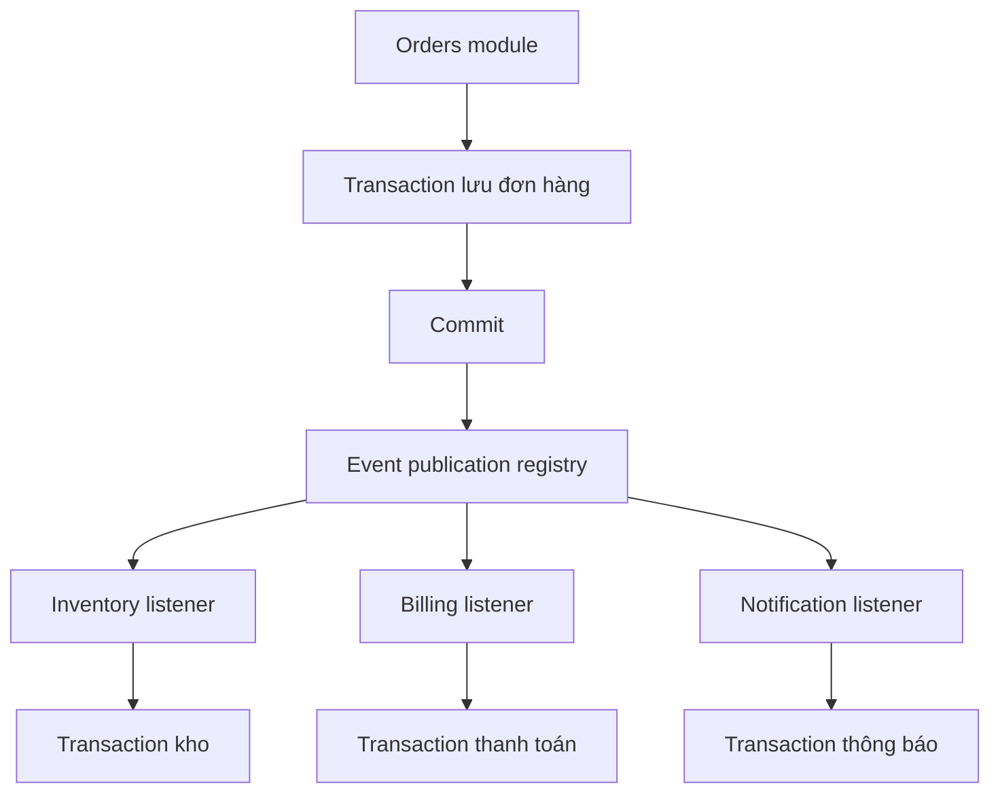

# Cô lập listener lỗi

Một application event trong Spring Modulith có thể được nhiều module lắng nghe. Ví dụ, sau khi đơn hàng được tạo, module kho giữ hàng, module thanh toán chuẩn bị thu tiền và module thông báo gửi email. Nếu một listener gặp lỗi, hệ thống cần giới hạn ảnh hưởng vào đúng công việc đó để các phản ứng độc lập vẫn có thể tiếp tục.

Cô lập listener lỗi là cách tổ chức transaction, executor, retry và trạng thái publication sao cho một listener thất bại không làm mất event, không buộc các listener đã hoàn tất chạy lại và không làm cạn tài nguyên của toàn bộ ứng dụng. Spring Modulith cung cấp các cơ chế nền tảng như `@ApplicationModuleListener` và Event Publication Registry; ứng dụng vẫn phải thiết kế cách phân loại lỗi, xử lý lại và quan sát phù hợp.

## 1. Vì sao cần cô lập theo listener?

Giả sử module `orders` phát `OrderPlaced` và có ba listener:

- `InventoryOnOrderPlaced` giữ hàng trong kho.
- `BillingOnOrderPlaced` tạo yêu cầu thanh toán.
- `NotificationOnOrderPlaced` gửi email xác nhận.

Nếu dịch vụ email tạm thời ngừng hoạt động, việc gửi email có thể thất bại. Lỗi đó không nên làm mất việc giữ hàng hoặc ngăn module thanh toán hoàn thành công việc của nó. Ngược lại, nếu listener kho thất bại, hệ thống cần giữ lại trạng thái chưa hoàn tất của listener kho để xử lý sau.

Một thiết kế không cô lập có thể gây ra các vấn đề:

- Listener lỗi làm gián đoạn luồng phát event hoặc các listener khác.
- Retry toàn bộ event khiến listener đã thành công thực hiện lại tác dụng phụ.
- Một dịch vụ phụ thuộc chậm chiếm hết thread, làm các listener không liên quan bị đói tài nguyên.
- Exception bị bắt rồi bỏ qua khiến hệ thống tưởng publication đã hoàn tất.
- Không có dấu vết cho biết listener nào lỗi, lỗi bao lâu và cần khôi phục công việc nào.

Mục tiêu là theo dõi và khôi phục từng lần giao event tới từng listener, đồng thời giữ cho lỗi ở một nhánh không lan rộng sang các nhánh độc lập.

## 2. Hiểu ranh giới lỗi của application event

Một application event có thể được phát trong transaction của module nguồn. Với listener thông thường chạy đồng bộ, listener có thể được gọi ngay trong luồng phát event. Nếu listener ném exception, exception có thể quay trở lại caller và ảnh hưởng luồng xử lý đang phát event.

Đối với công việc cần xử lý sau khi transaction nguồn commit, Spring Modulith cung cấp `@ApplicationModuleListener`. Annotation này là lựa chọn thuận tiện cho listener bất đồng bộ, được gọi sau commit và chạy trong transaction riêng theo cơ chế của Spring Modulith.



Với transactional listener được registry theo dõi, Spring Modulith quản lý publication riêng cho từng listener. Một event có ba transactional listener có thể tương ứng với ba publication độc lập. Khi listener thông báo thất bại, trạng thái của publication thông báo có thể còn dang dở trong khi publication kho và thanh toán đã hoàn tất.

Điểm cần phân biệt:

| Thành phần | Ranh giới trách nhiệm |
| --- | --- |
| Transaction nguồn | Lưu thay đổi nghiệp vụ và đăng ký publication trong cùng transaction. |
| Transaction listener | Bao quanh tác dụng phụ nội bộ của một listener. |
| Event Publication Registry | Theo dõi trạng thái publication theo listener. |
| Executor | Cung cấp thread để chạy listener bất đồng bộ; giới hạn tài nguyên thực thi. |
| Retry/recovery | Đưa publication chưa hoàn tất trở lại luồng xử lý theo chính sách ứng dụng. |

Việc có transaction riêng không tự động cô lập mọi tài nguyên. Các listener vẫn có thể dùng chung executor, connection pool, CPU, database hoặc dịch vụ ngoài. Muốn giới hạn ảnh hưởng khi một nhóm listener quá tải, cần thiết kế bulkhead và capacity riêng ở những nơi có nguy cơ cạnh tranh.

## 3. Dùng `@ApplicationModuleListener` cho listener độc lập

Hãy đặt listener trong module sở hữu phản ứng nghiệp vụ. Mỗi listener nên có một trách nhiệm rõ ràng và nhận dữ liệu event đủ để thực hiện công việc mà không phải gọi ngược module nguồn để thay đổi trạng thái của nó.

Event minh họa:

```java
import java.time.Instant;
import java.util.UUID;

public record OrderPlaced(
        UUID eventId,
        UUID orderId,
        Instant occurredAt) {
}
```

Module nguồn phát event trong transaction:

```java
import org.springframework.context.ApplicationEventPublisher;
import org.springframework.stereotype.Service;
import org.springframework.transaction.annotation.Transactional;

@Service
class OrderApplicationService {

    private final OrderRepository orders;
    private final ApplicationEventPublisher events;

    OrderApplicationService(
            OrderRepository orders,
            ApplicationEventPublisher events) {
        this.orders = orders;
        this.events = events;
    }

    @Transactional
    UUID placeOrder(OrderRequest request) {
        Order order = orders.save(Order.create(request));
        events.publishEvent(new OrderPlaced(
                UUID.randomUUID(), order.getId(), Instant.now()));
        return order.getId();
    }
}
```

Các kiểu `Order`, `OrderRepository` và `OrderRequest` thuộc mô hình nghiệp vụ minh họa. Trong ứng dụng thực tế, event ID cần được tạo một lần cho lần phát logic và giữ ổn định trong suốt quá trình xử lý lại.

Listener kho:

```java
import org.springframework.modulith.events.ApplicationModuleListener;
import org.springframework.stereotype.Component;

@Component
class InventoryOnOrderPlaced {

    private final InventoryService inventory;

    InventoryOnOrderPlaced(InventoryService inventory) {
        this.inventory = inventory;
    }

    @ApplicationModuleListener
    void reserve(OrderPlaced event) {
        inventory.reserveFor(event.orderId());
    }
}
```

Listener thông báo:

```java
@Component
class NotificationOnOrderPlaced {

    private final NotificationService notifications;

    NotificationOnOrderPlaced(NotificationService notifications) {
        this.notifications = notifications;
    }

    @ApplicationModuleListener
    void sendConfirmation(OrderPlaced event) {
        notifications.sendOrderConfirmation(event.orderId());
    }
}
```

Hai listener có publication riêng. Lỗi khi gửi thông báo không nên khiến listener kho phải chạy lại nếu publication kho đã được đánh dấu hoàn tất. Việc thực thi vẫn phụ thuộc executor và cấu hình runtime, vì vậy cần theo dõi cả trạng thái publication lẫn sức khỏe tài nguyên dùng chung.

## 4. Không để exception bị nuốt

Event Publication Registry chỉ có thể nhận biết listener thất bại nếu lỗi được truyền ra khỏi lần gọi listener theo cơ chế xử lý của framework. Nếu listener bắt exception rồi kết thúc bình thường, framework có thể xem lần gọi là thành công và đánh dấu publication hoàn tất.

Ví dụ cần tránh:

```java
@ApplicationModuleListener
void sendConfirmation(OrderPlaced event) {
    try {
        notifications.sendOrderConfirmation(event.orderId());
    } catch (RuntimeException ex) {
        log.error("Cannot send order confirmation", ex);
        // Kết thúc bình thường: framework có thể coi listener đã thành công.
    }
}
```

Nếu muốn ghi log hoặc bổ sung metadata, hãy ghi nhận rồi ném lại exception khi công việc thực sự chưa hoàn tất:

```java
@ApplicationModuleListener
void sendConfirmation(OrderPlaced event) {
    try {
        notifications.sendOrderConfirmation(event.orderId());
    } catch (NotificationUnavailableException ex) {
        log.warn("Notification delivery failed for order {}", event.orderId(), ex);
        throw ex;
    }
}
```

Chỉ bắt và không ném lại khi ứng dụng đã xử lý xong lỗi theo một quy trình được xác định rõ, ví dụ đã ghi một trạng thái nghiệp vụ thay thế và việc gửi thông báo không còn là điều kiện phải hoàn tất. Khi đó, hãy ghi lại kết quả xử lý để operator và hệ thống quan sát hiểu vì sao listener được xem là hoàn tất.

Không nên dùng một `catch (Exception)` chung để biến mọi lỗi thành thành công. Cần phân biệt lỗi có thể thử lại, lỗi dữ liệu không thể tự khắc phục và lỗi đã được xử lý có chủ đích.

## 5. Phân loại lỗi trước khi retry

Không phải mọi exception đều cần retry. Retry một lỗi dữ liệu vĩnh viễn chỉ làm tăng tải và kéo dài backlog. Ngược lại, bỏ qua lỗi timeout tạm thời có thể khiến một tác vụ hợp lệ không bao giờ hoàn tất.

| Loại lỗi | Ví dụ | Hướng xử lý |
| --- | --- | --- |
| Tạm thời | Timeout, connection reset, dịch vụ phụ thuộc quá tải. | Retry có backoff và giới hạn số lần/thời gian. |
| Có thể khắc phục bằng cấu hình | Credential hết hạn, endpoint sai, quota bị giới hạn. | Sửa cấu hình hoặc quyền, sau đó retry có kiểm soát. |
| Dữ liệu không hợp lệ | Thiếu mã nghiệp vụ, enum không được hỗ trợ, payload sai schema. | Đưa vào luồng điều tra hoặc xử lý thủ công; không retry vô hạn. |
| Vi phạm quy tắc nghiệp vụ | Đơn hàng đã hủy, tài khoản bị khóa, tồn kho không đủ. | Ghi nhận kết quả nghiệp vụ hoặc phát hành hành động bù trừ phù hợp. |
| Lỗi lập trình | Null dereference, mapping sai, invariant bị vi phạm. | Sửa lỗi và triển khai bản vá; sau đó đánh giá retry các publication bị ảnh hưởng. |

Một lỗi có thể đổi loại theo thời gian. Ví dụ, lỗi xác thực ban đầu là lỗi cấu hình; sau khi credential được sửa, publication có thể xử lý thành công. Vì vậy, trạng thái lỗi cần lưu đủ thông tin để điều tra nhưng không nên gắn cứng mọi lỗi vào một nhãn không thể cập nhật.

## 6. Retry đúng listener đang lỗi

Với Event Publication Registry, trạng thái publication được theo dõi theo từng transactional listener. Khi một listener thất bại, hãy phục hồi publication đó thay vì phát lại toàn bộ event nguồn.

Spring Modulith cung cấp API `IncompleteEventPublications` trong các phiên bản có hỗ trợ để truy vấn và gửi lại publication chưa hoàn tất. Ví dụ dưới đây minh họa thao tác chọn publication theo loại event và mã đơn hàng:

```java
import java.util.UUID;

import org.springframework.modulith.events.IncompleteEventPublications;
import org.springframework.stereotype.Service;

@Service
class OrderPublicationRecovery {

    private final IncompleteEventPublications publications;

    OrderPublicationRecovery(IncompleteEventPublications publications) {
        this.publications = publications;
    }

    void retryOrder(UUID orderId) {
        publications.resubmitFailedPublications(publication ->
                publication.getEvent() instanceof OrderPlaced event
                        && event.orderId().equals(orderId));
    }
}
```

Đây là ví dụ minh họa API; cần xác nhận tên phương thức và khả năng lọc theo phiên bản Spring Modulith của dự án. Trong công cụ vận hành, nên hiển thị listener đích, publication ID, event type, thời điểm phát và mã nghiệp vụ trước khi cho phép retry.

Một số nguyên tắc khi phục hồi:

- Chỉ chọn publication còn dang dở và đúng listener cần xử lý.
- Xác nhận nguyên nhân lỗi đã được khắc phục trước khi gửi lại.
- Giới hạn số publication được gửi lại trong một đợt.
- Theo dõi kết quả sau retry và giữ nguyên dấu vết của lần lỗi trước.
- Không cập nhật trực tiếp cột completion trong database để ép publication thành công.

API phục hồi không thay thế chính sách retry tự động. Ứng dụng cần xác định phần nào được thử lại tự động, phần nào cần operator can thiệp và cách giới hạn tốc độ xử lý lại.

## 7. Cô lập tài nguyên bằng executor và bulkhead

`@ApplicationModuleListener` cho phép thực thi bất đồng bộ, nhưng các listener có thể dùng chung executor. Nếu một listener gọi dịch vụ ngoài chậm và chiếm hết thread, các listener khác vẫn có thể bị trì hoãn dù publication của chúng độc lập.

Hãy xem xét các biện pháp sau khi có nguy cơ tranh chấp tài nguyên:

- Giới hạn số thread và queue capacity của executor.
- Dùng executor riêng cho nhóm listener có đặc tính tải khác nhau nếu cơ chế cấu hình của ứng dụng hỗ trợ.
- Giới hạn số lời gọi đồng thời tới một dịch vụ phụ thuộc bằng semaphore hoặc bulkhead.
- Đặt timeout cho lời gọi I/O để thread không bị giữ vô thời hạn.
- Từ chối hoặc làm chậm công việc mới khi queue đầy thay vì tích lũy vô hạn.
- Theo dõi queue depth, active thread, rejection count và thời gian chờ.

Một cấu hình executor cần cân bằng throughput, số connection database và năng lực dịch vụ phụ thuộc. Tăng thread count không tự tăng năng lực xử lý nếu database pool hoặc API ngoài đã là nút thắt.

Nếu dùng nhiều executor, hãy kiểm tra rõ listener nào chạy ở executor nào và cách Spring Modulith cấu hình việc dispatch. Không tạo một `ApplicationEventMulticaster` bất đồng bộ toàn cục một cách tùy tiện: thay đổi đó có thể ảnh hưởng mọi listener, ngữ nghĩa transaction, thứ tự và cách exception được truyền. Ưu tiên cơ chế cấu hình được hỗ trợ bởi phiên bản Spring Modulith/Spring đang dùng.

## 8. Dùng timeout và circuit breaker cho dịch vụ phụ thuộc

Một listener có thể thất bại vì dịch vụ ngoài không phản hồi. Nếu mỗi lần retry đều gọi vào dịch vụ đang hỏng, hệ thống có thể tạo thêm tải và làm chậm cả các luồng khác.

Timeout giới hạn thời gian một lời gọi được phép chờ. Circuit breaker tạm ngăn lời gọi mới khi tỷ lệ lỗi vượt ngưỡng, cho hệ thống phụ thuộc thời gian phục hồi. Bulkhead giới hạn số lời gọi đồng thời để một dịch vụ không chiếm hết tài nguyên của ứng dụng.

Các cơ chế này có vai trò khác nhau:

| Cơ chế | Tác dụng |
| --- | --- |
| Timeout | Giới hạn thời gian chờ của một lời gọi. |
| Retry | Thử lại thao tác sau lỗi có thể phục hồi. |
| Backoff và jitter | Giãn thời điểm retry và tránh nhiều instance retry cùng lúc. |
| Circuit breaker | Tạm ngừng gọi dịch vụ đang có dấu hiệu lỗi kéo dài. |
| Bulkhead | Giới hạn tài nguyên dành cho một nhóm công việc hoặc dependency. |

Không nên retry nhanh bên trong listener rồi tiếp tục để listener retry toàn bộ publication mà không có kế hoạch tổng thể. Hai lớp retry có thể nhân số lần gọi lên rất lớn. Hãy xác định retry budget, timeout tổng và nơi chịu trách nhiệm cho từng lần thử.

## 9. Idempotency để retry không nhân đôi tác dụng phụ

Một listener có thể đã hoàn thành tác dụng phụ nhưng tiến trình dừng trước khi registry ghi nhận publication hoàn tất. Khi publication được gửi lại, listener có thể thực hiện cùng thao tác lần nữa.

Vì vậy, listener cần idempotent. Cùng một event được xử lý nhiều lần phải dẫn tới một kết quả nghiệp vụ đúng.

Các cách thường dùng:

- Dùng `eventId` ổn định làm idempotency key.
- Lưu event ID đã xử lý cùng transaction với thay đổi dữ liệu của listener.
- Đặt unique constraint cho reservation, payment operation hoặc notification delivery.
- Truyền idempotency key khi gọi API ngoài nếu nhà cung cấp hỗ trợ.
- Kiểm tra trạng thái nghiệp vụ trước khi chuyển đổi và cập nhật bằng transaction có điều kiện.

Ví dụ bảng inbox do module sở hữu:

```sql
CREATE TABLE processed_event (
    listener_name VARCHAR(100) NOT NULL,
    event_id UUID NOT NULL,
    processed_at TIMESTAMP NOT NULL,
    PRIMARY KEY (listener_name, event_id)
);
```

Ghi nhận event ID và cập nhật dữ liệu projection hoặc nghiệp vụ trong cùng transaction. Nếu unique constraint cho biết event đã được xử lý, listener có thể kết thúc theo quy tắc duplicate đã định nghĩa. Không ghi inbox thành công trước rồi thực hiện tác dụng phụ ở transaction khác nếu điều đó có thể để lại dấu đã xử lý trong khi công việc thực tế chưa hoàn tất.

Với API bên ngoài, idempotency key cần ổn định qua mọi lần retry của cùng một thao tác. Một event ID mới cho mỗi lần gửi lại sẽ làm hệ thống đích tưởng đó là các yêu cầu độc lập.

## 10. Xử lý poison event và lỗi không thể tự phục hồi

Poison event là event luôn làm listener thất bại, thường do payload không hợp lệ, schema không tương thích hoặc dữ liệu nghiệp vụ không thể xử lý. Retry vô hạn một poison event khiến publication tồn tại mãi và có thể tiêu tốn tài nguyên.

Một quy trình xử lý phù hợp:

1. Nhận diện lỗi lặp lại theo event type, listener ID và nguyên nhân.
2. Giữ nguyên payload cùng metadata cần điều tra.
3. Đưa publication vào trạng thái cần can thiệp theo quy trình vận hành của ứng dụng; không tự ý đánh dấu hoàn tất.
4. Phân loại lỗi: sửa dữ liệu, triển khai code tương thích, phát event thay thế hoặc thực hiện compensation.
5. Sau khi có phương án, retry đúng publication hoặc xử lý theo một command nghiệp vụ mới.
6. Ghi lại kết quả và nguyên nhân gốc để ngăn lỗi tương tự.

Không phải ứng dụng nào cũng cần dead-letter table riêng cho listener nội bộ. Nếu tạo bảng hoặc queue lỗi, hãy xác định ai sở hữu nó, payload được giữ bao lâu, cách bảo vệ dữ liệu và cách liên kết nó với publication gốc. Tránh tạo hai nguồn trạng thái mâu thuẫn giữa registry và hệ thống dead-letter tự xây dựng.

## 11. Một listener lỗi không nên làm retry các listener đã thành công

Giả sử `OrderPlaced` có ba publication:

| Listener | Trạng thái | Hành động |
| --- | --- | --- |
| Inventory | Hoàn tất | Không cần gửi lại. |
| Billing | Hoàn tất | Không cần gửi lại. |
| Notification | Chưa hoàn tất | Điều tra và retry publication này. |

Nếu ứng dụng phát lại `OrderPlaced` như một event mới để sửa lỗi email, listener kho có thể giữ hàng lần nữa và listener thanh toán có thể tạo thao tác thanh toán trùng. Điều đó tạo ra tác dụng phụ ngoài phạm vi lỗi ban đầu.

Hãy phân biệt:

- **Retry publication:** gửi lại cùng công việc tới listener đang lỗi.
- **Republish event:** phát một event mới, có thể kích hoạt lại mọi listener đăng ký.
- **Compensation:** phát một hành động nghiệp vụ mới để bù lại tác động đã xảy ra.

Khi mục tiêu là khôi phục một listener, dùng cơ chế retry publication phù hợp. Chỉ phát event mới khi nghiệp vụ thực sự đã thay đổi hoặc cần một thông báo mới với định danh và ý nghĩa riêng.

## 12. Quan sát listener và backlog

Để phát hiện lỗi sớm, cần quan sát theo listener thay vì chỉ đếm tổng event đã phát.

Các chỉ số hữu ích:

| Chỉ số | Ý nghĩa |
| --- | --- |
| Publication chưa hoàn tất theo listener | Xác định module hoặc listener đang có backlog. |
| Tuổi publication cũ nhất | Phát hiện công việc bị kẹt lâu hơn ngưỡng nghiệp vụ. |
| Listener processing duration | Tìm listener chậm hoặc dependency có latency cao. |
| Listener error rate | Phát hiện tỷ lệ lỗi tăng theo listener/event type. |
| Executor active threads và queue depth | Nhận biết cạn tài nguyên hoặc queue tăng. |
| Retry count và recovery result | Theo dõi việc xử lý lại có thành công không. |
| Circuit breaker state | Biết dependency nào đang bị ngắt tạm thời. |

Log và trace nên mang các metadata sau:

- Event ID và event type.
- Publication ID và listener ID nếu có.
- Aggregate/business ID và correlation ID.
- Thời điểm phát, thời điểm listener bắt đầu và kết thúc.
- Lần thử, loại lỗi và dependency liên quan.

Không ghi toàn bộ payload nếu chỉ metadata là đủ để điều tra. Event có thể chứa dữ liệu khách hàng, thông tin thanh toán hoặc dữ liệu nội bộ; cần masking, giới hạn quyền truy cập và retention log phù hợp.

Một cảnh báo hữu ích thường dựa trên tuổi publication chưa hoàn tất, xu hướng backlog hoặc tỷ lệ lỗi kéo dài. Không cảnh báo chỉ vì có một publication mới chưa hoàn tất trong vài mili giây, vì listener bất đồng bộ cần thời gian để chạy bình thường.

## 13. Kiểm thử khả năng cô lập listener

Unit test cho từng listener giúp kiểm tra logic riêng, nhưng cần integration test để xác nhận registry, transaction và dispatch hoạt động đúng.

Các kịch bản quan trọng:

- **Một listener thất bại:** phát event có nhiều transactional listener; làm một listener ném exception và xác nhận publication của listener đó chưa hoàn tất.
- **Listener khác vẫn hoàn tất:** xác nhận publication của các listener độc lập vẫn được xử lý và giữ trạng thái hoàn tất.
- **Retry chọn lọc:** khôi phục publication lỗi và xác nhận listener đã thành công không bị gọi lại ngoài ý muốn.
- **Exception propagation:** xác nhận exception không bị bắt rồi nuốt khiến publication bị đánh dấu thành công sai.
- **Transaction nguồn rollback:** xác nhận publication không được commit khi transaction nguồn rollback.
- **Listener transaction rollback:** xác nhận thay đổi dữ liệu của listener rollback khi listener thất bại.
- **Duplicate delivery:** gửi lại cùng event và xác nhận idempotency ngăn tác dụng phụ trùng.
- **Executor saturation:** mô phỏng listener chậm và xác nhận giới hạn tài nguyên, queue và rejection được quan sát.
- **Dependency outage:** làm dịch vụ ngoài timeout hoặc trả lỗi và xác nhận retry/circuit breaker hoạt động theo chính sách.
- **Poison event:** xác nhận lỗi dữ liệu không bị retry vô hạn và có đường điều tra.

Với listener after-commit, test bị bọc trong transaction rồi rollback có thể không kích hoạt listener như khi chạy thật. Hãy tạo transaction boundary rõ ràng và xác nhận transaction nguồn thực sự commit trước khi kiểm tra trạng thái publication hoặc dữ liệu listener.

## 14. Runbook khi một listener bị lỗi

Một runbook ngắn giúp operator xử lý đúng phạm vi và tránh làm lại các tác dụng phụ đã thành công.

### Bước 1: Xác định listener và publication

- Tìm publication chưa hoàn tất vượt ngưỡng cảnh báo.
- Ghi lại publication ID, listener ID, event type, event ID và business reference.
- Kiểm tra trạng thái các listener khác của cùng event.

### Bước 2: Phân loại nguyên nhân

- Đọc exception và trace liên quan.
- Kiểm tra database, executor và dependency ngoài.
- Xác định lỗi tạm thời, cấu hình, dữ liệu hay logic nghiệp vụ.
- Kiểm tra tác dụng phụ có thể đã xảy ra trước khi tiến trình dừng.

### Bước 3: Chọn cách khôi phục

- Sửa dependency/cấu hình rồi retry nếu lỗi có thể phục hồi.
- Sửa code hoặc schema rồi retry nếu listener thất bại do lỗi triển khai.
- Chuyển sang xử lý thủ công hoặc compensation nếu event không còn hợp lệ.
- Chuyển cấp xử lý nếu không xác định được tác dụng phụ đã xảy ra.

### Bước 4: Retry có giới hạn

- Chọn đúng publication và listener.
- Giới hạn số lượng mỗi đợt và theo dõi executor.
- Giữ nguyên event ID/idempotency key.
- Không phát lại event nguồn nếu chỉ một listener bị lỗi.

### Bước 5: Xác minh và đóng sự cố

- Kiểm tra publication được đánh dấu hoàn tất sau khi listener thực sự thành công.
- Kiểm tra trạng thái nghiệp vụ và tác dụng phụ tại dependency.
- Ghi lại operator, thời điểm, lý do và kết quả phục hồi.
- Bổ sung cảnh báo hoặc kiểm thử nếu nguyên nhân có thể tái diễn.

## 15. Những sai lầm thường gặp

- Dùng listener đồng bộ cho công việc lâu hoặc phụ thuộc dịch vụ ngoài mà không đánh giá tác động tới transaction nguồn.
- Bắt exception rồi kết thúc bình thường khiến registry tưởng listener thành công.
- Retry toàn bộ event khi chỉ một listener thất bại.
- Cho rằng transaction riêng đồng nghĩa executor và mọi tài nguyên đã được cô lập.
- Dùng chung một executor không giới hạn cho mọi nhóm listener.
- Retry nhanh và vô hạn khi dependency đang ngừng hoạt động.
- Không thiết kế idempotency cho tác dụng phụ bên ngoài.
- Cập nhật trực tiếp trạng thái publication trong database để xóa backlog.
- Xem Event Publication Registry là event store hoặc dead-letter queue tổng quát.
- Không quan sát tuổi publication và backlog theo listener.

## Checklist thiết kế

- [ ] Listener có một trách nhiệm nghiệp vụ rõ ràng và thuộc module sở hữu công việc đó.
- [ ] Công việc sau commit dùng transactional listener phù hợp, chẳng hạn `@ApplicationModuleListener`.
- [ ] Mỗi listener được theo dõi publication độc lập khi cần recovery.
- [ ] Exception chưa được xử lý được truyền ra để registry nhận biết thất bại.
- [ ] Lỗi được phân loại trước khi retry.
- [ ] Retry chỉ nhắm tới publication đang lỗi và có giới hạn.
- [ ] Listener idempotent và giữ event ID ổn định qua retry.
- [ ] Executor, queue và dependency có giới hạn tài nguyên phù hợp.
- [ ] Có timeout, backoff và circuit breaker khi gọi dịch vụ ngoài.
- [ ] Có quy trình cho poison event và xử lý thủ công.
- [ ] Có metric/log theo listener, publication, event và correlation ID.
- [ ] Integration test xác nhận listener lỗi không làm mất trạng thái các listener độc lập.

Cô lập listener lỗi giúp ứng dụng giới hạn phạm vi sự cố và phục hồi từng công việc một cách có kiểm soát. Khi transaction, publication registry, executor, retry và idempotency được thiết kế cùng nhau, một listener gặp lỗi có thể được điều tra và xử lý lại mà không làm lặp các tác dụng phụ đã hoàn tất ở những module khác.
