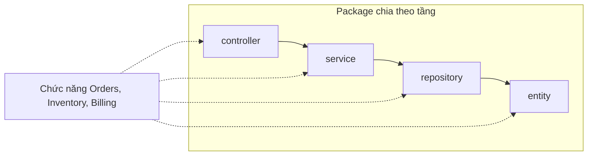
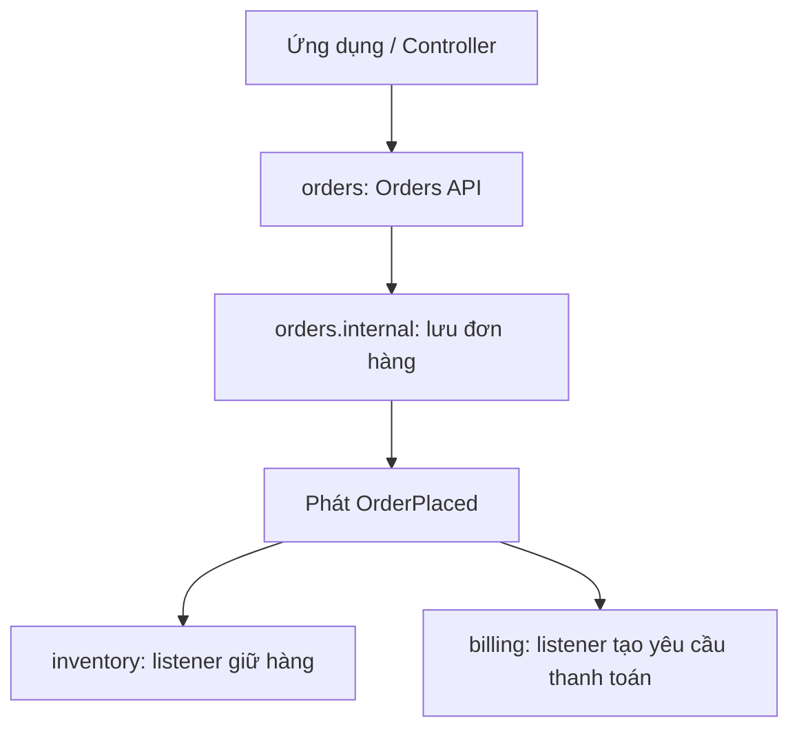
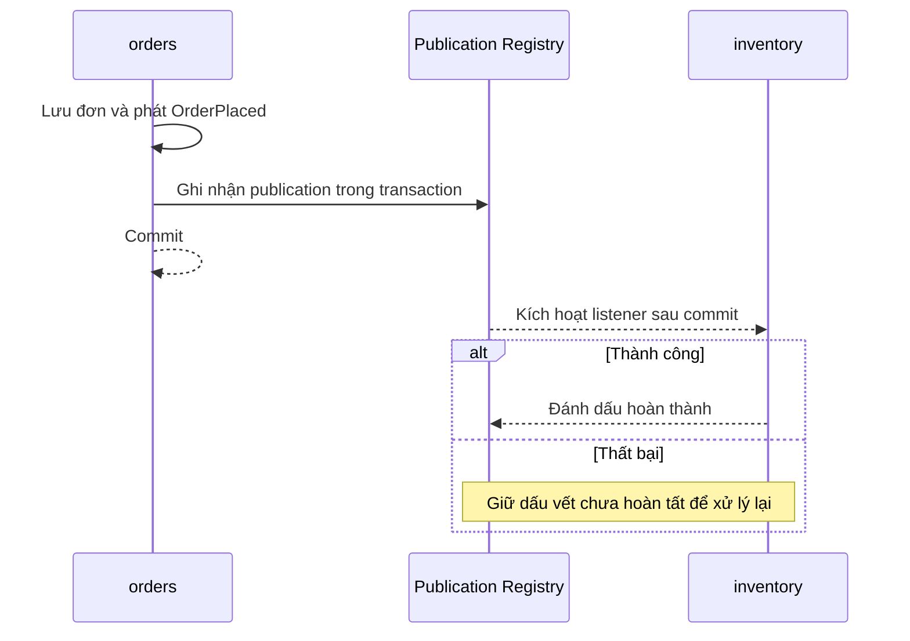

# Từ package đến module trong Spring Modulith

## 1. Package là điểm khởi đầu, module là ranh giới kiến trúc

Trong Java, **package** là cơ chế đặt tên và tổ chức các lớp, interface, record. Khi viết một ứng dụng Spring Boot, chúng ta thường tạo package để nhóm các file liên quan. Tuy nhiên, chỉ đặt các lớp vào những package khác nhau **chưa đủ** để hệ thống có kiến trúc module.

Một **module nghiệp vụ** (application module) cần thêm những điều mà tên package không tự bảo đảm:

- **Trách nhiệm rõ ràng:** module quản lý một năng lực hoặc một tập quy tắc nghiệp vụ nhất quán.
- **Quyền sở hữu:** module quản lý logic và dữ liệu của mình; module khác không tự ý thao tác chi tiết nội bộ.
- **Hợp đồng công khai:** module khác biết cách tương tác qua API hoặc sự kiện đã công bố.
- **Quy tắc phụ thuộc:** hướng phụ thuộc được kiểm soát, tránh chu trình và việc truy cập trực tiếp lớp nội bộ.
- **Khả năng kiểm chứng:** vi phạm ranh giới phải được phát hiện bằng công cụ và bài kiểm thử, thay vì chỉ trông chờ vào quy ước của nhóm.

**Spring Modulith** giúp biểu diễn các ranh giới này ngay trong một ứng dụng Spring Boot duy nhất. Nó nhận diện application module từ cấu trúc package, hỗ trợ khai báo API, xác minh quan hệ phụ thuộc, kiểm thử module và giao tiếp giữa module bằng application events. Đây là nền tảng cho phạm vi học `SPRING_MODULITH_APPLICATION_EVENTS`: tổ chức publisher, listener, xử lý sau commit, Event Publication Registry, retry và quan sát giao sự kiện đáng tin cậy.

> Spring Modulith không biến mỗi Java package thành một tiến trình hay một microservice độc lập. Các module trong modular monolith vẫn thường chạy chung JVM và được triển khai cùng một ứng dụng. Ranh giới được thiết lập ở mức kiến trúc mã nguồn và hợp đồng tương tác.

## 2. Vấn đề khi chỉ chia package theo tầng kỹ thuật

Giả sử có một ứng dụng thương mại điện tử gồm chức năng **đặt hàng**, **kho** và **thanh toán**. Cấu trúc thường gặp ban đầu là:

```text
com.example.shop
├── ShopApplication.java
├── controller
│   ├── OrderController.java
│   └── PaymentController.java
├── service
│   ├── OrderService.java
│   ├── InventoryService.java
│   └── PaymentService.java
├── repository
│   ├── OrderRepository.java
│   ├── StockRepository.java
│   └── PaymentRepository.java
└── entity
    ├── Order.java
    ├── Stock.java
    └── Payment.java
```

Cách sắp xếp này dễ hiểu trong dự án nhỏ, nhưng khi hệ thống lớn lên, các package `service`, `repository`, `entity` trở thành tập hợp của nhiều nghiệp vụ khác nhau. Ví dụ, `OrderService` có thể import trực tiếp `StockRepository`, cập nhật `Stock` và gọi `PaymentService`. Khi sửa quy tắc tồn kho, người phát triển khó xác định phần nào phải thay đổi và phần nào không được đụng tới.

Điểm yếu chính là **cấu trúc package không phản ánh quyền sở hữu nghiệp vụ**. Tên package cho biết một lớp thuộc tầng kỹ thuật nào, nhưng không chỉ ra lớp đó thuộc năng lực kinh doanh nào hoặc được phép phụ thuộc vào đâu.



Hậu quả thường gặp là thay đổi lan rộng, kiểm thử cần khởi tạo quá nhiều thành phần và module khác có thể sử dụng trực tiếp repository nội bộ chỉ vì chúng nằm trong cùng ứng dụng.

## 3. Chuyển sang package theo năng lực nghiệp vụ

Bước đầu tiên không phải thêm annotation, mà là **xác định ranh giới nghiệp vụ**. Với ví dụ trên, có thể chia thành ba application module:

| Module | Trách nhiệm chính | Điều không nên sở hữu |
| --- | --- | --- |
| `orders` | Tạo, xác nhận, hủy đơn hàng và trạng thái đơn | Trừ tồn kho bằng repository của kho |
| `inventory` | Quản lý tồn kho, giữ và giải phóng hàng | Cập nhật trực tiếp trạng thái đơn hàng |
| `billing` | Xử lý yêu cầu thanh toán, lưu trạng thái thanh toán | Sửa trực tiếp thực thể kho hoặc đơn hàng |

Sau khi xác định trách nhiệm, cấu trúc dự án có thể tổ chức lại như sau:

```text
com.example.shop
├── ShopApplication.java
├── orders
│   ├── Orders.java                     // API sử dụng nghiệp vụ đặt hàng
│   ├── PlaceOrderCommand.java          // Kiểu dữ liệu của API
│   ├── events
│   │   ├── package-info.java           // Công bố named interface: events
│   │   └── OrderPlaced.java            // Hợp đồng sự kiện
│   └── internal
│       ├── OrderService.java           // Triển khai nghiệp vụ
│       ├── OrderRepository.java        // Truy cập dữ liệu riêng của orders
│       └── OrderEntity.java
├── inventory
│   ├── package-info.java              // Khai báo phụ thuộc được phép
│   └── internal
│       ├── OrderPlacedListener.java
│       └── StockRepository.java
└── billing
    └── internal
        ├── PaymentService.java
        └── PaymentRepository.java
```

Ở đây, mỗi module tập hợp nhiều tầng kỹ thuật của **cùng một nghiệp vụ**. `OrderService` và `OrderRepository` cùng thuộc `orders`; `StockRepository` thuộc `inventory`. Thay đổi cấu trúc thư mục là bước chuẩn bị quan trọng, nhưng để thực sự giữ được ranh giới vẫn cần quy định phần nào là API và kiểm chứng hướng phụ thuộc.

### 3.1. Cách Spring Modulith nhận diện application module

Theo cách phát hiện module mặc định, Spring Modulith xem các **subpackage trực tiếp** dưới package gốc của ứng dụng Spring Boot là các application module. Trong ví dụ, `orders`, `inventory`, `billing` là ba module; `orders.internal` và `orders.events` là các package **bên trong** module `orders`, không phải hai module độc lập.

```text
com.example.shop                 <- package gốc của ứng dụng
  ├─ orders                      <- application module
  │    ├─ events                 <- package con thuộc orders
  │    └─ internal               <- package con thuộc orders
  ├─ inventory                   <- application module
  └─ billing                     <- application module
```

Cơ chế phát hiện có thể được cấu hình trong những trường hợp nâng cao, nhưng mô hình mặc định là điểm bắt đầu dễ kiểm soát. **Một module có thể chứa nhiều package** và các package con của module không tự trở thành module mới.

## 4. Từ package công khai đến API của module

Tổ chức package phải đi cùng quyết định **module nào được phép nhìn thấy lớp nào**.

Trong mô hình mặc định, các kiểu công khai nằm ngay tại package gốc của module, chẳng hạn `com.example.shop.orders.Orders`, thuộc API được công bố của `orders`. Những kiểu nằm trong package con như `com.example.shop.orders.internal.OrderRepository` mặc định được xem là **nội bộ của module** khi Spring Modulith xác minh kiến trúc.

| Vị trí | Ý nghĩa kiến trúc | Module khác nên làm gì? |
| --- | --- | --- |
| `orders.Orders` | API công khai của nghiệp vụ đơn hàng | Có thể gọi qua hợp đồng này |
| `orders.PlaceOrderCommand` | Kiểu dữ liệu đầu vào API | Có thể sử dụng khi gọi `Orders` |
| `orders.internal.OrderService` | Chi tiết triển khai | Không import hoặc gọi trực tiếp |
| `orders.internal.OrderRepository` | Chi tiết lưu trữ | Không thao tác trực tiếp |
| `orders.events.OrderPlaced` | Chỉ công khai nếu package này được xuất thành named interface | Có thể lắng nghe sau khi công bố hợp lệ |

Lưu ý: `public` trong Java là mức truy cập của ngôn ngữ, **không đồng nghĩa** lớp đó là một phần của API kiến trúc Spring Modulith. Một lớp `public` đặt trong `orders.internal` vẫn có thể bị `ApplicationModules.verify()` phát hiện là phụ thuộc không hợp lệ từ module khác.

### 4.1. Công bố một API cho lệnh đồng bộ

Module đặt hàng có thể cung cấp interface ở package gốc:

```java
// orders/Orders.java
package com.example.shop.orders;

import java.util.UUID;

public interface Orders {
    UUID placeOrder(PlaceOrderCommand command);
}
```

Định nghĩa dữ liệu vào thuộc API:

```java
// orders/PlaceOrderCommand.java
package com.example.shop.orders;

import java.util.UUID;

public record PlaceOrderCommand(UUID productId, int quantity) {}
```

`orders.internal.OrderService` có thể triển khai `Orders`. Một module khác cần kết quả đặt hàng ngay có thể phụ thuộc vào `Orders` mà không cần biết lớp `OrderService` hay `OrderRepository` thực thi ra sao.

### 4.2. Công bố sự kiện qua named interface

Nếu hợp đồng sự kiện được đặt trong subpackage `orders.events`, Spring Modulith mặc định coi đó là package nội bộ. Để các module khác sử dụng hợp lệ, có thể tạo **named interface** bằng annotation `@NamedInterface` ở cấp package:

```java
// orders/events/package-info.java
@org.springframework.modulith.NamedInterface("events")
package com.example.shop.orders.events;
```

Tiếp theo, định nghĩa sự kiện như một bản ghi nghiệp vụ ổn định:

```java
// orders/events/OrderPlaced.java
package com.example.shop.orders.events;

import java.util.UUID;

public record OrderPlaced(UUID orderId) {}
```

Điều này tạo ra hợp đồng có tên `orders::events`. Module tiêu thụ có thể được giới hạn chỉ phụ thuộc vào nhóm API sự kiện đó:

```java
// inventory/package-info.java
@org.springframework.modulith.ApplicationModule(
    allowedDependencies = "orders::events"
)
package com.example.shop.inventory;
```

Khi khai báo như vậy, `inventory` được phép phụ thuộc vào named interface `events` của `orders`; một truy cập tới `orders.internal.OrderRepository` hoặc API khác ngoài danh sách được phép sẽ không phù hợp với ràng buộc đã khai báo. Đây là cách khiến ý định kiến trúc trở thành quy tắc có thể kiểm tra.

**Phân biệt:** `@NamedInterface` công bố một tập kiểu để các module khác phụ thuộc hợp lệ; nó không tự triển khai cơ chế gửi sự kiện, không ép listener chạy bất đồng bộ và không cung cấp bảo đảm giao sự kiện.

## 5. Khi ranh giới module dẫn đến giao tiếp bằng application events

Khi người dùng tạo đơn hàng, `orders` xác định đơn đã được ghi nhận. `inventory` và `billing` có thể cần phản ứng với thay đổi này. Nếu `orders` gọi trực tiếp repository của hai module kia thì ranh giới vừa thiết kế sẽ bị phá vỡ.

Thay vào đó, `orders` công bố `OrderPlaced` để các module khác tự đăng ký xử lý:



Mã rút gọn bên trong module `orders`:

```java
// orders/internal/OrderService.java (trích đoạn minh họa)
package com.example.shop.orders.internal;

import com.example.shop.orders.Orders;
import com.example.shop.orders.PlaceOrderCommand;
import com.example.shop.orders.events.OrderPlaced;
import java.util.UUID;
import org.springframework.context.ApplicationEventPublisher;
import org.springframework.stereotype.Service;
import org.springframework.transaction.annotation.Transactional;

@Service
class OrderService implements Orders {
    private final OrderRepository repository;
    private final ApplicationEventPublisher events;

    OrderService(OrderRepository repository, ApplicationEventPublisher events) {
        this.repository = repository;
        this.events = events;
    }

    @Override
    @Transactional
    public UUID placeOrder(PlaceOrderCommand command) {
        UUID orderId = repository.create(command.productId(), command.quantity());
        events.publishEvent(new OrderPlaced(orderId));
        return orderId;
    }
}
```

Trong ví dụ này, `OrderRepository` là thành phần nội bộ giả định với phương thức `create(...)`; mục đích của đoạn mã là chỉ ra thứ tự lưu đơn hàng và công bố sự kiện trong transaction. Để chạy thực tế, cần hiện thực repository, kiểm tra đầu vào và các quy tắc nghiệp vụ liên quan.

Module `inventory` xử lý sự kiện qua hợp đồng đã công bố:

```java
// inventory/internal/OrderPlacedListener.java
package com.example.shop.inventory.internal;

import com.example.shop.orders.events.OrderPlaced;
import org.springframework.modulith.events.ApplicationModuleListener;
import org.springframework.stereotype.Component;

@Component
class OrderPlacedListener {

    @ApplicationModuleListener
    void reserveStock(OrderPlaced event) {
        // Gọi nghiệp vụ nội bộ inventory với event.orderId().
    }
}
```

`@ApplicationModuleListener` của Spring Modulith là lựa chọn tiện dụng cho listener sự kiện giao dịch: nó kết hợp xử lý sau commit, bất đồng bộ và transaction riêng cho việc xử lý. Cần có transaction thực và cơ chế quản lý transaction phù hợp để ví dụ có hành vi sau commit như mong đợi. Một lời gọi `ApplicationEventPublisher.publishEvent(...)` **tự thân không bảo đảm** mọi listener đều xử lý sau commit; listener `@EventListener` thông thường mặc định hoạt động đồng bộ nếu không có cấu hình khác.

Sau khi dùng sự kiện, `orders` không còn phải biết những module nào đang xử lý `OrderPlaced`. Tuy vậy, module tiêu thụ vẫn phụ thuộc vào **ngữ nghĩa và cấu trúc của hợp đồng sự kiện**. Việc đổi `orderId`, đổi ý nghĩa “đơn đã được đặt” hay thay đổi thời điểm phát sự kiện đều có thể ảnh hưởng các listener.

## 6. Không phải mọi tương tác đều cần chuyển thành sự kiện

Sự kiện là phù hợp khi một module cần thông báo **điều đã xảy ra**, và những module khác có thể phản ứng độc lập. Đối với thao tác cần trả kết quả ngay, API công khai của module có thể rõ ràng và phù hợp hơn.

| Tình huống | Tương tác thường phù hợp | Lý do |
| --- | --- | --- |
| Kiểm tra sản phẩm còn được phép bán trước khi nhận đơn | Lời gọi đồng bộ qua API module | Cần kết quả để quyết định nghiệp vụ ngay |
| Đơn hàng được tạo, module thông báo cần gửi email | Phát `OrderPlaced` và xử lý bởi listener | Gửi email không nên làm `orders` phụ thuộc trực tiếp vào module thông báo |
| Đơn hàng đã commit, kho cần cập nhật trạng thái giữ hàng | Sự kiện sau commit với thiết kế nhất quán rõ ràng | Kho có thể phản ứng độc lập với giao dịch ghi đơn |
| Cần kết quả giữ hàng thành công trước khi xác nhận đơn | API đồng bộ hoặc quy trình nhiều bước có trạng thái chờ | Xử lý sau commit không thể trực tiếp rollback đơn đã commit |

Không nên dùng sự kiện chỉ để tránh một lời gọi phương thức. Cần xác định rõ yêu cầu về thời điểm phản hồi, nhất quán dữ liệu, thứ tự xử lý và khả năng khôi phục khi lỗi.

## 7. Biến quy tắc module thành kiểm tra tự động

Một thiết kế dựa trên package chỉ bền vững khi phụ thuộc sai bị phát hiện sớm. Spring Modulith cung cấp `ApplicationModules` để xây dựng mô hình module và xác minh những quy tắc cơ bản:

```java
import org.junit.jupiter.api.Test;
import org.springframework.modulith.core.ApplicationModules;

class ModularityTests {

    @Test
    void modulesRespectTheirBoundaries() {
        ApplicationModules.of(ShopApplication.class).verify();
    }
}
```

Với cấu trúc ví dụ, kiểm tra có thể phát hiện các vấn đề như `inventory` import trực tiếp `orders.internal.OrderRepository`, phụ thuộc không nằm trong `allowedDependencies` hoặc vòng phụ thuộc giữa các module. Test nên được đưa vào quá trình kiểm tra mã nguồn thường xuyên để ranh giới không suy yếu khi bổ sung tính năng.

Tuy nhiên, `verify()` kiểm tra **kiến trúc và phụ thuộc**, không tự xác minh nghiệp vụ đã đúng, listener luôn xử lý thành công hay dữ liệu trong các bảng có độc lập thực sự. Đây là lý do cần thêm kiểm thử module (`@ApplicationModuleTest`), kiểm thử transaction và kiểm thử thất bại trong các bài tiếp theo.

### 7.1. Quy trình chuyển đổi từng bước

Khi cải tiến một dự án Spring Boot đang tồn tại, có thể triển khai dần theo trình tự sau:

1. **Vẽ bản đồ nghiệp vụ:** liệt kê các chức năng và xác định module sở hữu từng quy tắc, bảng dữ liệu và hành vi quan trọng.
2. **Nhóm lớp theo nghiệp vụ:** chuyển controller, service, repository, entity liên quan về các package `orders`, `inventory`, `billing` phù hợp; giữ API cần thiết ở package gốc.
3. **Đóng các chi tiết nội bộ:** đặt triển khai và repository trong `internal`; thay import xuyên module bằng interface nghiệp vụ công khai khi cần gọi đồng bộ.
4. **Công bố hợp đồng sự kiện:** chọn các sự kiện nghiệp vụ thực sự hữu ích, định nghĩa dữ liệu nhỏ gọn, dùng `@NamedInterface` nếu hợp đồng nằm trong subpackage.
5. **Giới hạn phụ thuộc và xác minh:** bổ sung `@ApplicationModule(allowedDependencies = ...)` khi cần, chạy `ApplicationModules.verify()` để tìm phụ thuộc sai.
6. **Thêm kiểm thử hành vi và sự kiện:** xác minh việc phát sự kiện, listener sau commit, tình huống rollback và xử lý lỗi.
7. **Vận hành luồng sự kiện:** cấu hình cơ chế ghi nhận publication phù hợp, chính sách retry và quan sát các sự kiện chưa được xử lý xong.

Việc di chuyển package cần có bước điều chỉnh import, bean wiring và kiểm thử chức năng. Có thể bắt đầu từ một luồng nghiệp vụ có ranh giới rõ rồi mở rộng, thay vì di chuyển đồng loạt mọi package của hệ thống.

## 8. Ranh giới tốt chưa đủ: phải thiết kế độ tin cậy của sự kiện

Khi xử lý trong cùng ứng dụng, một giao dịch đã commit ở `orders` không tự động bảo đảm listener `inventory` hoàn tất. Ví dụ, listener có thể lỗi do cơ sở dữ liệu kho tạm thời mất kết nối. Spring Modulith có **Event Publication Registry** để theo dõi những publication dành cho transactional event listener khi được tích hợp với cơ chế lưu trữ thích hợp. Registry hỗ trợ nhận biết publication đã hoàn thành hay còn dở dang, tạo cơ sở cho xử lý lại theo cấu hình và chính sách ứng dụng.



Sơ đồ mô tả cơ chế khi registry đã được cấu hình. **Không nên giả định** rằng chỉ dùng `@ApplicationModuleListener` là đã tự có lưu trữ bền vững hoặc retry tự động trong mọi phiên bản và mọi môi trường. Trạng thái lưu trữ, cách tái công bố, lịch thử lại và cách giám sát cần được thiết kế và kiểm thử cụ thể.

Listener nên xử lý **idempotent**: nếu `OrderPlaced(orderId)` được giao lại thì không giữ hàng hai lần. Một giải pháp là dùng `orderId` làm khóa nghiệp vụ, kết hợp ràng buộc duy nhất hoặc bảng theo dõi sự kiện đã xử lý. Cần quan sát số publication chưa hoàn tất, số lần retry và độ trễ xử lý để phát hiện vấn đề vận hành.

## 9. Đánh giá kết quả: từ cấu trúc thư mục đến module thực sự

Hãy xem các câu hỏi sau như tiêu chí kiểm tra một lần tái cấu trúc:

| Câu hỏi | Dấu hiệu module được tổ chức tốt |
| --- | --- |
| Module sở hữu nghiệp vụ gì? | Mô tả được trách nhiệm riêng bằng ngôn ngữ nghiệp vụ |
| Lớp nào có thể được module khác sử dụng? | Có API hoặc named interface rõ ràng, phần triển khai được giữ nội bộ |
| Quan hệ phụ thuộc có được kiểm soát? | Kiểm tra kiến trúc tự động thông qua `ApplicationModules.verify()` |
| Có cần module phát biết từng bên nhận? | Các phản ứng độc lập dùng hợp đồng application event thích hợp |
| Thay đổi một repository có ảnh hưởng module khác? | Module khác không sử dụng repository nội bộ |
| Sự kiện thất bại được xử lý như thế nào? | Có cơ chế ghi nhận, chiến lược retry, xử lý trùng và quan sát phù hợp |

**Kết luận:** Đi từ package đến module là đi từ việc **sắp xếp lớp** sang **xác định trách nhiệm, quyền sở hữu và hợp đồng tương tác**. Spring Modulith biến các ranh giới này thành cấu trúc có thể phân tích và kiểm chứng. Khi các module cần phối hợp, application events giúp giảm phụ thuộc trực tiếp; transaction sau commit, Event Publication Registry, retry và kiểm thử giúp luồng giao tiếp đó có khả năng được vận hành tin cậy.
