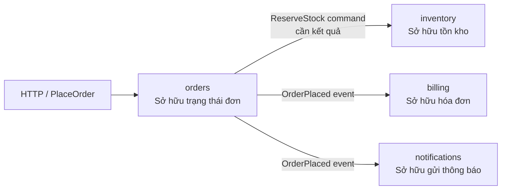
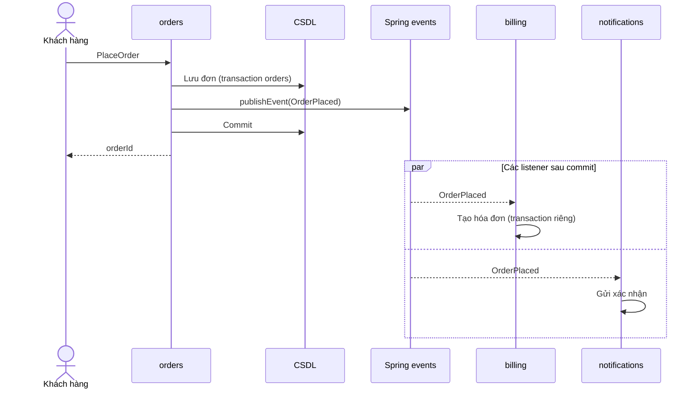

# Tách trách nhiệm theo module trong Spring Modulith

Một ứng dụng có thể có nhiều package và service nhưng vẫn khó bảo trì nếu mọi phần đều đọc chung entity, sửa chung bảng dữ liệu hoặc gọi vòng qua nhau. **Tách trách nhiệm theo module** là xác định rõ *ai sở hữu quy tắc nào, ai được phép thay đổi dữ liệu nào và phần còn lại của hệ thống tương tác với trách nhiệm ấy bằng hợp đồng gì*.

Trong Spring Modulith, cách chia này giúp xây dựng **modular monolith**: các module nghiệp vụ chạy chung một ứng dụng Spring Boot, nhưng có ranh giới nội bộ đủ rõ để phát triển, kiểm thử và thay đổi tương đối độc lập. Đặc biệt, **application events** cho phép module phát thông báo về sự thật nghiệp vụ đã xảy ra, để các module quan tâm tự xử lý mà không cần publisher phụ thuộc trực tiếp vào implementation của họ.

Bài này tập trung vào quyết định **phân định trách nhiệm**; event publisher, listener, xử lý sau commit, registry và retry được đặt trong ngữ cảnh thiết kế ranh giới module.

## 1. “Trách nhiệm của module” nghĩa là gì?

Một module không chỉ là một thư mục Java. Một module có trách nhiệm tốt thường có đủ ba thành phần:

1. **Năng lực nghiệp vụ (business capability):** module phục vụ nhu cầu cụ thể, ví dụ đặt hàng, quản lý tồn kho hay thanh toán.
2. **Quy tắc và trạng thái sở hữu:** module quyết định khi nào nghiệp vụ hợp lệ, quản lý dữ liệu cần để đưa ra quyết định đó.
3. **Hợp đồng tương tác:** module công khai một tập API nhỏ hoặc event ổn định để phần khác sử dụng, giấu implementation bên trong.

Ví dụ, module `orders` có thể chịu trách nhiệm tạo đơn, kiểm tra trạng thái đơn và quy tắc hủy đơn. Module `inventory` chịu trách nhiệm tính tồn khả dụng và quyết định có cho phép giữ hàng hay không. Cả hai có thể dùng chung một cơ sở dữ liệu vật lý nhưng **không vì thế mà được sở hữu chung mọi bảng, repository hay entity**.

### Module theo nghiệp vụ và package theo tầng

Cách chia theo tầng kỹ thuật thường có cấu trúc:

```text
com.example.shop
├── controllers
│   ├── OrderController.java
│   └── InventoryController.java
├── services
│   ├── OrderService.java
│   └── InventoryService.java
├── repositories
│   ├── OrderRepository.java
│   └── InventoryRepository.java
└── entities
    ├── Order.java
    └── Stock.java
```

Các class cùng thực hiện một nghiệp vụ lại nằm ở nhiều package xa nhau. Việc xác định “ai được sửa Order?” khó hơn và một package `services` có xu hướng phụ thuộc ngày càng nhiều.

Trong modular monolith, ưu tiên gom theo năng lực nghiệp vụ:

```text
com.example.shop
├── ShopApplication.java
├── orders
│   ├── Orders.java                   # API công khai
│   ├── PlaceOrder.java               # Command công khai
│   ├── OrderPlaced.java              # Event công khai
│   └── internal
│       ├── DefaultOrders.java        # Thực thi use case
│       ├── Order.java                # Domain model nội bộ
│       └── OrderRepository.java      # Persistence nội bộ
├── inventory
│   ├── InventoryOperations.java      # API công khai
│   └── internal
│       ├── Stock.java
│       └── StockRepository.java
├── billing
│   └── internal
│       ├── IssueInvoiceOnOrderPlaced.java
│       └── InvoiceRepository.java
└── notifications
    └── internal
        └── SendConfirmationOnOrderPlaced.java
```

Spring Modulith mặc định nhận diện các package trực tiếp dưới package ứng dụng làm **application modules**. Trong cấu trúc trên, `orders`, `inventory`, `billing` và `notifications` là các module; nội dung dưới `internal` được coi là chi tiết implementation theo ranh giới mặc định.

**Lưu ý:** Kiến trúc theo module vẫn có thể dùng controller, service, repository và entity *bên trong từng module*. Ta đổi đơn vị tổ chức chính từ “loại class kỹ thuật” sang “năng lực nghiệp vụ”.

## 2. Xác định ranh giới từ nghiệp vụ, không từ tên bảng

Một phương pháp thực dụng là bắt đầu với các tình huống sử dụng và hỏi:

- Ai có thẩm quyền quyết định điều kiện nghiệp vụ này đúng hay sai?
- Trạng thái nào có **một chủ sở hữu** chịu trách nhiệm bảo đảm tính nhất quán?
- Khi cần thay đổi quy tắc này, team phải sửa những phần nào?
- Phần nào **bắt buộc có kết quả ngay**, phần nào có thể xử lý sau?
- Nếu phần việc thất bại, nghiệp vụ gốc có phải thất bại theo không?

Xét ứng dụng bán hàng:

| Module | Trách nhiệm sở hữu | Ví dụ quy tắc bất biến | Không nên sở hữu |
| --- | --- | --- | --- |
| `orders` | Vòng đời đơn hàng, tạo/hủy đơn, trạng thái đơn | Đơn đã giao không thể hủy theo quy trình thông thường | Kiểm kê tồn kho thực tế, gửi email, phát hành hóa đơn |
| `inventory` | Tồn khả dụng, giữ/hoàn hàng | Không giữ số lượng lớn hơn tồn cho phép | Quy tắc hủy đơn, mẫu email |
| `billing` | Hóa đơn, ghi nhận chứng từ | Một đơn chỉ có hóa đơn phù hợp quy tắc xuất hóa đơn | Sửa trực tiếp trạng thái đơn |
| `notifications` | Kênh thông báo và lịch sử gửi | Không gửi trùng cùng một thông báo đã hoàn thành | Quyết định đặt hàng có thành công |

Khi một use case đi qua nhiều trách nhiệm, **không mặc định gom tất cả thành một module**. Thay vào đó, xác định module điều phối và cách các module trao đổi kết quả.

Ví dụ: khách đặt hàng, cần giữ kho trước khi trả thành công. `orders` điều phối yêu cầu và gọi API `inventory` để nhận kết quả giữ hàng. Sau khi đơn được ghi nhận thành công, `orders` có thể phát `OrderPlaced` cho `billing` và `notifications` xử lý tác vụ tiếp theo.

### Một module có thể có nhiều use case

Không cần tạo một module mới cho mỗi HTTP endpoint. “Tạo đơn”, “đổi địa chỉ giao”, “hủy đơn” đều có thể thuộc `orders` vì cùng làm việc với trạng thái và quy tắc vòng đời đơn. Ngược lại, “phát hành hóa đơn” có mô hình dữ liệu và quy tắc riêng, nên phù hợp là trách nhiệm của `billing`.

Kích thước module không nên quyết định chỉ bằng số class. **Mức gắn kết nghiệp vụ bên trong** và **mức phụ thuộc ra ngoài** quan trọng hơn.

## 3. Xác định chủ sở hữu dữ liệu và quyền thay đổi

Giả sử module `billing` nhận sự kiện đơn đã đặt. Một cách làm dễ nhưng nguy hiểm là inject `OrderRepository` từ `orders.internal`, tải `Order` rồi sửa trực tiếp trạng thái đơn để đánh dấu hóa đơn hoàn tất.

Cách đó làm mờ quyền sở hữu: `billing` vô tình chi phối quy tắc vòng đời đơn, còn `orders` không kiểm soát được các cập nhật lên dữ liệu của mình.

Cách tổ chức tốt hơn:

- `orders` là nơi duy nhất thực thi quy tắc và thay đổi **trạng thái đơn**.
- `billing` lưu và thay đổi **trạng thái hóa đơn** do chính nó sở hữu.
- Nếu `orders` cần biết một hóa đơn đã phát hành, `billing` công bố `InvoiceIssued`; `orders` tự quyết định phản ứng hợp lệ theo quy tắc của nó.
- Nếu module khác cần thông tin đơn hàng, dùng **API đọc công khai** hoặc snapshot được đưa vào event; không đọc lén repository nội bộ.

Có thể triển khai các bảng của hai module trong cùng một database và cùng một JVM. **Ranh giới sở hữu là ranh giới nghiệp vụ và mã nguồn**, không nhất thiết là ranh giới máy chủ. Việc mỗi module có schema riêng chỉ là một chiến lược tăng cường kiểm soát, không phải yêu cầu bắt buộc của Spring Modulith.

### Ma trận quyền làm việc với dữ liệu

| Dữ liệu | Đọc | Thay đổi |
| --- | --- | --- |
| Đơn hàng | `orders`; module khác qua public API/event theo nhu cầu | Chỉ logic được `orders` sở hữu |
| Số lượng tồn kho | `inventory`; module khác qua API được công khai | Chỉ logic được `inventory` sở hữu |
| Hóa đơn | `billing`; module khác qua API/event | Chỉ logic được `billing` sở hữu |
| Lịch sử thông báo | `notifications`; module khác qua API nếu cần | Chỉ logic được `notifications` sở hữu |

Đây là **quy ước kiến trúc** cần được thực thi bằng encapsulation, kiểm tra dependency và review; Spring Modulith không thể tự suy ra quyền sở hữu từng bảng từ ý nghĩa nghiệp vụ.

## 4. Thiết kế public API nhỏ và internal implementation

Trong mô hình package mặc định của Spring Modulith:

- Các kiểu ở **package gốc của module** (ví dụ `com.example.shop.orders`) là phần API công khai được phép tham chiếu từ module khác.
- Các kiểu ở **subpackage** như `com.example.shop.orders.internal` được xem là implementation nội bộ, trừ khi được công khai chủ ý bằng cơ chế như `@NamedInterface`.
- Một module không nên import lớp nội bộ của module khác dù Java compiler về mặt `public` có thể cho phép.

Ví dụ hợp đồng dành cho việc đặt hàng:

```java
// com.example.shop.orders.PlaceOrder
package com.example.shop.orders;

import java.util.UUID;

public record PlaceOrder(UUID customerId, String sku, int quantity) {
    public PlaceOrder {
        if (customerId == null || sku == null || sku.isBlank() || quantity <= 0) {
            throw new IllegalArgumentException("Invalid order request");
        }
    }
}
```

```java
// com.example.shop.orders.Orders
package com.example.shop.orders;

import java.util.UUID;

public interface Orders {
    UUID place(PlaceOrder command);
}
```

Module bên ngoài biết interface `Orders` và DTO `PlaceOrder`, không cần biết domain entity `Order` hay cách repository lưu dữ liệu.

Implementation đặt dưới namespace nội bộ:

```java
// com.example.shop.orders.internal.DefaultOrders
package com.example.shop.orders.internal;

import com.example.shop.orders.Orders;
import com.example.shop.orders.OrderPlaced;
import com.example.shop.orders.PlaceOrder;
import java.time.Instant;
import java.util.UUID;
import org.springframework.context.ApplicationEventPublisher;
import org.springframework.stereotype.Service;
import org.springframework.transaction.annotation.Transactional;

@Service
class DefaultOrders implements Orders {

    private final OrderRepository repository;
    private final ApplicationEventPublisher publisher;

    DefaultOrders(OrderRepository repository, ApplicationEventPublisher publisher) {
        this.repository = repository;
        this.publisher = publisher;
    }

    @Override
    @Transactional
    public UUID place(PlaceOrder command) {
        // Order và OrderRepository thuộc module orders, không công khai
        // và phải được hiện thực hóa theo mô hình dữ liệu thực tế.
        Order order = Order.place(
            command.customerId(),
            command.sku(),
            command.quantity()
        );

        repository.save(order);

        publisher.publishEvent(new OrderPlaced(
            UUID.randomUUID(),
            order.id(),
            Instant.now()
        ));

        return order.id();
    }
}
```

Snippet này minh họa cách tổ chức các class: `Order` và `OrderRepository` là thành phần domain/persistence **giả định** của module và cần hiện thực trong project cụ thể. Các đoạn minh họa không phải project chạy độc lập.

Đặt interface `Orders` ở package gốc tạo điểm gọi rõ ràng; đặt `DefaultOrders` và repository dưới `internal` giúp giấu quyết định triển khai. Spring Modulith có thể kiểm tra xem module khác có nhập trái phép kiểu internal hay không.

### Không phơi toàn bộ entity chỉ vì “tiện dùng lại”

Nếu `Orders.place(...)` trả về `Order` có quan hệ JPA và các setter công khai, caller có thể bắt đầu phụ thuộc persistence và cập nhật trạng thái ngoài ý muốn. Giá trị trả về nhỏ, ổn định như `UUID` hoặc `OrderResult` thường bảo vệ ranh giới tốt hơn.

Public API càng rộng, số chỗ phải đánh giá khi thay đổi càng lớn.

## 5. Phân phối trách nhiệm bằng Command và Event

Khi một module cần phối hợp với module khác, cần chọn hình thức theo **ý nghĩa** và **mức đảm bảo** của luồng nghiệp vụ.

**Command** là yêu cầu thực hiện một hành động, có bên nhận chịu trách nhiệm và có thể từ chối. **Event** là một sự thật đã xảy ra, có thể được nhiều bên quan sát mà publisher không cần biết các listener.

| Tình huống | Cách giao tiếp | Vì sao |
| --- | --- | --- |
| `orders` cần biết có giữ được hàng trước khi xác nhận đơn | Gọi API/command `inventory.reserve(...)` | Phải có kết quả để quyết định thành công |
| `orders` đã tạo đơn, các module muốn biết | Phát event `OrderPlaced` | Đây là sự thật do `orders` sở hữu |
| `billing` muốn gửi thông báo sau khi có hóa đơn | Phát event `InvoiceIssued` | `billing` không phải biết danh sách kênh gửi |
| Khách yêu cầu hủy đơn | Command `CancelOrder` | Phải kiểm tra quyền và trạng thái |
| Một module cần truy vấn trạng thái đơn hiện tại | Public query API `Orders.find(...)` | Đây là đọc dữ liệu hiện tại, không phải hành động hay sự kiện |

**Không phải mọi giao tiếp xuyên module đều nên là event.** Ép một command cần phản hồi thành event bất đồng bộ thường khiến API báo thành công quá sớm hoặc phải tự dựng cơ chế chờ phức tạp.

Ngược lại, nếu `orders` gọi trực tiếp `BillingService`, `EmailService` và `AnalyticsService` mỗi khi lưu đơn, module đặt hàng bị buộc phải biết các quy trình phụ trợ. Event có thể bỏ phụ thuộc này.

### Sơ đồ quan hệ



Các mũi tên trên biểu diễn **luồng tương tác**. Về dependency mã nguồn, listener ở `billing` và `notifications` cần biết kiểu `OrderPlaced` công khai thuộc `orders`. `orders` không cần import các listener đó.

## 6. Public event: hợp đồng giữa người phát và người nhận

Event nên chứa một **sự thật nghiệp vụ cụ thể**, có tên dạng quá khứ và lượng dữ liệu hợp lý.

```java
// com.example.shop.orders.OrderPlaced
package com.example.shop.orders;

import java.time.Instant;
import java.util.UUID;

public record OrderPlaced(
    UUID eventId,
    UUID orderId,
    Instant occurredAt
) {}
```

Đây là event ở package API công khai của `orders`. `eventId` hỗ trợ theo dõi/idempotency theo thông điệp; `orderId` là khóa nghiệp vụ; `occurredAt` ghi thời điểm sự kiện phát sinh.

Cần phân biệt ba loại dữ liệu:

1. **Identity:** ai/đối tượng nào thay đổi, ví dụ `orderId`.
2. **Snapshot cần thiết:** thuộc tính có ý nghĩa tại thời điểm phát sinh, nếu listener cần nó mà không nên tra cứu trạng thái hiện tại.
3. **Chi tiết nội bộ:** JPA entity, repository, cấu trúc aggregate mutable, các field phục vụ implementation; không đưa vào event công khai.

Một event chỉ chứa `orderId` không tự động là lựa chọn tốt nhất trong mọi hệ thống. Nếu người nghe cần giá tại **thời điểm đặt hàng**, truy vấn đơn hiện tại nhiều ngày sau có thể đọc phải giá hoặc thông tin đã thay đổi. Khi đó cân nhắc đưa bản chụp dữ liệu được chấp nhận vào event và quản lý schema tương ứng.

Tránh đặt tên event `SendEmailEvent` nếu thực chất chỉ muốn ra lệnh gửi email. Tên như `OrderPlaced` diễn đạt sự thật mà nhiều subscriber có thể diễn giải độc lập.

### Publisher không gắn với người nghe

`DefaultOrders` chỉ dùng:

```java
publisher.publishEvent(new OrderPlaced(
    UUID.randomUUID(),
    order.id(),
    Instant.now()
));
```

Không inject `BillingService` hay `NotificationService` vì mục đích gửi các sự kiện phụ trợ. Khi thêm subscriber mới, module `orders` thường không cần thay đổi.

Cần chú ý `publishEvent` là **gửi application event trong tiến trình Spring**; đây không phải mặc định là gửi message qua Kafka/RabbitMQ, cũng không chứng minh transaction đã commit.

## 7. Listener ở đúng module sở hữu tác vụ

Module `notifications` tự nhận và xử lý event liên quan:

```java
// com.example.shop.notifications.internal.SendConfirmationOnOrderPlaced
package com.example.shop.notifications.internal;

import com.example.shop.orders.OrderPlaced;
import org.springframework.modulith.events.ApplicationModuleListener;
import org.springframework.stereotype.Component;

@Component
class SendConfirmationOnOrderPlaced {

    private final NotificationService notificationService;

    SendConfirmationOnOrderPlaced(NotificationService notificationService) {
        this.notificationService = notificationService;
    }

    @ApplicationModuleListener
    void on(OrderPlaced event) {
        notificationService.sendOrderConfirmationOnce(
            event.eventId(),
            event.orderId()
        );
    }
}
```

`NotificationService` ở đây là service **nội bộ** của module thông báo; phương thức `sendOrderConfirmationOnce` là hợp đồng triển khai cần đảm bảo chống gửi trùng. Nếu gửi ra nhà cung cấp email hoặc API ngoài, cần thêm cơ chế lưu trạng thái/khóa idempotency thích hợp.

Tương tự, module `billing` có thể viết listener khác nhận cùng `OrderPlaced` để tạo hóa đơn, mà module `notifications` không cần biết `billing` tồn tại.

**Quy tắc sở hữu:** listener thuộc module nào thì **quy tắc và side effect của listener thuộc module đó**. Mã gửi email đặt ở `notifications`, mã lập hóa đơn đặt ở `billing`; publisher chỉ phát sự thật `OrderPlaced`.

### Chọn đúng thời điểm nhận sự kiện

| Cơ chế Spring | Hành vi điển hình | Khi phù hợp |
| --- | --- | --- |
| `@EventListener` | Thông thường đồng bộ ngay lúc `publishEvent`; có thể cùng transaction và ảnh hưởng publisher khi ném lỗi | Xử lý nội bộ đơn giản cần tính đồng bộ |
| `@TransactionalEventListener` | Mặc định phản ứng sau commit thành công của transaction hiện hành | Chỉ thực hiện side effect sau khi dữ liệu nguồn được commit |
| `@ApplicationModuleListener` | Kết hợp listener sau commit, chạy bất đồng bộ và thực hiện trong transaction mới | Tác vụ xuyên module có thể hoàn tất sau nghiệp vụ chính |

Với `@TransactionalEventListener`, event phát ngoài transaction thường không kích hoạt listener trừ khi cấu hình `fallbackExecution`. Với `@ApplicationModuleListener`, cần chuẩn bị hạ tầng async/transaction phù hợp theo cấu hình ứng dụng.

Ví dụ đặt hàng: việc gửi email chậm hoặc thất bại **không nên làm rollback** một đơn đã được commit. `@ApplicationModuleListener` là lựa chọn thường phù hợp. Tuy nhiên, nếu giữ tồn kho là điều kiện bắt buộc **trước khi** xác nhận đặt hàng, hãy yêu cầu `inventory` xử lý command và trả kết quả ngay, hoặc quản lý workflow bất đồng bộ với trạng thái đơn như `PENDING_STOCK`.

## 8. Transaction: nhất quán trong module, nhất quán cuối cùng giữa module

Một module nên bảo vệ bất biến **thuộc dữ liệu nó sở hữu** trong một transaction phù hợp. Khi module khác phản ứng sau commit, không thể mặc nhiên coi toàn bộ chuỗi tác vụ là một transaction nguyên tử.

Ví dụ:



Sơ đồ thể hiện **quan hệ logic** và có thể xảy ra chênh lệch về thời điểm giữa HTTP response và listener bất đồng bộ; không nên diễn giải các mũi tên như một bảo đảm thời gian tuyệt đối.

Các trạng thái nhất quán có thể cùng tồn tại trong một khoảng ngắn:

- `orders`: đơn đã tạo và commit thành công.
- `billing`: hóa đơn đang chờ hoặc đang được xử lý.
- `notifications`: email đang gửi hoặc chờ retry.

Đây là **eventual consistency**. Nếu sản phẩm yêu cầu mọi bước phải hoàn tất trước khi trả thành công, cần thiết kế lại flow và hợp đồng, thay vì mặc định dùng event async cho mọi việc.

### Nếu listener thất bại thì sao?

Giả sử đơn đã commit nhưng kết nối đến hệ thống hóa đơn bị lỗi. Sau commit, publisher không thể “xóa đi” giao dịch đặt hàng vừa thành công chỉ vì một listener phụ trợ thất bại. Module `billing` cần quản lý retry và trạng thái lỗi; luồng vận hành cần có khả năng quan sát lỗi để khôi phục.

Điều này đặt ra ranh giới trách nhiệm mới: `orders` chịu trách nhiệm sự thật đơn đã đặt, còn `billing` chịu trách nhiệm biến sự thật đó thành hóa đơn đáng tin cậy.

## 9. Tăng độ tin cậy bằng Event Publication Registry

Application event mặc định là tương tác trong một tiến trình Java. Nếu ứng dụng gặp sự cố giữa lúc transaction nguồn commit và listener hoàn tất, chỉ sử dụng callback trong bộ nhớ có thể bỏ lỡ công việc theo sau.

Spring Modulith có **Event Publication Registry** để theo dõi publication cho các transactional event listener. Khi cấu hình persistence phù hợp (ví dụ JDBC, JPA hoặc MongoDB), framework ghi nhận publication đang chờ, đánh dấu hoàn tất sau xử lý thành công và cho phép xác định các publication chưa hoàn tất cần phục hồi.

Với bài toán tách trách nhiệm, registry giúp duy trì sự độc lập giữa `orders` và `billing`: publisher không cần trực tiếp gọi lại billing khi lỗi, mà quá trình giao event có thể được quản lý từ hạ tầng publication.

Tuy nhiên, chỉ dùng annotation listener **không đủ** để có bảo đảm giao bền vững. Ứng dụng cần cấu hình giải pháp lưu registry, schema/transaction cần thiết và chính sách resubmit, quan sát, xử lý lỗi.

### Ba trách nhiệm khác nhau

| Phần | Chịu trách nhiệm |
| --- | --- |
| Module phát event | Chỉ phát sự kiện khi sự thật nghiệp vụ hợp lệ và đảm bảo transaction nguồn |
| Hạ tầng event publication | Theo dõi event phải giao đến listener, ghi trạng thái hoàn thành/thất bại và hỗ trợ phục hồi |
| Module nghe event | Xử lý nghiệp vụ của mình, đảm bảo idempotency, giữ lỗi có thể truy vết |

**Độ bền giao sự kiện không thay thế idempotency.** Một listener có thể xử lý thành công tác vụ bên ngoài nhưng bị lỗi trước khi đánh dấu publication hoàn thành; khi giao lại, event có thể đến lần hai.

Ví dụ `billing` nên có unique constraint theo `orderId` hoặc khóa nghiệp vụ tương đương. Listener cần biến việc “đã có hóa đơn” thành kết quả an toàn thay vì tạo bản ghi thứ hai.

Đối với email, khả năng gửi chính xác một lần phụ thuộc thêm vào nhà cung cấp và giao thức: cần kiểm soát khóa thông báo, trạng thái gửi và chấp nhận rằng một số tình huống không thể loại bỏ hoàn toàn việc gửi lặp nếu nhà cung cấp không hỗ trợ idempotency.

### Đừng nhầm application event với message broker

- **Application event** giao tiếp giữa các thành phần trong cùng Spring application context.
- **Event Publication Registry** hỗ trợ tracking và recovery cho các publication được framework quản lý.
- **Externalization/message broker** là giải pháp đưa sự kiện ra hệ thống ngoài như Kafka/RabbitMQ; cần thêm cấu hình và hợp đồng tương ứng.

Tách module tốt không bắt buộc đưa từng module thành microservice. Giữ cùng tiến trình thường đơn giản hơn; thiết kế ranh giới rõ giúp giảm chi phí thay đổi về sau.

## 10. Kiểm tra ranh giới bằng Spring Modulith

Quy tắc đóng gói có ích khi được **kiểm chứng tự động**, nhất là khi số lượng module và lập trình viên tăng lên.

Spring Modulith cung cấp API `ApplicationModules` để xây dựng mô hình module và kiểm tra các ràng buộc kiến trúc, ví dụ phụ thuộc đến internal package hoặc vòng phụ thuộc module.

```java
package com.example.shop;

import org.junit.jupiter.api.Test;
import org.springframework.modulith.core.ApplicationModules;

class ModularityTests {

    @Test
    void modulesRespectTheirBoundaries() {
        ApplicationModules.of(ShopApplication.class).verify();
    }
}
```

Kiểm tra này phát huy tác dụng khi code thực sự tuân theo package structure đã chọn. Ví dụ, nếu `billing` import `com.example.shop.orders.internal.OrderRepository`, việc kiểm tra module boundary nên phát hiện sai phạm theo ranh giới mặc định.

Ngoài ra, có thể dùng `@ApplicationModuleTest` để tải context phù hợp cho một module khi kiểm thử. Với luồng xuất event, `PublishedEvents` hỗ trợ xác minh module đã phát event đúng kiểu và nội dung:

```java
package com.example.shop.orders;

import static org.assertj.core.api.Assertions.assertThat;

import java.util.UUID;
import org.junit.jupiter.api.Test;
import org.springframework.beans.factory.annotation.Autowired;
import org.springframework.modulith.test.ApplicationModuleTest;
import org.springframework.modulith.test.PublishedEvents;

@ApplicationModuleTest
class OrdersModuleTests {

    @Autowired Orders orders;

    @Test
    void placingOrderPublishesEvent(PublishedEvents events) {
        UUID customerId = UUID.randomUUID();

        UUID orderId = orders.place(
            new PlaceOrder(customerId, "BOOK-001", 2)
        );

        assertThat(events.ofType(OrderPlaced.class)
                         .matching(OrderPlaced::orderId, orderId))
            .hasSize(1);
    }
}
```

Ví dụ test giả định module `orders` có persistence test đã cấu hình và đủ dữ liệu nền để lệnh đặt hàng thành công. Nó xác minh **publisher phát event đúng**, chưa chứng minh listener sau commit đã hoàn tất hoặc registry có thể phục hồi khi crash. Để kiểm tra tin cậy đầu cuối, cần các test khác cho transaction rollback, listener thất bại, retry/idempotency.

### Những câu hỏi kiểm thử nên trả lời

1. Nếu command bị từ chối hoặc transaction của `orders` rollback, listener after-commit có bị kích hoạt sai không?
2. Nếu `notifications` hoặc `billing` lỗi sau commit, đơn đã tạo có giữ nguyên không?
3. Nếu cùng `OrderPlaced` được xử lý hai lần, có tạo hai hóa đơn hoặc hai thông báo không?
4. Nếu `billing` truy cập API nội bộ `orders`, bài test kiến trúc có phát hiện không?
5. Nếu không có listener nào cho một event, nghiệp vụ của publisher có còn đúng không?
6. Có cách nào quan sát publication chưa hoàn thành để vận hành biết mà khôi phục không?

Các câu hỏi này đo **mức độc lập thực tế** giữa các module, thay vì chỉ đếm số package.

## 11. Cách phân tách module từng bước trong một hệ thống có sẵn

Không cần chuyển toàn bộ code sang kiến trúc mới trong một lần. Một quy trình có thể áp dụng:

### Bước 1 — Vẽ bản đồ use case

Ghi những hành vi nghiệp vụ chính, đối tượng dữ liệu liên quan và nơi chứa quy tắc. Ví dụ `PlaceOrder`, `ReserveStock`, `IssueInvoice`, `SendConfirmation`.

### Bước 2 — Gán một chủ sở hữu cho từng quy tắc

Ai quyết định “không được hủy đơn đã giao”? `orders`. Ai quyết định “số lượng hàng đủ giữ hay không”? `inventory`. Ai quyết định “một đơn có hóa đơn hợp lệ chưa”? `billing`.

Nếu nhiều module có quyền quyết định cùng một bất biến, cần phân tích lại ranh giới hoặc thiết kế một đầu mối điều phối.

### Bước 3 — Chuyển dependency sang public API

Đưa `OrderRepository` và `Order` khỏi các nơi gọi xuyên module. Công bố `Orders`, `PlaceOrder`, DTO đọc hoặc query API thật sự cần. Chuyển implementation vào subpackage nội bộ.

### Bước 4 — Đổi những tác vụ phụ trợ sang event

Những tác vụ chỉ cần biết “đơn đã đặt” có thể nghe `OrderPlaced`. Đặt listener dưới module sở hữu side effect. Giữ lời gọi command đồng bộ với những điều kiện phải được xác nhận trước khi hoàn tất use case.

### Bước 5 — Chọn transaction và recovery

Xác định phần nào cùng transaction, phần nào xử lý sau commit. Với tác vụ quan trọng, cấu hình Event Publication Registry, retry/resubmit và idempotency; đồng thời thiết kế trạng thái quan sát được khi có lỗi.

### Bước 6 — Đặt kiểm tra kiến trúc và use case vào CI

Dùng `ApplicationModules.verify()`, test module và những bài test nghiệp vụ quan trọng. Mỗi lần thêm dependency xuyên module, team nên hiểu rõ hợp đồng và tác động tới vòng đời module.

## 12. Sai lầm thường gặp khi phân chia trách nhiệm

| Dấu hiệu | Vấn đề | Hướng sửa |
| --- | --- | --- |
| Một `common` module chứa hầu hết entity và mọi service đều dùng | Không còn chủ sở hữu quy tắc rõ ràng | Giữ model ở module chủ sở hữu, chỉ đưa giá trị thực sự chung và ổn định vào shared kernel nhỏ |
| `billing` update trực tiếp bảng `orders` | Phá invariant của chủ sở hữu | Tương tác qua public API hoặc event, để `orders` tự cập nhật |
| `orders` import `notifications.internal.EmailSender` | Coupling tới implementation module khác | Phát `OrderPlaced`, module thông báo tự xử lý |
| Dùng event async cho yêu cầu giữ kho bắt buộc | Trả thành công trước khi biết kết quả | Command có phản hồi hoặc workflow có trạng thái |
| Dùng `@EventListener` đồng bộ cho email chậm | Kéo dài transaction và có thể làm rollback nghiệp vụ gốc | Listener sau commit/async theo mức đảm bảo yêu cầu |
| Event chứa entity JPA nội bộ | Rò rỉ mô hình dữ liệu, dễ gặp lỗi lazy loading | Dùng record/DTO công khai, bất biến |
| Tin rằng listener sẽ chỉ chạy một lần | Lỗi trùng khi retry/crash | Thiết kế idempotency và khóa duy nhất |
| Không có ai theo dõi publication lỗi | Công việc sau commit bị treo mà không biết | Quan sát registry, lỗi và quy trình recovery |
| Có package riêng nhưng không kiểm thử dependency | Ranh giới mòn dần theo thời gian | Bổ sung kiểm chứng với Spring Modulith |

## 13. Bài tập thiết kế

Hệ thống gồm bốn chức năng: khách đặt hàng, giữ tồn kho, phát hành hóa đơn và gửi thông báo. Hãy tự trả lời:

1. Module nào là chủ sở hữu trạng thái đơn hàng? Module nào giữ quy tắc số lượng tồn?
2. Khi đặt hàng **chỉ được phép thành công nếu giữ kho thành công**, nên giao tiếp `orders` → `inventory` bằng command hay event?
3. Sau khi đơn commit, module nào phát `OrderPlaced`? Có cần module đặt hàng biết class gửi email không?
4. Khi người nhận event xử lý thất bại, trạng thái đơn hàng và trạng thái hóa đơn có thể khác nhau trong một thời gian không?
5. Nếu listener nhận lại cùng event sau retry, làm thế nào tránh tạo hai hóa đơn?
6. Nếu muốn bổ sung module `analytics` ghi nhận số đơn được tạo, bạn phải sửa những file gì trong `orders`?

<details>
<summary>Gợi ý lời giải</summary>

1. `orders` sở hữu đơn hàng; `inventory` sở hữu tồn kho.
2. Dùng command hoặc public API có kết quả rõ ràng; nếu bắt buộc bất đồng bộ, cần giữ đơn ở trạng thái chờ và không báo hoàn thành ngay.
3. `orders` phát `OrderPlaced`. `notifications` nhận event và tự gọi email sender nội bộ; `orders` không import lớp gửi email.
4. Có. Xử lý listener sau commit tạo ranh giới transaction riêng; thiết kế nghiệp vụ phải chấp nhận/hiển thị trạng thái đang xử lý.
5. Dùng khóa idempotency, ví dụ unique constraint theo `orderId` trong `billing`, cùng xử lý trùng an toàn.
6. Nếu hợp đồng `OrderPlaced` đã đủ thông tin, thường chỉ cần thêm listener trong `analytics` và cấu hình/module test thích hợp; không cần thay implementation `orders`.

</details>

## Tổng kết kiến thức

- Một module tốt **sở hữu rõ quy tắc, dữ liệu và hành vi nghiệp vụ**, không chỉ gom class cùng tên.
- Đưa kiểu hợp đồng vào **public API**, giữ aggregate, repository và implementation trong **internal package**.
- Dùng **command/API đồng bộ** khi luồng chính cần quyết định từ kết quả; dùng **event** để thông báo sự thật cho những trách nhiệm có thể phản ứng độc lập.
- Listener thuộc module nhận và sở hữu tác vụ của chính nó; listener sau commit làm rõ ranh giới transaction.
- Với sự kiện quan trọng, cần xét **Event Publication Registry**, retry/resubmit, idempotency và quan sát vận hành.
- Dùng **Spring Modulith ApplicationModules** và module tests để bảo vệ ranh giới khỏi bị phá vỡ theo thời gian.

**Tài liệu tham khảo:**

- [Spring Modulith – Fundamentals](https://docs.spring.io/spring-modulith/reference/fundamentals.html)
- [Spring Modulith – Verifying Application Module Structure](https://docs.spring.io/spring-modulith/reference/verification.html)
- [Spring Modulith – Working with Application Events](https://docs.spring.io/spring-modulith/reference/events.html)
- [Spring Modulith – Testing Application Modules](https://docs.spring.io/spring-modulith/reference/testing.html)
