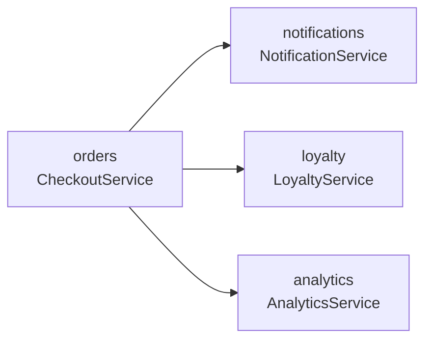
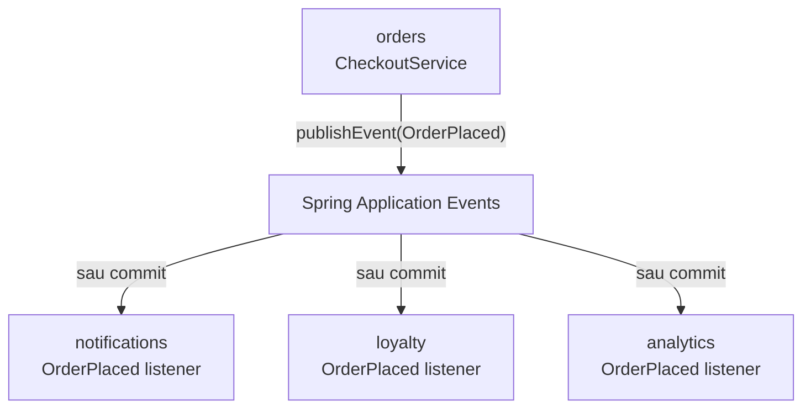
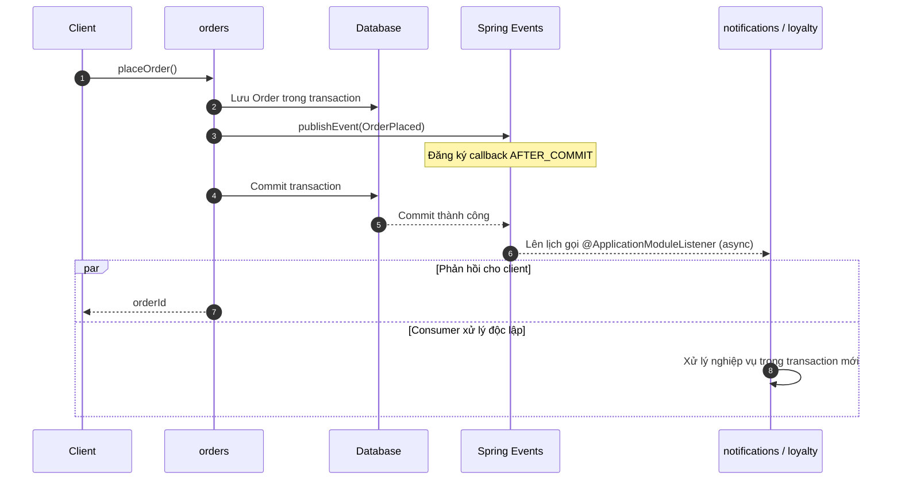

# Giảm phụ thuộc trực tiếp giữa các module bằng application events

## 1. Vì sao phụ thuộc trực tiếp làm kiến trúc module khó mở rộng?

Trong kiến trúc theo module, mỗi module nên quản lý một năng lực nghiệp vụ và công khai một giao diện nhỏ, ổn định. Với **Spring Modulith**, bài toán thường gặp là một nghiệp vụ cần kích hoạt nhiều hành động thuộc các module khác.

Ví dụ, khi module `orders` tạo đơn hàng thành công, hệ thống còn cần:

- Gửi email xác nhận qua module `notifications`.
- Cộng điểm khách hàng qua module `loyalty`.
- Ghi nhận dữ liệu phân tích qua module `analytics`.

Một cách triển khai ban đầu là gọi trực tiếp cả ba service:

```java
@Service
class CheckoutService {

    private final OrderRepository orders;
    private final NotificationService notifications;
    private final LoyaltyService loyalty;
    private final AnalyticsService analytics;

    @Transactional
    public UUID placeOrder(CreateOrderCommand command) {
        Order order = orders.save(Order.from(command));

        notifications.sendOrderConfirmation(order.getId());
        loyalty.awardPointsFor(order.getId());
        analytics.recordOrderPlaced(order.getId());

        return order.getId();
    }
}
```

*Đây là mã minh họa cấu trúc phụ thuộc; các kiểu repository, command, entity và service được lược bớt.*

Cách gọi này tạo ra các vấn đề:

1. **Phụ thuộc tại thời điểm biên dịch:** `orders` phải import API của cả `notifications`, `loyalty` và `analytics`. Thêm một phản ứng nghiệp vụ mới phải sửa `CheckoutService`.
2. **Phụ thuộc khi thực thi:** tốc độ và khả năng hoạt động của nghiệp vụ tạo đơn gắn với ba thao tác phụ. Một service chậm có thể kéo dài thời gian phản hồi.
3. **Ràng buộc lỗi và giao dịch:** exception từ một lời gọi có thể ảnh hưởng trực tiếp đến transaction tạo đơn; việc gọi dịch vụ ngoài như email trong transaction còn có thể tạo hiệu ứng phụ ngay cả khi transaction sau đó rollback.
4. **Khó giữ ranh giới:** người viết `orders` cần biết chi tiết nghiệp vụ của module khác. Nếu gọi repository hay service nội bộ của module khác, ranh giới đóng gói bị phá vỡ.



Điều cần giảm là **phụ thuộc vào các hành động bên nhận**. Với sự kiện, module tạo đơn công bố một sự thật nghiệp vụ: **đơn hàng đã được tạo**. Những module quan tâm tự đăng ký phản ứng.

## 2. Đổi hướng phụ thuộc: từ lệnh gọi đến sự kiện

Thay vì `orders` điều khiển các bước của `notifications`, `loyalty` và `analytics`, module `orders` chỉ phát event `OrderPlaced` qua `ApplicationEventPublisher`:



Điểm thay đổi quan trọng:

- **Publisher** xác định *sự kiện nghiệp vụ nào đã xảy ra*, không ra lệnh bên nhận làm gì.
- **Event** mô tả dữ kiện bằng một hợp đồng nhỏ, chẳng hạn mã đơn hàng và thời điểm phát sinh.
- **Listener** trong từng module quyết định hành động của riêng mình, có thể bổ sung hoặc bỏ đi mà không phải đổi code publisher.
- **Spring** cung cấp cơ chế phát và phân phối event trong cùng ứng dụng. Spring Modulith cung cấp annotation và các thành phần hỗ trợ điều phối giao tiếp module bằng event.

Về dependency giữa các module, `notifications` vẫn cần **biết kiểu `OrderPlaced`** để khai báo listener. Vì thế không có nghĩa mọi phụ thuộc đều biến mất: hướng phụ thuộc chuyển thành **module tiêu thụ phụ thuộc vào hợp đồng công khai của module phát**, trong khi module phát không phải phụ thuộc trực tiếp vào các module tiêu thụ.

| Khía cạnh | Gọi trực tiếp qua service | Phát và lắng nghe event |
|---|---|---|
| Quan hệ code | Publisher import từng service bên nhận | Publisher chỉ dùng event của mình và `ApplicationEventPublisher`; listener import event |
| Thêm một phản ứng mới | Thường sửa orchestration của publisher | Thêm listener tại module liên quan |
| Kết quả trả về | Có thể nhận giá trị ngay từ callee | Không có kết quả đồng bộ từ từng listener |
| Xử lý lỗi | Exception có thể truyền trực tiếp về caller | Với listener sau commit, lỗi được xử lý ở luồng riêng |
| Giao dịch | Có thể cùng một transaction khi gọi đồng bộ nội bộ | Tùy kiểu listener; listener sau commit xử lý khi transaction gốc đã thành công |
| Phù hợp | Bước bắt buộc phải có kết quả ngay; truy vấn đồng bộ | Thông báo về sự kiện đã xảy ra; phản ứng có thể thực hiện sau |

## 3. Thiết kế hợp đồng event để bảo vệ ranh giới

Trong Spring Modulith, module thường được phát hiện từ package con trực tiếp của package ứng dụng. Ví dụ:

```text
com.example.shop
├── ShopApplication.java
├── orders
│   ├── OrderPlaced.java             # API công khai của orders
│   ├── CheckoutService.java
│   └── internal
│       ├── Order.java
│       └── OrderRepository.java
├── notifications
│   └── OrderNotificationListener.java
├── loyalty
│   └── OrderLoyaltyListener.java
└── analytics
    └── OrderAnalyticsListener.java
```

Đặt event `public` ở package gốc `orders` để consumer import như một phần giao diện module. Nếu muốn đặt event vào package con chuyên biệt, cần cấu hình **named interface** phù hợp để module khác được phép truy cập theo mô hình xác minh ranh giới của Spring Modulith. Tránh để consumer import entity hoặc repository trong `orders.internal`.

Event dùng `record` (Java 17+) để biểu diễn dữ liệu bất biến:

```java
package com.example.shop.orders;

import java.time.Instant;
import java.util.UUID;

public record OrderPlaced(
        UUID eventId,
        UUID orderId,
        Instant occurredAt
) {}
```

Trong hợp đồng trên:

- `eventId` định danh duy nhất lần phát sự kiện, hữu ích khi phát hiện sự kiện bị xử lý lại.
- `orderId` cho biết đối tượng nghiệp vụ xảy ra thay đổi; bên nhận có thể dùng nó để ghi log hoặc tra cứu thông tin thông qua API được công khai.
- `occurredAt` phản ánh thời điểm sự kiện phát sinh trong nghiệp vụ, không nên mặc định xem là thời điểm listener xử lý.

**Đặt tên event theo sự thật đã xảy ra**, chẳng hạn `OrderPlaced`, `PaymentCompleted` hoặc `InventoryReserved`. Tên `SendEmailNow` lại mô tả mệnh lệnh dành cho một module cụ thể, làm mất lợi ích giảm phụ thuộc.

Payload nên gọn, không chứa entity JPA đang được quản lý hay những tham chiếu đến các service nội bộ. Hạn chế dữ liệu nhạy cảm và tránh yêu cầu bên nhận phụ thuộc vào trạng thái transaction chưa commit.

## 4. Ví dụ publisher: module đơn hàng chỉ phát sự kiện

```java
package com.example.shop.orders;

import com.example.shop.orders.internal.Order;
import com.example.shop.orders.internal.OrderRepository;
import java.time.Clock;
import java.util.UUID;
import org.springframework.context.ApplicationEventPublisher;
import org.springframework.stereotype.Service;
import org.springframework.transaction.annotation.Transactional;

@Service
public class CheckoutService {

    private final OrderRepository orderRepository;
    private final ApplicationEventPublisher publisher;
    private final Clock clock;

    public CheckoutService(
            OrderRepository orderRepository,
            ApplicationEventPublisher publisher,
            Clock clock) {
        this.orderRepository = orderRepository;
        this.publisher = publisher;
        this.clock = clock;
    }

    @Transactional
    public UUID placeOrder(CreateOrderCommand command) {
        Order order = orderRepository.save(Order.from(command));

        publisher.publishEvent(new OrderPlaced(
                UUID.randomUUID(),
                order.getId(),
                clock.instant()));

        return order.getId();
    }
}
```

Các kiểu `OrderRepository`, `Order` và `CreateOrderCommand` là API nghiệp vụ minh họa bên trong module `orders`; ví dụ giả định ứng dụng đã cấu hình bean `Clock`.

Cần đọc đúng luồng thực thi:

1. `placeOrder()` bắt đầu transaction và ghi đơn hàng.
2. `publishEvent(...)` công bố event qua hạ tầng sự kiện Spring. Tại thời điểm này, transaction lưu đơn hàng **chưa chắc đã commit**.
3. Nếu dùng listener sau commit, Spring ghi nhận callback phù hợp rồi kích hoạt listener **sau khi transaction gốc commit thành công**.
4. Publisher trả mã đơn hàng mà không cần biết có bao nhiêu module khác sẽ phản ứng.

Thêm module `fraud-monitoring` về sau chỉ cần tạo listener mới cho `OrderPlaced`. Mã nghiệp vụ tạo đơn không phải nhận thêm phụ thuộc `FraudMonitoringService`.

## 5. Ví dụ consumer: mỗi module tự xử lý sự kiện

Trong `notifications`, listener quan tâm đến `OrderPlaced`:

```java
package com.example.shop.notifications;

import com.example.shop.orders.OrderPlaced;
import org.springframework.modulith.events.ApplicationModuleListener;
import org.springframework.stereotype.Component;

@Component
class OrderNotificationListener {

    private final NotificationService notifications;

    OrderNotificationListener(NotificationService notifications) {
        this.notifications = notifications;
    }

    @ApplicationModuleListener
    public void on(OrderPlaced event) {
        notifications.sendOrderConfirmation(
                event.eventId(), event.orderId());
    }
}
```

Tương tự, `loyalty` có thể định nghĩa listener độc lập:

```java
package com.example.shop.loyalty;

import com.example.shop.orders.OrderPlaced;
import org.springframework.modulith.events.ApplicationModuleListener;
import org.springframework.stereotype.Component;

@Component
class OrderLoyaltyListener {

    private final LoyaltyService loyalty;

    OrderLoyaltyListener(LoyaltyService loyalty) {
        this.loyalty = loyalty;
    }

    @ApplicationModuleListener
    public void on(OrderPlaced event) {
        loyalty.awardPointsOnce(event.eventId(), event.orderId());
    }
}
```

Các method `sendOrderConfirmation(...)` và `awardPointsOnce(...)` là ví dụ về nghiệp vụ nội bộ của từng module, cần có implementation trong ứng dụng thật. Phần *Once* ngụ ý consumer tự bảo vệ chống áp dụng lặp, ví dụ lưu `eventId` vào bảng đã xử lý với unique constraint cùng thao tác nghiệp vụ trong transaction phù hợp.

**`@ApplicationModuleListener`** của Spring Modulith là tiện ích kết hợp lắng nghe event theo pha **sau commit**, thực thi **bất đồng bộ** và chạy logic listener trong **transaction mới**. Nhờ đó, nghiệp vụ gửi thông báo hoặc cộng điểm không phải nằm trong transaction tạo đơn hàng.

Điều này đi kèm **nhất quán cuối cùng** (*eventual consistency*): ngay sau khi API tạo đơn trả về, người dùng có thể thấy đơn hàng đã tồn tại nhưng điểm thưởng vẫn chưa được cộng. Giao diện và quy trình nghiệp vụ cần chấp nhận độ trễ đó.

## 6. Tác động của transaction lên mức độ phụ thuộc

Giảm phụ thuộc giữa các module không chỉ là bỏ lời gọi service; quan trọng hơn là xác định **phần nào bắt buộc thành công cùng nhau**.



Sơ đồ thể hiện quan hệ **logic** giữa commit và xử lý event; do listener chạy bất đồng bộ, không được suy luận thứ tự cụ thể giữa lúc client nhận phản hồi và lúc các consumer hoàn thành.

| Loại listener | Thời điểm điển hình | Ý nghĩa cho phụ thuộc |
|---|---|---|
| `@EventListener` | Mặc định chạy đồng bộ khi `publishEvent(...)` phân phối | Publisher vẫn có thể chịu lỗi và độ trễ của listener |
| `@TransactionalEventListener(phase = AFTER_COMMIT)` | Sau khi transaction gốc commit | Consumer chỉ phản ứng khi ghi dữ liệu thành công; không tự mở transaction mới |
| `@ApplicationModuleListener` | Sau commit, bất đồng bộ và với transaction mới | Phản ứng nghiệp vụ được xử lý độc lập với transaction publisher |

Các khác biệt cần nhớ:

- **Nếu transaction gốc rollback:** listener ở pha `AFTER_COMMIT` không được chạy. `@EventListener` đồng bộ có thể đã thực thi trước khi rollback.
- **Nếu consumer lỗi sau commit:** transaction tạo đơn đã hoàn tất, không thể rollback ngược. Phải quản lý retry, theo dõi lỗi hoặc khôi phục ở consumer.
- **Nếu publisher phát event ngoài transaction:** `@TransactionalEventListener` mặc định không chạy khi không có transaction; `@ApplicationModuleListener` cũng dựa trên cơ chế này. Phải đảm bảo điểm phát có transaction phù hợp.
- **Nếu cần thay đổi dữ liệu sau commit:** với `@TransactionalEventListener` thuần, cần xem xét mở transaction mới, chẳng hạn `@Transactional(propagation = REQUIRES_NEW)` ở service xử lý; `@ApplicationModuleListener` đã cung cấp cách chạy với transaction mới.
- **Nếu cần kết quả ngay để quyết định tạo đơn:** hãy giữ lời gọi trực tiếp có kiểm soát; event sau commit không phù hợp cho logic phải trả kết quả đồng bộ.

## 7. Giảm phụ thuộc không đồng nghĩa bảo đảm giao sự kiện tuyệt đối

`ApplicationEventPublisher` phân phối event trong tiến trình Spring. Event **không tự động** trở thành message bền vững trong Kafka/RabbitMQ, và consumer **không tự nhiên** được bảo đảm xử lý đúng một lần.

Ví dụ: đơn hàng đã commit, nhưng ứng dụng bị dừng đột ngột trước khi listener gửi thông báo. Phản ứng có thể bị bỏ lỡ nếu không có cơ chế lưu trạng thái sự kiện và xử lý lại.

Spring Modulith cung cấp **Event Publication Registry** hỗ trợ theo dõi các publication cho transactional listener. Khi cấu hình phần tích hợp lưu trữ thích hợp (như JDBC hoặc JPA, tùy phiên bản/thiết lập), ứng dụng có thể ghi nhận publication đang chờ, đánh dấu publication hoàn tất và xem xét phát lại những publication chưa được xử lý thành công.

Việc dùng registry cần cấu hình đúng hạ tầng lưu trữ, transaction và chính sách khôi phục. Registry không thay thế cơ chế **idempotency** ở listener; khi phát lại, cùng event có thể tạo hiệu ứng phụ lần nữa.

Với nghiệp vụ quan trọng, thiết kế consumer nên có ít nhất:

1. **Định danh sự kiện:** lưu `eventId` hoặc business key xác định hành động.
2. **Chống thực thi trùng:** unique constraint hoặc logic kiểm tra đã xử lý, đặt trong transaction phù hợp.
3. **Phục hồi:** xử lý publication chưa hoàn tất theo chính sách retry và phát lại có kiểm soát.
4. **Quan sát:** log có `eventId`/`orderId`, số lượng công bố chưa hoàn tất, lỗi consumer và thời gian xử lý.

Nếu cần giao tiếp **giữa nhiều ứng dụng hoặc process**, hãy đánh giá giải pháp broker và mô hình outbox/integration events phù hợp. Application events nội bộ Spring Modulith chủ yếu giải quyết phối hợp giữa các module **trong cùng ứng dụng**.

## 8. Kiểm chứng rằng ranh giới kiến trúc thực sự được giữ

Việc có event chưa đủ để khẳng định kiến trúc đã giảm phụ thuộc. Cần bảo đảm consumer chỉ tham chiếu API được công khai của publisher và không tạo vòng phụ thuộc module.

Spring Modulith cung cấp `ApplicationModules` để xác minh cấu trúc module trong kiểm thử:

```java
package com.example.shop;

import org.junit.jupiter.api.Test;
import org.springframework.modulith.core.ApplicationModules;

class ModuleArchitectureTests {

    @Test
    void verifiesModuleBoundaries() {
        ApplicationModules.of(ShopApplication.class).verify();
    }
}
```

Bài kiểm thử dùng `ShopApplication` làm lớp ứng dụng gốc; ví dụ giả định dự án đã khai báo dependency kiểm thử Spring Modulith cần thiết. Việc verify giúp phát hiện các vi phạm ranh giới theo quy tắc module được cấu hình, bao gồm phụ thuộc không hợp lệ hoặc vòng phụ thuộc.

Bổ sung kiểm thử theo ba góc nhìn:

- **Publisher:** tạo đơn và xác minh phát `OrderPlaced` đúng `orderId`. Đảm bảo không xuất hiện lời gọi service nội bộ của module khác.
- **Consumer:** đưa event mẫu vào listener, kiểm tra hiệu ứng nghiệp vụ và trường hợp xử lý lại cùng `eventId`.
- **Giao dịch:** rollback transaction tạo đơn và xác minh tác vụ sau commit không được chạy; mô phỏng consumer lỗi sau commit để bảo đảm đơn hàng vẫn được lưu.

Với listener bất đồng bộ, kiểm thử tích hợp phải đồng bộ hóa quan sát kết quả, chẳng hạn đợi trạng thái kỳ vọng thay vì giả định hiệu ứng phụ xảy ra ngay sau lệnh `publishEvent(...)`.

## 9. Khi nào nên dùng event, khi nào nên gọi trực tiếp?

| Nhu cầu | Cách phù hợp | Lý do |
|---|---|---|
| Sau khi tạo đơn, gửi thông báo và cập nhật báo cáo | Event sau commit | Các hành động phụ có thể hoàn tất riêng |
| Sau khi thanh toán, phát thông tin để module loyalty cộng điểm | Event sau commit, listener idempotent | Giảm phụ thuộc trực tiếp, có thể xử lý lại |
| Kiểm tra hạn mức phải được xác nhận **trước** khi chấp nhận đơn | Gọi trực tiếp API công khai hoặc xử lý trong cùng luồng nghiệp vụ | Cần phản hồi ngay để quyết định commit/rollback |
| Lấy bảng giá hiện hành để tính tổng đơn | Gọi truy vấn qua API công khai thích hợp | Đó là yêu cầu dữ liệu đồng bộ, không phải sự kiện đã xảy ra |
| Truyền dữ liệu sang hệ thống độc lập ngoài process | Integration event/broker và cơ chế reliability phù hợp | Application events nội bộ không tự vận chuyển qua process |

Khi chọn event, cần trả lời được ba câu hỏi:

- **Có sự thật nghiệp vụ vừa xảy ra không?** Nếu có, hãy đặt tên event theo sự thật đó.
- **Các consumer có thể hoàn thành sau transaction chính không?** Nếu có, listener sau commit giúp tách vòng đời xử lý.
- **Nếu xử lý chậm, lỗi hoặc trùng lặp thì sao?** Hãy thiết kế retry, quan sát và idempotency trước khi coi luồng là đáng tin cậy.

## 10. Tổng kết

Để giảm phụ thuộc trực tiếp trong kiến trúc Spring Modulith, module phát sự kiện chỉ cần biết **nghiệp vụ của chính mình và hợp đồng event**, còn mỗi module tiêu thụ tự sở hữu listener và phản ứng riêng. Nhờ vậy, có thể thêm `notifications`, `loyalty` hoặc `analytics` mà không mở rộng danh sách lời gọi service trong `orders`.

Lợi ích thực tế đến từ việc kết hợp **event contract được công khai rõ ràng**, **listener sau commit**, **kiểm thử ranh giới module** và **xử lý lỗi/retry/idempotency**. Vẫn cần giữ lời gọi trực tiếp cho những bước đòi hỏi câu trả lời tức thì hoặc cùng một transaction; event phù hợp nhất để thông báo những thay đổi nghiệp vụ đã xảy ra đến nhiều module tự trị.
