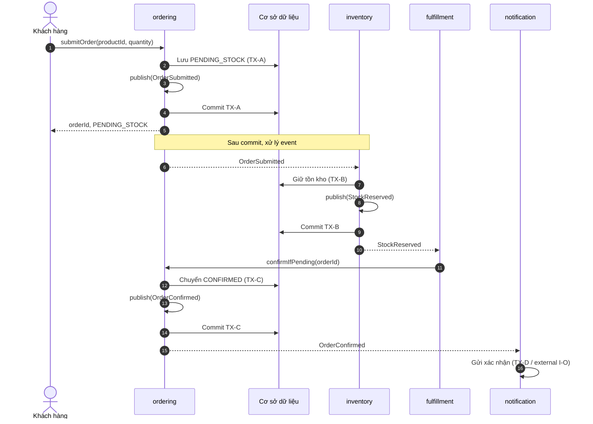
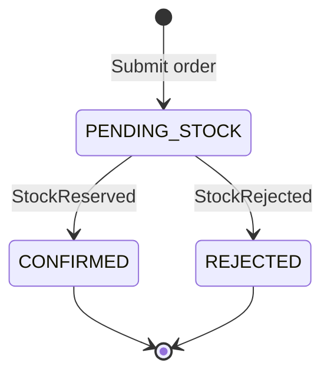
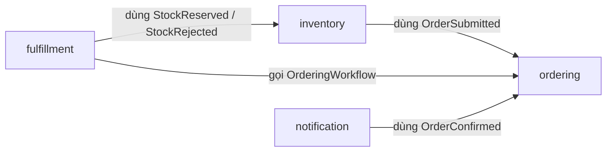
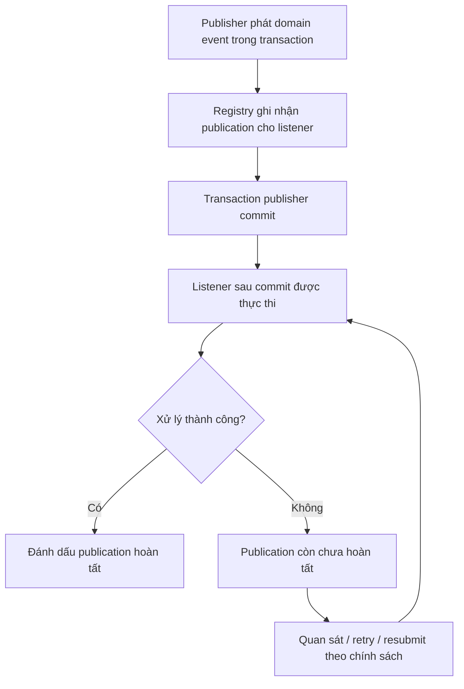

# Luồng nghiệp vụ xuyên module trong Spring Modulith

## 1. Vấn đề: một nghiệp vụ thường đi qua nhiều module

Trong một ứng dụng Spring Boot được tổ chức bằng **Spring Modulith**, mỗi application module chịu trách nhiệm cho một năng lực nghiệp vụ, nhưng một yêu cầu của người dùng hiếm khi chỉ liên quan đến một module. Ví dụ, thao tác đặt hàng có thể cần ghi đơn hàng, giữ số lượng tồn kho, xác nhận đơn, gửi email và cập nhật số liệu kinh doanh.

Nếu `ordering` gọi trực tiếp các repository nội bộ của `inventory`, `notification` và `analytics`, mã nguồn sẽ nhanh chóng phụ thuộc chéo. Nếu chuyển mọi thứ thành application event mà không thiết kế trạng thái, giao dịch và xử lý lỗi, hệ thống lại có nguy cơ lưu đơn thành công nhưng không giữ được tồn kho, gửi thông báo trùng hoặc bỏ sót một bước nghiệp vụ.

**Luồng nghiệp vụ xuyên module** là chuỗi bước phối hợp giữa nhiều application module để đạt một kết quả nghiệp vụ chung. Thiết kế luồng này cần trả lời rõ:

1. Module nào sở hữu dữ liệu và quy tắc của từng bước?
2. Khi nào cần kết quả đồng bộ, khi nào có thể phản ứng sau qua sự kiện?
3. Giao dịch nào đã commit và bước tiếp theo bắt đầu ở thời điểm nào?
4. Nếu một bước thất bại hoặc được thực thi lại, hệ thống phục hồi ra sao?
5. Sự kiện và API nào được công bố mà không làm rò rỉ lớp nội bộ?

Với phạm vi **SPRING_MODULITH_APPLICATION_EVENTS**, bài học tập trung vào cách phối hợp các module bằng Spring application events và `@ApplicationModuleListener`, kết hợp xử lý sau commit, Event Publication Registry, retry, kiểm thử và quan sát để tạo một luồng nghiệp vụ có ranh giới rõ ràng.

## 2. Phân biệt ranh giới module và ranh giới giao dịch

Một **application module** là ranh giới kiến trúc trong ứng dụng, thường tương ứng với một nhóm package nghiệp vụ. Nó không mặc nhiên là tiến trình riêng, database riêng hoặc transaction riêng. Nhiều module Spring Modulith có thể chạy trong **cùng một JVM** và cùng một ứng dụng triển khai.

Một **transaction** là ranh giới nguyên tử đối với các tài nguyên tham gia giao dịch đó. Hai module gọi nhau đồng bộ có thể tham gia cùng một giao dịch Spring nếu dùng cùng transaction manager và cấu hình propagation phù hợp. Ngược lại, listener sau commit thường bắt đầu một giao dịch khác: dữ liệu đã ghi ở bước đầu vẫn tồn tại ngay cả khi bước sau thất bại.

| Ranh giới | Trả lời câu hỏi | Ví dụ |
| --- | --- | --- |
| Module | Ai sở hữu hành vi và được phép công bố hợp đồng nào? | `inventory` sở hữu quy tắc giữ tồn kho |
| Public API | Module khác được phép gọi hoặc lắng nghe những gì? | `InventoryAvailability`, `OrderSubmitted` |
| Transaction | Những thay đổi nào commit hoặc rollback cùng nhau? | Ghi `Order(PENDING_STOCK)` trong giao dịch A |
| Event | Điều gì đã xảy ra, và module nào muốn phản ứng? | `OrderSubmitted`, `StockReserved` |
| Workflow | Những trạng thái và bước nào tạo thành một kết quả nghiệp vụ? | `PENDING_STOCK → CONFIRMED/REJECTED` |

Điều quan trọng là **ranh giới module không đồng nghĩa với ranh giới transaction**. Khi chọn sự kiện chạy sau commit, nhóm phát triển chấp nhận rằng các bước sau có thể hoàn tất muộn và cần cơ chế xử lý lỗi.

## 3. Ba cách phối hợp giữa các module

### 3.1. Gọi API trực tiếp khi cần câu trả lời ngay

Nếu `ordering` phải kiểm tra điều kiện bán hàng trước khi chấp nhận đơn, module có thể gọi API công khai của `inventory`:

```java
// API do inventory công bố; chi tiết repository nằm trong inventory.internal.
package com.example.shop.inventory;

import java.util.UUID;

public interface InventoryAvailability {
    boolean isAvailable(UUID productId, int quantity);
}
```

```java
// Đoạn minh họa bên trong ordering.internal
if (!inventoryAvailability.isAvailable(productId, quantity)) {
    throw new InsufficientStockException(productId);
}
```

Ưu điểm là lời gọi có kết quả tức thời và đường đi xử lý dễ theo dõi. Đổi lại, `ordering` phụ thuộc vào API `inventory`, và lời gọi này không tự giải quyết mọi vấn đề đồng thời: **kiểm tra còn hàng không tương đương với giữ hàng**. Nếu hai người cùng đặt sản phẩm, logic giữ tồn kho vẫn phải bảo vệ invariant bằng khóa, version hoặc cập nhật nguyên tử.

### 3.2. Phát application event khi muốn module khác tự phản ứng

Sau khi tạo đơn hàng, `ordering` có thể phát sự kiện `OrderSubmitted`. Module `inventory` lắng nghe, tự thực hiện bước giữ hàng và phát kết quả. Module `ordering` không cần biết lớp listener hay repository bên trong `inventory`.

```java
events.publishEvent(new OrderSubmitted(
        UUID.randomUUID(), orderId, productId, quantity));
```

Sự kiện thể hiện **sự thật nghiệp vụ đã xảy ra**, khác với mệnh lệnh gọi một thao tác của module khác. `OrderSubmitted` có thể được các module quan tâm lắng nghe, nhưng chính sách xử lý và độ trễ phải được thiết kế rõ.

### 3.3. Điều phối nhiều bước bằng workflow

Với quy trình có trạng thái trung gian, nhiều nhánh rẽ hoặc cần bù trừ, nên có một thành phần chịu trách nhiệm **theo dõi tiến trình nghiệp vụ**. Thành phần này có thể là module `fulfillment` chuyên điều phối kết quả sau khi giữ tồn kho, hoặc một application service gọi API công khai của các module liên quan.

Hai cách phối hợp thường gặp:

- **Choreography:** từng module nghe sự kiện liên quan rồi phát sự kiện tiếp theo; ít thành phần điều phối trung tâm nhưng khó theo dõi nếu chuỗi kéo dài.
- **Orchestration:** một module điều phối ghi nhận trạng thái và yêu cầu module khác thực hiện các bước thông qua API hoặc command; dễ thể hiện quy trình tổng thể nhưng cần tránh biến nó thành nơi chứa toàn bộ logic nghiệp vụ.

Không có yêu cầu mọi luồng phải dùng riêng một kiểu. Trong thực tế, một ứng dụng có thể gọi trực tiếp để bảo vệ bất biến nghiệp vụ, rồi dùng events cho các bước sau commit.

| Tiêu chí | Gọi API trực tiếp | Application event | Module điều phối |
| --- | --- | --- | --- |
| Cần kết quả tức thời | Phù hợp | Không phù hợp khi listener bất đồng bộ | Tùy bước được điều phối |
| Mức độ biết module đích | Biết public API đích | Bên phát không cần biết listener | Biết các public API và event kết quả |
| Xử lý thất bại | Lỗi có thể trả về caller | Cần retry, registry và quan sát | Cần chính sách trạng thái, timeout, bù trừ |
| Quy trình nhiều nhánh | Dễ thành chuỗi gọi dài | Dễ phân tán khó lần vết | Rõ nơi quản lý tiến trình |
| Bước phụ sau commit | Có thể làm tăng thời gian phản hồi | Rất phù hợp | Có thể kết hợp events |

## 4. Ví dụ xuyên suốt: đặt hàng → giữ tồn kho → xác nhận → thông báo

Xét các module sau:

- **`ordering`**: tạo đơn với trạng thái `PENDING_STOCK`, công bố `OrderSubmitted`, cung cấp API xác nhận hoặc từ chối đơn; sở hữu trạng thái đơn hàng.
- **`inventory`**: nhận `OrderSubmitted`, quyết định giữ hàng theo dữ liệu của chính nó; công bố `StockReserved` hoặc `StockRejected`.
- **`fulfillment`**: nghe kết quả từ `inventory`, gọi **public API** của `ordering` để chuyển đơn sang trạng thái cuối phù hợp.
- **`notification`**: nhận `OrderConfirmed` hoặc `OrderRejected` của `ordering` để gửi thông báo sau khi kết quả đơn hàng đã commit.

Luồng thành công:



Đây là **luồng bất đồng bộ theo nhiều giao dịch**, dù các module cùng chạy trong một ứng dụng. Khách hàng nhận trạng thái `PENDING_STOCK` trước; khi bước giữ tồn kho hoàn tất, đơn mới chuyển `CONFIRMED` hoặc `REJECTED`. Nếu nghiệp vụ buộc phải biết ngay kết quả giữ hàng, nên cân nhắc cách gọi public API đồng bộ trong một giao dịch được thiết kế phù hợp.

### 4.1. Mô hình trạng thái



| Sự kiện / kết quả | Chủ thể sở hữu | Trạng thái đơn trước | Trạng thái đơn sau | Hệ quả |
| --- | --- | --- | --- | --- |
| Submit thành công | `ordering` | Chưa có | `PENDING_STOCK` | Phát `OrderSubmitted` |
| Giữ hàng thành công | `inventory` | `PENDING_STOCK` | Chưa đổi ngay | Phát `StockReserved` |
| Xác nhận sau khi giữ hàng | `ordering` qua `fulfillment` | `PENDING_STOCK` | `CONFIRMED` | Phát `OrderConfirmed` |
| Giữ hàng thất bại | `inventory` | `PENDING_STOCK` | Chưa đổi ngay | Phát `StockRejected` |
| Từ chối sau kết quả giữ hàng | `ordering` qua `fulfillment` | `PENDING_STOCK` | `REJECTED` | Phát `OrderRejected` |

Đặt trạng thái và các phép chuyển trạng thái trong `ordering` giúp tránh trường hợp `inventory` hoặc `notification` cập nhật thẳng bảng đơn hàng. `fulfillment` chỉ điều phối bằng hợp đồng công khai và không sở hữu dữ liệu đơn.

## 5. Công bố contract sự kiện ở API module

Với cấu trúc mặc định của Spring Modulith, các package con trực tiếp dưới base package của ứng dụng thường được nhận diện là application module. Kiểu mà module khác sử dụng được đặt ở **API công khai** của module; các lớp triển khai, listener và repository được giữ trong `internal`.

```text
com.example.shop
├── ShopApplication.java
├── ordering
│   ├── OrderSubmitted.java             <-- API/event công khai
│   ├── OrderConfirmed.java             <-- API/event công khai
│   ├── OrderRejected.java
│   ├── OrderingWorkflow.java           <-- API chuyển trạng thái đơn
│   └── internal
│       ├── OrderingService.java
│       └── OrderRepository.java
├── inventory
│   ├── StockReserved.java              <-- API/event công khai
│   ├── StockRejected.java
│   └── internal
│       ├── StockReservationListener.java
│       └── ReservationRepository.java
├── fulfillment
│   └── internal
│       └── StockResultListener.java
└── notification
    └── internal
        └── OrderNotificationListener.java
```

Ví dụ contract `OrderSubmitted`:

```java
// ordering/OrderSubmitted.java
package com.example.shop.ordering;

import java.util.UUID;

public record OrderSubmitted(
        UUID eventId,
        UUID orderId,
        UUID productId,
        int quantity) {}
```

```java
// inventory/StockReserved.java
package com.example.shop.inventory;

import java.util.UUID;

public record StockReserved(UUID orderId) {}
```

```java
// inventory/StockRejected.java
package com.example.shop.inventory;

import java.util.UUID;

public record StockRejected(UUID orderId, String reason) {}
```

```java
// ordering/OrderConfirmed.java
package com.example.shop.ordering;

import java.util.UUID;

public record OrderConfirmed(UUID orderId) {}
```

Các `record` bất biến, có dữ liệu tối thiểu để thể hiện nghiệp vụ. `eventId` nhận diện một lần phát sự kiện; `orderId` là khóa nghiệp vụ dùng để liên hệ các bước. Với hệ thống cần truy vết xuyên nhiều bước, có thể thêm `correlationId`, thời điểm phát và phiên bản hợp đồng. Không nhồi JPA entity, bean Spring hoặc object nội bộ vào payload event.

Khi thay đổi contract đã có listener phụ thuộc, cần đánh giá tương thích: thêm field bắt buộc, đổi tên hoặc đổi ý nghĩa event có thể phá hỏng consumer. Một sự kiện nói `OrderSubmitted` phải được phát theo đúng ý nghĩa “đơn đã được tiếp nhận”, tránh đổi ngầm thành “đơn đã được xác nhận”.

## 6. Triển khai publisher và listener theo từng module

Các đoạn mã sau minh họa vị trí trách nhiệm. Những interface lưu trữ như `OrderRepository`, `ReservationRepository`, kiểu `ReservationOutcome` và logic gửi email được giả định thuộc module tương ứng, cần cài đặt khi xây dựng dự án chạy thật.

### 6.1. `ordering`: lưu đơn rồi phát `OrderSubmitted`

```java
// ordering/internal/OrderingService.java
package com.example.shop.ordering.internal;

import com.example.shop.ordering.OrderSubmitted;
import java.util.UUID;
import org.springframework.context.ApplicationEventPublisher;
import org.springframework.stereotype.Service;
import org.springframework.transaction.annotation.Transactional;

@Service
public class OrderingService {

    private final OrderRepository orders;
    private final ApplicationEventPublisher events;

    public OrderingService(OrderRepository orders,
                           ApplicationEventPublisher events) {
        this.orders = orders;
        this.events = events;
    }

    @Transactional
    public UUID submitOrder(UUID productId, int quantity) {
        if (quantity <= 0) {
            throw new IllegalArgumentException("Quantity must be positive");
        }

        UUID orderId = orders.createPending(productId, quantity);
        events.publishEvent(new OrderSubmitted(
                UUID.randomUUID(), orderId, productId, quantity));
        return orderId;
    }
}
```

Thao tác tạo đơn ở trạng thái `PENDING_STOCK` là trách nhiệm duy nhất của `ordering`. Lệnh `publishEvent(...)` xảy ra trong phương thức có `@Transactional`; listener theo transaction sẽ xử lý theo phase được cấu hình. Nếu transaction tạo đơn rollback, listener sau commit sẽ không được kích hoạt.

Lưu ý: `ApplicationEventPublisher` là cơ chế phát sự kiện **trong ứng dụng Spring**, không mặc định đẩy dữ liệu lên Kafka/RabbitMQ. Nếu cần truyền sự kiện ra hệ thống khác, phải thiết kế kênh tích hợp và đặc tính giao nhận riêng.

### 6.2. `inventory`: xử lý sau commit và phát kết quả

```java
// inventory/internal/StockReservationListener.java
package com.example.shop.inventory.internal;

import com.example.shop.ordering.OrderSubmitted;
import com.example.shop.inventory.StockReserved;
import com.example.shop.inventory.StockRejected;
import org.springframework.context.ApplicationEventPublisher;
import org.springframework.modulith.events.ApplicationModuleListener;
import org.springframework.stereotype.Component;

@Component
public class StockReservationListener {

    private final ReservationRepository reservations;
    private final ApplicationEventPublisher events;

    public StockReservationListener(ReservationRepository reservations,
                                    ApplicationEventPublisher events) {
        this.reservations = reservations;
        this.events = events;
    }

    @ApplicationModuleListener
    public void on(OrderSubmitted event) {
        ReservationOutcome outcome = reservations.reserveOnce(
                event.orderId(), event.productId(), event.quantity());

        if (outcome.reserved()) {
            events.publishEvent(new StockReserved(event.orderId()));
        } else {
            events.publishEvent(new StockRejected(
                    event.orderId(), outcome.reason()));
        }
    }
}
```

Ở đây `reserveOnce(...)` được **thiết kế** là thao tác idempotent: nếu cùng đơn được xử lý lại, nó trả về kết quả giữ hàng đã lưu thay vì trừ tồn kho lần nữa. Cách thực hiện có thể dùng ràng buộc duy nhất theo `orderId` và cập nhật tồn kho có bảo vệ đồng thời. Đây là yêu cầu đối với lớp repository minh họa, không phải hành vi Spring Modulith tự cung cấp.

`@ApplicationModuleListener` trong Spring Modulith kết hợp cách lắng nghe application event dựa trên transaction với thực thi bất đồng bộ và một giao dịch dành cho listener. Mô hình phù hợp ở đây là `OrderSubmitted` chỉ được xử lý sau khi giao dịch tạo đơn commit thành công. Giao dịch giữ tồn kho của listener độc lập với giao dịch tạo đơn ban đầu.

### 6.3. `fulfillment`: hoàn tất trạng thái bằng public API

```java
// ordering/OrderingWorkflow.java
package com.example.shop.ordering;

import java.util.UUID;

public interface OrderingWorkflow {
    void confirmIfPending(UUID orderId);
    void rejectIfPending(UUID orderId, String reason);
}
```

```java
// fulfillment/internal/StockResultListener.java
package com.example.shop.fulfillment.internal;

import com.example.shop.inventory.StockReserved;
import com.example.shop.inventory.StockRejected;
import com.example.shop.ordering.OrderingWorkflow;
import org.springframework.modulith.events.ApplicationModuleListener;
import org.springframework.stereotype.Component;

@Component
public class StockResultListener {

    private final OrderingWorkflow orders;

    public StockResultListener(OrderingWorkflow orders) {
        this.orders = orders;
    }

    @ApplicationModuleListener
    public void on(StockReserved event) {
        orders.confirmIfPending(event.orderId());
    }

    @ApplicationModuleListener
    public void on(StockRejected event) {
        orders.rejectIfPending(event.orderId(), event.reason());
    }
}
```

Implementation của `OrderingWorkflow` nằm trong `ordering.internal` và phải chuyển trạng thái **có điều kiện**. Ví dụ, `confirmIfPending()` chỉ chuyển `PENDING_STOCK → CONFIRMED` khi đơn còn ở trạng thái chờ; chỉ khi chuyển thành công mới phát `OrderConfirmed`. Một lần nhận lại `StockReserved` sau khi đơn đã `CONFIRMED` không được tạo xác nhận hoặc sự kiện mới vô hạn.

Kỹ thuật cập nhật có điều kiện thường dùng là:

```sql
UPDATE orders
SET status = 'CONFIRMED'
WHERE id = :order_id
  AND status = 'PENDING_STOCK';
```

Chỉ khi số dòng được cập nhật là 1 mới thực hiện các hành vi tương ứng với **lần chuyển trạng thái đầu tiên**, chẳng hạn phát `OrderConfirmed`. Tất cả phải nằm trong transaction phù hợp.

### 6.4. `notification`: phản ứng với kết quả cuối cùng

```java
// notification/internal/OrderNotificationListener.java
package com.example.shop.notification.internal;

import com.example.shop.ordering.OrderConfirmed;
import org.springframework.modulith.events.ApplicationModuleListener;
import org.springframework.stereotype.Component;

@Component
public class OrderNotificationListener {

    private final NotificationSender sender;

    public OrderNotificationListener(NotificationSender sender) {
        this.sender = sender;
    }

    @ApplicationModuleListener
    public void on(OrderConfirmed event) {
        sender.sendConfirmation(event.orderId());
    }
}
```

Thông báo chỉ được gửi sau khi đơn được xác nhận, không phải ngay sau khi có `OrderSubmitted`. Một lần thất bại khi gửi email không có nghĩa phải rollback đơn hàng đã xác nhận. Đối với I/O ra hệ thống ngoài như email hoặc HTTP, phải xử lý khả năng gọi trùng, timeout, retry và kết quả “đã gửi nhưng chưa kịp ghi nhận hoàn tất”.

## 7. Kiểm soát hướng phụ thuộc: tránh vòng lặp module

Một lỗi kiến trúc dễ gặp là `inventory` lắng nghe `OrderSubmitted` thuộc `ordering`, còn `ordering` lại lắng nghe trực tiếp `StockReserved` thuộc `inventory`. Khi đó ở mức kiểu Java có thể xuất hiện vòng phụ thuộc **`inventory → ordering → inventory`**, làm vi phạm ranh giới module.

Trong ví dụ này, `fulfillment` đảm nhiệm bước nối kết quả tồn kho về đơn hàng thông qua public API. Hướng phụ thuộc trong **mã nguồn** như sau:



`ordering` không import các event hoặc lớp nội bộ của `inventory`; `inventory` không gọi repository của `ordering`. Phụ thuộc hướng về các API được công bố và không có chu trình trong đồ thị này. Đây là ví dụ về **hướng phụ thuộc mã nguồn**, vốn khác với thứ tự runtime mà sự kiện di chuyển.

Nếu một bài toán thực sự đòi hỏi trao đổi hai chiều, có thể cân nhắc một module hợp đồng riêng phù hợp, một module điều phối, hoặc thiết kế lại ranh giới nghiệp vụ. Không nên tạo vòng import rồi coi application events là đã giải quyết được phụ thuộc.

Spring Modulith có thể kiểm tra mô hình:

```java
package com.example.shop;

import org.junit.jupiter.api.Test;
import org.springframework.modulith.core.ApplicationModules;

class ModulithArchitectureTests {
    @Test
    void modulesRespectDependencies() {
        ApplicationModules.of(ShopApplication.class).verify();
    }
}
```

Đưa phép kiểm tra này vào CI giúp phát hiện phụ thuộc vòng và các phụ thuộc không phù hợp vào phần nội bộ module. Việc tách package `internal` chỉ là quy ước cấu trúc; cần kiểm tra kiến trúc để phát hiện vi phạm trong quá trình phát triển.

## 8. Transaction và thời điểm xử lý event

### 8.1. `@EventListener`, `@TransactionalEventListener` và `@ApplicationModuleListener`

| Annotation | Thời điểm / ngữ nghĩa chính | Tác động lên luồng |
| --- | --- | --- |
| `@EventListener` | Listener sự kiện Spring thông thường; với multicaster mặc định thường chạy đồng bộ lúc publish | Lỗi listener có thể ảnh hưởng lời gọi publisher và transaction hiện tại |
| `@TransactionalEventListener` | Gắn listener với phase của transaction; mặc định `AFTER_COMMIT` | Chỉ phản ứng khi transaction đạt phase đã chọn; không mặc nhiên chạy bất đồng bộ |
| `@ApplicationModuleListener` | Shortcut của Spring Modulith cho transactional event listener bất đồng bộ với giao dịch riêng | Phù hợp cho tương tác giữa các module sau khi bước phát commit |

Ví dụ dùng `@TransactionalEventListener` của Spring Framework khi muốn chủ động chọn phase:

```java
@TransactionalEventListener(phase = TransactionPhase.AFTER_COMMIT)
public void afterOrderCommitted(OrderSubmitted event) {
    // Xử lý sau khi giao dịch đặt hàng đã commit.
}
```

Với transactional listener, sự kiện được công bố khi không có transaction sẽ **không được gọi theo mặc định** (trừ khi cấu hình `fallbackExecution`). Vì vậy, cần kiểm tra transaction thực tế tại nơi publisher phát event, tránh hiểu rằng chỉ cần `publishEvent()` là luôn kích hoạt được listener.

### 8.2. Vì sao “sau commit” tạo ra nhất quán cuối cùng?

Xét ba giao dịch:

- **TX-A**: `ordering` lưu đơn `PENDING_STOCK`, phát `OrderSubmitted`, commit.
- **TX-B**: `inventory` nhận event, giữ hàng, phát `StockReserved`, commit.
- **TX-C**: `fulfillment` nhận kết quả, gọi `ordering` xác nhận đơn, commit.

Nếu TX-B lỗi, **TX-A đã commit không tự rollback**. Trong khoảng thời gian trước khi B/C hoàn tất, khách hàng có thể đọc đơn đang `PENDING_STOCK`. Đây là sự đánh đổi cần chấp nhận và thể hiện bằng trạng thái, timeout, retry hoặc hành động khôi phục.

Một workflow đa giao dịch không có tính nguyên tử end-to-end như một giao dịch SQL duy nhất. Nếu nghiệp vụ không chấp nhận trạng thái trung gian, nên lựa chọn thiết kế đồng bộ hoặc thay đổi cách xác lập điểm xác nhận nghiệp vụ.

## 9. Event Publication Registry, retry và idempotency

### 9.1. Event Publication Registry giải quyết điều gì?

Khi publisher commit thành công nhưng listener không kịp xử lý, hệ thống cần biết **sự kiện nào đã được chuyển đến transactional listener và chưa được ghi nhận hoàn tất**. Spring Modulith cung cấp **Event Publication Registry** để theo dõi publication phục vụ giao sự kiện đáng tin cậy. Khi có triển khai lưu trữ bền vững và cấu hình tương ứng (ví dụ triển khai dựa trên JDBC/JPA), registry có thể giữ thông tin publication chưa hoàn tất qua sự cố của tiến trình.

Luồng khái quát:



Đây là sơ đồ khái niệm về vòng đời publication; hành vi chi tiết phụ thuộc cấu hình registry và cơ chế tái xử lý đang dùng. **Chỉ thêm `@ApplicationModuleListener` không đồng nghĩa có lưu bền vững hoặc tự động retry vô hạn**. Cần chọn triển khai lưu trữ và thiết lập chính sách retry/resubmission phù hợp với phiên bản Spring Modulith của dự án.

### 9.2. Vì sao listener phải idempotent?

Trong hệ thống có retry, cùng event hoặc cùng tác động nghiệp vụ có thể được xử lý nhiều lần. Nếu mỗi lần nhận `OrderSubmitted` đều trừ tiếp số lượng tồn kho, chỉ một lỗi tạm thời có thể khiến số lượng bị trừ hai lần.

Cần một khóa idempotency phù hợp với thao tác:

| Thao tác | Khóa gợi ý | Nguyên tắc |
| --- | --- | --- |
| Giữ tồn kho cho đơn | `orderId` | Mỗi đơn chỉ có một kết quả giữ hàng hợp lệ theo chính sách của hệ thống |
| Xác nhận đơn | `orderId` + trạng thái hiện tại | Chỉ chuyển từ `PENDING_STOCK` một lần |
| Áp dụng một event riêng lẻ | `(consumerName, eventId)` | Đánh dấu đã xử lý trong cùng giao dịch với cập nhật dữ liệu |
| Gửi thông báo | `(orderId, notificationType)` | Chống tạo trùng thông báo; nếu provider hỗ trợ thì truyền idempotency key |

Mô hình dữ liệu tối thiểu có thể là:

```sql
CREATE TABLE stock_reservation (
    order_id UUID PRIMARY KEY,
    product_id UUID NOT NULL,
    quantity INTEGER NOT NULL,
    result VARCHAR(20) NOT NULL
);
```

Ràng buộc unique trên `order_id` chỉ là **một phần** của giải pháp: cần xử lý cạnh tranh cập nhật lượng tồn kho và trả lại kết quả đã ghi khi xử lý trùng. Với consumer khác nhau hoặc nhiều lần thử của cùng đơn, hãy chọn khóa business và chính sách phiên bản/tái đặt phù hợp.

### 9.3. Retry phải có giới hạn và khả năng quan sát

Thất bại có thể thuộc nhiều loại:

- **Tạm thời:** database timeout, email provider trả 503; có thể retry với backoff.
- **Dữ liệu hoặc quy tắc nghiệp vụ:** hết tồn kho; thường nên trả về kết quả `StockRejected`, không retry vô hạn như lỗi kỹ thuật.
- **Lỗi lập trình hoặc contract:** event thiếu thông tin, consumer không hiểu schema; cần cảnh báo và sửa nguyên nhân.
- **Bước đã thực hiện một phần:** đã giữ hàng nhưng bước cập nhật trạng thái đơn thất bại; cần retry đúng bước hoặc thực hiện bù trừ.

Không được coi “listener method không ném exception” là thành công nếu nó đã âm thầm nuốt lỗi nghiệp vụ. Ngược lại, không nên ném exception cho kết quả nghiệp vụ dự kiến như không đủ tồn kho; hãy phát event kết quả rõ ràng.

Ngay cả khi registry ghi nhận publication của listener, một HTTP request hoặc email gửi thành công rồi mất kết nối trước khi ghi trạng thái có thể bị gọi lại. Do đó, registry cộng với idempotency là hai trách nhiệm bổ sung cho nhau; không có cam kết **exactly once** cho mọi hiệu ứng bên ngoài.

## 10. Khi một bước thất bại: xử lý và bù trừ

Giả sử `inventory` đã giữ hàng thành công nhưng `fulfillment` không gọi được `ordering.confirmIfPending()`. Hệ thống khi đó có thể ở trạng thái:

```text
ordering:  PENDING_STOCK
inventory: RESERVED
fulfillment: publication chưa hoàn tất / xử lý lỗi
```

Cách phục hồi hợp lý trước tiên là **retry bước hoàn tất đơn** sau khi xác minh nó có thể chạy lại an toàn. Nếu hết thời hạn nghiệp vụ và không thể xác nhận, cần quy trình bù trừ có chủ đích để giải phóng phần tồn kho đã giữ; không thể trông đợi một rollback SQL tự động đảo ngược TX-B.

Một số quy tắc vận hành:

1. Mỗi trạng thái trung gian phải có thời hạn hoặc quy tắc xử lý nếu tồn tại quá lâu.
2. Mỗi event phải liên hệ được với `orderId` và luồng nghiệp vụ cụ thể.
3. Các thao tác hoàn tất, từ chối, giải phóng tồn kho phải có điều kiện chuyển trạng thái hợp lệ.
4. Hành vi bù trừ là một nghiệp vụ mới (chẳng hạn `StockReleased`), không phải “xóa lịch sử” của bước đã commit.
5. Retry phải biết bước đã thực hiện thành công hay chưa và phải an toàn khi kết quả nhận bị trễ hoặc lặp.

Chỉ thêm các event `StockReserved`, `OrderConfirmed` không đủ để tự động tạo cơ chế saga đầy đủ. Với quy trình nhiều bước kéo dài, nhóm phát triển phải chủ động xác định timeout, điều kiện hủy, bù trừ và nguồn sự thật của trạng thái cuối.

## 11. Kiểm thử luồng xuyên module

Kiểm thử nên đặt câu hỏi về **hành vi quan sát được**, thay vì chỉ xác nhận một method được gọi. Nên tổ chức các cấp độ:

| Cấp kiểm thử | Trọng tâm | Tình huống minh họa |
| --- | --- | --- |
| Kiến trúc | Module không có vòng phụ thuộc và không truy cập `internal` của nhau | `ApplicationModules.verify()` |
| Unit theo module | Quy tắc nghiệp vụ và chuyển trạng thái | `reserveOnce()` không trừ hàng hai lần |
| Module integration | Publisher phát đúng event và listener áp dụng đúng dữ liệu | Đơn `PENDING_STOCK` phát `OrderSubmitted` |
| Workflow integration | Nhiều module cùng hợp tác sau commit | `OrderSubmitted → StockReserved → OrderConfirmed` |
| Failure/retry | Thất bại ở từng bước vẫn giữ trạng thái hợp lệ | Listener gửi lỗi một lần, retry không tạo đơn trùng |

Spring Modulith hỗ trợ **`@ApplicationModuleTest`** để kiểm thử một module theo ranh giới đã xác định, cùng API kiểm thử kịch bản sự kiện như `Scenario` ở các phiên bản hỗ trợ. Ví dụ cách đánh dấu một test module:

```java
import org.junit.jupiter.api.Test;
import org.springframework.modulith.test.ApplicationModuleTest;

@ApplicationModuleTest
class OrderingModuleTests {
    @Test
    void placeholderForOrderSubmittedScenario() {
        // Khởi tạo điều kiện nghiệp vụ, phát đơn
        // và kiểm tra OrderSubmitted đã được công bố.
    }
}
```

Đây là **khung định hướng**, không phải test hoàn chỉnh. Khi triển khai cần inject service và các thành phần kiểm thử phù hợp, sử dụng fixture thật và assert kết quả. Không nên dùng `Thread.sleep()` cố định để chờ listener bất đồng bộ; nên chờ điều kiện/sự kiện qua hỗ trợ testing của Spring Modulith hoặc cơ chế await có timeout rõ ràng.

Các kịch bản tối thiểu cho ví dụ đặt hàng:

1. **Happy path:** tạo đơn, giữ đủ hàng, xác nhận đơn, phát `OrderConfirmed`, gửi đúng một thông báo về mặt nghiệp vụ.
2. **Out of stock:** giữ hàng từ chối, đơn sang `REJECTED`, không phát `OrderConfirmed`.
3. **Duplicate delivery:** phát lại `OrderSubmitted` hoặc `StockReserved`, số lượng giữ và trạng thái cuối không bị lặp.
4. **Listener failure:** cố ý làm bước sau commit lỗi, kiểm tra trạng thái trung gian và publication chưa hoàn tất khi có registry bền vững.
5. **Replay:** tái xử lý sau khi sửa lỗi, workflow đi đến trạng thái cuối hợp lệ.
6. **Concurrent orders:** nhiều đơn cùng giữ sản phẩm cuối cùng, không cho số lượng tồn kho âm.
7. **Boundary check:** cố tình import `ordering.internal.OrderRepository` từ module khác để xác nhận kiểm tra kiến trúc phát hiện vi phạm.

## 12. Quan sát luồng đang chạy trong thực tế

Với xử lý bất đồng bộ, “API trả 200 OK” chỉ chứng minh request ban đầu đã được tiếp nhận; nó chưa chứng minh toàn bộ workflow kết thúc. Vì vậy, nên theo dõi đồng thời:

- **Trạng thái nghiệp vụ:** số đơn `PENDING_STOCK` theo thời gian, số đơn chuyển `CONFIRMED`/`REJECTED`, những đơn bị kẹt lâu.
- **Tình trạng event:** số publication chưa hoàn tất, tuổi của publication cũ nhất, số lần retry và lỗi cuối cùng theo listener.
- **Độ trễ:** từ `OrderSubmitted` tới `StockReserved` và từ `StockReserved` tới `OrderConfirmed`.
- **Tính đúng đắn:** số thao tác bị loại do idempotency, số đơn cần bù trừ hoặc can thiệp.

Một log có thể chứa các trường:

```json
{
  "eventType": "StockReserved",
  "eventId": "49dba047-70b7-4c5f-a8ac-261b1d77096c",
  "correlationId": "ae1d267d-0d4e-4d98-b824-971d3e43a25f",
  "orderId": "c7e33e9d-6919-4c5f-bb38-7f26dc611bf1",
  "module": "inventory",
  "result": "RESERVED"
}
```

`correlationId` cho phép nối các log của nhiều module vào cùng một yêu cầu nghiệp vụ. Nếu đã dùng Micrometer Tracing, Actuator hoặc công cụ observability khác, có thể kết hợp trace/span với các khóa nghiệp vụ này. Không nên log thông tin thanh toán, dữ liệu cá nhân hoặc payload nhạy cảm của sự kiện khi không có nhu cầu và biện pháp bảo vệ phù hợp.

Một dashboard vận hành tốt phải cho thấy **luồng nào đang chờ, vì sao và có thể làm gì tiếp theo**. Đếm số event phát ra mà không theo dõi publication chưa hoàn tất và trạng thái đơn hàng sẽ khó phát hiện nghiệp vụ mắc kẹt.

## 13. Các sai lầm thường gặp khi thiết kế luồng xuyên module

| Sai lầm | Hậu quả | Cách thiết kế tốt hơn |
| --- | --- | --- |
| Cho module khác gọi trực tiếp repository `internal` | Rò rỉ chi tiết triển khai và phụ thuộc chéo | Dùng public API hoặc event |
| Dùng event bất đồng bộ cho kiểm tra bắt buộc có kết quả ngay | API trả thành công khi điều kiện cốt lõi còn chưa rõ | Dùng lời gọi đồng bộ cho invariant cần quyết định tức thời |
| Coi publish event đồng nghĩa listener đã hoàn thành | Trả trạng thái cuối quá sớm | Mô hình hóa trạng thái `PENDING_*` và tiến trình |
| Không xét vòng phụ thuộc khi nghe event giữa các module | Kiến trúc có chu trình | Phân tích đồ thị dependency, cân nhắc module điều phối |
| Retry listener nhưng không idempotent | Trừ tồn kho hoặc gửi thông báo lặp | Khóa idempotency và chuyển trạng thái có điều kiện |
| Nuốt lỗi listener để tránh exception | Registry tưởng xử lý thành công, mất cơ hội khôi phục | Phân biệt kết quả nghiệp vụ và lỗi kỹ thuật |
| Mong TX của publisher rollback bước đã commit sau đó | Trạng thái không nhất quán khó xử lý | Xác định transaction độc lập, retry và bù trừ |
| Chỉ test happy path | Không thấy lỗi khi trùng, timeout, concurrency | Test retry, lỗi, bù trừ, kiểm tra kiến trúc |
| Thiếu correlation ID và giám sát pending | Khó truy vết luồng mắc kẹt | Tracing và metric theo trạng thái nghiệp vụ |

## 14. Bài tập thực hành

**Bối cảnh:** Một cửa hàng triển khai ứng dụng Spring Boot theo các application module `ordering`, `inventory`, `fulfillment` và `notification`. Khi khách đặt một đơn có một sản phẩm, hệ thống tạo đơn `PENDING_STOCK`, giữ tồn kho, xác nhận hoặc từ chối đơn, rồi gửi thông báo về kết quả cuối.

**Nhiệm vụ:**

1. Tạo package cho bốn module và phân định API công khai so với `internal`.
2. Định nghĩa `OrderSubmitted`, `StockReserved`, `StockRejected`, `OrderConfirmed` dưới dạng `record`.
3. Viết publisher trong `ordering` với `@Transactional` và listener trong `inventory` bằng `@ApplicationModuleListener`.
4. Viết `OrderingWorkflow` để chỉ cho phép `PENDING_STOCK → CONFIRMED/REJECTED`; để `fulfillment` gọi interface này theo kết quả event.
5. Thêm listener trong `notification`, chỉ gửi sau `OrderConfirmed`.
6. Chạy `ApplicationModules.of(ShopApplication.class).verify()` để kiểm tra ranh giới và hướng dependency.
7. Cấu hình Event Publication Registry bền vững phù hợp, mô phỏng listener lỗi và thực hiện replay theo cơ chế phiên bản đang dùng.
8. Chạy lại cùng event và đồng thời tạo nhiều đơn để chứng minh giữ tồn kho, trạng thái đơn và thông báo không bị nhân đôi về mặt nghiệp vụ.
9. Bổ sung log theo `orderId`/`eventId` và truy vấn những đơn `PENDING_STOCK` vượt quá thời hạn dự kiến.

**Câu hỏi tự đánh giá:** Nếu `inventory` đã trừ tồn kho nhưng `ordering` vẫn `PENDING_STOCK`, bạn sẽ retry bước nào, dựa vào bằng chứng nào để biết việc giữ hàng đã thành công, và khi nào cần giải phóng lượng hàng đã giữ? Nếu một listener gửi email thành công nhưng chưa kịp ghi nhận hoàn tất trước khi tiến trình dừng, làm thế nào hạn chế gửi trùng khi retry?

## 15. Ghi nhớ

Thiết kế luồng xuyên module trong Spring Modulith bắt đầu từ **trách nhiệm nghiệp vụ và public contract**. Lời gọi trực tiếp phù hợp khi cần kết quả đồng bộ; application events giúp các module phản ứng sau khi một thay đổi đã xảy ra. Listener sau commit tách thời gian và giao dịch xử lý nên phải mô hình hóa trạng thái trung gian, retry, idempotency, xử lý bù trừ và quan sát. Event Publication Registry hỗ trợ theo dõi sự kiện chưa hoàn tất nhưng không thay thế logic nghiệp vụ đúng đắn hoặc bảo đảm exactly once cho các hệ thống ngoài. Một luồng tốt vừa có đồ thị phụ thuộc module hợp lệ, vừa có trạng thái và hành vi phục hồi có thể kiểm chứng bằng test.
