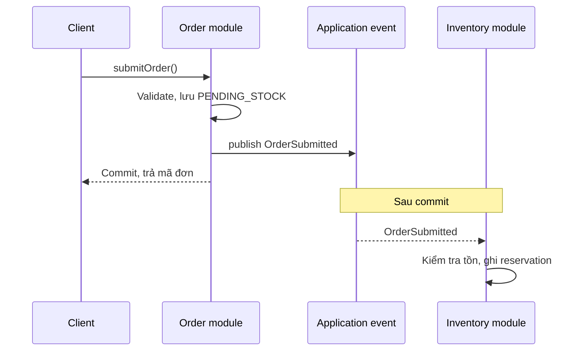
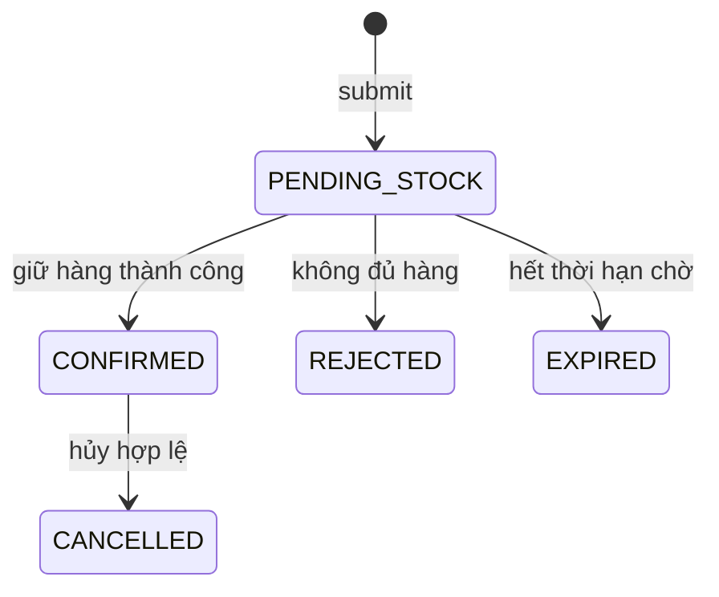

# Module sở hữu hành vi trong kiến trúc Spring Modulith

## 1. Ý nghĩa của việc module sở hữu hành vi

Trong kiến trúc theo module, việc chia mã nguồn thành các package như `order`, `inventory`, `payment` hay `notification` mới chỉ là bước đầu. Một module có ranh giới rõ ràng phải **sở hữu cả những quyết định nghiệp vụ và thao tác làm thay đổi trạng thái thuộc phạm vi của nó**. Module khác có thể yêu cầu một kết quả hoặc phản ứng trước một sự kiện, nhưng không nên tự thực thi quy tắc nội bộ thay cho module sở hữu.

Ví dụ, trong hệ thống bán hàng:

- `order` quyết định một đơn hàng có được tạo, hủy hoặc chuyển trạng thái hay không;
- `inventory` quyết định một yêu cầu giữ hàng có thể được đáp ứng và cập nhật lượng tồn như thế nào;
- `notification` quyết định nội dung, kênh và thời điểm gửi thông báo;
- `payment` quyết định một giao dịch thanh toán đã được ghi nhận hợp lệ hay chưa.

Nếu `order` tự sửa số lượng tồn kho bằng repository của `inventory`, hành vi giữ hàng thực tế đã bị chuyển ra khỏi nơi có trách nhiệm bảo vệ nó. Chỉ cần quy tắc tồn kho thay đổi, nhiều module có thể phải sửa theo; việc kiểm soát tính nhất quán và thử nghiệm cũng khó hơn.

Bài học thuộc chương **Kiến trúc theo module**, trong phạm vi **SPRING_MODULITH_APPLICATION_EVENTS**: tổ chức giao tiếp giữa các module Spring Modulith bằng **application events** để giảm phụ thuộc và bảo vệ ranh giới nghiệp vụ. Nguyên tắc sở hữu hành vi giải thích vì sao publisher, listener, xử lý sau commit, event publication registry, retry, kiểm thử và quan sát sự kiện cần được đặt đúng trách nhiệm.

### Sau bài này, bạn có thể

1. Xác định module nào chịu trách nhiệm thực hiện một hành vi nghiệp vụ và bảo vệ các bất biến liên quan.
2. Phân biệt sở hữu hành vi với vị trí đặt class, sở hữu dữ liệu và điều phối quy trình.
3. Nhận diện và sửa thiết kế nơi một module thao tác trực tiếp vào nội bộ module khác.
4. Thiết kế giao tiếp qua API công khai và application event mà không chuyển quyền quyết định nghiệp vụ sang module nhận sự kiện.
5. Liên hệ quyền sở hữu hành vi với transaction, idempotency, xử lý lỗi và kiểm thử Spring Modulith.

## 2. Hành vi nghiệp vụ bao gồm những gì?

**Hành vi** không đơn thuần là tên một method. Đó là một thao tác có ý nghĩa trong miền nghiệp vụ, thường bao gồm kiểm tra điều kiện, thay đổi trạng thái và bảo đảm các ràng buộc.

| Hành vi | Module sở hữu | Quy tắc cần bảo vệ | Kết quả có thể công khai |
| --- | --- | --- | --- |
| Tạo đơn hàng | `order` | Đơn có dòng hàng hợp lệ, trạng thái khởi tạo đúng | Mã đơn; sự kiện `OrderSubmitted` |
| Hủy đơn hàng | `order` | Không hủy đơn đã giao thành công hoặc vượt chính sách hủy | Trạng thái hủy; sự kiện `OrderCancelled` |
| Giữ tồn kho | `inventory` | Không giữ vượt lượng tồn khả dụng; không giữ lặp một yêu cầu | Kết quả giữ hàng; sự kiện kết quả nếu cần |
| Ghi nhận thanh toán | `payment` | Mã giao dịch không được ghi nhận hai lần | Trạng thái thanh toán; sự kiện `PaymentCaptured` |
| Gửi xác nhận | `notification` | Chọn mẫu/kênh gửi, chống gửi trùng theo chính sách | Trạng thái gửi thông báo |

Ba khái niệm thường đi cùng nhau:

- **Sở hữu dữ liệu:** module nắm quyền đọc/ghi và diễn giải mô hình dữ liệu thuộc miền của mình. Ví dụ `inventory` quản lý stock ledger và reservation; việc dùng chung database vật lý không chuyển quyền này cho `order`.
- **Sở hữu hành vi:** module quyết định cách kiểm tra và cập nhật trạng thái, chẳng hạn `inventory.reserve(...)` bảo đảm số lượng có thể giữ và tính idempotent.
- **Sở hữu hợp đồng giao tiếp:** module xác định phần thông tin và cách yêu cầu mà bên ngoài được phép sử dụng, chẳng hạn API công khai hoặc sự kiện `OrderSubmitted`.

Các loại sở hữu này liên quan chặt chẽ, nhưng không đồng nhất. Một module có thể cung cấp dữ liệu đọc cho module khác qua API mà vẫn giữ độc quyền điều chỉnh trạng thái. Cũng có những hành vi phải phối hợp qua nhiều module; khi ấy cần một thành phần điều phối, còn quy tắc và thay đổi trạng thái chi tiết vẫn nằm ở module tương ứng.

## 3. Vì sao chia package theo lớp kỹ thuật chưa đủ?

Một cấu trúc thường gặp trong ứng dụng monolith là:

```text
com.example.shop
├── controller/
├── service/
│   ├── OrderService.java
│   ├── InventoryService.java
│   └── PaymentService.java
├── repository/
└── entity/
```

Ở cấu trúc này, lớp của mọi miền nghiệp vụ cùng nằm trong các package kỹ thuật. Developer dễ import repository hoặc entity của miền khác và thực hiện nghiệp vụ ở bất cứ service nào.

Với cách chia theo năng lực nghiệp vụ, mỗi module chứa phần ứng dụng, miền nghiệp vụ và lưu trữ mà nó sở hữu:

```text
com.example.shop
├── ShopApplication.java
├── order/
│   ├── OrderSubmitted.java          # Sự kiện công khai
│   ├── OrderOperations.java         # API công khai (nếu cần)
│   └── internal/
│       ├── CheckoutService.java     # Điều phối use case của Order
│       ├── Order.java               # Quy tắc/trạng thái của đơn
│       └── OrderRepository.java     # Lưu trữ riêng của Order
├── inventory/
│   └── internal/
│       ├── OrderSubmittedListener.java
│       ├── StockReservationService.java
│       ├── StockReservation.java
│       └── StockRepository.java
└── notification/
    └── internal/
        ├── OrderSubmittedListener.java
        └── NotificationService.java
```

Trong cấu trúc mặc định của Spring Modulith, các package trực tiếp bên dưới package gốc ứng dụng thường được xác định là **application modules**. Những kiểu đặt tại package gốc của module tạo thành API mặc định; những package con như `internal` được dùng cho triển khai nội bộ, trừ khi chủ động công khai thông qua **named interface**. Điều đó giúp việc kiểm tra phụ thuộc thể hiện được ranh giới đã thiết kế.

> Module nghiệp vụ không nhất thiết là Gradle subproject, Maven module hay microservice. Các module Spring Modulith vẫn có thể chạy trong cùng JVM và cùng ứng dụng Spring Boot. Ranh giới được bảo vệ bởi thiết kế API, quy ước và kiểm tra kiến trúc.

## 4. Dấu hiệu một module đang chiếm hành vi của module khác

Giả sử `order` nhận yêu cầu đặt hàng và tự sửa tồn kho như sau:

```java
// Minh họa thiết kế sai: lớp thuộc order biết repository nội bộ inventory.
@Service
class CheckoutService {
    private final OrderRepository orders;
    private final StockRepository stocks; // inventory.internal.StockRepository

    @Transactional
    public void checkout(CheckoutCommand command) {
        for (var line : command.lines()) {
            var stock = stocks.findBySkuId(line.skuId()).orElseThrow();
            stock.setAvailable(stock.getAvailable() - line.quantity());
        }
        orders.save(Order.from(command));
    }
}
```

Vấn đề không nằm ở việc phép trừ khó hay dễ. Đoạn code làm cho `order` chịu trách nhiệm bảo vệ bất biến của `inventory`, dù `inventory` mới là nơi biết thế nào là tồn khả dụng, tồn đã giữ, giới hạn đặt trước, khóa cạnh tranh và chính sách hết hàng.

Thiết kế này dẫn đến ít nhất bốn rủi ro:

1. **Rò rỉ quy tắc:** Logic tồn kho phải được sao chép vào các use case đặt hàng, hủy hàng hoặc đổi hàng.
2. **Rò rỉ dữ liệu:** `order` phụ thuộc vào entity/schema lưu trữ của `inventory`.
3. **Khó bảo vệ đồng thời:** Hai service có thể cập nhật cùng số lượng theo những cơ chế locking khác nhau.
4. **Khó thay đổi:** Khi `inventory` chuyển sang reservation ledger, những caller ghi trực tiếp vào stock phải sửa toàn bộ.

Thao tác đọc chéo repository cũng là dấu hiệu cần xem lại, ngay cả khi không sửa dữ liệu: một màn hình cần thông tin tồn kho nên gọi API đọc công khai hoặc dùng read model phù hợp, thay vì tự suy diễn cấu trúc lưu trữ của module khác.

### Câu hỏi xác định chủ sở hữu

Với mỗi thao tác, hãy tự hỏi:

- **Ai có đủ ngữ cảnh để quyết định điều kiện hợp lệ?** Module ấy thường phải giữ quy tắc.
- **Trạng thái nào thay đổi?** Module sở hữu trạng thái phải chịu trách nhiệm cho thay đổi đó.
- **Nếu chính sách thay đổi, code ở đâu cần sửa?** Lý tưởng là chủ yếu trong module sở hữu.
- **Ai có quyền từ chối yêu cầu?** Nếu `inventory` có thể từ chối giữ hàng thì `inventory` phải thực thi kiểm tra.
- **Có module nào chỉ cần biết kết quả?** Khi đó, hãy cung cấp kết quả qua API/event thay vì mở nội bộ.

## 5. Giữ hành vi bên trong module, công khai ý định hoặc sự thật

Các module có hai cách giao tiếp phổ biến, tùy yêu cầu nghiệp vụ:

| Cơ chế | Ý nghĩa | Phù hợp khi |
| --- | --- | --- |
| Gọi API công khai đồng bộ | Bên gọi gửi yêu cầu và cần kết quả trả về ngay | Phải kiểm tra điều kiện trước khi hoàn thành use case |
| Application event | Bên phát thông báo một sự thật đã xảy ra, listener tự quyết định phản ứng | Các module khác có thể xử lý sau commit, độc lập với bên phát |

Trong cả hai trường hợp, module **nhận yêu cầu vẫn sở hữu cách thực hiện**. `order` có thể gọi `inventory.reserve(...)` qua một interface được công khai nếu kết quả giữ hàng là điều kiện phải xác nhận ngay. Hoặc `order` có thể phát `OrderSubmitted`, rồi `inventory` tự giữ hàng sau commit nếu đơn hàng được phép chuyển qua trạng thái `PENDING_STOCK`.

### 5.1. Ví dụ domain event có payload ổn định

```java
// com/example/shop/order/OrderSubmitted.java
package com.example.shop.order;

import java.util.List;
import java.util.UUID;

public record OrderSubmitted(UUID orderId, List<Line> lines) {

    public OrderSubmitted {
        lines = List.copyOf(lines);
    }

    public record Line(UUID skuId, int quantity) {}
}
```

`OrderSubmitted` có nghĩa là **đơn hàng đã được tiếp nhận để xử lý**; nó không khẳng định tồn kho đã được giữ. Sự kiện mô tả sự thật nghiệp vụ của `order` và chỉ mang dữ liệu snapshot cần thiết. Không truyền entity JPA hay reference đến một service đang sống trong bộ nhớ qua ranh giới module.

Trong ví dụ này, record được công khai tại `com.example.shop.order` nên các listener của module khác có thể dùng nó như hợp đồng. Dữ liệu cần được validate lúc tạo đơn (mã SKU, số lượng dương, tập dòng hàng không rỗng). `List.copyOf` tạo bản sao danh sách và ngăn sửa cấu trúc danh sách, nhưng **không tự thay thế validation nghiệp vụ**.

### 5.2. `order` chịu trách nhiệm tiếp nhận đơn và phát event

```java
// com/example/shop/order/internal/CheckoutService.java
package com.example.shop.order.internal;

import com.example.shop.order.OrderSubmitted;
import org.springframework.context.ApplicationEventPublisher;
import org.springframework.stereotype.Service;
import org.springframework.transaction.annotation.Transactional;

@Service
class CheckoutService {
    private final OrderRepository orders;
    private final ApplicationEventPublisher publisher;

    CheckoutService(OrderRepository orders, ApplicationEventPublisher publisher) {
        this.orders = orders;
        this.publisher = publisher;
    }

    @Transactional
    public void submit(CheckoutCommand command) {
        // Order.submit() kiểm tra điều kiện đơn hàng và tạo PENDING_STOCK.
        Order order = Order.submit(command);
        orders.save(order);

        var snapshot = order.lines().stream()
                .map(line -> new OrderSubmitted.Line(
                        line.skuId(), line.quantity()))
                .toList();

        publisher.publishEvent(new OrderSubmitted(order.id(), snapshot));
    }
}
```

`Order`, `OrderRepository` và `CheckoutCommand` là các kiểu minh họa thuộc `order.internal`, được giả định đã khai báo trong ví dụ ứng dụng. Đoạn code cho thấy **vị trí đặt trách nhiệm**, không phải một dự án có thể biên dịch độc lập chỉ bằng các đoạn trích.

Điểm chính: `Order.submit(command)` kiểm tra quy tắc tạo đơn và đặt trạng thái ban đầu. `CheckoutService` điều phối use case, lưu trạng thái sở hữu bởi `order` và phát sự kiện. Nó không gọi `inventory.internal.StockRepository` và không định nghĩa cách giữ tồn kho.

### 5.3. `inventory` tự quyết định và thực hiện giữ hàng

```java
// com/example/shop/inventory/internal/OrderSubmittedListener.java
package com.example.shop.inventory.internal;

import com.example.shop.order.OrderSubmitted;
import org.springframework.modulith.events.ApplicationModuleListener;
import org.springframework.stereotype.Component;

@Component
class OrderSubmittedListener {
    private final StockReservationService reservations;

    OrderSubmittedListener(StockReservationService reservations) {
        this.reservations = reservations;
    }

    @ApplicationModuleListener
    void on(OrderSubmitted event) {
        var requestLines = event.lines().stream()
                .map(line -> new ReservationLine(
                        line.skuId(), line.quantity()))
                .toList();

        reservations.reserveOnce(event.orderId(), requestLines);
    }
}
```

`ReservationLine` và `StockReservationService` là các kiểu nội bộ do `inventory` tự định nghĩa. Listener chuyển dữ liệu từ hợp đồng event sang mô hình của `inventory`; phần kiểm tra tồn, locking, ghi reservation và xử lý trùng nằm trong `reserveOnce(...)`. Cách này giúp module phát không biết cấu trúc và thuật toán giữ hàng.

Trong cấu hình Spring Modulith phù hợp, `@ApplicationModuleListener` xử lý sự kiện **bất đồng bộ sau khi giao dịch phát event commit thành công**, thường trong một transaction riêng. Đây là lý do `order` phải có trạng thái trung gian như `PENDING_STOCK`: sau khi tạo đơn thành công, `inventory` có thể chưa xử lý xong.

Ví dụ luồng nghiệp vụ:



Sơ đồ mô tả đường đi sự kiện, **không ngụ ý các module đã trở thành những microservice**. Trong ví dụ này, `inventory` phụ thuộc vào kiểu sự kiện công khai của `order`; `order` không phụ thuộc vào implementation của `inventory`. Đó là chiều phụ thuộc tĩnh cần xem khi kiểm tra kiến trúc.

## 6. Phân biệt quy tắc nghiệp vụ, application service và điều phối liên module

Đặt đúng chủ sở hữu không có nghĩa là phải nhét toàn bộ hành vi vào một entity duy nhất. Bên trong một module, các trách nhiệm có thể chia tiếp:

| Thành phần | Trách nhiệm | Ví dụ trong `inventory` |
| --- | --- | --- |
| Domain entity/aggregate | Bảo vệ trạng thái và bất biến của một đối tượng nghiệp vụ | Reservation không chuyển sang `RESERVED` nếu số lượng không hợp lệ |
| Domain service | Thực hiện quy tắc cần phối hợp nhiều đối tượng miền | Tính khả năng giữ hàng từ stock ledger và reservation |
| Application service | Điều phối use case, transaction và các thành phần nội bộ | Nhận lệnh giữ hàng, kiểm tra quyền, gọi domain service, lưu kết quả |
| Event listener/adapter | Chuyển hợp đồng bên ngoài thành use case của module | Nhận `OrderSubmitted`, ánh xạ sang `ReservationLine` |
| Repository | Đọc/ghi persistence theo nhu cầu của module sở hữu | `StockRepository`, `ReservationRepository` |

Nguyên tắc cốt lõi là **toàn bộ chuỗi trách nhiệm ấy thuộc module nghiệp vụ phù hợp**. Một use case có thể dùng nhiều class nội bộ mà vẫn giữ ranh giới sạch.

### 6.1. Ví dụ bảo vệ bất biến ngay tại chủ sở hữu

```java
// Đoạn minh họa domain behavior thuộc order.internal
void cancel() {
    if (status == OrderStatus.SHIPPED) {
        throw new IllegalStateException("Không thể hủy đơn đã giao");
    }
    if (status == OrderStatus.CANCELLED) {
        return; // Chính sách riêng: hủy lặp không gây thay đổi mới
    }
    status = OrderStatus.CANCELLED;
}
```

`Order` tự bảo vệ chính sách hủy. Controller, listener hoặc module khác không được sửa trực tiếp `order.status` để vượt qua logic này. Khi có nhiều rule hoặc phối hợp entity, `order` vẫn có thể chuyển logic qua domain service nội bộ, miễn chủ sở hữu và hợp đồng rõ ràng.

### 6.2. Ai sở hữu quy trình đi qua nhiều module?

Một hành trình đặt hàng có thể gồm tiếp nhận đơn, giữ hàng, thanh toán và thông báo. Không module nào tự nhiên sở hữu hết mọi quy tắc chỉ vì nó khởi phát hành trình.

Nếu yêu cầu nghiệp vụ đòi hỏi phối hợp nhiều kết quả, có thể tạo **process manager / application orchestrator** cho quy trình đó. Thành phần này sở hữu trình tự, trạng thái điều phối, timeout và xử lý bù; nó không được tự sửa entity của các module khác. Ví dụ, tiến trình điều phối có thể yêu cầu `inventory` giữ hàng và yêu cầu `payment` thu tiền thông qua hợp đồng công khai.

Một thiết kế publish/subscribe thuần sự kiện cũng có thể phù hợp nếu các module chỉ phản ứng độc lập và quy trình có trạng thái rõ ràng. Đừng tạo thêm orchestrator khi quy trình chưa cần phối hợp phức tạp; cũng đừng ép event thành cơ chế request/response đồng bộ nếu bên gọi phải biết kết quả ngay.

## 7. Kết quả bất đồng bộ vẫn phải có chủ sở hữu

Giả sử `inventory` nhận `OrderSubmitted` nhưng không đủ hàng. `inventory` là nơi đưa ra kết luận *không thể giữ đủ số lượng*. Còn `order` sở hữu quyết định đơn hàng được chuyển sang trạng thái nào sau khi nhận kết luận đó.

Có thể thiết kế các trạng thái của `order` như sau:



**Phân chia quyết định:** `inventory` quyết định kết quả giữ hàng; `order` quyết định cách đổi trạng thái đơn hàng theo kết quả. Việc `inventory` tự chạy `UPDATE orders SET status = ...` sẽ xâm phạm chủ sở hữu `order` ngay cả khi hai module đang dùng chung một database.

Nếu cần truyền kết quả ngược lại, phải thiết kế hợp đồng cẩn thận. Chẳng hạn, `inventory` có thể phát một sự kiện kết quả và một module điều phối tiếp nhận để yêu cầu cập nhật đơn hàng qua API công khai. **Không tự động đặt listener ở `order` import event thuộc `inventory`** khi `inventory` đã import `OrderSubmitted` từ `order`: điều đó có thể tạo chu trình phụ thuộc tĩnh. Hãy chọn ranh giới event API, hướng dependency hoặc thành phần điều phối sao cho đồ thị phụ thuộc module hợp lệ.

Ở phạm vi một use case đơn giản, nếu việc giữ hàng phải hoàn tất trước khi tạo đơn, một API đồng bộ của `inventory` có thể dễ diễn đạt hơn. Quy tắc nghiệp vụ, yêu cầu transaction và khả năng rollback quyết định lựa chọn; không có yêu cầu mọi giao tiếp xuyên module phải dùng event.

## 8. Sở hữu hành vi và độ tin cậy của application event

Việc tách trách nhiệm chỉ tạo ra ranh giới đúng về mặt thiết kế. Để cơ chế bất đồng bộ an toàn, module nhận cần tự bảo vệ hành vi khi event thất bại, bị phát lại hoặc đến muộn.

### 8.1. Idempotency thuộc module thực thi

`inventory.reserveOnce(orderId, lines)` cần có ý nghĩa: với cùng một yêu cầu hợp lệ, **không giữ hàng hai lần**. Ví dụ, module có thể lưu `orderId` làm khóa idempotency của reservation và dùng ràng buộc unique ở database để ngăn hai xử lý đồng thời ghi trùng. Chỉ kiểm tra `existsByOrderId()` trước khi ghi mà không có ràng buộc giao dịch/unique có thể vẫn bị race condition.

Một tiêu chí thiết kế hữu ích:

```text
Lần 1:  OrderSubmitted(42) -> giữ 3 sản phẩm -> reservation(42) thành công
Lần 2:  OrderSubmitted(42) -> tìm thấy reservation(42) -> không trừ tồn lần nữa
```

Nếu kết quả cũ và payload lần mới không nhất quán, đó là trường hợp cần xử lý bất thường, không nên lặng lẽ ghi đè dữ liệu. Chính `inventory` là nơi xác định phản ứng phù hợp.

### 8.2. Commit của publisher khác với thành công của listener

- Publisher của `order` cần phát event trong ngữ cảnh nghiệp vụ đúng; nếu transaction gốc rollback, listener sau commit không nên xử lý như thể đơn đã được ghi nhận.
- Listener của `inventory` có thể thất bại sau khi `order` đã commit. Vì vậy không được giả định nhận được mã đơn đồng nghĩa tồn kho đã được giữ.
- Listener thường chạy transaction riêng; việc nó thất bại không tự động rollback transaction đã commit của `order`.
- Nếu xử lý thành công nhưng việc ghi nhận hoàn tất gặp lỗi, event có thể được xử lý lại. Quy tắc idempotency bảo vệ kết quả kinh doanh trong trường hợp đó.

### 8.3. Event Publication Registry và retry

Spring Modulith có cơ chế **Event Publication Registry** hỗ trợ theo dõi publication cho các transactional listener khi được bật với thành phần lưu trữ phù hợp. Registry cho phép quan sát publication chưa được đánh dấu hoàn tất và hỗ trợ xử lý lại theo chiến lược/cấu hình được ứng dụng lựa chọn. Không nên coi `publishEvent(...)` đơn lẻ là cơ chế durable messaging bảo đảm giao chính xác một lần.

Quyền sở hữu vẫn được giữ khi có retry: hệ thống có thể kích hoạt xử lý lại `OrderSubmitted`, nhưng chỉ module `inventory` quyết định cách tái thực thi giữ hàng, kiểm tra trạng thái đã xử lý và đánh dấu lỗi nghiệp vụ. Không đặt một tác vụ sửa trực tiếp bảng `inventory` trong module `order` để “cứu” một listener thất bại.

### 8.4. Quan sát theo chủ sở hữu

Các tín hiệu nên theo dõi gồm:

| Tín hiệu | Chủ thể chịu trách nhiệm điều tra | Ý nghĩa |
| --- | --- | --- |
| Đơn ở `PENDING_STOCK` quá lâu | Quy trình order/điều phối | Thiếu kết quả giữ hàng hoặc chưa có hành động timeout |
| Publication chưa hoàn tất | Người vận hành luồng event và listener liên quan | Có thể cần phục hồi hoặc xử lý lỗi |
| Reservation trùng theo `orderId` | `inventory` | Kiểm tra idempotency và tính đồng thời |
| Số lượt gửi email bất thường | `notification` | Kiểm tra chống trùng và retry thông báo |

Đặt log/tracing cùng `eventId` hoặc `orderId` giúp đối chiếu luồng giữa các module. Cần phân biệt **lỗi giao/nhận event**, **lỗi kỹ thuật có thể retry** và **từ chối nghiệp vụ hợp lệ** như không đủ hàng: ba tình huống này không nên có chung cách phục hồi.

## 9. Kiểm tra ranh giới bằng Spring Modulith

Một module “tự nhận” sở hữu hành vi nhưng vẫn cho mọi class import nội bộ sẽ khó giữ thiết kế lâu dài. Spring Modulith cung cấp mô hình `ApplicationModules` để xác minh cấu trúc module:

```java
import org.junit.jupiter.api.Test;
import org.springframework.modulith.core.ApplicationModules;

class ArchitectureTests {

    @Test
    void modulesRespectBoundaries() {
        ApplicationModules.of(ShopApplication.class).verify();
    }
}
```

Trong ví dụ, `ShopApplication` thuộc package gốc `com.example.shop`. `verify()` hỗ trợ phát hiện các vi phạm ranh giới như module tham chiếu vào phần nội bộ của module khác và các chu trình phụ thuộc không hợp lệ theo mô hình Spring Modulith.

Khi muốn chỉ cho phép phụ thuộc vào một bề mặt giao tiếp cụ thể, có thể công khai **named interface**. Ví dụ tách các event của `order` sang package `order.events`:

```java
// com/example/shop/order/events/package-info.java
@org.springframework.modulith.NamedInterface("events")
package com.example.shop.order.events;
```

```java
// com/example/shop/inventory/package-info.java
@org.springframework.modulith.ApplicationModule(
        allowedDependencies = { "order::events" }
)
package com.example.shop.inventory;
```

Trong phương án này, `OrderSubmitted` cần được **chuyển sang** `com.example.shop.order.events`, và listener import đường dẫn mới. Đây là phương án tổ chức thay thế cho sự kiện ở package gốc trong mục 5, không phải hai phiên bản class cần tồn tại đồng thời. Nếu `inventory` còn cần hợp đồng công khai khác của `order`, thiết kế các dependency được phép một cách tường minh.

Kiểm tra kiến trúc vẫn chưa chứng minh mọi bất biến và quy trình bất đồng bộ hoạt động đúng. Cần kiểm thử đúng nơi sở hữu trách nhiệm:

1. **Unit test `order`:** lệnh hủy đơn đã giao bị từ chối, lệnh tạo đơn thiếu dòng hàng không hợp lệ; event chỉ có thông tin cần công bố.
2. **Unit test `inventory`:** không giữ quá tồn khả dụng; phát lại cùng `orderId` không tạo reservation thứ hai; hai yêu cầu đồng thời không vượt giới hạn tồn.
3. **Module/integration test:** `order` phát đúng `OrderSubmitted`; `inventory` nhận đúng event qua listener sau commit và xử lý trong transaction phù hợp.
4. **Failure test:** mô phỏng listener gặp lỗi rồi được xử lý lại; xác nhận trạng thái nghiệp vụ không bị ghi trùng và có cách khôi phục rõ ràng.
5. **Architecture test:** cố ý import `inventory.internal.StockRepository` trong `order` và quan sát phép xác minh ranh giới phát hiện vi phạm.

Spring Modulith còn hỗ trợ kiểm thử ở phạm vi application module và kiểm tra sự kiện; mức độ cô lập và cách cung cấp dependency cần dựa vào cấu trúc ứng dụng thực tế. Đừng thay kiểm thử hành vi bằng mỗi `ApplicationModules.verify()`.

## 10. Bài tập thực hành: phân quyền sở hữu khi phát triển tính năng hoàn hàng

**Bối cảnh:** Hệ thống bổ sung tính năng khách yêu cầu hoàn hàng. Đơn phải ở trạng thái hợp lệ, kho tiếp nhận lại hàng, thanh toán hoàn tiền và người dùng nhận thông báo.

**Yêu cầu:**

1. Xác định module sở hữu hành vi `requestReturn`, `receiveReturnedGoods`, `refundPayment` và `sendRefundNotification`.
2. Vẽ ranh giới package. Mỗi module đặt repository, domain rule và application service của mình bên trong `internal`.
3. Đề xuất ít nhất một sự kiện ở thì quá khứ, ví dụ `ReturnRequested` hoặc `RefundCompleted`, có payload không chứa JPA entity.
4. Chỉ ra bước nào cần kết quả đồng bộ và bước nào có thể xảy ra sau commit; đặt trạng thái chờ cho các bước bất đồng bộ.
5. Mô tả tình huống sự kiện hoàn hàng bị nhận hai lần, hoàn tiền thất bại và người dùng gửi yêu cầu trùng nhau. Ai có quyền bảo vệ mỗi bất biến?
6. Viết bài kiểm tra `ApplicationModules.of(ShopApplication.class).verify()` và một kiểm thử nghiệp vụ về chống xử lý trùng.

Một cách phân quyền hợp lý là `order` chịu trách nhiệm chính sách yêu cầu trả hàng và trạng thái đơn; `inventory` xác nhận tiếp nhận và điều chỉnh kho; `payment` bảo vệ việc hoàn tiền đúng một lần theo khóa nghiệp vụ; `notification` gửi tin. Thành phần điều phối, nếu cần, quản lý thứ tự và trạng thái hành trình hoàn hàng nhưng không thao tác trực tiếp entity của bốn module.

**Tự đánh giá:** Nếu thay chính sách hoàn tiền, phần lớn thay đổi có nằm ở `payment` không? Nếu thay mô hình kho, `order` có phải import repository mới không? Nếu thêm gửi push notification, có phải sửa publisher của `order` không? Càng ít yêu cầu sửa vượt ranh giới, quyền sở hữu hành vi càng rõ.

## 11. Các nguyên tắc cần ghi nhớ

- Một module sở hữu **quyết định, bất biến và thay đổi trạng thái** của miền nghiệp vụ mà nó phụ trách; nó có thể tổ chức những trách nhiệm đó giữa entity, domain service và application service.
- Chỉ công khai **hợp đồng cần thiết**. Code của module khác không nên đọc/ghi trực tiếp repository, entity hoặc implementation nội bộ.
- Application event mô tả **sự thật đã xảy ra**; bên nhận tự quyết định hành vi phù hợp. Publisher không cần biết các listener.
- Bất đồng bộ sau commit tạo ra khoảng thời gian trạng thái chưa đồng bộ. Quy trình cần trạng thái chờ, kết quả thất bại, timeout và cách xử lý lại được định nghĩa rõ.
- Publication registry, retry và quan sát hỗ trợ vận hành sự kiện đáng tin cậy, còn module sở hữu hành vi phải bảo vệ **idempotency** và các bất biến của mình.
- Kiểm tra kiến trúc bằng Spring Modulith giúp giữ bề mặt giao tiếp sạch; kiểm thử nghiệp vụ và giao dịch mới chứng minh các quy tắc hoạt động đúng.

Khi các quyền sở hữu này rõ ràng, hệ thống có thể thêm hoặc thay đổi listener mà ít tác động đến module phát, giữ nguyên trách nhiệm nghiệp vụ của từng module và phát triển một modular monolith dễ bảo trì hơn.
