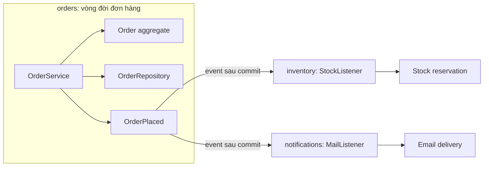

# Đánh giá độ kết dính của module trong kiến trúc Spring Modulith

## 1. Độ kết dính là gì và vì sao cần đánh giá?

**Độ kết dính (cohesion)** phản ánh mức độ các thành phần bên trong một module cùng phục vụ một **trách nhiệm nghiệp vụ có ý nghĩa**. Một module có độ kết dính cao thường tập hợp các quy tắc, dữ liệu, hành vi và ca sử dụng liên quan chặt chẽ đến cùng một năng lực nghiệp vụ; lý do khiến chúng cần thay đổi cũng có xu hướng gần nhau.

Ví dụ, một module `orders` có thể chứa `Order`, `OrderRepository`, `OrderService` và các quy tắc tính tổng tiền, thay đổi trạng thái, hủy đơn. Các thành phần ấy cùng xoay quanh **vòng đời đơn hàng**. Nếu `orders` còn chịu trách nhiệm gửi email, quản lý tồn kho và kết nối cổng thanh toán, module bắt đầu mang nhiều lý do thay đổi độc lập. Đó là dấu hiệu cần kiểm tra độ kết dính.

Trong chủ đề **SPRING_MODULITH_APPLICATION_EVENTS**, việc đánh giá độ kết dính giúp quyết định:

- Thành phần nào nên nằm **cùng module** để bảo vệ quy tắc nghiệp vụ và giao dịch.
- Thành phần nào nên được **tách thành module khác** và nhận thông tin qua application events.
- Event nào đại diện cho **sự kiện nghiệp vụ thực sự**, thay vì dùng event để che một thiết kế module thiếu rõ ràng.
- Thay đổi một nghiệp vụ có làm nhiều module sửa theo không, và nguyên nhân nằm ở đâu.

**Lưu ý:** Spring Modulith có công cụ phát hiện module và xác minh ràng buộc phụ thuộc, nhưng **không có một phép đo mặc định duy nhất kết luận module “có độ kết dính cao”**. Muốn đánh giá tốt cần kết hợp phân tích nghiệp vụ, đọc mã, lịch sử thay đổi, kiểm thử và luồng sự kiện.

### Mục tiêu học tập

Sau bài này, bạn có thể nhận diện các biểu hiện của độ kết dính cao/thấp, sử dụng bộ tiêu chí đánh giá thực tế, đối chiếu bằng evidence từ mã và lịch sử thay đổi, quyết định khi nào cần tách/gộp module và kiểm tra tác động của việc tái cấu trúc bằng Spring Modulith.

## 2. Phân biệt cohesion và coupling

Hai khái niệm thường xuất hiện cùng nhau nhưng trả lời những câu hỏi khác nhau:

| Khía cạnh | Độ kết dính (cohesion) | Độ phụ thuộc (coupling) |
|---|---|---|
| Câu hỏi chính | Các thành phần **bên trong module** có cùng phục vụ một mục tiêu không? | Các module **phụ thuộc vào nhau** bao nhiêu và theo cách nào? |
| Quan sát | Trách nhiệm, mô hình nghiệp vụ, invariant, ca sử dụng, nguyên nhân thay đổi | Import, lời gọi giữa module, phụ thuộc vào API/nội bộ, event contract |
| Thiết kế mong muốn | Độ kết dính cao | Coupling thấp và có kiểm soát |
| Lỗi thường gặp | Một module vừa quản lý đơn hàng, vừa gửi email, vừa tính phí vận chuyển | Module `notifications` import trực tiếp `orders.internal.OrderRepository` |
| Công cụ hỗ trợ | Review capability, dependency graph nội bộ, change history, thử nghiệm di chuyển yêu cầu | Spring Modulith `ApplicationModules.verify()`, static analysis, dependency graph |

Hai vấn đề có thể tồn tại độc lập. Một module `orders` có thể rất tập trung vào vòng đời đơn hàng nhưng vẫn phụ thuộc trực tiếp vào cấu trúc nội bộ của `inventory` (cohesion khá tốt, coupling xấu). Ngược lại, module `common` chỉ chứa các hàm không liên quan có thể ít phụ thuộc vào module khác nhưng **cohesion thấp**.

Không nên đánh đồng:

- **Ít class** với **độ kết dính cao**: module nhỏ vẫn có thể trộn ba trách nhiệm không liên quan.
- **Nhiều class** với **độ kết dính thấp**: một năng lực nghiệp vụ lớn có thể cần nhiều entity, repository, domain service và use case.
- **Không có vòng phụ thuộc** với **cohesion tốt**: kiểm tra dependency có thể PASS dù ranh giới trách nhiệm chia sai.
- **Có sử dụng event** với **thiết kế module tốt**: event chỉ là phương tiện giao tiếp; một event contract sai có thể tăng sự phụ thuộc về ngữ nghĩa.

Một câu hỏi gợi mở hữu ích là: **“Nếu nghiệp vụ X đổi, vì sao các class này phải cùng đổi?”** Nếu câu trả lời luôn là một quy tắc kinh doanh chung, đó là tín hiệu tốt. Nếu câu trả lời là “vì chúng nằm chung package”, chưa đủ chứng minh cohesion.

## 3. Đánh giá theo trách nhiệm nghiệp vụ, không theo tên package

### 3.1. Bắt đầu bằng business capability

Một module nên có **một mục đích nghiệp vụ rõ ràng có thể phát biểu bằng một câu**. Ví dụ:

| Module | Mục đích | Những thứ thường thuộc về module |
|---|---|---|
| `orders` | Quản lý vòng đời đơn hàng | Tạo đơn, cập nhật trạng thái, hủy đơn, lưu đơn, invariant của đơn |
| `inventory` | Quản lý số lượng có thể bán và reservation | Stock ledger, kiểm tra tồn, đặt/giải phóng giữ hàng |
| `payments` | Quản lý yêu cầu thanh toán và đối soát | Payment attempt, trạng thái thanh toán, idempotency key |
| `notifications` | Gửi thông báo theo kênh | Template, người nhận, email/SMS sender, lịch sử gửi |

Đây là một cách phân chia tham khảo. Ranh giới thực tế phụ thuộc domain: trong một hệ thống bán vé, “giữ chỗ” có thể là phần không thể tách khỏi giao dịch đặt vé; trong thương mại điện tử, nó có thể thuộc năng lực inventory. **Cần xác định invariant và thời điểm phải có kết quả** trước khi chốt ranh giới.

Đặt tên module theo khái niệm công nghệ như `services`, `repositories` hoặc `events` thường làm các thành phần chung nghiệp vụ bị rải ra nhiều module. Một module được gọi là `notifications` nhưng chứa toàn bộ quyết định khuyến mãi, tính giá và cập nhật trạng thái đơn cũng có trách nhiệm không đúng tên.

### 3.2. Nhóm thành phần “đi cùng nhau” khi thực thi nghiệp vụ

Xét ca sử dụng **hủy đơn hàng**:

1. Kiểm tra trạng thái đơn hiện tại.
2. Xác minh đơn còn được phép hủy.
3. Đánh dấu đơn đã hủy.
4. Lưu thay đổi trạng thái.
5. Phát sự kiện `OrderCancelled` sau khi quyết định hủy được ghi nhận.

Bốn bước đầu phục vụ **cùng invariant về vòng đời đơn hàng** và thường thuộc `orders`. Việc hoàn tồn kho hay gửi email hủy có thể thuộc module tiêu thụ sự kiện nếu nghiệp vụ cho phép xử lý sau commit.

Tuy nhiên, nếu đơn chỉ được hủy khi cổng thanh toán xác nhận hoàn tiền **ngay trong cùng workflow**, cần thiết kế rõ trạng thái `CANCELLATION_PENDING` và cơ chế xác nhận/khôi phục. Không thể mặc định rằng chuyển một lời gọi đồng bộ thành event sau commit sẽ giữ nguyên tính nhất quán nghiệp vụ.

### 3.3. Xác định “lý do thay đổi”

Một kỹ thuật thực dụng là liệt kê các thay đổi tương lai và hỏi module nào phải sửa:

| Yêu cầu thay đổi | Module dự kiến chịu trách nhiệm chính | Phụ thuộc hợp lý |
|---|---|---|
| Bổ sung trạng thái đơn hàng `CANCELLED` | `orders` | Consumer có thể cần thích nghi với event nếu contract đổi |
| Thay template email xác nhận đơn | `notifications` | Không cần sửa `orders` |
| Thay thuật toán chọn kho giao hàng | `inventory` | Không cần sửa quy tắc lưu đơn |
| Thêm nhà cung cấp thanh toán | `payments` | `orders` chỉ cần biết kết quả nghiệp vụ nếu có liên quan |
| Thêm quy tắc không cho hủy đơn đã giao | `orders` | Có thể cần đầu vào/trạng thái giao hàng theo API công khai |

Nếu mỗi thay đổi nội bộ của `notifications` lại buộc sửa `OrderService`, hai module đang dính vào nhau quá chặt. Nếu thay thuật toán chọn kho nhưng phải sửa cả hàng chục class không liên quan ngay trong `orders`, bản thân `orders` có khả năng kém kết dính.

## 4. Dấu hiệu nhận biết độ kết dính cao và thấp

| Dấu hiệu quan sát | Cohesion cao | Cohesion thấp / cần điều tra |
|---|---|---|
| Tên và mô tả module | Một năng lực nghiệp vụ dễ giải thích | Tên chung chung: `misc`, `utilities`, `manager`, `shared` |
| Trách nhiệm | Thành phần cùng phục vụ một mục tiêu | Module nhận yêu cầu không liên quan chỉ vì “tiện” |
| Dữ liệu | Module sở hữu dữ liệu và invariant của năng lực đó | Nhiều module cùng sửa trực tiếp dữ liệu nội bộ của nhau |
| Use case | Luồng xử lý cốt lõi tập trung trong module | Một use case bình thường phải nhảy qua nhiều module chỉ để hoàn thành một quyết định đơn giản |
| Thay đổi | Phần lớn thay đổi theo capability được cô lập | Thay email template nhưng phải sửa code tính giá trong cùng module |
| Event | Sự kiện mô tả thay đổi nghiệp vụ có ý nghĩa | Event kiểu `AnythingChanged`, `RunTask` hoặc payload chứa đối tượng nội bộ |
| Test | Module có thể kiểm thử các invariant cốt lõi một cách rõ ràng | Test một quy tắc đơn giản kéo theo rất nhiều module không liên quan |
| Team ownership | Có nhóm/chủ sở hữu nghiệp vụ rõ | Mỗi team bổ sung logic bất kỳ vào cùng module |

**Không suy luận từ một dấu hiệu đơn lẻ.** Module shared thật sự có thể hợp lệ nếu chỉ chứa kiểu nền tảng ổn định. Một workflow liên quan nhiều module không nhất thiết là thiết kế kém nếu đó là phối hợp các năng lực tách biệt. Phải truy ra ranh giới ra quyết định và trạng thái dữ liệu.

## 5. Quy trình đánh giá độ kết dính từng bước

### Bước 1 — Xác lập nhiệm vụ chính của module

Viết một câu mô tả module theo mẫu:

> Module `orders` chịu trách nhiệm bảo đảm các quy tắc tạo, sửa và kết thúc vòng đời đơn hàng; phát sự kiện về những thay đổi trạng thái đã được ghi nhận.

Nếu phải dùng nhiều mệnh đề không liên quan, chẳng hạn “vừa quản lý đơn hàng, vừa gửi email, vừa quản lý chứng từ, vừa chọn kho”, hãy liệt kê chúng thành các năng lực cần xem xét tách biệt.

### Bước 2 — Lập bản đồ class, dữ liệu và use case

Lập bảng ngắn gồm các cột:

| Thành phần | Vai trò | Capability | Sở hữu dữ liệu hoặc invariant? |
|---|---|---|---|
| `Order` | Aggregate/domain entity | Orders | Có: trạng thái đơn |
| `OrderRepository` | Lưu trữ đơn | Orders | Lưu state của orders |
| `OrderService` | Điều phối tạo/hủy đơn | Orders | Có: quy tắc giao dịch |
| `EmailTemplateRenderer` | Render email | Notifications | Không thuộc orders |
| `PaymentGatewayAdapter` | Gọi provider thanh toán | Payments | Không thuộc orders |
| `OrderPlaced` | Public event contract | Orders | Công bố việc đã tạo đơn |

Mục tiêu không phải xóa mọi dependency nội bộ. Một module kết dính tốt có thể có nhiều lớp phụ thuộc nhau hợp lý để bảo vệ cùng một quy tắc nghiệp vụ.

### Bước 3 — Kiểm tra dữ liệu và invariant

Hỏi ba câu:

1. **Ai là chủ sở hữu của sự thật nghiệp vụ?** Ví dụ, `orders` quyết định trạng thái đơn; `inventory` quyết định số lượng còn có thể bán.
2. **Quy tắc nào bắt buộc được kiểm tra nguyên tử?** Ví dụ, không được chuyển `CANCELLED` thành `DELIVERED` trong cùng aggregate.
3. **Module khác có đang sửa trực tiếp dữ liệu nội bộ không?** Nếu có, ranh giới ownership đang bị phá vỡ.

Một tập các class dùng chung database table chưa chắc có cohesion cao. Điều quan trọng là quyền quyết định và invariant được giữ ở đâu. Ngược lại, một module có thể sở hữu nhiều bảng nếu chúng cùng biểu diễn một mô hình nghiệp vụ.

### Bước 4 — Phân tích luồng gọi và event

Vẽ đường đi cho ba luồng: một luồng bình thường, một luồng thất bại, một luồng xử lý lại. Đánh dấu ranh giới transaction.



Sơ đồ này có **một module quyết định việc tạo đơn** và hai module thực hiện trách nhiệm riêng. Đây có thể là thiết kế kết dính tốt nếu giữ hàng và email là side effect bất đồng bộ chấp nhận được.

Nếu yêu cầu kinh doanh là “chỉ xác nhận đơn sau khi giữ được hàng”, hãy bổ sung vòng đời trạng thái và event phản hồi như `StockReserved` / `StockReservationRejected`, hoặc chọn phối hợp đồng bộ phù hợp. Chỉ số lượng mũi tên ít hơn không đủ khẳng định kiến trúc tốt.

### Bước 5 — Đọc lịch sử thay đổi

Lấy danh sách yêu cầu thay đổi/PR/commit theo một khoảng thời gian đủ đại diện và nhóm chúng theo **năng lực nghiệp vụ**, thay vì chỉ đếm số file:

- Yêu cầu “thay email template” có thể hoàn thành trong `notifications` không?
- Yêu cầu “thêm trạng thái hủy đơn” có tập trung ở `orders` không?
- Có class nào thường xuyên bị sửa cho các yêu cầu **không cùng một khả năng nghiệp vụ** không?
- Những lần nhiều module thay đổi cùng nhau là do yêu cầu nghiệp vụ hợp lệ, thay đổi API/event contract hay do phụ thuộc không cần thiết?

Lọc các commit tự động, format toàn repository, nâng version dependency và migration cơ sở hạ tầng trước khi rút kết luận. Một commit chạm nhiều module không tự nó chứng minh cohesion thấp.

### Bước 6 — Chấm bằng rubric có thể giải thích

Dùng bảng đánh giá định tính ở phần tiếp theo và ghi **bằng chứng cụ thể** cho từng điểm. Không lấy rubric làm gate cứng khi thiếu bối cảnh domain.

## 6. Rubric 10 điểm cho buổi review module

Mỗi tiêu chí chấm từ **0 đến 2** theo bằng chứng đang có:

- **0:** Có bằng chứng rõ ràng về vấn đề.
- **1:** Có điểm tốt nhưng còn trường hợp ngoại lệ quan trọng hoặc bằng chứng chưa đủ.
- **2:** Trách nhiệm và ranh giới rõ, đã kiểm chứng bằng mã/ca sử dụng.

| Tiêu chí (0–2) | Câu hỏi cần trả lời | Bằng chứng phù hợp |
|---|---|---|
| **A. Mục tiêu nghiệp vụ** | Module có thể mô tả bằng một capability nhất quán không? | Danh sách use case, mô tả domain, tên class |
| **B. Invariant và data ownership** | Quy tắc và dữ liệu lõi có chủ sở hữu rõ không? | Aggregate, repository, transaction, schema |
| **C. Sự gắn kết của các thành phần** | Class/service trong module có cùng phục vụ trách nhiệm đó không? | Bản đồ phụ thuộc nội bộ, phân loại class theo capability |
| **D. Khả năng cô lập thay đổi** | Thay đổi theo một capability có tập trung ở module tương ứng không? | Các PR/issue đại diện, file change history |
| **E. Ranh giới giao tiếp** | Module dùng API/event contract rõ nghĩa, không rò chi tiết implementation? | Import graph, code listener/publisher, event payload |

**Tổng điểm minh họa = A + B + C + D + E**, tối đa 10. Có thể diễn giải sơ bộ:

| Tổng điểm | Cách sử dụng |
|---|---|
| 0–3 | Ưu tiên điều tra các trách nhiệm đang bị trộn. |
| 4–6 | Cần review sâu những tiêu chí bị 0 hoặc 1, làm rõ trade-off. |
| 7–8 | Ranh giới nhìn chung hợp lý; xác minh bằng các use case khó và failure flow. |
| 9–10 | Tín hiệu tốt; tiếp tục theo dõi khi domain và khối lượng công việc thay đổi. |

Đây là **rubric đề xuất cho thảo luận**, không phải thang điểm chính thức của Spring Modulith và không thể áp dụng máy móc giữa các dự án. Điểm thấp ở **data ownership** đôi khi nguy hiểm hơn điểm tổng, vì nó có thể phá invariant ngay cả khi các tiêu chí khác tốt.

### Ví dụ chấm điểm

Một module giả định `orders` chứa tạo đơn, gửi email, chọn kho, tích hợp thanh toán, sử dụng repository chung và có event `OrderChanged` chứa toàn bộ entity:

| Tiêu chí | Điểm ví dụ | Lý do |
|---|---:|---|
| A. Mục tiêu nghiệp vụ | 0 | Có nhiều capability khác nhau. |
| B. Invariant và data ownership | 1 | Dữ liệu đơn được giữ ở đây, nhưng logic tồn kho/thanh toán bị trộn. |
| C. Gắn kết thành phần | 0 | Nhiều class không cùng phục vụ vòng đời đơn. |
| D. Cô lập thay đổi | 0 | Đổi email template vẫn sửa `orders`. |
| E. Ranh giới giao tiếp | 0 | Event làm lộ entity và kết nối nhiều thành phần. |
| **Tổng minh họa** | **1/10** | Nên lập kế hoạch refactor với kiểm thử bảo vệ nghiệp vụ. |

Nếu chuyển email về `notifications`, tồn kho về `inventory`, thanh toán về `payments`, giữ invariant của đơn tại `orders` và dùng event rõ nghĩa, điểm **có thể** cải thiện. Cần chấm lại từ bằng chứng thực tế sau refactor, thay vì tự mặc định module được tách luôn tốt.

## 7. Định lượng để hỗ trợ đánh giá, không thay thế review nghiệp vụ

Không có metric nào mô tả đầy đủ cohesion của một application module. Một số số liệu sau có ích để **phát hiện điểm bất thường** và theo dõi xu hướng.

### 7.1. Tỷ lệ thay đổi được cô lập

Trong các yêu cầu thuộc năng lực `orders`, xác định bao nhiêu yêu cầu được giải quyết chủ yếu bằng thay đổi trong `orders` và hợp đồng công khai của nó.

```text
Tỷ lệ thay đổi cô lập
= số yêu cầu của capability được hoàn thành mà không phải sửa
  logic nghiệp vụ của capability khác
  / tổng số yêu cầu đã lấy mẫu của capability
```

Ví dụ, trong 20 yêu cầu liên quan vòng đời đơn, có 16 yêu cầu không đụng vào logic nghiệp vụ inventory/notifications/payments, tỷ lệ tham khảo là **16/20 = 80%**.

Đây là chỉ dấu **mức độ cô lập thay đổi**, không phải chỉ số cohesion tiêu chuẩn. Những thay đổi chính đáng về hợp đồng event hoặc workflow xuyên capability có thể khiến nhiều module cùng sửa. Cần ghi rõ mẫu, khoảng thời gian và cách phân loại.

### 7.2. Mức độ tập trung theo capability

Với mỗi class của một module, gán capability chính mà class phục vụ. Nếu module có 25 class, trong đó 18 class phục vụ orders, 4 class chuyên email và 3 class chuyên payment, cấu trúc này đáng review.

Không nên kết luận “18/25 class = 72% cohesion”, vì class lớn và nhỏ có trọng số không giống nhau; nhiều helper có thể dùng chung hợp lý. Số liệu chỉ giúp chỉ ra những class **cần đặt câu hỏi**.

### 7.3. Các cụm thay đổi cùng nhau

Quan sát các class thường thay đổi trong cùng yêu cầu nghiệp vụ (co-change). Các class `Order`, `OrderService` và `OrderPolicy` thường đổi cùng nhau cho một quy tắc trạng thái đơn có thể là một cụm kết dính. Nếu `EmailTemplateRenderer` thường đổi vì yêu cầu kênh email không liên quan đến thay đổi đơn hàng, việc nó nằm trong `orders` là nghi vấn.

Cẩn thận với commit gom nhiều công việc: “cùng commit” không đồng nghĩa “cùng lý do thay đổi”. Nên đối chiếu pull request và issue nghiệp vụ.

### 7.4. LCOM và dependency metrics không phải phán quyết

**LCOM (Lack of Cohesion of Methods)** vốn thường được dùng trong bối cảnh cohesion của **class**, dựa trên quan hệ giữa method và state. Không thể lấy LCOM của một class rồi suy trực tiếp ra mức độ cohesion nghiệp vụ của một Spring Modulith application module.

Các chỉ số `Ca` (afferent coupling), `Ce` (efferent coupling), số import xuyên module hoặc số event subscriber chủ yếu nói về **phụ thuộc và phạm vi tác động**; chúng có giá trị kết hợp nhưng không thay thế đánh giá cohesion.

## 8. Ví dụ tái cấu trúc: từ “OrderService làm mọi thứ” đến module kết dính

### 8.1. Trước khi tái cấu trúc

```java
@Service
class OrderService {
    private final OrderRepository orders;
    private final PaymentGateway paymentGateway;
    private final StockRepository stock;
    private final EmailSender emailSender;

    @Transactional
    UUID placeOrder(PlaceOrderCommand command) {
        Order order = orders.save(Order.from(command));
        paymentGateway.charge(command.payment());
        stock.reserve(command.items());
        emailSender.sendConfirmation(order.id());
        return order.id();
    }
}
```

Đoạn mã trên là **mô hình minh họa**, bỏ qua định nghĩa các kiểu và xử lý lỗi. Nó cho thấy một service phải biết chi tiết của nhiều năng lực. Ngoài vấn đề cohesion, việc gọi payment/email từ một transaction database **không tạo tính nguyên tử** với hệ thống ngoài. Một exception có thể rollback database dù thanh toán đã thực hiện, hoặc email được gửi rồi nhưng đơn hàng rollback.

Trong cấu trúc package:

```text
com.example.shop.orders
├── OrderService
├── OrderRepository
├── PaymentGateway
├── StockRepository
├── EmailSender
└── Order
```

Module `orders` có ít nhất bốn nhóm lý do thay đổi: đơn hàng, thanh toán, tồn kho, thông báo.

### 8.2. Sau khi xác định lại trách nhiệm

```text
com.example.shop
├── ShopApplication
├── orders
│   ├── OrderPlaced
│   ├── OrderService
│   └── internal
│       ├── Order
│       └── OrderRepository
├── inventory
│   └── internal
│       ├── StockReservationListener
│       └── StockRepository
├── payments
│   └── internal
│       ├── PaymentRequestListener
│       └── PaymentGateway
└── notifications
    └── internal
        ├── NotificationListener
        └── EmailSender
```

Ở ví dụ này, các nghiệp vụ sau tạo đơn được mô hình hóa thành một workflow **có trạng thái**. Module `orders` có thể ghi nhận đơn mới ở trạng thái `PENDING`; trạng thái cuối cùng phụ thuộc vào các phản hồi `StockReserved`, `PaymentSucceeded` hoặc các sự kiện thất bại tương ứng. Thiết kế cần xác định rõ thứ tự nghiệp vụ và cơ chế hoàn tác/bồi hoàn phù hợp, không tự giả định payment và reservation được thực hiện nguyên tử.

Event công khai có thể chỉ mang dữ liệu cần thiết:

```java
package com.example.shop.orders;

import java.time.Instant;
import java.util.UUID;

public record OrderPlaced(UUID orderId, Instant occurredAt) {}
```

Publisher phát event sau khi thay đổi dữ liệu nghiệp vụ thuộc trách nhiệm của mình:

```java
package com.example.shop.orders;

import java.time.Instant;
import java.util.UUID;
import org.springframework.context.ApplicationEventPublisher;
import org.springframework.stereotype.Service;
import org.springframework.transaction.annotation.Transactional;

@Service
public class OrderService {

    private final OrderRepository orders;
    private final ApplicationEventPublisher events;

    public OrderService(OrderRepository orders, ApplicationEventPublisher events) {
        this.orders = orders;
        this.events = events;
    }

    @Transactional
    public UUID placeOrder(PlaceOrderCommand command) {
        Order order = orders.save(Order.pending(command));
        events.publishEvent(new OrderPlaced(order.id(), Instant.now()));
        return order.id();
    }
}
```

`OrderRepository`, `Order` và `PlaceOrderCommand` ở ví dụ này là các kiểu domain giả định; code thể hiện **ranh giới publisher** chứ chưa phải ứng dụng hoàn chỉnh.

Consumer thuộc module notifications tự xử lý trách nhiệm thông báo:

```java
package com.example.shop.notifications.internal;

import com.example.shop.orders.OrderPlaced;
import org.springframework.modulith.events.ApplicationModuleListener;
import org.springframework.stereotype.Component;

@Component
class NotificationListener {

    private final NotificationSender sender;

    NotificationListener(NotificationSender sender) {
        this.sender = sender;
    }

    @ApplicationModuleListener
    void on(OrderPlaced event) {
        sender.sendOrderReceived(event.orderId());
    }
}
```

`@ApplicationModuleListener` hỗ trợ xử lý event theo semantics giao dịch sau commit và bất đồng bộ trong hạ tầng Spring Modulith phù hợp. Cần bật async, cấu hình transaction manager/executor và cân nhắc event publication registry nếu phải phục hồi khi listener thất bại.

Chú ý phân biệt **“đã nhận đơn”** với **“đã xác nhận thanh toán/giữ hàng thành công”**. Event `OrderPlaced` không đủ cơ sở cho email “đơn đã được thanh toán”. Nếu business yêu cầu email xác nhận cuối cùng, consumer nên lắng nghe event biểu diễn đúng trạng thái cuối, ví dụ `OrderConfirmed`.

### 8.3. Tại sao thiết kế sau thường kết dính hơn?

- `orders` quyết định và bảo vệ trạng thái vòng đời đơn.
- `inventory` sở hữu cách reserve/giải phóng tồn kho.
- `payments` sở hữu việc tích hợp provider và trạng thái giao dịch thanh toán.
- `notifications` sở hữu template, kênh và lịch sử gửi.
- Contract `OrderPlaced` mô tả sự kiện nghiệp vụ, không buộc consumer truy cập entity/repository của publisher.

Mỗi module có lý do thay đổi rõ hơn. Tuy nhiên, **hệ thống tổng thể phức tạp hơn ở phần phối hợp nhiều bước**; cần test xử lý lỗi, trạng thái chờ, bồi hoàn và retry. Nếu một rule cần tính nhất quán tức thời, để nó trong cùng transactional boundary có thể đúng hơn việc tách chỉ để tăng điểm rubric.

## 9. Spring Modulith giúp đánh giá những gì?

Spring Modulith có thể **phát hiện module theo package**, xác minh phụ thuộc và hỗ trợ kiểm thử. Đây là bằng chứng kỹ thuật bổ trợ, không phải phép tính cohesion trực tiếp.

### 9.1. Xác minh phụ thuộc kiến trúc

Ví dụ một test thường dùng:

```java
package com.example.shop;

import org.junit.jupiter.api.Test;
import org.springframework.modulith.core.ApplicationModules;

class ArchitectureTests {

    @Test
    void moduleBoundariesAreValid() {
        ApplicationModules.of(ShopApplication.class).verify();
    }
}
```

Lớp `ShopApplication` là ứng dụng Spring Boot trong package `com.example.shop`. Theo quy ước, các subpackage trực tiếp thường đại diện cho application module. `verify()` kiểm tra những quy tắc kiến trúc Modulith hỗ trợ, bao gồm các phụ thuộc không hợp lệ theo cấu hình module.

Ví dụ, module `notifications` nên import `orders.OrderPlaced` (API công khai) thay vì `orders.internal.OrderRepository`. Nếu `verify()` PASS, điều đó **không chứng minh** toàn bộ class trong `orders` cùng phục vụ một capability.

### 9.2. Kiểm thử tập trung vào một module

Có thể sử dụng `@ApplicationModuleTest` để khởi tạo context kiểm thử cho module và đánh giá các use case của nó:

```java
package com.example.shop.orders;

import org.junit.jupiter.api.Test;
import org.springframework.beans.factory.annotation.Autowired;
import org.springframework.modulith.test.ApplicationModuleTest;
import org.springframework.modulith.test.PublishedEvents;

import static org.assertj.core.api.Assertions.assertThat;

@ApplicationModuleTest
class OrderModuleTests {

    @Autowired OrderService orders;
    @Autowired PublishedEvents publishedEvents;

    @Test
    void creatingOrderPublishesOrderPlaced() {
        PlaceOrderCommand command = OrderFixtures.validCommand();
        var id = orders.placeOrder(command);

        assertThat(publishedEvents.ofType(OrderPlaced.class))
                .anySatisfy(event ->
                        assertThat(event.orderId()).isEqualTo(id));
    }
}
```

`OrderFixtures.validCommand()` chỉ là tên fixture minh họa, cần được định nghĩa trong dự án thực tế. Test trên xác nhận **publisher phát event**, chưa xác nhận consumer async đã xử lý hay registry đã đánh dấu publication hoàn tất.

Khi đánh giá cohesion, hãy dùng test module để hỏi: “Các use case và invariant cốt lõi của module có thể được diễn đạt và kiểm thử nhất quán ngay tại module này không?” Nếu test đơn hàng luôn phải dựng cả mail sender, payment adapter và inventory persistence chỉ để kiểm tra một quy tắc đơn hàng, đó là dấu hiệu đáng điều tra. Dù vậy, dependency test phức tạp cũng có thể đến từ thiết lập Spring context chưa tối ưu; cần phân biệt vấn đề kiểm thử với vấn đề kiến trúc.

### 9.3. Dùng biểu đồ module và luồng sự kiện để review

Các tính năng tài liệu hóa cấu trúc module của Spring Modulith, khi được cấu hình theo phiên bản đang dùng, giúp thấy các dependency và kiểu tương tác giữa module. Khi review:

1. Xem module có import API của module khác một cách có chủ đích không.
2. Xem sự kiện xuất hiện trong luồng nghiệp vụ có đúng **chủ sở hữu** và **ý nghĩa** không.
3. Đối chiếu dependency thực tế với mục tiêu một capability cho mỗi module.
4. Kiểm tra các class nhận/ phát event có mang quá nhiều nhiệm vụ tích hợp không.

Không dùng số lượng event như một thước đo cohesion. Một module có nhiều event hợp lý cho một lifecycle vẫn có thể kết dính cao; một module với đúng một event `GenericChanged` vẫn có thể che giấu nhiều trách nhiệm khác nhau.

## 10. Kiểm tra độ kết dính qua giao tiếp bằng application events

Application events giúp giảm coupling tại điểm gọi, nhưng **không tự sửa được module thiếu cohesion**. Cần phân biệt bốn tình huống.

### 10.1. Event mô tả một thực tế nghiệp vụ

`OrderPlaced`, `PaymentSucceeded` hay `StockReservationRejected` nói rõ điều **đã xảy ra** và module nào có thẩm quyền phát biểu. Consumer có thể phản ứng trong phạm vi trách nhiệm của mình.

Event contract nên ổn định, vừa đủ dữ liệu và tránh chuyển trực tiếp entity có lazy loading hoặc object reference nội bộ. Payload mang `orderId` có thể được dùng để truy vấn qua public API khi thực sự cần, nhưng tránh khiến consumer phụ thuộc vào repository private của publisher.

### 10.2. Event thay thế cho lời gọi nội bộ quá mức

Nếu `OrderService` phát `CalculateTotalRequested` và một listener cùng module nhận để tính toán bắt buộc trước khi trả kết quả, luồng điều khiển trở nên khó theo dõi mà không giúp cohesion. Một phép gọi method/domain service đồng bộ trong cùng module thường rõ nghĩa hơn.

Dùng event khi có **sự kiện nghiệp vụ** với producer/consumer độc lập hoặc nhu cầu xử lý sau commit. Không cần biến mọi method call thành sự kiện.

### 10.3. Event tạo ra workflow nghiệp vụ xuyên module

Một đơn hàng có thể đi qua các trạng thái `PENDING` → `RESERVED` → `PAID` → `CONFIRMED`. Điều này vẫn có thể giữ cohesion cao ở từng module nếu:

- Mỗi module sở hữu **trạng thái và quy tắc** của capability riêng.
- Cơ chế phối hợp có người chịu trách nhiệm rõ ràng, xử lý được thứ tự sự kiện, timeout và các nhánh lỗi.
- Consumer idempotent khi nhận lại event do retry/replay.
- Không module nào sửa trực tiếp dữ liệu nội bộ của module khác.

Nếu listener ở mọi nơi đều phải hiểu toàn bộ logic kinh doanh của các module khác, đó là dấu hiệu ranh giới capability chưa hợp lý hoặc choreography đã trở nên khó kiểm soát.

### 10.4. Tách module nhưng rò rỉ invariant

Ví dụ `orders` tạo đơn `CONFIRMED` ngay khi publish `OrderPlaced`, còn `inventory` có thể thất bại khi giữ hàng sau commit. Khi business định nghĩa “CONFIRMED = đã bảo đảm có hàng”, invariant đã bị vi phạm.

Cách sửa không nhất thiết là gộp lại mọi class; có thể điều chỉnh trạng thái đơn, phối hợp quy trình, hoặc dùng gọi đồng bộ khi điều kiện nhất quán bắt buộc. **Đánh giá cohesion luôn phải gắn với tính đúng đắn nghiệp vụ**, không chỉ với cách chia package.

## 11. Cân bằng độ kết dính với độ phức tạp vận hành

### 11.1. Khi nào nên tách module?

Xem xét tách khi có đồng thời nhiều bằng chứng:

- Hai nhóm use case có mục tiêu và chủ sở hữu dữ liệu khác nhau.
- Lịch sử thay đổi cho thấy chúng thường thay đổi vì những lý do độc lập.
- Dữ liệu và invariant của chúng có thể được quản lý qua ranh giới công khai rõ ràng.
- Giao tiếp qua API hoặc application events có semantics xử lý lỗi rõ.
- Lợi ích về bảo trì và kiểm thử lớn hơn chi phí phối hợp.

Nếu chưa trả lời được ownership và transaction boundary, chuyển class sang package mới có thể chỉ là **tách về mặt hình thức**.

### 11.2. Khi nào nên gộp module?

Có thể gộp hoặc điều chỉnh ranh giới khi:

- Hai module luôn phải cùng thay đổi vì một invariant đơn nhất.
- Hầu hết các use case cần gọi qua lại đồng bộ, liên tục và chặt chẽ.
- Phần lớn event chỉ mô phỏng các bước method call nội bộ.
- Cần transaction nguyên tử cho hành vi cốt lõi mà thiết kế phân tách đang cố mô phỏng sai.
- Không phân định được chủ sở hữu dữ liệu, bất chấp đã thử thiết kế public API.

Gộp không có nghĩa tăng coupling tùy tiện. Mục tiêu là tạo ranh giới **trung thực với domain** hơn.

### 11.3. Tránh chia module quá nhỏ

Một module chứa một entity, một repository hoặc một event đơn lẻ không mặc nhiên kết dính hơn. Phân mảnh quá mức dẫn đến nhiều interface, event, transaction boundary, dependency và test setup. Hãy cân nhắc **độ lớn của một business capability**, thay vì đặt mục tiêu “mỗi class thành một module”.

### 11.4. Tránh module `common` phình to

Những thành phần ổn định, mang tính kỹ thuật thật sự có thể chia sẻ. Tuy vậy, khi `common` chứa `OrderCalculator`, `PaymentRules`, `StockPolicy` và `EmailTemplate`, nó đã trở thành nơi gom nhiều trách nhiệm không liên quan.

Review từng class bằng câu hỏi: “Điều gì khiến class này thay đổi, và capability nào sở hữu quyết định đó?” Sau đó di chuyển về module tương ứng; chỉ giữ những abstraction thật sự dùng chung và đủ ổn định.

## 12. Checklist review và bài thực hành

### Checklist trước khi kết luận

- [ ] Có thể mô tả module bằng một năng lực nghiệp vụ nhất quán.
- [ ] Các class trọng tâm phục vụ cùng use case, dữ liệu và quy tắc.
- [ ] Invariant quan trọng có chủ sở hữu và transaction boundary xác định.
- [ ] Những thay đổi không liên quan có thể phát triển tương đối độc lập.
- [ ] Không có module khác sửa trực tiếp repository/entity nội bộ.
- [ ] Event contract mô tả kết quả nghiệp vụ và không làm lộ implementation.
- [ ] Listener sau commit không bị coi nhầm là xử lý đồng bộ nguyên tử.
- [ ] Có cách xử lý event trùng, thất bại, replay và publication tồn đọng khi nghiệp vụ yêu cầu.
- [ ] `ApplicationModules.verify()` PASS với ranh giới module đã định nghĩa.
- [ ] Rubric được ghi kèm bằng chứng và các ngoại lệ nghiệp vụ được giải thích.

### Bài tập 1 — Đánh giá module đang quá tải

Cho hệ thống có package `sales` gồm `OrderEntity`, `OrderRepository`, `OrderService`, `MailSender`, `StockUpdater`, `PaymentProviderClient`. Hãy lập bảng capability cho từng class, chấm rubric 5 tiêu chí và đề xuất cấu trúc module sau khi review. Chỉ rõ phần nào phải được xử lý trong transaction tạo đơn, phần nào có thể xử lý sau commit.

**Gợi ý:** Có thể đề xuất `orders`, `inventory`, `payments`, `notifications`. Nhưng trước khi chuyển xử lý thanh toán hoặc giữ hàng thành bất đồng bộ, phải làm rõ trạng thái đơn hàng và các invariant bắt buộc.

### Bài tập 2 — So sánh hai cách dùng event

Xét hai phương án:

**Phương án A:** `orders` phát `OrderPlaced` sau khi lưu đơn, `notifications` lắng nghe để gửi email “đã tiếp nhận đơn”.

**Phương án B:** `orders` phát lần lượt `CalculatePriceRequested`, `ValidateAddressRequested` và `SaveOrderRequested` để các listener hoàn thành ba bước bắt buộc trước khi `placeOrder()` trả kết quả.

Hãy trả lời phương án nào phù hợp hơn với giao tiếp bằng application events và vì sao. Đánh giá rủi ro khi các bước của B chạy sau commit hoặc bất đồng bộ.

**Gợi ý:** A là sự kiện nghiệp vụ có side effect tương đối độc lập. B giống phân tán một transaction và một use case cốt lõi thành nhiều bước điều khiển khó kiểm soát; nên xem lại ranh giới module và các lời gọi đồng bộ.

### Bài tập 3 — Đối chiếu với lịch sử thay đổi

Lấy 10–20 thay đổi nghiệp vụ đại diện của một ứng dụng, nhóm theo capability và tính tỷ lệ thay đổi cô lập theo định nghĩa trong mục 7.1. Chọn ba thay đổi xuyên module và giải thích chúng đến từ:

1. Sự phối hợp nghiệp vụ hợp lệ.
2. Thay đổi event/API contract cần thiết.
3. Một ranh giới trách nhiệm chưa đúng.

Từ đó đề xuất **một** refactor có giá trị cao và viết các kiểm thử cần giữ ổn định trước/sau refactor.

## 13. Ghi nhớ trọng tâm

**Độ kết dính cao** nghĩa là các thành phần trong module cùng thực hiện một trách nhiệm nghiệp vụ rõ ràng, có dữ liệu và invariant được sở hữu nhất quán, cùng thay đổi vì những lý do gần nhau. Đánh giá cohesion phải bắt đầu từ domain và bằng chứng thực tế; đếm số class, import hay event chỉ hỗ trợ phát hiện dấu hiệu bất thường.

Trong **Spring Modulith Application Events**, dùng application events để các module có trách nhiệm riêng giao tiếp qua hợp đồng rõ nghĩa, đặc biệt ở các side effect có thể chạy sau commit. Khi tái cấu trúc, phải bảo vệ các invariant đồng bộ, transaction boundary, idempotency và khả năng phục hồi publication. Công cụ Spring Modulith giúp **kiểm tra ranh giới và kiểm thử hành vi**; trách nhiệm quyết định một ranh giới module có thực sự kết dính vẫn thuộc về thiết kế nghiệp vụ của đội phát triển.

