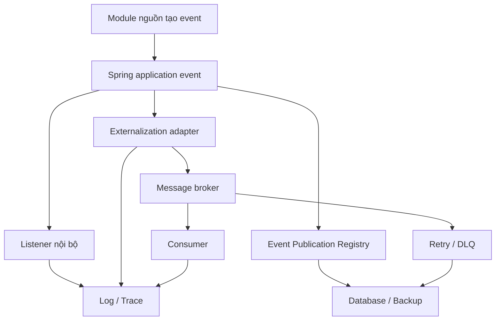

# Dữ liệu nhạy cảm trong event

Application event là hợp đồng dữ liệu được truyền từ module phát đến các listener quan tâm. Khi event chứa thông tin cá nhân, dữ liệu tài chính, bí mật xác thực hoặc thông tin kinh doanh hạn chế, payload có thể trở thành một đường rò rỉ qua listener, Event Publication Registry, log, broker, dead-letter queue, bản sao lưu và công cụ quan sát.

Trong Spring Modulith, event giúp các module giao tiếp qua hợp đồng rõ ràng và giảm phụ thuộc vào implementation của nhau. Nhưng ranh giới module không tự động là ranh giới bảo mật. Mọi consumer có thể nhận event phải được xem là một nơi có khả năng truy cập dữ liệu trong payload. Thiết kế an toàn bắt đầu từ việc chỉ đưa dữ liệu cần thiết vào event, sau đó kiểm soát cách lưu, truyền, đọc, log, retry và xóa dữ liệu đó.

## 1. Vì sao payload event cần được bảo vệ?

Một event có thể đi qua nhiều thành phần trong vòng đời của nó:

1. Use case tạo event trong module nguồn.
2. Spring chuyển event đến các listener nội bộ.
3. Event Publication Registry lưu trạng thái publication; adapter lưu trữ có thể serialize nội dung event.
4. Adapter externalization có thể chuyển event thành message gửi đến broker.
5. Consumer, retry handler và dead-letter queue có thể giữ message trong thời gian dài.
6. Log, trace, metric, dashboard và bản sao lưu có thể lưu lại một phần dữ liệu.

Vì vậy, một trường nhạy cảm được thêm vào event có thể xuất hiện ở nhiều nơi hơn dự kiến. Xóa trường đó khỏi bảng nghiệp vụ nguồn không tự động xóa bản sao trong publication store, broker retention, DLQ, log hoặc backup.



Sơ đồ cho thấy các nơi cần xem xét trong threat model. Không phải mọi ứng dụng đều dùng tất cả thành phần; hãy kiểm kê đúng adapter, broker, log pipeline và chính sách lưu trữ đang triển khai.

## 2. Phân loại dữ liệu trước khi thiết kế event

Trước khi tạo event, xác định loại dữ liệu và mức độ ảnh hưởng nếu người không có quyền truy cập đọc được payload. Một cách phân loại đơn giản:

| Nhóm | Ví dụ | Cách xử lý thường phù hợp |
| --- | --- | --- |
| Công khai | Mã loại sự kiện, trạng thái công khai, thời điểm công bố | Có thể truyền trong event nếu cần cho consumer. |
| Nội bộ | ID đơn hàng, trạng thái quy trình, số lượng tổng hợp | Chỉ chia sẻ với module/consumer có mục đích rõ ràng. |
| Mật | Thông tin liên hệ, địa chỉ giao hàng, giá hợp đồng, dữ liệu khách hàng | Tối thiểu hóa; giới hạn consumer; cân nhắc mã hóa trường hoặc tham chiếu bảo vệ. |
| Rất nhạy cảm / bí mật | Mật khẩu, access token, refresh token, private key, CVV, dữ liệu xác thực | Không đưa vào event; dùng luồng bí mật chuyên biệt nếu nghiệp vụ thực sự cần. |

Phân loại cần dựa trên ngữ cảnh. Một mã khách hàng có thể không nhạy cảm khi đứng riêng nhưng có thể nhận diện cá nhân khi kết hợp với dữ liệu khác. Giá trị đơn hàng có thể là dữ liệu nội bộ ở một hệ thống nhưng là thông tin mật trong một quy trình hợp đồng.

Không đưa vào event các dữ liệu xác thực như password, session cookie, bearer token, API key, private key hoặc mã khôi phục. Consumer không cần giữ thông tin đăng nhập của người dùng để thực hiện nghiệp vụ. Nếu cần biết ai khởi tạo thao tác, truyền actor ID hoặc service identity phù hợp, không truyền credential.

## 3. Tối thiểu hóa dữ liệu trong event

Nguyên tắc quan trọng nhất là chỉ phát những trường cần thiết cho mục đích của consumer. Không sao chép nguyên entity hoặc toàn bộ request vào event chỉ vì tiện.

Ví dụ không an toàn:

```java
public record OrderPlaced(
        UUID orderId,
        String customerName,
        String email,
        String phone,
        String fullAddress,
        String accessToken,
        String cardNumber,
        String cvv,
        BigDecimal totalAmount
) {}
```

Event này gom dữ liệu nhận diện, liên hệ, thanh toán và bí mật xác thực vào cùng một payload. Nhiều listener có thể chỉ cần `orderId` và trạng thái đơn nhưng vẫn được cấp quyền đọc toàn bộ trường.

Một event tối thiểu hơn:

```java
public record OrderPlaced(
        UUID eventId,
        UUID orderId,
        UUID customerReference,
        BigDecimal totalAmount,
        String currency,
        Instant occurredAt,
        int schemaVersion
) {}
```

Event trên không chứa email, số điện thoại, địa chỉ, thông tin thẻ hoặc credential. `customerReference` vẫn có thể là dữ liệu cá nhân nếu hệ thống có thể liên kết nó với một người; cần áp dụng quyền truy cập và retention tương ứng. Mã tham chiếu giả danh không tự biến dữ liệu thành ẩn danh.

Khi thiết kế payload, hãy hỏi với từng trường:

- Listener nào thực sự cần trường này?
- Có thể thay bằng ID tham chiếu hoặc dữ liệu tổng hợp không?
- Consumer có thể lấy dữ liệu qua API bảo vệ quyền truy cập khi cần không?
- Trường này có cần giữ lại khi retry, replay hoặc rebuild không?
- Nếu payload xuất hiện trong log hoặc DLQ, mức ảnh hưởng là gì?

Không dùng event làm bản sao đầy đủ của database. Event mô tả một sự kiện hoặc snapshot nghiệp vụ có mục đích rõ ràng, không phải bản dump của aggregate.

## 4. Chọn giữa snapshot và tham chiếu dữ liệu

Có hai cách phổ biến để consumer tiếp cận dữ liệu không nên phát trực tiếp trong event.

| Cách | Mô tả | Điểm cần cân nhắc |
| --- | --- | --- |
| Event mang snapshot tối thiểu | Chỉ chứa các giá trị nghiệp vụ không nhạy cảm mà consumer cần tại thời điểm phát sinh. | Giữ được ý nghĩa tại thời điểm event; cần quản lý schema và freshness. |
| Event mang reference | Chứa ID hoặc opaque reference; consumer gọi API nội bộ có xác thực để lấy phần dữ liệu được phép. | Payload nhỏ hơn và quyền truy cập có thể kiểm soát tại API; consumer phụ thuộc vào khả năng truy vấn và dữ liệu có thể đã thay đổi. |

Ví dụ event chỉ mang tham chiếu:

```java
public record ShipmentRequested(
        UUID eventId,
        UUID orderId,
        UUID deliveryProfileReference,
        Instant requestedAt
) {}
```

Consumer giao hàng dùng service identity riêng để gọi API lấy thông tin giao hàng cần thiết. API cần xác thực consumer, kiểm tra quyền truy cập theo mục đích và ghi audit phù hợp. Không coi việc biết `deliveryProfileReference` là đủ quyền truy cập dữ liệu.

Nếu consumer cần đúng địa chỉ tại thời điểm tạo shipment, API phải cung cấp snapshot/version phù hợp hoặc event mang snapshot tối thiểu đã được phê duyệt. Nếu chỉ truy vấn trạng thái hiện tại, dữ liệu có thể đã thay đổi kể từ lúc event được phát. Đây là quyết định về semantics nghiệp vụ, không chỉ là lựa chọn bảo mật.

## 5. Pseudonymization, tokenization và hashing

Thay tên, email hoặc số tài khoản bằng mã tham chiếu có thể giảm mức lộ dữ liệu, nhưng cần phân biệt các kỹ thuật:

- **Pseudonymization:** thay định danh trực tiếp bằng mã khác; vẫn có thể liên kết lại nếu còn bảng ánh xạ hoặc khóa.
- **Tokenization:** thay dữ liệu nhạy cảm bằng token được một dịch vụ/token vault quản lý; consumer không có quyền không thể tự suy ra giá trị gốc.
- **Hashing:** tạo giá trị băm một chiều. Với dữ liệu có không gian giá trị nhỏ như số điện thoại hoặc email, hash không khóa có thể bị dò bằng từ điển.
- **HMAC:** dùng khóa bí mật để tạo mã kiểm tra ổn định; phù hợp khi cần đối chiếu mà không phát giá trị gốc, nhưng việc quản lý và xoay khóa vẫn quan trọng.

Không tự băm email hoặc số điện thoại bằng SHA-256 rồi xem đó là dữ liệu ẩn danh. Kẻ tấn công có thể thử các giá trị phổ biến và so sánh hash. Nếu cần một mã ổn định để liên kết event, dùng ID nội bộ ngẫu nhiên hoặc HMAC có khóa được quản lý an toàn, đồng thời vẫn phân loại mã đó là dữ liệu có thể liên kết.

## 6. Mã hóa dữ liệu nhạy cảm khi không thể loại bỏ

Nếu consumer thực sự cần một trường nhạy cảm trong payload, hãy cân nhắc mã hóa ở tầng ứng dụng trước khi event rời khỏi module sở hữu dữ liệu. Mã hóa transport và mã hóa ổ đĩa vẫn cần thiết nhưng không thay thế bảo vệ trường ở payload.

### Mã hóa theo lớp

| Lớp | Bảo vệ | Giới hạn |
| --- | --- | --- |
| TLS khi truyền | Bảo vệ message trên đường truyền giữa ứng dụng, broker và consumer. | Broker hoặc consumer được cấp quyền vẫn đọc payload sau khi giải mã transport. |
| Encryption at rest | Bảo vệ dữ liệu trên disk, database, broker storage và backup theo cấu hình. | Thành phần có quyền đọc dữ liệu thường vẫn có thể truy cập plaintext. |
| Field-level / application-level encryption | Mã hóa riêng trường nhạy cảm trước khi serialize event. | Cần quản lý key, quyền giải mã, version và quy trình xoay khóa. |

Với field-level encryption, dùng thuật toán mã hóa xác thực hiện đại như AES-GCM hoặc một cơ chế envelope encryption được nền tảng KMS hỗ trợ. Không tự thiết kế thuật toán, không hardcode key trong source code, file cấu hình hoặc event.

Ví dụ envelope trong payload:

```java
public record EncryptedField(
        String algorithm,
        String keyId,
        String nonce,
        String ciphertext,
        String authenticationTag
) {}

public record CustomerContactUpdated(
        UUID eventId,
        UUID customerReference,
        EncryptedField encryptedContact,
        Instant occurredAt
) {}
```

Đây là cấu trúc minh họa. API mã hóa thực tế cần dùng thư viện mật mã đã được kiểm chứng, tạo nonce đúng cách và bảo đảm nonce không bị tái sử dụng với cùng key theo yêu cầu của thuật toán. `keyId` chỉ là định danh để tra cứu khóa trong KMS; không chứa key material.

### Quản lý khóa

- Lưu key trong KMS/HSM hoặc secret manager được kiểm soát; không lưu cùng nơi với ciphertext.
- Chỉ consumer có mục đích hợp lệ mới được cấp quyền decrypt.
- Dùng key version để hỗ trợ xoay khóa và đọc message cũ trong thời gian cần thiết.
- Có quy trình thu hồi, rotate và xử lý khi key bị lộ.
- Không ghi plaintext, key, nonce nhạy cảm hoặc nội dung sau giải mã vào log.
- Xác định thời gian giữ key phù hợp với retention và yêu cầu phục hồi dữ liệu.

Nếu nhiều consumer cần các trường khác nhau, mã hóa cả payload bằng một key chung có thể cấp quyền quá rộng. Cân nhắc mã hóa từng trường hoặc phát các event chuyên biệt cho từng nhóm consumer để quyền giải mã bám sát mục đích.

## 7. Kiểm soát quyền truy cập của listener và consumer

Mọi listener nhận event đều có thể đọc payload của event đó. Chỉ đăng ký listener trong module không phải là kiểm soát quyền truy cập dữ liệu. Cần xác định rõ module/consumer nào được nhận loại event nào và vì sao.

Với event nội bộ:

- Đặt event contract trong API package mà consumer được phép dùng.
- Chỉ tạo listener cho module có trách nhiệm nghiệp vụ tương ứng.
- Không phát event chứa trường nhạy cảm cho toàn ứng dụng nếu chỉ một consumer cần trường đó.
- Dùng event chuyên biệt hoặc reference API bảo vệ quyền nếu consumer có quyền khác nhau.
- Không xem `@ApplicationModuleListener` như một cơ chế authorization; annotation mô tả cách giao event và transaction, không quyết định ai được phép đọc từng trường.

Với broker bên ngoài:

- Dùng TLS và xác thực client theo cơ chế broker hỗ trợ.
- Cấp ACL tối thiểu theo topic, consumer group, producer và thao tác read/write.
- Tách topic theo mức phân loại dữ liệu khi cần; không cho consumer chung đọc topic mật.
- Tách service account theo ứng dụng hoặc workload; không dùng chung credential quản trị.
- Kiểm soát ai có quyền xem message, đọc DLQ, replay hoặc export dữ liệu.
- Xác minh quyền ở consumer/API; không dựa vào tên topic hay routing key như một bằng chứng authorization.

Security context dạng thread-local của request web không tự động trở thành identity đáng tin cậy trong listener bất đồng bộ. Nếu cần biết actor hoặc tenant khởi tạo event, truyền actor/tenant reference đã được xác thực như metadata nghiệp vụ tối thiểu. Không truyền bearer token hoặc session token để listener “kế thừa” quyền của người dùng. Consumer nên dùng service identity và kiểm tra quyền theo chính sách của nó.

## 8. Event Publication Registry và dữ liệu được lưu bền vững

Event Publication Registry theo dõi publication đến transactional listener và lưu trạng thái hoàn tất để có thể phát hiện publication chưa hoàn tất. Khi dùng persistence adapter, cần kiểm tra chính xác dữ liệu nào được serialize và lưu, thời gian giữ, quyền truy cập database, backup và quy trình dọn dữ liệu.

Với JDBC publication registry, dữ liệu event được serialize có thể được lưu cùng metadata publication trong database. Vì vậy, một trường nhạy cảm trong event có thể tồn tại ở publication store ngay cả khi listener đã hoàn tất hoặc khi ứng dụng đang retry. Không giả định registry chỉ lưu event ID và trạng thái.

Các nguyên tắc:

- Giữ event payload tối thiểu trước khi nó được đưa vào registry.
- Bảo vệ database registry bằng quyền truy cập riêng, mã hóa at rest và backup policy.
- Đặt retention/cleanup phù hợp với khả năng retry và yêu cầu audit.
- Không truy vấn hoặc cập nhật trực tiếp bảng nội bộ để lấy plaintext hoặc ép publication hoàn tất.
- Dùng API công khai và cơ chế persistence được hỗ trợ bởi phiên bản Spring Modulith.
- Nếu cần xóa hoặc hạn chế dữ liệu nhạy cảm, xác định ảnh hưởng đến publication incomplete và quy trình phục hồi trước khi thực hiện.

Event Publication Registry không phải kho lưu trữ event lịch sử vô thời hạn. Không dùng nó làm event store hoặc nguồn duy nhất để dựng lại mọi dữ liệu nghiệp vụ.

## 9. Externalization và broker adapter

Khi event được externalize, dữ liệu đi qua ranh giới process và có thể được giữ trong broker, replica, consumer buffer, retry topic và DLQ. Ví dụ:

```java
@Externalized("customer-contact")
public record CustomerContactChanged(
        UUID eventId,
        UUID customerReference,
        EncryptedField encryptedContact,
        Instant occurredAt
) {}
```

Tên destination chỉ là routing value theo cấu hình adapter. Nó không tự bảo vệ message. Cần kiểm tra serializer, header mapping, TLS, broker ACL, encryption at rest, retention và consumer authorization.

Trước khi externalize, xác định:

1. Event nào được phép rời khỏi ứng dụng?
2. Trường nào được phép truyền qua broker?
3. Producer nào được publish và consumer nào được subscribe?
4. Message được giữ trong topic, retry queue và DLQ bao lâu?
5. Ai có thể đọc, export hoặc replay message?
6. Khi schema thay đổi hoặc dữ liệu cần xóa, các bản sao cũ được xử lý thế nào?

Nếu event nội bộ chứa dữ liệu nhạy cảm nhưng chỉ một tích hợp ngoài cần một phần dữ liệu, hãy tạo integration event riêng với schema tối thiểu. Không externalize nguyên application event chỉ vì adapter có thể serialize nó.

## 10. Bảo vệ log, trace và metric

Một payload được bảo vệ trong broker vẫn có thể bị lộ qua log. Những câu lệnh như `log.info("Received event: {}", event)` hoặc log toàn bộ request/exception có thể ghi email, địa chỉ, token hay dữ liệu tài chính vào hệ thống log tập trung.

Nên log metadata tối thiểu:

```java
log.info(
        "Processed event type={}, eventId={}, aggregateId={}, consumer={}",
        "OrderPlaced",
        event.eventId(),
        event.orderId(),
        "billing"
);
```

Không log `event.toString()` nếu record có trường nhạy cảm. Tránh đưa payload vào exception message, tracing baggage, span attribute hoặc metric label. Dùng event ID, correlation ID, event type và consumer name để truy vết.

Nếu cần debug payload, dùng công cụ có kiểm soát truy cập, che trường nhạy cảm, giới hạn thời gian bật và ghi audit người xem. Không bật logging toàn payload trong production như biện pháp chẩn đoán mặc định.

Một chính sách masking có thể che email, số điện thoại và địa chỉ khi hiển thị cho người vận hành. Masking log không thay thế việc loại bỏ dữ liệu không cần thiết khỏi event; nó chỉ là lớp giảm rủi ro bổ sung.

## 11. Retry, DLQ và replay

Message trong retry queue hoặc dead-letter queue thường tồn tại lâu hơn message đã xử lý bình thường. DLQ có thể tập trung các payload lỗi, bao gồm dữ liệu nhạy cảm. Quyền truy cập DLQ cần chặt như topic nguồn hoặc chặt hơn.

Các yêu cầu vận hành:

- Giới hạn ai được đọc, tải xuống, replay hoặc xóa message trong DLQ.
- Không sao chép payload đầy đủ vào ticket, chat hoặc log điều tra.
- Khi hiển thị lỗi, che dữ liệu nhạy cảm và giữ mã lỗi/correlation ID.
- Đặt retention cho retry/DLQ và quy trình dọn theo chính sách dữ liệu.
- Replay bằng message ID ổn định để consumer idempotent nhận diện lần giao lại.
- Ghi audit người yêu cầu replay, lý do, thời điểm và phạm vi message.
- Kiểm tra schema và quyền truy cập trước khi đưa message cũ trở lại luồng chính.

Nếu một consumer không còn quyền đọc trường nhạy cảm, không chỉ ngừng hiển thị trường trong UI. Cần cập nhật ACL, key permission và consumer deployment; đồng thời xem xét message cũ đang nằm trong broker, DLQ hoặc backup.

## 12. Retention, xóa dữ liệu và quyền riêng tư

Event có thể tồn tại trong nhiều bản sao: database nguồn, publication registry, broker, DLQ, log, trace, backup và data lake. Chính sách retention cần bao quát tất cả các nơi này.

Các nguyên tắc thiết kế:

- Tránh đưa dữ liệu cá nhân trực tiếp vào event nếu một reference là đủ.
- Ghi rõ mục đích sử dụng, chủ sở hữu dữ liệu và thời gian lưu của từng event type.
- Thiết lập retention cho registry, broker, retry, DLQ, log và backup.
- Xác định quy trình xử lý yêu cầu xóa hoặc hạn chế xử lý dữ liệu trên tất cả bản sao có thể truy cập.
- Với dữ liệu đã mã hóa, cân nhắc cryptographic erasure bằng thu hồi/hủy key riêng khi phù hợp; phải đánh giá tác động đến bản ghi khác dùng chung key và yêu cầu lưu trữ.
- Không coi việc xóa bản ghi nguồn là đủ nếu event đã được externalize hoặc backup.

Pseudonymization không đồng nghĩa anonymization. Nếu có thể nối reference với một cá nhân qua bảng ánh xạ, dữ liệu vẫn cần được bảo vệ. Việc xóa key ánh xạ hoặc hủy encryption key chỉ phù hợp khi hệ thống không còn cần khôi phục dữ liệu và đã đánh giá toàn bộ bản sao, key sharing và nghĩa vụ lưu trữ.

## 13. Versioning và thay đổi schema an toàn

Event schema là hợp đồng giữa producer và consumer. Khi thêm trường nhạy cảm, cần đánh giá mọi consumer hiện tại, serializer, registry, broker, log và công cụ replay. Không thêm trường chỉ vì một consumer mới yêu cầu nếu có thể phát một event chuyên biệt.

Các nguyên tắc versioning:

- Giữ event type và schema version rõ ràng.
- Thay đổi theo hướng tương thích khi có thể; không đổi ý nghĩa trường cũ âm thầm.
- Không đưa secret vào header hoặc metadata với giả định header ít bị lưu hơn payload.
- Xác định consumer cũ xử lý trường mới như thế nào.
- Kiểm thử serialization/deserialization và redaction ở mọi adapter.
- Khi bỏ một trường nhạy cảm, xử lý cả message cũ còn trong retention, không chỉ code producer mới.

Ví dụ event contract có version:

```java
public record CustomerContactChangedV2(
        UUID eventId,
        UUID customerReference,
        String contactPurpose,
        EncryptedField encryptedContact,
        Instant occurredAt
) {}
```

Tên lớp chỉ minh họa cho hợp đồng version mới. Trong thực tế, chọn chiến lược versioning phù hợp với serializer và schema registry của hệ thống.

## 14. Kiểm thử bảo mật dữ liệu event

Kiểm thử cần xác minh cả nội dung event và các nơi dữ liệu được ghi ra:

1. Event không chứa password, token, private key, CVV hoặc trường không cần thiết.
2. Event contract chỉ chứa các trường đã được phân loại và phê duyệt cho consumer.
3. Serializer không vô tình thêm field từ entity hoặc superclass.
4. Log, trace và exception không chứa plaintext nhạy cảm.
5. Consumer không có quyền đọc topic hoặc giải mã field ngoài mục đích.
6. TLS, broker ACL và database access policy được xác minh trong integration test hoặc môi trường kiểm thử bảo mật.
7. Ciphertext chỉ consumer được cấp quyền mới giải mã được; key không xuất hiện trong config/log/event.
8. Retry và DLQ không làm lộ payload qua dashboard hoặc ticket.
9. Replay giữ event ID, audit đầy đủ và không vượt qua chính sách authorization.
10. Retention/cleanup xử lý registry, broker và DLQ theo chính sách đã định.

Có thể dùng test serialization để kiểm tra allowlist field và test log capture để tìm chuỗi nhạy cảm giả lập. Kiểm thử quyền broker và KMS cần chạy với identity thực tế trong môi trường tích hợp; mock không chứng minh ACL hoặc key policy đang hoạt động.

## 15. Checklist trước khi phát event có dữ liệu nhạy cảm

- [ ] Đã phân loại dữ liệu và xác định mục đích của từng trường.
- [ ] Payload chỉ chứa dữ liệu tối thiểu mà consumer cần.
- [ ] Không có password, token, key, CVV hoặc credential trong event.
- [ ] Reference/pseudonym được bảo vệ như dữ liệu có thể liên kết khi phù hợp.
- [ ] Consumer lấy dữ liệu bổ sung qua API có xác thực và authorization.
- [ ] Trường nhạy cảm bắt buộc phải truyền được mã hóa ở tầng phù hợp.
- [ ] Key nằm trong KMS/HSM/secret manager và có quy trình rotate/revoke.
- [ ] Listener, registry, broker, DLQ và log có quyền truy cập tối thiểu.
- [ ] Không log toàn bộ event hoặc đưa payload vào trace/metric.
- [ ] Retention và quy trình xóa bao phủ mọi bản sao và backup liên quan.
- [ ] Schema change, retry, replay và rebuild được đánh giá về bảo mật.
- [ ] Có kiểm thử serialization, redaction, ACL, decrypt permission và log leakage.

Dữ liệu nhạy cảm trong event cần được bảo vệ xuyên suốt vòng đời, từ lúc publisher tạo payload đến khi listener hoàn tất, message hết retention và các bản sao được xử lý. Trong Spring Modulith, hợp đồng event tối thiểu, listener đúng trách nhiệm và Event Publication Registry giúp tổ chức giao nhận giữa module; các lớp authorization, mã hóa, retention và logging mới quyết định dữ liệu được bảo vệ ra sao. Hãy giảm dữ liệu ngay tại nguồn, chỉ cấp quyền cho consumer cần thiết và kiểm soát cả registry, broker, DLQ, log lẫn backup để tránh một event tiện lợi trở thành kênh phát tán thông tin nhạy cảm.
