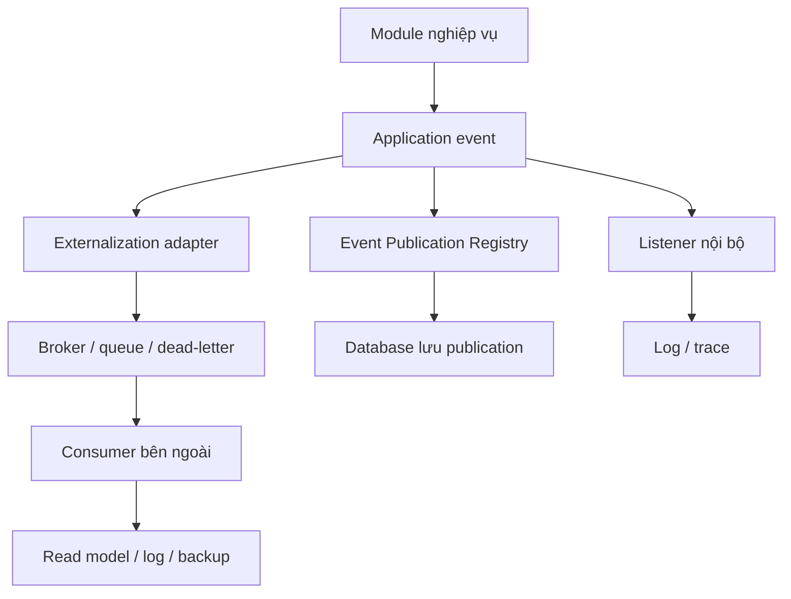

# Ẩn thông tin cá nhân trong application event

Application event giúp các module trao đổi thông tin mà không cần gọi trực tiếp service của nhau. Tuy nhiên, event có thể được nhiều listener nhận, được serialize vào Event Publication Registry, chuyển tới message broker, lưu trong queue, ghi vào dead-letter queue hoặc xuất hiện trong log và trace. Nếu payload chứa email, số điện thoại, địa chỉ hay thông tin định danh, dữ liệu đó có thể lan tới nhiều hệ thống và tồn tại lâu hơn dự kiến.

**Ẩn thông tin cá nhân** trong luồng event bắt đầu từ việc chỉ công bố dữ liệu thật sự cần thiết cho mục đích xử lý. Khi consumer cần nhận diện một khách hàng, event có thể mang một tham chiếu giả danh được giới hạn theo từng tích hợp. Khi consumer cần dữ liệu liên hệ, nó có thể truy xuất qua API được phân quyền thay vì nhận bản sao dữ liệu cá nhân trong mọi message. Trong Spring Modulith, cần áp dụng nguyên tắc này ngay khi thiết kế event, trước khi event được serialize hoặc externalize.

## 1. Vì sao application event có thể làm lộ thông tin cá nhân?

Một event được phát một lần có thể đi qua nhiều nơi:

1. Publisher tạo event trong transaction nghiệp vụ.
2. Spring Modulith ghi nhận publication cho listener; persistent Event Publication Registry có thể lưu payload đã serialize.
3. Listener nội bộ nhận event và có thể ghi log hoặc tạo event khác.
4. Event được đánh dấu externalize có thể được gửi tới Kafka, RabbitMQ hoặc hệ thống tích hợp.
5. Broker lưu message trong queue/topic, bản sao dự phòng, dead-letter queue hoặc backup.
6. Consumer có thể ghi message vào log, trace, kho phân tích hoặc một hệ thống khác.

Nếu event chứa `fullName`, `email`, `phoneNumber` và `address`, mọi thành phần có quyền đọc payload đều có thể tiếp cận các trường đó. Việc chỉ bảo vệ API hoặc database gốc không đủ nếu dữ liệu đã được sao chép sang publication registry, broker, log và hệ thống downstream.



Mỗi nhánh có chính sách quyền truy cập, retention và xóa dữ liệu riêng. Vì vậy, cách hiệu quả nhất là giảm thông tin cá nhân ngay trong hợp đồng event; các lớp bảo vệ phía sau sẽ có ít dữ liệu nhạy cảm hơn để quản lý.

## 2. Nhận diện dữ liệu cá nhân trong event

Thông tin cá nhân không chỉ là tên hoặc số định danh. Một trường dữ liệu có thể nhận diện trực tiếp hoặc trở thành dữ liệu nhận diện khi kết hợp với trường khác.

| Nhóm dữ liệu | Ví dụ | Cách xem xét |
| --- | --- | --- |
| Định danh trực tiếp | Họ tên, email, số điện thoại, số giấy tờ | Tránh đưa vào event nếu consumer không cần giá trị gốc |
| Địa chỉ và vị trí | Địa chỉ nhà, tọa độ chính xác, nơi làm việc | Chỉ chia sẻ mức độ chi tiết cần cho mục đích xử lý |
| Định danh tài khoản | Username, customer number, account ID | Có thể liên kết với cá nhân; cần phân quyền và scope |
| Dữ liệu tài chính | Số tài khoản, thông tin thẻ, giao dịch | Không phát thông tin xác thực hoặc dữ liệu thanh toán đầy đủ |
| Dữ liệu nhạy cảm theo ngữ cảnh | Sức khỏe, sinh trắc học, thông tin gia đình hoặc dữ liệu riêng tư khác | Chỉ xử lý khi có mục đích và quyền truy cập rõ ràng |
| Dữ liệu kết hợp | Ngày sinh, khu vực nhỏ, chức danh, thời điểm giao dịch | Nhiều trường ít nhạy cảm có thể kết hợp để nhận diện một người |
| Nội dung tự do | Ghi chú khách hàng, nội dung hỗ trợ, mô tả sự cố | Có thể chứa thông tin cá nhân ngoài dự kiến; không đưa nguyên văn vào event chung |

Một `customerId` dạng UUID không nhất thiết là dữ liệu ẩn danh. Nếu hệ thống có thể tra cứu UUID đó về một khách hàng, nó vẫn là định danh giả danh có khả năng liên kết. Cần phân loại theo khả năng liên kết thực tế và quyền truy cập, không chỉ dựa trên việc giá trị có dễ đọc hay không.

## 3. Bắt đầu bằng data minimization

Trước khi chọn kỹ thuật che hoặc mã hóa, hãy hỏi consumer cần biết điều gì để hoàn thành trách nhiệm của nó. Event nên mang thông tin về sự kiện nghiệp vụ đã xảy ra, không mang toàn bộ hồ sơ của đối tượng.

Ví dụ, consumer phân tích chỉ cần biết hồ sơ khách hàng đã thay đổi và nhóm thuộc tính nào thay đổi. Nó thường không cần email, số điện thoại, địa chỉ hoặc ngày sinh của khách hàng.

**Payload không nên dùng:**

```json
{
  "eventType": "CustomerProfileChanged",
  "customerId": "C-1042",
  "fullName": "Nguyen Van A",
  "email": "customer@example.com",
  "phoneNumber": "+84901234567",
  "dateOfBirth": "1992-04-17",
  "homeAddress": "12 Example Street, Ho Chi Minh City",
  "changedAt": "2026-11-25T09:30:00Z"
}
```

**Payload tối giản hơn:**

```json
{
  "eventId": "8b2f8c2a-efb0-4e89-9f2b-6d4b3f8b2c10",
  "eventType": "CustomerProfileChanged",
  "schemaVersion": 1,
  "customerReference": "cust-ref-7Q4M",
  "changedAttributes": ["EMAIL"],
  "occurredAt": "2026-11-25T09:30:00Z"
}
```

Ví dụ thứ hai không chứa email mới. Consumer biết thuộc tính email đã thay đổi và có thể thực hiện bước tiếp theo qua một API được kiểm soát nếu thật sự cần giá trị mới. `customerReference` vẫn có thể là dữ liệu cá nhân giả danh nếu có hệ thống ánh xạ; cần bảo vệ nó như một định danh có thể liên kết.

### Xác định mục đích và người nhận

Với mỗi trường trong event, hãy ghi rõ:

- Consumer nào cần trường này?
- Consumer dùng trường đó để thực hiện hành động nào?
- Có thể thay trường bằng trạng thái, nhóm, cờ hoặc tham chiếu hay không?
- Trường có được gửi tới tất cả consumer của exchange/topic hay chỉ một consumer cụ thể?
- Dữ liệu cần tồn tại trong bao lâu ở registry, broker, log và backup?

Nếu không xác định được consumer và mục đích cụ thể, không đưa trường đó vào hợp đồng event dùng chung.

## 4. Phân biệt event nội bộ và integration event

Event nội bộ và event công bố ra hệ thống ngoài có phạm vi người nhận khác nhau. Một module có thể cần xử lý dữ liệu liên hệ để hoàn thành nghiệp vụ, nhưng các consumer phân tích hoặc đối tác bên ngoài không cần nhận dữ liệu đó.

| Loại event | Dữ liệu nên mang | Phạm vi |
| --- | --- | --- |
| Event nội bộ | Các trường tối thiểu cần cho listener nội bộ có trách nhiệm xử lý | Trong application context/module boundary được thiết kế |
| Integration event | Hợp đồng công khai đã giảm thiểu dữ liệu và có schema ổn định | Broker hoặc hệ thống bên ngoài |
| Event phục vụ thông báo | Tham chiếu tới người nhận và loại thông báo; dữ liệu liên hệ được truy xuất có kiểm soát khi cần | Notification service được phân quyền |

Không xem ranh giới module là ranh giới bảo mật tuyệt đối. Listener trong cùng ứng dụng vẫn có thể ghi log, lưu dữ liệu hoặc chuyển tiếp event. Nếu một event nội bộ chứa dữ liệu cá nhân, cần giới hạn listener, tránh externalize trực tiếp và kiểm soát mọi nhánh xử lý tiếp theo.

Một cách thiết kế là dùng event nội bộ tối giản để báo thay đổi, sau đó tạo integration event riêng cho consumer bên ngoài. Không tái sử dụng một DTO chứa đầy đủ thông tin cá nhân cho mọi loại listener chỉ vì nó đã có sẵn.

## 5. Chọn kỹ thuật ẩn phù hợp

Không có một kỹ thuật duy nhất phù hợp cho mọi trường hợp. Hãy chọn theo việc consumer có cần biết giá trị gốc, cần so khớp ổn định hay chỉ cần phân biệt đối tượng.

| Kỹ thuật | Consumer nhìn thấy | Phù hợp khi | Giới hạn |
| --- | --- | --- | --- |
| Loại bỏ trường | Không nhận dữ liệu đó | Consumer không cần giá trị | Cách bảo vệ tốt nhất khi trường không có mục đích sử dụng |
| Tham chiếu giả danh | Mã thay thế như `customerReference` | Cần liên kết các event của cùng một đối tượng trong phạm vi cho phép | Vẫn có thể liên kết về cá nhân nếu tồn tại bảng ánh xạ |
| Tokenization | Token thay cho giá trị gốc | Một dịch vụ được cấp quyền có thể đổi token về dữ liệu gốc | Cần bảo vệ kho token và giới hạn quyền detokenize |
| Masking | Một phần giá trị, ví dụ `***@example.com` | Giao diện vận hành cần nhận diện hạn chế | Không phù hợp làm biện pháp bảo vệ payload nếu consumer vẫn có thể cần giá trị gốc |
| HMAC/pseudonymous digest | Giá trị ổn định không đọc ngược trực tiếp | Cần so khớp cùng một giá trị qua nhiều event mà không phát giá trị gốc | Có thể liên kết các lần xuất hiện; bí mật HMAC phải được bảo vệ |
| Encryption | Ciphertext có thể giải mã bằng khóa | Một consumer được cấp quyền cần khôi phục giá trị gốc | Người giữ khóa vẫn đọc được; mã hóa không thay thế data minimization |

Ưu tiên loại bỏ trường hoặc thay bằng trạng thái/tham chiếu. Chỉ dùng kỹ thuật biến đổi khi có nhu cầu nghiệp vụ cụ thể.

## 6. Tham chiếu giả danh và tokenization

Thay vì đưa email hoặc số điện thoại vào event, publisher có thể đưa một tham chiếu ngẫu nhiên được quản lý bởi dịch vụ sở hữu dữ liệu khách hàng. Ví dụ `customerReference` có thể là token chỉ có ý nghĩa trong một tích hợp nhất định.

Một bảng ánh xạ token có thể có dạng:

```text
integration_name | customer_reference | customer_id
-----------------+--------------------+------------
shipping         | ship-7Q4M          | 9d...
analytics        | ana-3P8X           | 9d...
```

Token riêng theo từng consumer giúp giảm khả năng hai hệ thống ghép dữ liệu của cùng một người nếu không có quyền phù hợp. Dịch vụ sở hữu dữ liệu giữ bảng ánh xạ và chỉ cho phép detokenize qua API có xác thực, phân quyền và audit.

Không đưa bảng ánh xạ vào broker hoặc chia sẻ nó cùng event. Không để consumer có quyền tra cứu token tùy ý nếu nó chỉ cần đếm, phân nhóm hoặc cập nhật projection. Nếu consumer chỉ cần phân biệt event của một khách hàng trong chính hệ thống của nó, có thể cấp một mã tham chiếu riêng thay vì ID nội bộ dùng xuyên toàn tổ chức.

Token ngẫu nhiên không tự động làm dữ liệu thành ẩn danh. Khi dịch vụ hoặc người có quyền có thể liên kết token với hồ sơ khách hàng, dữ liệu vẫn có tính giả danh và cần được bảo vệ theo chính sách tương ứng.

## 7. Hash, HMAC và nguy cơ suy đoán

Không nên dùng `SHA-256(email)` hoặc `SHA-256(phoneNumber)` như một cách ẩn danh mặc định. Email và số điện thoại có không gian giá trị tương đối dễ đoán. Người có bản danh sách ứng viên có thể tính hash hàng loạt rồi so sánh để suy ra giá trị gốc.

Nếu cần tạo mã ổn định để so khớp mà không công bố dữ liệu gốc, có thể cân nhắc HMAC với khóa bí mật:

```java
byte[] digest = hmacSha256(
        secretKey,
        normalizeEmail(email).getBytes(StandardCharsets.UTF_8)
);
String reference = Base64.getUrlEncoder()
        .withoutPadding()
        .encodeToString(digest);
```

Đây là pseudocode minh họa; `hmacSha256`, quản lý khóa và chuẩn hóa email cần được triển khai bằng thư viện mật mã phù hợp. Khóa bí mật phải nằm trong secret manager hoặc KMS, không nằm trong source code hay payload.

HMAC vẫn tạo một giá trị ổn định: hai event có cùng email sau chuẩn hóa sẽ có cùng digest trong cùng phạm vi khóa. Vì vậy, nó cho phép liên kết các event. Hãy dùng khóa riêng theo tích hợp hoặc mục đích khi cần giảm khả năng liên kết chéo. Việc xoay khóa cũng cần kế hoạch vì digest mới sẽ khác digest cũ.

Không dùng HMAC thay cho tokenization khi hệ thống cần khôi phục email hoặc số điện thoại. HMAC là hàm một chiều; nếu cần lấy lại dữ liệu gốc, dùng kho token có kiểm soát hoặc mã hóa.

## 8. Masking chỉ là lớp trình bày

Masking thường che một phần giá trị để người vận hành có thể nhận diện hạn chế, ví dụ `n***@example.com` hoặc `******4567`. Cần phân biệt masking trên giao diện với việc giảm dữ liệu trong event.

Nếu message chứa email đầy đủ nhưng dashboard chỉ hiển thị email đã che, payload vẫn chứa dữ liệu gốc. Consumer, broker administrator hoặc người có quyền truy cập database publication vẫn có thể đọc email đầy đủ.

Chỉ tạo masked value khi có mục đích vận hành rõ ràng. Nếu không cần dữ liệu liên hệ, bỏ hẳn trường đó. Nếu cần hiển thị một phần, hãy tạo giá trị đã mask trước khi ghi vào log hoặc view và bảo đảm bản gốc không bị đưa vào metadata khác.

Không dùng chuỗi masking như `***` làm khóa định danh hoặc để thực hiện so khớp. Nhiều giá trị gốc có thể tạo ra cùng một chuỗi đã che.

## 9. Mã hóa trường nhạy cảm khi thật sự cần

Trong một số luồng, consumer được phép xử lý giá trị gốc nhưng chỉ một nhóm dịch vụ cụ thể có quyền giải mã. Có thể dùng mã hóa ở cấp trường hoặc envelope encryption để giới hạn khả năng đọc dữ liệu.

Các nguyên tắc cơ bản:

- Dùng thuật toán mã hóa xác thực hiện đại như AES-GCM hoặc cơ chế được nền tảng KMS cung cấp.
- Dùng nonce/IV duy nhất theo yêu cầu của thuật toán; không tự tái sử dụng nonce với cùng khóa.
- Lưu ciphertext cùng metadata cần thiết như key ID và phiên bản định dạng, không lưu khóa bí mật trong event.
- Quản lý khóa trong KMS/secret manager, phân quyền giải mã riêng và audit thao tác sử dụng khóa.
- Có kế hoạch xoay khóa, thu hồi khóa và xử lý payload cũ.
- Tránh giải mã ở những consumer chỉ cần tham chiếu hoặc trạng thái.

Mã hóa không làm payload nhỏ đi và không xóa dữ liệu cá nhân khỏi hệ thống. Ciphertext vẫn có thể được xem là dữ liệu cần bảo vệ, đặc biệt khi tổ chức còn giữ khóa giải mã. Khi mọi consumer đều được cấp cùng một khóa, lợi ích phân quyền ở cấp trường bị giảm đáng kể.

Không tự thiết kế thuật toán mật mã hoặc dùng Base64 như mã hóa. Nếu cần bảo vệ payload ở tầng broker, kết hợp TLS cho đường truyền và encryption-at-rest theo khả năng của broker; nếu cần giới hạn consumer đọc một trường cụ thể, cân nhắc mã hóa trường với khóa được quản lý riêng.

## 10. Thiết kế integration event không chứa PII

Một integration event có thể dùng định danh tham chiếu, danh sách thuộc tính thay đổi và metadata kỹ thuật không chứa thông tin liên hệ trực tiếp.

```java
import java.time.Instant;
import java.util.Set;
import java.util.UUID;

import org.springframework.modulith.events.Externalized;

@Externalized("customers.events::customer.profile-changed")
public record CustomerProfileChanged(
        UUID eventId,
        String customerReference,
        Set<CustomerAttribute> changedAttributes,
        Instant occurredAt,
        int schemaVersion
) {}

enum CustomerAttribute {
    EMAIL,
    PHONE,
    PREFERRED_LANGUAGE
}
```

Event này thông báo rằng một số thuộc tính đã thay đổi, không chứa giá trị email hoặc số điện thoại mới. `customerReference` được cấp cho tích hợp tương ứng. `eventId` giúp nhận diện lần phát event; `schemaVersion` giúp consumer quản lý thay đổi hợp đồng.

Publisher phát event trong transaction nghiệp vụ:

```java
@Transactional
public void updateContact(UUID customerId, ContactChange change) {
    customerProfile.updateContact(change);

    events.publishEvent(new CustomerProfileChanged(
            UUID.randomUUID(),
            customerReferences.forIntegration("analytics", customerId),
            Set.of(CustomerAttribute.EMAIL),
            Instant.now(),
            1
    ));
}
```

Các service `customerProfile`, `customerReferences` và `events` được lược giản để tập trung vào hợp đồng event. Trong triển khai thật, chỉ tạo tham chiếu cho consumer có nhu cầu; không cấp một token dùng chung cho mọi hệ thống nếu điều đó tạo khả năng liên kết chéo ngoài mục đích.

Consumer phân tích có thể cập nhật projection bằng `customerReference` và `changedAttributes`. Nếu một dịch vụ thông báo cần email mới, nó gọi API hồ sơ khách hàng bằng danh tính dịch vụ đã được cấp quyền và chỉ lấy trường cần dùng. Việc truy xuất đó phải được audit và có thể bị giới hạn theo mục đích.

## 11. Không để PII rò rỉ qua metadata và log

Ngay cả khi JSON body đã được tối giản, thông tin cá nhân vẫn có thể xuất hiện ở nơi khác:

- Routing key hoặc tên queue được ghép từ email, số điện thoại hay tên khách hàng.
- Message headers chứa `customer-email`, `phone` hoặc địa chỉ.
- `correlationId` được tạo từ số điện thoại hoặc customer identifier có thể tra cứu.
- Log ghi `event.toString()` và in toàn bộ record.
- Exception message chứa payload hoặc dữ liệu request.
- Trace span attribute, baggage hoặc metric label chứa PII.
- Dashboard, dead-letter viewer và công cụ debug lưu bản sao message.

Hãy dùng ID kỹ thuật ngẫu nhiên cho `eventId` và `correlationId`. Routing key nên mô tả loại sự kiện hoặc bounded context, ví dụ `customer.profile-changed`, không chứa dữ liệu của cá nhân. Headers chỉ nên chứa metadata phục vụ định tuyến, version hoặc tracing đã được kiểm soát.

Ví dụ log phù hợp:

```java
log.info(
        "Published customer profile event: eventId={}, customerRef={}, attributes={}",
        event.eventId(),
        event.customerReference(),
        event.changedAttributes()
);
```

Không log email, số điện thoại, địa chỉ hoặc toàn bộ payload. Cần kiểm tra cả log của serializer, message converter và exception handler vì thư viện có thể ghi nội dung message khi deserialize hoặc publish thất bại.

## 12. Event Publication Registry, broker và dead-letter queue

Khi sử dụng persistent Event Publication Registry, payload event có thể được serialize và lưu trong database để phục hồi publication chưa hoàn tất. Vì vậy, nếu event có dữ liệu cá nhân, registry cũng là một nơi lưu trữ cần được bảo vệ và áp dụng retention.

Khi externalize qua broker, message có thể tồn tại trong:

- Queue/topic đang chờ consumer.
- Retry queue hoặc delayed queue.
- Dead-letter queue khi consumer từ chối hoặc message hết TTL.
- Broker replication, snapshot và backup.
- Consumer inbox, outbox hoặc read model.
- Log và trace của producer/consumer.

Không nên cho rằng message đã biến mất khỏi queue chính là dữ liệu đã bị xóa hoàn toàn. Cần xác định chính sách retention cho từng nơi, bao gồm bản sao và backup. Dead-letter queue thường được giữ lâu để điều tra; nếu payload có PII, quyền truy cập DLQ và thời gian lưu phải được kiểm soát chặt.

Event Publication Registry giúp theo dõi việc giao event, không phải kho lưu hồ sơ khách hàng. Chỉ lưu những trường cần thiết để retry listener. Nếu một listener thực sự cần giá trị cá nhân để hoàn tất nghiệp vụ, hãy đánh giá riêng phạm vi truy cập và thời gian giữ publication đó.

## 13. Retention, replay và yêu cầu xóa dữ liệu

Event có thể được lưu lâu hơn hồ sơ gốc do retention của broker, event store hoặc hệ thống audit. Nếu event chứa email hoặc địa chỉ trực tiếp, việc xóa hồ sơ khách hàng ở database chính không tự động xóa các bản sao trong registry, broker, DLQ, log và backup.

Một thiết kế giảm thiểu dữ liệu giúp xử lý vòng đời tốt hơn:

1. Event lưu định danh giả danh và thông tin nghiệp vụ tối thiểu.
2. Hồ sơ chứa dữ liệu liên hệ được giữ trong dịch vụ sở hữu dữ liệu.
3. Consumer truy xuất dữ liệu gốc qua API có phân quyền khi cần.
4. Khi dữ liệu gốc hết mục đích lưu giữ hoặc cần xóa theo chính sách, dịch vụ sở hữu xử lý hồ sơ và bảng ánh xạ token.
5. Các event cũ còn lại không chứa bản sao email/địa chỉ; tuy nhiên tham chiếu giả danh vẫn cần được đánh giá khả năng liên kết.

Nếu payload phải chứa dữ liệu cá nhân, cần có quy trình xóa hoặc làm mất khả năng giải mã ở mọi nơi được áp dụng, theo chính sách retention và khả năng kỹ thuật của từng hệ thống. Crypto-shredding có thể được cân nhắc khi dữ liệu được mã hóa bằng khóa riêng có thể thu hồi, nhưng cần đánh giá backup, bản sao khóa và metadata còn lại. Không thể khẳng định dữ liệu đã ẩn danh chỉ vì đã xóa một bảng ánh xạ nếu vẫn còn cách liên kết khác.

Với event sourcing hoặc hệ thống yêu cầu lịch sử bất biến, hãy tách dữ liệu nhận diện khỏi event bất biến ngay từ đầu. Event lưu ID tham chiếu và sự kiện nghiệp vụ; hồ sơ cá nhân được quản lý trong một kho riêng có thể cập nhật hoặc xóa theo chính sách. Các yêu cầu pháp lý cụ thể phụ thuộc khu vực và loại dữ liệu, vì vậy cần phối hợp với bộ phận phụ trách quyền riêng tư/pháp chế để xác định retention và xử lý yêu cầu xóa.

## 14. Quyền truy cập theo nguyên tắc tối thiểu

Ẩn dữ liệu trong payload cần đi cùng kiểm soát ai có thể đọc và xử lý message.

- Tạo tài khoản broker riêng cho producer và từng nhóm consumer.
- Chỉ cấp quyền publish vào exchange/topic cần thiết.
- Chỉ cấp quyền consume từ queue/topic mà service cần.
- Phân tách quyền đọc DLQ, backup và message browser khỏi quyền chạy consumer thông thường.
- Dùng TLS cho kết nối và xác thực service identity.
- Bảo vệ database của Event Publication Registry và bảng token mapping.
- Audit thao tác đọc dữ liệu gốc, detokenize và giải mã.
- Không chia sẻ credential giữa các môi trường hoặc nhiều ứng dụng không liên quan.

Nếu một consumer chỉ cần biết `customerReference` và thuộc tính đã thay đổi, nó không cần quyền truy cập API trả về toàn bộ hồ sơ khách hàng. Hãy thiết kế API hẹp theo mục đích, ví dụ chỉ trả về ngôn ngữ thông báo hoặc địa chỉ giao hàng đang có hiệu lực cho một đơn hàng cụ thể.

## 15. Kiểm thử hợp đồng không chứa thông tin cá nhân

Kiểm thử bảo mật cần xác nhận dữ liệu không xuất hiện trong payload, metadata và log ngoài dự kiến. Có thể xây dựng kiểm thử ở nhiều lớp:

| Kiểm thử | Điều cần xác nhận |
| --- | --- |
| Contract test | Integration event chỉ có trường đã được phê duyệt |
| Serialization test | JSON/byte payload không chứa email, phone, address hoặc trường bị cấm |
| Mapping test | Publisher không sao chép toàn bộ entity/DTO cá nhân sang event |
| Header/routing test | Routing key và header không chứa dữ liệu nhận diện |
| Logging test | Log và exception không in payload hoặc giá trị cá nhân |
| Authorization test | Consumer chỉ có quyền đọc destination và API cần thiết |
| Registry/broker test | Payload được lưu trong registry, queue và DLQ tuân thủ chính sách dữ liệu |
| Retention test | Publication/message hết hạn được dọn theo cấu hình đã xác định |
| Replay test | Event cũ có thể được xử lý mà không cần khôi phục PII đã loại bỏ |
| Token test | Consumer không có quyền không thể tra ngược token về hồ sơ gốc |

Một contract test có thể serialize event rồi kiểm tra các trường nhạy cảm không xuất hiện:

```java
@Test
void integrationEventDoesNotExposeContactDetails() throws Exception {
    CustomerProfileChanged event = new CustomerProfileChanged(
            UUID.randomUUID(),
            "cust-ref-7Q4M",
            Set.of(CustomerAttribute.EMAIL),
            Instant.parse("2026-11-25T09:30:00Z"),
            1
    );

    String payload = objectMapper.writeValueAsString(event);

    assertThat(payload).doesNotContain("emailAddress");
    assertThat(payload).doesNotContain("phoneNumber");
    assertThat(payload).doesNotContain("homeAddress");
    assertThat(payload).doesNotContain("customer@example.com");
}
```

Đây là ví dụ minh họa. Kiểm thử thực tế nên dùng danh sách trường cấm theo phân loại dữ liệu và kiểm tra schema đã công bố. Việc kiểm tra một vài chuỗi không chứng minh payload hoàn toàn không có dữ liệu cá nhân; cần review hợp đồng và mapping cùng với kiểm thử tự động.

## 16. Những lỗi thiết kế thường gặp

| Lỗi | Hệ quả | Cách xử lý |
| --- | --- | --- |
| Gửi toàn bộ entity khách hàng trong event | Mọi listener và broker có thể nhận nhiều dữ liệu hơn cần thiết | Tạo integration DTO tối giản |
| Chỉ mask trên dashboard | Payload gốc vẫn tồn tại trong registry, broker và log | Loại bỏ hoặc biến đổi dữ liệu trước serialization |
| Dùng SHA-256(email) làm mã ẩn danh | Có thể bị dò bằng danh sách email phổ biến | Dùng token ngẫu nhiên hoặc HMAC với khóa được bảo vệ khi cần so khớp |
| Dùng chung customer ID cho mọi đối tác | Tạo khả năng liên kết dữ liệu chéo hệ thống | Cấp token riêng theo integration hoặc purpose |
| Cho mọi consumer truy cập API hồ sơ | Mở rộng quyền đọc PII ngoài nhu cầu | API hẹp và authorization theo mục đích |
| Đặt email trong routing key/header | Lộ dữ liệu qua broker management và log | Dùng routing key theo loại event, metadata kỹ thuật |
| Ghi `event.toString()` vào log | Record có thể in toàn bộ trường cá nhân | Log allowlist các trường an toàn |
| Chỉ bảo vệ database gốc | PII còn trong registry, DLQ, backup và trace | Lập bản đồ mọi bản sao và retention |
| Mã hóa nhưng phát khóa cho mọi consumer | Mọi consumer vẫn có thể đọc dữ liệu gốc | Phân quyền khóa và chỉ giải mã tại service cần thiết |
| Xem token là dữ liệu ẩn danh | Token vẫn có thể liên kết về cá nhân | Phân loại là dữ liệu giả danh và bảo vệ tương ứng |
| Xóa hồ sơ nhưng giữ event chứa PII vô thời hạn | Bản sao cá nhân còn trong lịch sử event | Tách hồ sơ khỏi event và có quy trình retention/xóa |

## 17. Quy trình áp dụng trong một module

Khi thiết kế event có khả năng chứa thông tin cá nhân, hãy thực hiện theo thứ tự:

1. Liệt kê trường dữ liệu và phân loại dữ liệu cá nhân, dữ liệu nhạy cảm, định danh có thể liên kết.
2. Xác định mục đích, consumer và trường thật sự cần cho từng consumer.
3. Loại bỏ trường không cần; ưu tiên trạng thái, nhóm thuộc tính hoặc tham chiếu thay cho giá trị gốc.
4. Tách event nội bộ khỏi integration event nếu hai nhóm consumer cần dữ liệu khác nhau.
5. Nếu cần liên kết đối tượng, cấp token/tham chiếu theo phạm vi tích hợp và bảo vệ bảng ánh xạ.
6. Chỉ dùng masking, HMAC hoặc encryption khi có yêu cầu cụ thể và hiểu rõ giới hạn.
7. Kiểm tra payload, serializer, headers, routing key, log, trace và exception trước khi externalize.
8. Bảo vệ Event Publication Registry, broker, queue, DLQ, backup và API truy xuất dữ liệu gốc.
9. Xác định retention, replay và quy trình xử lý yêu cầu xóa dữ liệu ở mọi bản sao.
10. Viết contract test, serialization test, logging test và authorization test cho luồng event.

Ẩn thông tin cá nhân trong application event hiệu quả nhất khi dữ liệu không cần thiết chưa từng được đưa vào payload. Khi event chỉ chứa thông tin nghiệp vụ tối thiểu, tham chiếu giả danh được kiểm soát và consumer truy xuất dữ liệu gốc qua API có phân quyền khi thật sự cần, Spring Modulith có thể duy trì giao tiếp bất đồng bộ mà giảm đáng kể nguy cơ lan truyền dữ liệu cá nhân qua listener, publication registry, broker và hệ thống downstream.
