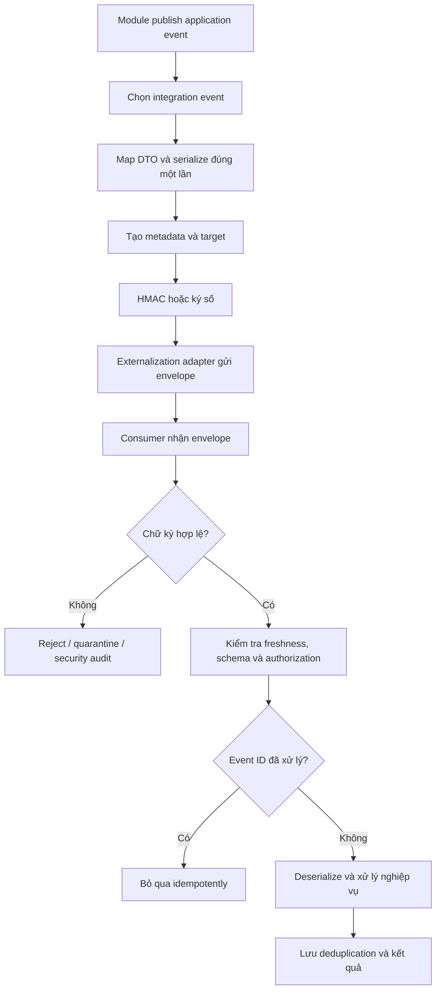

# Toàn vẹn message

Application event giúp các module Spring Modulith trao đổi thông tin qua hợp đồng nghiệp vụ. Khi event được xử lý trong cùng application context, các listener thường nằm trong cùng ranh giới tin cậy của tiến trình. Khi event được externalize qua Kafka, RabbitMQ hoặc một transport khác, message đi qua broker, mạng và có thể tới consumer do một nhóm khác vận hành. Ở ranh giới đó, hệ thống cần xác minh message có bị sửa đổi hay giả mạo trong quá trình truyền và lưu chuyển hay không.

Toàn vẹn message (message integrity) bảo đảm nội dung và metadata quan trọng của message không bị thay đổi mà không bị phát hiện. Cơ chế xác thực message còn giúp consumer kiểm tra message được tạo bởi một bên nắm giữ khóa hoặc khóa ký hợp lệ. Trong Spring Modulith, cần phân biệt việc publish application event, theo dõi publication bằng Event Publication Registry và bảo vệ payload khi externalize: registry theo dõi vòng đời xử lý, còn chữ ký hoặc mã xác thực message bảo vệ tính toàn vẹn ở ranh giới tích hợp.

## Mục tiêu

Sau bài này, bạn có thể:

- Phân biệt toàn vẹn, xác thực nguồn gửi và bảo mật/confidentiality của message.
- Xác định ranh giới tin cậy khi application event được externalize.
- Thiết kế envelope có chữ ký hoặc MAC bao phủ payload cùng metadata định tuyến.
- Chọn HMAC hoặc chữ ký số phù hợp với mô hình publisher và consumer.
- Xác minh chữ ký trước khi chuyển message vào xử lý nghiệp vụ.
- Quản lý khóa, xoay vòng khóa, chống replay và chống xử lý trùng.
- Tích hợp bảo vệ message với adapter broker, Event Publication Registry và chính sách lỗi.
- Kiểm thử message bị sửa, giả mạo, phát lại hoặc dùng khóa không hợp lệ.

## 1. Toàn vẹn message giải quyết vấn đề gì?

Một message có thể đi qua nhiều thành phần: producer, externalization adapter, broker exchange/topic, queue, consumer adapter và listener. Trong suốt hành trình, payload hoặc metadata có thể bị thay đổi do lỗi cấu hình, bug chuyển đổi, thao tác vận hành sai hoặc hành vi có chủ đích của một thành phần không đáng tin cậy.

Ví dụ, event `PaymentAuthorized` ban đầu có số tiền 1.000.000 đồng nhưng payload tới consumer lại mang số tiền 10.000.000 đồng. Một trường hợp khác là payload không đổi nhưng `tenantId`, `eventType` hoặc routing target bị sửa, khiến message được xử lý dưới ngữ cảnh hoặc đích không đúng. Nếu consumer chỉ parse JSON và gọi listener, nó không có bằng chứng rằng message còn nguyên vẹn như lúc publisher tạo.

| Thuộc tính | Câu hỏi được trả lời | Cơ chế thường dùng |
|---|---|---|
| Toàn vẹn (integrity) | Nội dung có bị thay đổi không? | HMAC hoặc chữ ký số |
| Xác thực nguồn gửi (authenticity) | Message có được tạo bởi publisher được tin cậy không? | HMAC theo trust domain hoặc chữ ký số |
| Bí mật (confidentiality) | Bên trung gian có đọc được nội dung không? | TLS hoặc mã hóa payload |
| Chống phát lại (replay protection) | Message hợp lệ cũ có bị gửi lại để lặp tác động không? | Event ID, deduplication, timestamp/expiry và trạng thái xử lý |
| Phân quyền (authorization) | Publisher có được phép phát loại event này không? | Broker ACL, identity và policy ở consumer |

Một chữ ký hợp lệ không tự chứng minh nghiệp vụ được phép thực hiện. Consumer vẫn phải kiểm tra quyền, trạng thái aggregate, tenant và quy tắc nghiệp vụ. Tương tự, TLS bảo vệ kênh truyền giữa hai đầu kết nối nhưng không thay thế chữ ký end-to-end nếu message đi qua nhiều broker, bridge, queue hoặc thành phần trung gian.

## 2. Xác định ranh giới cần bảo vệ

Trong cùng application context, producer gọi `ApplicationEventPublisher` để phát một đối tượng event cho các listener nội bộ. Nếu các module cùng thuộc một tiến trình và cùng miền tin cậy, ký từng object nội bộ thường không đem lại lợi ích tương xứng. Cần tập trung bảo vệ nơi event rời khỏi tiến trình hoặc đi qua một ranh giới không còn hoàn toàn tin cậy.

Một luồng externalization điển hình:

```mermaid
flowchart LR
    A[Module nghiệp vụ] --> B[ApplicationEventPublisher]
    B --> C[Event externalization]
    C --> D[Mapping thành integration payload]
    D --> E[Serializer và signer]
    E --> F[Broker adapter]
    F --> G[(Kafka / RabbitMQ)]
    G --> H[Consumer adapter]
    H --> I[Verify signature/MAC]
    I --> J[Validate schema và authorization]
    J --> K[Application listener]
```



Producer nên ký sau khi đã tạo payload tích hợp cuối cùng và trước khi gửi vào broker. Consumer xác minh tại ingress, trước khi payload được chuyển tới listener nghiệp vụ. Nếu một gateway hoặc broker bridge thay đổi payload, thành phần đó phải nằm trong thiết kế trust rõ ràng; không âm thầm thay đổi nội dung đã ký.

Hãy xác định cụ thể những trường cần bảo vệ:

- Nội dung payload, bao gồm số tiền, định danh aggregate và dữ liệu nghiệp vụ.
- Loại event và phiên bản schema.
- Event ID và thời điểm phát sinh.
- Tenant hoặc security context nếu có.
- Target, topic hoặc routing key nếu chúng ảnh hưởng đến consumer hoặc ngữ nghĩa message.
- Content type và encoding nếu consumer dựa vào chúng để giải mã.

Nếu chỉ ký payload mà không ký metadata, một bên trung gian có thể giữ nguyên payload nhưng đổi loại event, tenant hoặc target. Message vẫn có MAC hợp lệ cho payload cũ nhưng có thể bị diễn giải sai trong ngữ cảnh mới. Vì vậy, ký cả payload lẫn metadata có ảnh hưởng tới ý nghĩa hoặc định tuyến.

## 3. Phân biệt Event Publication Registry và message integrity

Event Publication Registry của Spring Modulith theo dõi publication tới listener: publication nào được tạo, listener nào đã hoàn tất và publication nào còn chưa hoàn tất để phục hồi. Registry hỗ trợ độ tin cậy của luồng xử lý trong ứng dụng; nó không phải cơ chế mật mã để xác minh payload có bị sửa khi đi qua broker hay không.

| Cơ chế | Bảo vệ hoặc theo dõi điều gì? | Không thay thế được |
|---|---|---|
| Event Publication Registry | Trạng thái publication và listener trong ứng dụng | Chữ ký, MAC hoặc TLS |
| Publisher confirm của broker | Kết quả broker xác nhận nhận message theo cấu hình | Xác thực nội dung khi consumer đọc |
| TLS | Bảo vệ kênh truyền giữa các endpoint TLS | Toàn vẹn end-to-end qua mọi hop hoặc chống replay nghiệp vụ |
| HMAC/chữ ký số | Phát hiện thay đổi và xác thực bên giữ khóa ký | Authorization, deduplication và confidentiality |
| Inbox/deduplication | Ngăn xử lý lặp cùng event | Phát hiện sửa payload nếu chưa xác minh chữ ký |

Một publication được registry đánh dấu hoàn tất chỉ phản ánh listener/externalizer đã hoàn thành theo semantics của cấu hình. Nó không chứng minh consumer bên ngoài đã xác minh chữ ký, đã áp dụng nghiệp vụ hoặc người dùng cuối đã nhận kết quả. Các chặng này cần tín hiệu và trạng thái riêng.

## 4. Thiết kế signed message envelope

Không nên chỉ gắn một header `signature` rời rạc mà không định nghĩa chính xác chữ ký bao phủ dữ liệu nào. Hãy thiết kế một envelope ổn định gồm metadata, payload và thông tin xác thực.

Ví dụ cấu trúc logic:

```json
{
  "metadata": {
    "eventType": "orders.payment-authorized",
    "eventId": "2a5a1c7d-1d89-4d9b-bae5-b9f6a4f5a012",
    "schemaVersion": 2,
    "occurredAt": "2026-11-25T10:15:30Z",
    "target": "payments.authorized",
    "tenantId": "tenant-42",
    "keyId": "orders-signing-2026-02"
  },
  "payload": "BASE64_ENCODED_EXACT_PAYLOAD_BYTES",
  "signature": {
    "algorithm": "HMAC-SHA-256",
    "value": "BASE64_ENCODED_MAC"
  }
}
```

Envelope trên minh họa cấu trúc, không phải một schema bắt buộc của Spring Modulith. `keyId` xác định khóa cần tra cứu; `algorithm` phải được giới hạn bởi policy của consumer thay vì tin tùy ý vào giá trị do message cung cấp. Payload được biểu diễn bằng Base64 để giữ nguyên byte đã ký. Nếu dùng một format nhị phân hoặc broker headers, vẫn phải định nghĩa cùng một tập trường được bảo vệ.

Chữ ký cần bao phủ tối thiểu:

1. Phiên bản định dạng envelope hoặc domain separation string.
2. Event type và schema version.
3. Event ID và thời điểm phát sinh.
4. Target/routing context và tenant nếu có.
5. Key ID hoặc thông tin lựa chọn khóa.
6. Byte payload chính xác được gửi qua transport.

Không ký một chuỗi nối tùy tiện như `eventType + eventId + payload`; các chuỗi khác nhau có thể tạo ra cùng một kết quả nối nếu không có ranh giới trường. Dùng canonical serialization có quy tắc rõ ràng hoặc mã hóa từng trường với length-prefix. Consumer phải xác minh trên cùng byte sequence mà producer đã ký.

## 5. Chọn HMAC hay chữ ký số

HMAC dùng một khóa bí mật chung giữa publisher và consumer. Publisher tạo MAC; consumer dùng cùng khóa để xác minh. HMAC phù hợp khi số bên tham gia nhỏ, các bên cùng thuộc một trust domain và việc chia sẻ secret có thể quản lý an toàn.

Chữ ký số dùng private key ở publisher và public key ở consumer. Publisher ký; consumer chỉ cần public key để xác minh và không thể dùng public key đó tạo chữ ký hợp lệ. Đây là lựa chọn phù hợp khi có nhiều consumer độc lập hoặc cần phân biệt quyền ký và quyền xác minh.

| Tiêu chí | HMAC-SHA-256 | Ed25519 hoặc chữ ký bất đối xứng tương đương |
|---|---|---|
| Khóa | Secret dùng chung | Private key ký, public key xác minh |
| Ai có thể tạo message hợp lệ? | Mọi bên có secret | Bên giữ private key |
| Phân phối khóa | Phải bảo vệ secret ở mọi consumer | Có thể phân phối public key rộng hơn |
| Thu hồi/rotation | Phải thay secret ở các bên liên quan | Thay key pair và cập nhật trust store |
| Trường hợp phù hợp | Một trust domain nhỏ, kiểm soát được secret | Nhiều consumer, cần xác minh mà không trao quyền ký |

Không tự thiết kế thuật toán mật mã hoặc dùng hash không khóa như SHA-256(payload) để xác thực nguồn gửi. Hash thường chỉ phát hiện thay đổi nếu giá trị hash được bảo vệ bằng một kênh tin cậy; attacker có thể sửa payload và tính lại hash thường. Hãy dùng thư viện mật mã chuẩn và thuật toán đã được policy phê duyệt.

## 6. Tạo HMAC trên đúng byte payload

Ví dụ sau minh họa HMAC-SHA-256 với metadata được mã hóa bằng length-prefix. Cách này tránh nhập nhằng khi nối các trường có độ dài thay đổi. Payload được ký dưới dạng byte đã serialize và chính byte đó phải được gửi qua broker.

```java
import java.io.ByteArrayOutputStream;
import java.io.DataOutputStream;
import java.io.IOException;
import java.nio.charset.StandardCharsets;
import java.security.GeneralSecurityException;
import java.security.MessageDigest;
import java.time.Instant;
import javax.crypto.Mac;
import javax.crypto.spec.SecretKeySpec;

record MessageMetadata(
    String eventType,
    String eventId,
    int schemaVersion,
    Instant occurredAt,
    String target,
    String tenantId,
    String keyId,
    String algorithm
) {}

final class MessageIntegrity {

    private MessageIntegrity() {}

    static byte[] sign(
            byte[] secret,
            MessageMetadata metadata,
            byte[] payload) throws GeneralSecurityException, IOException {
        Mac mac = Mac.getInstance("HmacSHA256");
        mac.init(new SecretKeySpec(secret, "HmacSHA256"));
        return mac.doFinal(signingInput(metadata, payload));
    }

    static boolean verify(
            byte[] secret,
            MessageMetadata metadata,
            byte[] payload,
            byte[] suppliedMac) throws GeneralSecurityException, IOException {
        byte[] expected = sign(secret, metadata, payload);
        return MessageDigest.isEqual(expected, suppliedMac);
    }

    private static byte[] signingInput(
            MessageMetadata metadata, byte[] payload) throws IOException {
        var bytes = new ByteArrayOutputStream();
        try (var out = new DataOutputStream(bytes)) {
            writeString(out, "spring-modulith-message-v1");
            writeString(out, metadata.eventType());
            writeString(out, metadata.eventId());
            out.writeInt(metadata.schemaVersion());
            out.writeLong(metadata.occurredAt().getEpochSecond());
            out.writeInt(metadata.occurredAt().getNano());
            writeString(out, metadata.target());
            writeString(out, metadata.tenantId());
            writeString(out, metadata.keyId());
            writeString(out, metadata.algorithm());
            out.writeInt(payload.length);
            out.write(payload);
        }
        return bytes.toByteArray();
    }

    private static void writeString(DataOutputStream out, String value)
            throws IOException {
        byte[] encoded = value.getBytes(StandardCharsets.UTF_8);
        out.writeInt(encoded.length);
        out.write(encoded);
    }
}
```

Trong ứng dụng thực tế, `secret` phải được lấy từ secret manager hoặc key store theo `keyId`, không hard-code, commit vào repository hoặc ghi log. HMAC key nên là byte ngẫu nhiên đủ mạnh; HMAC-SHA-256 thường dùng secret tối thiểu 256 bit. `MessageDigest.isEqual` được dùng để so sánh MAC nhằm tránh so sánh byte thông thường có thời gian phụ thuộc vị trí byte sai.

Ví dụ này là phần lõi mật mã minh họa. Serializer cần tạo `payload` đúng một lần; publisher gửi chính byte array đó và MAC tương ứng. Nếu producer serialize lại object lần thứ hai, khác biệt thứ tự thuộc tính, timestamp hoặc format số có thể khiến consumer không xác minh được. Nếu muốn ký trên dữ liệu JSON ở dạng semantic object thay vì byte transport, phải dùng một chuẩn canonical JSON thống nhất như RFC 8785 ở cả hai phía.

## 7. Ký cả metadata và kiểm soát định tuyến

Payload không phải phần duy nhất ảnh hưởng đến ý nghĩa message. Ví dụ cùng payload `{"orderId":"..."}` có thể bị chuyển sang tenant khác, event type khác hoặc target khác. Nếu consumer dùng các trường này để chọn handler hoặc phân quyền, chúng phải nằm trong signing input.

Hãy ký `target` hoặc routing context logic trước khi broker adapter chuyển thành tên topic/queue cụ thể. Nếu hạ tầng thay đổi routing key ở broker, hãy quyết định rõ đó là metadata vận chuyển không thuộc hợp đồng hay là một phần ý nghĩa message. Nếu consumer dựa vào routing key để phân vùng tenant hoặc chọn nghiệp vụ, cần bảo vệ hoặc xác minh nó ở một lớp tin cậy.

Không lấy `tenantId` chỉ từ header không được xác minh. Sau khi kiểm tra chữ ký, consumer vẫn phải xác nhận publisher có quyền phát event cho tenant đó. Chữ ký chứng minh bên giữ khóa đã ký trường `tenantId`; nó không chứng minh tenant đó thuộc quyền của producer nếu producer có quyền ký quá rộng.

## 8. Xác minh trước khi xử lý nghiệp vụ

Consumer nên thực hiện các bước theo thứ tự:

1. Nhận envelope với giới hạn kích thước và kiểm tra cấu trúc cơ bản.
2. Kiểm tra thuật toán có nằm trong allowlist của consumer không.
3. Tra cứu khóa theo `keyId`; từ chối khóa không tồn tại hoặc đã bị thu hồi.
4. Tái tạo signing input từ metadata và đúng payload bytes nhận được.
5. Xác minh HMAC/chữ ký; nếu sai, dừng trước khi deserialize thành domain object hoặc gọi listener nghiệp vụ.
6. Kiểm tra timestamp, schema version, event type, target và authorization.
7. Kiểm tra event ID đã được xử lý chưa và áp dụng deduplication.
8. Deserialize payload đã xác minh, sau đó mới chuyển tới application handler.

Ví dụ flow xác minh ở mức ứng dụng:

```java
VerifiedEvent verifyAndDecode(ReceivedEnvelope envelope) {
    requireAllowedAlgorithm(envelope.signature().algorithm());

    var key = keyProvider.findVerificationKey(
        envelope.metadata().keyId()
    ).orElseThrow(UnknownSigningKeyException::new);

    boolean valid = integrityVerifier.verify(
        key,
        envelope.metadata(),
        envelope.payloadBytes(),
        envelope.signatureBytes()
    );

    if (!valid) {
        throw new InvalidMessageSignatureException();
    }

    validateFreshness(envelope.metadata().occurredAt());
    authorizePublisher(envelope.metadata());
    validateSchema(envelope.metadata().eventType(),
                   envelope.metadata().schemaVersion());

    return decoder.decodeVerified(envelope);
}
```

`ReceivedEnvelope`, `keyProvider`, `integrityVerifier` và các hàm validation là abstraction do ứng dụng định nghĩa. Điểm quan trọng là handler nghiệp vụ chỉ nhận `VerifiedEvent`; không để một code path khác bỏ qua bước xác minh rồi gọi trực tiếp listener với dữ liệu chưa tin cậy.

Nếu envelope dùng JSON, parser bên ngoài vẫn phải đọc một số trường để tìm `keyId` và payload bytes. Giới hạn kích thước, độ sâu JSON, số trường và encoding trước khi parse để tránh message quá lớn hoặc cấu trúc độc hại gây tiêu thụ tài nguyên. Không thực hiện business deserialization hoặc side effect trước khi chữ ký hợp lệ.

## 9. Chống replay và xử lý trùng

Một message có chữ ký hợp lệ vẫn có thể bị phát lại. Attacker hoặc một consumer lỗi có thể gửi lại nguyên message cũ để tạo tác động lặp. Chữ ký chứng minh message không bị sửa; nó không chứng minh message chưa từng được xử lý.

Các biện pháp thường dùng:

- Mỗi event có `eventId` duy nhất, ổn định qua mọi lần gửi lại.
- Consumer lưu event ID đã xử lý với unique constraint hoặc inbox table.
- Việc ghi deduplication record và cập nhật nghiệp vụ nằm trong cùng transaction nếu cùng database.
- Timestamp hoặc `expiresAt` giới hạn khoảng thời gian message được chấp nhận khi nghiệp vụ cho phép.
- Với lệnh có tác động tài chính, dùng idempotency key tại hệ thống ngoài và lưu external reference.

Không chỉ dựa vào timestamp để chống replay. Message có thể bị giữ trong broker hoặc retry hợp lệ lâu hơn cửa sổ thời gian dự kiến; ngược lại, attacker có thể phát lại ngay trong cửa sổ đó. Deduplication bền vững theo event ID là lớp bảo vệ chính cho tác động nghiệp vụ. Timestamp giúp phát hiện message quá cũ hoặc đồng hồ lệch bất thường.

Nếu cùng event ID xuất hiện với payload hoặc metadata khác, không xem đó là duplicate bình thường. Đây có thể là lỗi producer hoặc dấu hiệu can thiệp. So sánh digest đã lưu và đưa trường hợp xung đột vào luồng security incident/quarantine.

## 10. Quản lý khóa và xoay vòng khóa

Khóa ký là tài sản bảo mật. Nếu secret HMAC hoặc private key bị lộ, attacker có thể tạo message được consumer chấp nhận. Không lưu khóa trong source code, file cấu hình commit vào Git, image container hoặc log.

Một quy trình quản lý khóa nên có:

- Lưu secret/private key trong secret manager, KMS hoặc HSM phù hợp.
- Phân quyền tối thiểu: publisher có quyền ký; consumer chỉ có quyền xác minh nếu dùng chữ ký bất đối xứng.
- Mỗi khóa có `keyId` duy nhất, trạng thái và thời điểm hiệu lực.
- Hỗ trợ giai đoạn chuyển tiếp: publisher ký bằng khóa mới, consumer tạm thời chấp nhận khóa mới và khóa cũ.
- Thu hồi khóa cũ sau khi hết thời gian lưu message/retry hợp lệ.
- Có quy trình khẩn cấp khi khóa bị lộ: dừng ký, thu hồi, cập nhật trust store và điều tra message đã phát.

Với HMAC, mọi consumer giữ secret đều có khả năng tạo MAC hợp lệ. Nếu consumer chỉ cần xác minh và không nên có quyền phát message, cân nhắc chữ ký số để chỉ publisher giữ private key. Với nhiều producer, có thể cấp key pair riêng theo producer hoặc trust domain để thu hẹp phạm vi ảnh hưởng khi một khóa bị lộ.

Không cho message tự chọn thuật toán bất kỳ. Consumer nên cấu hình thuật toán mong đợi theo loại producer hoặc trust domain; `algorithm` trong envelope chỉ là thông tin để kiểm tra tương thích, không phải quyền yêu cầu consumer hạ cấp sang thuật toán yếu.

## 11. Kết hợp với Spring Modulith externalization

Module nghiệp vụ nên publish event nội bộ bằng `ApplicationEventPublisher` và giữ hợp đồng event độc lập với broker. Khi cần gửi ra ngoài, externalization chọn event phù hợp, mapping sang integration payload ổn định và chuyển payload qua adapter broker.

Có thể đặt bước serialize và ký trong adapter/decorator ở ranh giới externalization:

1. Nhận event đã được chọn externalize.
2. Map sang DTO tích hợp, không serialize trực tiếp entity hoặc aggregate nội bộ.
3. Serialize DTO thành byte array đúng một lần.
4. Tạo metadata gồm event type, event ID, schema version, timestamp, target, tenant và key ID.
5. Tạo MAC/chữ ký trên metadata cùng payload bytes.
6. Đóng gói envelope và gửi qua Kafka/AMQP/JMS hoặc transport đã cấu hình.

Consumer adapter nhận envelope, xác minh chữ ký, kiểm tra authorization và deduplication, rồi mới chuyển payload đã xác minh vào application handler. Module nghiệp vụ không cần phụ thuộc trực tiếp vào thư viện mật mã hoặc client broker.

Spring Modulith không tự động ký mọi application event chỉ vì event được externalize. Nếu ứng dụng cần message integrity, phải triển khai hoặc cấu hình lớp ký/xác minh rõ ràng tại transport boundary. Với custom transport, có thể đặt logic này trong adapter triển khai SPI externalization mà phiên bản Spring Modulith đang dùng hỗ trợ; với adapter có sẵn, dùng extension point hoặc lớp tích hợp phù hợp mà không tạo hai đường gửi song song.

Event Publication Registry vẫn theo dõi publication của externalizer. Chỉ đánh dấu publication hoàn tất khi adapter đã hoàn thành thao tác gửi theo semantics đã chọn. Việc ký thành công trong bộ nhớ không đồng nghĩa broker đã nhận message; tương tự, broker nhận message không chứng minh consumer đã xác minh và xử lý thành công.

## 12. TLS, broker ACL và message signature

Một thiết kế toàn vẹn message nên kết hợp nhiều lớp:

| Lớp | Biện pháp | Mục tiêu |
|---|---|---|
| Ứng dụng | HMAC/chữ ký số trên envelope | Bảo vệ nội dung end-to-end và xác thực bên ký |
| Kết nối | TLS/mTLS | Bảo vệ dữ liệu trên đường truyền và xác thực endpoint kết nối |
| Broker | ACL theo exchange/topic/queue/vhost | Giới hạn ai được publish, consume hoặc bind |
| Consumer | Signature verification, schema validation, authorization | Chỉ chuyển message hợp lệ vào xử lý nghiệp vụ |
| Nghiệp vụ | Idempotency, state validation, audit | Ngăn replay và tác động không hợp lệ |

TLS/mTLS nên được bật cho kết nối producer-broker và consumer-broker. Broker ACL cần giới hạn producer chỉ publish vào destination được phép và consumer chỉ consume queue cần thiết. Chữ ký message bổ sung bằng chứng end-to-end ngay cả khi message được lưu, bridge hoặc chuyển qua nhiều kết nối TLS khác nhau.

Chữ ký không mã hóa payload. Nếu message chứa dữ liệu nhạy cảm, cần mã hóa ở mức transport hoặc payload theo yêu cầu confidentiality. Đồng thời hạn chế dữ liệu trong integration event ở mức cần thiết; không phát token, mật khẩu hoặc thông tin cá nhân không liên quan.

## 13. Xử lý message không hợp lệ

Message có chữ ký sai, key ID không tồn tại hoặc metadata không khớp cần được xem là lỗi bảo mật hoặc lỗi hợp đồng, không phải lỗi tạm thời thông thường. Retry vô hạn một message có chữ ký sai sẽ chỉ lặp lại cùng thất bại.

| Trường hợp | Xử lý đề xuất |
|---|---|
| Signature/MAC không hợp lệ | Reject và quarantine/DLQ theo chính sách; phát security alert |
| Unknown hoặc revoked key | Từ chối; kiểm tra key rotation và trust configuration |
| Algorithm không được phép | Từ chối, không fallback sang thuật toán yếu |
| Payload bị hỏng hoặc schema không hỗ trợ | Quarantine, ghi mã lỗi an toàn và thông tin tương quan |
| Key service tạm thời không truy cập được | Có thể retry có giới hạn vì chưa thể xác minh |
| Message hợp lệ nhưng event ID đã xử lý | Bỏ qua idempotently và ghi nhận duplicate nếu cần |
| Event hợp lệ nhưng publisher không có quyền | Từ chối theo authorization policy và ghi security audit |

Không ghi secret, MAC đầy đủ hoặc payload nhạy cảm vào log. Log cần đủ thông tin điều tra như event ID, event type, key ID, producer identity, target, lỗi xác minh và correlation ID. Có thể lưu digest payload để đối chiếu, nhưng digest không thay thế chữ ký.

## 14. Kiểm thử toàn vẹn message

Kiểm thử cần chứng minh cả trường hợp hợp lệ và trường hợp bị can thiệp:

| Tình huống | Kết quả cần xác nhận |
|---|---|
| Payload và metadata nguyên vẹn | Xác minh thành công, handler được phép chạy |
| Sửa một byte payload | MAC/chữ ký không hợp lệ, handler không chạy |
| Sửa event type hoặc schema version | Xác minh thất bại |
| Sửa tenant, target hoặc routing context | Xác minh thất bại nếu trường đó nằm trong signing input |
| Dùng sai secret/public key | Xác minh thất bại |
| Unknown hoặc revoked key ID | Message bị từ chối theo policy |
| Thay algorithm trong envelope | Không được hạ cấp hoặc chọn thuật toán ngoài allowlist |
| Phát lại cùng event ID | Không tạo tác động nghiệp vụ thứ hai |
| Cùng event ID nhưng payload khác | Bị xem là xung đột hoặc security incident |
| Message quá cũ hoặc hết hạn | Bị từ chối theo freshness policy |
| Xoay vòng khóa | Message ký bằng khóa mới được nhận; khóa cũ chỉ được chấp nhận trong thời gian chuyển tiếp |
| Key service tạm thời lỗi | Retry có giới hạn, không bypass verification |
| Envelope quá lớn hoặc cấu trúc bất thường | Bị từ chối trước khi tiêu thụ tài nguyên quá mức |

Unit test nên kiểm tra signing input ổn định, thay đổi từng trường và so sánh MAC. Integration test cần gửi envelope qua broker thật hoặc test container để xác nhận serializer, headers và adapter không làm biến đổi byte đã ký. Kiểm thử consumer phải chứng minh listener nghiệp vụ không được gọi khi xác minh thất bại.

## 15. Quan sát và audit

Theo dõi các chỉ số:

- Số message xác minh thành công/thất bại theo producer, event type và target.
- Số unknown/revoked key và lỗi lấy khóa.
- Số message bị quarantine hoặc chuyển DLQ do integrity failure.
- Số duplicate event ID và xung đột cùng ID nhưng payload khác.
- Độ trễ xác minh và độ trễ lấy khóa từ KMS/secret manager.
- Tuổi khóa, thời điểm rotation và thời điểm thu hồi.
- Số publication externalization incomplete trong Event Publication Registry.

Log/audit nên ghi producer identity, key ID, event ID, event type, schema version, target, tenant đã xác minh, kết quả signature verification và correlation ID. Không dùng event ID hoặc tenant ID có cardinality lớn làm metric label nếu điều đó gây bùng nổ chuỗi thời gian; giữ định danh cụ thể trong log và trace.

Khi có integrity failure tăng đột biến, kiểm tra phiên bản serializer, key rotation, adapter, broker bridge và quyền publish. Nếu nghi ngờ khóa bị lộ, thu hồi khóa theo quy trình, xác định khoảng thời gian message bị ảnh hưởng và đối soát tác động đã được consumer thực hiện.

## 16. Những lỗi thiết kế thường gặp

| Lỗi | Hệ quả | Cách khắc phục |
|---|---|---|
| Chỉ hash payload bằng SHA-256 không khóa | Attacker có thể sửa payload và tính lại hash | Dùng HMAC hoặc chữ ký số |
| Chỉ ký payload | Metadata tenant, type hoặc target có thể bị thay đổi | Ký cả metadata quan trọng và payload bytes |
| Serialize lại trước khi verify | Khác biệt format làm sai byte sequence hoặc tạo lỗ hổng canonicalization | Verify trên byte gốc hoặc dùng canonical format chuẩn |
| Dùng chung HMAC secret cho nhiều trust domain | Một consumer bị lộ có thể giả mạo producer khác | Tách khóa hoặc dùng chữ ký bất đối xứng |
| Tin algorithm do message tự khai báo | Có thể bị downgrade hoặc algorithm confusion | Allowlist thuật toán theo policy |
| Xem chữ ký hợp lệ là authorization | Publisher có khóa có thể phát event ngoài phạm vi quyền | Kiểm tra identity, tenant và quyền nghiệp vụ riêng |
| Không chống replay | Message hợp lệ bị gửi lại và tạo tác động lặp | Deduplication bền vững theo event ID |
| Ghi secret/MAC/payload vào log | Lộ tài sản bảo mật và dữ liệu nhạy cảm | Log metadata tối thiểu, không log bí mật |
| Cho rằng Event Publication Registry xác minh chữ ký | Không phát hiện message bị sửa ở broker | Tách registry tracking và cryptographic verification |

## 17. Quy trình bảo vệ message



Toàn vẹn message cần được triển khai tại ranh giới externalization và consumer ingress. Hãy ký đúng byte payload cùng metadata ảnh hưởng đến ý nghĩa và định tuyến, quản lý khóa theo trust domain, xác minh trước khi xử lý nghiệp vụ và chống replay bằng event ID cùng trạng thái deduplication bền vững. Kết hợp chữ ký với TLS, broker ACL, authorization và Event Publication Registry để bảo vệ từng chặng mà không nhầm lẫn trách nhiệm của các cơ chế.

## Tài liệu tham khảo

- [Spring Modulith — Working with Application Events](https://docs.spring.io/spring-modulith/reference/events.html)
- [Java Cryptography Architecture — Message Authentication](https://docs.oracle.com/en/java/javase/21/security/java-cryptography-architecture-jca-reference-guide.html)
- [RFC 2104 — HMAC](https://www.rfc-editor.org/rfc/rfc2104)
- [RFC 8785 — JSON Canonicalization Scheme](https://www.rfc-editor.org/rfc/rfc8785)
