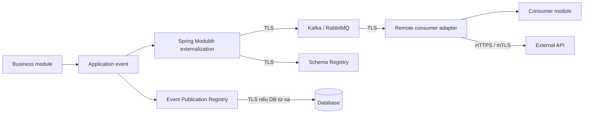

# Mã hóa khi truyền

## Mục tiêu

Application event trong Spring Modulith có thể được xử lý ngay trong cùng ứng dụng hoặc được externalize tới Kafka, RabbitMQ, HTTP endpoint và hệ thống khác. Khi dữ liệu rời khỏi process hoặc đi qua mạng, payload, metadata và thông tin xác thực có thể bị đọc hoặc sửa nếu kênh truyền không được bảo vệ.

**Mã hóa khi truyền (encryption in transit)** bảo vệ dữ liệu trong lúc di chuyển giữa publisher, broker, consumer, Schema Registry và các dịch vụ liên quan. Cơ chế nền tảng thường là TLS; mutual TLS (mTLS) bổ sung xác thực chứng thư của cả client và server. Với dữ liệu nhạy cảm cần bảo vệ xuyên qua nhiều hop, có thể mã hóa payload ở tầng ứng dụng bên cạnh TLS.

Sau bài học, bạn có thể:

- Xác định những chặng mạng trong luồng application event cần mã hóa.
- Cấu hình TLS và mTLS cho Kafka, RabbitMQ, HTTP và Schema Registry.
- Phân biệt mã hóa, xác thực danh tính và phân quyền truy cập.
- Quản lý trust store, client certificate, secret và vòng đời chứng thư.
- Hiểu giới hạn của TLS hop-by-hop và khi nào cần mã hóa payload đầu cuối.
- Kiểm thử, quan sát và vận hành kết nối an toàn cho event integration.

## 1. Xác định luồng dữ liệu cần bảo vệ

Trong cùng một Spring application context, `ApplicationEventPublisher` chuyển event tới listener trong process. Luồng này không đi qua mạng nên TLS không được áp dụng trực tiếp giữa publisher và listener. Tuy nhiên, các bước tiếp theo có thể sử dụng mạng:

- Event được externalize từ ứng dụng tới Kafka hoặc RabbitMQ.
- Consumer ở một ứng dụng khác đọc message từ broker.
- Adapter gọi HTTP webhook hoặc REST API của hệ thống bên ngoài.
- Producer/consumer kết nối tới Schema Registry để đăng ký hoặc lấy schema.
- Event Publication Registry, outbox hoặc inbox lưu dữ liệu vào database ở máy chủ khác.
- Dịch vụ quản lý khóa (KMS), secret manager hoặc hệ thống tracing nhận metadata liên quan.

Mỗi kết nối cần được xem là một chặng riêng. Bật TLS cho kết nối Kafka không tự động bảo vệ kết nối Schema Registry, database hoặc HTTP callback.



### Lập bản đồ kết nối

Trước khi cấu hình, hãy liệt kê cho từng chặng:

| Chặng | Dữ liệu đi qua | Cơ chế bảo vệ thường dùng |
| --- | --- | --- |
| Ứng dụng tới Kafka | Key, value, headers, credentials | TLS; mTLS hoặc SASL qua TLS; ACL trên topic. |
| Ứng dụng tới RabbitMQ | Message, routing metadata, credentials | AMQPS/TLS; mTLS hoặc cơ chế xác thực broker; quyền trên vhost/exchange/queue. |
| Ứng dụng tới Schema Registry | Schema, subject, schema ID, credentials | HTTPS/TLS và authentication/authorization. |
| Consumer tới HTTP service | Event payload hoặc command | HTTPS; mTLS khi cần xác thực hai chiều. |
| Ứng dụng tới database | Publication/inbox/outbox và dữ liệu event | TLS cho kết nối database từ xa; quyền database tối thiểu. |
| Ứng dụng tới KMS/secret manager | Yêu cầu lấy hoặc giải mã khóa | TLS, workload identity và quyền theo key/purpose. |

Sơ đồ luồng nên thể hiện cả nơi TLS kết thúc. Nếu một load balancer hoặc proxy giải mã TLS rồi chuyển tiếp bằng HTTP nội bộ, chặng phía sau vẫn có thể bị nghe lén. Hãy quyết định rõ ranh giới tin cậy và mã hóa lại trên từng chặng cần bảo vệ.

## 2. TLS bảo vệ những gì?

TLS tạo một kênh truyền được mã hóa giữa hai đầu kết nối. Khi được cấu hình và xác minh chứng thư đúng cách, TLS cung cấp:

- **Bí mật (confidentiality):** bên trung gian không thể đọc nội dung truyền trên đường mạng chỉ bằng cách bắt gói tin.
- **Toàn vẹn (integrity):** thay đổi dữ liệu trên đường truyền sẽ bị phát hiện.
- **Xác thực server:** client kiểm tra chứng thư và danh tính server theo trust chain và hostname.
- **Xác thực client tùy cấu hình:** với mTLS, server cũng yêu cầu client trình chứng thư hợp lệ.

TLS không tự quyết định client được phép publish vào topic nào hoặc consume queue nào. Đó là nhiệm vụ của authorization như Kafka ACL, RabbitMQ permissions hoặc quyền ở API. TLS cũng không bảo vệ dữ liệu sau khi endpoint đã giải mã, không ngăn ứng dụng ghi payload vào log và không mã hóa dữ liệu đã lưu trong database/broker.

### TLS và mTLS

| Cơ chế | Xác thực | Trường hợp sử dụng |
| --- | --- | --- |
| TLS một chiều | Client xác thực server bằng chứng thư server. | Kết nối tới broker/API có danh tính client được xác thực bằng cơ chế khác. |
| mTLS | Client xác thực server; server cũng xác thực client bằng chứng thư client. | Kết nối service-to-service cần danh tính workload ở cả hai đầu. |
| SASL over TLS | TLS bảo vệ kênh; SASL xác thực client theo mechanism được hỗ trợ. | Kafka cần username/password, SCRAM hoặc cơ chế SASL khác qua kênh mã hóa. |

mTLS và SASL giải quyết lớp xác thực khác nhau. Có thể dùng mTLS để xác thực workload và ACL để giới hạn quyền; hoặc dùng SASL qua TLS theo chính sách nền tảng. Không gửi SASL credentials qua kết nối plaintext.

### Phiên bản giao thức

Ưu tiên TLS 1.2 hoặc TLS 1.3 theo khả năng của broker, client, runtime và chính sách tổ chức; ưu tiên TLS 1.3 khi toàn bộ hệ thống hỗ trợ. Vô hiệu hóa SSL và các phiên bản TLS cũ không còn được chấp nhận. Chỉ bật cipher suite được nền tảng hỗ trợ và đã được tổ chức phê duyệt.

Không hạ cấp giao thức hoặc tắt xác minh chứng thư chỉ để làm cho kết nối hoạt động. Nếu handshake thất bại, hãy kiểm tra trust chain, hostname, thời hạn chứng thư, protocol và cấu hình hai đầu.

## 3. TLS cho Kafka trong ứng dụng Spring

Khi Spring Modulith externalize application event tới Kafka, integration adapter sử dụng Kafka client để kết nối broker. TLS được cấu hình ở Kafka client/container; annotation `@Externalized` chỉ đánh dấu event cần externalize và không tự bật mã hóa mạng.

### Kết nối TLS với server authentication

Ví dụ cấu hình Spring Boot dạng YAML cho Kafka client dùng trust store:

```yaml
spring:
  kafka:
    bootstrap-servers: kafka.internal.example:9093
    properties:
      security.protocol: SSL
      ssl.endpoint.identification.algorithm: https
    ssl:
      trust-store-location: file:/run/secrets/kafka-truststore.p12
      trust-store-password: ${KAFKA_TRUSTSTORE_PASSWORD}
      trust-store-type: PKCS12
```

Trust store chứa CA hoặc chứng thư tin cậy để client xác minh broker. `ssl.endpoint.identification.algorithm=https` bật kiểm tra hostname theo cấu hình Kafka client; không nên đặt giá trị rỗng để bỏ qua kiểm tra tên server. Tên host dùng để kết nối phải khớp SAN trong chứng thư broker.

### mTLS với client certificate

Khi broker yêu cầu client certificate, bổ sung key store chứa private key và certificate chain của ứng dụng:

```yaml
spring:
  kafka:
    bootstrap-servers: kafka.internal.example:9093
    properties:
      security.protocol: SSL
      ssl.endpoint.identification.algorithm: https
    ssl:
      trust-store-location: file:/run/secrets/kafka-truststore.p12
      trust-store-password: ${KAFKA_TRUSTSTORE_PASSWORD}
      trust-store-type: PKCS12
      key-store-location: file:/run/secrets/app-client.p12
      key-store-password: ${KAFKA_KEYSTORE_PASSWORD}
      key-store-type: PKCS12
      key-password: ${KAFKA_KEY_PASSWORD}
```

Tên thuộc tính chính xác có thể thay đổi theo phiên bản Spring Boot/Kafka client. Hãy đối chiếu metadata cấu hình của phiên bản dự án đang dùng. File store nên được mount từ secret volume hoặc cấp qua secret manager; không commit keystore/password vào source control hay image container.

### SASL qua TLS

Nếu Kafka dùng SASL/SCRAM, đặt protocol thành `SASL_SSL` để SASL authentication diễn ra trong kênh TLS:

```yaml
spring:
  kafka:
    bootstrap-servers: kafka.internal.example:9094
    properties:
      security.protocol: SASL_SSL
      sasl.mechanism: SCRAM-SHA-512
      sasl.jaas.config: ${KAFKA_SASL_JAAS_CONFIG}
      ssl.endpoint.identification.algorithm: https
    ssl:
      trust-store-location: file:/run/secrets/kafka-truststore.p12
      trust-store-password: ${KAFKA_TRUSTSTORE_PASSWORD}
      trust-store-type: PKCS12
```

`KAFKA_SASL_JAAS_CONFIG` phải được cấp từ secret manager hoặc môi trường triển khai an toàn. Tránh ghi username/password trực tiếp vào YAML, log startup hoặc command line có thể bị quan sát. Mechanism phải khớp cấu hình broker; ví dụ trên chỉ phù hợp khi cluster bật SCRAM-SHA-512.

### Cấu hình producer và consumer

Spring Boot thường dùng chung cấu hình Kafka client cho producer, consumer và admin client. Trong hệ thống có nhiều cluster hoặc yêu cầu trust identity khác nhau, cần cấu hình riêng từng client factory thay vì giả định mọi kết nối có cùng trust store/credential. Hãy kiểm tra producer và consumer thực tế đều kết nối bằng protocol bảo mật; cấu hình ở một client không chứng minh client còn lại đã được bảo vệ.

## 4. TLS cho RabbitMQ và HTTP adapter

### RabbitMQ qua AMQPS

RabbitMQ hỗ trợ TLS listener thường dùng cổng AMQPS. Ứng dụng Spring Boot có thể bật SSL cho Rabbit client và cấu hình trust store/client key store tùy chính sách broker.

Ví dụ cấu hình khái niệm:

```yaml
spring:
  rabbitmq:
    host: rabbitmq.internal.example
    port: 5671
    ssl:
      enabled: true
      algorithm: TLSv1.3
      validate-server-certificate: true
      verify-hostname: true
      trust-store: file:/run/secrets/rabbit-truststore.p12
      trust-store-password: ${RABBIT_TRUSTSTORE_PASSWORD}
      key-store: file:/run/secrets/app-client.p12
      key-store-password: ${RABBIT_KEYSTORE_PASSWORD}
```

Các thuộc tính và khả năng mTLS phụ thuộc phiên bản Spring Boot, Spring AMQP và cấu hình RabbitMQ. Hãy xác minh property được hỗ trợ trong phiên bản thực tế. Broker phải bật TLS listener, cài certificate chain phù hợp và cấu hình client certificate requirement nếu muốn mTLS. Cần kiểm tra hostname verification vẫn được bật.

TLS không thay thế RabbitMQ authentication và authorization. Dùng user/service identity riêng cho từng ứng dụng, giới hạn vhost, exchange, queue và routing key theo nhu cầu.

### HTTPS cho webhook hoặc REST endpoint

Nếu event được chuyển qua HTTP, luôn dùng HTTPS. Client cần xác minh certificate chain và hostname của server. Với mTLS, client cung cấp certificate riêng và server xác minh client certificate theo CA tin cậy.

Ví dụ khi cấu hình Java HTTP client, hãy dùng SSL context/trust material được quản lý bởi runtime hoặc secret provider; tránh tạo trust manager chấp nhận mọi certificate. Trong môi trường production, không dùng cấu hình kiểu `trust-all` hoặc tắt hostname verification để bỏ qua lỗi chứng thư.

Nếu TLS kết thúc ở API gateway, gateway cần xác thực client theo chính sách; chặng từ gateway tới service nội bộ cũng phải được bảo vệ khi đi qua mạng hoặc ranh giới tin cậy. Đừng coi mạng nội bộ là mặc nhiên an toàn.

## 5. Bảo vệ kết nối tới Schema Registry và database

Kafka producer/consumer có thể kết nối broker qua TLS nhưng vẫn truy cập Schema Registry bằng HTTP nếu endpoint được cấu hình sai. Khi dùng registry từ xa, đặt URL HTTPS và cấu hình trust/authentication riêng. Credentials của registry không nhất thiết giống credentials của Kafka broker; cấp quyền tối thiểu cho từng service.

Event Publication Registry lưu trạng thái publication trong database. Nếu database nằm trên host khác, cấu hình TLS ở JDBC/database driver và xác minh chứng thư server theo chính sách của database. Outbox/inbox chứa payload hoặc metadata event cũng cần được bảo vệ khi truyền tới database. TLS cho broker không bao phủ đường kết nối database.

KMS/secret manager cũng là một endpoint mạng. Khi ứng dụng lấy khóa mã hóa payload, kết nối và workload identity tới KMS cần được bảo vệ. Không tải khóa bí mật qua endpoint không xác thực hoặc lưu cache lâu hơn chính sách cho phép.

## 6. TLS hop-by-hop và mã hóa payload đầu cuối

TLS thường bảo vệ từng kết nối giữa hai endpoint. Ví dụ producer mã hóa khi gửi tới Kafka; broker giải mã ở đầu nhận và lưu message; consumer lại thiết lập TLS khi đọc. Broker và các thành phần được cấp quyền trên broker có thể truy cập plaintext của message.

Nếu yêu cầu bảo mật đòi hỏi broker, proxy hoặc một số operator không được đọc nội dung, có thể mã hóa payload ở tầng ứng dụng trước khi publish và chỉ consumer đích mới giải mã. Đây là mã hóa payload đầu cuối (end-to-end payload encryption), bổ sung cho TLS chứ không thay thế TLS.

### Mã hóa payload bằng envelope encryption

Một cách triển khai phổ biến là envelope encryption:

1. Producer yêu cầu KMS tạo hoặc cấp một data encryption key (DEK).
2. Producer dùng DEK để mã hóa payload bằng thuật toán AEAD như AES-GCM.
3. DEK được mã hóa (wrapped) bằng key encryption key (KEK) do KMS quản lý.
4. Message mang ciphertext, nonce/IV, authentication tag, key ID và wrapped DEK.
5. Consumer có quyền yêu cầu KMS unwrap DEK rồi giải mã và xác minh authentication tag.

Envelope khái niệm:

```json
{
  "encryptionVersion": 1,
  "algorithm": "AES-256-GCM",
  "keyId": "kms://events/order-payload-key/v3",
  "wrappedDataKey": "base64:...",
  "nonce": "base64:...",
  "ciphertext": "base64:...",
  "authTag": "base64:..."
}
```

Đây chỉ là cấu trúc minh họa, không phải wire format chuẩn. Dùng thư viện mật mã và KMS được tổ chức phê duyệt; không tự thiết kế thuật toán, không dùng lại nonce với cùng key trong AES-GCM và không tự lưu plaintext DEK trong message/log.

### Những giới hạn cần hiểu

- Metadata bên ngoài ciphertext như topic, partition, key, message size, timestamp và một số headers vẫn có thể bị quan sát.
- Consumer cần schema/version của envelope và cách xác định key ID.
- Search/filter theo field đã mã hóa sẽ khó hoặc không thể thực hiện trực tiếp ở broker.
- Mọi consumer cần quyền giải mã; cấp quyền quá rộng sẽ làm mất mục tiêu end-to-end.
- Replay lịch sử yêu cầu giữ key version cũ hoặc có quy trình re-encryption.
- Mã hóa payload không xác thực nguồn gửi nếu không có cơ chế identity/signature phù hợp; AEAD xác thực ciphertext và associated data trong phạm vi key.

Chỉ mã hóa những trường thực sự cần bảo vệ nếu consumer vẫn cần routing metadata. Nếu dùng field-level encryption, hãy định nghĩa rõ version, key ID, nonce, tag và quy tắc xoay khóa.

## 7. Quản lý certificate, trust store và secret

TLS chỉ an toàn khi certificate và private key được quản lý đúng.

### Trust store và key store

- **Trust store** chứa CA/certificate mà client tin cậy để xác minh server hoặc client certificate.
- **Key store** chứa private key và certificate chain của chính ứng dụng khi client cần chứng minh danh tính, ví dụ mTLS.
- **Private key** phải được bảo vệ khỏi người dùng không có quyền; giới hạn quyền file, mount và process access.
- **Certificate chain** cần đầy đủ intermediate CA theo cấu hình server/client; tránh chỉ cài leaf certificate nếu quy trình trust yêu cầu CA.

Không dùng trust store chứa mọi CA công cộng hoặc CA nội bộ không cần thiết. Trust anchor nên được giới hạn theo môi trường và service. Certificate SAN phải chứa hostname mà client thực sự dùng để kết nối.

### Vòng đời và xoay certificate

Quy trình xoay chứng thư nên có thời gian chồng lấn để tránh gián đoạn:

1. Phát hành certificate mới và xác minh subject/SAN, EKU, chain và thời hạn.
2. Cập nhật trust store ở phía nhận để tin cậy CA/certificate mới trong khi chứng thư cũ còn hiệu lực.
3. Triển khai client/server certificate mới theo thứ tự tương thích.
4. Kiểm tra handshake, hostname và quyền truy cập trên tất cả instance.
5. Theo dõi kết nối và loại bỏ trust cũ sau khi không còn client sử dụng.
6. Thu hồi certificate bị lộ hoặc không còn hợp lệ theo quy trình PKI.

Đặt cảnh báo trước ngày hết hạn. Với workload nhiều instance, cần biết instance nào còn dùng certificate cũ. Không chờ tới khi chứng thư hết hạn mới thay; sự cố đồng loạt có thể làm gián đoạn publish/consume và tích tụ backlog.

### Quản lý secret

- Lấy password/key material từ secret manager hoặc secret volume của nền tảng.
- Không commit secret vào Git, file mẫu có giá trị thật, Docker image hoặc log.
- Không đưa password vào tham số command line nếu có thể bị lưu trong process listing.
- Tách credential theo service và môi trường; xoay vòng định kỳ hoặc khi có dấu hiệu lộ.
- Hạn chế quyền đọc file keystore và quyền gọi KMS.
- Không chia sẻ cùng một client certificate/private key cho nhiều ứng dụng nếu có thể cấp danh tính riêng.

## 8. Authentication, authorization và network controls

Mã hóa chỉ là một lớp trong bảo vệ event transport. Hệ thống cần kết hợp:

| Lớp | Câu hỏi cần trả lời | Ví dụ kiểm soát |
| --- | --- | --- |
| Encryption | Ai có thể đọc dữ liệu trên đường truyền? | TLS/mTLS, payload encryption. |
| Authentication | Kết nối đến từ workload nào? | Client certificate, SASL/SCRAM, service identity, OAuth client credentials. |
| Authorization | Workload được phép làm gì? | Kafka ACL, RabbitMQ vhost/permissions, API scopes, database grants. |
| Network isolation | Kết nối có thể đi từ đâu tới đâu? | Private endpoint, firewall, security group, network policy. |
| Audit | Ai đã kết nối và thao tác gì? | Broker audit log, identity, topic/queue access log. |

Tạo identity riêng cho producer, consumer và service quản trị. Producer chỉ cần quyền ghi topic; consumer chỉ cần quyền đọc topic/group tương ứng; service quản trị schema chỉ cần quyền quản lý subject cần thiết. Không dùng tài khoản admin chung cho mọi ứng dụng.

## 9. Quan sát và xử lý sự cố TLS

Một cấu hình TLS sai thường biểu hiện bằng handshake failure, connection timeout hoặc lỗi xác minh certificate. Cần thu thập đủ thông tin để phân biệt lỗi mạng, lỗi trust và lỗi identity.

Theo dõi:

- Tỷ lệ kết nối/handshake thành công và thất bại theo broker/endpoint.
- Lỗi certificate expired, unknown CA, hostname mismatch và client certificate rejected.
- Thời gian còn lại trước khi certificate hết hạn.
- Kết nối producer/consumer, số lần reconnect và thời gian mất kết nối.
- Consumer lag, publication chưa hoàn tất và outbox backlog khi broker không truy cập được.
- Lỗi truy cập Schema Registry, database và KMS riêng theo endpoint.

Log lỗi nên ghi endpoint logic, client identity, error category và correlation ID nếu phù hợp; không log private key, password, token, plaintext payload hoặc toàn bộ TLS secret. Không bật debug TLS quá rộng trong production vì log có thể chứa dữ liệu nhạy cảm và tạo lượng lớn thông tin.

### Checklist điều tra handshake failure

1. Xác nhận hostname và port đang dùng đúng endpoint TLS.
2. Kiểm tra server certificate còn hạn, SAN khớp hostname và chain đầy đủ.
3. Kiểm tra client trust store có CA cần thiết và file/password có thể đọc.
4. Nếu dùng mTLS, kiểm tra client certificate, private key, EKU và CA mà server tin cậy.
5. Kiểm tra hai đầu có phiên bản TLS/cipher suite giao nhau.
6. Kiểm tra proxy/load balancer có kết thúc TLS hay yêu cầu client certificate ở chặng nào.
7. Kiểm tra SASL/authentication và ACL sau khi TLS handshake đã thành công.
8. Kiểm tra thời gian hệ thống và đồng hồ nếu xác minh thời hạn certificate gặp vấn đề.

Không khắc phục bằng cách tắt hostname verification, chấp nhận mọi certificate hoặc chuyển sang plaintext. Sửa trust chain, SAN, credential hoặc cấu hình listener đúng nguyên nhân.

## 10. Kiểm thử mã hóa khi truyền

Kiểm thử cần chứng minh kết nối được mã hóa và endpoint xác minh danh tính đúng. Một số trường hợp cần có:

| Tình huống | Kết quả cần xác minh |
| --- | --- |
| Client kết nối broker bằng TLS hợp lệ | Handshake thành công; producer/consumer hoạt động. |
| Server certificate do CA không tin cậy ký | Client từ chối kết nối. |
| Hostname không khớp SAN | Client từ chối kết nối khi hostname verification bật. |
| Certificate hết hạn | Kết nối bị từ chối và cảnh báo được phát. |
| mTLS thiếu client certificate | Server từ chối client theo policy. |
| Client certificate không được CA tin cậy | Server từ chối handshake. |
| SASL credentials sai trên SASL_SSL | TLS có thể thành công nhưng authentication thất bại. |
| ACL không cho phép publish/consume | Kết nối đã xác thực nhưng thao tác bị từ chối. |
| Schema Registry không có TLS hoặc sai CA | Producer/consumer không thể dùng endpoint theo policy. |
| Broker tạm mất kết nối | Client reconnect; publication/message được xử lý lại theo cơ chế độ tin cậy đã cấu hình. |
| Xoay certificate | Client mới và cũ chuyển đổi trong khoảng overlap mà không mất kết nối ngoài kế hoạch. |

Integration test có thể dùng broker/container cấu hình TLS với certificate test riêng. Không dùng certificate production hoặc private key thật trong test. Test negative path rất quan trọng: nếu kết nối vẫn thành công khi server certificate sai hoặc hostname không khớp, cấu hình xác minh đang bị bỏ qua.

Với Spring Modulith, kiểm tra externalized event thực sự đi qua Kafka client đã cấu hình TLS; kiểm tra listener/publication status khi broker unavailable và sau khi kết nối phục hồi. Event Publication Registry theo dõi publication, nhưng không tự chứng minh TLS được bật. Cần quan sát cấu hình và handshake ở transport layer.

## 11. Những lỗi cấu hình thường gặp

| Lỗi | Hậu quả | Cách xử lý |
| --- | --- | --- |
| Chỉ bật TLS cho Kafka, quên Schema Registry | Schema và credentials có thể đi qua HTTP plaintext. | Cấu hình HTTPS/trust/auth riêng cho registry. |
| Tắt hostname verification để tránh lỗi certificate | Có thể kết nối tới server giả mạo có certificate không khớp hostname. | Sửa SAN hoặc endpoint DNS và bật hostname verification. |
| Dùng trust-all certificate | Client chấp nhận server không đáng tin cậy. | Cài đúng CA vào trust store. |
| Nhầm TLS với authorization | Workload đã mã hóa vẫn có thể truy cập topic/queue quá rộng. | Dùng ACL/permissions/scopes riêng. |
| Dùng cùng credential cho mọi service | Khó thu hồi và xác định nguồn truy cập khi có sự cố. | Cấp workload identity riêng và quyền tối thiểu. |
| Lưu password/keystore trong Git | Secret có thể bị lộ lâu dài qua history và artifact. | Secret manager, secret volume và quy trình rotation. |
| Chỉ mã hóa một hop rồi gửi plaintext nội bộ | Dữ liệu có thể bị đọc ở chặng sau khi TLS kết thúc. | Mã hóa từng chặng qua ranh giới tin cậy; cân nhắc payload encryption. |
| Không theo dõi ngày hết hạn certificate | Broker/client mất kết nối đột ngột khi certificate hết hạn. | Metric và alert trước hạn, rotation có overlap. |
| Dùng payload encryption nhưng không quản lý key version | Consumer không thể giải mã message lịch sử sau khi xoay khóa. | Giữ key version cần thiết và có quy trình re-encryption/retention. |

## 12. Quy trình áp dụng

Khi bảo vệ giao tiếp event trong ứng dụng Spring Modulith:

1. Lập bản đồ mọi chặng mạng: broker, Schema Registry, HTTP, database và KMS.
2. Bật TLS 1.2/1.3 theo policy; xác minh certificate chain và hostname ở mọi client.
3. Chọn mTLS hoặc SASL/OAuth phù hợp để xác thực workload; cấu hình ACL/permissions riêng.
4. Cấu hình Kafka/RabbitMQ client và HTTPS endpoint bằng trust/key material được cấp an toàn.
5. Bảo vệ kết nối database, Schema Registry và secret manager độc lập với broker.
6. Xác định TLS termination point và mã hóa lại trên các chặng qua ranh giới tin cậy.
7. Nếu broker không được phép đọc payload, thiết kế envelope encryption với KMS, key ID và version rõ ràng.
8. Quản lý certificate, secret, rotation, expiry alert và quyền thu hồi.
9. Kiểm thử handshake hợp lệ và các trường hợp certificate/hostname/authentication sai.
10. Theo dõi TLS failures cùng consumer lag, publication backlog và lỗi externalization.

Mã hóa khi truyền bảo vệ event trên đường đi giữa các thành phần. Khi kết hợp TLS/mTLS đúng cách, xác thực và phân quyền tối thiểu, quản lý chứng thư có vòng đời và kiểm thử negative path, ứng dụng Spring Modulith có thể externalize application events qua mạng mà vẫn bảo vệ tính bí mật và toàn vẹn của dữ liệu.
