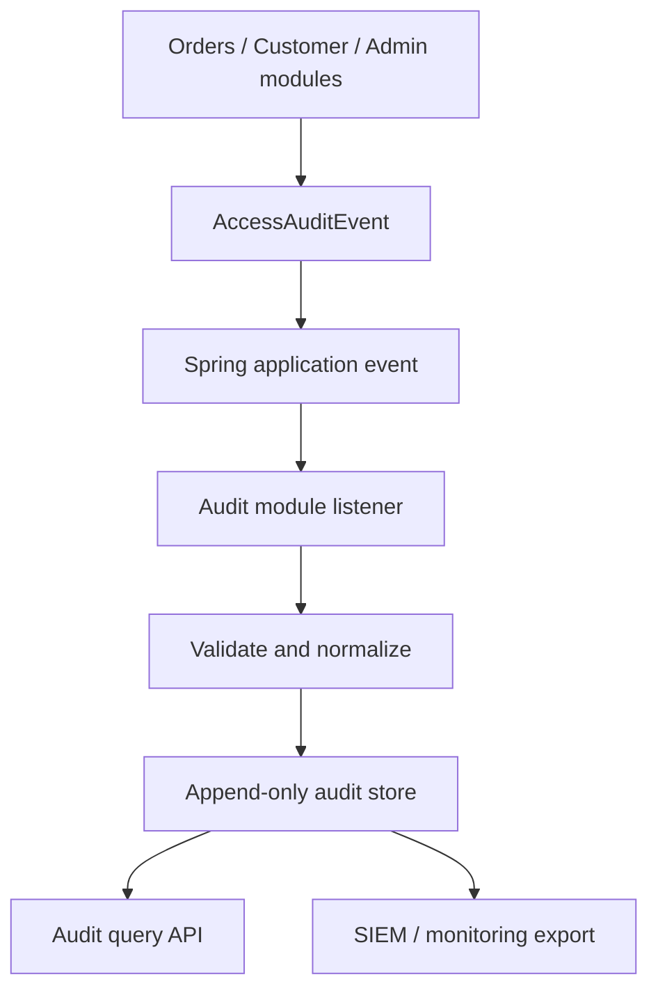

# Audit truy cập

Trong một hệ thống có nhiều module, việc kiểm soát ai được phép đọc hoặc thay đổi dữ liệu chỉ là một nửa của bài toán bảo mật. Hệ thống còn cần trả lời được ai đã truy cập tài nguyên nào, thực hiện hành động gì, quyết định cấp quyền ra sao và kết quả cuối cùng là gì. **Audit truy cập** ghi lại những sự kiện có ý nghĩa bảo mật để phục vụ điều tra, giám sát, đối soát và chứng minh việc thực thi chính sách.

Trong Spring Modulith, application events có thể chuyển thông tin audit từ module nghiệp vụ tới module chuyên trách lưu trữ hoặc xuất audit record. Cách tổ chức này giúp module nghiệp vụ công bố sự kiện theo contract rõ ràng mà không phụ thuộc trực tiếp vào kho audit, hệ thống SIEM hay công cụ báo cáo. Tuy nhiên, audit event chỉ có giá trị khi được phát ở đúng điểm, mang đủ ngữ cảnh, được lưu bền vững và được bảo vệ khỏi truy cập hoặc sửa đổi trái phép.

## 1. Audit truy cập ghi nhận điều gì?

Audit truy cập là bản ghi có cấu trúc về một hành động liên quan tới bảo mật. Nó thường ghi nhận:

- **Actor:** người dùng, service account hoặc hệ thống khởi tạo hành động.
- **Action:** hành động được yêu cầu, chẳng hạn đọc hồ sơ, tải báo cáo, cập nhật quyền hoặc xuất dữ liệu.
- **Resource:** tài nguyên được truy cập, chẳng hạn hồ sơ khách hàng, đơn hàng hoặc cấu hình bảo mật.
- **Decision:** chính sách cho phép hay từ chối hành động.
- **Outcome:** hành động thực tế thành công, thất bại hoặc chưa xác định.
- **Context:** tenant, thời điểm, request/correlation ID, nguồn gọi và lý do có thể ghi nhận an toàn.

Một audit record cần phân biệt quyết định cấp quyền với kết quả thực hiện. Ví dụ, hệ thống có thể cho phép đọc hồ sơ nhưng truy vấn database thất bại; hoặc từ chối truy cập trước khi dữ liệu được đọc. Nếu chỉ ghi `ACCESS_ALLOWED`, người điều tra không biết dữ liệu đã thực sự được trả về hay chưa.

| Khái niệm | Câu hỏi | Ví dụ |
|---|---|---|
| Authentication | Chủ thể là ai? | Người dùng đã đăng nhập bằng danh tính nào? |
| Authorization | Chủ thể có được phép thực hiện hành động không? | Chính sách có cho phép đọc hồ sơ này không? |
| Access audit | Ai đã thử truy cập tài nguyên nào và quyết định/kết quả ra sao? | Người dùng A được phép đọc hồ sơ B; request hoàn tất thành công |
| Application log | Chương trình đã chạy qua nhánh kỹ thuật nào? | Repository query mất 42 ms |
| Business event | Điều gì đã xảy ra trong nghiệp vụ? | Đơn hàng được xác nhận |

Audit record không thay thế application log hoặc business event. Log kỹ thuật hỗ trợ debug; business event mô tả thay đổi nghiệp vụ; audit record tập trung vào hành động và trách nhiệm truy cập.

## 2. Xác định phạm vi cần audit

Không nhất thiết ghi audit cho mọi lần gọi method. Trước hết, xác định tài nguyên và hành động có ý nghĩa bảo mật hoặc tuân thủ. Các ví dụ thường cần audit:

- Đọc hoặc xuất dữ liệu cá nhân, tài chính hay hồ sơ nhạy cảm.
- Truy cập dữ liệu của tenant hoặc khách hàng khác trong phạm vi được ủy quyền.
- Tạo, sửa, xóa hoặc tải xuống tài liệu quan trọng.
- Thay đổi role, permission, policy, credential hoặc cấu hình bảo mật.
- Thực hiện thao tác quản trị hoặc truy cập bằng tài khoản đặc quyền.
- Truy cập bị từ chối vào tài nguyên được bảo vệ.
- Thực hiện thao tác hàng loạt, export hoặc truy vấn có phạm vi dữ liệu lớn.

Với mỗi loại hành động, cần định nghĩa chính xác điều gì được ghi. Ví dụ, `REPORT_EXPORTED` có thể được phát khi file đã được tạo thành công; `REPORT_EXPORT_DENIED` được ghi khi policy từ chối; còn `REPORT_EXPORT_REQUESTED` chỉ thể hiện yêu cầu đã được tiếp nhận. Tên event nên mô tả đúng trạng thái, không khiến người đọc hiểu nhầm một hành động mới chỉ được yêu cầu là đã hoàn tất.

Một ma trận audit có thể giúp thống nhất phạm vi:

| Resource | Action | Khi nào ghi | Mức độ |
|---|---|---|---|
| Customer profile | `READ` | Sau khi xác định actor, resource và kết quả truy cập | Cao nếu chứa dữ liệu nhạy cảm |
| Order | `EXPORT` | Khi export thành công hoặc bị từ chối | Cao |
| Role/permission | `GRANT`, `REVOKE` | Khi thay đổi được chấp nhận và lưu thành công | Rất cao |
| Security policy | `UPDATE` | Sau khi thay đổi policy commit | Rất cao |
| Public catalog | `READ` | Chỉ khi có yêu cầu nghiệp vụ/tuân thủ cụ thể | Tùy phạm vi |

Audit quá rộng tạo lượng dữ liệu lớn, tăng chi phí và làm khó điều tra. Audit quá hẹp có thể bỏ sót hành động quan trọng. Hãy thống nhất phạm vi theo rủi ro, yêu cầu pháp lý và mục đích vận hành của hệ thống.

## 3. Thiết kế audit event contract

Audit event nên là dữ liệu bất biến, độc lập với entity và request object nội bộ. Một contract minh họa:

```java
public record AccessAuditEvent(
    UUID eventId,
    Instant occurredAt,
    String actorId,
    String actorType,
    String tenantId,
    String action,
    String resourceType,
    String resourceId,
    String decision,
    String outcome,
    String reasonCode,
    String requestId,
    String correlationId,
    String source
) {}
```

Các trường có ý nghĩa:

| Trường | Ý nghĩa và lưu ý |
|---|---|
| `eventId` | ID duy nhất, ổn định qua retry và replay |
| `occurredAt` | Thời điểm hành động xảy ra theo quy ước UTC |
| `actorId` | ID nội bộ đã được chuẩn hóa; không nhất thiết là username/email |
| `actorType` | `USER`, `SERVICE`, `SYSTEM` hoặc loại được định nghĩa |
| `tenantId` | Phạm vi tenant đã được xác thực, nếu hệ thống multi-tenant |
| `action` | Mã hành động có danh mục ổn định |
| `resourceType` | Loại tài nguyên, không dùng tên class Java làm hợp đồng |
| `resourceId` | ID tài nguyên cần tra cứu, có kiểm soát quyền hiển thị |
| `decision` | `ALLOW` hoặc `DENY` theo authorization policy |
| `outcome` | `SUCCESS`, `FAILURE`, `NOT_COMPLETED` hoặc giá trị đã thống nhất |
| `reasonCode` | Mã lý do an toàn, tránh lưu nội dung exception tùy ý |
| `requestId` | ID của request gốc nếu có |
| `correlationId` | Liên kết các bước xử lý trong cùng luồng |
| `source` | Tên ứng dụng/module hoặc thành phần phát audit |

Không đưa `Authentication`, `HttpServletRequest`, `SecurityContext`, JPA entity hoặc toàn bộ payload nghiệp vụ vào event. Những object này có thể chứa trạng thái theo thread, credential, dữ liệu nhạy cảm hoặc tham chiếu không thể serialize. Hãy trích xuất các giá trị bất biến cần thiết trước khi qua ranh giới bất đồng bộ.

Các giá trị như `action`, `decision`, `outcome` và `actorType` nên được quản lý bằng enum hoặc danh mục contract ổn định. Nếu dùng chuỗi, cần validate giá trị trước khi lưu để tránh dữ liệu không nhất quán giữa các module.

## 4. Ghi nhận actor từ ngữ cảnh đã xác thực

Actor phải được lấy từ nguồn danh tính đã xác thực, không lấy trực tiếp từ trường `userId` tùy ý trong request body. Với request HTTP dùng Spring Security, ứng dụng có thể lấy principal từ `SecurityContext` tại ranh giới request/service, kiểm tra loại principal rồi tạo snapshot actor cho audit event.

Ví dụ minh họa:

```java
Authentication authentication = SecurityContextHolder.getContext()
    .getAuthentication();

AuditActor actor = actorResolver.from(authentication);
```

`AuditActor` và `actorResolver` là abstraction do ứng dụng định nghĩa. Resolver cần phân biệt người dùng, service account và anonymous request; không giả định principal luôn là một class hoặc luôn có username. Với service-to-service, actor có thể là client/service identity đã được xác thực.

Đối với tác vụ chạy nền, actor có thể là `SYSTEM` hoặc service account cùng thông tin về tác nhân khởi tạo ban đầu nếu contract có trường riêng. Không gán người dùng cuối làm actor của một job chỉ vì job được tạo bởi request của họ; nên phân biệt `initiatedBy` và `executedBy` nếu cần truy vết cả hai vai trò.

## 5. Ghi nhận quyết định và kết quả truy cập

Audit nên phản ánh đúng thời điểm mà hệ thống biết được quyết định và kết quả. Có thể chia một luồng thành các mốc:

1. Request được tiếp nhận và actor được xác định.
2. Authorization policy quyết định allow hoặc deny.
3. Nếu được phép, ứng dụng truy cập tài nguyên.
4. Ứng dụng hoàn tất hoặc thất bại khi đọc/thay đổi tài nguyên.
5. Audit event được lưu theo yêu cầu độ bền vững.

Với truy cập bị từ chối, không có bước đọc dữ liệu thành công. Với truy cập được phép nhưng database lỗi, quyết định là `ALLOW` còn outcome là `FAILURE`. Với thao tác export, chỉ ghi `SUCCESS` sau khi file hoặc kết quả export thực sự được tạo theo định nghĩa nghiệp vụ.

Một số hệ thống cần hai event: `AccessAttempted` tại thời điểm quyết định và `ResourceAccessCompleted` khi thao tác hoàn tất. Cách này giúp phân tích đầy đủ nhưng tăng số lượng record và yêu cầu correlation. Hệ thống nhỏ hơn có thể ghi một record kết hợp `decision` và `outcome` khi kết quả cuối cùng đã biết. Chọn mô hình theo mục đích điều tra và mức độ chi tiết cần thiết.

## 6. Phát audit event tại đúng ranh giới

Audit event nên được tạo tại nơi có đủ thông tin về actor, action, resource và kết quả. Có thể dùng Spring Security filter/handler cho quyết định ở tầng HTTP, method security cho hành động được bảo vệ hoặc application service cho hành động nghiệp vụ.

Không nên chỉ ghi audit trong controller nếu cùng một use case còn được gọi qua scheduler, message listener hoặc module API khác. Ngược lại, ghi ở mọi tầng có thể tạo nhiều record cho cùng một hành động. Hãy chọn một ranh giới có thẩm quyền và thống nhất định danh event.

Ví dụ service phát event sau khi hoàn thành truy cập:

```java
@Service
class CustomerProfileAccessService {

    private final CustomerProfileRepository profiles;
    private final AccessPolicy policy;
    private final ApplicationEventPublisher events;
    private final AuditActorProvider actors;

    CustomerProfileAccessService(
        CustomerProfileRepository profiles,
        AccessPolicy policy,
        ApplicationEventPublisher events,
        AuditActorProvider actors
    ) {
        this.profiles = profiles;
        this.policy = policy;
        this.events = events;
        this.actors = actors;
    }

    public CustomerProfileView read(UUID profileId) {
        var actor = actors.currentActor();
        var decision = policy.canReadProfile(actor, profileId);

        if (!decision.allowed()) {
            events.publishEvent(AccessAuditEventFactory.denied(
                actor, "CUSTOMER_PROFILE_READ", profileId,
                decision.reasonCode()
            ));
            throw new AccessDeniedException("Profile access denied");
        }

        var profile = profiles.findViewById(profileId).orElseThrow();
        events.publishEvent(AccessAuditEventFactory.succeeded(
            actor, "CUSTOMER_PROFILE_READ", profileId
        ));
        return profile;
    }
}
```

Đây là skeleton để minh họa điểm phát event. `AccessPolicy`, `AuditActorProvider` và `AccessAuditEventFactory` là thành phần do ứng dụng định nghĩa. Ví dụ cũng cần được điều chỉnh theo transaction boundary và yêu cầu audit durability: nếu audit event được phát trong transaction sau đó rollback, event có thể không được ghi theo cách mong muốn.

Với truy cập đọc, không phải lúc nào cũng có transaction ghi dữ liệu nghiệp vụ. Nếu audit bắt buộc phải bền vững trước khi trả dữ liệu nhạy cảm, service cần gọi một cổng audit có cam kết lưu bền vững hoặc ghi audit/outbox trong transaction thích hợp trước khi trả kết quả. Không nên chỉ publish một event bất đồng bộ rồi giả định record đã được lưu.

## 7. Ghi audit cho truy cập bị từ chối

Một request bị từ chối thường kết thúc bằng exception hoặc HTTP 403. Nếu audit record được ghi trong cùng transaction sẽ rollback, dấu vết của lần truy cập bị từ chối có thể biến mất.

Với Spring Security, có thể ghi nhận từ `AccessDeniedHandler` cho request đã xác thực nhưng không đủ quyền và `AuthenticationEntryPoint` cho request chưa được xác thực. Đây là hai điểm khác nhau:

- `AuthenticationEntryPoint`: xử lý request cần authentication nhưng không có thông tin xác thực hợp lệ.
- `AccessDeniedHandler`: xử lý chủ thể đã được xác thực nhưng không được phép thực hiện hành động.

Ví dụ handler minh họa:

```java
@Component
class AuditingAccessDeniedHandler implements AccessDeniedHandler {

    private final AccessAuditRecorder auditRecorder;

    AuditingAccessDeniedHandler(AccessAuditRecorder auditRecorder) {
        this.auditRecorder = auditRecorder;
    }

    @Override
    public void handle(
        HttpServletRequest request,
        HttpServletResponse response,
        AccessDeniedException exception
    ) throws IOException {
        auditRecorder.recordDeniedRequest(request, exception);
        response.sendError(HttpServletResponse.SC_FORBIDDEN);
    }
}
```

`recordDeniedRequest` phải trích xuất actor/resource/action theo dữ liệu đã được xác thực và không ghi raw token hoặc toàn bộ request. Handler cần được đăng ký trong cấu hình Spring Security của ứng dụng. Nếu endpoint được bảo vệ ở method/service layer hoặc request đi qua message listener, handler HTTP không bao phủ các trường hợp đó; cần audit tại boundary tương ứng.

Audit denial phải tránh biến thành công cụ thu thập dữ liệu tùy tiện. Không ghi password, bearer token, session cookie, nội dung bí mật trong query string hoặc toàn bộ payload của request. Với resource ID không thể xác định do request sai, ghi loại tài nguyên và reason code phù hợp.

## 8. Transaction và độ bền vững của audit

Chọn thời điểm ghi audit dựa trên mức độ bắt buộc của audit record:

| Cách ghi | Đặc điểm | Khi phù hợp |
|---|---|---|
| Ghi trực tiếp đồng bộ | Caller biết ngay việc ghi audit thành công hay thất bại | Hành động nhạy cảm cần audit trước khi hoàn tất |
| Ghi audit trong cùng transaction | Audit record và thay đổi nghiệp vụ cùng commit/rollback | Cần chứng minh thay đổi nghiệp vụ và audit record được lưu nguyên tử trong cùng database |
| Ghi outbox trong transaction | Lưu intent audit cùng thay đổi, dispatcher gửi/lưu sau commit | Cần độ bền vững nhưng audit sink nằm ngoài transaction nguồn |
| Listener sau commit | Audit được xử lý sau khi nghiệp vụ commit | Audit có thể trễ và hệ thống có publication persistence/recovery |

`@TransactionalEventListener(phase = AFTER_COMMIT)` chạy sau khi transaction nguồn commit. Nếu listener ghi audit thất bại, không thể rollback transaction nguồn đã commit. Cần một cơ chế theo dõi và phục hồi publication phù hợp.

`@ApplicationModuleListener` hỗ trợ xử lý bất đồng bộ tại ranh giới module theo semantics của phiên bản Spring Modulith đang dùng. Caller không chờ listener hoàn tất. Đối với audit bắt buộc, cần xác định rõ liệu có thể chấp nhận audit đến muộn hay thao tác phải chờ xác nhận ghi audit.

Event Publication Registry theo dõi publication tới listener và hỗ trợ nhận biết publication chưa hoàn tất với persistence implementation phù hợp. Registry không phải kho audit bất biến và không tự bảo đảm audit record đã được ghi vào hệ thống lưu trữ cuối. Cần phân biệt trạng thái publication với nội dung audit đã được lưu.

## 9. Thiết kế Audit module trong Spring Modulith

Có thể tổ chức một module chuyên trách, ví dụ `audit`, sở hữu contract tiếp nhận và lưu audit record. Các module nghiệp vụ chỉ phụ thuộc vào event contract công khai hoặc một port ghi audit đã được công bố.



Audit module chịu trách nhiệm:

- Validate event contract và mã action/resource được phép.
- Chuẩn hóa actor, tenant, timestamp và correlation metadata.
- Deduplicate theo `eventId`.
- Lưu record theo mô hình append-only.
- Áp dụng retention, phân quyền đọc và quy trình export.
- Cung cấp API truy vấn có audit trail cho người được phép.

Module nghiệp vụ không nên import repository hoặc entity nội bộ của Audit module. Nếu cần xác nhận ghi audit đồng bộ, hãy công bố một interface/port có semantics rõ ràng, chẳng hạn `recordRequiredAudit(...)`, thay vì truy cập trực tiếp bảng lưu trữ.

## 10. Ví dụ listener lưu audit record

Một listener có thể nhận event và chuyển thành entity lưu trữ. Cần bảo đảm thao tác lưu có idempotency và transaction riêng phù hợp:

```java
@Component
class AccessAuditListener {

    private final AuditRecordRepository records;

    AccessAuditListener(AuditRecordRepository records) {
        this.records = records;
    }

    @ApplicationModuleListener
    void on(AccessAuditEvent event) {
        if (records.existsByEventId(event.eventId())) {
            return;
        }

        records.save(AuditRecord.from(event));
    }
}
```

Đây là ví dụ minh họa. Trong triển khai thực tế, `existsByEventId` rồi `save` riêng rẽ có thể gặp race condition khi hai lần giao trùng chạy đồng thời. Cần unique constraint trên `event_id` và thao tác insert-if-absent/upsert phù hợp; nếu insert xung đột, xử lý duplicate như một lần đã được ghi nhận.

Ví dụ schema tối giản:

```sql
CREATE TABLE access_audit_record (
    event_id UUID PRIMARY KEY,
    occurred_at TIMESTAMP NOT NULL,
    actor_id VARCHAR(200),
    actor_type VARCHAR(40) NOT NULL,
    tenant_id VARCHAR(100),
    action VARCHAR(100) NOT NULL,
    resource_type VARCHAR(100) NOT NULL,
    resource_id VARCHAR(200),
    decision VARCHAR(20) NOT NULL,
    outcome VARCHAR(30) NOT NULL,
    reason_code VARCHAR(100),
    request_id VARCHAR(200),
    correlation_id VARCHAR(200),
    source VARCHAR(100) NOT NULL,
    recorded_at TIMESTAMP NOT NULL
);
```

Schema chỉ mang tính minh họa. Cần chọn kiểu timestamp phù hợp database, index theo truy vấn audit, chính sách partition/retention và giới hạn kích thước trường. `occurred_at` là thời điểm hành động; `recorded_at` là thời điểm kho audit ghi nhận. Hai mốc này giúp đo độ trễ và điều tra event đến muộn.

## 11. Bảo vệ tính toàn vẹn của audit trail

Audit record có giá trị điều tra khi có thể tin cậy rằng chúng không bị sửa hoặc xóa âm thầm. Một bảng database thông thường với quyền `UPDATE` và `DELETE` rộng không tự tạo ra audit trail bất biến.

Các biện pháp thường dùng:

- Tài khoản ứng dụng chỉ có quyền `INSERT` cần thiết; tách quyền đọc và quyền quản trị.
- Dùng append-only storage hoặc dịch vụ lưu trữ có retention lock khi yêu cầu phù hợp.
- Ghi audit sang hệ thống độc lập với workload nghiệp vụ để giảm khả năng một tài khoản bị xâm nhập có thể xóa cả dữ liệu lẫn dấu vết.
- Giới hạn ai có quyền export, purge hoặc thay đổi retention.
- Ghi nhận mọi thao tác quản trị đối với chính hệ thống audit.
- Đồng bộ bản sao hoặc stream audit tới hệ thống giám sát độc lập.
- Kiểm tra định kỳ tính đầy đủ và khả năng đọc lại record.

Có thể bổ sung checksum hoặc chữ ký số để phát hiện thay đổi. Một hash chain có thể liên kết record theo thứ tự, nhưng phải xử lý đồng thời và nhiều partition cẩn thận: mỗi chuỗi cần sequence rõ ràng, khóa cập nhật hoặc cơ chế ký/anchor phù hợp. Hash chain không tự chống được kẻ tấn công có quyền sửa toàn bộ dữ liệu và tính lại hash nếu không có anchor hoặc khóa nằm ngoài vùng bị kiểm soát.

Đồng hồ hệ thống cũng ảnh hưởng tới audit. Dùng thời gian UTC, đồng bộ clock giữa các node và lưu thêm sequence/recorded timestamp khi cần thứ tự đáng tin cậy. Không dùng timestamp đơn lẻ làm bằng chứng duy nhất về thứ tự khi nhiều máy phát event.

## 12. Phân quyền đọc audit record

Audit record có thể chứa actor ID, tenant, resource ID, hành động quản trị và dấu vết truy cập dữ liệu nhạy cảm. Vì vậy, quyền đọc audit cũng cần được bảo vệ.

Nên tách các vai trò:

| Vai trò | Quyền phù hợp |
|---|---|
| Audit writer | Ghi record qua API được kiểm soát; không sửa/xóa record cũ |
| Auditor | Đọc và tìm kiếm trong phạm vi được giao |
| Security operator | Điều tra sự kiện bảo mật và xem metadata cần thiết |
| Tenant administrator | Chỉ xem record thuộc tenant của mình nếu policy cho phép |
| Platform administrator | Quản trị hạ tầng; thao tác trên audit store phải được ghi lại riêng |

API truy vấn audit cần xác thực, phân quyền theo tenant và giới hạn filter. Không cho phép client truyền một `tenantId` bất kỳ rồi dùng trực tiếp để đọc dữ liệu audit. Tenant scope phải đến từ danh tính/ủy quyền đã xác thực và được kiểm tra ở server.

Các truy vấn audit cũng là hành động nhạy cảm. Nên audit việc tìm kiếm, export và thay đổi cấu hình truy cập audit store. Nếu một auditor tải xuống hàng triệu record, thao tác export cần có giới hạn, phê duyệt hoặc audit event riêng tùy chính sách.

## 13. Bảo vệ dữ liệu và quyền riêng tư

Audit không phải lý do để sao chép toàn bộ dữ liệu nghiệp vụ vào một kho mới. Chỉ lưu thông tin cần để trả lời câu hỏi điều tra. Ví dụ, với việc đọc hồ sơ khách hàng, thường chỉ cần actor ID, resource type/ID, action, decision, outcome và thời điểm; không cần sao chép tên, địa chỉ hoặc nội dung hồ sơ.

Các nguyên tắc:

- Không ghi password, access token, refresh token, session cookie hoặc secret.
- Không ghi toàn bộ request/response body mặc định.
- Hạn chế dữ liệu cá nhân; dùng internal ID hoặc pseudonymous identifier khi phù hợp.
- Chuẩn hóa reason code thay vì lưu thông báo lỗi có thể chứa dữ liệu nhạy cảm.
- Mã hóa dữ liệu audit khi lưu và khi truyền theo yêu cầu bảo mật.
- Đặt retention theo mục đích, nghĩa vụ và chính sách dữ liệu.
- Giới hạn quyền truy cập log/export và theo dõi truy vấn hàng loạt.

Nếu cần lưu địa chỉ IP hoặc thông tin thiết bị, xác định rõ mục đích và thời hạn. Không suy ra danh tính người dùng từ IP nếu không có cơ sở. Việc ẩn danh hoặc xóa dữ liệu phải cân bằng với nghĩa vụ lưu trữ audit và cần được quy định rõ, không xử lý tùy tiện.

## 14. Tenant isolation trong audit

Trong hệ thống multi-tenant, mỗi audit record cần gắn tenant theo nguồn tin cậy. Không lấy tenant từ payload tùy ý hoặc từ query parameter mà chưa kiểm tra quyền. Tenant ID phải được xác định tại ranh giới đã xác thực và sao chép vào event bất biến.

Khi truy vấn, tenant filter phải được áp dụng ở server/repository, không dựa vào việc giao diện tự lọc. Unique ID toàn cục không thay thế tenant authorization: người dùng biết ID của resource tenant khác vẫn không được đọc audit record của tenant đó.

Với service-to-service hoặc tác vụ hệ thống có thể xử lý nhiều tenant, cần ghi rõ actor type và tenant scope. Nếu một batch chạy cho nhiều tenant, có thể phát record riêng cho từng hành động/tài nguyên hoặc định nghĩa event batch với danh sách phạm vi được kiểm soát; tránh một record mơ hồ không thể xác định tenant nào đã bị tác động.

## 15. Retry, duplicate và audit completeness

Application event có thể được giao lại khi listener lỗi, ứng dụng restart hoặc publication được phục hồi. Audit sink cần idempotent để một event không tạo nhiều record chỉ vì retry.

Một unique constraint trên `event_id` giúp deduplicate. Nếu event ID đã tồn tại, listener có thể coi việc lưu đã hoàn tất. Việc kiểm tra và insert cần được thực hiện an toàn trước cạnh tranh; không chỉ dựa vào một lần `exists` rồi `save` không có constraint.

Audit completeness cũng cần được đo. Một listener có thể hoạt động nhưng publication vẫn bị kẹt; một publisher có thể phát event nhưng event không được lưu ở audit store. Theo dõi:

- Số audit event được phát và số record đã lưu.
- Publication incomplete và tuổi publication lâu nhất.
- Độ trễ từ `occurredAt` đến `recordedAt`.
- Số duplicate bị loại bỏ và số lỗi validation.
- Số event bị quarantine hoặc mất khả năng phục hồi.
- Chênh lệch giữa số hành động nhạy cảm và số audit record khi đối soát.

Không giả định Event Publication Registry là nguồn duy nhất để chứng minh audit completeness. Registry theo dõi publication; audit store chứa record được dùng cho điều tra. Cần đối soát cả hai khi yêu cầu kiểm toán đòi hỏi bằng chứng đầy đủ.

## 16. Chọn fail-open hay fail-closed khi audit lỗi

Nếu không ghi được audit, hệ thống nên tiếp tục hành động hay từ chối hành động? Không có một lựa chọn đúng cho mọi trường hợp. Quyết định phụ thuộc độ nhạy cảm của tài nguyên và yêu cầu kiểm soát.

| Loại hành động | Chính sách có thể cân nhắc |
|---|---|
| Đọc dữ liệu công khai, rủi ro thấp | Có thể cho phép tiếp tục khi audit sink tạm lỗi nếu có hàng đợi bền vững hoặc cảnh báo phù hợp |
| Đọc dữ liệu cá nhân/nhạy cảm | Có thể yêu cầu audit được lưu bền vững trước khi trả dữ liệu |
| Thay đổi quyền hoặc cấu hình bảo mật | Thường cần ghi audit nguyên tử với thay đổi hoặc xác nhận audit/outbox trước khi hoàn tất |
| Truy cập quản trị đặc quyền | Có thể fail-closed khi không thể bảo đảm audit theo policy |
| Request bị từ chối | Cần cố gắng ghi nhận denial; nếu audit store lỗi, có thể dùng kênh dự phòng và cảnh báo |

Fail-closed bảo vệ khả năng kiểm toán nhưng có thể làm giảm tính sẵn sàng nếu audit store gặp sự cố. Fail-open duy trì dịch vụ nhưng có nguy cơ thiếu dấu vết. Chính sách cần được quyết định theo từng loại hành động, được ghi thành cấu hình/quy tắc rõ ràng và kiểm thử. Không để exception audit bị nuốt âm thầm.

## 17. Audit event và Spring Security

Spring Security có nhiều điểm kiểm soát: authentication filter, authorization manager, method security và exception handler. Audit có thể được tích hợp ở các điểm này, nhưng cần tránh ghi trùng cùng một hành động ở nhiều tầng.

Một thiết kế thường dùng:

- Authentication success/failure được ghi tại security event listener hoặc authentication handler phù hợp.
- Authorization denial ở HTTP được ghi qua `AccessDeniedHandler` hoặc điểm xử lý tương ứng.
- Truy cập tài nguyên nhạy cảm được ghi tại application service nơi xác định resource/action và kết quả.
- Thay đổi role/permission được ghi cùng transaction cập nhật chính sách.

Spring Security cung cấp các event liên quan authentication như success/failure tùy cơ chế xác thực được bật. Những event này không tự cung cấp đầy đủ resource ID hoặc kết quả đọc dữ liệu. Với audit truy cập tài nguyên, application service thường có ngữ cảnh nghiệp vụ chính xác hơn.

Không ghi mọi lần `AuthorizationManager` được gọi thành một audit record nếu một request đi qua nhiều lớp kiểm tra; hãy xác định một event semantics duy nhất cho hành động cần audit. Có thể giữ log bảo mật kỹ thuật riêng cho các quyết định ở tầng thấp hơn.

## 18. Correlation và truy vết end-to-end

Một thao tác truy cập có thể đi qua gateway, ứng dụng, nhiều module và hệ thống lưu trữ. `requestId` hoặc `correlationId` giúp nối các record liên quan, còn `eventId` định danh một audit event cụ thể.

Phân biệt:

- `eventId`: ID duy nhất của audit event.
- `requestId`: ID request cụ thể được tiếp nhận.
- `correlationId`: ID liên kết chuỗi công việc hoặc luồng nghiệp vụ.
- `causationId`: ID event/command trực tiếp gây ra hành động hiện tại nếu cần.
- `traceId`: ID của distributed trace theo chuẩn tracing.

Không dùng một ID cho tất cả mục đích nếu semantics khác nhau. Khi qua async boundary, truyền metadata cần thiết trong event hoặc message header; không phụ thuộc `ThreadLocal`, MDC hoặc `SecurityContext` còn tồn tại trên worker thread.

Audit record nên lưu thời điểm hành động và thời điểm ghi nhận. Nếu event đến muộn, hai thời điểm này giúp phân biệt thời gian thực hiện với độ trễ của hệ thống.

## 19. Kiểm thử audit truy cập

Kiểm thử phải xác nhận record được phát ở đúng thời điểm, có dữ liệu đúng và không chứa thông tin cấm.

| Tình huống | Điều cần xác minh |
|---|---|
| Người dùng hợp lệ đọc resource | Actor, action, resource, decision và outcome chính xác |
| Người dùng bị từ chối | Có record denial dù request kết thúc bằng 403 |
| Authentication thất bại | Ghi nhận actor anonymous/attempt theo policy, không lưu credential |
| Database đọc lỗi sau khi allow | Decision là allow, outcome phản ánh failure |
| Tenant không khớp | Không đọc dữ liệu; tenant scope và denial được ghi đúng |
| Listener audit thất bại | Publication/recovery hoặc fail-closed policy hoạt động đúng |
| Event được giao lại | Unique event ID ngăn tạo record trùng |
| Audit event thiếu field | Validation từ chối và ghi nhận lỗi an toàn |
| Người không có quyền truy vấn audit | API từ chối và có thể audit hành động truy vấn bị từ chối |
| Export audit | Có giới hạn, phân quyền và record về thao tác export |
| Dữ liệu nhạy cảm | Token, password và payload không xuất hiện trong record/log |
| Sửa hoặc xóa record | Quyền storage ngăn thao tác trái phép hoặc phát hiện được thay đổi |

Ở unit test, kiểm tra factory tạo event, policy mapping và actor resolution. Ở integration test, dùng database/persistence thực tế để xác minh transaction, unique constraint và publication lifecycle. Kiểm thử security cần xác nhận cả nhánh allow và deny; chỉ test happy path sẽ bỏ sót những lần truy cập bị từ chối vốn rất quan trọng trong audit.

## 20. Vận hành và phản ứng với dấu hiệu bất thường

Audit record hữu ích khi có quy trình xem xét. Một số dấu hiệu nên được giám sát:

- Một actor đọc số lượng resource bất thường trong thời gian ngắn.
- Nhiều lần denial liên tiếp trên cùng resource hoặc tenant.
- Một service account truy cập ngoài phạm vi thường lệ.
- Thay đổi role/permission ngoài khung thời gian hoặc quy trình phê duyệt.
- Một tenant administrator truy vấn audit của tenant khác.
- Lượng export tăng đột biến hoặc truy vấn audit phạm vi lớn.
- Audit publication backlog hoặc độ trễ lưu tăng cao.
- Có khoảng trống giữa hành động nhạy cảm và record tương ứng.

Không kết luận hành vi độc hại chỉ từ một chỉ số. Dùng rule/correlation phù hợp, kết hợp context và quy trình xác minh. Với alert quan trọng, lưu lại người xử lý, thời điểm, quyết định và hành động tiếp theo như một audit trail riêng.

## 21. Checklist thiết kế

- [ ] Phạm vi tài nguyên và hành động cần audit được xác định rõ.
- [ ] Audit event phân biệt actor, action, resource, decision và outcome.
- [ ] Actor/tenant lấy từ nguồn đã xác thực, không tin request field tùy ý.
- [ ] Event contract bất biến, có event ID và timestamp rõ ràng.
- [ ] Không đưa credential, token hoặc payload nhạy cảm không cần thiết vào audit.
- [ ] Audit được phát tại boundary có đủ ngữ cảnh và không ghi trùng.
- [ ] Denied access và authentication failure được ghi theo policy.
- [ ] Transaction/outbox/AFTER_COMMIT được chọn theo yêu cầu durability.
- [ ] Event Publication Registry không bị nhầm với audit store.
- [ ] Audit sink idempotent và có unique constraint theo event ID.
- [ ] Audit storage append-only hoặc có kiểm soát integrity tương đương.
- [ ] Quyền writer, auditor, operator và tenant admin được tách rõ.
- [ ] Tenant isolation được kiểm tra ở server-side query.
- [ ] Retention, encryption, export và deletion có policy rõ ràng.
- [ ] Fail-open/fail-closed được quyết định theo mức độ rủi ro.
- [ ] Có metric, alert, đối soát và quy trình điều tra.
- [ ] Kiểm thử cả allow, deny, failure, duplicate, privacy và unauthorized audit query.

Audit truy cập tạo bằng chứng có cấu trúc về ai đã làm gì với tài nguyên nào, theo quyết định và kết quả ra sao. Trong Spring Modulith, các module có thể công bố audit event tới module chuyên trách, nhưng độ tin cậy phụ thuộc vào điểm phát, transaction boundary, persistence, idempotency và chính sách phục hồi. Kết hợp audit contract tối thiểu, kho append-only được bảo vệ, phân quyền truy vấn và đối soát publication giúp hệ thống điều tra được hành vi truy cập mà vẫn giữ ranh giới module và bảo vệ dữ liệu.
