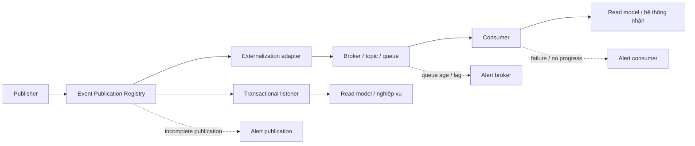

# Alert khi application event bị kẹt

Trong kiến trúc hướng sự kiện, một event có thể đã được phát nhưng chưa được listener xử lý hoàn tất. Publication có thể chờ quá lâu trong Event Publication Registry, message có thể nằm lâu trong queue, consumer có thể ngừng tiến độ hoặc liên tục retry một payload lỗi. Nếu chỉ theo dõi trạng thái ứng dụng và số exception, đội vận hành có thể không nhận ra một luồng nghiệp vụ đang bị đình trệ.

**Alert event bị kẹt** là cảnh báo được kích hoạt khi event hoặc publication chưa hoàn tất lâu hơn thời gian cho phép, backlog không tiến triển, hoặc một điều kiện lỗi cho thấy luồng giao sự kiện có nguy cơ không đáp ứng SLO. Trong Spring Modulith, cần kết hợp trạng thái publication của từng listener với tín hiệu từ broker và consumer. Alert phải chỉ ra luồng nào bị ảnh hưởng, mức độ chậm và nơi cần điều tra để người vận hành có thể xử lý đúng nguyên nhân.

## 1. Thế nào là một event bị kẹt?

Một event bị kẹt khi nó chưa đạt trạng thái hoàn tất trong thời gian dự kiến và không có tiến triển đủ để đáp ứng yêu cầu nghiệp vụ. Không phải mọi publication chưa hoàn tất đều là sự cố: một listener có thể đang xử lý tác vụ bình thường, một queue có thể tăng ngắn hạn trong giờ cao điểm hoặc một consumer có thể đang replay có kế hoạch.

Nên phân biệt các tình huống:

| Tình huống | Dấu hiệu | Ý nghĩa vận hành |
| --- | --- | --- |
| Publication đang chờ bình thường | Tuổi publication còn trong ngân sách xử lý, backlog ổn định | Chưa cần cảnh báo |
| Publication chậm | Tuổi publication vượt ngưỡng mục tiêu nhưng vẫn có tiến triển | Cảnh báo độ trễ hoặc cảnh báo sớm |
| Publication bị kẹt | Tuổi lớn, không có tiến triển hoặc listener liên tục thất bại | Cần điều tra và phục hồi |
| Backlog tăng | Tốc độ event mới cao hơn tốc độ xử lý trong một khoảng thời gian | Năng lực consumer không theo kịp nguồn phát |
| Poison event | Một event cụ thể luôn lỗi trong khi các event khác có thể tiếp tục | Cần cách ly hoặc xử lý dữ liệu có kiểm soát |
| Consumer mất kết nối | Queue depth/lag tăng và consumer không nhận message | Kiểm tra broker, subscription và consumer |
| Dead-letter tăng | Message bị chuyển sang DLQ hoặc quarantine | Luồng chính có thể vẫn chạy nhưng một phần event không được xử lý |

Một event chỉ được xem là “kẹt” khi đánh giá theo thời gian, tiến triển và yêu cầu nghiệp vụ. Số lượng publication chưa hoàn tất đơn thuần chưa đủ để kết luận sự cố.

## 2. Các ranh giới cần quan sát

Luồng event trong Spring Modulith có thể đi qua nhiều thành phần. Mỗi thành phần có một loại trạng thái khác nhau:

1. **Publisher:** event được tạo và phát trong transaction nghiệp vụ.
2. **Event Publication Registry:** theo dõi publication cần giao tới từng listener transactional.
3. **Listener:** thực hiện xử lý nội bộ và hoàn tất publication khi xử lý thành công theo cấu hình.
4. **Externalization adapter:** chuyển event được chọn tới broker hoặc hệ thống ngoài.
5. **Broker:** nhận, lưu và định tuyến message tới queue/topic.
6. **Consumer:** nhận message, cập nhật dữ liệu và xác nhận xử lý theo semantics của broker.



Publication registry giúp nhận diện event chưa hoàn tất ở ranh giới listener được theo dõi. Broker metrics cho biết message đang chờ hoặc consumer lag. Consumer metrics cho biết tốc độ xử lý, lỗi và thời điểm tiến triển gần nhất. Không nên gộp các tín hiệu này thành một metric “event pending” duy nhất vì chúng mô tả những chặng khác nhau.

## 3. Dùng Event Publication Registry làm nguồn tín hiệu

Spring Modulith Event Publication Registry theo dõi publication của event tới các transactional listener. Với repository lưu trữ bền vững, ứng dụng có thể truy vấn các publication chưa hoàn tất và xây dựng cảnh báo dựa trên trạng thái đó.

`IncompleteEventPublications` là abstraction có thể dùng để làm việc với publication chưa hoàn tất, ví dụ xây dựng màn hình vận hành hoặc quy trình resubmit. API cụ thể cần theo Javadoc của phiên bản Spring Modulith đang sử dụng. Không nên truy vấn trực tiếp cấu trúc bảng nội bộ hoặc tự cập nhật trạng thái publication bằng SQL để làm cho cảnh báo biến mất.

Các thông tin nên thu thập từ registry hoặc lớp adapter của ứng dụng:

- Số publication chưa hoàn tất theo listener và loại event.
- Tuổi của publication chưa hoàn tất lâu nhất.
- Thời điểm publication gần nhất được tạo và hoàn tất.
- Số lần listener thất bại hoặc được resubmit nếu ứng dụng ghi nhận.
- Nhóm exception gần nhất và listener liên quan.
- Số publication chưa hoàn tất đã vượt ngưỡng thời gian nghiệp vụ.

Registry theo dõi publication theo listener, vì vậy một event có nhiều listener có thể có nhiều publication độc lập. Alert nên gắn với listener cụ thể. Nếu listener kho hoàn tất nhưng listener hóa đơn bị kẹt, cảnh báo cần chỉ ra listener hóa đơn thay vì chỉ báo chung rằng event `OrderCompleted` có vấn đề.

### Lưu ý về metric

Không mặc định mọi phiên bản Spring Modulith tự xuất sẵn tất cả metric cần cho alert. Có thể cần một scheduled sampler hoặc adapter quan sát của ứng dụng để đọc số liệu từ API registry và xuất gauge/counter qua Micrometer. Việc đọc trạng thái phải giới hạn tần suất và số bản ghi để tránh làm tải thêm database khi backlog lớn.

Nếu registry dùng repository trong bộ nhớ, trạng thái không tồn tại qua restart. Với luồng cần phục hồi và alert đáng tin cậy, nên dùng persistent Event Publication Registry và kiểm tra datasource/transaction manager tương ứng.

## 4. Đo tuổi publication và thời gian xử lý

Tuổi publication là một trong những tín hiệu trực tiếp nhất để phát hiện event bị kẹt. Nên đo từ thời điểm publication được tạo hoặc từ mốc bắt đầu xử lý đã được xác định, không lấy thời điểm hiện tại trừ một timestamp không cùng ý nghĩa.

Một số khoảng thời gian hữu ích:

- **Publication age:** thời gian từ khi registry tạo publication tới hiện tại nếu publication chưa hoàn tất.
- **End-to-end event latency:** thời gian từ lúc nghiệp vụ phát event tới khi consumer hoàn tất.
- **Processing duration:** thời gian listener/consumer thực sự chạy.
- **Queue waiting age:** thời gian message cũ nhất chờ trong queue.
- **Consumer lag:** khoảng cách tiến độ giữa nguồn phát và consumer, thường theo offset hoặc cursor của broker.

Không nên dùng `occurredAt` làm mốc duy nhất nếu event có thể được phát muộn hoặc dữ liệu được replay. Ví dụ một event được replay từ lịch sử có `occurredAt` từ tuần trước; alert dựa trên tuổi event nghiệp vụ sẽ báo hàng loạt dù publication mới vừa được tạo. Cần tách event time khỏi publication/ingestion time.

Đối với từng loại event, xác định thời gian xử lý mục tiêu và ngưỡng cảnh báo theo SLO. Ví dụ, event cập nhật trạng thái đơn hàng có thể cần được xử lý trong vài phút, trong khi tác vụ tổng hợp báo cáo theo lô có thể được phép chậm hơn. Không áp dụng một ngưỡng duy nhất cho mọi listener.

## 5. Phát hiện backlog không tiến triển

Backlog tăng liên tục có thể là dấu hiệu consumer không đủ năng lực, nhưng backlog lớn trong một đợt replay có thể là hoạt động bình thường. Cần theo dõi đồng thời số lượng backlog và tốc độ thay đổi.

Các tín hiệu nên kết hợp:

- Số publication chưa hoàn tất hiện tại.
- Số publication mới tạo trong mỗi khoảng thời gian.
- Số publication hoàn tất trong cùng khoảng thời gian.
- Tuổi publication lâu nhất và phân vị tuổi (p50/p95/p99) nếu có thể tính ổn định.
- Thời điểm hoàn tất gần nhất của listener.
- Consumer lag hoặc queue depth của broker.
- Tốc độ xử lý event mỗi giây/phút.

Nếu số publication đang chờ cao nhưng số hoàn tất vẫn tăng đều và tuổi lớn nhất nằm trong SLO, có thể chỉ cần dashboard. Nếu backlog tiếp tục tăng, không có publication hoàn tất trong một khoảng thời gian hoặc tuổi lâu nhất vượt ngưỡng, cần cảnh báo.

Một chỉ số đơn giản là chênh lệch giữa số publication mới và số publication hoàn tất trong cửa sổ thời gian. Đây là chỉ báo xu hướng, không phải trạng thái tuyệt đối; cần tính theo cùng listener và loại event, đồng thời xét việc retry/resubmit có thể tạo thêm lần xử lý.

## 6. Thiết kế ngưỡng alert theo SLO

Ngưỡng nên phản ánh tác động nghiệp vụ và khả năng phục hồi, không chọn tùy ý chỉ vì một con số dễ nhớ. Có thể chia thành ba mức:

| Mức | Điều kiện tham khảo | Hành động |
| --- | --- | --- |
| Warning | Tuổi publication vượt mục tiêu cảnh báo hoặc backlog tăng liên tục nhưng chưa ảnh hưởng nghiêm trọng | Theo dõi dashboard, kiểm tra xu hướng và dependency |
| Critical | Tuổi vượt SLO, không có tiến triển trong thời gian xác định hoặc listener liên tục thất bại | On-call điều tra và phục hồi |
| Emergency | Luồng nghiệp vụ quan trọng bị đình trệ, backlog tăng nhanh, dữ liệu có nguy cơ mất hoặc ảnh hưởng khách hàng diện rộng | Kích hoạt incident process và phối hợp các nhóm liên quan |

Ví dụ với một listener cần xử lý event trong vòng 5 phút:

- Warning khi tuổi publication lâu nhất vượt 3 phút liên tục trong 5 phút.
- Critical khi tuổi vượt 5 phút và không có publication hoàn tất trong 5 phút.
- Emergency khi backlog tăng nhanh cùng lúc consumer không hoạt động hoặc dependency chính bị gián đoạn kéo dài.

Đây chỉ là ví dụ. Ngưỡng thực tế phải dựa trên SLO của event, lưu lượng bình thường, thời gian retry và thời gian phục hồi của dependency. Nếu listener có lịch xử lý theo batch, cần tính tới cửa sổ batch để tránh cảnh báo giả.

### Dùng `for` để tránh cảnh báo chập chờn

Alert thường nên yêu cầu điều kiện tồn tại liên tục trong một khoảng thời gian trước khi chuyển sang firing. Cách này tránh cảnh báo khi backlog tăng thoáng qua hoặc một publication mất vài giây lâu hơn bình thường.

Không nên trì hoãn cảnh báo quá lâu đối với event có hậu quả nghiêm trọng. Với thanh toán hoặc điều phối tồn kho, ngưỡng và thời gian `for` cần dựa trên thời gian chấp nhận được của nghiệp vụ.

## 7. Metric cần có cho alert

Ứng dụng có thể xuất các metric custom qua Micrometer. Tên dưới đây là quy ước minh họa do ứng dụng định nghĩa, không phải cam kết tên metric mặc định của Spring Modulith:

| Metric | Loại | Ý nghĩa |
| --- | --- | --- |
| `app_event_publications_incomplete` | Gauge | Số publication chưa hoàn tất theo listener |
| `app_event_publication_oldest_age_seconds` | Gauge | Tuổi publication chưa hoàn tất lâu nhất |
| `app_event_publications_completed_total` | Counter | Tổng publication hoàn tất |
| `app_event_publications_failed_total` | Counter | Tổng lần xử lý publication thất bại |
| `app_event_listener_last_success_timestamp_seconds` | Gauge | Thời điểm listener hoàn tất gần nhất |
| `app_event_consumer_processing_duration_seconds` | Timer/Histogram | Thời gian xử lý event |
| `app_event_consumer_retries_total` | Counter | Số lần retry theo nhóm lỗi |
| `app_event_dead_letter_messages` | Gauge | Số message trong dead-letter queue |

Với broker, bổ sung queue depth, oldest message age, consumer count, consumer lag, unacked messages và tốc độ publish/deliver/ack. Tên metric phụ thuộc exporter và broker; cần ánh xạ đúng metric thực tế của môi trường.

### Tránh cardinality quá cao

Không đưa `eventId`, `publicationId`, `aggregateId`, email hoặc customer ID vào label của Prometheus. Mỗi giá trị mới có thể tạo một time series riêng, làm tăng bộ nhớ và chi phí query. Nên dùng label có tập giá trị hữu hạn như:

- `listener` hoặc `consumer` với danh sách được kiểm soát.
- `event_type` theo loại event đã đăng ký.
- `destination` theo tên exchange/topic/queue cố định.
- `result` như `success`, `failure`, `retry`.
- `error_class` theo nhóm exception, không dùng message exception động.

Định danh cụ thể của event nên nằm trong log hoặc trace có quyền truy cập phù hợp, không nằm trong label metric.

## 8. Ví dụ Prometheus alert rule

Ví dụ sau minh họa cách cảnh báo publication tồn tại quá lâu. Metric `app_event_publication_oldest_age_seconds` và label `listener` là metric custom mà ứng dụng cần xuất:

```yaml
groups:
  - name: spring-modulith-events
    rules:
      - alert: EventPublicationStuck
        expr: app_event_publication_oldest_age_seconds > 300
        for: 5m
        labels:
          severity: critical
          team: platform
        annotations:
          summary: "Event publication bị kẹt ở listener {{ $labels.listener }}"
          description: >-
            Publication chưa hoàn tất lâu hơn 5 phút. Kiểm tra listener,
            dependency và Event Publication Registry trước khi resubmit.
```

Đây là rule minh họa; cần điều chỉnh tên metric, label và thời gian theo hệ thống. Nếu gauge không có publication thì nên xác định rõ cách exporter biểu diễn (ví dụ không xuất series hoặc xuất giá trị 0) để alert không bị hiểu sai.

Có thể bổ sung alert cho backlog không tiến triển:

```yaml
- alert: EventPublicationNoProgress
  expr: |
    app_event_publications_incomplete > 0
    and increase(app_event_publications_completed_total[10m]) == 0
  for: 5m
  labels:
    severity: warning
  annotations:
    summary: "Listener không hoàn tất publication trong 10 phút"
    description: "Kiểm tra consumer health, lỗi listener và dependency liên quan."
```

Rule thứ hai cũng cần được điều chỉnh nếu listener có thời gian idle hợp lệ hoặc chỉ chạy theo batch. Nên kết hợp với tuổi publication và lịch hoạt động của listener để tránh cảnh báo khi không có event mới.

## 9. Alert riêng cho từng loại điểm nghẽn

Một alert chung cho toàn bộ event flow thường khó hành động. Nên phân loại cảnh báo theo thành phần:

| Alert | Điều kiện | Nhóm điều tra đầu tiên |
| --- | --- | --- |
| `EventPublicationTooOld` | Publication registry có bản ghi quá tuổi | Listener, transaction, dependency nội bộ |
| `EventListenerFailureRateHigh` | Tỷ lệ listener thất bại tăng | Exception, dữ liệu đầu vào, code mới triển khai |
| `EventPublicationNoProgress` | Không có publication hoàn tất trong cửa sổ quan sát khi vẫn có backlog | Thread pool, listener bị treo, dependency |
| `BrokerQueueAgeHigh` | Message cũ nhất trong queue vượt ngưỡng | Broker, consumer subscription và tốc độ xử lý |
| `ConsumerLagHigh` | Offset/cursor consumer tụt xa nguồn | Consumer group, partition, rebalance, throughput |
| `DeadLetterMessagesGrowing` | DLQ tăng liên tục | Poison event, schema mismatch, retry policy |
| `EventExternalizationFailure` | Adapter không gửi được message | Kết nối broker, ACL, routing, serialization |

Không phải mọi alert đều cần paging ngay. Ví dụ DLQ tăng một message có thể cần cảnh báo warning và dashboard; DLQ tăng nhanh cho event thanh toán quan trọng có thể cần critical. Mức độ phải gắn với tác động và SLO.

## 10. Thiết kế nội dung alert có thể hành động

Một alert tốt trả lời được các câu hỏi: thành phần nào bị ảnh hưởng, event nào hoặc listener nào liên quan, tình trạng kéo dài bao lâu, số lượng bao nhiêu và người trực nên bắt đầu ở đâu.

Nội dung nên có:

- Tên listener/consumer hoặc destination.
- Event type hoặc nhóm event bị ảnh hưởng.
- Số publication/message đang chờ.
- Tuổi lớn nhất và thời gian không có tiến triển.
- Tỷ lệ thất bại hoặc retry gần đây.
- Môi trường, service và phiên bản triển khai.
- Link tới dashboard, log/trace và runbook tương ứng.
- Mức độ ảnh hưởng nghiệp vụ và SLO liên quan.

Không đưa toàn bộ payload, email, số điện thoại hoặc dữ liệu khách hàng vào alert. Nếu cần điều tra một event cụ thể, alert có thể cung cấp `eventId` hoặc `publicationId` trong hệ thống quan sát được phân quyền; không dùng các định danh này làm label metric.

Ví dụ nội dung:

```text
Alert: EventPublicationTooOld
Service: order-management
Listener: inventory-on-order-completed
Event type: OrderCompleted
Incomplete publications: 42
Oldest publication age: 12m 35s
No successful completion: 8m
Likely impact: tồn kho chưa phản ánh các đơn hàng hoàn tất
Next step: xem dashboard listener và runbook Event Publication Recovery
```

Đây là ví dụ minh họa. Chỉ nêu tác động nghiệp vụ khi có quan hệ đã được xác nhận giữa listener và read model/quy trình bị ảnh hưởng.

## 11. Correlation giữa metric, log và trace

Khi alert firing, người vận hành cần chuyển từ số liệu tổng hợp tới một lần xử lý cụ thể. Có thể dùng các trường tương quan sau:

- `eventId`: định danh event nghiệp vụ.
- `publicationId`: định danh publication nếu registry hoặc lớp quan sát cung cấp.
- `correlationId`/`traceId`: liên kết các bước trong cùng workflow.
- `listener` hoặc `consumer`: thành phần đang xử lý.
- `destination`, topic, exchange, queue và partition nếu có.
- `eventType` và `schemaVersion`.

Metric cho biết xu hướng và mức độ. Log cho biết exception và ngữ cảnh của lần xử lý. Trace cho biết thời gian ở từng chặng khi tracing được instrument đúng. Cần thống nhất cách truyền correlation metadata giữa publisher, listener và externalization adapter.

Không giả định trace context tự động được giữ nguyên qua mọi broker hoặc mọi phiên bản adapter. Nếu cần truyền trace context qua message headers, hãy cấu hình propagation theo chuẩn OpenTelemetry và kiểm tra consumer thực sự tiếp tục trace. Không đưa dữ liệu cá nhân vào baggage hoặc span attribute.

## 12. Runbook khi alert event bị kẹt

Khi nhận alert, người trực nên thực hiện theo trình tự để xác định chặng bị nghẽn trước khi retry:

1. **Xác định phạm vi:** service, listener/consumer, event type, destination, môi trường và thời điểm bắt đầu.
2. **Đánh giá tác động:** xác định nghiệp vụ hoặc read model nào đang chậm; đối chiếu SLO và số lượng event bị ảnh hưởng.
3. **Kiểm tra xu hướng:** xem backlog, tuổi publication lâu nhất, completion rate, failure rate và thời điểm thành công gần nhất.
4. **Kiểm tra registry:** tìm publication chưa hoàn tất theo listener và exception gần nhất qua API/quan sát được hỗ trợ.
5. **Kiểm tra listener:** trạng thái instance, thread pool, transaction, lock contention, timeout và dependency nội bộ.
6. **Kiểm tra broker nếu có:** connection, queue depth, consumer count, unacked message, consumer lag, DLQ và routing.
7. **Phân loại lỗi:** lỗi tạm thời, cấu hình, schema/payload, logic nghiệp vụ hay kết quả side effect chưa xác định.
8. **Khắc phục nguyên nhân:** phục hồi dependency, sửa cấu hình hoặc triển khai bản sửa theo quy trình incident.
9. **Resubmit có kiểm soát:** chỉ phát lại publication sau khi hiểu lỗi và đánh giá idempotency của listener/consumer.
10. **Xác nhận phục hồi:** completion rate tăng, backlog giảm, tuổi lớn nhất trở về trong SLO và alert tự chuyển về trạng thái bình thường.
11. **Ghi nhận incident:** lưu nguyên nhân gốc, thời gian ảnh hưởng, số event bị chậm và hành động phòng ngừa.

Không xóa publication chưa hoàn tất chỉ để làm metric giảm. Không đánh dấu publication hoàn tất bằng SQL nếu listener chưa thực sự xử lý thành công. Với publication lỗi do payload không hợp lệ, có thể cần quarantine hoặc quy trình xử lý thủ công thay vì retry vô hạn.

## 13. Resubmit và retry sau khi alert

Alert cho biết có vấn đề; nó không tự động quyết định event nào nên được phát lại. Trước khi resubmit, hãy xác định:

- Listener đã thực hiện side effect nào trước khi thất bại?
- Lỗi có thể phục hồi hay do payload/logic không hợp lệ?
- Listener có idempotent khi nhận lại cùng event không?
- Publication có thể đang được xử lý ở một instance khác hay không?
- Việc retry có làm tăng tải lên broker hoặc dependency đang lỗi không?
- Có cần cách ly một event để phần còn lại tiếp tục xử lý không?

Spring Modulith cung cấp abstraction `IncompleteEventPublications` để làm việc với publication chưa hoàn tất và resubmit theo API của phiên bản. Cần kiểm tra hành vi retry, transaction và concurrency trong môi trường ứng dụng. Tránh viết một job tự lấy bản ghi rồi gọi listener trực tiếp, vì có thể bỏ qua semantics mà registry quản lý.

Với broker, retry có thể thực hiện qua consumer policy, retry queue hoặc dead-letter flow. Phải hiểu rõ việc acknowledgement và requeue để tránh vòng lặp message vô hạn. Poison event nên được cách ly, ghi nhận nguyên nhân và xử lý sau khi sửa dữ liệu hoặc consumer.

## 14. Giảm false positive và alert fatigue

Alert quá nhạy sẽ khiến người trực bỏ qua cảnh báo. Một số cách giảm nhiễu:

- Dùng ngưỡng riêng theo event type/listener và SLO.
- Yêu cầu điều kiện tồn tại liên tục bằng `for` phù hợp.
- Kết hợp backlog với tuổi và tiến triển, không cảnh báo chỉ vì một gauge lớn.
- Loại trừ thời gian bảo trì hoặc replay có kế hoạch bằng cơ chế silence/maintenance window có thời hạn.
- Nhóm alert theo service, listener và destination để tránh một incident tạo hàng trăm notification.
- Dùng alert riêng cho lỗi cấu hình kéo dài và lỗi tạm thời.
- Tự động resolve khi backlog trở về ngưỡng và completion rate phục hồi.
- Rà soát alert không có hành động rõ ràng hoặc thường xuyên firing mà không gây tác động.

Silence chỉ tạm ẩn notification; nó không khắc phục event bị kẹt. Mọi maintenance window cần có người chịu trách nhiệm, thời hạn kết thúc và dashboard theo dõi trong thời gian silence.

## 15. Kiểm thử alert và tình huống event bị kẹt

Alert rule cần được kiểm thử với dữ liệu metric mẫu và các tình huống lỗi thực tế. Một số kịch bản nên có:

| Kịch bản | Điều cần xác nhận |
| --- | --- |
| Publication tồn tại quá ngưỡng | Alert firing sau đúng thời gian `for` |
| Publication hoàn tất trước ngưỡng | Alert không firing hoặc tự resolve |
| Backlog cao nhưng completion vẫn đều | Không báo critical sai nếu tuổi vẫn trong SLO |
| Backlog tăng và không có tiến triển | Alert cảnh báo đúng listener/destination |
| Một listener lỗi, listener khác vẫn khỏe | Alert chỉ gắn với listener lỗi |
| Broker mất kết nối | Alert externalization/connection và backlog xuất hiện phù hợp |
| Consumer dừng hoặc lag tăng | Alert consumer/queue phản ánh đúng chặng |
| Một poison event lặp lại | Failure/DLQ alert phát hiện mà không tạo retry storm |
| Replay có kế hoạch | Maintenance/silence không che giấu sự cố ngoài phạm vi |
| Không có event mới | Alert no-progress không báo sai khi listener không có việc |
| Metric không được scrape | Có alert cho telemetry/monitoring gap riêng |

Nên dùng Prometheus rule test hoặc công cụ tương ứng của nền tảng alerting để xác nhận biểu thức. Với Event Publication Registry, có thể kiểm thử integration bằng cách làm listener thất bại có kiểm soát rồi xác nhận metric incomplete/age tăng và giảm sau khi phục hồi. Đây là kiểm thử observability, không thay thế kiểm thử logic nghiệp vụ của listener.

## 16. Các lỗi thiết kế alert thường gặp

| Lỗi | Hệ quả | Cách xử lý |
| --- | --- | --- |
| Chỉ cảnh báo theo số publication chưa hoàn tất | Backlog bình thường tạo false positive | Kết hợp tuổi, completion rate và SLO |
| Dùng event timestamp để đo publication age | Replay lịch sử bị hiểu nhầm là event mới đang kẹt | Tách event time và publication/ingestion time |
| Gộp mọi listener thành một metric | Khó xác định consumer nào gây nghẽn | Gắn label listener/consumer có tập giá trị kiểm soát |
| Dùng event ID làm label metric | Cardinality tăng nhanh và tốn tài nguyên | Đưa định danh vào log/trace |
| Alert không có runbook hoặc tác động | Người trực không biết bắt đầu ở đâu | Bổ sung listener, event type, tuổi, backlog và next step |
| Tự động resubmit mọi publication khi alert | Tăng tải hoặc lặp side effect | Phân loại lỗi và xác nhận idempotency trước retry |
| Xóa publication để làm sạch dashboard | Mất dấu event chưa được xử lý | Khắc phục nguyên nhân và resubmit/quarantine đúng cách |
| Không giám sát telemetry pipeline | Metric mất nhưng hệ thống trông như không có event lỗi | Theo dõi scrape/collector và alert dữ liệu giám sát bị thiếu |
| Dùng một ngưỡng cho mọi event | Alert không phù hợp với mức độ quan trọng khác nhau | Định nghĩa SLO theo luồng nghiệp vụ |

## 17. Quy trình triển khai alert trong module

Khi bổ sung alert cho một luồng Spring Modulith, hãy triển khai theo thứ tự:

1. Liệt kê listener, event type và luồng externalization cần quan sát.
2. Xác định SLO xử lý, thời gian chấp nhận được và tác động nếu event bị trễ.
3. Dùng persistent Event Publication Registry cho publication cần phục hồi qua restart.
4. Xuất metric incomplete count, oldest age, completion/failure rate và last progress theo listener.
5. Bổ sung queue depth, oldest message age, consumer lag và DLQ metrics cho broker.
6. Thiết kế warning/critical theo tuổi, backlog, tiến triển và thời gian `for`.
7. Giữ label có cardinality thấp; liên kết event cụ thể qua log/trace.
8. Viết alert message có tác động nghiệp vụ, dashboard và runbook.
9. Kiểm thử alert bằng listener failure, broker outage, consumer stop, poison event và replay.
10. Diễn tập runbook, đo thời gian phục hồi và điều chỉnh ngưỡng theo dữ liệu thực tế.

Alert event bị kẹt cần dựa trên trạng thái publication, tuổi xử lý và tín hiệu tiến triển của từng listener/consumer. Khi cảnh báo được gắn với SLO, có metric phù hợp, nội dung hành động rõ ràng và runbook phục hồi an toàn, đội vận hành có thể phát hiện sớm event bị đình trệ và khôi phục luồng giao sự kiện mà vẫn giữ được tính đúng đắn của dữ liệu nghiệp vụ.
