# Chi phí serialization

Trong hệ thống hướng sự kiện, một event thường đi qua nhiều ranh giới: từ object Java trong module phát, sang dữ liệu được lưu trong publication registry hoặc outbox, rồi thành message gửi tới broker và cuối cùng được deserialize ở consumer. Mỗi lần chuyển đổi này tiêu tốn CPU, cấp phát bộ nhớ và có thể làm tăng độ trễ. Khi lưu lượng event lớn, payload cồng kềnh hoặc cùng một event bị serialize nhiều lần, chi phí nhỏ trên mỗi message có thể trở thành tải đáng kể.

**Serialization** là quá trình chuyển object hoặc cấu trúc dữ liệu thành một biểu diễn có thể lưu trữ hoặc truyền đi, thường là byte array hoặc văn bản. **Deserialization** là chiều ngược lại: đọc biểu diễn đó và khôi phục dữ liệu thành object. Tối ưu serialization trong Spring Modulith cần xem xét toàn bộ đường đi của event, từ thiết kế contract đến persistence, transport và consumer.

## 1. Serialization xuất hiện ở đâu trong luồng event?

Một application event có thể được chuyển đổi ở nhiều điểm:

1. Module nghiệp vụ tạo event object và publish qua `ApplicationEventPublisher`.
2. Event Publication Registry có thể serialize event để lưu publication bền vững, tùy persistence implementation và serializer được cấu hình.
3. Externalization adapter chuyển event thành payload của message.
4. Transport serializer mã hóa key/value hoặc body thành bytes để gửi qua Kafka, RabbitMQ hay hệ thống khác.
5. Consumer giải mã bytes thành DTO rồi map sang model xử lý.
6. Consumer có thể tiếp tục serialize dữ liệu vào inbox, event store, audit store hoặc read model.

```mermaid
flowchart LR
    A[Java event object] --> B[Event Publication Registry]
    B -->|Persistence serialization nếu được dùng| C[Stored publication]
    C --> D[Externalization adapter]
    D --> E[Transport serialization]
    E --> F[Broker bytes]
    F --> G[Transport deserialization]
    G --> H[Consumer DTO]
    H --> I[Business processing]
```



Các bước trên là những ranh giới có thể xuất hiện trong một kiến trúc; không phải mọi ứng dụng đều thực hiện tất cả hoặc dùng cùng một serializer. Ví dụ, listener nội bộ có thể nhận object trong JVM mà không qua JSON. Một adapter broker có thể serialize trực tiếp DTO, trong khi persistence registry dùng serializer khác để lưu publication. Cần đo đúng đường đi thực tế trước khi tối ưu.

## 2. Những thành phần tạo nên chi phí

Chi phí serialization không chỉ là thời gian gọi `writeValueAsBytes()`. Tổng chi phí thường gồm:

| Thành phần | Tác động |
|---|---|
| CPU | Duyệt object graph, introspection, chuyển kiểu, mã hóa và escape dữ liệu |
| Memory allocation | Tạo buffer, byte array, chuỗi trung gian, token và object tạm |
| Garbage collection | Object tạm tồn tại ngắn làm tăng áp lực young-generation GC |
| Payload size | Tăng network transfer, broker storage, replication và retention |
| Latency | Serialization/deserialization nằm trên critical path của publish hoặc consume |
| Schema handling | Tra cứu schema, kiểm tra version, tạo descriptor hoặc resolve type metadata |
| Compression | Tốn CPU để nén/giải nén, đổi lại có thể giảm bytes truyền và lưu |
| Persistence | Ghi và đọc payload đã serialize làm tăng I/O và dung lượng database |

Một serializer nhanh nhưng tạo payload lớn có thể làm tổng thời gian end-to-end kém hơn do network và broker. Ngược lại, format nhỏ hơn nhưng tốn CPU giải mã có thể trở thành bottleneck ở consumer. Vì vậy, cần đo CPU, allocation, bytes và latency cùng nhau.

## 3. Ước lượng tác động ở quy mô hệ thống

Giả sử hệ thống phát 8.000 event mỗi giây và payload trung bình là 1,5 KiB. Lượng payload thô đi qua một ranh giới transport xấp xỉ:

```text
8,000 events/s × 1.5 KiB/event = 12,000 KiB/s
                                  ≈ 11.72 MiB/s
                                  ≈ 1.01 TiB/day
```

Đây mới là payload ở một lượt truyền, chưa tính protocol overhead, headers, replication, bản sao persistence, retry, retention hoặc các consumer khác. Nếu cùng event được lưu vào publication registry rồi serialize lại để gửi broker, tổng bytes được ghi/đọc có thể cao hơn đáng kể.

Một cách ước lượng khác là đo chi phí CPU trung bình mỗi event:

```text
CPU cores consumed ≈ events_per_second × CPU_seconds_per_event
```

Ví dụ, 8.000 event/giây với 0,25 ms CPU cho mỗi lần serialize tương đương khoảng 2 CPU cores chỉ cho thao tác đó, chưa tính deserialize và các bước khác. Đây là phép ước lượng tải, không phải benchmark thay cho đo trên ứng dụng thực.

## 4. Kích thước và cấu trúc event ảnh hưởng trực tiếp

Serializer phải duyệt dữ liệu cần chuyển đổi. Một event càng chứa nhiều field, nested object và collection lớn thì thường càng tốn CPU và bộ nhớ.

Ví dụ payload quá rộng:

```java
public record OrderPlaced(
    OrderEntity order,
    CustomerEntity customer,
    List<OrderLineEntity> lines,
    List<PaymentEntity> payments,
    List<ShipmentEntity> shipments
) {}
```

Các entity có thể chứa quan hệ hai chiều, lazy proxy, audit fields, dữ liệu không cần cho consumer và những object phụ thuộc persistence context. Serialize chúng có thể kích hoạt lazy loading, tạo truy vấn N+1, gặp vòng tham chiếu hoặc vô tình đưa dữ liệu nội bộ ra ngoài.

Hãy tạo event contract nhỏ, bất biến và chỉ chứa thông tin consumer cần:

```java
public record OrderPlaced(
    UUID eventId,
    UUID orderId,
    String orderNumber,
    Instant occurredAt,
    List<OrderLineData> lines
) {}

public record OrderLineData(
    UUID productId,
    int quantity,
    BigDecimal unitPrice
) {}
```

Thiết kế payload nhỏ giúp giảm thời gian duyệt object, số allocation, bytes truyền và nguy cơ lộ dữ liệu. Nếu consumer cần thêm thông tin ít khi dùng, cân nhắc event riêng, API truy vấn có thẩm quyền hoặc reference tới tài nguyên đã được phân quyền thay vì nhúng toàn bộ object graph.

## 5. Tránh serialize JPA entity và object runtime

JPA entity được thiết kế cho persistence lifecycle, không phải message contract. Các vấn đề thường gặp khi serialize entity:

- Lazy relationship có thể kích hoạt truy vấn database ngoài dự kiến.
- Quan hệ hai chiều có thể tạo vòng tham chiếu.
- Hibernate proxy và collection wrapper phụ thuộc implementation.
- Thay đổi schema/domain có thể phá payload cũ.
- Field nội bộ hoặc dữ liệu nhạy cảm có thể bị phát ra ngoài.
- Object có thể phụ thuộc session hoặc persistence context đã đóng.

Không đưa `EntityManager`, repository, stream, file handle, HTTP request, security context hoặc connection vào event. Hãy map sang DTO tại boundary nghiệp vụ khi dữ liệu cần thiết còn sẵn sàng. Mapping này cũng là nơi xác định rõ snapshot semantics: event mô tả dữ liệu tại thời điểm nghiệp vụ xảy ra, không phải object sống sẽ thay đổi sau đó.

## 6. JSON: dễ quan sát nhưng có overhead

JSON là lựa chọn phổ biến cho event contract vì dễ đọc, hỗ trợ nhiều ngôn ngữ và thuận tiện khi debug. Tuy nhiên, JSON biểu diễn field name dưới dạng text, có dấu ngoặc, dấu phẩy, escape string và thường có overhead khi biểu diễn số hoặc metadata.

Ví dụ JSON:

```json
{
  "eventId": "f34b3a4a-9b1f-4c7f-9c8e-7e31a2b7b4e1",
  "eventType": "order.placed",
  "schemaVersion": 1,
  "orderId": "d48a8e64-bad8-4a87-9e7c-5e4b70d0a40f",
  "quantity": 2,
  "currency": "VND"
}
```

Ưu điểm:

- Con người đọc được trong log và công cụ broker.
- Hỗ trợ rộng ở Java, JavaScript, Python, Go và nhiều nền tảng.
- Dễ mở rộng contract khi consumer bỏ qua field không biết theo policy.
- Có hệ sinh thái serializer và schema validation phong phú.

Chi phí cần cân nhắc:

- Tên field lặp lại trên mỗi message làm tăng payload size.
- Chuyển object sang token/string và escape text tiêu tốn CPU.
- Number, date/time và enum cần quy ước biểu diễn rõ.
- Parse JSON có thể tạo nhiều object tạm và string.

JSON vẫn có thể là lựa chọn tốt nhất khi khả năng tương tác và khả năng quan sát quan trọng hơn chênh lệch kích thước. Đừng đổi format chỉ vì binary thường nhỏ hơn trên lý thuyết; hãy đo payload thực tế và chi phí vận hành.

## 7. Jackson và cách giảm overhead

Trong Java/Spring, Jackson thường được dùng để serialize DTO sang JSON. Tạo một `ObjectMapper` dùng chung, cấu hình nhất quán và tái sử dụng thay vì tạo mapper mới cho mỗi event.

```java
@Configuration
class EventJsonConfiguration {

    @Bean
    ObjectMapper eventObjectMapper() {
        return JsonMapper.builder()
            .addModule(new JavaTimeModule())
            .build();
    }
}
```

Ví dụ trên minh họa mapper riêng cho event contract. Cách đăng ký mapper với Spring Modulith persistence serializer hoặc Spring AMQP/Kafka serializer phải theo extension point của phiên bản đang dùng. Không giả định mọi integration tự động dùng cùng bean `ObjectMapper`.

Một số nguyên tắc:

- Tái sử dụng mapper và cấu hình module một lần khi khởi tạo ứng dụng.
- Dùng DTO/record có cấu trúc ổn định và tránh custom serializer không cần thiết.
- Tránh serialize entity graph và field không cần thiết.
- Dùng `ObjectWriter` đã cấu hình sẵn cho kiểu payload cố định nếu phù hợp.
- Không bật polymorphic default typing rộng chỉ để tiện deserialize.
- Giới hạn kích thước collection/string và validate payload ở boundary.
- Kiểm tra `JavaTimeModule`, timezone, decimal và enum theo contract.

Ví dụ serialize sang byte array:

```java
byte[] payload = eventObjectMapper.writeValueAsBytes(event);
```

`writeValueAsBytes` tránh tạo một `String` trung gian rồi gọi `getBytes()` khi transport nhận bytes. Tuy nhiên, serializer vẫn phải cấp phát buffer và byte array kết quả. Với payload lớn, cần đo allocation và xem xét streaming hoặc API ghi trực tiếp vào output stream nếu transport/persistence hỗ trợ.

## 8. Tránh serialize hai lần không cần thiết

Một pipeline có thể vô tình chuyển đổi nhiều lần:

```text
Event object
  -> JSON String
  -> UTF-8 byte[]
  -> JSON String lần nữa ở adapter
  -> broker serializer tạo byte[] khác
```

Mỗi bước có thể tạo buffer và copy dữ liệu. Hãy xác định format ở mỗi boundary và tránh chuyển đổi qua lại giữa `String` và `byte[]` nếu không cần.

Trong Spring Modulith, cần phân biệt:

- **Publication persistence serialization:** serializer mà Event Publication Registry/persistence implementation dùng để lưu và khôi phục event.
- **Transport serialization:** serializer của adapter/broker dùng để tạo message bytes.

Hai bước này có thể đều tồn tại vì phục vụ hai mục đích khác nhau. Không nên loại bỏ serialization của registry nếu persistence cần khôi phục event sau restart. Cũng không nên serialize payload thành JSON trong application service rồi để transport adapter serialize JSON string đó thêm lần nữa nếu adapter có thể nhận DTO hoặc byte array trực tiếp.

Hãy đo số lần serialize thực tế bằng profiling hoặc instrumentation tại serializer, thay vì suy đoán từ số lần gọi `publishEvent()`. Một event được publish một lần không có nghĩa chỉ được serialize một lần trên toàn pipeline.

## 9. Binary formats: Avro, Protobuf và CBOR

Khi payload lớn hoặc lưu lượng cao, binary format có thể giảm kích thước và/hoặc tăng tốc encode/decode. Các lựa chọn phổ biến:

| Format | Đặc điểm | Điểm cần cân nhắc |
|---|---|---|
| JSON | Text, dễ đọc và tương tác | Field name lặp lại, payload thường lớn hơn binary |
| Avro | Binary, schema-based, hỗ trợ schema evolution | Cần quản lý schema và serializer/decoder tương ứng |
| Protocol Buffers | Binary, field number, code generation | Cần quản lý `.proto`, generated code và compatibility |
| CBOR | Biểu diễn kiểu dữ liệu dạng binary, gần mô hình JSON | Mức hỗ trợ schema/tooling phụ thuộc hệ sinh thái |

Avro hoặc Protobuf thường phù hợp khi producer và consumer cần contract chặt, nhiều ngôn ngữ và schema evolution có kiểm soát. JSON thường phù hợp khi khả năng đọc và tích hợp linh hoạt là ưu tiên. CBOR có thể hữu ích khi cần binary representation nhưng muốn giữ mô hình dữ liệu gần JSON.

Binary không tự động nhanh hơn trong mọi trường hợp. Schema lookup, object allocation, code generation, validation và conversion sang model nội bộ vẫn có chi phí. Hãy so sánh trên payload thực, với cùng dữ liệu và cùng yêu cầu tương thích.

## 10. Schema evolution và chi phí tương thích

Một event có thể tồn tại lâu trong publication registry, outbox, broker hoặc DLQ. Consumer mới có thể phải đọc payload được tạo bởi phiên bản producer cũ. Vì vậy, schema evolution là một phần của chi phí serialization.

Các thay đổi thường dễ tương thích hơn:

- Thêm field optional có default rõ ràng.
- Giữ nguyên ý nghĩa và kiểu của field đã phát hành.
- Duy trì event type và schema version ổn định.
- Chấp nhận field không biết khi contract cho phép.
- Giữ reader cũ trong khoảng thời gian còn message tồn đọng hoặc replay.

Các thay đổi rủi ro cao:

- Đổi kiểu field, ví dụ `long` thành object lồng nhau.
- Đổi ý nghĩa của field mà không đổi version.
- Xóa enum value vẫn còn trong message cũ.
- Đổi tên hoặc package class khi serializer lưu type metadata gắn với class.
- Thay serializer mà không có reader tương thích payload cũ.

Schema Registry có thể quản lý version và compatibility policy cho Avro/Protobuf/JSON Schema tùy hệ sinh thái. Nếu dùng registry, cần tính thêm chi phí schema lookup/cache và vận hành dịch vụ. Cache schema có thể giảm round trip nhưng phải xử lý cache miss, schema mới và lỗi registry.

## 11. Serialization trong Event Publication Registry

Spring Modulith Event Publication Registry theo dõi publication của application event tới listener. Khi dùng persistence implementation lưu event bền vững, hệ thống cần một cơ chế serialize để ghi và deserialize khi khôi phục publication. Spring Modulith có abstraction `EventSerializer`; implementation và cách cấu hình cụ thể phụ thuộc phiên bản cùng module persistence.

Chi phí ở lớp này có thể gồm:

- Serialize event khi ghi publication.
- Ghi payload bytes/text vào database.
- Database index, WAL và replication cho payload.
- Deserialize event khi đọc lại hoặc phục hồi publication.
- Tăng storage và backup size nếu payload lớn hoặc retention dài.

Để giảm chi phí, hãy giữ event nhỏ, tránh entity graph và chỉ lưu dữ liệu cần để listener xử lý. Nếu một event có payload lớn nhưng consumer chỉ cần ID, cân nhắc event reference và truy vấn có thẩm quyền; tuy nhiên cần bảo đảm dữ liệu được tham chiếu còn tồn tại và có thể truy cập khi retry/replay.

Không tự thay `EventSerializer` bằng một implementation nhanh hơn mà không kiểm tra khả năng đọc publication đã lưu từ phiên bản trước. Thay serializer có thể ảnh hưởng dữ liệu tồn đọng. Cần compatibility test hoặc migration trước khi loại bỏ format cũ.

## 12. Serialization ở transport adapter

Khi externalize event, adapter chuyển contract nội bộ thành message của broker. Đây là lúc cần quyết định rõ:

- Payload là JSON text, bytes hay binary schema format.
- Key và headers được serialize theo quy ước nào.
- Event type và schema version nằm trong envelope hay header.
- Có nén payload ở producer hay broker không.
- Có cần copy payload sang nhiều destination không.
- Consumer nào cần field nào.

Với Kafka, producer serializer chuyển key/value thành bytes; với Spring AMQP, message converter chuyển object thành AMQP message body và headers. Tránh serialize thành JSON bytes rồi bọc bytes đó thành Base64 trong JSON envelope nếu không có yêu cầu tương thích cụ thể; việc này làm payload lớn và thêm encode/decode.

Nếu cùng một event được gửi tới nhiều destination với cùng payload, có thể cân nhắc serialize một lần rồi tái sử dụng byte array bất biến trong phạm vi một lần dispatch. Cách này chỉ phù hợp khi adapter, headers và serializer semantics giống nhau; không chia sẻ mutable buffer giữa thread hoặc lần retry. Đo trước khi tối ưu vì copy/retention byte array cũng có chi phí.

## 13. Compression: giảm bytes, tăng CPU

Compression có thể giảm kích thước payload và network/storage cost, đặc biệt với JSON có nhiều tên field lặp lại hoặc text dài. Tuy nhiên, nén và giải nén tốn CPU, tạo buffer và có thể tăng latency cho message nhỏ.

| Điều kiện | Tác động có thể gặp |
|---|---|
| Payload lớn, nhiều text lặp | Compression thường giảm bytes đáng kể |
| Payload nhỏ | Header/algorithm overhead có thể làm lợi ích thấp |
| Payload đã nén hoặc mã hóa | Khó nén thêm |
| CPU producer/consumer đang bão hòa | Compression có thể làm tăng latency |
| Network hoặc broker storage là bottleneck | Compression có thể cải thiện throughput tổng thể |

Kafka producer hỗ trợ compression codec như gzip, snappy, lz4 hoặc zstd tùy client/broker version và cấu hình. Compression có thể được áp dụng ở batch level, do đó hiệu quả phụ thuộc batch size và cách producer gom record. Với AMQP, compression có thể được thực hiện ở application hoặc một lớp hỗ trợ; consumer cần biết cách giải nén và content encoding.

Không nén payload hai lần ở application và broker nếu không có lý do. Chọn một điểm chịu trách nhiệm compression, ghi rõ content encoding và kiểm tra mọi consumer. Đo CPU, bytes, p95/p99 latency và throughput trước/sau.

## 14. Batching và buffer

Với broker hỗ trợ batch, gom nhiều record có thể giảm overhead network và tăng hiệu quả compression. Nhưng batch lớn có thể làm tăng thời gian chờ, memory usage và độ trễ của record đầu tiên.

Các tham số cần cân nhắc ở Kafka producer gồm batch size, linger time, buffer memory và compression type. Tên property và default phụ thuộc phiên bản Kafka client. Tăng batch size không luôn cải thiện hiệu năng nếu lưu lượng thấp hoặc payload quá lớn.

Ở application layer, tránh tạo một collection khổng lồ rồi serialize thành một message duy nhất nếu consumer có thể xử lý từng event độc lập. Batch event thay đổi semantics: một message lỗi có thể ảnh hưởng cả batch, kích thước message tăng và retry có thể phát lại toàn bộ batch. Hãy chọn batch theo contract nghiệp vụ, giới hạn kích thước và khả năng retry.

## 15. Allocation và garbage collection

Serialization thường tạo nhiều object sống ngắn: encoder context, token, buffer, string và byte array. Với throughput cao, tổng allocation rate có thể làm tăng GC frequency dù mỗi event chỉ dùng vài kilobyte.

Các cách giảm allocation:

- Tái sử dụng mapper, serializer và schema descriptor an toàn theo thread-safety contract.
- Tránh tạo mapper/serializer mới trong mỗi lần xử lý.
- Tránh `object -> String -> byte[]` nếu có thể ghi trực tiếp bytes.
- Hạn chế nested DTO và collection dư thừa.
- Không copy byte array nhiều lần giữa adapter và producer.
- Dùng buffer pooling chỉ khi thư viện hỗ trợ an toàn và profiling chứng minh có lợi.
- Giới hạn payload lớn và streaming khi phù hợp.

Không tự viết serializer tối ưu thấp tầng hoặc dùng buffer pool toàn cục chỉ dựa trên suy đoán. Quản lý buffer thủ công có thể gây memory leak, data race hoặc giữ bộ nhớ lâu hơn. Hãy dùng JFR/profiler để xác định allocation hotspot trước.

## 16. Streaming cho payload lớn

Với payload lớn, serialize toàn bộ object vào một byte array có thể tạo peak memory cao. Streaming ghi dần vào `OutputStream` có thể giảm nhu cầu giữ buffer trung gian, nhưng chỉ hữu ích khi persistence hoặc transport hỗ trợ streaming end-to-end.

Ví dụ với Jackson:

```java
try (OutputStream output = Files.newOutputStream(path)) {
    eventObjectMapper.writeValue(output, event);
}
```

Ví dụ này ghi JSON ra file; nó không tự động chứng minh broker adapter có thể stream cùng cách. Nếu transport API yêu cầu `byte[]`, ứng dụng vẫn phải giữ payload hoàn chỉnh trước khi gửi. Với payload rất lớn, thường nên lưu object ở object storage và phát event chứa reference, checksum, content type và quyền truy cập có thời hạn.

## 17. Cân nhắc event reference thay vì payload lớn

Nếu event chứa file, ảnh, báo cáo hoặc snapshot lớn, hãy cân nhắc lưu dữ liệu ở object storage và phát một event nhỏ:

```java
public record ReportGenerated(
    UUID eventId,
    UUID reportId,
    String objectKey,
    String contentType,
    long contentLength,
    String checksum,
    Instant occurredAt
) {}
```

Consumer tải object khi cần và được cấp quyền truy cập theo policy. Cách này giảm bytes của event và broker storage nhưng tạo dependency tới object storage, yêu cầu quản lý lifecycle, retention và quyền truy cập. Object phải tồn tại đủ lâu cho retry/replay; không dùng URL công khai hoặc credential dài hạn trong event.

## 18. Đo serialization đúng cách

Không tối ưu dựa trên cảm giác hoặc một lần chạy benchmark. Cần đo trên payload đại diện cho production:

- Payload nhỏ, trung bình và p95/p99.
- Event có collection lớn và nested object.
- String Unicode, decimal, timestamp và enum.
- Schema version cũ cần compatibility mapping.
- Trường hợp có compression và không compression.
- Cold start/schema lookup và steady state/cache hit.

Các chỉ số cần thu thập:

| Chỉ số | Ý nghĩa |
|---|---|
| Encode time | Thời gian serialize mỗi event |
| Decode time | Thời gian deserialize mỗi event |
| Allocation bytes/op | Lượng bộ nhớ cấp phát mỗi thao tác |
| Payload bytes | Kích thước message sau serialize và sau compression |
| Throughput | Số event/giây trong điều kiện tải xác định |
| p50/p95/p99 latency | Phân bố độ trễ, không chỉ trung bình |
| CPU utilization | Tỷ lệ CPU tiêu thụ bởi serializer/consumer |
| GC pause/allocation rate | Tác động tới garbage collector |

JMH có thể dùng để so sánh serializer ở mức microbenchmark, còn JFR hoặc profiler giúp quan sát allocation và CPU trong ứng dụng thật. Integration/load test cần đo end-to-end vì broker, network, database và concurrency có thể chi phối kết quả.

Một benchmark JMH minh họa cấu trúc đo:

```java
@State(Scope.Thread)
public class EventSerializationBenchmark {

    private ObjectMapper mapper;
    private OrderPlaced event;

    @Setup
    public void setup() {
        mapper = JsonMapper.builder()
            .addModule(new JavaTimeModule())
            .build();
        event = TestEvents.representativeOrderPlaced();
    }

    @Benchmark
    public byte[] jacksonSerialize() throws JsonProcessingException {
        return mapper.writeValueAsBytes(event);
    }
}
```

Đây là ví dụ minh họa cho cách tách setup khỏi phần đo. Cần khai báo JMH dependency, fork, warmup, measurement iterations và benchmark các format trên cùng dữ liệu. Không chạy benchmark trong bài này; kết quả phải được thu thập trên runtime, CPU và cấu hình gần với môi trường mục tiêu.

## 19. Đo end-to-end trong Spring Modulith

Microbenchmark serializer không cho biết toàn bộ chi phí event pipeline. Cần đo từng đoạn:

1. Thời gian từ `publishEvent()` tới khi publication được ghi nhận.
2. Thời gian persistence serialize và ghi payload nếu registry lưu event.
3. Thời gian dispatch tới listener hoặc externalization adapter.
4. Thời gian transport serialization và publish.
5. Thời gian broker xác nhận hoặc message được giao.
6. Thời gian consumer deserialize và xử lý.
7. Thời gian từ `occurredAt` tới khi consumer hoàn tất.

Dùng event ID, publication ID và correlation/trace ID để liên kết các span. Không gộp thời gian broker wait với thời gian serialize nếu mục tiêu là tìm bottleneck. Nếu serialization chỉ chiếm 2% end-to-end latency, thay serializer có thể không tạo cải thiện đáng kể.

## 20. Chọn format theo yêu cầu thực tế

Một ma trận quyết định đơn giản:

| Điều kiện ưu tiên | Hướng lựa chọn |
|---|---|
| Debug dễ, tích hợp nhiều ngôn ngữ, payload vừa phải | JSON với contract rõ và mapper tái sử dụng |
| Schema chặt, nhiều consumer, cần compatibility quản lý tập trung | Avro/Protobuf hoặc JSON Schema với schema registry |
| Payload lớn, network/storage là bottleneck | Đo binary format và compression trên dữ liệu thật |
| CPU consumer đang bão hòa | So sánh decode CPU và allocation, không chỉ payload size |
| Publication persistence là bottleneck | Giảm event payload và kiểm tra serializer/DB I/O của registry |
| Payload chứa object/blob lớn | Lưu blob ngoài broker, event chỉ giữ reference có kiểm soát |
| Hệ thống ít event, ưu tiên đơn giản | Giữ JSON nếu chi phí chưa đáng kể |

Không chọn Avro hoặc Protobuf chỉ vì chúng là binary, cũng không giữ JSON chỉ vì dễ đọc. Lựa chọn tốt là format đáp ứng contract, khả năng tương thích, vận hành và hiệu năng tổng thể.

## 21. Những tối ưu dễ gây phản tác dụng

Một số cách giảm chi phí cục bộ có thể làm hệ thống khó vận hành hơn:

- **Bỏ schema version:** tiết kiệm vài bytes nhưng làm migration và replay khó kiểm soát.
- **Serialize entity trực tiếp:** giảm bước mapping nhưng tăng coupling, lazy loading và nguy cơ lộ dữ liệu.
- **Dùng Java native serialization:** phụ thuộc class Java, khó tương thích đa ngôn ngữ và có rủi ro khi deserialize dữ liệu không tin cậy.
- **Tắt validation:** giảm CPU nhưng có thể cho payload sai đi sâu vào hệ thống.
- **Nén mọi message:** giảm bytes nhưng tăng CPU và latency cho payload nhỏ.
- **Dùng một buffer mutable dùng chung:** giảm allocation nhưng có thể tạo race condition và payload bị thay đổi khi gửi.
- **Cache byte array vô thời hạn:** giảm encode nhưng giữ bộ nhớ lớn và có nguy cơ gửi dữ liệu cũ.
- **Gộp nhiều event thành một message không giới hạn:** giảm request count nhưng tăng memory, retry blast radius và latency.

Tối ưu cần bảo toàn semantics, schema compatibility, bảo mật và khả năng phục hồi. Một payload nhỏ hơn nhưng không thể replay hoặc không còn tương thích có thể làm tăng chi phí vận hành nhiều hơn phần CPU tiết kiệm được.

## 22. Checklist tối ưu serialization

- [ ] Đã xác định mọi ranh giới serialize/deserialize trong pipeline.
- [ ] Event contract nhỏ, bất biến và không chứa entity graph hoặc object runtime.
- [ ] Đã đo encode/decode CPU, allocation, payload bytes và latency.
- [ ] Mapper/serializer/schema descriptor được tái sử dụng an toàn.
- [ ] Không chuyển đổi `object -> String -> byte[]` nhiều lần không cần thiết.
- [ ] Phân biệt persistence serialization của Event Publication Registry với transport serialization.
- [ ] Có schema version và compatibility policy cho event còn tồn tại lâu.
- [ ] JSON/binary format được chọn dựa trên benchmark và yêu cầu tích hợp.
- [ ] Compression được đo cả CPU, bytes và p95/p99 latency.
- [ ] Batch size và buffer được điều chỉnh theo throughput/latency mục tiêu.
- [ ] Payload lớn được stream hoặc thay bằng object reference khi phù hợp.
- [ ] Không tắt validation hoặc nới lỏng deserialization security để đổi lấy tốc độ.
- [ ] Có test đọc payload cũ và kiểm tra replay sau khi đổi serializer.
- [ ] Có metric/profiling để phát hiện regression sau deploy.

Chi phí serialization phụ thuộc vào cấu trúc event, format, số lần chuyển đổi, payload size và nơi dữ liệu được lưu hoặc truyền. Trong Spring Modulith, cần xem riêng serialization phục vụ Event Publication Registry và serialization của transport adapter. Bắt đầu bằng event contract nhỏ, DTO ổn định và serializer được tái sử dụng; sau đó đo CPU, allocation, bytes và latency trước khi đổi sang binary format, compression hoặc buffer optimization. Cách tiếp cận này giúp giảm tải mà vẫn giữ khả năng tương thích, phục hồi publication và bảo vệ ranh giới module.
