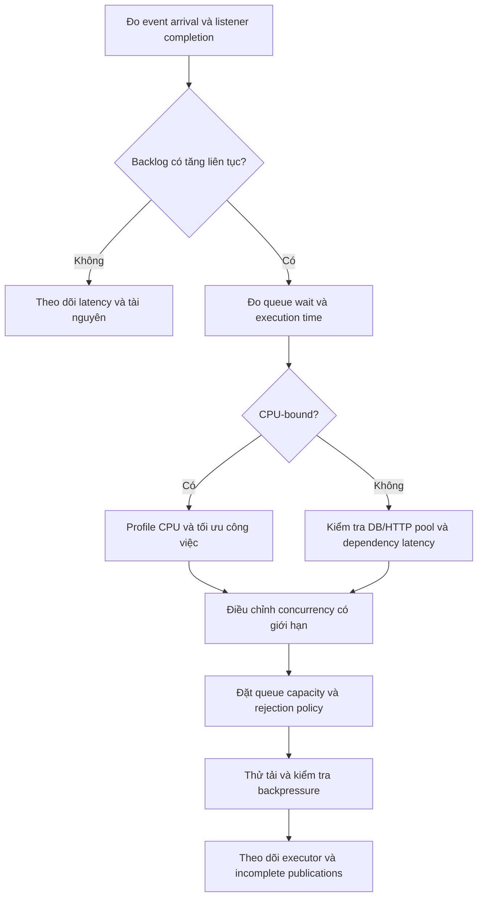

# Tải của listener

Trong một ứng dụng Spring Modulith, một application event có thể được nhiều module lắng nghe. Khi số event tăng, mỗi listener tiêu thụ thời gian CPU, thread, bộ nhớ, kết nối cơ sở dữ liệu và năng lực của các dịch vụ phụ thuộc. Một listener xử lý chậm hoặc một executor không được giới hạn có thể tạo backlog, làm tăng độ trễ của các listener khác và khiến hệ thống mất khả năng phản hồi ổn định.

Quản lý tải của listener là việc điều chỉnh cách event được thực thi, số tác vụ chạy đồng thời, dung lượng hàng đợi, tốc độ nhận việc và giới hạn tài nguyên. Mục tiêu là giữ throughput phù hợp với năng lực thật của ứng dụng, duy trì độ trễ có thể dự đoán và tránh để một nhóm listener làm cạn tài nguyên của các module khác. Trong Spring Modulith, cần hiểu rõ khác biệt giữa listener đồng bộ, `@ApplicationModuleListener`, executor của Spring và Event Publication Registry để chọn đúng điểm kiểm soát.

## Mục tiêu

Sau bài này, bạn có thể:

- Nhận diện các nguồn tạo tải trong quá trình publish và xử lý application event.
- Phân biệt chi phí của listener đồng bộ và bất đồng bộ.
- Cấu hình executor có giới hạn thread và queue cho `@ApplicationModuleListener`.
- Ước lượng concurrency từ throughput và thời gian xử lý.
- Thiết kế backpressure, rejection policy và giới hạn tài nguyên phụ thuộc.
- Tránh listener chậm làm ảnh hưởng các listener hoặc module khác.
- Kiểm soát thứ tự, event trùng, batching và tải tăng đột biến.
- Theo dõi backlog của executor và publication chưa hoàn tất trong Event Publication Registry.
- Kiểm thử hành vi khi tải cao, queue đầy và listener xử lý chậm.

## 1. Tải của listener gồm những gì?

Một event được publish không chỉ tạo ra một lời gọi phương thức. Spring phải tìm listener phù hợp; listener có thể chạy ngay trên thread phát event hoặc được gửi tới executor. Khi listener chạy, nó có thể mở transaction, truy vấn database, gọi HTTP, ghi log, serialize payload hoặc phát thêm event khác.

Các nguồn tải chính gồm:

- **Tốc độ phát event:** số event được publish mỗi giây và mức tăng đột biến.
- **Fan-out:** một event có thể được nhiều listener xử lý; một producer phát 100 event/giây với 5 listener có thể tạo khoảng 500 lần thực thi listener mỗi giây.
- **Thời gian xử lý:** listener càng lâu thì càng giữ thread, transaction và tài nguyên lâu.
- **Concurrency:** số listener chạy cùng thời điểm.
- **Queueing:** số tác vụ đang chờ executor có thread rảnh.
- **Tài nguyên phụ thuộc:** connection pool, HTTP connection, broker client, CPU, heap và lock trong database.
- **Retry và redelivery:** một event lỗi có thể tạo thêm lần thực thi và làm tải tăng nhanh.

Hãy phân biệt tốc độ publish event với tốc độ hoàn tất listener. Producer có thể publish nhanh hơn nhiều so với khả năng xử lý. Khi đó, backlog tăng dần dù API tiếp nhận vẫn phản hồi bình thường.

## 2. Listener đồng bộ và bất đồng bộ

Listener đồng bộ chạy trong luồng phát event. Producer phải chờ listener hoàn tất; thời gian xử lý và exception của listener có thể ảnh hưởng trực tiếp tới luồng nghiệp vụ đang publish. Cách này phù hợp khi kết quả listener phải có ngay để quyết định tiếp hoặc khi công việc rất nhỏ và cần nhất quán trong cùng luồng.

`@ApplicationModuleListener` của Spring Modulith được thiết kế cho xử lý theo module bất đồng bộ và gắn với transaction. Annotation này kết hợp semantics async với `@TransactionalEventListener` ở phase `AFTER_COMMIT` và transaction mới cho listener. Nhờ đó, listener chỉ xử lý sau khi transaction phát event commit thành công và chạy tách khỏi luồng producer.

```java
import org.springframework.modulith.events.ApplicationModuleListener;
import org.springframework.stereotype.Component;

@Component
class OrderProjectionListener {

    private final OrderProjection projection;

    OrderProjectionListener(OrderProjection projection) {
        this.projection = projection;
    }

    @ApplicationModuleListener
    void on(OrderConfirmed event) {
        projection.update(event.orderId());
    }
}
```

Xử lý bất đồng bộ giúp producer không phải chờ công việc hoàn tất, nhưng không làm chi phí biến mất. Listener vẫn cần thread, transaction và tài nguyên phụ thuộc. Nếu event đến nhanh hơn tốc độ xử lý, executor sẽ tích lũy tác vụ chờ. Vì vậy, async cần đi cùng giới hạn concurrency, queue và chính sách khi quá tải.

Không dùng async chỉ để che giấu một listener chậm. Hãy xác định listener chậm vì CPU, truy vấn database, network hay lock; sau đó mới chọn tối ưu thuật toán, batch, cache, pool hoặc giới hạn lưu lượng phù hợp.

## 3. Cấu hình executor có giới hạn

Spring xử lý `@Async` thông qua cơ chế async infrastructure. Với `@ApplicationModuleListener`, cần bảo đảm ứng dụng đã bật async processing và executor được chọn đúng. Có thể khai báo một `ThreadPoolTaskExecutor` làm executor mặc định:

```java
import java.util.concurrent.ThreadPoolExecutor;

import org.springframework.context.annotation.Bean;
import org.springframework.context.annotation.Configuration;
import org.springframework.scheduling.annotation.EnableAsync;
import org.springframework.scheduling.concurrent.ThreadPoolTaskExecutor;

@Configuration
@EnableAsync
class ListenerExecutorConfiguration {

    @Bean(name = "taskExecutor")
    ThreadPoolTaskExecutor taskExecutor() {
        var executor = new ThreadPoolTaskExecutor();
        executor.setCorePoolSize(8);
        executor.setMaxPoolSize(16);
        executor.setQueueCapacity(500);
        executor.setKeepAliveSeconds(60);
        executor.setThreadNamePrefix("event-listener-");
        executor.setRejectedExecutionHandler(
            new ThreadPoolExecutor.AbortPolicy()
        );
        executor.setWaitForTasksToCompleteOnShutdown(true);
        executor.setAwaitTerminationSeconds(30);
        return executor;
    }
}
```

Đây là cấu hình minh họa, không phải bộ thông số tối ưu cho mọi ứng dụng. Tên bean `taskExecutor` giúp Spring async tìm executor mặc định theo quy ước. Nếu ứng dụng có nhiều `TaskExecutor`, hãy cấu hình `AsyncConfigurer` để chọn rõ executor mặc định thay vì dựa vào việc Spring tự suy ra. Kiểm tra cấu hình thực tế của Spring Boot và các thư viện khác vì một số bean executor có thể phục vụ cả MVC, scheduling hoặc tác vụ nền.

Các tham số quan trọng:

| Tham số | Tác động |
|---|---|
| `corePoolSize` | Số thread duy trì khi tải thấp hoặc bình thường |
| `maxPoolSize` | Giới hạn thread tối đa khi tải tăng và queue đã đạt điều kiện mở rộng |
| `queueCapacity` | Số tác vụ có thể chờ trước khi executor từ chối hoặc áp dụng chính sách khác |
| `keepAliveSeconds` | Thời gian thread vượt mức core được giữ khi nhàn rỗi |
| `threadNamePrefix` | Giúp nhận diện listener thread trong log và thread dump |
| `RejectedExecutionHandler` | Quyết định hành vi khi không thể nhận thêm tác vụ |
| shutdown settings | Quy định thời gian chờ tác vụ hoàn tất khi ứng dụng dừng |

Với `ThreadPoolExecutor`, khi thread đang chạy ít hơn core pool, executor thường tạo thread mới; sau đó tác vụ được đưa vào queue; khi queue đầy mới mở rộng tới max pool size; nếu cả queue và pool đều đầy thì áp dụng rejection policy. Vì vậy, một queue quá lớn có thể khiến executor không bao giờ tăng tới `maxPoolSize` trong thời gian tải tăng, đồng thời làm độ trễ chờ phình to.

## 4. Ước lượng concurrency và năng lực xử lý

Không có một giá trị thread pool đúng cho mọi loại listener. Hãy bắt đầu từ tốc độ event, thời gian xử lý và năng lực của tài nguyên phụ thuộc.

Định luật Little mô tả quan hệ giữa số tác vụ trung bình trong hệ thống, tốc độ đến và thời gian lưu lại:

\[
L = \lambda \times W
\]

Trong đó `W` là thời gian trung bình một tác vụ ở trong hệ thống, gồm cả chờ và xử lý. Khi cần ước lượng số listener đang thực thi đồng thời, dùng thời gian xử lý trung bình `S`:

- `L`: số tác vụ trung bình đang được xử lý hoặc chờ trong hệ thống.
- `λ`: tốc độ tác vụ đến, ví dụ listener invocation mỗi giây.
- `W`: thời gian trung bình một tác vụ ở trong hệ thống, tính cả thời gian chờ và xử lý.

Ví dụ, một listener nhận 40 invocation mỗi giây và mất trung bình 250 ms để thực thi, chưa tính thời gian chờ trong queue. Số tác vụ đang thực thi đồng thời cần thiết ở trạng thái ổn định xấp xỉ:

\[
C_{active} \approx \lambda \times S = 40 \times 0.25 = 10
\]

Con số 10 chỉ là ước lượng tải trung bình. Nó chưa tính burst, phân bố thời gian xử lý, retry, pause GC hoặc giới hạn database. Nếu mỗi invocation giữ một connection database trong suốt 250 ms, connection pool phải đủ đáp ứng concurrency đó cùng với các workload khác. Nếu dịch vụ ngoài chỉ chịu được 6 request đồng thời, tăng listener pool lên 16 có thể làm downstream quá tải thay vì tăng throughput.

Với listener CPU-bound, concurrency thường bắt đầu gần số core CPU có thể cấp cho workload và được đo lại bằng benchmark. Với listener I/O-bound, có thể cần nhiều thread hơn số core vì thread thường chờ network hoặc database; tuy nhiên, giới hạn thực tế là connection pool và năng lực phụ thuộc. Hãy tăng từng bước và quan sát throughput, latency, CPU, pool wait và error rate.

## 5. Queue capacity và backpressure

Queue của executor hấp thụ burst ngắn. Nó không tạo thêm năng lực xử lý. Nếu tốc độ đến luôn lớn hơn tốc độ hoàn tất, queue sẽ đầy dù dung lượng lớn đến đâu; queue lớn chỉ trì hoãn thời điểm quá tải và làm message chờ lâu hơn.

Một cách ước lượng đơn giản cho thời gian chờ trong queue là:

\[
T_{queue} \approx \frac{Q}{C} \times S
\]

Trong đó `Q` là số tác vụ đang chờ, `C` là số worker thread hoạt động và `S` là thời gian xử lý trung bình. Đây chỉ là xấp xỉ khi tác vụ có thời gian tương đối đồng đều và worker hoạt động ổn định; tải thực tế có phân bố và burst phức tạp hơn.

Backpressure là cách làm chậm hoặc từ chối nhận thêm công việc khi hệ thống gần chạm giới hạn. Với listener, các lựa chọn thường gặp:

- Queue có giới hạn để hấp thụ burst trong khoảng thời gian xác định.
- Rejection policy để không nhận vô hạn khi pool và queue đã đầy.
- Giới hạn concurrency ở listener hoặc phụ thuộc ngoài.
- Rate limit ở producer hoặc gateway khi có thể điều tiết nguồn phát.
- Retry có backoff để tránh tạo thêm tải trong thời điểm phụ thuộc lỗi.
- Durable broker hoặc cơ chế lưu publication để công việc có thể được phục hồi sau khi từ chối hoặc restart.

`AbortPolicy` ném `RejectedExecutionException` khi executor không thể nhận tác vụ. Đây là tín hiệu rõ để hệ thống xử lý quá tải và quan sát rejection. `CallerRunsPolicy` chạy tác vụ trên thread gọi submit, tạo backpressure tự nhiên nhưng có thể làm chậm luồng phát event hoặc callback sau commit. `DiscardPolicy` và `DiscardOldestPolicy` có thể làm mất tác vụ; không dùng chúng cho listener nghiệp vụ nếu không có cơ chế lưu và phục hồi độc lập.

Khi dùng `@ApplicationModuleListener`, hãy kiểm thử hành vi thực tế nếu executor từ chối tác vụ: exception được truyền về đâu, publication registry ghi nhận trạng thái thế nào và tác vụ có thể được phục hồi ra sao. Không giả định rằng mọi rejection tự động trở thành một publication incomplete nếu chưa xác nhận semantics của phiên bản và cấu hình đang dùng.

## 6. Cô lập tải giữa các nhóm listener

Một executor dùng chung dễ quản lý, nhưng một listener chậm có thể chiếm toàn bộ thread và làm các listener khác phải chờ. Ví dụ, listener gửi email bị nghẽn vì nhà cung cấp email chậm có thể làm listener cập nhật projection hoặc xử lý tồn kho chậm theo.

Hãy phân nhóm listener theo đặc tính tải và mức độ quan trọng:

| Nhóm listener | Đặc tính | Chính sách gợi ý |
|---|---|---|
| Cập nhật projection | I/O database ngắn, số lượng lớn | Pool vừa phải, batch nếu phù hợp, theo dõi DB pool |
| Gọi dịch vụ ngoài | I/O-bound, latency biến động | Timeout, giới hạn concurrency theo downstream, retry có backoff |
| Tính toán nặng | CPU-bound | Pool riêng gần số core được cấp, giới hạn queue |
| Gửi email/thông báo | Có thể chậm và không chặn nghiệp vụ chính | Pool riêng hoặc broker riêng, retry và rate limit |
| Công việc ưu tiên cao | Cần độ trễ thấp | Pool hoặc quota riêng, không để tác vụ nền chiếm hết tài nguyên |

Nếu cần nhiều executor, cấu hình rõ executor được dùng cho từng nhóm listener bằng cơ chế async phù hợp. `@ApplicationModuleListener` sử dụng async semantics của Spring; khi cần chọn executor theo listener, có thể thiết kế annotation/composition hoặc listener adapter riêng dựa trên `@Async` và `@TransactionalEventListener`. Phải giữ nguyên yêu cầu xử lý sau commit, transaction listener và Event Publication Registry nếu nghiệp vụ phụ thuộc các semantics đó. Không thêm một annotation async tùy tiện rồi giả định toàn bộ hành vi của `@ApplicationModuleListener` vẫn được giữ nguyên.

Không tạo một thread pool cho từng event type nếu số lượng loại event lớn. Mỗi pool cần thread, queue, metric và shutdown lifecycle riêng; quá nhiều pool nhỏ có thể làm cấu hình phức tạp và phân mảnh tài nguyên. Hãy tách khi có khác biệt rõ về SLA, tải hoặc mức độ ưu tiên.

## 7. Giới hạn tài nguyên phụ thuộc

Thread pool không phải giới hạn duy nhất. Một listener có thể giữ transaction và connection database, gọi HTTP client, đọc file hoặc publish message tiếp theo. Nếu tăng thread mà không tăng năng lực phụ thuộc, hàng đợi chỉ chuyển từ executor sang connection pool hoặc dịch vụ ngoài.

Ví dụ, nếu executor có 24 thread nhưng datasource chỉ có 10 connection, tối đa 10 listener có thể đồng thời dùng database; số thread còn lại có thể chờ connection và làm tăng latency. Nếu HTTP client có connection pool 8 cho một host, đặt listener concurrency 32 có thể tạo queue chờ ngay trong HTTP client.

Các nguyên tắc thực tế:

- Đặt timeout cho mọi lời gọi network và query có khả năng chờ lâu.
- Căn chỉnh listener concurrency với connection pool và quota của downstream.
- Dùng bulkhead để cô lập dịch vụ ngoài có độ tin cậy thấp.
- Giới hạn số request đồng thời theo tenant hoặc loại tác vụ nếu cần công bằng.
- Không giữ transaction database mở trong khi chờ một HTTP call dài nếu có thể tách bước.
- Giảm số lần truy vấn bằng batch hoặc projection phù hợp, nhưng giữ đúng ranh giới transaction.
- Tránh gọi một listener tiếp theo theo kiểu tạo event dây chuyền không giới hạn.

## 8. Batch và coalesce event khi phù hợp

Một số event biểu diễn thay đổi nhỏ và có thể được gom lại. Ví dụ, một listener cập nhật dashboard có thể nhận nhiều `OrderLineChanged` cho cùng order trong một khoảng thời gian ngắn. Thay vì cập nhật projection cho từng event, có thể gom các order ID rồi đọc trạng thái mới nhất theo batch.

Batch giúp giảm overhead gọi database và network, nhưng làm tăng độ trễ chờ gom nhóm và có thể thay đổi semantics. Không gom event nếu mỗi event là một giao dịch tài chính độc lập, nếu thứ tự từng event có ý nghĩa hoặc nếu consumer phải quan sát mọi transition.

Coalescing chỉ phù hợp khi kết quả cuối có thể được tính từ trạng thái mới nhất. Ví dụ, cập nhật cache của một aggregate có thể bỏ qua các intermediate update; phát thông báo thanh toán thì không thể gộp hai lần thanh toán thành một.

Khi triển khai batch:

- Đặt giới hạn kích thước batch và thời gian chờ tối đa.
- Giữ danh sách event ID để truy vết và deduplicate.
- Xác định cách xử lý khi một phần tử trong batch thất bại.
- Không đánh dấu toàn bộ publication thành công nếu một event chưa được xử lý theo hợp đồng.
- Đo throughput và latency theo batch size để tìm điểm cân bằng.

## 9. Thứ tự và idempotency dưới tải cao

Listener bất đồng bộ có thể xử lý nhiều event đồng thời. Event được publish trước chưa chắc hoàn tất trước, nhất là khi một listener có thời gian xử lý biến động. Nếu hai event cùng aggregate được xử lý song song, event mới có thể ghi đè trạng thái do event cũ tạo ra.

Nếu nghiệp vụ yêu cầu thứ tự:

- Đưa aggregate ID và sequence/version vào event.
- Dùng cập nhật có điều kiện hoặc optimistic locking để từ chối version cũ.
- Tuần tự hóa theo aggregate key hoặc partition nếu transport hỗ trợ.
- Chỉ giới hạn concurrency toàn cục khi thật sự cần; điều đó có thể giảm throughput đáng kể.
- Thiết kế listener idempotent vì retry và phục hồi có thể giao lại event.

Ví dụ, `OrderStatusChanged` version 12 không được ghi đè projection đã áp dụng version 13. Listener cần kiểm tra version hiện tại và chỉ cập nhật nếu event mới hơn theo quy tắc domain. Nếu phát hiện gap sequence, có thể truy vấn aggregate hoặc yêu cầu phát lại dữ liệu theo chính sách thay vì chờ vô hạn.

## 10. Event Publication Registry và backlog

Event Publication Registry theo dõi publication tới từng listener. Nó hữu ích để biết listener nào đã hoàn tất và publication nào còn chưa hoàn tất, đặc biệt khi listener thất bại hoặc ứng dụng dừng. Tuy nhiên, registry không phải thread pool và không thay thế queue của executor.

Hai loại backlog cần được phân biệt:

| Backlog | Ý nghĩa | Nơi quan sát |
|---|---|---|
| Executor queue | Tác vụ đã được submit nhưng chưa có thread thực thi | Executor metrics và thread pool instrumentation |
| Incomplete publication | Publication chưa được listener đánh dấu hoàn tất | Event Publication Registry và `IncompleteEventPublications` |

Một listener có thể đang chờ trong executor queue nhưng publication chưa được đánh dấu lỗi. Một publication incomplete có thể là listener đã chạy và thất bại, hoặc một công việc cần resubmit sau khi restart. Không suy luận queue depth từ số publication incomplete.

Với registry bền vững, có thể truy vấn publication chưa hoàn tất và phục hồi có kiểm soát. Resubmit làm listener chạy lại; nếu listener không idempotent, việc phục hồi có thể lặp tác động. Đặt retry budget, backoff và ngưỡng tuổi trước khi tự động resubmit. Nếu có nhiều instance, cần điều phối việc claim/recovery để tránh cùng publication bị nhiều worker gửi lại đồng thời.

## 11. Kiểm soát tải tăng đột biến

Burst có thể xuất hiện sau khi hệ thống khởi động lại, broker được mở kết nối lại, một batch import chạy hoặc một dependency vừa phục hồi. Nếu toàn bộ backlog được xử lý ngay lập tức, database và dịch vụ ngoài có thể bị quá tải.

Các biện pháp giảm burst:

- Giới hạn số listener chạy đồng thời.
- Dùng queue có dung lượng hữu hạn và rejection policy có thể quan sát.
- Điều tiết tốc độ resubmit publication incomplete.
- Dùng backoff và jitter cho retry.
- Đặt rate limit theo downstream hoặc tenant.
- Phân tán tác vụ theo key/partition khi broker hỗ trợ.
- Ưu tiên xử lý event quan trọng nếu hệ thống có cơ chế ưu tiên rõ ràng.
- Khởi động lại consumer hoặc scheduler theo từng nhóm thay vì mở toàn bộ cùng lúc.

Không đặt queue capacity rất lớn để che giấu tình trạng producer liên tục vượt consumer. Nếu queue liên tục tăng, cần tăng năng lực xử lý một cách an toàn, giảm tải đầu vào hoặc chuyển phần công việc phù hợp sang broker bền vững.

## 12. Kiểm thử tải và hành vi quá tải

Kiểm thử hiệu năng nên dùng workload gần với phân bố thực tế: event size, fan-out, tỷ lệ lỗi, thời gian gọi phụ thuộc và burst. Một test chỉ publish event rỗng rồi đo tốc độ dispatch không đại diện cho listener thực hiện transaction và I/O.

| Tình huống | Điều cần xác nhận |
|---|---|
| Tải thấp ổn định | Thread pool không tạo quá nhiều thread và latency nằm trong mục tiêu |
| Tải bằng năng lực dự kiến | Throughput và queue depth ổn định |
| Tải vượt năng lực | Queue đạt giới hạn, rejection/backpressure xảy ra có kiểm soát |
| Listener chậm bất thường | Pool và queue không tăng vô hạn; cảnh báo được kích hoạt |
| Downstream chậm | Timeout và concurrency limit bảo vệ connection pool |
| Retry tăng | Backoff/jitter không tạo retry storm |
| Nhiều listener cùng nhận event | Tải fan-out và trạng thái publication được quan sát riêng |
| Ứng dụng shutdown khi còn queue | Hành vi chờ, dừng hoặc phục hồi tác vụ đúng chính sách |
| Publication incomplete được resubmit | Không tạo tác động trùng và tốc độ phục hồi có giới hạn |
| Event cùng aggregate đến đồng thời | Version/sequence ngăn trạng thái bị ghi đè sai |

Trong integration test, dùng executor thật với queue nhỏ để dễ kích hoạt rejection và kiểm tra hành vi. Với load test, theo dõi cả latency percentile, queue wait, CPU, heap, GC, database pool và downstream. Không chỉ nhìn throughput trung bình; p95/p99 latency và tuổi backlog thường cho thấy vấn đề sớm hơn.

## 13. Quan sát tải của listener

Nên theo dõi executor và Event Publication Registry như hai lớp riêng biệt.

**Executor metrics:**

- Pool size, core size và max size.
- Số thread active.
- Queue depth và queue capacity.
- Số tác vụ đã hoàn tất.
- Số lần reject hoặc caller-runs.
- Thời gian chờ trong queue và thời gian thực thi listener.

**Event processing metrics:**

- Event arrival rate và listener invocation rate theo event type/listener.
- Throughput hoàn tất và tỷ lệ lỗi.
- Số publication incomplete và tuổi publication cũ nhất.
- Số lần retry/resubmit và kết quả phục hồi.
- Thời gian transaction listener và thời gian gọi dependency.
- Fan-out trung bình và độ lệch tải giữa các listener.

Log nên có event ID, listener name, event type, thời điểm bắt đầu/kết thúc, queue wait, execution duration và correlation ID. Tránh dùng event ID hoặc aggregate ID làm metric label có cardinality cao; dùng các nhãn ổn định như listener, event type, outcome và dependency.

Một số dấu hiệu cần chú ý:

| Dấu hiệu | Nguyên nhân có thể | Hướng điều tra |
|---|---|---|
| Active threads luôn bằng max | Pool thiếu năng lực hoặc listener bị block | Thread dump, dependency latency và pool sizing |
| Queue depth tăng liên tục | Arrival rate lớn hơn completion rate | Fan-out, thời gian xử lý, burst và downstream capacity |
| Rejection tăng | Queue và pool đã đầy | Backpressure, giới hạn producer và recovery policy |
| CPU cao, queue tăng | Listener CPU-bound hoặc serialization nặng | Profile CPU, giảm công việc mỗi event hoặc batch |
| CPU thấp nhưng thread active cao | Nhiều thread đang chờ I/O/lock | Database/HTTP pool, timeout và lock contention |
| Incomplete publication tăng | Listener lỗi hoặc phục hồi không theo kịp | Exception, retry và registry storage |
| p99 cao nhưng throughput bình thường | Một số listener/event có thời gian xử lý dài | Phân nhóm theo listener và event type |

## 14. Những lỗi thiết kế thường gặp

| Lỗi | Hệ quả | Cách khắc phục |
|---|---|---|
| Dùng executor không giới hạn | Thread và bộ nhớ tăng không kiểm soát | Pool và queue có giới hạn |
| Queue quá lớn | Độ trễ chờ cao và backlog khó phục hồi | Chọn capacity theo SLA và burst thực tế |
| Tăng max pool mà không kiểm tra downstream | Database hoặc API ngoài bị quá tải | Căn chỉnh concurrency với connection pool/quota |
| Dùng chung pool cho workload rất khác nhau | Listener chậm làm nghẽn listener quan trọng | Cô lập theo nhóm tải/SLA |
| Dùng `DiscardPolicy` cho event nghiệp vụ | Mất tác vụ mà không có tín hiệu phục hồi | Rejection rõ ràng và theo dõi publication |
| Retry quá nhanh khi phụ thuộc lỗi | Retry storm và tải tăng thêm | Backoff, jitter, timeout và circuit breaker |
| Chỉ nhìn số thread | Không thấy queue wait, dependency wait và incomplete publication | Theo dõi toàn bộ vòng đời tác vụ |
| Giả định async giữ thứ tự event | Trạng thái aggregate có thể bị ghi đè | Sequence, idempotency và partitioning |
| Resubmit toàn bộ backlog cùng lúc | Burst sau restart | Throttle và giới hạn concurrency phục hồi |

## 15. Quy trình điều chỉnh tải listener



Quản lý tải của listener bắt đầu từ đo lường arrival rate, completion rate và thời gian xử lý. Hãy cấu hình executor có giới hạn, chọn concurrency theo CPU và năng lực phụ thuộc, đặt queue vừa đủ cho burst, rồi xác định rõ hành vi khi quá tải. Kết hợp idempotency, retry có giới hạn và Event Publication Registry để phục hồi an toàn. Khi tải thay đổi, điều chỉnh dựa trên queue wait, latency, rejection và backlog thực tế thay vì chỉ tăng số thread.

## Tài liệu tham khảo

- [Spring Modulith — Working with Application Events](https://docs.spring.io/spring-modulith/reference/events.html)
- [Spring Framework — Task Execution and Scheduling](https://docs.spring.io/spring-framework/reference/integration/scheduling.html)
- [Spring Framework — `@Async` Annotation Support](https://docs.spring.io/spring-framework/reference/integration/scheduling.html#scheduling-annotation-support-async)
- [Java — ThreadPoolExecutor](https://docs.oracle.com/en/java/javase/21/docs/api/java.base/java/util/concurrent/ThreadPoolExecutor.html)
