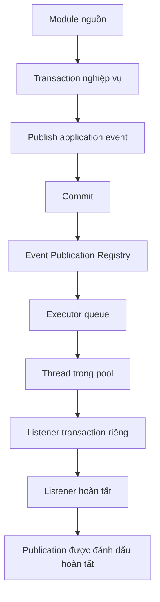

# Executor và thread pool

Trong Spring Modulith, application event thường được xử lý bởi các listener chạy bất đồng bộ sau khi transaction nghiệp vụ commit. Cách chạy này giúp module nguồn hoàn tất request mà không phải chờ mọi listener xử lý xong. Tuy nhiên, listener vẫn cần thread để thực thi. Executor và thread pool quyết định số công việc có thể chạy đồng thời, số công việc phải chờ, cách hệ thống phản ứng khi quá tải và thời gian ứng dụng cần để dừng an toàn.

Nếu thread pool quá nhỏ, publication bị chậm và backlog tăng. Nếu pool quá lớn, các listener có thể tranh chấp CPU, database connection hoặc giới hạn của dịch vụ bên ngoài. Nếu hàng đợi không giới hạn, hệ thống có thể giữ quá nhiều task trong bộ nhớ khi tốc độ phát event cao hơn tốc độ xử lý. Vì vậy, cần thiết kế executor cùng với transaction, Event Publication Registry, retry và năng lực của các dependency.

## 1. Executor nằm ở đâu trong event lifecycle?

Một luồng phổ biến với Spring Modulith gồm các bước:

1. Module nguồn lưu thay đổi nghiệp vụ trong transaction.
2. Module nguồn phát application event.
3. Transaction commit; publication tới transactional listener được theo dõi theo cấu hình Event Publication Registry.
4. Listener được dispatch bất đồng bộ tới executor.
5. Một thread trong pool thực thi listener trong transaction riêng.
6. Khi listener hoàn tất, registry ghi nhận publication đã hoàn tất theo cơ chế của framework.

`@ApplicationModuleListener` là annotation tiện dụng cho listener được gọi sau commit, bất đồng bộ và chạy trong transaction riêng theo semantics của Spring Modulith. Annotation này kết hợp các cơ chế như `@Async`, `@TransactionalEventListener` ở phase `AFTER_COMMIT` và transaction `REQUIRES_NEW`.



Executor chịu trách nhiệm lập lịch và cấp thread để chạy task. Event Publication Registry theo dõi trạng thái publication. Hai thành phần giải quyết hai vấn đề khác nhau: queue trong bộ nhớ không phải nơi lưu event bền vững, còn registry không phải bộ lập lịch thread.

Khi dùng `@ApplicationModuleListener`, hãy xác nhận async support và executor được Spring chọn trong cấu hình thực tế. Nếu ứng dụng có nhiều executor, đừng giả định listener tự động dùng pool có tên mà nhóm mong muốn; hãy cấu hình theo cơ chế Spring hỗ trợ ở phiên bản đang dùng và kiểm tra bằng integration test.

## 2. Phân biệt Executor, ThreadPoolTaskExecutor và thread pool

`Executor` là abstraction nhận một `Runnable` để thực thi. Nó không quy định cụ thể task chạy ngay, chạy trên thread mới hay được đưa vào queue.

`ThreadPoolTaskExecutor` là implementation của Spring dựa trên thread pool của Java. Nó quản lý số thread, queue, thời gian sống của thread, tên thread và chính sách từ chối task. Đây thường là lựa chọn phù hợp khi cần kiểm soát việc chạy `@Async` trong ứng dụng Spring.

| Khái niệm | Vai trò |
| --- | --- |
| `Executor` | Hợp đồng gửi task tới nơi thực thi. |
| `TaskExecutor` | Abstraction executor của Spring, tích hợp với các cơ chế task của framework. |
| `ThreadPoolTaskExecutor` | Executor Spring quản lý pool thread và queue. |
| Core pool size | Số thread cơ sở mà pool duy trì theo chính sách của nó. |
| Maximum pool size | Giới hạn số thread tối đa khi queue đã đầy và cần mở rộng pool. |
| Queue capacity | Số task có thể chờ trong queue. |
| Rejection policy | Cách xử lý khi pool và queue đều không nhận thêm task. |

Một pool có thể chạy nhiều listener cùng lúc. Mỗi thread chỉ xử lý một task tại một thời điểm. Khi tất cả thread đang bận, task mới được xếp hàng hoặc bị từ chối tùy cấu hình.

## 3. Hiểu core size, max size và queue capacity

Với `ThreadPoolTaskExecutor`, cách pool tiếp nhận task thường theo thứ tự:

1. Nếu số thread đang chạy thấp hơn `corePoolSize`, pool có thể tạo thread mới để chạy task.
2. Khi đã đạt core size, task mới được đưa vào queue nếu queue còn chỗ.
3. Khi queue đầy, pool mới mở rộng thread tới `maxPoolSize`.
4. Nếu queue đầy và pool đã đạt max size, task bị từ chối theo rejection policy.

Điều này có nghĩa queue capacity ảnh hưởng trực tiếp đến lúc pool mở rộng. Một queue rất lớn khiến pool ở core size trong thời gian dài và giữ nhiều task chờ. Một queue nhỏ khiến pool tăng thread sớm hơn nhưng cũng có thể làm dependency nhận nhiều request đồng thời.

Ví dụ cấu hình:

```java
executor.setCorePoolSize(8);
executor.setMaxPoolSize(16);
executor.setQueueCapacity(200);
```

Với cấu hình minh họa này, pool duy trì khoảng 8 thread cơ sở, queue có thể giữ tối đa 200 task chờ, và pool có thể tăng tới 16 thread khi queue đầy. Đây không phải con số mặc định phù hợp cho mọi ứng dụng. Cần đo thời gian xử lý, tỷ lệ I/O, CPU, connection pool và tải thực tế trước khi chọn.

Nếu queue capacity là số âm hoặc queue không giới hạn theo cấu hình implementation, task có thể tích lũy lâu và việc tăng `maxPoolSize` không diễn ra như nhóm dự đoán. Với workload event, queue hữu hạn thường giúp hệ thống có điểm quá tải rõ ràng và dễ cảnh báo hơn.

## 4. Cấu hình ThreadPoolTaskExecutor cho listener

Một cấu hình rõ ràng có thể dùng `AsyncConfigurer` để chỉ định executor mặc định cho các phương thức chạy qua Spring async infrastructure:

```java
import java.util.concurrent.Executor;
import java.util.concurrent.ThreadPoolExecutor;

import org.springframework.context.annotation.Bean;
import org.springframework.context.annotation.Configuration;
import org.springframework.scheduling.annotation.AsyncConfigurer;
import org.springframework.scheduling.annotation.EnableAsync;
import org.springframework.scheduling.concurrent.ThreadPoolTaskExecutor;

@Configuration
@EnableAsync
class EventAsyncConfiguration implements AsyncConfigurer {

    @Bean(name = "applicationTaskExecutor")
    ThreadPoolTaskExecutor applicationTaskExecutor() {
        ThreadPoolTaskExecutor executor = new ThreadPoolTaskExecutor();
        executor.setCorePoolSize(8);
        executor.setMaxPoolSize(16);
        executor.setQueueCapacity(200);
        executor.setKeepAliveSeconds(60);
        executor.setThreadNamePrefix("app-event-");
        executor.setWaitForTasksToCompleteOnShutdown(true);
        executor.setAwaitTerminationSeconds(30);
        executor.setRejectedExecutionHandler(
                new ThreadPoolExecutor.AbortPolicy());
        return executor;
    }

    @Override
    public Executor getAsyncExecutor() {
        return applicationTaskExecutor();
    }
}
```

Đây là cấu hình minh họa. Tên bean, cơ chế chọn executor và cách Spring Boot/Spring Modulith tích hợp phụ thuộc phiên bản cùng cấu hình async của ứng dụng. Trong Spring Boot, bean `applicationTaskExecutor` cũng có vai trò trong một số cơ chế async khác; nếu ứng dụng dùng executor cho MVC, WebFlux, scheduling hoặc tác vụ nền khác, hãy cân nhắc tách workload thay vì vô tình dùng chung một pool.

Nếu dự án đã có `AsyncConfigurer`, hãy bổ sung vào cấu hình hiện tại thay vì khai báo một cấu hình cạnh tranh. Nếu dự án quản lý executor qua properties, giữ các giá trị ở cấu hình môi trường để có thể điều chỉnh theo từng môi trường.

`@EnableAsync` bật cơ chế xử lý `@Async` của Spring. Hãy xác nhận cấu hình async thực sự được kích hoạt trong ứng dụng và listener được dispatch bất đồng bộ như mong muốn. Không dùng một executor bean riêng mà không kiểm tra xem listener có thực sự sử dụng bean đó.

## 5. Chọn kích thước pool theo loại công việc

Không có một công thức duy nhất để chọn số thread. Cần phân biệt công việc thiên về CPU và công việc chủ yếu chờ I/O.

**CPU-bound** là công việc dùng CPU liên tục, ví dụ mã hóa, tính toán hoặc biến đổi dữ liệu lớn. Pool quá lớn khiến nhiều thread tranh nhau CPU và tăng context switching. Điểm bắt đầu thường gần số CPU core khả dụng, sau đó đo và điều chỉnh.

**I/O-bound** là công việc dành nhiều thời gian chờ database, HTTP hoặc filesystem. Có thể cần nhiều thread hơn số CPU core vì một thread chờ I/O trong khi thread khác tiếp tục chạy. Tuy nhiên, giới hạn thực tế thường đến từ connection pool, rate limit và năng lực dịch vụ phụ thuộc.

Một heuristic thường dùng cho workload I/O là:

\[
N_{threads} \approx N_{cores} \times \left(1 + \frac{T_{wait}}{T_{compute}}\right)
\]

Trong đó `T_wait` là thời gian chờ trung bình và `T_compute` là thời gian CPU thực sự xử lý. Đây chỉ là điểm khởi đầu để thử nghiệm, không phải giá trị cấu hình có thể áp dụng máy móc. Nếu listener chờ một database pool chỉ có 10 connection, tạo 100 thread không giúp tăng throughput database; nó có thể làm tăng số thread chờ và thời gian timeout.

Khi sizing pool, hãy xem đồng thời:

- Số CPU core được cấp cho container hoặc máy ảo, không chỉ số core của máy host.
- Thời gian listener chạy CPU và thời gian chờ I/O.
- Kích thước database connection pool và số connection dành cho request đồng bộ.
- Giới hạn concurrency của API bên ngoài.
- Throughput event trung bình và đỉnh.
- Thời gian xử lý p95/p99 và mức backlog có thể chấp nhận.
- Số replica của ứng dụng; tổng concurrency là tổng các pool trên tất cả replica.

## 6. Queue hữu hạn và backpressure

Queue giữ task chờ khi tất cả thread đang bận. Queue lớn giúp hấp thụ đỉnh tải ngắn, nhưng không làm tăng năng lực xử lý lâu dài. Nếu tốc độ event đến liên tục cao hơn tốc độ listener hoàn tất, queue sẽ tăng cho đến khi đầy.

Một queue hữu hạn tạo ra giới hạn rõ ràng. Khi đầy, ứng dụng cần một chính sách phản ứng: từ chối task, giảm tốc độ phát, tạm dừng nguồn, hoặc dựa vào cơ chế publication/recovery để thử lại sau. Không nên để hệ thống âm thầm giữ hàng triệu task trong heap.

Backpressure có thể được thực hiện ở nhiều tầng:

- Giới hạn số task đang chờ trong executor.
- Giới hạn số lời gọi đồng thời tới dependency bằng bulkhead/semaphore.
- Giảm tốc độ producer hoặc consumer ở tầng messaging nếu có broker.
- Tách nhóm listener có workload khác nhau để một nhóm không chiếm toàn bộ capacity.
- Theo dõi queue depth và tuổi task chờ để phát hiện quá tải trước khi hết bộ nhớ.

Queue của `ThreadPoolTaskExecutor` là queue trong bộ nhớ. Task đang chờ có thể mất khi tiến trình bị dừng đột ngột. Đối với event cần giao đáng tin cậy, trạng thái publication bền vững và quy trình resubmit/recovery mới là phần cần dựa vào; không coi queue executor là hàng đợi durable.

## 7. Chọn rejection policy có chủ đích

Khi pool đạt max size và queue đầy, `RejectedExecutionHandler` quyết định chuyện gì xảy ra với task mới.

| Policy | Hành vi | Tác động cần hiểu |
| --- | --- | --- |
| `AbortPolicy` | Ném `RejectedExecutionException`. | Thể hiện quá tải rõ ràng; ứng dụng cần quan sát và có đường xử lý/recovery phù hợp. |
| `CallerRunsPolicy` | Thread gửi task tự chạy task. | Tạo backpressure lên caller nhưng có thể làm listener chạy trên luồng phát/dispatch và thay đổi latency hoặc ngữ nghĩa thực thi. |
| `DiscardPolicy` | Bỏ task mới mà không báo lỗi. | Có nguy cơ mất công việc âm thầm; không phù hợp nếu không có cơ chế bảo đảm khác. |
| `DiscardOldestPolicy` | Bỏ task cũ nhất trong queue rồi thử submit task mới. | Có thể bỏ một event đang chờ và làm sai thứ tự; cần tránh với công việc nghiệp vụ cần xử lý đầy đủ. |

Với listener nghiệp vụ, không nên chọn policy chỉ vì nó làm ứng dụng “không báo lỗi”. `DiscardPolicy` và `DiscardOldestPolicy` có thể làm mất tác vụ mà không để lại tín hiệu đủ rõ. `CallerRunsPolicy` có thể khiến task chạy trên thread submit, làm request phát event bị chặn và làm thay đổi giả định về async execution.

`AbortPolicy` thường dễ quan sát khi quá tải, nhưng cần xác nhận cách lỗi submit được xử lý trong đúng đường dispatch của Spring Modulith và Event Publication Registry. Hãy kiểm thử rejection ở phiên bản thực tế; đừng giả định mọi trường hợp từ chối đều được registry ghi nhận giống một exception phát sinh bên trong listener.

## 8. Tách executor theo nhóm workload

Nếu tất cả listener dùng chung một pool, một nhóm công việc chậm có thể chiếm hết thread và làm các listener khác bị trì hoãn. Ví dụ, listener gửi email có thể chờ API ngoài lâu, trong khi listener cập nhật projection chỉ cần một transaction database ngắn.

Có thể phân nhóm workload theo đặc tính:

| Nhóm | Đặc điểm | Hướng cấu hình |
| --- | --- | --- |
| Database projection | Transaction ngắn, phụ thuộc connection pool. | Giới hạn concurrency theo số connection dành cho projection. |
| External HTTP | Chờ mạng, chịu rate limit và timeout. | Bulkhead riêng, giới hạn concurrency và timeout rõ ràng. |
| CPU-heavy | Tính toán hoặc chuyển đổi dữ liệu lớn. | Pool nhỏ gần số CPU core khả dụng. |
| Notification | Có thể chậm và có retry riêng. | Tách capacity nếu lưu lượng có thể ảnh hưởng listener quan trọng. |

Việc gán listener vào executor cụ thể cần dùng cơ chế Spring hỗ trợ cho phiên bản đang chạy. `@ApplicationModuleListener` đã mang semantics async của nó; không thêm một `@Async` thứ hai hoặc đổi `ApplicationEventMulticaster` toàn cục mà chưa xác minh cách các annotation được hợp thành. Nếu cần executor riêng theo listener, hãy thiết kế một annotation/configuration hoặc adapter dispatch rõ ràng, sau đó kiểm thử transaction phase, exception propagation và publication completion.

Tách pool làm tăng số cấu hình và tổng thread. Hãy chỉ tách khi có lý do về isolation, latency hoặc giới hạn dependency; nhiều pool nhỏ không tự động làm hệ thống ổn định hơn.

## 9. Thread pool và transaction của listener

`@ApplicationModuleListener` thực thi listener sau khi transaction nguồn commit và trong transaction riêng theo semantics của Spring Modulith. Thread pool không làm transaction nguồn kéo dài cho tới khi listener hoàn tất; listener có transaction riêng của nó.

Điều này có một số hệ quả:

- Lỗi listener không rollback transaction nguồn đã commit.
- Listener có thể được retry hoặc phục hồi sau khi transaction nguồn kết thúc.
- Database connection được cấp cho transaction listener trong lúc listener chạy; số thread hoạt động có thể làm tăng số connection đồng thời.
- Listener chạy lâu giữ thread và có thể giữ connection/transaction lâu hơn cần thiết.
- Gọi dịch vụ ngoài trong khi giữ transaction database có thể làm connection bị chiếm trong thời gian chờ mạng.

Hãy giữ transaction listener ngắn. Nếu cần gọi HTTP lâu, cân nhắc tách bước gọi ngoài khỏi transaction database, nhưng phải thiết kế trạng thái trung gian, idempotency và xử lý lỗi để không tạo khoảng trống nhất quán. Không đặt toàn bộ công việc mạng trong một transaction database dài chỉ vì listener đang chạy trên một thread riêng.

## 10. Thread naming và chẩn đoán thread dump

Đặt `threadNamePrefix` riêng giúp nhận diện thread listener trong log, thread dump và công cụ quan sát. Ví dụ prefix `app-event-` làm các thread có tên như `app-event-1`, `app-event-2`.

Khi điều tra pool bị nghẽn, thread dump có thể cho biết:

- Nhiều thread đang chờ cùng một HTTP client hoặc socket read.
- Nhiều thread đang chờ connection database.
- Thread bị block trên synchronized lock hoặc monitor.
- CPU-bound task chiếm thời gian xử lý liên tục.
- Thread pool không có worker hoạt động dù queue đang tăng, gợi ý lỗi cấu hình hoặc thread chết.

Thread dump là ảnh chụp tại một thời điểm. Nên thu thập nhiều lần cách nhau một khoảng ngắn và đối chiếu với queue depth, active count, latency và log event. Một thread ở trạng thái `WAITING` không nhất thiết là lỗi; thread pool bình thường cũng có worker đang chờ task.

## 11. Truyền MDC và context qua thread pool

Thread pool tái sử dụng thread. MDC, security context hoặc trace context không nên được giả định tự động truyền từ thread request sang thread listener. Nếu không truyền context, log của listener có thể thiếu correlation ID; nếu truyền mà không dọn, thread tiếp theo có thể mang nhầm dữ liệu.

`TaskDecorator` có thể sao chép MDC từ thread submit sang worker và khôi phục context cũ sau khi task hoàn tất:

```java
import java.util.Map;

import org.slf4j.MDC;
import org.springframework.core.task.TaskDecorator;

class MdcTaskDecorator implements TaskDecorator {

    @Override
    public Runnable decorate(Runnable task) {
        Map<String, String> submittedContext = MDC.getCopyOfContextMap();

        return () -> {
            Map<String, String> previousContext = MDC.getCopyOfContextMap();
            try {
                if (submittedContext == null) {
                    MDC.clear();
                } else {
                    MDC.setContextMap(submittedContext);
                }
                task.run();
            } finally {
                if (previousContext == null) {
                    MDC.clear();
                } else {
                    MDC.setContextMap(previousContext);
                }
            }
        };
    }
}
```

Gắn decorator vào executor:

```java
executor.setTaskDecorator(new MdcTaskDecorator());
```

Đây là ví dụ dành cho MDC. Nếu ứng dụng dùng Micrometer Tracing, Observation hoặc Spring Security, hãy dùng cơ chế context propagation tương ứng để truyền đầy đủ context cần thiết. MDC chỉ là một phần của context và không thay thế propagation cho security hoặc tracing.

## 12. Graceful shutdown và task đang chạy

Khi ứng dụng dừng, executor cần có chính sách cho task đang chạy và task đang chờ. `ThreadPoolTaskExecutor` hỗ trợ các thiết lập như `setWaitForTasksToCompleteOnShutdown(true)` và `setAwaitTerminationSeconds(...)` để chờ task trong một khoảng thời gian giới hạn.

Một số điểm cần quyết định:

- Có ngừng nhận task mới trước khi shutdown không?
- Task đang chạy có được chờ hoàn tất hay bị interrupt?
- Thời gian chờ tối đa có phù hợp với thời gian xử lý listener không?
- Queue còn task khi hết thời hạn sẽ được xử lý thế nào?
- Publication chưa hoàn tất sẽ được phục hồi ra sao sau lần khởi động tiếp theo?

Graceful shutdown giúp giảm số task bị dừng giữa chừng, nhưng không biến queue trong bộ nhớ thành durable. Nếu tiến trình bị kill đột ngột hoặc hết thời gian chờ, task có thể chưa hoàn tất. Event Publication Registry và cơ chế phục hồi của ứng dụng cần được cấu hình và kiểm chứng để publication chưa hoàn tất có thể được xử lý lại.

Không đặt thời gian shutdown vô hạn. Khi triển khai rolling deployment, thời gian drain cần phù hợp với termination grace period của nền tảng chạy ứng dụng. Nếu listener thường mất nhiều phút, hãy cân nhắc tách công việc dài thành workflow có trạng thái bền vững thay vì giữ một thread trong pool quá lâu.

## 13. Virtual threads có thay thế thread pool không?

Virtual threads từ Java 21 có thể giảm chi phí quản lý nhiều tác vụ blocking I/O. Chúng hữu ích khi ứng dụng có nhiều listener chủ yếu chờ mạng hoặc database. Tuy nhiên, virtual threads không làm CPU nhanh hơn và không tăng giới hạn connection pool, rate limit hay throughput của dependency.

Khi cân nhắc virtual threads:

- Xác nhận phiên bản Java, Spring Boot và Spring Framework hỗ trợ cấu hình đang dùng.
- Đo latency, throughput, memory và số lời gọi đồng thời trước/sau khi chuyển.
- Vẫn giới hạn concurrency ở database và API ngoài bằng connection pool, semaphore hoặc bulkhead.
- Kiểm tra thư viện blocking và các vùng có thể pin carrier thread theo phiên bản Java.
- Không tạo số lượng công việc chờ vô hạn chỉ vì virtual thread rẻ hơn platform thread.

Virtual thread là mô hình thực thi khác với pool platform thread truyền thống. Có thể dùng executor phù hợp với virtual threads theo nền tảng đang chạy, nhưng vẫn phải có backpressure và giới hạn tài nguyên ở các dependency. Chọn theo benchmark và đặc tính workload thay vì coi virtual threads là giải pháp mặc định cho mọi listener.

## 14. Quan sát thread pool và event backlog

Để đánh giá executor, cần theo dõi cả mức sử dụng thread và kết quả xử lý event. Chỉ nhìn CPU hoặc số thread không đủ để biết listener đang bị nghẽn ở đâu.

Các chỉ số nên có:

| Chỉ số | Ý nghĩa |
| --- | --- |
| Pool size | Số worker thread hiện có trong pool. |
| Active thread count | Số thread đang thực thi task. |
| Queue depth | Số task đang chờ được xử lý. |
| Queue wait time | Thời gian từ lúc submit tới lúc task bắt đầu. |
| Task execution duration | Thời gian listener thực thi. |
| Completed task count | Số task đã hoàn tất theo bộ đếm executor. |
| Rejected task count | Số task bị từ chối khi pool không nhận thêm được. |
| Publication pending/oldest age | Số publication chưa hoàn tất và tuổi publication cũ nhất. |
| Listener error rate | Tỷ lệ listener kết thúc bằng lỗi. |

Có thể dùng Micrometer/Actuator hoặc instrumentation riêng để đưa các chỉ số executor vào hệ thống metric. Các tên metric cụ thể phụ thuộc phiên bản Spring Boot, Micrometer và cách executor được bind. Với `ThreadPoolTaskExecutor`, một số thông tin như active count, pool size và queue size có thể lấy từ executor; rejected count thường cần được ghi nhận qua rejection handler hoặc instrumentation riêng.

Đừng đưa `eventId`, `aggregateId` hoặc correlation ID vào metric tag vì cardinality cao. Dùng log/trace để điều tra từng event, metric để xem xu hướng theo executor, listener hoặc event type có tập giá trị hữu hạn.

## 15. Cảnh báo khi pool quá tải

Một cảnh báo nên dựa trên xu hướng và thời gian, không chỉ một mẫu queue depth tức thời. Queue có thể tăng ngắn hạn khi có burst rồi giảm sau đó.

Các điều kiện đáng theo dõi:

- Queue depth tăng liên tục và không giảm sau một khoảng thời gian.
- Active thread luôn bằng max size trong thời gian dài.
- Rejected task count tăng.
- Queue wait time hoặc listener duration p95/p99 vượt SLO.
- Publication pending và tuổi publication cũ nhất tăng đồng thời.
- Database pool hoặc dependency có latency/timeout tăng.

Khi cảnh báo, hãy xác định nút thắt trước khi tăng pool. Nếu queue tăng vì database chỉ có ít connection, tăng thread có thể làm nhiều task chờ connection hơn. Nếu dependency ngoài rate-limit, tăng concurrency có thể làm tỷ lệ lỗi cao hơn. Có thể cần giảm tải, tách pool, tăng capacity dependency hoặc tối ưu listener.

## 16. Kiểm thử executor và thread pool

Kiểm thử cần xác nhận cả semantics async và hành vi khi tải cao:

- **Async dispatch:** listener chạy trên thread executor theo cấu hình, không chạy trong thread request nếu semantics yêu cầu bất đồng bộ.
- **After commit:** listener chỉ được kích hoạt sau khi transaction nguồn commit.
- **Separate transaction:** thay đổi của listener nằm trong transaction phù hợp.
- **Queue capacity:** khi pool bận, task được queue trong giới hạn đã cấu hình.
- **Rejection:** khi pool và queue đầy, rejection policy hoạt động và có tín hiệu quan sát.
- **Concurrency limit:** số listener chạy đồng thời không vượt giới hạn dự kiến.
- **Shutdown:** ứng dụng chờ task theo thời gian cấu hình và publication chưa hoàn tất có đường recovery.
- **Context propagation:** MDC/trace context có mặt trong listener và được dọn sau khi task hoàn tất.
- **Isolation:** workload chậm không chiếm toàn bộ capacity của listener quan trọng nếu đã thiết kế pool riêng.
- **Dependency saturation:** timeout và bulkhead ngăn listener giữ tài nguyên không giới hạn.

Với test bất đồng bộ, không dùng `Thread.sleep` cố định để đoán khi nào listener hoàn tất. Dùng latch, future, Awaitility hoặc cơ chế đồng bộ test phù hợp để chờ điều kiện rõ ràng với timeout hữu hạn. Test after-commit cần tạo transaction thật và xác nhận commit thay vì rollback transaction test ở cuối phương thức.

## 17. Quy trình điều chỉnh pool trong production

Khi listener bị chậm hoặc backlog tăng, có thể xử lý theo trình tự:

1. Xác định executor và nhóm listener đang dùng pool đó.
2. Đo queue depth, active count, queue wait time và listener duration.
3. Kiểm tra CPU, database connection pool và latency/rate limit của dependency.
4. Xác định bottleneck nằm ở CPU, I/O, queue, database hay dịch vụ ngoài.
5. Thay đổi một nhóm thông số có kiểm soát, chẳng hạn queue capacity hoặc max pool size.
6. Theo dõi throughput, error rate, rejection, publication age và tài nguyên sau thay đổi.
7. Giữ cấu hình mới nếu SLO cải thiện mà không gây quá tải dependency; nếu không, rollback và xử lý bottleneck gốc.

Không tăng đồng thời core size, max size, queue capacity và timeout mà không có số liệu. Nếu thay đổi nhiều yếu tố cùng lúc, khó xác định yếu tố nào cải thiện hoặc làm xấu hệ thống.

## 18. Những sai lầm thường gặp

- Dùng queue không giới hạn và để backlog tăng tới khi heap cạn.
- Tăng thread count mà không xét database connection pool hoặc rate limit bên ngoài.
- Cho rằng `maxPoolSize` sẽ được sử dụng ngay cả khi queue còn chỗ.
- Dùng `CallerRunsPolicy` mà không hiểu task có thể chạy trên thread submit.
- Dùng `DiscardPolicy` hoặc `DiscardOldestPolicy` cho event nghiệp vụ mà không có cơ chế phục hồi rõ ràng.
- Cho rằng queue trong executor là nơi lưu event bền vững.
- Dùng một pool chung cho listener CPU-heavy và listener I/O chậm mà không đo isolation.
- Không truyền hoặc không dọn MDC/context khi tái sử dụng thread.
- Không chờ task khi shutdown hoặc chờ vô hạn khi shutdown.
- Coi virtual threads là cách loại bỏ backpressure và giới hạn dependency.
- Chỉ theo dõi số thread mà bỏ qua queue wait time, publication backlog và listener duration.

## Checklist thiết kế executor

- [ ] Đã xác định listener nào chạy bất đồng bộ và executor thực tế được Spring chọn.
- [ ] Async support được bật và cấu hình phù hợp với phiên bản Spring/Spring Modulith.
- [ ] Core size, max size và queue capacity được chọn dựa trên đo đạc workload.
- [ ] Queue hữu hạn và có chính sách backpressure/rejection rõ ràng.
- [ ] Rejection không âm thầm bỏ task nghiệp vụ.
- [ ] Pool sizing phù hợp với CPU, database connection và giới hạn dependency.
- [ ] Workload khác đặc tính được tách capacity khi cần isolation.
- [ ] Transaction listener ngắn và không giữ connection khi chờ I/O dài nếu tránh được.
- [ ] Thread name và context propagation hỗ trợ điều tra.
- [ ] Graceful shutdown có thời hạn và publication pending có đường recovery.
- [ ] Có metric cho pool, queue, rejection, listener duration và publication backlog.
- [ ] Integration test bao phủ after-commit, concurrency, rejection, shutdown và context propagation.

Executor và thread pool là nền tảng thực thi của listener bất đồng bộ. Khi pool có giới hạn phù hợp, queue và rejection được quản lý rõ, dependency có bulkhead, và Event Publication Registry được dùng để theo dõi công việc chưa hoàn tất, ứng dụng Spring Modulith có thể xử lý event ổn định hơn dưới tải thực tế.
