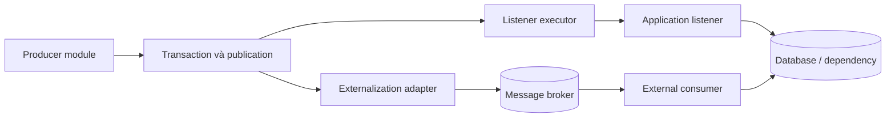

# Giới hạn tốc độ (backpressure)

*Điều tiết tốc độ phát và xử lý application event để consumer không bị quá tải*

Trong một ứng dụng Spring Modulith, một module có thể phát event nhanh hơn khả năng xử lý của listener. Ví dụ, module `orders` nhận một đợt lớn đơn hàng và phát `OrderPlaced`, trong khi listener của `billing` phải gọi dịch vụ thuế và ghi dữ liệu hóa đơn. Nếu event đến liên tục nhanh hơn tốc độ listener hoàn tất, hàng đợi tác vụ, bộ nhớ, connection pool hoặc broker backlog sẽ tăng dần. Cuối cùng, độ trễ tăng, timeout xuất hiện và các module khác cũng có thể bị ảnh hưởng.

**Backpressure** là cách điều tiết luồng dữ liệu khi phía nhận không theo kịp phía phát. Thay vì tiếp tục đẩy công việc vào một vùng đệm không giới hạn, hệ thống giới hạn lượng công việc đang chờ hoặc đang chạy, làm chậm producer, tạm dừng consumer, giảm tốc độ nhận hoặc từ chối có kiểm soát khi đã hết năng lực.

Mục tiêu là giữ hệ thống trong vùng tải có thể phục hồi: bộ nhớ và tài nguyên có giới hạn, độ trễ không tăng vô hạn, event quan trọng không bị âm thầm loại bỏ và các module vẫn có thể hoạt động độc lập.

## 1. Nhận biết tình trạng consumer không theo kịp

Giả sử producer phát trung bình 500 event mỗi giây, còn listener chỉ xử lý được 350 event mỗi giây. Nếu chênh lệch kéo dài, backlog tăng khoảng 150 event mỗi giây. Tăng số thread có thể cải thiện throughput trong một khoảng, nhưng nếu listener bị giới hạn bởi database hoặc dịch vụ bên ngoài, thêm thread chỉ làm contention và timeout tăng.

Các dấu hiệu thường gặp:

- Số task chờ trong executor hoặc số message trong broker tăng liên tục.
- Tuổi event chưa xử lý lâu nhất tăng, dù producer không tăng lưu lượng.
- Consumer lag tăng hoặc queue depth không giảm sau giờ cao điểm.
- Thread pool bão hòa, task bị từ chối hoặc thời gian chờ lấy thread tăng.
- Database connection pool cạn, lock contention và query latency tăng.
- Tỷ lệ timeout, retry và duplicate tăng theo tải.
- Heap tăng do payload hoặc task chờ được giữ trong bộ nhớ lâu.

Backpressure cần được kích hoạt dựa trên tín hiệu về năng lực và backlog, không chỉ dựa vào số event phát ra. Một đợt tăng lưu lượng ngắn có thể được hấp thụ bởi capacity dự phòng; một backlog nhỏ nhưng già đi liên tục có thể báo hiệu sự cố nghiêm trọng hơn.

## 2. Phân biệt backpressure, buffering, throttling và load shedding

Các kỹ thuật này liên quan nhưng giải quyết các phần khác nhau của vấn đề:

| Kỹ thuật | Cách hoạt động | Khi phù hợp |
|---|---|---|
| Buffering | Giữ công việc trong queue hoặc executor để xử lý sau | Hấp thụ burst ngắn khi có giới hạn dung lượng rõ ràng |
| Backpressure | Báo hoặc áp đặt giới hạn để nguồn giảm tốc độ theo năng lực phía nhận | Producer và consumer có cơ chế phối hợp hoặc có thể điều khiển tốc độ nhận |
| Throttling / rate limiting | Giới hạn số lần phát hoặc xử lý trong một đơn vị thời gian | Bảo vệ listener, broker hoặc API phụ thuộc khỏi vượt quota |
| Concurrency limiting | Giới hạn số tác vụ được xử lý đồng thời | Kiểm soát thread, connection và tài nguyên dùng chung |
| Load shedding | Từ chối hoặc loại bỏ một phần tải khi hệ thống đã vượt khả năng | Bảo vệ dịch vụ trọng yếu khi không thể trì hoãn toàn bộ công việc |

Buffer chỉ trì hoãn thời điểm quá tải nếu producer liên tục nhanh hơn consumer. Queue không giới hạn có thể biến một đợt quá tải thành lỗi bộ nhớ sau đó. Backpressure hiệu quả cần có giới hạn buffer và một hành vi rõ ràng khi giới hạn bị chạm tới.

## 3. Xác định điểm giới hạn trong event flow

Một event có thể đi qua nhiều tầng: transaction nghiệp vụ, publication registry, executor của listener, adapter externalization, broker và consumer. Mỗi tầng có giới hạn riêng.



Hãy tìm tầng đang tạo backlog hoặc cạn tài nguyên trước khi chọn biện pháp. Nếu executor đầy vì listener chờ database, tăng queue capacity chỉ kéo dài thời gian chờ. Nếu broker nhận message nhanh nhưng consumer group không đọc kịp, giới hạn ở producer nội bộ có thể không giải quyết đúng điểm nghẽn. Nếu dịch vụ ngoài có quota, rate limit nên đặt gần lời gọi đến dịch vụ đó.

Đặt giới hạn cho từng nhóm listener theo đặc tính công việc. Listener cập nhật projection nhanh không nên bị chặn bởi listener gửi email chậm. Có thể dùng executor hoặc consumer group riêng cho các luồng có mức ưu tiên và tài nguyên khác nhau.

## 4. Giới hạn executor và hàng đợi trong Spring

Với listener bất đồng bộ chạy qua `TaskExecutor`, cần cấu hình thread pool có giới hạn. `ThreadPoolTaskExecutor` cho phép đặt số thread, dung lượng queue và chính sách từ chối khi không còn chỗ.

```java
import org.springframework.context.annotation.Bean;
import org.springframework.context.annotation.Configuration;
import org.springframework.scheduling.concurrent.ThreadPoolTaskExecutor;

import java.util.concurrent.Executor;
import java.util.concurrent.ThreadPoolExecutor;

@Configuration
class EventListenerExecutionConfig {

    @Bean("applicationEventExecutor")
    Executor applicationEventExecutor() {
        ThreadPoolTaskExecutor executor = new ThreadPoolTaskExecutor();
        executor.setCorePoolSize(8);
        executor.setMaxPoolSize(16);
        executor.setQueueCapacity(500);
        executor.setThreadNamePrefix("app-event-");
        executor.setRejectedExecutionHandler(
            new ThreadPoolExecutor.AbortPolicy()
        );
        executor.initialize();
        return executor;
    }
}
```

Các con số trên chỉ là ví dụ. Cần chọn pool size theo thời gian xử lý, số CPU, connection pool và giới hạn dịch vụ phụ thuộc. Queue capacity phải dựa trên mức burst có thể chấp nhận và thời gian tối đa event được phép chờ.

Chính sách từ chối là một phần của thiết kế:

- `AbortPolicy` từ chối task bằng exception khi executor đã đầy. Tầng gọi phải xử lý kết quả từ chối và bảo đảm publication có thể được phục hồi theo cơ chế đã cấu hình.
- `CallerRunsPolicy` chạy task trên thread gọi submit, làm chậm nguồn phát một cách gián tiếp. Điều này có thể tạo backpressure, nhưng cũng có thể kéo listener chạy trên thread transaction hoặc request, làm thay đổi latency và ranh giới thực thi.
- Chính sách loại bỏ task như `DiscardPolicy` hoặc `DiscardOldestPolicy` có thể làm mất công việc nếu không có cơ chế bền vững và đối soát riêng; không dùng cho event nghiệp vụ cần giao đáng tin cậy.

Với Spring Modulith, `@ApplicationModuleListener` là listener bất đồng bộ thường dùng cho xử lý sau commit trong transaction riêng. Cần xác minh executor nào được integration và phiên bản Spring Modulith đang dùng chọn, cũng như hành vi khi task bị từ chối. Không giả định bean executor tùy ý sẽ tự động được dùng nếu chưa cấu hình đúng tên hoặc cơ chế liên kết.

## 5. Backpressure ở ranh giới producer

Nếu producer có thể kiểm soát tốc độ tiếp nhận yêu cầu, có thể giới hạn trước khi tạo thêm công việc. Ví dụ API tạo đơn hàng có thể kiểm tra capacity hoặc quota trước khi nhận một lệnh mới. Khi hệ thống đã chạm ngưỡng, trả phản hồi có thể retry như `429 Too Many Requests` hoặc `503 Service Unavailable`, kèm `Retry-After` nếu phù hợp.

```java
if (!admissionController.tryAcquire()) {
    throw new ServiceUnavailableException("Event capacity is temporarily full");
}

try {
    orderService.place(command);
} finally {
    admissionController.release();
}
```

Đây là ví dụ admission control đơn giản; trong ứng dụng thực tế, quyền capacity cần được quản lý an toàn khi có nhiều instance và cần phân biệt tài nguyên được giữ trong suốt request với công việc bất đồng bộ sau commit.

Điểm quan trọng: nếu transaction nghiệp vụ đã commit và event đã được phát, không thể trả lỗi cho client như thể lệnh chưa được chấp nhận chỉ vì listener phía sau đang quá tải. Khi cần từ chối tải, hãy thực hiện admission control trước khi commit hoặc thiết kế một trạng thái chấp nhận công việc rõ ràng, chẳng hạn `202 Accepted` cùng mã theo dõi. Không để client retry một command đã commit mà không có idempotency key.

## 6. Rate limit và concurrency limit ở listener

Rate limit giới hạn số lần xử lý trong một khoảng thời gian; concurrency limit giới hạn số tác vụ chạy cùng lúc. Hai giới hạn bổ sung cho nhau.

Ví dụ, một dịch vụ định giá bên ngoài chỉ cho phép 100 request mỗi giây. Listener có thể dùng token bucket hoặc rate limiter để điều tiết lời gọi. Nếu chưa có token, handler cần chờ có giới hạn, lên lịch retry hoặc để message chưa được acknowledge tùy cơ chế vận chuyển. Không giữ transaction database và row lock trong lúc chờ token lâu.

Concurrency limit hữu ích khi mỗi listener chiếm một connection hoặc tài nguyên có giới hạn. Nếu connection pool chỉ dành 20 connection cho công việc event, đặt concurrency cao hơn nhiều có thể làm các request đồng bộ khác bị đói connection. Hãy phân bổ pool theo ngân sách tài nguyên của toàn ứng dụng.

Khi nhiều instance cùng chạy, rate limit trong bộ nhớ chỉ giới hạn từng instance. Nếu cần giới hạn toàn hệ thống hoặc tuân thủ quota chung của dịch vụ ngoài, dùng rate limiter phân tán hoặc chia quota rõ ràng cho từng instance.

## 7. Backpressure với broker

Khi event được externalize sang broker, có thể dùng cơ chế điều tiết của broker và consumer:

- **RabbitMQ:** giới hạn `prefetch` để kiểm soát số message chưa được acknowledge mà broker giao trước cho mỗi consumer. Prefetch quá cao làm tăng lượng message bị giữ trong consumer; quá thấp có thể giảm throughput khi xử lý nhanh và có độ trễ mạng.
- **Kafka:** consumer có thể pause/resume partition khi downstream đang quá tải, đồng thời tiếp tục poll theo yêu cầu của client để tránh rebalance không mong muốn. Cần quản lý offset chỉ sau khi record đã được xử lý bền vững.
- **Queue retry:** đưa message chưa xử lý được vào luồng retry có backoff thay vì requeue liên tục.
- **Consumer concurrency:** điều chỉnh số consumer theo partition, queue và năng lực hệ thống đích.

Với Kafka, tăng số consumer trong một group chỉ tăng song song đến giới hạn số partition được gán. Với RabbitMQ, tăng consumer có thể tăng tải đồng thời lên database hoặc API phụ thuộc. Thêm consumer không tự động làm hệ thống nhanh hơn nếu điểm nghẽn nằm ở tài nguyên phía sau.

## 8. Giới hạn buffer và dung lượng backlog

Mỗi buffer cần có giới hạn rõ ràng: số phần tử, dung lượng byte, tuổi tối đa hoặc kết hợp các giới hạn này. Chỉ giới hạn số event có thể chưa đủ nếu kích thước payload biến động mạnh. Một queue 10.000 event nhỏ khác với 10.000 event chứa payload lớn.

Khi buffer đạt ngưỡng, hệ thống cần một hành vi xác định:

- Giảm tốc độ producer hoặc tạm dừng nhận thêm công việc.
- Giữ event trong một kho bền vững có dung lượng và retention được quản lý.
- Từ chối công việc mới trước khi transaction nghiệp vụ commit.
- Chuyển công việc không khẩn cấp sang hàng đợi riêng hoặc xử lý theo batch.
- Load shed các tác vụ có thể trì hoãn hoặc bỏ theo chính sách nghiệp vụ được phê duyệt.

Không âm thầm bỏ event nghiệp vụ chỉ để giảm queue. Nếu buộc phải loại bỏ một loại telemetry hoặc thông báo có thể mất, phải xác định rõ loại dữ liệu, mức mất chấp nhận và metric đếm số phần tử bị loại.

## 9. Phối hợp backpressure với Event Publication Registry

Spring Modulith event publication registry theo dõi publication cần được giao đến transactional listener hoặc externalization target. Registry giúp nhận diện publication chưa hoàn tất và hỗ trợ phục hồi việc giao sau lỗi. Nó không tự động điều tiết tốc độ producer, giới hạn executor queue hay tạo backpressure xuyên suốt hệ thống.

Khi executor đầy hoặc listener xử lý chậm, cần hiểu rõ trạng thái publication được ghi nhận và hành vi khi submit task bị từ chối trong cấu hình đang dùng. Publication chưa hoàn tất có thể được retry/resubmit theo chính sách ứng dụng, nhưng resubmit quá nhanh sẽ làm tăng tải ở consumer vốn đã quá tải. Kết hợp backoff, giới hạn số lần thử và điều kiện capacity trước khi resubmit.

Không chạy một vòng resubmit liên tục để “xả backlog”. Hãy phục hồi dependency, xác nhận consumer có đủ năng lực, sau đó tăng dần tốc độ xử lý. Theo dõi publication age và completion rate để biết backlog đang giảm thực sự hay chỉ chuyển từ registry sang executor hoặc broker.

## 10. Bảo vệ module và dependency dùng chung

Một listener chậm không nên làm cạn toàn bộ thread hoặc connection của ứng dụng. Có thể cô lập tài nguyên bằng:

- Executor riêng cho nhóm listener có đặc tính tải khác nhau.
- Bulkhead hoặc semaphore giới hạn đồng thời khi gọi dependency.
- Connection pool riêng hoặc quota cho tác vụ event nếu phù hợp với kiến trúc.
- Queue riêng cho công việc quan trọng và công việc có thể trì hoãn.
- Timeout cho từng dependency để thread không bị giữ vô hạn.
- Ưu tiên xử lý theo mức độ nghiệp vụ, nhưng tránh starvation của nhóm ưu tiên thấp.

Không tạo executor riêng cho mọi listener một cách máy móc. Quá nhiều pool nhỏ làm phân mảnh tài nguyên và khó vận hành. Chỉ tách khi có lý do về SLO, tải, dependency hoặc mức độ ưu tiên.

## 11. Batch, coalescing và giảm công việc thừa

Không phải mọi event đều cần một lần cập nhật read model riêng. Nếu một projection chỉ cần trạng thái mới nhất, có thể gộp nhiều thay đổi của cùng aggregate hoặc cập nhật theo batch. Ví dụ, một luồng đồng bộ chỉ cần biết `CustomerProfile` phiên bản mới nhất; các bản cập nhật trung gian có thể được coalesce nếu hợp đồng nghiệp vụ cho phép.

Batch giúp giảm overhead database và network, nhưng làm tăng latency cho event đầu tiên trong batch. Chọn batch size và thời gian chờ tối đa dựa trên SLO. Coalescing chỉ phù hợp với event có semantics thay thế được; không gộp các sự kiện tài chính, kiểm toán hoặc chuyển trạng thái mà mỗi lần đều có ý nghĩa riêng.

Khi xử lý batch, chỉ đánh dấu hoàn tất các event đã được áp dụng bền vững. Nếu một phần batch thất bại, cần biết event nào thành công để retry đúng phạm vi và tránh lặp side effect.

## 12. Retry và backoff không được khuếch đại quá tải

Khi consumer chậm, retry quá nhanh tạo thêm tải đúng lúc hệ thống đang thiếu năng lực. Dùng exponential backoff có jitter, giới hạn số lần thử và phân loại lỗi. Lỗi timeout do dependency quá tải không nên kích hoạt nhiều retry đồng thời từ mọi listener.

Một chính sách có thể gồm:

1. Retry nhanh một số ít lần cho lỗi thoáng qua.
2. Tăng khoảng chờ theo backoff và thêm jitter.
3. Giới hạn số lần thử hoặc tổng tuổi event.
4. Chuyển event lỗi kéo dài sang trạng thái cần điều tra hoặc dead-letter theo hợp đồng.
5. Chỉ resubmit khi dependency phục hồi và consumer có capacity.

Khi mở lại một backlog lớn, dùng gradual ramp-up hoặc batch nhỏ. Nếu tăng concurrency đột ngột, database và dịch vụ ngoài có thể bị quá tải lần nữa.

## 13. Metric và alert cho backpressure

Để biết hệ thống có đang chịu áp lực hay không, theo dõi cả tốc độ và lượng công việc đang chờ:

- Event created rate so với processing completion rate.
- Executor active thread, queue size và task rejection count.
- Incomplete publication count và tuổi publication lâu nhất.
- Broker queue depth, consumer lag, unacknowledged messages và redelivery.
- Listener processing duration p50/p95/p99.
- Database connection utilization, pool wait time và timeout.
- Retry rate, dead-letter count và số event bị load shed.

Alert nên dựa trên sự kết hợp giữa backlog, tuổi event và khả năng phục hồi. Queue đầy trong vài giây có thể là burst bình thường; queue liên tục tăng cùng với tuổi event vượt SLO là dấu hiệu consumer không theo kịp. Cần phân biệt queue đang tăng nhưng vẫn được xả nhanh với queue tăng không có dấu hiệu giảm.

Không dùng `eventId`, `aggregateId` hoặc request ID làm tag metric vì cardinality cao. Dùng event type, listener, module, destination và outcome thuộc tập giá trị hữu hạn; ID cụ thể đặt trong log hoặc trace.

## 14. Kiểm thử hành vi khi quá tải

Kiểm thử backpressure cần tạo tải cao hơn năng lực xử lý trong một khoảng có kiểm soát và xác nhận hệ thống giữ được giới hạn:

1. **Executor saturation:** làm listener chậm để queue đạt capacity; xác nhận task bị từ chối hoặc nguồn bị làm chậm theo chính sách.
2. **No silent loss:** xác nhận event nghiệp vụ không bị loại bỏ âm thầm khi executor hoặc buffer đầy.
3. **Producer admission:** khi capacity hết, command mới bị từ chối trước commit hoặc được trả trạng thái chấp nhận có theo dõi.
4. **Concurrency limit:** xác nhận số lời gọi đồng thời đến dependency không vượt quota.
5. **Broker flow control:** kiểm tra RabbitMQ prefetch hoặc Kafka pause/resume dưới tải.
6. **Retry storm:** dependency lỗi kéo dài không làm retry tăng không giới hạn.
7. **Recovery ramp-up:** sau khi dependency phục hồi, backlog giảm dần mà không tạo đợt quá tải mới.
8. **Isolation:** listener chậm không làm cạn tài nguyên của listener hoặc request quan trọng khác.
9. **Metrics:** queue size, rejection, lag, processing rate và event age phản ánh đúng trạng thái.

Kiểm thử tải nên dùng môi trường gần với cấu hình production và có giới hạn rõ ràng. Không chạy thử nghiệm gây quá tải trên hệ thống thật nếu chưa có kế hoạch và phạm vi được phê duyệt.

## 15. Quy trình xử lý khi backlog tăng

Khi metric cho thấy consumer không theo kịp, xử lý theo thứ tự:

1. Xác định listener, destination hoặc dependency tạo backlog; so sánh producer rate với completion rate.
2. Kiểm tra thread pool, queue capacity, connection pool, broker lag và thời gian xử lý.
3. Phân loại nguyên nhân: burst ngắn, dependency chậm, lỗi lặp lại, cấu hình concurrency thấp hoặc payload quá lớn.
4. Giảm tải đầu vào hoặc giới hạn concurrency phù hợp; tránh tăng thread khi dependency đã bão hòa.
5. Khắc phục dependency và xác nhận consumer có thể xử lý ổn định.
6. Tăng dần concurrency hoặc tốc độ resubmit để xả backlog.
7. Theo dõi event age, completion rate, retry và tài nguyên cho đến khi trở về mức bình thường.
8. Đối soát event lỗi hoặc bị dead-letter; xác nhận không có event nghiệp vụ bị mất.

## 16. Những điểm cần nhớ

- Backpressure điều tiết tốc độ khi producer nhanh hơn consumer; buffering không giới hạn chỉ trì hoãn quá tải.
- Giới hạn thread, queue capacity, concurrency và rate ở đúng tầng đang nghẽn.
- `ThreadPoolTaskExecutor` cần queue hữu hạn và rejection policy phù hợp; tránh chính sách âm thầm loại bỏ event nghiệp vụ.
- Admission control phải diễn ra trước khi command commit hoặc dùng trạng thái chấp nhận có theo dõi.
- RabbitMQ prefetch, Kafka pause/resume và consumer concurrency là các công cụ điều tiết ở tầng broker.
- Event Publication Registry theo dõi publication chưa hoàn tất nhưng không tự cung cấp backpressure.
- Retry cần backoff, jitter, giới hạn và ramp-up có kiểm soát khi phục hồi backlog.
- Theo dõi producer rate, completion rate, queue size, event age, rejection và tài nguyên phụ thuộc.

Khi mỗi tầng có giới hạn rõ ràng, producer được điều tiết trước khi nhận quá nhiều công việc và consumer chỉ chạy trong năng lực tài nguyên cho phép, event flow có thể hấp thụ burst mà không để backlog tăng vô hạn. Kết hợp backpressure với publication registry, retry có kiểm soát và metric giúp ứng dụng Spring Modulith duy trì giao sự kiện ổn định khi tải biến động.
