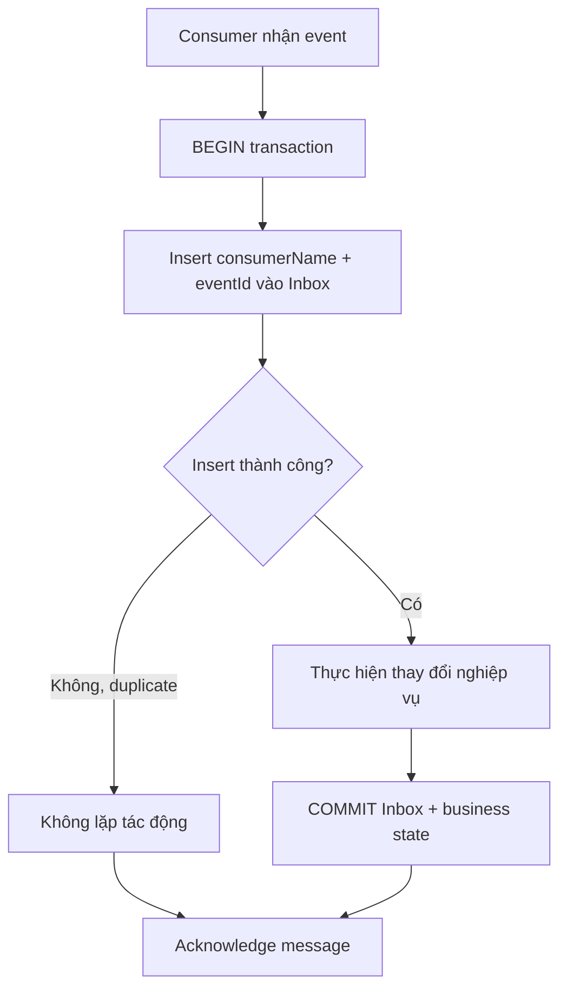

# Kiểm thử idempotency

Trong hệ thống hướng sự kiện, cùng một message có thể được giao nhiều lần. Producer có thể gửi lại sau khi không nhận được xác nhận; broker có thể redeliver khi consumer mất kết nối trước khi ack; Event Publication Registry có thể phục hồi publication chưa hoàn tất; một thao tác replay cũng có thể phát lại event cũ. Vì vậy, listener cần xử lý an toàn khi nhận cùng một sự kiện nhiều lần.

**Idempotency** là thuộc tính bảo đảm một thao tác có cùng kết quả nghiệp vụ khi được thực hiện lặp lại với cùng định danh hoặc cùng yêu cầu. Trong Spring Modulith, kiểm thử idempotency phải xác minh rằng event được giao lại không tạo thêm reservation, payment, notification, audit record hoặc chuyển trạng thái lặp ngoài ý muốn.

Kiểm thử cần tập trung vào kết quả đã lưu và tác động thực tế. Việc xác minh listener được gọi một lần trong unit test không chứng minh hệ thống idempotent, vì duplicate có thể xuất hiện qua transaction retry, concurrency, restart hoặc broker redelivery.

## 1. Idempotency bảo vệ điều gì?

Giả sử module Orders phát `OrderPlaced` và module Inventory nhận event để giữ hàng. Nếu listener giữ hàng thành công nhưng consumer mất kết nối trước khi acknowledgement được broker ghi nhận, message có thể được giao lại. Nếu listener giữ hàng lần thứ hai mà không kiểm tra duplicate, tồn kho có thể bị trừ hai lần.

Một luồng khác có thể xảy ra với publisher: broker đã nhận message nhưng ứng dụng bị timeout trước khi ghi nhận publish thành công. Publisher retry có thể gửi cùng event thêm lần nữa. Ở phía consumer, event ID cần được dùng để nhận diện cùng một sự kiện nghiệp vụ qua các lần gửi.

Idempotency giúp bảo vệ:

- Số dư, tồn kho, reservation và các invariant tài chính.
- Trạng thái aggregate/process khi listener nhận event lặp.
- Các lệnh gửi email, thông báo, thanh toán hoặc tạo shipment.
- Read model, projection, audit record và dữ liệu tổng hợp.
- Luồng phục hồi publication sau restart hoặc replay từ DLQ.

Idempotency không có nghĩa là bỏ qua mọi message có payload giống nhau. Hai event khác nhau có thể mang dữ liệu giống hệt nhưng đại diện cho hai hành động hợp lệ. Khóa chống trùng phải phản ánh danh tính của một lần phát sinh nghiệp vụ, không chỉ so sánh nội dung JSON.

## 2. Phân biệt event ID, command ID và business key

Một thiết kế kiểm thử tốt bắt đầu bằng việc xác định định danh nào được dùng để chống trùng.

| Định danh | Mục đích | Ví dụ |
|---|---|---|
| `eventId` | Nhận diện một event cụ thể qua retry/replay | Một `InventoryReserved` có UUID ổn định |
| `commandId` | Nhận diện một yêu cầu xử lý để participant không thực hiện lặp | Một `ReserveInventoryCommand` |
| `processId` | Nhận diện một lần chạy quy trình/Saga | Quy trình fulfillment của một đơn hàng |
| `businessKey` | Định danh đối tượng nghiệp vụ | `orderId`, `paymentId` |
| `correlationId` | Liên kết nhiều message cùng một luồng | Chuỗi xử lý của một request |

Không dùng `correlationId` làm khóa dedup nếu một correlation có thể chứa nhiều event hợp lệ. Không dùng `orderId` làm khóa duy nhất nếu một đơn hàng có thể phát nhiều event `OrderUpdated` hợp lệ. Với consumer, cặp `(consumerName, eventId)` thường là một khóa phù hợp. Nếu event ID chỉ duy nhất trong phạm vi tenant, cần đưa tenant vào khóa.

Một event được retry phải giữ nguyên `eventId`. Nếu mỗi lần retry tạo UUID mới, consumer sẽ coi đó là event mới và không thể nhận diện duplicate. Ngược lại, nếu hai hành động nghiệp vụ độc lập vô tình dùng chung event ID, một hành động có thể bị bỏ qua.

## 3. Phân biệt idempotency và exactly-once

Message broker và application event infrastructure thường cung cấp các cơ chế giao nhận có thể phát lại. Kafka producer idempotence, RabbitMQ acknowledgement, transaction của broker và Event Publication Registry giải quyết những phần khác nhau của luồng.

Không nên suy luận rằng listener chỉ chạy một lần vì producer đã bật idempotence hoặc publication đã được đánh dấu hoàn tất. Một consumer có thể commit database rồi mất kết nối trước ack; publisher có thể không nhận được confirm dù broker đã nhận message; worker có thể phục hồi publication sau khi ứng dụng restart.

Một thiết kế thực tế thường hướng tới **at-least-once delivery kết hợp idempotent processing**:

1. Hệ thống lưu event hoặc publication đủ bền vững để có thể thử lại.
2. Consumer nhận message và kiểm tra event ID.
3. Inbox/dedup record và thay đổi nghiệp vụ được commit cùng transaction.
4. Nếu message được giao lại, consumer nhận ra event đã xử lý và không lặp tác động.
5. Consumer chỉ ack sau khi xử lý hoặc xác nhận duplicate đã được xử lý an toàn.

Exactly-once end-to-end qua database, broker và dịch vụ ngoài là một bảo đảm rất mạnh, không tự xuất hiện chỉ nhờ một cờ cấu hình. Idempotency tạo ra hiệu quả nghiệp vụ một lần trong phạm vi được thiết kế và kiểm thử.

## 4. Mô hình Inbox để chống xử lý trùng

Inbox là nơi consumer lưu các event ID đã được xử lý. Một schema minh họa:

```sql
CREATE TABLE processed_event (
    consumer_name VARCHAR(160) NOT NULL,
    event_id UUID NOT NULL,
    processed_at TIMESTAMP NOT NULL,
    PRIMARY KEY (consumer_name, event_id)
);
```

Khóa chính bảo đảm một consumer chỉ ghi nhận một lần cho một event ID. Nếu ID chỉ duy nhất trong tenant scope, có thể thêm `tenant_id` vào khóa chính. Tên consumer cần ổn định qua deploy; đổi tên consumer có thể làm mất tác dụng dedup đối với dữ liệu đã xử lý nếu bảng Inbox được dùng chung.

Điểm quan trọng là ghi Inbox và thay đổi dữ liệu nghiệp vụ trong cùng transaction database. Nếu ghi Inbox commit trước rồi cập nhật nghiệp vụ thất bại, lần giao lại sẽ bị bỏ qua dù tác động chưa hoàn tất. Nếu cập nhật nghiệp vụ commit trước rồi ghi Inbox thất bại, lần giao lại có thể lặp tác động.

Một luồng xử lý khái quát:



Nếu transaction rollback, cả Inbox và thay đổi nghiệp vụ đều rollback. Message có thể được giao lại và consumer sẽ thử xử lý lại từ đầu.

## 5. Ví dụ consumer idempotent

Ví dụ sau minh họa transaction boundary. Các repository và kiểu dữ liệu là thành phần ứng dụng định nghĩa; cách insert-if-absent cần được triển khai phù hợp với database đang dùng.

```java
@Service
class InventoryEventHandler {

    private final ProcessedEventRepository inbox;
    private final InventoryRepository inventory;

    InventoryEventHandler(
        ProcessedEventRepository inbox,
        InventoryRepository inventory
    ) {
        this.inbox = inbox;
        this.inventory = inventory;
    }

    @Transactional
    public void on(OrderPlaced event) {
        boolean firstDelivery = inbox.insertIfAbsent(
            "inventory-order-placed",
            event.eventId()
        );

        if (!firstDelivery) {
            return;
        }

        inventory.reserve(
            event.orderId(),
            event.lines()
        );
    }
}
```

`insertIfAbsent` phải dựa trên unique constraint hoặc thao tác database nguyên tử. Không triển khai bằng cặp lệnh `existsBy...()` rồi `save()` riêng biệt mà không có constraint, vì hai transaction đồng thời có thể cùng thấy chưa tồn tại và cùng thực hiện tác động.

Khi transaction commit, Inbox và reservation cùng được lưu. Khi reservation ném exception, transaction rollback cả Inbox. Khi event được giao lại sau commit, insert Inbox trả về duplicate và listener không giữ hàng lần nữa.

## 6. Kiểm thử lần giao đầu tiên và lần giao lặp

Bộ kiểm thử cơ bản phải gửi cùng event ID ít nhất hai lần và xác minh trạng thái nghiệp vụ chỉ thay đổi một lần.

Ví dụ kiểm thử service:

```java
@SpringBootTest
class InventoryEventHandlerTests {

    @Autowired
    InventoryEventHandler handler;

    @Autowired
    ReservationRepository reservations;

    @Test
    void duplicateEventCreatesOnlyOneReservation() {
        var event = TestEvents.orderPlaced(
            UUID.fromString("9f0b2b2e-86c8-4d2a-b0d1-14c8b8c6f101")
        );

        handler.on(event);
        handler.on(event);

        assertThat(reservations.countByOrderId(event.orderId()))
            .isEqualTo(1);
    }
}
```

Đây là ví dụ minh họa; test data và repository cần khớp với ứng dụng. Nếu test method chạy trong một transaction bao ngoài, cả hai lần gọi có thể dùng chung transaction và không mô phỏng chính xác hai lần giao độc lập. Với integration test, nên kiểm tra transaction boundary thật hoặc dùng hai lần xử lý tách transaction.

Các assertion cần tập trung vào hiệu quả nghiệp vụ:

- Chỉ có một reservation cho command/event đó.
- Số lượng tồn chỉ giảm một lần.
- Không có hai payment/shipment được tạo.
- Process state chỉ chuyển một lần.
- Inbox chỉ có một bản ghi cho consumer và event ID.

Chỉ assert rằng `inventory.reserve()` được gọi một lần ở mock test là chưa đủ. Một mock không kiểm tra được atomicity, unique constraint hoặc rollback của database.

## 7. Kiểm thử event ID khác nhau nhưng payload giống nhau

Một lỗi thường gặp là dùng hash payload làm khóa chống trùng. Điều này có thể làm mất hai hành động hợp lệ có nội dung giống nhau.

Ví dụ, hai lần người dùng đặt cùng một sản phẩm với cùng số lượng có thể tạo hai event có payload giống nhau nhưng event ID khác nhau. Consumer phải xử lý cả hai nếu nghiệp vụ cho phép.

Kiểm thử cần xác minh:

1. Gửi event A với `eventId=A` và payload X.
2. Gửi event B với `eventId=B` và cùng payload X.
3. Xác minh hai hành động nghiệp vụ được áp dụng theo đúng quy tắc.
4. Gửi lại event A với cùng ID và payload X.
5. Xác minh lần gửi lại không tạo thêm tác động.

Ngược lại, nếu cùng event ID nhưng payload khác, đó là dấu hiệu producer vi phạm contract hoặc dữ liệu bị sửa. Consumer không nên âm thầm coi đây là duplicate hợp lệ. Có thể lưu checksum/payload fingerprint cùng Inbox để phát hiện cùng ID nhưng nội dung không khớp, sau đó quarantine và cảnh báo.

## 8. Kiểm thử cạnh tranh đồng thời

Hai consumer instance có thể nhận cùng event gần như đồng thời, ví dụ khi message được redeliver trong lúc consumer trước vẫn đang xử lý hoặc khi publication được gửi lại. Kiểm thử tuần tự không phát hiện được race condition giữa `exists` và `insert`.

Một bài test concurrency nên:

1. Chuẩn bị cùng event ID và trạng thái database ban đầu.
2. Khởi chạy hai transaction/worker độc lập.
3. Dùng barrier hoặc latch để hai worker cùng tiến tới thao tác Inbox.
4. Cho cả hai tiếp tục đồng thời.
5. Chờ cả hai hoàn tất và đọc trạng thái từ transaction mới.
6. Xác minh chỉ một worker tạo tác động nghiệp vụ.

Các cơ chế cần được kiểm tra:

- Unique constraint ngăn hai Inbox row cùng khóa.
- Insert-if-absent có kết quả rõ ràng khi xung đột.
- Transaction thua cuộc không thực hiện business effect.
- Optimistic/pessimistic locking bảo vệ invariant liên quan.
- Duplicate exception được xử lý như kết quả idempotent, không làm consumer retry vô hạn.

Không dùng một database mock hoặc repository fake để kết luận race condition đã được giải quyết. Hãy chạy integration test trên database engine tương ứng, vì semantics unique constraint, isolation và locking phụ thuộc database.

## 9. Kiểm thử rollback và retry

Idempotency phải hoạt động đúng cả khi lần xử lý đầu tiên thất bại giữa chừng.

Một kịch bản quan trọng:

1. Consumer insert Inbox.
2. Consumer bắt đầu cập nhật nghiệp vụ.
3. Một thao tác nghiệp vụ ném exception.
4. Transaction rollback.
5. Xác minh Inbox row không tồn tại và dữ liệu nghiệp vụ không thay đổi một phần.
6. Gửi lại cùng event ID sau khi dependency phục hồi.
7. Xác minh event được xử lý thành công đúng một lần.

Kịch bản đối lập cũng cần kiểm tra: lần xử lý đầu tiên commit thành công nhưng acknowledgement bị mất. Khi gửi lại cùng event, Inbox phải nhận ra duplicate và consumer có thể ack mà không lặp tác động.

Nếu code bắt exception rồi trả về bình thường, framework có thể xem listener thành công và không retry. Test cần xác minh lỗi cần retry được truyền tới infrastructure hoặc được chuyển sang trạng thái phục hồi bền vững theo thiết kế.

## 10. Kiểm thử Event Publication Registry

Spring Modulith Event Publication Registry theo dõi publication của application event tới listener được quản lý. Với persistence implementation phù hợp, registry lưu trạng thái publication để nhận diện công việc chưa hoàn tất và hỗ trợ phục hồi theo cơ chế của phiên bản đang dùng.

Registry và Inbox giải quyết hai vấn đề khác nhau:

| Cơ chế | Trách nhiệm |
|---|---|
| Event Publication Registry | Theo dõi publication tới listener và trạng thái hoàn tất |
| Inbox/dedup store | Ngăn cùng event tạo tác động nghiệp vụ lặp ở consumer |
| Outbox | Lưu intent phát event/message cùng transaction nghiệp vụ |
| Broker acknowledgement | Xác nhận consumer đã xử lý message theo semantics broker |

Registry không tự deduplicate mọi business effect. Một publication có thể được phục hồi và listener có thể được gọi lại; Inbox hoặc state guard ở consumer vẫn cần thiết.

Các integration test nên xác minh:

- Publication được ghi nhận theo persistence configuration.
- Listener thành công khiến publication được đánh dấu hoàn tất theo lifecycle.
- Listener thất bại không bị đánh dấu thành công nhầm.
- Publication có thể được phục hồi sau khi ứng dụng restart theo API được hỗ trợ.
- Khi publication được giao lại, consumer Inbox ngăn tác động nghiệp vụ lặp.
- Hai publication độc lập có event ID khác nhau vẫn được xử lý riêng.

Không sửa trực tiếp bảng registry để tạo tình huống test. Dùng API, persistence adapter và recovery mechanism công khai của phiên bản Spring Modulith đang dùng.

## 11. Kiểm thử process manager và state transition

Process manager/Saga cũng cần idempotency. Một event kết quả như `PaymentAuthorized` có thể được giao lại và nếu handler không kiểm tra state, nó có thể phát `CreateShipmentCommand` nhiều lần.

Kiểm thử nên bao gồm:

- Cùng event ID được giao lại khi process đang ở trạng thái đã chuyển tiếp.
- Hai event kết quả cùng process đến đồng thời.
- Event cũ đến sau khi process đã ở trạng thái terminal.
- Command được phát lại sau khi publication chưa hoàn tất.
- Process state đã commit nhưng dispatcher chưa gửi command.
- Command participant được giao lại sau timeout hoặc mất confirm.

Inbox có thể chống duplicate theo event ID, còn state machine bảo vệ transition hợp lệ. Participant cũng cần deduplicate command theo `commandId` hoặc một business key phù hợp. Hai lớp này bổ trợ nhau: event dedup không thay thế invariant của state machine, và state guard không luôn thay thế dedup cho các side effect ngoài database.

## 12. Idempotency với side effect ngoài database

Một transaction database không thể tự rollback email đã gửi, payment đã thực hiện hoặc HTTP request đã được dịch vụ khác chấp nhận. Nếu consumer gọi hệ thống ngoài rồi transaction local thất bại, lần retry có thể gọi side effect lần nữa.

Ví dụ, module Payments gửi yêu cầu charge tới payment gateway. Cần dùng idempotency key ổn định theo payment command/event:

```java
paymentGateway.charge(
    request,
    IdempotencyKey.of(command.commandId().toString())
);
```

API thực tế của gateway phụ thuộc provider; ví dụ chỉ minh họa nguyên tắc. Nếu provider hỗ trợ idempotency key, mọi retry của cùng một command phải dùng lại key đó. Không tạo key mới mỗi lần retry.

Nếu hệ thống đích không hỗ trợ idempotency, cần lưu operation state và có quy trình inquiry/reconciliation để xác định request trước đã thành công hay chưa trước khi gửi lại. Với email/notification, có thể dùng notification outbox với unique key theo business action để tránh gửi lặp.

Kiểm thử cần mô phỏng tình huống hệ thống ngoài đã nhận request nhưng client timeout trước khi nhận response. Khi retry, xác minh provider chỉ tạo một giao dịch hoặc ứng dụng thực hiện đối soát trước khi gửi lại.

## 13. Kiểm thử Outbox và publisher retry

Outbox lưu message cần gửi cùng transaction thay đổi nghiệp vụ. Dispatcher có thể gửi thành công nhưng dừng trước khi đánh dấu outbox row đã publish. Sau restart, row có thể được gửi lại.

Do đó, outbox thường cung cấp khả năng phát bền vững theo hướng at-least-once; consumer vẫn cần idempotency.

Các tình huống cần kiểm thử:

| Tình huống | Kết quả mong đợi |
|---|---|
| Business transaction rollback | Không có outbox row |
| Business transaction commit | Có đúng một outbox row theo event ID |
| Dispatcher gửi lỗi trước khi broker nhận | Row vẫn chờ để retry |
| Broker nhận nhưng confirm bị mất | Có thể gửi lại cùng event ID; consumer deduplicate |
| Dispatcher gửi thành công và đánh dấu row | Row chuyển trạng thái published theo policy |
| Hai dispatcher cùng claim row | Chỉ một claim hợp lệ hoặc duplicate được xử lý an toàn |
| Replay outbox row | Không tạo business effect lặp ở consumer |

Không kiểm thử outbox chỉ bằng cách xác minh method `send()` được gọi. Cần kiểm tra trạng thái row, event ID, transaction rollback và hành vi khi kết quả gửi không xác định.

## 14. Idempotency cho read model và projection

Projection consumer thường cộng dồn số liệu hoặc cập nhật trạng thái từ event. Nếu event bị xử lý hai lần, tổng doanh thu, số lượng đơn hoặc trạng thái hiển thị có thể sai.

Ví dụ phép cộng không idempotent:

```java
summary.increaseOrderCount(1);
summary.addRevenue(event.total());
```

Nếu cùng event chạy hai lần, count và revenue tăng gấp đôi. Có thể bảo vệ bằng Inbox trong cùng transaction với projection update. Một lựa chọn khác là projection được tính lại từ event store có event ID duy nhất, nhưng vẫn cần xác định cách deduplicate nguồn.

Kiểm thử nên gửi cùng event nhiều lần và xác minh tổng số đơn, doanh thu và version projection không thay đổi sau lần đầu. Cũng cần gửi event ID khác nhau với cùng giá trị để xác minh hai sự kiện hợp lệ vẫn được cộng riêng.

## 15. Kiểm thử audit và notification

Audit record thường cần deduplicate theo event ID để retry không tạo nhiều bản ghi cho cùng hành động. Tuy nhiên, không nên gộp hai lần truy cập riêng biệt chỉ vì cùng actor, resource và action; mỗi lần thử truy cập là một hành động độc lập và cần event ID riêng.

Notification cũng cần xác định semantics:

- Một notification cho mỗi event ID.
- Một notification cho mỗi business action.
- Có cho phép gửi lại khi người dùng yêu cầu resend hay không.

Nếu người dùng chủ động resend, đó có thể là command mới với ID mới dù nội dung thông báo giống nhau. Kiểm thử phải phân biệt resend có chủ ý với retry kỹ thuật của cùng một notification request.

## 16. Thời hạn lưu dedup record

Inbox cần giữ event ID đủ lâu để bao phủ mọi khả năng retry/replay. Nếu xóa Inbox row quá sớm, một event cũ được replay sau đó có thể tạo tác động nghiệp vụ lặp.

Thời hạn retention nên dựa trên:

- Message retention của broker.
- Thời gian publication có thể được phục hồi.
- Retry window và DLQ retention.
- Thời gian cho phép replay/backfill.
- Yêu cầu audit và nghiệp vụ.
- Khả năng lưu trữ và partition dữ liệu Inbox.

Nếu event có thể được replay nhiều tháng sau, retention vài ngày là không đủ. Với dữ liệu lớn, có thể partition Inbox theo thời gian hoặc lưu dedup key trong kho chuyên dụng; nhưng cần bảo đảm thời hạn thực tế khớp với replay policy.

Không xóa Inbox row chỉ dựa trên `processed_at` mà chưa kiểm tra message còn có thể xuất hiện lại từ broker, outbox, registry hoặc công cụ vận hành.

## 17. Kiểm thử event ID bị tái sử dụng sai

Event ID phải duy nhất cho một event và không đổi qua retry. Một lỗi producer có thể tái sử dụng ID cho payload khác. Nếu consumer chỉ kiểm tra ID, event mới có thể bị bỏ qua và lỗi bị che giấu.

Có thể lưu checksum của payload hoặc các trường contract quan trọng cùng Inbox. Khi event ID đã tồn tại:

- Nếu checksum khớp, coi là duplicate hợp lệ.
- Nếu checksum khác, ghi nhận integrity violation và quarantine.

Kiểm thử cần gửi hai payload khác nhau nhưng cùng event ID và xác minh consumer không âm thầm xử lý như duplicate bình thường. Không cần hash toàn bộ payload nếu contract có một fingerprint ổn định và an toàn; lựa chọn phải bảo đảm phát hiện thay đổi có ý nghĩa.

## 18. Kiểm thử với Spring Modulith

Trong modular monolith, có thể kết hợp unit test cho handler/state transition với integration test cho event publication và persistence.

Các công cụ/thành phần thường tham gia:

- Spring Boot Test để dựng application context và dependency thật.
- JUnit và AssertJ để mô tả hành vi và kiểm tra kết quả.
- Test transaction/database để xác minh Inbox cùng business state commit/rollback.
- Spring Modulith integration testing để kiểm tra module event interactions.
- Persistence implementation của Event Publication Registry để kiểm tra publication lifecycle.
- Broker test hoặc Testcontainers khi event được externalize.

Một test kiến trúc có thể xác minh module boundaries, nhưng không tự chứng minh idempotency. Một test dùng mock event publisher có thể kiểm tra event được phát đúng, nhưng không kiểm tra listener bị giao lại. Hãy chọn test layer theo rủi ro cần xác minh.

Ví dụ dùng `ApplicationModules` để kiểm tra cấu trúc module:

```java
class ModularityTests {

    @Test
    void moduleDependenciesAreValid() {
        ApplicationModules.of(Application.class).verify();
    }
}
```

Đây là kiểm tra kiến trúc, không phải idempotency test. Nó giúp bảo vệ ranh giới module trong khi các integration test riêng xác minh duplicate delivery và transaction behavior.

## 19. Ma trận kiểm thử idempotency

Một ma trận bao phủ các tình huống thường gặp:

| Nhóm | Tình huống | Assertion chính |
|---|---|---|
| Duplicate tuần tự | Cùng event ID được gửi hai lần | Business effect chỉ xảy ra một lần |
| Payload giống, ID khác | Hai event độc lập cùng nội dung | Cả hai được xử lý theo nghiệp vụ |
| ID giống, payload khác | Producer tái sử dụng ID sai | Phát hiện conflict và quarantine |
| Concurrency | Hai worker xử lý cùng ID đồng thời | Chỉ một transaction tạo tác động |
| Rollback | Lỗi sau khi insert Inbox | Inbox và business state cùng rollback |
| Retry | Gửi lại sau khi dependency phục hồi | Event hoàn tất một lần |
| Ack bị mất | DB commit nhưng broker redeliver | Không lặp business effect |
| Restart | Ứng dụng dừng giữa các bước | Recovery không tạo tác động trùng |
| Outbox | Broker nhận nhưng confirm bị mất | Retry giữ event ID và consumer deduplicate |
| Registry | Publication incomplete được resubmit | Listener idempotent |
| External side effect | Provider nhận request nhưng client timeout | Dùng idempotency key hoặc reconciliation |
| Retention | Replay sau thời gian dài | Dedup policy vẫn bảo vệ hoặc replay được kiểm soát |
| Projection | Event được áp dụng lại | Aggregate/read model không cộng dồn hai lần |
| Process manager | Event kết quả bị giao lại | State transition và command tiếp theo không lặp |

## 20. Cách tổ chức test fixture và dữ liệu

Test fixture cần tạo event có ID cố định để dễ mô phỏng duplicate. Tránh factory luôn sinh UUID ngẫu nhiên nếu test cần gửi lại cùng event. Có thể cho factory nhận event ID và thời gian từ test.

Ví dụ:

```java
static OrderPlaced orderPlaced(UUID eventId, UUID orderId) {
    return new OrderPlaced(
        eventId,
        orderId,
        List.of(new OrderLine(UUID.randomUUID(), 2))
    );
}
```

Khi test hai event độc lập, dùng hai event ID khác nhau. Khi test retry, giữ nguyên cả event ID và payload. Khi test ID conflict, giữ nguyên ID nhưng thay payload có chủ đích.

Mỗi test integration nên có dữ liệu database độc lập, dọn Inbox và business state theo transaction/test lifecycle. Với test concurrency, không để một transaction test bao ngoài toàn bộ worker vì các thread khác có thể không nhìn thấy dữ liệu setup hoặc không commit đúng semantics. Hãy chuẩn bị dữ liệu commit trước khi bắt đầu các worker.

## 21. Những lỗi phổ biến trong test idempotency

- **Chỉ test gọi listener hai lần trong cùng transaction:** không mô phỏng redelivery qua hai transaction độc lập.
- **Chỉ mock repository:** không kiểm tra unique constraint và race condition.
- **Dùng payload hash làm event identity:** có thể bỏ qua hai event độc lập có nội dung giống nhau.
- **Tạo event ID mới mỗi lần retry:** dedup không nhận ra cùng event.
- **Commit Inbox riêng:** có thể bỏ qua event dù business transaction rollback.
- **Commit business state trước Inbox:** có thể lặp tác động khi Inbox insert thất bại.
- **Không test provider timeout:** side effect ngoài database có thể bị thực hiện hai lần.
- **Retention quá ngắn:** replay cũ có thể gây tác động lặp sau khi dedup row bị xóa.
- **Chỉ kiểm tra số lần method được gọi:** không chứng minh trạng thái cuối cùng đúng.
- **Cho rằng Event Publication Registry tự chống duplicate:** registry theo dõi publication, còn consumer cần bảo vệ business effect.

## 22. Checklist trước khi phát hành

- [ ] Event ID ổn định và duy nhất cho một event nghiệp vụ.
- [ ] Command ID/business key được chọn đúng cho participant.
- [ ] Consumer Inbox có khóa duy nhất phù hợp phạm vi consumer/tenant.
- [ ] Inbox insert và business state update nằm trong cùng transaction.
- [ ] Database constraint bảo vệ race condition khi xử lý đồng thời.
- [ ] Duplicate cùng ID không lặp side effect.
- [ ] Hai event khác ID nhưng payload giống nhau vẫn được xử lý đúng.
- [ ] Cùng ID nhưng payload khác được phát hiện.
- [ ] Rollback không để lại Inbox row hoặc business update một phần.
- [ ] Redelivery sau commit/ack loss không lặp tác động.
- [ ] External side effect dùng idempotency key hoặc reconciliation.
- [ ] Event Publication Registry/outbox được kiểm thử với recovery.
- [ ] Process manager và projection có state guard/dedup phù hợp.
- [ ] Retention Inbox bao phủ retry và replay window.
- [ ] Có integration test concurrency trên database thực tế.
- [ ] Có metric/log cho duplicate, ID conflict, retry và replay.

Kiểm thử idempotency phải chứng minh cùng một event có thể được giao lại mà không làm lặp tác động nghiệp vụ. Trong Spring Modulith, Event Publication Registry hỗ trợ theo dõi và phục hồi publication, còn Inbox, unique constraint, transaction boundary và state guard bảo vệ consumer. Kết hợp test duplicate tuần tự, concurrency, rollback, ack loss, restart, outbox và side effect ngoài database giúp phát hiện các lỗi chỉ xuất hiện khi hệ thống chạy bất đồng bộ và phục hồi sau sự cố.
