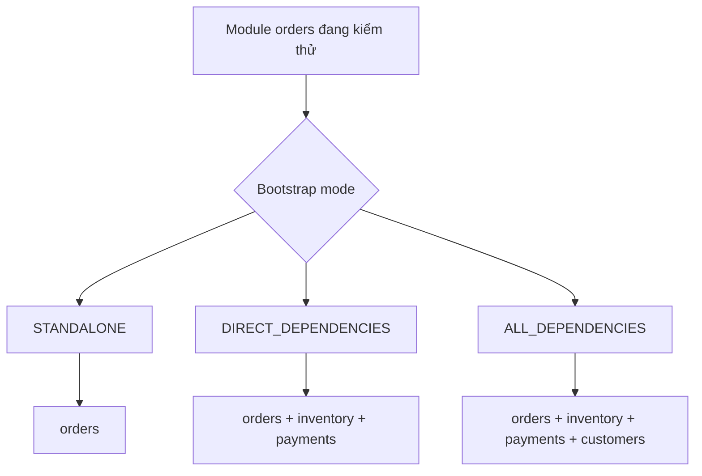
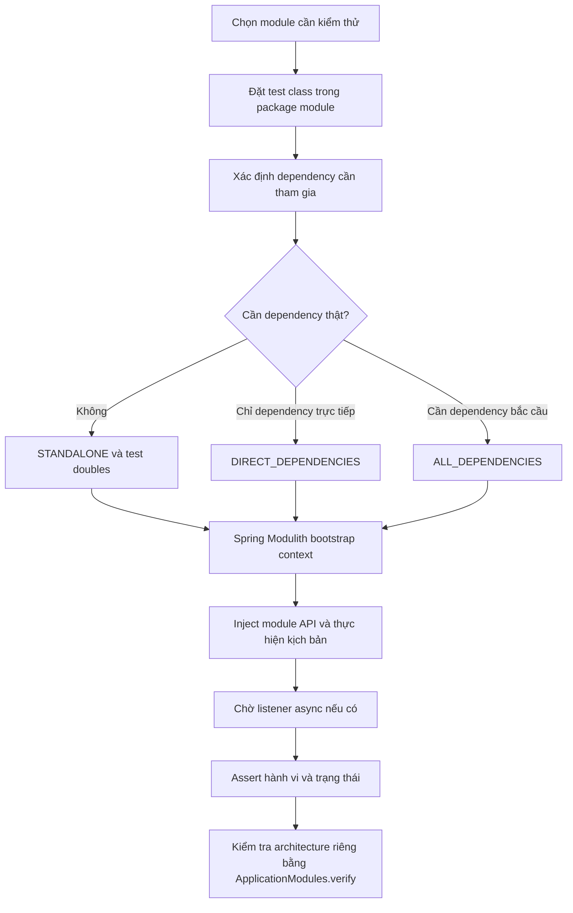

# Bootstrap module

Một ứng dụng Spring Modulith có thể chứa nhiều module cùng chạy trong một Spring Boot application. Nếu mọi bài kiểm thử đều khởi động toàn bộ application context, mỗi test sẽ phải tải nhiều bean, cấu hình và phụ thuộc không liên quan đến hành vi đang kiểm tra. Test chạy chậm hơn, khó cô lập lỗi hơn và có thể vô tình phụ thuộc vào implementation của module khác.

Spring Modulith cung cấp `@ApplicationModuleTest` để bootstrap một application context tập trung vào module đang kiểm thử. Annotation này giúp kiểm tra module trong bối cảnh Spring thực tế, đồng thời kiểm soát những module phụ thuộc nào được đưa vào context. Nhờ lựa chọn bootstrap mode, có thể kiểm tra riêng module, tích hợp với các dependency trực tiếp hoặc mở rộng tới toàn bộ dependency bắc cầu.

Trong phạm vi `SPRING_MODULITH_APPLICATION_EVENTS`, bootstrap module đặc biệt hữu ích khi kiểm thử producer, listener và luồng application event. Có thể khởi tạo module sở hữu event cùng những module cần thiết, kiểm tra bean và transaction listener, rồi dùng test double cho các phụ thuộc nằm ngoài phạm vi của bài kiểm thử.

## Mục tiêu

Sau bài này, bạn có thể:

- Giải thích vì sao nên bootstrap một module thay vì luôn khởi động toàn bộ ứng dụng.
- Dùng `@ApplicationModuleTest` để tạo context kiểm thử theo module.
- Chọn `STANDALONE`, `DIRECT_DEPENDENCIES` hoặc `ALL_DEPENDENCIES` theo mục tiêu.
- Đặt test class đúng package để Spring Modulith nhận diện module cần kiểm thử.
- Thay thế dependency bên ngoài bằng test double trong chế độ standalone.
- Kiểm tra hành vi producer, listener và application events trong module context.
- Phân biệt module integration test với kiểm thử cấu trúc dependency.
- Giữ context gọn, tái sử dụng được và có thời gian khởi động hợp lý.

## 1. Bootstrap module là gì?

Bootstrap module là khởi tạo Spring application context với phạm vi thành phần được giới hạn theo module đang kiểm thử và những dependency được lựa chọn. Thay vì quét tất cả module trong ứng dụng, Spring Modulith xác định module chứa test class rồi cấu hình context theo bootstrap mode.

Ví dụ, ứng dụng có các module `orders`, `inventory`, `payments` và `notifications`. Module `orders` phụ thuộc trực tiếp vào `inventory` và `payments`; `payments` lại phụ thuộc vào `customers`. Một test cho module `orders` có thể chọn:

- Chỉ bootstrap `orders`, thay dependency bằng test double.
- Bootstrap `orders` cùng `inventory` và `payments` để kiểm tra tích hợp trực tiếp.
- Bootstrap `orders` và toàn bộ dependency bắc cầu, bao gồm `customers`.

Phạm vi context càng lớn thì test càng gần với môi trường tích hợp thật, nhưng thời gian khởi động và số thành phần có thể ảnh hưởng test cũng tăng. Phạm vi nhỏ giúp xác định lỗi rõ hơn và khuyến khích module công bố API đủ rõ để các module khác phụ thuộc.



Sơ đồ chỉ minh họa một đồ thị dependency. Các module được đưa vào context thực tế phụ thuộc vào quan hệ module mà Spring Modulith phát hiện trong ứng dụng.

## 2. Tổ chức test class theo package module

Spring Modulith cần xác định module mà test muốn bootstrap. Cách đơn giản là đặt test class trong package gốc của module hoặc package con thuộc module đó.

Ví dụ cấu trúc ứng dụng:

```text
com.example.shop
├── ShopApplication.java
├── orders
│   ├── OrderManagement.java
│   ├── Order.java
│   └── internal
│       └── OrderRepository.java
├── inventory
│   └── InventoryManagement.java
├── payments
│   └── PaymentManagement.java
└── customers
    └── CustomerDirectory.java
```

Test cho module `orders` nên nằm trong package `com.example.shop.orders` hoặc một package con phù hợp:

```text
src/test/java
└── com/example/shop/orders
    ├── OrderManagementTests.java
    └── OrderEventListenerTests.java
```

Khi test class nằm đúng package, `@ApplicationModuleTest` có thể suy ra module từ package của test. Nếu đặt test ở package gốc hoặc package dùng chung không đại diện cho module, việc xác định module có thể không như mong muốn. Hãy tổ chức package test phản ánh cấu trúc module production để test đọc được như một phần của module đó.

Test class không cần gọi trực tiếp implementation nội bộ. Nên tương tác qua API công khai mà module muốn cung cấp, ví dụ `OrderManagement`, để kiểm tra hành vi qua ranh giới module.

## 3. Bootstrap module bằng `@ApplicationModuleTest`

Ví dụ tối thiểu:

```java
package com.example.shop.orders;

import org.junit.jupiter.api.Test;
import org.springframework.beans.factory.annotation.Autowired;
import org.springframework.modulith.test.ApplicationModuleTest;

import static org.assertj.core.api.Assertions.assertThat;

@ApplicationModuleTest
class OrderModuleBootstrapTests {

    @Autowired
    OrderManagement orders;

    @Test
    void bootstrapsOrderModule() {
        assertThat(orders).isNotNull();
    }
}
```

`@ApplicationModuleTest` tạo context kiểm thử theo module chứa test class. Test có thể inject bean của module, dùng repository hoặc gọi API module để kiểm tra hành vi. Annotation này tích hợp với Spring Test và JUnit Jupiter; test vẫn dùng các annotation thông thường như `@Test`, `@Autowired` và AssertJ.

Mặc định, bootstrap mode là `DIRECT_DEPENDENCIES`: module đang kiểm thử cùng các module mà nó phụ thuộc trực tiếp được đưa vào context. Có thể chọn mode rõ ràng trong annotation để người đọc biết test đang bao phủ phạm vi nào.

Không dùng `@SpringBootTest` mặc định thay cho `@ApplicationModuleTest` nếu mục tiêu là cô lập một module. `@SpringBootTest` vẫn hữu ích cho smoke test toàn ứng dụng hoặc kiểm tra cấu hình tích hợp cuối cùng; hai loại test trả lời những câu hỏi khác nhau.

## 4. Ba bootstrap mode

`@ApplicationModuleTest` cung cấp ba mode chính:

| Mode | Phạm vi bootstrap | Mục đích phù hợp |
|---|---|---|
| `STANDALONE` | Chỉ module đang kiểm thử | Kiểm tra module độc lập, thay dependency bằng test double |
| `DIRECT_DEPENDENCIES` | Module đang kiểm thử và các dependency trực tiếp | Kiểm tra tích hợp giữa module với các module mà nó sử dụng trực tiếp |
| `ALL_DEPENDENCIES` | Module đang kiểm thử và toàn bộ dependency bắc cầu | Kiểm tra một luồng cần nhiều tầng module thật |

### STANDALONE

Chọn `STANDALONE` khi muốn kiểm tra logic và cấu hình của module mà không bootstrap các module phụ thuộc. Các collaborator nằm ngoài module cần được cung cấp bằng mock, stub hoặc test configuration.

```java
@ApplicationModuleTest(
    mode = ApplicationModuleTest.BootstrapMode.STANDALONE
)
class OrderModuleStandaloneTests {
    // Chỉ bootstrap module orders.
}
```

Mode này hữu ích để kiểm tra module có thể khởi động với hợp đồng dependency công khai và test double. Nếu module có quá nhiều dependency phải mock, đó có thể là dấu hiệu module đang phụ thuộc quá rộng hoặc test đang kiểm tra quá nhiều trách nhiệm cùng lúc.

### DIRECT_DEPENDENCIES

Chọn `DIRECT_DEPENDENCIES` khi cần kiểm tra tương tác giữa module hiện tại và những module nó phụ thuộc trực tiếp. Đây là lựa chọn mặc định của `@ApplicationModuleTest`.

```java
@ApplicationModuleTest(
    mode = ApplicationModuleTest.BootstrapMode.DIRECT_DEPENDENCIES
)
class OrderModuleIntegrationTests {
    // Bootstrap orders và các module được orders phụ thuộc trực tiếp.
}
```

Mode này thường cân bằng giữa độ cô lập và độ chân thực. Ví dụ, test `orders` có thể dùng implementation thật của `inventory` và `payments`, trong khi các module chỉ là dependency bắc cầu của chúng không được tự động mở rộng toàn bộ context.

### ALL_DEPENDENCIES

Chọn `ALL_DEPENDENCIES` khi hành vi cần kiểm tra phụ thuộc vào nhiều tầng module và việc thay thế dependency bằng mock sẽ làm mất ý nghĩa của bài test.

```java
@ApplicationModuleTest(
    mode = ApplicationModuleTest.BootstrapMode.ALL_DEPENDENCIES
)
class OrderWorkflowIntegrationTests {
    // Bootstrap orders và toàn bộ dependency bắc cầu.
}
```

Mode này có thể làm context lớn hơn đáng kể. Chỉ dùng khi các module phụ thuộc cần cùng tham gia vào kịch bản và không có cách cô lập hợp lý hơn. Nếu mọi test đều cần `ALL_DEPENDENCIES`, hãy xem lại ranh giới module và cấu trúc dependency.

## 5. Dùng test double trong standalone mode

Khi module được bootstrap độc lập, bean phụ thuộc ở module khác không nằm trong context. Có thể thay chúng bằng mock để tập trung kiểm tra hành vi của module đang xét.

Ví dụ module `orders` gọi API công khai của `Pricing`:

```java
package com.example.shop.orders;

import org.junit.jupiter.api.Test;
import org.springframework.beans.factory.annotation.Autowired;
import org.springframework.modulith.test.ApplicationModuleTest;
import org.springframework.test.context.bean.override.mockito.MockitoBean;

import static org.assertj.core.api.Assertions.assertThat;
import static org.mockito.Mockito.when;

@ApplicationModuleTest(
    mode = ApplicationModuleTest.BootstrapMode.STANDALONE
)
class OrderPricingTests {

    @Autowired
    OrderManagement orders;

    @MockitoBean
    Pricing pricing;

    @Test
    void usesPricingModuleContract() {
        when(pricing.quoteFor("SKU-42", 2))
            .thenReturn(new PriceQuote("SKU-42", 2, 250_000));

        var order = orders.create(new CreateOrderCommand("SKU-42", 2));

        assertThat(order.totalAmount()).isEqualTo(250_000);
    }
}
```

`Pricing`, `PriceQuote`, `CreateOrderCommand` và `OrderManagement` là kiểu minh họa của ứng dụng. `@MockitoBean` thuộc Spring Test hiện đại (Spring Framework 6.2 trở lên). Với dự án dùng phiên bản Spring Boot cũ hơn, có thể dùng `@MockBean` từ Spring Boot Test theo phiên bản tương ứng. Chọn annotation phù hợp với dependency đang có trong dự án.

Mock nên đại diện cho hợp đồng công khai mà module đang phụ thuộc. Tránh mock class implementation nội bộ của module khác; điều đó khiến test bị ràng buộc vào chi tiết triển khai và làm mất lợi ích của ranh giới module.

## 6. Bootstrap dependency thật khi cần integration test

Nếu mục tiêu là kiểm tra cách hai module phối hợp, hãy bootstrap module phụ thuộc thật thay vì mock API của nó. Ví dụ, module `orders` gọi module `inventory` để giữ chỗ hàng; test ở `DIRECT_DEPENDENCIES` có thể chạy cả hai module trong cùng application context.

```java
package com.example.shop.orders;

import org.junit.jupiter.api.Test;
import org.springframework.beans.factory.annotation.Autowired;
import org.springframework.modulith.test.ApplicationModuleTest;

import static org.assertj.core.api.Assertions.assertThat;

@ApplicationModuleTest(
    mode = ApplicationModuleTest.BootstrapMode.DIRECT_DEPENDENCIES
)
class OrderInventoryIntegrationTests {

    @Autowired
    OrderManagement orders;

    @Autowired
    InventoryManagement inventory;

    @Test
    void reservesInventoryWhenOrderIsCreated() {
        var order = orders.create(new CreateOrderCommand("SKU-42", 2));

        assertThat(inventory.reservationFor(order.id())).isPresent();
    }
}
```

Ví dụ giả định `orders` có dependency trực tiếp tới API công khai của `inventory`. Nếu quan hệ đó không tồn tại trong module graph, `DIRECT_DEPENDENCIES` không tự đưa `inventory` vào chỉ vì test inject bean của nó. Hãy chọn mode hoặc cấu hình bổ sung theo dependency thực tế, đồng thời xem lại liệu module đang kiểm thử có được phép phụ thuộc vào module kia hay không.

Khi test cần nhiều tầng module thật, `ALL_DEPENDENCIES` mở rộng context theo dependency closure. Tuy nhiên, nếu một dependency bắc cầu chỉ cần một hành vi nhỏ, mock hợp đồng đó có thể làm test nhanh và tập trung hơn.

## 7. Bootstrap module có application events

Một module có thể publish event và có listener nội bộ. `@ApplicationModuleTest` giúp khởi động các bean trong module để kiểm tra việc publish và xử lý event trong application context đã giới hạn.

Ví dụ service publish event sau khi tạo đơn:

```java
import org.springframework.context.ApplicationEventPublisher;
import org.springframework.stereotype.Service;
import org.springframework.transaction.annotation.Transactional;

@Service
class OrderManagement {

    private final OrderRepository orders;
    private final ApplicationEventPublisher events;

    OrderManagement(
            OrderRepository orders,
            ApplicationEventPublisher events) {
        this.orders = orders;
        this.events = events;
    }

    @Transactional
    Order create(CreateOrderCommand command) {
        var order = orders.save(Order.create(command));
        events.publishEvent(new OrderCreated(order.id()));
        return order;
    }
}
```

Test có thể bootstrap module `orders`, gọi API công khai và xác minh trạng thái được cập nhật bởi listener thuộc module đó. Nếu listener dùng `@ApplicationModuleListener`, nó chạy bất đồng bộ và sau commit; test cần chờ điều kiện hoàn tất thay vì giả định listener đã chạy ngay khi phương thức publish trả về.

```java
import org.junit.jupiter.api.Test;
import org.springframework.beans.factory.annotation.Autowired;
import org.springframework.modulith.test.ApplicationModuleTest;

import static org.assertj.core.api.Assertions.assertThat;

@ApplicationModuleTest
class OrderEventBootstrapTests {

    @Autowired
    OrderManagement orders;

    @Autowired
    OrderProjectionRepository projections;

    @Test
    void updatesProjectionAfterOrderCreated() {
        var order = orders.create(new CreateOrderCommand("SKU-42", 1));

        org.awaitility.Awaitility.await()
            .atMost(java.time.Duration.ofSeconds(5))
            .untilAsserted(() ->
                assertThat(projections.findByOrderId(order.id())).isPresent()
            );
    }
}
```

Đoạn code minh họa một listener cập nhật projection trong cùng module. Test phải có transaction và cấu hình phù hợp với cách listener đang được khai báo. Không đặt test method trong một transaction bao quanh nếu điều đó khiến event `AFTER_COMMIT` không được kích hoạt cho tới sau khi assertion đã kết thúc. Với listener bất đồng bộ, dùng Awaitility hoặc cơ chế chờ có điều kiện để tránh race condition.

Nếu listener nằm trong module khác, chọn bootstrap mode có bao gồm module đó hoặc kiểm thử producer và consumer thành hai module test riêng. Đừng mở rộng context chỉ để một test đơn giản kiểm tra producer đã phát đúng event; khi đó có thể dùng test listener hoặc publisher spy trong phạm vi nhỏ hơn.

## 8. Phân biệt bootstrap test và kiểm thử cấu trúc module

`@ApplicationModuleTest` kiểm tra hành vi runtime của module trong Spring context. Nó không thay thế kiểm thử kiến trúc dùng `ApplicationModules` để xác minh dependency giữa các module.

Ví dụ kiểm thử cấu trúc:

```java
import org.junit.jupiter.api.Test;
import org.springframework.modulith.core.ApplicationModules;

class ModularityTests {

    @Test
    void verifiesModuleStructure() {
        ApplicationModules.of(ShopApplication.class).verify();
    }
}
```

Hai loại test trả lời các câu hỏi khác nhau:

| Loại test | Câu hỏi chính |
|---|---|
| `@ApplicationModuleTest` | Module có khởi động và thực hiện hành vi đúng trong phạm vi context đã chọn không? |
| `ApplicationModules.verify()` | Dependency và ranh giới module có tuân thủ quy tắc kiến trúc không? |
| `@SpringBootTest` | Toàn bộ application context và cấu hình tích hợp có khởi động đúng không? |

Một module có thể vượt qua bootstrap test nhưng vẫn vi phạm quy tắc dependency nếu test không chạy kiểm tra kiến trúc. Ngược lại, cấu trúc module hợp lệ không chứng minh bean, repository, transaction hoặc listener hoạt động đúng. Nên có các lớp kiểm thử bổ sung cho mục tiêu tương ứng.

## 9. Cấu hình bổ sung cho test context

Một số module cần bean chỉ dùng trong test, như fake clock, stub gateway hoặc dữ liệu cấu hình. Có thể khai báo `@TestConfiguration` và import vào test class:

```java
import org.springframework.boot.test.context.TestConfiguration;
import org.springframework.context.annotation.Bean;

@TestConfiguration
class OrderModuleTestConfiguration {

    @Bean
    FixedClock fixedClock() {
        return new FixedClock("2026-11-25T10:00:00Z");
    }
}
```

Sau đó import cấu hình test theo cách Spring Test hỗ trợ:

```java
import org.springframework.context.annotation.Import;

@ApplicationModuleTest
@Import(OrderModuleTestConfiguration.class)
class OrderModuleWithFixedClockTests {
    // Các test sử dụng clock cố định.
}
```

Test configuration nên nhỏ và chỉ cung cấp những thành phần cần cho test. Không đưa business implementation thay thế vào test configuration nếu mục tiêu là kiểm tra implementation thật của module. Với hạ tầng như database hoặc broker, chọn embedded service hoặc Testcontainers khi bài test thực sự cần xác minh tích hợp với hạ tầng đó.

## 10. Chọn bootstrap mode theo câu hỏi kiểm thử

Hãy bắt đầu từ câu hỏi mà test cần trả lời, sau đó chọn phạm vi context:

| Câu hỏi | Mode hoặc cách tiếp cận phù hợp |
|---|---|
| Logic module có hoạt động với dependency contract giả lập? | `STANDALONE` cùng test doubles |
| Module có phối hợp đúng với API của dependency trực tiếp? | `DIRECT_DEPENDENCIES` |
| Luồng cần nhiều tầng dependency thật có hoạt động? | `ALL_DEPENDENCIES` |
| Toàn bộ cấu hình application có khởi động? | `@SpringBootTest` |
| Dependency có vi phạm module boundary? | `ApplicationModules.verify()` |

Đừng chọn `ALL_DEPENDENCIES` chỉ vì test không khởi động được ở `STANDALONE`. Trước tiên hãy xác định bean nào bị thiếu và đó có phải dependency hợp lệ của module hay không. Nếu đúng là dependency trực tiếp, `DIRECT_DEPENDENCIES` có thể phù hợp. Nếu test cần một module không thuộc dependency graph, hãy xem lại thiết kế hoặc dùng cấu hình bổ sung có chủ đích; không nên vô tình mở rộng context để che giấu một quan hệ phụ thuộc không hợp lệ.

## 11. Tái sử dụng context và giữ test nhanh

Spring Test có thể cache application context giữa các test khi cấu hình tương đương. Các test dùng cùng module, bootstrap mode và tập cấu hình có cơ hội chia sẻ context, giúp giảm thời gian khởi động.

Những khác biệt như bootstrap mode, test configuration, mock bean hoặc thuộc tính môi trường có thể làm context cache key thay đổi và tạo context mới. Nếu mỗi test class cấu hình một tập bean khác nhau, suite có thể khởi động nhiều context gần giống nhau.

Để giữ test suite hiệu quả:

- Gom các test có cùng bootstrap mode và cấu hình nền vào nhóm hợp lý.
- Chỉ dùng `ALL_DEPENDENCIES` cho kịch bản thực sự cần dependency bắc cầu.
- Tránh tạo test configuration riêng biệt nếu có thể dùng cấu hình dùng chung an toàn.
- Không chia sẻ mutable test data giữa các test chỉ vì context được cache.
- Làm sạch dữ liệu database hoặc dùng transaction/test fixture phù hợp.
- Đặt timeout cho listener bất đồng bộ và external dependency.
- Không để test phụ thuộc thứ tự chạy hoặc trạng thái từ test trước.

Context cache là tối ưu hiệu năng của test framework, không phải nơi lưu trạng thái nghiệp vụ. Mỗi test vẫn phải chuẩn bị dữ liệu đầu vào và xác minh kết quả độc lập.

## 12. Các lỗi thường gặp

| Lỗi | Hệ quả | Cách khắc phục |
|---|---|---|
| Đặt test class ngoài package module | Không xác định đúng module cần bootstrap | Đặt test trong package module hoặc package con |
| Luôn dùng `@SpringBootTest` | Context lớn, test chậm và khó cô lập | Dùng `@ApplicationModuleTest` cho test theo module |
| Luôn chọn `ALL_DEPENDENCIES` | Test phụ thuộc nhiều module và khó xác định nguyên nhân lỗi | Chọn mode nhỏ nhất trả lời được câu hỏi |
| Dùng `STANDALONE` nhưng quên cung cấp dependency | Context không khởi động vì thiếu bean | Thêm test double hoặc chọn mode có dependency thật |
| Mock implementation nội bộ module khác | Test bị khóa vào chi tiết triển khai | Mock API công khai hoặc bootstrap module thật |
| Cho rằng bootstrap test xác minh architecture | Dependency sai vẫn có thể tồn tại | Chạy riêng `ApplicationModules.verify()` |
| Assertion ngay sau khi publish event async | Test flaky vì listener chưa chạy xong | Chờ điều kiện với Awaitility và timeout |
| Test `AFTER_COMMIT` trong transaction chưa commit | Listener không được kích hoạt như mong đợi | Thiết kế ranh giới transaction phù hợp với test |
| Context có nhiều cấu hình gần giống nhau | Suite khởi động context lặp lại | Chuẩn hóa bootstrap mode và test configuration |

## 13. Quy trình bootstrap một module



Bootstrap module giúp kiểm thử tập trung vào ranh giới và hành vi của module. Hãy đặt test class đúng package, chọn bootstrap mode nhỏ nhất phù hợp, dùng test double cho dependency ngoài khi cần và bootstrap module thật khi muốn kiểm tra tích hợp. Với application events, cần tính đến transaction `AFTER_COMMIT`, listener bất đồng bộ và Event Publication Registry để assertion phản ánh đúng thời điểm xử lý. Kết hợp bootstrap test với kiểm thử kiến trúc và một số smoke test toàn ứng dụng để bao phủ cả hành vi lẫn cấu trúc.

## Tài liệu tham khảo

- [Spring Modulith — Testing Application Modules](https://docs.spring.io/spring-modulith/reference/testing.html)
- [Spring Modulith — ApplicationModuleTest API](https://docs.spring.io/spring-modulith/docs/current/api/org/springframework/modulith/test/ApplicationModuleTest.html)
- [Spring Framework — Testing](https://docs.spring.io/spring-framework/reference/testing.html)
