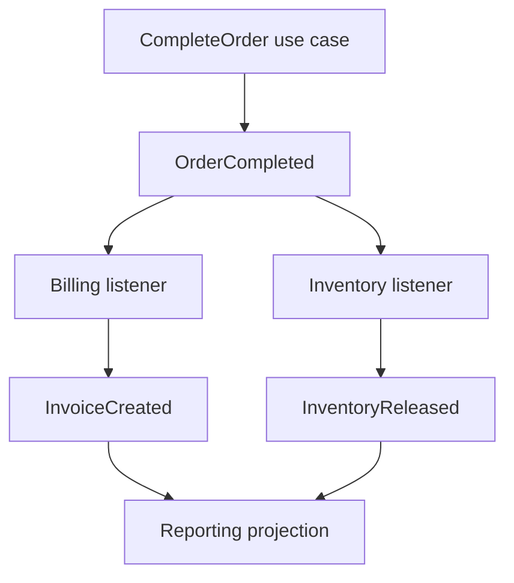

# Scenario API

*Kiểm thử luồng application event theo kịch bản với Spring Modulith*

Trong một ứng dụng Spring Modulith, một thao tác nghiệp vụ có thể phát application event, kích hoạt nhiều listener và làm thay đổi dữ liệu của các module khác. Kiểm thử từng phương thức riêng lẻ chưa đủ để chứng minh toàn bộ luồng phối hợp hoạt động đúng. **Scenario API** cung cấp cách mô tả một kịch bản bằng hành động kích hoạt và kết quả cần chờ, giúp kiểm thử event flow trong Spring context mà không phải tự quản lý thread, latch hoặc `Thread.sleep`.

Một scenario thường bắt đầu bằng việc phát event hoặc gọi một hành động nghiệp vụ, sau đó chờ một event khác xuất hiện hoặc read model chuyển sang trạng thái mong đợi. Cách viết này làm rõ quan hệ nhân quả: khi `OrderCompleted` xảy ra, module hóa đơn phải phát `InvoiceCreated` hoặc cập nhật trạng thái hóa đơn.

## 1. Scenario API giải quyết vấn đề gì?

Listener bất đồng bộ thường chạy sau khi transaction của publisher commit. Test gọi `publishEvent()` rồi lập tức đọc database có thể chạy trước listener. Nếu dùng `Thread.sleep`, test chỉ đoán rằng listener đã có đủ thời gian chạy; trên máy chậm hoặc CI tải cao, kết quả dễ chập chờn.

Scenario API giúp test diễn đạt rõ:

- **Stimulus:** hành động bắt đầu kịch bản, chẳng hạn phát `OrderPlaced` hoặc gọi use case hoàn tất đơn hàng.
- **Expected event:** loại event cần xuất hiện sau stimulus.
- **Expected state:** trạng thái read model hoặc aggregate cần đạt được.
- **Verification:** điều kiện xác nhận trên event hoặc state sau khi điều kiện chờ được thỏa mãn.

Thay vì chờ một khoảng thời gian cố định, test chờ một điều kiện có ý nghĩa. Nếu điều kiện không xảy ra trong thời gian cho phép, test thất bại với ngữ cảnh rõ hơn.

## 2. Chuẩn bị Spring Modulith test context

Scenario API được cung cấp trong test support của Spring Modulith. Test module thường dùng `@ApplicationModuleTest` để khởi tạo Spring context theo phạm vi module và inject `Scenario`.

```java
import org.junit.jupiter.api.Test;
import org.springframework.beans.factory.annotation.Autowired;
import org.springframework.modulith.test.ApplicationModuleTest;
import org.springframework.modulith.test.Scenario;

@ApplicationModuleTest
class BillingScenarioTests {

    @Autowired
    Scenario scenario;
}
```

`@ApplicationModuleTest` giúp giới hạn context theo module đang kiểm thử và các dependency được cấu hình cho test. Tùy bootstrap mode, context có thể bao gồm riêng module hiện tại, các dependency trực tiếp hoặc toàn bộ ứng dụng. Scenario API không thay thế việc chọn đúng phạm vi context; test vẫn cần các bean, repository và adapter cần thiết.

Đảm bảo dự án có dependency test support tương thích với phiên bản Spring Modulith đang sử dụng. Không trộn phiên bản test API với phiên bản runtime khác nhau.

## 3. Kích hoạt kịch bản bằng cách publish event

Nếu mục tiêu là kiểm tra listener phản ứng với một application event cụ thể, có thể dùng `scenario.publish(...)` để phát event làm stimulus.

```java
import static org.assertj.core.api.Assertions.assertThat;

import java.time.Instant;
import java.util.UUID;
import org.junit.jupiter.api.Test;
import org.springframework.beans.factory.annotation.Autowired;
import org.springframework.modulith.test.ApplicationModuleTest;
import org.springframework.modulith.test.Scenario;

@ApplicationModuleTest
class InventoryScenarioTests {

    @Autowired
    Scenario scenario;

    @Test
    void publishesInventoryReservedAfterOrderPlaced() {
        UUID orderId = UUID.randomUUID();
        UUID productId = UUID.randomUUID();
        var event = new OrderPlaced(
            UUID.randomUUID(), orderId, productId, 2, Instant.now()
        );

        scenario.publish(event)
            .andWaitForEventOfType(InventoryReserved.class)
            .toArriveAndVerify(reserved -> {
                assertThat(reserved.orderId()).isEqualTo(orderId);
                assertThat(reserved.productId()).isEqualTo(productId);
                assertThat(reserved.quantity()).isEqualTo(2);
            });
    }
}
```

Ví dụ minh họa một module nhận `OrderPlaced`, xử lý tồn kho rồi phát `InventoryReserved`. Các record event và listener là thành phần của ứng dụng. Scenario chờ event đầu ra và chỉ chạy phần assertion khi event đó đến.

Kiểu event được chờ nên cụ thể và có ý nghĩa. Nếu một loại event được phát bởi nhiều luồng, assertion cần kiểm tra event ID, aggregate ID hoặc correlation ID để xác nhận đúng kịch bản, tránh test vô tình nhận event do dữ liệu khác tạo ra.

## 4. Kích hoạt use case thật bằng stimulus

Khi muốn kiểm thử từ hành vi nghiệp vụ thay vì tự phát event, dùng `scenario.stimulate(...)` để thực thi hành động của ứng dụng, rồi chờ event kết quả.

```java
@ApplicationModuleTest
class OrderCompletionScenarioTests {

    @Autowired
    Scenario scenario;

    @Autowired
    CompleteOrder completeOrder;

    @Test
    void completingOrderPublishesOrderCompleted() {
        UUID orderId = createOpenOrder();

        scenario.stimulate(() -> completeOrder.complete(orderId))
            .andWaitForEventOfType(OrderCompleted.class)
            .toArriveAndVerify(event -> {
                assertThat(event.orderId()).isEqualTo(orderId);
                assertThat(event.eventId()).isNotNull();
            });
    }
}
```

`stimulate` giúp giữ nguyên đường đi của use case: validation, transaction, thay đổi aggregate và phát event đều được thực thi qua Spring bean. Cách này phù hợp khi cần xác nhận hành động nghiệp vụ thực sự tạo ra event đúng hợp đồng.

Nếu test chỉ cần kiểm tra listener xử lý một event đã có, `publish` ngắn gọn hơn. Nếu cần kiểm tra producer, transaction và listener trong cùng kịch bản, kích hoạt use case sẽ sát hành vi ứng dụng hơn.

## 5. Chờ read model thay đổi

Không phải listener nào cũng phát event đầu ra. Nhiều listener chỉ cập nhật projection hoặc read model. Scenario có thể chờ một supplier trả về trạng thái mới rồi xác nhận giá trị đó:

```java
@ApplicationModuleTest
class BillingProjectionScenarioTests {

    @Autowired
    Scenario scenario;

    @Autowired
    InvoiceRepository invoices;

    @Test
    void createsInvoiceWhenOrderIsCompleted() {
        UUID orderId = UUID.randomUUID();
        var event = new OrderCompleted(
            UUID.randomUUID(), orderId, Instant.now()
        );

        scenario.publish(event)
            .andWaitForStateChange(() -> invoices.findByOrderId(orderId))
            .andVerify(invoice -> {
                assertThat(invoice).isPresent();
                assertThat(invoice.orElseThrow().getOrderId()).isEqualTo(orderId);
            });
    }
}
```

`andWaitForStateChange` phù hợp khi test có một trạng thái quan sát được thay đổi sau listener. Supplier nên đọc trạng thái từ nguồn dữ liệu phù hợp và không tạo side effect. Phần verify kiểm tra kết quả cuối cùng sau khi Scenario quan sát được thay đổi.

Nếu trạng thái ban đầu đã thỏa điều kiện hoặc test dùng dữ liệu tồn tại từ lần chạy trước, scenario có thể không phản ánh đúng nguyên nhân. Hãy tạo ID riêng cho từng test, thiết lập trạng thái ban đầu rõ ràng và xác nhận dữ liệu chưa tồn tại trước stimulus khi điều đó quan trọng.

## 6. Chờ event đầu ra và xác minh hợp đồng

Một event đầu ra không chỉ cần xuất hiện; payload phải phản ánh đúng sự kiện nguồn. Assertion nên kiểm tra những trường thuộc hợp đồng:

- ID của aggregate hoặc đối tượng nghiệp vụ.
- Event ID và correlation ID nếu hợp đồng có quy định.
- Giá trị, số lượng hoặc trạng thái đã được chuyển đổi.
- Timestamp và schema version theo quy ước.
- Không phát dữ liệu nội bộ hoặc thông tin nhạy cảm ngoài hợp đồng.

Tránh assertion chỉ kiểm tra event khác `null`. Một event sai order ID vẫn có thể đến đúng thời điểm nhưng gây lỗi nghiệp vụ. Cũng không nên so sánh toàn bộ object nếu có field thời gian hoặc metadata không ổn định; hãy kiểm tra các thuộc tính có ý nghĩa.

## 7. Kiểm thử listener bất đồng bộ và xử lý sau commit

`@ApplicationModuleListener` thường được dùng cho listener bất đồng bộ trong transaction riêng sau khi transaction publisher commit. Vì vậy, test cần chờ kết quả cuối thay vì giả định listener chạy ngay trong thread phát event.

Scenario API giúp đợi event đầu ra hoặc trạng thái read model thay đổi. Điều này đặc biệt hữu ích khi listener gọi repository, cập nhật projection hoặc phát event tiếp theo. Test vẫn cần cấu hình executor, transaction manager và persistence gần với ứng dụng thật nếu những thành phần đó ảnh hưởng kết quả.

Khi kiểm tra after-commit behavior, tránh bọc test bằng transaction tự rollback nếu điều đó ngăn transaction publisher commit thật. Gọi use case qua Spring bean để transaction proxy hoạt động. Nếu test cần kiểm tra rollback, tạo một kịch bản riêng xác nhận event không được phát từ transaction chưa commit.

## 8. Chọn thời gian chờ và xử lý timeout

Scenario API chờ điều kiện bất đồng bộ trong một khoảng thời gian hữu hạn. Thời gian chờ cần đủ cho môi trường test nhưng không quá dài đến mức che giấu listener bị treo.

Khi scenario timeout, điều tra theo thứ tự:

1. Stimulus có thực sự được gọi không?
2. Transaction publisher có commit không?
3. Event có được phát và listener có được đăng ký trong context không?
4. Listener có bị lỗi, bị từ chối bởi executor hoặc chờ dependency không?
5. Supplier quan sát state có đọc đúng database hoặc projection không?
6. Test có dùng đúng module bootstrap mode và dependency không?

Không tăng timeout vô hạn chỉ để làm test xanh. Timeout dài có thể che giấu deadlock, cấu hình sai hoặc dependency không sẵn sàng. Nếu môi trường CI chậm hơn máy phát triển, chọn giới hạn hợp lý và ghi nhận nguyên nhân thực tế.

## 9. Cô lập dữ liệu giữa các scenario

Scenario test thường chạy bất đồng bộ, vì vậy dữ liệu dùng chung có thể làm test nhận nhầm event hoặc state từ kịch bản khác. Nên:

- Tạo UUID riêng cho aggregate, event và correlation của từng test.
- Chuẩn bị dữ liệu ban đầu trong fixture rõ ràng.
- Không phụ thuộc thứ tự thực thi test.
- Dọn dữ liệu theo transaction hoặc cơ chế cleanup phù hợp với test context.
- Tránh dùng chung queue/topic giữa test chạy song song nếu message có thể còn tồn tại.
- Nếu test dùng database thật, xác định rõ cách reset dữ liệu mà không ảnh hưởng test khác.

Nếu nhiều test dùng cùng Spring context, bean singleton và executor có thể tồn tại xuyên các method. Không lưu trạng thái scenario trong biến static hoặc mutable singleton dùng chung nếu không có cơ chế cô lập.

## 10. Kiểm thử nhiều bước trong event flow

Một nghiệp vụ có thể kích hoạt chuỗi event qua nhiều module. Ví dụ:



Scenario có thể xác nhận một event tiếp theo hoặc trạng thái cuối của một projection. Không nên buộc mọi test phải chờ toàn bộ hệ thống nếu mục tiêu chỉ là kiểm tra một ranh giới module. Chia scenario theo hành vi có ý nghĩa giúp test nhanh và xác định lỗi ở đúng module.

Với nhiều listener độc lập, nên có test riêng cho từng kết quả quan trọng và một số test tích hợp cấp cao cho luồng phối hợp. Tránh một test khổng lồ phụ thuộc vào tất cả module, vì lỗi ở một consumer có thể làm mọi assertion khác thất bại cùng lúc.

## 11. Kết hợp Scenario với event recording và publication registry

Scenario tập trung vào stimulus và kết quả cần chờ. Khi cần kiểm tra danh sách event đã được phát trong một đoạn test, có thể kết hợp cơ chế ghi nhận application event phù hợp của Spring Test, chẳng hạn `@RecordApplicationEvents` và `ApplicationEvents`, tùy loại assertion cần thực hiện.

Event publication registry lại trả lời câu hỏi publication cho listener đã hoàn tất hay còn chưa hoàn tất. Khi kiểm thử lỗi và phục hồi, nên xác nhận trạng thái registry bằng API được hỗ trợ của phiên bản Spring Modulith đang dùng, thay vì suy luận chỉ từ việc một event đầu ra xuất hiện.

Ba công cụ có mục đích khác nhau:

| Công cụ | Trọng tâm |
|---|---|
| Scenario API | Kích hoạt hành động và chờ event/state kết quả |
| Event recording | Quan sát các application event đã được phát trong test |
| Event Publication Registry | Theo dõi trạng thái giao publication đến transactional listener hoặc externalization target |

Không dùng event recording thay cho kiểm tra side effect trong database. Cũng không coi publication registry hoàn tất là bằng chứng consumer bên ngoài đã xử lý xong nghiệp vụ; registry thường theo dõi giao đến adapter/target ở phía producer.

## 12. Phân biệt Scenario API với broker end-to-end test

Scenario API kiểm thử application event flow trong Spring application context. Nó phù hợp để kiểm tra use case, listener, event đầu ra và read model trong phạm vi ứng dụng. Nó không tự khởi chạy RabbitMQ/Kafka, không xác nhận exchange/queue/topic/binding, publisher confirm, consumer group hoặc network failure.

Nếu event được đánh dấu `@Externalized`, có thể dùng Scenario để xác nhận stimulus tạo ra event/publication theo hợp đồng trong context. Để chứng minh message thật sự đến broker và consumer độc lập nhận được, cần broker integration test riêng, thường dùng Testcontainers hoặc môi trường broker tương thích.

Hai lớp test bổ sung cho nhau:

- Scenario test kiểm tra hành vi module và chuỗi event nội bộ.
- Broker integration test kiểm tra serialization, target mapping, routing, durability, acknowledgement, retry và consumer thực tế.

Giữ ranh giới này giúp test không đưa ra kết luận vượt quá điều nó thực sự xác minh.

## 13. Kiểm thử lỗi và nhánh không phát event

Ngoài kịch bản thành công, cần kiểm tra các điều kiện không được phát event hoặc listener không thể hoàn tất:

- Command không hợp lệ phải thất bại trước khi event nghiệp vụ được phát.
- Transaction rollback không để lại event đại diện cho thay đổi chưa commit.
- Listener lỗi không tạo read model ở trạng thái nửa chừng nếu dữ liệu và transaction phải nguyên tử.
- Event trùng không nhân đôi side effect nhờ idempotency.
- Event đến sai thứ tự được xử lý theo sequence/version hoặc chính sách của projection.
- Dependency không sẵn sàng tạo trạng thái lỗi có thể quan sát và phục hồi.

Scenario API phù hợp để chờ kết quả tích cực như event đầu ra hoặc state change. Với kỳ vọng “không có event”, cần dùng cơ chế quan sát và giới hạn thời gian phù hợp, đồng thời tránh một khoảng chờ quá ngắn khiến test kết luận âm tính trước khi listener thực sự chạy. Có thể bổ sung event recording hoặc assertion ở publication registry tùy hành vi cần xác nhận.

## 14. Tổ chức test và đặt tên scenario

Tên test nên mô tả hành vi và kết quả nghiệp vụ, ví dụ `publishesInvoiceCreatedWhenOrderCompletes` hoặc `updatesInventoryProjectionAfterOrderPlaced`. Tránh tên chung như `scenarioWorks` hoặc `testEvent`.

Một cấu trúc test dễ đọc:

1. Chuẩn bị aggregate, fixture và trạng thái ban đầu.
2. Xác định stimulus: `publish(event)` hoặc `stimulate(() -> useCase.execute(...))`.
3. Chờ event hoặc state cần xác minh.
4. Assert các trường thuộc hợp đồng và trạng thái nghiệp vụ.
5. Dọn dữ liệu nếu persistence không được reset tự động.

Giữ một scenario tập trung vào một hành vi chính. Nếu cần kiểm tra nhiều listener độc lập, tách test theo listener để lỗi dễ định vị; dùng test cấp cao hơn cho một số luồng xuyên module quan trọng.

## 15. Lỗi thường gặp khi dùng Scenario API

| Triệu chứng | Nguyên nhân có thể | Cách xử lý |
|---|---|---|
| Scenario timeout dù event được publish | Listener không có trong context, executor không chạy hoặc event type chờ sai | Kiểm tra module bootstrap, listener registration và event contract |
| Test đọc state quá sớm | Dùng assertion ngay sau stimulus thay vì chờ state change | Dùng `andWaitForStateChange` với supplier phù hợp |
| Test nhận event của scenario khác | Dùng ID cố định hoặc dữ liệu/queue dùng chung | Dùng UUID riêng và cô lập fixture |
| Test xanh trên mock nhưng lỗi với broker | Chưa kiểm tra routing, serialization hoặc acknowledgement thực tế | Thêm broker integration test |
| Test after-commit không kích hoạt | Test transaction rollback tự động hoặc không gọi qua proxy | Dùng transaction boundary thật và Spring bean được quản lý |
| Tăng timeout vẫn thất bại | Listener lỗi hoặc dependency không sẵn sàng | Đọc log, publication state và trace thay vì chỉ tăng thời gian |

## 16. Những điểm cần nhớ

- Scenario API mô tả stimulus và kết quả event/state cần chờ trong Spring Modulith test context.
- `scenario.publish(event)` phù hợp khi kiểm tra listener phản ứng với event; `scenario.stimulate(...)` phù hợp khi muốn gọi use case thật.
- `andWaitForEventOfType(...).toArriveAndVerify(...)` chờ event đầu ra và xác minh payload.
- `andWaitForStateChange(...).andVerify(...)` chờ read model hoặc trạng thái quan sát được thay đổi.
- Dùng `@ApplicationModuleTest` để kiểm soát phạm vi context và giữ transaction boundary phù hợp.
- Scenario không thay thế broker end-to-end test; RabbitMQ/Kafka routing và transport cần integration test riêng.
- Kết hợp Scenario với event recording và publication registry khi cần kiểm tra các khía cạnh khác nhau.
- Dùng dữ liệu cô lập, timeout hữu hạn và điều kiện chờ có ý nghĩa để tránh test flaky.

Khi scenario được viết quanh hành vi nghiệp vụ, chờ đúng event hoặc trạng thái cuối và giữ phạm vi test phù hợp, nhóm phát triển có thể kiểm tra luồng application event một cách rõ ràng mà không phụ thuộc vào thời gian ngủ cố định. Kết hợp Scenario API với broker integration test và Event Publication Registry giúp xác nhận cả phối hợp module lẫn khả năng giao sự kiện đáng tin cậy.
