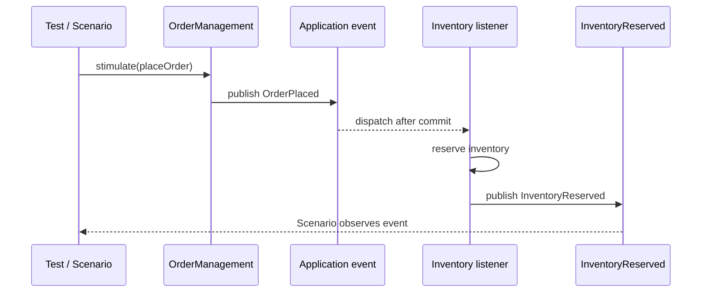

# When: Kích hoạt hành động

Trong một bài kiểm thử theo kịch bản, pha **When** mô tả hành động làm thay đổi trạng thái hệ thống hoặc khởi phát một luồng xử lý. Với Spring Modulith, `Scenario` cung cấp cách biểu diễn hành động này bằng `stimulate(...)`. Sau khi hành động được thực hiện, test có thể chờ application event được phát và xác minh kết quả bằng các bước tiếp theo của kịch bản.

Pha When cần thể hiện đúng hành vi mà người dùng hoặc module khác có thể yêu cầu: gọi một use case qua API ứng dụng, thực hiện một command hoặc phát một event đầu vào khi mục tiêu là kiểm tra listener. Chọn đúng loại hành động giúp test kiểm tra đúng ranh giới và tránh bỏ qua phần code cần được xác minh.

## 1. When nằm ở đâu trong Given-When-Then?

Given-When-Then là cách tổ chức test theo ba phần:

- **Given:** chuẩn bị trạng thái ban đầu, dữ liệu và dependency cần thiết.
- **When:** thực hiện một hành động cụ thể làm phát sinh hành vi cần kiểm tra.
- **Then:** chờ kết quả, xác minh event, trạng thái hoặc tác dụng phụ mong đợi.

Ví dụ với module đơn hàng:

| Pha | Nội dung |
| --- | --- |
| Given | Khách hàng tồn tại và có thể đặt hàng; dữ liệu sản phẩm hợp lệ. |
| When | Gọi `OrderManagement.placeOrder(command)`. |
| Then | Có `OrderPlaced` với đúng mã đơn và dữ liệu nghiệp vụ. |

Trong `Scenario`, pha When thường được biểu diễn bằng `scenario.stimulate(() -> ...)`. `stimulate` nhận hành động cần kích hoạt; sau đó test nối với bước chờ event hoặc trạng thái mong đợi.

```java
scenario.stimulate(() -> orderManagement.placeOrder(command))
        .andWaitForEventOfType(OrderPlaced.class)
        .toArriveAndVerify(event ->
                assertThat(event.orderId()).isNotNull());
```

Đoạn code cho thấy hành động được thực hiện trước, rồi test chờ event. Không cần tự gọi listener hoặc gọi trực tiếp phương thức publish bên trong module nguồn nếu mục tiêu là kiểm tra use case có phát event đúng hay không.

## 2. Khởi tạo Scenario trong module test

`Scenario` thuộc test support của Spring Modulith. Có thể inject nó vào test class được đánh dấu `@ApplicationModuleTest`:

```java
import org.junit.jupiter.api.Test;
import org.springframework.beans.factory.annotation.Autowired;
import org.springframework.modulith.test.ApplicationModuleTest;
import org.springframework.modulith.test.Scenario;

@ApplicationModuleTest
class OrderScenarioTests {

    @Autowired
    OrderManagement orderManagement;

    @Autowired
    Scenario scenario;

    @Test
    void publishesOrderPlacedWhenOrderIsCreated() {
        // Given: dữ liệu đầu vào đã được chuẩn bị.
        PlaceOrder command = TestOrders.validCommand();

        // When và Then được mô tả bằng Scenario.
        scenario.stimulate(() -> orderManagement.placeOrder(command))
                .andWaitForEventOfType(OrderPlaced.class)
                .toArriveAndVerify(event ->
                        assertThat(event.orderId()).isNotNull());
    }
}
```

`OrderManagement` và `TestOrders` là API/factory minh họa của ứng dụng. Test cần dùng dữ liệu hợp lệ theo mô hình thực tế và đặt class trong package của module đang kiểm thử để Spring Modulith xác định đúng module.

Dependency test support phải cùng dòng phiên bản với Spring Modulith mà ứng dụng sử dụng. Trong dự án Spring Modulith, test support thường được cung cấp qua starter test tương ứng. Không thêm một phiên bản test artifact khác với phiên bản runtime chỉ để có `Scenario`.

## 3. Dùng `stimulate` khi muốn kiểm tra use case

`stimulate(...)` phù hợp khi test cần bắt đầu từ hành động nghiệp vụ mà module công khai. Ví dụ:

- Đặt hàng.
- Xác nhận thanh toán.
- Hủy đăng ký.
- Hoàn tất một quy trình.
- Cập nhật thông tin khách hàng.

Hành động nên gọi API ứng dụng hoặc service nghiệp vụ mà caller thực tế sử dụng. Điều này giúp test bao phủ validation, transaction, lưu dữ liệu và phát event của use case.

```java
@Test
void publishesOrderPlacedAfterSuccessfulPlacement() {
    PlaceOrder command = TestOrders.validCommand();

    scenario.stimulate(() -> orderManagement.placeOrder(command))
            .andWaitForEventOfType(OrderPlaced.class)
            .toArriveAndVerify(event -> {
                assertThat(event.orderId()).isNotNull();
                assertThat(event.occurredAt()).isNotNull();
            });
}
```

Không nên gọi phương thức nghiệp vụ trước rồi mới truyền một lambda rỗng cho `stimulate`. Khi đó hành động đã xảy ra ngoài kịch bản và test không còn thể hiện đúng thứ tự Given-When-Then.

```java
// Không nên: hành động xảy ra trước khi Scenario bắt đầu theo dõi.
orderManagement.placeOrder(command);
scenario.stimulate(() -> { })
        .andWaitForEventOfType(OrderPlaced.class)
        .toArriveAndVerify(event -> assertThat(event.orderId()).isNotNull());
```

Đặt toàn bộ lời gọi cần kiểm tra bên trong callback của `stimulate`. Nếu hành động gồm nhiều bước nghiệp vụ bắt buộc, hãy cân nhắc gom chúng thành một use case rõ nghĩa thay vì đưa nhiều thao tác rời rạc vào lambda của test.

## 4. Phân biệt `stimulate` và `publish`

`Scenario` có hai cách bắt đầu kịch bản thường dùng:

| Cách bắt đầu | Ý nghĩa | Dùng khi |
| --- | --- | --- |
| `scenario.stimulate(() -> ...)` | Thực hiện một hành động trong ứng dụng. | Muốn kiểm tra use case phát event hoặc gây ra một thay đổi nghiệp vụ. |
| `scenario.publish(event)` | Phát trực tiếp một event làm đầu vào cho kịch bản. | Muốn kiểm tra phản ứng của listener với event đã có. |

Ví dụ `stimulate` kiểm tra publisher:

```java
scenario.stimulate(() -> orderManagement.placeOrder(command))
        .andWaitForEventOfType(OrderPlaced.class)
        .toArriveAndVerify(event ->
                assertThat(event.orderId()).isEqualTo(expectedOrderId));
```

Ví dụ `publish` kiểm tra consumer/listener:

```java
scenario.publish(new OrderPlaced(eventId, orderId, occurredAt))
        .andWaitForEventOfType(InventoryReserved.class)
        .toArriveAndVerify(event ->
                assertThat(event.orderId()).isEqualTo(orderId));
```

Nếu test dùng `publish` để phát `OrderPlaced`, test đang kiểm tra module nhận xử lý event đó. Nó không chứng minh use case của module `orders` tự phát `OrderPlaced` đúng. Muốn xác minh publisher, hãy gọi use case bằng `stimulate`.

Ngược lại, nếu mục tiêu chỉ là xác minh listener của module `inventory`, không cần khởi động toàn bộ module `orders` hoặc chạy toàn bộ use case tạo đơn. Có thể dùng `publish` với một event fixture hợp lệ để cô lập hành vi consumer.

## 5. Chuẩn bị Given trước khi kích hoạt hành động

Given nên tạo trạng thái ban đầu cần thiết và làm rõ điều kiện để hành động thành công. Dữ liệu chuẩn bị có thể được tạo qua fixture, repository hoặc API setup phù hợp với mục tiêu test.

Ví dụ, khi xác nhận đơn hàng cần một khách hàng tồn tại:

```java
@Test
void confirmsAnExistingOrder() {
    Customer customer = customers.save(TestCustomers.activeCustomer());
    Order order = orders.save(TestOrders.awaitingConfirmation(customer));

    scenario.stimulate(() -> orderManagement.confirm(order.getId()))
            .andWaitForEventOfType(OrderConfirmed.class)
            .toArriveAndVerify(event ->
                    assertThat(event.orderId()).isEqualTo(order.getId()));
}
```

Đây là ví dụ minh họa; repository và API setup cần tuân theo quyền sở hữu dữ liệu của module. Nếu test đang kiểm tra hành vi public API, ưu tiên tạo dữ liệu qua API module hoặc fixture được thiết kế cho test. Tránh sửa trực tiếp nhiều bảng nội bộ của module khác chỉ để chuẩn bị một trạng thái.

Given nên độc lập giữa các test. Mỗi test phải tạo dữ liệu mà nó cần, không dựa vào thứ tự chạy hoặc dữ liệu còn lại từ test trước. Với dữ liệu có ID, dùng ID riêng cho từng test để tránh va chạm khi test chạy song song.

## 6. Khi hành động cần transaction commit

Với application event được xử lý sau commit, hành động trong `stimulate` cần tạo ra transaction nguồn thực sự commit trước khi listener after-commit chạy.

`@ApplicationModuleListener` thường được dùng cho listener bất đồng bộ sau commit và chạy trong transaction riêng. Nếu test method bị bọc trong `@Transactional` và framework rollback transaction ở cuối test, transaction nguồn chưa commit; listener có thể không được kích hoạt như kỳ vọng.

Khi kiểm tra luồng after-commit:

- Để use case chạy qua transaction boundary thật của Spring.
- Tránh một transaction test bao ngoài luôn rollback nếu cần xác minh after-commit.
- Gọi hành động bên trong `stimulate`.
- Chờ event hoặc kết quả của listener bằng Scenario với timeout phù hợp.
- Chỉ đọc dữ liệu do listener tạo sau khi có tín hiệu listener đã hoàn tất.

Nếu cần kiểm soát transaction rõ ràng, có thể dùng `TransactionTemplate` để tạo transaction commit trong pha When. Tuy nhiên, phải kết hợp với bước chờ bất đồng bộ; việc transaction commit không đồng nghĩa listener đã hoàn tất.

## 7. Khi hành động không phát event

Không phải mọi hành động đều phải phát event. Một use case có thể chỉ cập nhật trạng thái nội bộ hoặc trả lỗi nghiệp vụ. Khi test không mong đợi event, hãy tập trung xác minh kết quả của hành động qua exception, return value hoặc trạng thái được công khai.

Ví dụ hành động bị từ chối do dữ liệu không hợp lệ:

```java
@Test
void rejectsAnOrderWithoutItems() {
    PlaceOrder invalidCommand = TestOrders.withoutItems();

    assertThatThrownBy(() -> orderManagement.placeOrder(invalidCommand))
            .isInstanceOf(InvalidOrderException.class);
}
```

Test trên kiểm tra hành vi đồng bộ của use case. Nếu cần chứng minh một event không được phát, hãy dùng cơ chế kiểm tra event absence được hỗ trợ bởi phiên bản Scenario đang dùng hoặc một test listener/probe phù hợp. Không suy ra “không có event” chỉ vì một listener khác không được nạp trong bootstrap mode hiện tại.

Với hành động thất bại trước commit, cần xác minh transaction rollback và không để lại publication đã commit cho event của nghiệp vụ chưa xảy ra. Đây là kiểm tra transaction/publication riêng, không chỉ là assertion exception.

## 8. Kích hoạt chuỗi hành động và event

Một hành động có thể kích hoạt event, listener xử lý event rồi phát event tiếp theo. Khi kiểm thử chuỗi này, hãy xác định rõ event đầu vào, hành động khởi phát và event kết quả mà test cần quan sát.

Ví dụ luồng đơn hàng:



Test có thể bắt đầu bằng hành động public của module nguồn rồi chờ event kết quả từ listener:

```java
@Test
void placesOrderAndReservesInventory() {
    PlaceOrder command = TestOrders.validCommand();

    scenario.stimulate(() -> orderManagement.placeOrder(command))
            .andWaitForEventOfType(InventoryReserved.class)
            .toArriveAndVerify(event ->
                    assertThat(event.orderId()).isNotNull());
}
```

Test này xác minh kết quả cuối của chuỗi event ở mức quan sát được. Nếu cần biết riêng `OrderPlaced` có được phát với payload đúng hay không, viết một test riêng chờ `OrderPlaced`. Một test nên có mục tiêu rõ để khi thất bại dễ xác định bước bị lỗi.

## 9. Không đặt quá nhiều hành động trong một When

Một pha When nên mô tả một hành động nghiệp vụ chính. Nếu lambda thực hiện nhiều command không liên quan, test khó xác định event nào là kết quả của command nào.

Ví dụ khó đọc:

```java
scenario.stimulate(() -> {
    orderManagement.placeOrder(firstCommand);
    paymentManagement.capture(secondPayment);
    customerManagement.updateProfile(profile);
})
.andWaitForEventOfType(OrderPlaced.class)
.toArriveAndVerify(event -> assertThat(event.orderId()).isNotNull());
```

Ở đây có ba hành động với các transaction và event khác nhau. Nếu test thất bại, không rõ hành động nào cần chịu trách nhiệm. Hãy tách thành các scenario hoặc tạo một use case điều phối có tên và hợp đồng rõ ràng nếu ba bước thực sự tạo thành một nghiệp vụ.

Một hành động có thể gọi nhiều phương thức nội bộ nếu đó là cách triển khai của một use case. Test không cần mô phỏng từng lời gọi private; nó cần gọi đúng điểm vào nghiệp vụ.

## 10. Giá trị trả về của hành động và dữ liệu Then

Trong nhiều test, hành động tạo ra một định danh hoặc kết quả cần dùng ở pha Then. Có thể giữ kết quả đó trong biến dùng chung bên ngoài lambda:

```java
@Test
void emitsEventForCreatedOrder() {
    PlaceOrder command = TestOrders.validCommand();
    AtomicReference<UUID> createdOrderId = new AtomicReference<>();

    scenario.stimulate(() ->
                    createdOrderId.set(orderManagement.placeOrder(command)))
            .andWaitForEventOfType(OrderPlaced.class)
            .toArriveAndVerify(event ->
                    assertThat(event.orderId()).isEqualTo(createdOrderId.get()));
}
```

Đây là cách minh họa khi hành động trả về giá trị nhưng callback của Scenario được biểu diễn bằng `Runnable`. Nếu API use case trả về ID, hãy giữ kết quả trong biến phù hợp và đảm bảo hành động được thực hiện đúng một lần. Không gọi use case lần thứ hai chỉ để lấy ID dùng trong assertion.

Nếu phiên bản API Scenario cung cấp cách truyền hoặc giữ kết quả khác, hãy theo đúng API của dependency đang dùng. Mục tiêu vẫn là không lặp hành động nghiệp vụ và không tạo thêm event ngoài ý muốn.

## 11. Xác minh event là kết quả của đúng hành động

Test cần tránh nhận nhầm event do một test khác, một tác vụ nền hoặc dữ liệu còn sót lại phát ra. Hãy dùng dữ liệu định danh riêng cho scenario và kiểm tra event khớp với dữ liệu đó.

Các trường nên xác minh tùy hợp đồng:

- Aggregate ID hoặc business ID.
- Event ID nếu event contract có định danh.
- Giá trị nghiệp vụ được thay đổi bởi hành động.
- Thời điểm hoặc version nếu thuộc yêu cầu nghiệp vụ.
- Correlation ID nếu ứng dụng truyền correlation context.

Ví dụ:

```java
scenario.stimulate(() -> orderManagement.placeOrder(command))
        .andWaitForEventOfType(OrderPlaced.class)
        .toArriveAndVerify(event -> {
            assertThat(event.orderId()).isEqualTo(expectedOrderId);
            assertThat(event.aggregateVersion()).isEqualTo(1L);
            assertThat(event.correlationId()).isEqualTo(correlationId);
        });
```

Không chỉ xác minh event “đã đến”. Hãy kiểm tra các trường thể hiện hợp đồng nghiệp vụ mà consumer sẽ dựa vào. Tuy nhiên, tránh assert các chi tiết triển khai không thuộc hợp đồng, chẳng hạn tên thread, thời điểm chính xác đến từng mili giây hoặc thứ tự giữa các listener độc lập.

## 12. Khi hành động phát nhiều event

Một use case có thể phát nhiều event cùng loại hoặc nhiều loại khác nhau. Ví dụ, nhập kho có thể phát `StockReceived` cho từng sản phẩm và `GoodsReceiptCompleted` khi toàn bộ phiếu nhập hoàn tất.

Test cần xác định event nào là điều kiện thành công chính. Nếu hành động phát nhiều event cùng loại, dữ liệu nhận diện như aggregate ID, receipt ID hoặc event ID giúp phân biệt đúng event cần kiểm tra.

Không giả định event được phát đồng bộ theo một thứ tự toàn cục nếu listener bất đồng bộ hoặc nhiều publication chạy song song. Nếu thứ tự là một phần của hợp đồng nghiệp vụ, hãy biểu diễn nó bằng version/sequence và kiểm tra theo quy tắc đó.

Với scenario phức tạp, tách test theo từng hành vi:

- Test một event đầu vào dẫn tới một event kết quả.
- Test use case phát event chính.
- Test listener xử lý một loại event cụ thể.
- Test tích hợp rộng hơn cho một chuỗi nhiều module thực sự cần được xác minh.

## 13. Khi hành động có lỗi hoặc timeout

Nếu hành động trong `stimulate` ném exception đồng bộ, test nên xác minh exception theo hợp đồng của use case. Không nên tiếp tục chờ event thành công nếu hành động đã thất bại trước khi transaction commit.

Nếu hành động hoàn tất nhưng listener bất đồng bộ thất bại, đó là một tình huống khác: command nguồn có thể đã commit, còn publication tới listener chưa hoàn tất. Test cần phân biệt lỗi của command với lỗi của listener và có thể kiểm tra publication/recovery bằng một integration test chuyên biệt.

Khi chờ event hoặc kết quả listener, dùng timeout hữu hạn và đủ lớn cho môi trường test. Timeout nên giúp test thất bại nhanh với thông tin hữu ích, không kéo dài vô hạn. Tránh tăng timeout rất lớn để che giấu listener bị treo hoặc executor không được cấu hình.

Nếu test không thấy event:

1. Kiểm tra action có thực sự được gọi trong `stimulate` không.
2. Kiểm tra transaction nguồn đã commit chưa.
3. Kiểm tra bootstrap mode có nạp publisher/listener cần thiết không.
4. Kiểm tra điều kiện nghiệp vụ có cho phép phát event không.
5. Kiểm tra listener hoặc executor có lỗi, bị từ chối hay đang chờ không.
6. Kiểm tra test có chờ đúng loại event và đúng dữ liệu nhận diện không.

## 14. Tránh `Thread.sleep` trong pha When

Không dùng `Thread.sleep` để cố tình tạo khoảng chờ giữa hành động và event. Thời gian listener phụ thuộc tải, executor và môi trường; một khoảng ngủ ngắn có thể làm test chập chờn, còn một khoảng ngủ dài làm suite chậm.

`Scenario` cung cấp bước chờ event và xác minh để test đồng bộ với điều kiện cần quan sát. Hãy để pha When chỉ kích hoạt hành động, còn việc chờ và assertion nằm ở pha Then của scenario.

Nếu cần chờ một trạng thái database thay đổi mà không có event kết quả, dùng cơ chế chờ điều kiện được hỗ trợ bởi phiên bản test framework hoặc Awaitility với timeout hữu hạn. Không đọc trạng thái ngay sau khi `stimulate` rồi giả định listener bất đồng bộ đã hoàn tất.

## 15. Phân biệt kiểm thử publisher, listener và toàn bộ luồng

Ba mục tiêu kiểm thử thường bị trộn lẫn:

| Mục tiêu | Pha When nên làm gì? | Điều Then cần xác minh |
| --- | --- | --- |
| Publisher | Gọi use case qua `stimulate`. | Event đúng được phát với payload hợp lệ. |
| Listener | Dùng `publish(event)` để đưa event đầu vào. | Listener tạo kết quả hoặc trạng thái đúng. |
| Luồng liên module | Gọi use case nguồn bằng `stimulate`. | Kết quả quan sát được ở module đích hoặc event cuối. |

Giữ test publisher và listener riêng giúp xác định trách nhiệm khi lỗi. Một số test end-to-end theo module có thể kiểm tra luồng xuyên module, nhưng không nên dùng chúng thay cho test tập trung của từng module.

## 16. Những sai lầm thường gặp

- Gọi use case trước `scenario.stimulate`, khiến Scenario không bao quanh hành động cần kiểm tra.
- Dùng `scenario.publish` nhưng lại kết luận publisher nghiệp vụ đã phát event đúng.
- Dùng `stimulate` để gọi trực tiếp listener và bỏ qua API module.
- Đặt nhiều command không liên quan trong một pha When.
- Chờ listener after-commit trong test transaction luôn rollback.
- Dùng `Thread.sleep` thay cho chờ event hoặc trạng thái.
- Xác minh event chỉ bằng kiểu mà không kiểm tra aggregate ID hoặc payload quan trọng.
- Giả định một listener bất đồng bộ hoàn tất ngay khi action trả về.
- Chọn bootstrap mode quá rộng làm test che giấu dependency ngoài ý muốn.
- Không phân biệt lỗi command đồng bộ với lỗi listener sau commit.

## Checklist cho pha When

- [ ] Hành động được gọi bên trong callback của `scenario.stimulate(...)`.
- [ ] Hành động đi qua API nghiệp vụ mà caller thực tế sử dụng.
- [ ] Dữ liệu Given đã được chuẩn bị và độc lập với test khác.
- [ ] Chọn `stimulate` cho use case hoặc `publish` cho event đầu vào của listener.
- [ ] Pha When chỉ có một hành động nghiệp vụ chính, dễ hiểu.
- [ ] Transaction nguồn commit thật nếu kiểm tra listener after-commit.
- [ ] Event được kiểm tra có định danh liên kết với dữ liệu của scenario.
- [ ] Test không giả định listener bất đồng bộ đã hoàn tất ngay khi action trả về.
- [ ] Pha Then dùng Scenario để chờ event hoặc kết quả cần xác minh.
- [ ] Không dùng `Thread.sleep` hoặc gọi lặp use case để lấy dữ liệu assertion.

Pha When là điểm bắt đầu có chủ đích của một scenario. Khi hành động được kích hoạt qua đúng API, transaction có ranh giới rõ ràng và test phân biệt được use case với event đầu vào, `Scenario` giúp xác minh publisher, listener và luồng liên module một cách ổn định, dễ đọc và sát hành vi thực tế.
