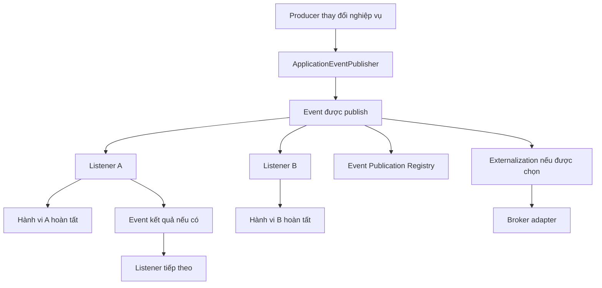
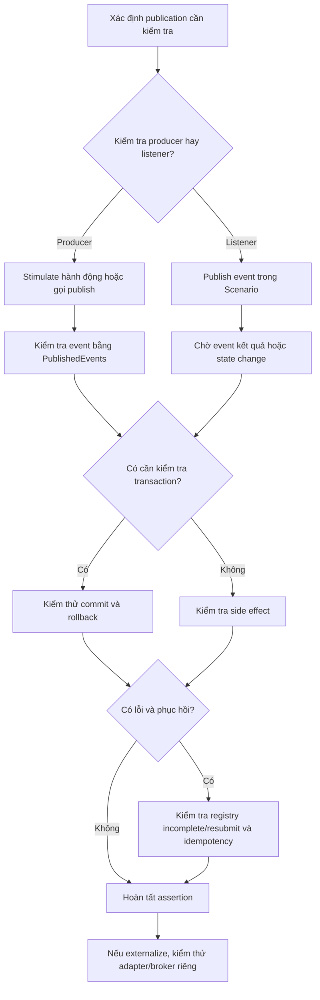

# Kiểm tra publication

Trong Spring Modulith, một module có thể publish application event để thông báo rằng một thay đổi nghiệp vụ đã xảy ra. Module khác đăng ký listener để phản ứng với event đó. Khi kiểm thử, chỉ xác nhận phương thức producer đã chạy là chưa đủ: cần biết event có được publish đúng lúc, listener phù hợp có nhận được, hành vi của listener có hoàn tất và publication có được theo dõi đúng hay không.

Spring Modulith cung cấp `Scenario` để viết kiểm thử theo luồng sự kiện: kích hoạt một hành động hoặc publish event, chờ một event tiếp theo hoặc trạng thái ứng dụng thay đổi, rồi xác minh kết quả. Kết hợp `Scenario` với `@ApplicationModuleTest` giúp kiểm thử publication trong module context có phạm vi rõ ràng. Với các bài kiểm thử cần kiểm tra event được phát ra, có thể dùng `PublishedEvents` để truy vấn các event đã được ghi nhận trong test.

Trong phạm vi `SPRING_MODULITH_APPLICATION_EVENTS`, kiểm tra publication còn cần phân biệt publication tới listener nội bộ với externalization tới broker, và phân biệt việc event đã được publish với việc listener đã xử lý thành công. Event Publication Registry theo dõi vòng đời publication của listener; nó không tự chứng minh toàn bộ nghiệp vụ phía consumer đã hoàn tất.

## Mục tiêu

Sau bài này, bạn có thể:

- Xác định publication cần được kiểm tra ở producer, listener hay ranh giới externalization.
- Dùng `@ApplicationModuleTest` và `Scenario` để kiểm thử luồng event bất đồng bộ.
- Chờ event tiếp theo hoặc trạng thái thay đổi thay vì dùng sleep cố định.
- Xác minh event đã publish bằng `PublishedEvents`.
- Kiểm tra semantics `AFTER_COMMIT` và hành vi khi transaction rollback.
- Phân biệt event được publish, listener được gọi và publication được đánh dấu hoàn tất.
- Kiểm thử nhiều listener, event trùng, listener thất bại và phục hồi publication.
- Xác định phạm vi kiểm thử phù hợp cho Event Publication Registry và broker externalization.

## 1. Publication có nhiều chặng

Một lời gọi `ApplicationEventPublisher.publishEvent(event)` chỉ là điểm bắt đầu của luồng. Tùy cách listener được cấu hình, Spring có thể gọi listener đồng bộ trong luồng publish hoặc chuyển công việc sang xử lý bất đồng bộ. Listener có thể cập nhật database, phát event tiếp theo hoặc gọi một dịch vụ ngoài.

Một luồng điển hình:

1. Producer thay đổi dữ liệu nghiệp vụ và publish event.
2. Spring phân phối event tới các listener có kiểu tương thích.
3. Listener thực hiện hành vi thuộc trách nhiệm của module mình.
4. Listener có thể phát event kết quả để module khác tiếp tục xử lý.
5. Event Publication Registry ghi nhận publication tới listener và trạng thái hoàn tất của từng publication nếu registry được cấu hình.
6. Nếu event được externalize, adapter gửi payload tới broker theo cấu hình transport.



Các chặng này trả lời những câu hỏi khác nhau. Producer có thể publish event thành công trong khi listener thất bại. Listener A có thể hoàn tất trong khi listener B vẫn đang xử lý. Externalizer có thể gửi message tới broker thành công trong khi consumer bên ngoài chưa nhận hoặc chưa xử lý. Bài kiểm thử cần chọn đúng chặng làm bằng chứng cho kết quả mong muốn.

## 2. Chọn loại kiểm thử publication

Không phải mọi test đều cần khởi động toàn bộ ứng dụng. Chọn phạm vi theo câu hỏi:

| Mục tiêu | Cách kiểm thử phù hợp |
|---|---|
| Producer phát đúng kiểu event và dữ liệu | Unit test hoặc `PublishedEvents` trong module test |
| Listener thực hiện đúng hành vi sau event | `@ApplicationModuleTest` và `Scenario` |
| Listener chỉ chạy sau transaction commit | Integration test có transaction thật và `Scenario` |
| Rollback không kích hoạt listener `AFTER_COMMIT` | Test transaction rollback và xác minh không có side effect |
| Nhiều module phối hợp qua event | Module integration test với bootstrap mode phù hợp |
| Publication được theo dõi và phục hồi | Test với Event Publication Registry có persistence |
| Message được gửi tới broker | Integration test adapter với broker thật hoặc Testcontainers |

Unit test phù hợp để kiểm tra logic tạo event và dữ liệu event. Test dùng Spring context phù hợp để xác minh listener registration, transaction và bất đồng bộ. Broker integration test cần kiểm tra topology, serialization và acknowledgement; mock publisher không chứng minh broker nhận message thực tế.

## 3. Dùng `@ApplicationModuleTest` với `Scenario`

`@ApplicationModuleTest` bootstrap module đang kiểm thử và các dependency theo bootstrap mode. `Scenario` cung cấp DSL để mô tả một luồng: publish event hoặc kích hoạt hành động, chờ event khác hoặc trạng thái thay đổi, rồi xác minh kết quả.

Ví dụ module `orders` publish `OrderCompleted`; listener của module `inventory` phát `InventoryUpdated` sau khi cập nhật projection:

```java
package com.example.shop.orders;

import org.junit.jupiter.api.Test;
import org.springframework.beans.factory.annotation.Autowired;
import org.springframework.modulith.test.ApplicationModuleTest;
import org.springframework.modulith.test.Scenario;

import static org.assertj.core.api.Assertions.assertThat;

@ApplicationModuleTest
class OrderPublicationTests {

    @Autowired
    Scenario scenario;

    @Test
    void publishesInventoryUpdateAfterOrderCompletion() {
        var orderId = OrderId.of("order-42");

        scenario.publish(new OrderCompleted(orderId))
            .andWaitForEventOfType(InventoryUpdated.class)
            .toArrive()
            .andVerify(event ->
                assertThat(event.orderId()).isEqualTo(orderId)
            );
    }
}
```

Ví dụ giả định `orders` có thể bootstrap listener cần thiết theo dependency graph và `InventoryUpdated` là event kết quả do listener phát ra. Tên API và kiểu domain là ví dụ; giữ đúng các package và hợp đồng thực tế của ứng dụng. Nếu listener nằm trong module khác, chọn bootstrap mode bao gồm module đó hoặc đặt kiểm thử ở module phù hợp.

`Scenario` giúp test chờ event bất đồng bộ thay vì giả định listener đã chạy ngay khi `publishEvent` trả về. Việc chờ có timeout làm test thất bại rõ ràng nếu event không đến, đồng thời tránh `Thread.sleep` cố định vốn dễ gây test chập chờn và làm suite chậm.

## 4. Kích hoạt hành động thay vì publish event trực tiếp

Khi muốn kiểm tra hành vi thực tế của producer, hãy để test gọi API công khai của module. API sẽ cập nhật trạng thái nghiệp vụ và publish event như khi ứng dụng chạy thật.

```java
@ApplicationModuleTest
class OrderCompletionScenarioTests {

    @Autowired
    Scenario scenario;

    @Autowired
    OrderManagement orders;

    @Test
    void completingOrderTriggersInventoryUpdate() {
        var order = OrderTestData.confirmedOrder();

        scenario.stimulate(() -> orders.complete(order.id()))
            .andWaitForEventOfType(InventoryUpdated.class)
            .toArrive()
            .andVerify(event ->
                assertThat(event.orderId()).isEqualTo(order.id())
            );
    }
}
```

`stimulate` phù hợp khi cần kích hoạt một hành động của ứng dụng trước khi chờ event. Nó giúp test bao phủ cả producer lẫn listener trong cùng kịch bản. Dữ liệu fixture phải ở trạng thái hợp lệ và được tạo trong context/database mà test đang sử dụng.

Nếu chỉ dùng `scenario.publish(event)`, test bắt đầu từ event đã có sẵn và tập trung vào phản ứng của consumer. Nếu dùng `scenario.stimulate(...)`, test bắt đầu từ hành động nghiệp vụ và bao phủ đường đi tới publication. Chọn điểm bắt đầu dựa trên phạm vi cần xác minh, tránh một test quá rộng kiểm tra nhiều trách nhiệm không liên quan.

## 5. Chờ trạng thái thay đổi khi không có event kết quả

Không phải listener nào cũng phát event tiếp theo. Một listener có thể cập nhật projection, ghi audit hoặc thay đổi trạng thái trong repository. `Scenario` hỗ trợ chờ trạng thái quan sát được thay đổi rồi xác minh giá trị đó.

```java
@ApplicationModuleTest
class OrderProjectionScenarioTests {

    @Autowired
    Scenario scenario;

    @Autowired
    OrderProjectionRepository projections;

    @Test
    void updatesProjectionAfterCompletion() {
        var orderId = OrderId.of("order-42");

        scenario.publish(new OrderCompleted(orderId))
            .andWaitForStateChange(() -> projections.findByOrderId(orderId))
            .andVerify(result ->
                assertThat(result)
                    .isPresent()
                    .get()
                    .extracting(OrderProjection::status)
                    .isEqualTo(OrderStatus.COMPLETED)
            );
    }
}
```

Phép chờ cần quan sát một giá trị có thể thay đổi rõ ràng và có timeout. Tránh supplier trả về một giá trị luôn khác nhau như timestamp hiện tại; nó có thể khiến test kết thúc ngay cả khi listener chưa thực hiện hành vi mong muốn. Tốt nhất là quan sát trạng thái domain hoặc projection cụ thể.

Nếu trạng thái ban đầu đã thỏa điều kiện, hãy chuẩn bị fixture sao cho phép chờ thực sự quan sát một chuyển đổi. Nếu không, test có thể pass trước khi listener chạy và không còn chứng minh được publication đã dẫn tới side effect.

## 6. Xác minh event đã được publish bằng `PublishedEvents`

Trong một số test, điều cần kiểm tra là producer đã phát đúng event với dữ liệu đúng, không nhất thiết phải chờ consumer xử lý. Spring Modulith cung cấp `PublishedEvents` để truy vấn các event được publish trong phạm vi test.

```java
import org.junit.jupiter.api.Test;
import org.springframework.beans.factory.annotation.Autowired;
import org.springframework.modulith.test.ApplicationModuleTest;
import org.springframework.modulith.test.PublishedEvents;

import static org.assertj.core.api.Assertions.assertThat;

@ApplicationModuleTest
class OrderEventContractTests {

    @Autowired
    OrderManagement orders;

    @Test
    void publishesOrderCreatedEvent(PublishedEvents events) {
        var order = orders.create(new CreateOrderCommand("SKU-42", 2));

        var published = events.ofType(OrderCreated.class);

        assertThat(published)
            .anySatisfy(event ->
                assertThat(event.orderId()).isEqualTo(order.id())
            );
    }
}
```

`PublishedEvents` tập trung vào event đã được publish trong test. Nó không chứng minh listener bất đồng bộ đã hoàn tất, transaction listener đã commit hay publication trong registry đã được đánh dấu hoàn tất. Nếu cần xác minh các kết quả đó, hãy kết hợp `Scenario`, repository assertion hoặc kiểm thử registry riêng.

Khi kiểm tra số lượng hoặc nội dung event, lọc theo đúng kiểu event và dữ liệu định danh của kịch bản. Nếu test context được tái sử dụng, đảm bảo cơ chế ghi nhận event được cấu hình theo vòng đời test để event từ kịch bản khác không làm sai assertion.

## 7. Kiểm tra listener chỉ chạy sau commit

`@ApplicationModuleListener` kết hợp listener bất đồng bộ với semantics transaction-bound, thường xử lý sau khi transaction phát event commit thành công. Điều này ngăn listener hành động dựa trên dữ liệu mà transaction nguồn cuối cùng rollback.

Một test cần phân biệt hai trường hợp:

- Transaction commit: listener được phép chạy và side effect xuất hiện.
- Transaction rollback: listener `AFTER_COMMIT` không được chạy cho publication đó.

Ví dụ kiểm tra nhánh commit:

```java
@ApplicationModuleTest
class AfterCommitPublicationTests {

    @Autowired
    OrderManagement orders;

    @Autowired
    OrderProjectionRepository projections;

    @Test
    void appliesProjectionAfterCommit() {
        var order = orders.createAndCommit(new CreateOrderCommand("SKU-42", 1));

        org.awaitility.Awaitility.await()
            .atMost(java.time.Duration.ofSeconds(5))
            .untilAsserted(() ->
                assertThat(projections.findByOrderId(order.id())).isPresent()
            );
    }
}
```

Ví dụ này giả định `createAndCommit` được gọi qua proxy transaction và transaction đã commit trước khi assertion chờ listener. Nếu test method tự chạy trong transaction chưa commit, listener `AFTER_COMMIT` có thể chưa được kích hoạt khi test đang assert. Cấu hình transaction test phải phản ánh đúng ranh giới commit của ứng dụng.

Đối với rollback, dùng một service test chuyên dụng thực hiện publish trong transaction rồi chủ động rollback. Sau đó xác minh side effect của listener không xuất hiện. Đừng chỉ gọi `publishEvent` ngoài transaction rồi kết luận về semantics `AFTER_COMMIT`; khi không có transaction đang hoạt động, hành vi có thể khác với trường hợp cần kiểm tra.

## 8. Kiểm tra nhiều listener nhận cùng một event

Một event có thể được nhiều module quan tâm. Mỗi listener có publication và kết quả xử lý riêng. Test nên xác minh từng trách nhiệm thay vì chỉ kiểm tra một side effect đại diện.

Ví dụ `OrderConfirmed` được module inventory dùng để giữ chỗ và module notifications dùng để tạo thông báo:

```java
@ApplicationModuleTest(
    mode = ApplicationModuleTest.BootstrapMode.ALL_DEPENDENCIES
)
class OrderFanOutScenarioTests {

    @Autowired
    Scenario scenario;

    @Autowired
    InventoryReservationRepository reservations;

    @Autowired
    NotificationRepository notifications;

    @Test
    void notifiesAllRelevantModules() {
        var orderId = OrderId.of("order-42");

        scenario.publish(new OrderConfirmed(orderId))
            .andWaitForStateChange(() ->
                new FanOutState(
                    reservations.existsFor(orderId),
                    notifications.existsFor(orderId)
                )
            )
            .andVerify(state -> {
                assertThat(state.inventoryReserved()).isTrue();
                assertThat(state.notificationCreated()).isTrue();
            });
    }
}
```

`FanOutState` là record test do ứng dụng định nghĩa. Test cần bootstrap các module listener thực sự tham gia; `ALL_DEPENDENCIES` chỉ phù hợp nếu các module đó nằm trong dependency closure của module đang kiểm thử. Nếu không, hãy chia thành test theo module hoặc thiết kế test context rõ ràng thay vì ép một module phụ thuộc vào các module không liên quan.

Không giả định thứ tự hoàn tất giữa các listener độc lập. Nếu nghiệp vụ yêu cầu một listener chỉ chạy sau khi listener khác hoàn tất, hãy biểu diễn quan hệ đó bằng event kết quả hoặc process manager, rồi kiểm thử thứ tự theo hợp đồng đó.

## 9. Kiểm tra listener thất bại và publication chưa hoàn tất

Với Event Publication Registry có persistence, publication tới listener được ghi nhận và chỉ được đánh dấu hoàn tất khi listener hoàn tất theo semantics cấu hình. Nếu listener ném exception và lỗi không được xử lý thành công bên trong listener, publication có thể vẫn ở trạng thái incomplete để được phục hồi.

Một kiểm thử failure nên xác minh:

1. Event đã được publish và publication được tạo cho listener cần kiểm tra.
2. Listener thực sự được gọi và thất bại theo kịch bản.
3. Publication không bị đánh dấu hoàn tất một cách sai lệch.
4. Sau khi nguyên nhân lỗi được loại bỏ, resubmit có thể chạy lại listener.
5. Tác động nghiệp vụ không bị lặp nếu lần chạy đầu đã tạo một side effect trước khi thất bại.

Không nên chỉ kiểm tra exception được log rồi coi test đã chứng minh registry hoạt động. Cần cấu hình registry với kho lưu trữ phù hợp và quan sát trạng thái publication qua API hoặc repository công khai được phiên bản Spring Modulith cung cấp. Tránh phụ thuộc trực tiếp vào tên bảng hoặc schema nội bộ của implementation nếu không phải hợp đồng được công bố.

`IncompleteEventPublications` cung cấp khả năng tìm và resubmit publication chưa hoàn tất. Trong test phục hồi, nên kiểm tra hành vi end-to-end: listener thất bại, publication còn incomplete, sau đó resubmit và listener hoàn tất. Đặt giới hạn chờ và dùng một test store cô lập để tránh publication từ test khác làm nhiễu kết quả.

Nếu listener bắt exception và trả về bình thường, registry có thể xem listener đã hoàn tất. Đây có thể là hành vi đúng khi listener đã lưu lỗi vào một nơi xử lý cuối có chủ đích; nhưng nếu muốn publication được retry, exception cần được truyền ra ngoài theo chính sách.

## 10. Phân biệt event publication với externalization

Một event có thể được publish nội bộ và đồng thời được chọn để externalize. Kiểm thử publication nội bộ xác minh event và listener trong application context; kiểm thử externalization xác minh payload được map và gửi qua adapter.

| Điều cần xác minh | Bằng chứng kiểm thử |
|---|---|
| Producer phát đúng application event | `PublishedEvents` hoặc `Scenario.publish/stimulate` |
| Listener nội bộ được kích hoạt | Side effect hoặc event kết quả qua `Scenario` |
| Listener chỉ chạy sau commit | Transaction integration test |
| Publication được theo dõi | Event Publication Registry với persistence |
| Externalizer gửi đúng payload | Adapter test và broker integration test |
| Broker nhận message | Broker confirm/consume từ broker test |
| Consumer bên ngoài xử lý xong | Acknowledgement hoặc trạng thái nghiệp vụ từ consumer |

Mock `KafkaTemplate`, `RabbitTemplate` hoặc một transport publisher có thể xác minh adapter gọi đúng API với target và payload dự kiến. Nó không chứng minh broker đã lưu message, routing key đã khớp binding hoặc consumer đã xử lý. Khi các yếu tố đó thuộc phạm vi yêu cầu, dùng broker thật hoặc Testcontainers.

## 11. Kiểm tra event không được publish

Một số quy tắc yêu cầu producer không phát event khi điều kiện nghiệp vụ chưa thỏa, ví dụ đơn hàng bị từ chối trước khi xác nhận. Test nên kiểm tra cả trạng thái nghiệp vụ và absence của event liên quan.

```java
@ApplicationModuleTest
class RejectedOrderPublicationTests {

    @Autowired
    OrderManagement orders;

    @Test
    void doesNotPublishConfirmationForRejectedOrder(PublishedEvents events) {
        orders.reject(new CreateOrderCommand("UNKNOWN-SKU", 1));

        assertThat(events.ofType(OrderConfirmed.class)).isEmpty();
    }
}
```

Ví dụ giả định `reject` không publish `OrderConfirmed` và `PublishedEvents` chỉ ghi nhận event trong phạm vi test hiện tại. Với listener bất đồng bộ hoặc event có thể đến trễ, không dùng một khoảng chờ ngắn rồi kết luận chắc chắn rằng event sẽ không bao giờ xuất hiện. Kiểm tra absence phù hợp nhất ở ranh giới producer đồng bộ; để kiểm tra không có side effect async, cần trạng thái cuối, cửa sổ quan sát có giới hạn và hợp đồng rõ ràng.

## 12. Kiểm tra event trùng và idempotency

Event có thể được giao lại khi listener thất bại, publication được resubmit hoặc broker redeliver message. Test nên publish cùng event ID nhiều lần và xác minh listener không tạo tác động nghiệp vụ trùng.

```java
@ApplicationModuleTest
class DuplicatePublicationTests {

    @Autowired
    Scenario scenario;

    @Autowired
    InventoryReservationRepository reservations;

    @Test
    void handlesDuplicateEventIdIdempotently() {
        var event = new OrderConfirmed(
            EventId.of("event-100"),
            OrderId.of("order-42")
        );

        scenario.publish(event)
            .andWaitForStateChange(() ->
                reservations.countFor(event.orderId())
            )
            .andVerify(count -> assertThat(count).isEqualTo(1));

        scenario.publish(event)
            .andWaitForStateChange(() ->
                reservations.countFor(event.orderId())
            )
            .andVerify(count -> assertThat(count).isEqualTo(1));
    }
}
```

Test cần bảo đảm hai lần publish thực sự được xử lý và listener dùng event ID làm idempotency key có unique constraint hoặc cơ chế tương đương. Chỉ assert số reservation sau lần đầu chưa chứng minh lần hai đã chạy; nếu cần, xác minh thêm bộ đếm invocation hoặc dấu vết deduplication.

## 13. Dùng fixture và context cô lập

Publication test có thể bị ảnh hưởng bởi event từ test khác nếu chia sẻ context, database hoặc event recorder không được reset phù hợp. Mỗi test nên tạo event ID và business ID riêng, đồng thời dọn dữ liệu hoặc dùng transaction fixture phù hợp.

Các nguyên tắc:

- Dùng định danh duy nhất cho event và aggregate trong từng kịch bản.
- Không phụ thuộc thứ tự chạy test.
- Tránh dùng singleton mutable làm event recorder dùng chung giữa các test.
- Đặt timeout rõ ràng cho event bất đồng bộ.
- Chỉ dùng bootstrap mode cần thiết để giảm bean và listener ngoài phạm vi.
- Nếu cần kiểm tra registry, dùng database/store dành riêng cho test.
- Đảm bảo test không để publication incomplete tồn tại rồi làm nhiễu test sau.

Với `@ApplicationModuleTest`, lựa chọn `STANDALONE`, `DIRECT_DEPENDENCIES` hoặc `ALL_DEPENDENCIES` ảnh hưởng module nào được bootstrap. Test producer có thể chỉ cần module sở hữu event; test listener cần module chứa listener; test fan-out cần các module tham gia. Phạm vi context phải phản ánh dependency graph thực tế.

## 14. Những lỗi thường gặp

| Lỗi | Hệ quả | Cách khắc phục |
|---|---|---|
| Chỉ assert producer method không lỗi | Không chứng minh event đã được publish | Dùng `PublishedEvents` hoặc `Scenario` |
| Assert ngay sau khi publish async | Listener có thể chưa chạy | Chờ event hoặc state change bằng `Scenario` |
| Dùng `Thread.sleep` cố định | Test chậm và dễ flaky | Dùng Awaitility hoặc Scenario timeout |
| Nhầm event đã publish với listener hoàn tất | Kết luận sai về nghiệp vụ | Assert side effect hoặc event kết quả |
| Nhầm registry completion với consumer ngoài đã xử lý | Bỏ sót lỗi ở broker/consumer | Kiểm thử từng chặng riêng |
| Kiểm tra rollback mà không có transaction thật | Không chứng minh `AFTER_COMMIT` | Dùng transaction test có commit/rollback xác định |
| Không cấu hình registry persistence trong test | Không kiểm tra được phục hồi sau restart | Dùng registry store phù hợp và test integration |
| Listener nuốt exception trong failure test | Publication có thể được đánh dấu hoàn tất | Xác định rõ kết quả xử lý cuối hoặc để exception truyền ra |
| Test nhiều module không đúng dependency graph | Context thiếu bean hoặc phụ thuộc sai | Chọn bootstrap mode và vị trí test phù hợp |
| Không kiểm tra idempotency khi resubmit | Retry tạo side effect trùng | Publish lại cùng event ID và assert một tác động |

## 15. Quy trình kiểm tra publication



Kiểm tra publication cần xác định chính xác bằng chứng cho từng chặng: event đã được phát, listener đã phản ứng, transaction đã commit, publication đã hoàn tất hoặc message đã tới broker. Dùng `Scenario` để kiểm thử luồng bất đồng bộ, `PublishedEvents` để xác minh event được phát, Event Publication Registry để kiểm tra publication chưa hoàn tất và phục hồi, rồi dùng broker integration test khi cần xác minh externalization. Cách phân tách này giúp test chỉ kết luận những gì nó thực sự quan sát được.

## Tài liệu tham khảo

- [Spring Modulith — Testing Application Modules](https://docs.spring.io/spring-modulith/reference/testing.html)
- [Spring Modulith — Working with Application Events](https://docs.spring.io/spring-modulith/reference/events.html)
- [Spring Modulith — Scenario API](https://docs.spring.io/spring-modulith/docs/current/api/org/springframework/modulith/test/Scenario.html)
- [Spring Modulith — PublishedEvents API](https://docs.spring.io/spring-modulith/docs/current/api/org/springframework/modulith/test/PublishedEvents.html)
