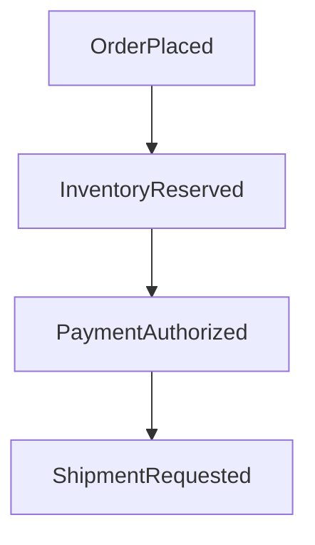
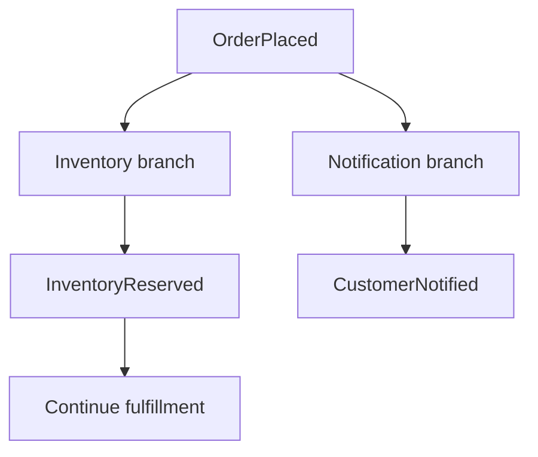

# Kiểm tra event sequence trong Spring Modulith

Một quy trình nghiệp vụ có thể phát ra nhiều application event nối tiếp nhau. Khi đơn hàng được đặt, module kho giữ hàng, module thanh toán xác nhận giao dịch và module giao vận tạo yêu cầu vận chuyển. Mỗi bước có thể do một listener khác nhau đảm nhiệm. Nếu một event bị phát sai thứ tự, bị thiếu hoặc xuất hiện nhiều lần, trạng thái nghiệp vụ cuối cùng có thể không còn nhất quán.

**Kiểm tra event sequence** là xác nhận các event được phát ra theo đúng chuỗi và quan hệ nhân quả mà nghiệp vụ yêu cầu. Với Spring Modulith, có thể kết hợp `Scenario` để kích hoạt một event và chờ event kết quả, cùng `@RecordApplicationEvents` để quan sát các event được publish trong test. Cần phân biệt thứ tự publish event với thứ tự listener hoàn tất xử lý: hai thứ tự này không luôn giống nhau, đặc biệt khi listener chạy bất đồng bộ.

## 1. Event sequence là gì?

Event sequence là chuỗi các sự kiện biểu diễn tiến trình của một hành động nghiệp vụ. Ví dụ một luồng đặt hàng có thể gồm:

1. `OrderPlaced`: đơn hàng được ghi nhận.
2. `InventoryReserved`: hàng được giữ cho đơn hàng.
3. `PaymentAuthorized`: khoản thanh toán được xác nhận.
4. `ShipmentRequested`: yêu cầu vận chuyển được tạo.



Chuỗi trên thể hiện một workflow tuyến tính. Trong hệ thống thực tế, một event có thể tạo nhiều nhánh độc lập. Ví dụ `OrderPlaced` có thể đồng thời kích hoạt giữ hàng và gửi thông báo. Khi đó không có một thứ tự toàn cục bắt buộc giữa hai nhánh; điều quan trọng là mỗi nhánh tuân thủ quan hệ phụ thuộc của chính nó.

Kiểm thử sequence giúp xác nhận:

- Event đầu vào được publish khi hành động nghiệp vụ xảy ra.
- Các event tiếp theo chỉ xuất hiện sau khi điều kiện trước đó được đáp ứng.
- Event mang đúng aggregate ID, correlation ID và dữ liệu cần thiết.
- Không phát event tiếp theo khi bước trước thất bại hoặc transaction nguồn rollback.
- Không phát lặp event ngoài ý muốn khi listener được giao lại.
- Các nhánh song song có thể tiến triển độc lập mà không áp đặt thứ tự không cần thiết.

## 2. Phân biệt thứ tự publish và thứ tự xử lý

Một application event được publish khi publisher gọi `ApplicationEventPublisher.publishEvent()`. Sau đó, Spring dispatch event tới listener phù hợp. Listener có thể chạy đồng bộ, sau commit hoặc trên executor bất đồng bộ.

Vì vậy cần phân biệt ba mốc:

| Mốc | Ý nghĩa | Có thể dùng để xác nhận điều gì? |
| --- | --- | --- |
| Event published | Publisher đã phát event vào application event mechanism | Thứ tự phát event và dữ liệu event |
| Listener started | Listener bắt đầu thực hiện công việc | Thứ tự bắt đầu xử lý |
| Listener completed | Listener hoàn tất side effect và transaction xử lý | Thứ tự hoàn tất và trạng thái nghiệp vụ |

`@RecordApplicationEvents` ghi nhận application event được publish trong test context. Nó hữu ích để kiểm tra event nào được phát và thứ tự phát của chúng. Nó không tự chứng minh mọi listener đã hoàn tất side effect. Để kiểm tra trạng thái cuối, hãy kiểm tra repository hoặc dùng `Scenario`/cơ chế await để chờ điều kiện hoàn tất.

Nếu listener bất đồng bộ, event A có thể được publish trước event B nhưng listener của B hoàn tất trước listener của A. Một test chỉ quan sát danh sách event đã publish không thể chứng minh thứ tự hoàn tất xử lý. Muốn kiểm tra thứ tự xử lý, cần một tín hiệu quan sát riêng như trạng thái nghiệp vụ, processing probe hoặc bản ghi audit được tạo khi listener hoàn tất.

## 3. Mô hình hóa chuỗi event có định danh và version

Để kiểm tra sequence chính xác, mỗi event nên mang định danh đối tượng nghiệp vụ và thông tin thứ tự nếu nghiệp vụ cần nó.

Ví dụ:

```java
public interface OrderWorkflowEvent {
    UUID orderId();
    long sequence();
}

public record OrderPlaced(
        UUID eventId,
        UUID orderId,
        long sequence
) implements OrderWorkflowEvent {}

public record InventoryReserved(
        UUID eventId,
        UUID orderId,
        long sequence
) implements OrderWorkflowEvent {}

public record PaymentAuthorized(
        UUID eventId,
        UUID orderId,
        long sequence
) implements OrderWorkflowEvent {}

public record ShipmentRequested(
        UUID eventId,
        UUID orderId,
        long sequence
) implements OrderWorkflowEvent {}
```

`eventId` nhận diện một event cụ thể; `orderId` xác định aggregate; `sequence` biểu diễn thứ tự nghiệp vụ trong phạm vi được định nghĩa. Nếu sequence được tăng theo aggregate, không được so sánh version của hai đơn hàng khác nhau như thể chúng thuộc cùng một stream.

Không phải event nào cũng cần sequence riêng. Nếu test chỉ cần xác nhận chuỗi publish trong một workflow đơn giản, có thể lọc event theo `orderId` và so sánh loại event. Với luồng có concurrency, retry hoặc replay, một sequence có nguồn gốc rõ ràng giúp phát hiện event cũ, thiếu hoặc sai thứ tự.

## 4. Xây dựng workflow publisher và listener

Giả sử module đơn hàng phát `OrderPlaced`. Module kho nhận event, giữ hàng và phát `InventoryReserved`. Module thanh toán nhận event này, xác nhận thanh toán và phát `PaymentAuthorized`. Cuối cùng module giao vận nhận event thanh toán thành công và phát `ShipmentRequested`.

```java
@Service
class OrderApplicationService {

    private final ApplicationEventPublisher events;
    private final OrderRepository orders;

    OrderApplicationService(
            ApplicationEventPublisher events,
            OrderRepository orders
    ) {
        this.events = events;
        this.orders = orders;
    }

    @Transactional
    public void place(UUID orderId) {
        Order order = orders.findById(orderId).orElseThrow();
        order.place();

        events.publishEvent(new OrderPlaced(
                UUID.randomUUID(), orderId, 1
        ));
    }
}
```

Listener của module kho:

```java
@Component
class InventoryOnOrderPlaced {

    private final InventoryService inventory;
    private final ApplicationEventPublisher events;

    InventoryOnOrderPlaced(
            InventoryService inventory,
            ApplicationEventPublisher events
    ) {
        this.inventory = inventory;
        this.events = events;
    }

    @ApplicationModuleListener
    void on(OrderPlaced event) {
        inventory.reserve(event.orderId());
        events.publishEvent(new InventoryReserved(
                UUID.randomUUID(), event.orderId(), 2
        ));
    }
}
```

Các listener tiếp theo có cấu trúc tương tự: chỉ phát event tiếp theo sau khi bước nghiệp vụ của mình hoàn tất. Ví dụ này minh họa quan hệ nhân quả; trong hệ thống thực, transaction của listener sau commit, idempotency và xử lý lỗi cần được cấu hình theo yêu cầu nghiệp vụ.

## 5. Kiểm tra chuỗi event với `@RecordApplicationEvents`

Spring Test cung cấp `@RecordApplicationEvents` để ghi nhận application event trong phạm vi test. Có thể inject `ApplicationEvents`, lọc event theo kiểu hoặc interface, sau đó kiểm tra thứ tự publish.

Ví dụ test:

```java
@ApplicationModuleTest
@RecordApplicationEvents
class OrderEventSequenceTests {

    @Autowired
    OrderApplicationService orders;

    @Autowired
    ApplicationEvents applicationEvents;

    @Test
    void publishesOrderWorkflowEventsInExpectedOrder() {
        UUID orderId = UUID.randomUUID();

        orders.place(orderId);

        List<Class<?>> sequence = applicationEvents
                .stream(OrderWorkflowEvent.class)
                .filter(event -> event.orderId().equals(orderId))
                .map(event -> event.getClass())
                .toList();

        assertThat(sequence).containsSubsequence(
                OrderPlaced.class,
                InventoryReserved.class,
                PaymentAuthorized.class,
                ShipmentRequested.class
        );
    }
}
```

Ví dụ dùng AssertJ để kiểm tra các event xuất hiện theo thứ tự tương đối. `containsSubsequence` cho phép có event khác xen giữa. Nếu hợp đồng yêu cầu đúng chính xác bốn event và không có event workflow nào khác, có thể dùng `containsExactly(...)` sau khi đã lọc đúng aggregate và đúng loại event.

Test trên giả định các bước publish tạo thành một chuỗi có thể quan sát trong cùng test context trước khi assertion chạy. Nếu listener chạy bất đồng bộ, hãy chờ event cuối hoặc trạng thái cuối trước khi đọc danh sách. Không nên dựa vào việc `orders.place()` trả về để kết luận mọi listener đã hoàn tất.

## 6. Dùng `Scenario` để chờ event kết quả

`Scenario` của Spring Modulith Test hỗ trợ mô tả một tình huống: publish event đầu vào, chờ event kết quả thuộc một loại cụ thể và có thể lọc theo nội dung. Cách này phù hợp với listener sau commit hoặc bất đồng bộ vì test chờ một kết quả có ý nghĩa thay vì sleep một khoảng thời gian cố định.

```java
@ApplicationModuleTest
class OrderScenarioTests {

    @Test
    void orderPlacedEventuallyRequestsShipment(Scenario scenario) {
        UUID orderId = UUID.randomUUID();

        scenario.publish(new OrderPlaced(
                        UUID.randomUUID(), orderId, 1))
                .andWaitForEventOfType(ShipmentRequested.class)
                .matching(event -> event.orderId().equals(orderId))
                .toArrive();
    }
}
```

Test này xác nhận event cuối của workflow đã đến. Nó không tự chứng minh mọi event trung gian đã được phát đúng thứ tự. Nếu sequence là hợp đồng cần kiểm tra, hãy kết hợp với event recording hoặc một trạng thái có version để xác nhận các bước trung gian.

API `Scenario` có thể thay đổi theo phiên bản Spring Modulith. Hãy dùng cú pháp và timeout mặc định/tuỳ chỉnh theo đúng phiên bản dependency của dự án. Không nên tự xây một API giả định hoặc dùng `Thread.sleep()` để thay thế khả năng chờ của test support.

## 7. Kiểm tra thứ tự tương đối và thứ tự tuyệt đối

Hai dạng assertion thường dùng là thứ tự tương đối và thứ tự tuyệt đối:

| Kiểu kiểm tra | Ý nghĩa | Assertion phù hợp |
| --- | --- | --- |
| Thứ tự tương đối | Các event quan trọng xuất hiện đúng thứ tự, event khác có thể xen giữa | `containsSubsequence(...)` |
| Thứ tự tuyệt đối | Danh sách event của workflow phải khớp hoàn toàn, không thừa/thiếu | `containsExactly(...)` |
| Có đủ event nhưng không quan tâm thứ tự | Tất cả event mong đợi đều xuất hiện | `containsExactlyInAnyOrder(...)` |
| Chỉ có một event thuộc loại cụ thể | Không phát lặp event đó | `hasSize(1)` hoặc `singleElement()` |

Chọn assertion theo hợp đồng nghiệp vụ. Ví dụ, `OrderPlaced`, `InventoryReserved`, `PaymentAuthorized` phải theo thứ tự, nhưng hệ thống có thể phát thêm `AuditRecorded` ở giữa. Khi đó, `containsSubsequence` phù hợp hơn. Nếu test đang kiểm tra chính xác contract của một chuỗi event công khai, `containsExactly` có thể giúp phát hiện event thừa hoặc event bị thiếu.

Không dùng `containsExactlyInAnyOrder` cho một workflow mà thứ tự là điều kiện nghiệp vụ. Assertion này có thể làm test xanh dù event bị phát sai thứ tự.

## 8. Kiểm tra sequence theo aggregate

Trong hệ thống xử lý nhiều đơn hàng đồng thời, các event của nhiều aggregate có thể xen kẽ:

```text
Order-A: OrderPlaced -> InventoryReserved -> PaymentAuthorized
Order-B: OrderPlaced -> InventoryReserved -> PaymentAuthorized
```

Danh sách toàn cục có thể là:

```text
OrderPlaced(A)
OrderPlaced(B)
InventoryReserved(B)
InventoryReserved(A)
PaymentAuthorized(A)
PaymentAuthorized(B)
```

Đây không nhất thiết là lỗi. Điều cần xác nhận là mỗi aggregate giữ đúng sequence riêng. Vì vậy, test nên lọc theo `orderId` trước khi so sánh:

```java
Map<UUID, List<Class<?>>> sequences = applicationEvents
        .stream(OrderWorkflowEvent.class)
        .collect(Collectors.groupingBy(
                OrderWorkflowEvent::orderId,
                Collectors.mapping(Object::getClass, Collectors.toList())
        ));

assertThat(sequences.get(orderA)).containsSubsequence(
        OrderPlaced.class,
        InventoryReserved.class,
        PaymentAuthorized.class
);

assertThat(sequences.get(orderB)).containsSubsequence(
        OrderPlaced.class,
        InventoryReserved.class,
        PaymentAuthorized.class
);
```

Ví dụ trên minh họa việc tách chuỗi theo aggregate. Nếu test dùng listener bất đồng bộ, cần chờ các event cuối của từng aggregate trước khi lấy snapshot danh sách.

## 9. Kiểm tra correlation và causation

Trong workflow dài, một event có thể phát sinh từ event trước đó. `correlationId` liên kết các event trong cùng một quy trình; `causationId` có thể chỉ ra event trực tiếp gây ra event hiện tại.

Ví dụ:

```java
public record WorkflowMetadata(
        UUID eventId,
        UUID correlationId,
        UUID causationId
) {}
```

Khi module kho nhận `OrderPlaced`, event `InventoryReserved` có thể giữ nguyên `correlationId` và đặt `causationId` bằng `eventId` của `OrderPlaced`. Module thanh toán tiếp tục chuỗi metadata này.

Test nên xác nhận:

- Mọi event trong một workflow có cùng correlation ID.
- Causation ID trỏ tới event trực tiếp đã kích hoạt bước kế tiếp.
- Event thuộc aggregate khác không bị gắn nhầm correlation ID.
- Retry giữ nguyên định danh event/business operation theo quy tắc idempotency, không tạo quan hệ nhân quả giả.

Không dùng correlation ID như bằng chứng về thứ tự. Nó chỉ liên kết các sự kiện trong cùng workflow; thứ tự cần được xác nhận bằng sequence/version hoặc quan sát event publish/processing.

## 10. Kiểm tra event thiếu, thừa và sai thứ tự

Một test sequence nên có cả trường hợp lỗi, không chỉ happy path:

| Tình huống | Điều cần xác nhận |
| --- | --- |
| Thiếu event trung gian | Event cuối không được phát nếu điều kiện bắt buộc chưa hoàn tất |
| Event bị phát sai thứ tự | Projector/consumer từ chối hoặc giữ event chờ theo chính sách |
| Event phát lặp | Side effect không bị áp dụng hai lần |
| Event của aggregate khác xen giữa | Không làm sai sequence của aggregate đang kiểm tra |
| Listener thất bại | Không phát event tiếp theo nếu bước nghiệp vụ chưa thành công |
| Transaction nguồn rollback | Event sau commit không xuất hiện |
| Event đến muộn | Không làm lùi trạng thái hoặc ghi đè kết quả mới hơn |
| Nhánh song song | Mỗi nhánh đạt điều kiện riêng; không áp đặt thứ tự toàn cục không cần thiết |

Với event thiếu, cần xác định listener có nên retry, giữ pending, phát cảnh báo hay chuyển sang trạng thái cần can thiệp. Không nên làm test chỉ assert event cuối không xuất hiện mà không xác nhận nguyên nhân và trạng thái trung gian.

## 11. Kiểm tra transaction phase và sequence sau commit

Nếu event đầu vào được phát trong transaction nghiệp vụ và listener dùng `@TransactionalEventListener(phase = AFTER_COMMIT)` hoặc `@ApplicationModuleListener`, sequence downstream chỉ nên bắt đầu sau khi transaction nguồn commit theo semantics được cấu hình.

Hai tình huống quan trọng:

- **Commit:** publisher phát `OrderPlaced`, transaction commit, listener xử lý và phát `InventoryReserved`.
- **Rollback:** transaction nguồn rollback, listener sau commit không thực hiện bước tiếp theo; event downstream không được xuất hiện.

Test cần thực hiện commit thật khi muốn xác nhận listener `AFTER_COMMIT`. Một test method có `@Transactional` và mặc định rollback khi kết thúc có thể khiến listener không được gọi. Hãy tổ chức test gọi service transaction từ ngoài transaction test hoặc điều khiển commit/rollback rõ ràng.

Nếu listener cần ghi database sau commit, nó cần transaction xử lý riêng. Khi test sequence, hãy đợi transaction listener hoàn tất trước khi đọc trạng thái hoặc event tiếp theo.

## 12. Kiểm tra listener bất đồng bộ và nhánh song song

Với listener chạy trên executor, thứ tự bắt đầu hoặc hoàn tất giữa các listener độc lập không được bảo đảm chỉ bởi thứ tự publish. Một event có thể kích hoạt nhiều listener và mỗi listener có thời gian xử lý khác nhau.

Ví dụ:



Nếu `InventoryReserved` và `CustomerNotified` không phụ thuộc nhau, test nên xác nhận cả hai xuất hiện trong thời hạn, nhưng không khẳng định nhánh nào phải hoàn tất trước. Có thể dùng hai `Scenario` hoặc chờ trạng thái của cả hai nhánh, mỗi nhánh lọc theo cùng order ID.

Nếu một bước chỉ được phép chạy sau khi hai nhánh hoàn tất, hãy mô hình hóa điều kiện hội tụ rõ ràng, chẳng hạn process manager hoặc một event tổng hợp `OrderReadyForFulfillment`. Test sequence khi đó xác nhận event hội tụ chỉ được phát sau khi cả hai điều kiện đã đạt.

Không dùng một danh sách event toàn cục để áp đặt thứ tự giữa các listener bất đồng bộ độc lập. Hãy kiểm tra quan hệ nhân quả thực sự của workflow.

## 13. Kiểm tra thứ tự xử lý, không chỉ thứ tự publish

Nếu yêu cầu nghiệp vụ nói rằng listener A phải hoàn tất trước listener B bắt đầu, event recording chưa đủ. Cần quan sát processing lifecycle.

Một cách là dùng probe trong test để ghi nhận mốc bắt đầu/kết thúc:

```java
final class ProcessingProbe {

    private final List<String> steps = new CopyOnWriteArrayList<>();

    void started(String step) {
        steps.add(step + ":started");
    }

    void completed(String step) {
        steps.add(step + ":completed");
    }

    List<String> snapshot() {
        return List.copyOf(steps);
    }
}
```

Listener test có thể ghi nhận:

```java
probe.started("inventory");
inventory.reserve(orderId);
probe.completed("inventory");
events.publishEvent(new InventoryReserved(...));
```

Trong test, probe cần được đồng bộ và chỉ dùng cho quan sát; không để test instrumentation thay đổi logic production. Có thể thay probe bằng audit record hoặc trạng thái domain nếu thứ tự xử lý là một yêu cầu cần lưu dấu trong hệ thống thật.

Khi listener bất đồng bộ, `CopyOnWriteArrayList` chỉ bảo vệ thao tác ghi/đọc danh sách; nó không tạo quan hệ thứ tự giữa các thread. Test phải chờ các mốc cần thiết và chỉ khẳng định thứ tự mà kiến trúc thực sự bảo đảm.

## 14. Event sequence với broker và partition

Khi externalize event tới Kafka hoặc AMQP, thứ tự còn phụ thuộc semantics của broker:

- Kafka bảo đảm thứ tự trong một partition; event của cùng aggregate thường cần cùng partition key nếu thứ tự aggregate quan trọng.
- AMQP queue giữ thứ tự theo cách broker giao message trong queue, nhưng nhiều consumer, requeue, retry và prefetch có thể làm thứ tự hoàn tất xử lý khác thứ tự enqueue.
- Nhiều queue nhận cùng một event qua exchange không có thứ tự hoàn tất toàn cục giữa các consumer.

Với Kafka, test sequence nên kiểm tra event của cùng aggregate được route cùng partition nếu partition ordering là yêu cầu. Không so sánh offset giữa các partition như một sequence toàn cục.

Với RabbitMQ, nếu cần thứ tự xử lý nghiêm ngặt cho một queue, cần xem xét số consumer, prefetch, acknowledgement và retry/requeue. Nếu nhiều consumer xử lý song song, message thứ hai có thể hoàn tất trước message thứ nhất dù được lấy sau.

Trong integration test, hãy dùng broker thật hoặc Testcontainers khi cần xác nhận partition/routing/ack semantics. Unit test của publisher không thể chứng minh broker duy trì thứ tự.

## 15. Kiểm tra duplicate và sequence version

Một event sequence có thể bị giao lặp do retry. Test cần xác nhận duplicate không làm sequence tiến sai hoặc phát event tiếp theo nhiều lần.

Ví dụ một projector kiểm tra version:

```java
@Transactional
public void apply(InventoryReserved event) {
    long current = checkpoints.current("order", event.orderId());

    if (event.sequence() <= current) {
        return; // event cũ hoặc duplicate
    }

    if (event.sequence() != current + 1) {
        throw new EventSequenceGapException(
                event.orderId(), current + 1, event.sequence()
        );
    }

    projection.apply(event);
    checkpoints.advance("order", event.orderId(), event.sequence());
}
```

Ví dụ giả định sequence liên tục trong stream của aggregate. Trong hệ thống thực, update projection và checkpoint cần cùng transaction; việc đọc/ghi checkpoint phải được bảo vệ trước concurrency bằng khóa, optimistic version hoặc unique constraint phù hợp.

Test nên gửi event sequence `1`, `2`, sau đó gửi lại `2` và xác nhận projection không thay đổi lần nữa. Tiếp theo, gửi `4` khi checkpoint đang ở `2` và xác nhận hệ thống không nhảy qua sequence `3` nếu nguồn yêu cầu liên tục.

## 16. Quản lý timeout và tránh test flaky

Test sequence bất đồng bộ cần timeout hữu hạn và điều kiện chờ cụ thể. Không dùng sleep cố định vì thời gian listener chạy thay đổi theo máy, tải và CI.

Các nguyên tắc:

- Chờ event cuối cùng có cùng aggregate/correlation ID.
- Sau khi event cuối đến, mới đọc event recorder hoặc trạng thái projection.
- Mỗi test dùng ID riêng để không nhận nhầm event của test khác.
- Timeout phản ánh thời gian test hợp lý, không che giấu listener bị treo.
- Dọn dữ liệu sau khi các listener đã hoàn tất.
- Nếu test kiểm tra nhánh song song, chờ đủ điều kiện của mọi nhánh.

Ví dụ với Awaitility:

```java
await()
        .atMost(Duration.ofSeconds(5))
        .untilAsserted(() ->
                assertThat(repository.findByOrderId(orderId))
                        .hasValueSatisfying(order ->
                                assertThat(order.status())
                                        .isEqualTo(OrderStatus.READY_FOR_SHIPMENT)
                        )
        );
```

Awaitility phù hợp khi trạng thái cuối là bằng chứng rõ ràng. Nếu cần xác nhận event cụ thể đã được phát, `Scenario` hoặc `ApplicationEvents` phù hợp hơn. Có thể kết hợp cả hai nếu workflow cần xác nhận event sequence và trạng thái persistence.

## 17. Những lỗi thường gặp khi kiểm tra event sequence

| Lỗi | Hệ quả | Cách khắc phục |
| --- | --- | --- |
| Cho rằng publish order bằng processing completion order | Test kết luận sai với listener async | Phân biệt publish/start/complete |
| Chỉ chờ event cuối nhưng không kiểm tra bước trung gian | Có thể bỏ sót event sai thứ tự hoặc event thừa | Kết hợp Scenario với event recording |
| So sánh sequence toàn cục của nhiều aggregate | Event xen kẽ hợp lệ bị coi là lỗi | Lọc theo aggregate ID hoặc partition |
| Dùng `containsExactlyInAnyOrder` khi thứ tự quan trọng | Test vẫn xanh dù sequence sai | Dùng `containsSubsequence` hoặc `containsExactly` |
| Dùng `Thread.sleep()` | Test chậm và flaky | Chờ điều kiện với timeout |
| Không lọc theo correlation ID | Event của workflow khác làm test vượt qua | Gắn và lọc correlation ID |
| Khẳng định thứ tự giữa nhánh song song | Test áp đặt một thứ tự không được kiến trúc bảo đảm | Kiểm tra partial order và điều kiện hội tụ |
| Không kiểm tra rollback | Event downstream có thể xuất hiện dù transaction nguồn thất bại | Test commit và rollback thật |
| Không kiểm tra duplicate/version gap | Retry hoặc event đến muộn làm sai trạng thái | Kiểm tra idempotency và sequence checkpoint |
| Dùng ApplicationEvents để chứng minh listener đã hoàn tất | Event được publish nhưng side effect có thể chưa commit | Kiểm tra trạng thái hoặc processing probe |

## 18. Quy trình kiểm tra event sequence

Khi kiểm thử một workflow Spring Modulith có nhiều event, hãy thực hiện theo thứ tự:

1. Mô tả chuỗi nghiệp vụ và phân biệt bước bắt buộc với nhánh độc lập.
2. Xác định event type, aggregate ID, event ID, correlation ID và sequence/version cần thiết.
3. Xác định listener đồng bộ, sau commit hay bất đồng bộ.
4. Dùng `@ApplicationModuleTest` để khởi tạo module hoặc phạm vi module cần thiết.
5. Dùng `Scenario` để publish event đầu vào và chờ event kết quả có ý nghĩa.
6. Dùng `@RecordApplicationEvents`/`ApplicationEvents` để kiểm tra event nào được publish và thứ tự tương đối hoặc tuyệt đối.
7. Lọc event theo aggregate/correlation ID để tránh trộn các workflow đồng thời.
8. Kiểm tra trạng thái persistence hoặc processing probe nếu cần chứng minh thứ tự listener hoàn tất.
9. Bổ sung test thiếu event, event thừa, duplicate, gap, rollback và nhánh song song.
10. Với broker, kiểm thử partition/routing/ack semantics trong integration test riêng.
11. Dùng timeout hữu hạn, dữ liệu test riêng và chờ listener hoàn tất trước cleanup.

Kiểm tra event sequence giúp xác nhận các module phối hợp theo đúng quan hệ nhân quả của nghiệp vụ. Khi test phân biệt thứ tự publish với thứ tự xử lý, lọc theo aggregate/correlation, kết hợp `Scenario` và event recording, đồng thời kiểm tra duplicate, rollback và concurrency, nhóm phát triển có thể phát hiện sớm event thiếu hoặc sai thứ tự mà không áp đặt những bảo đảm mà kiến trúc bất đồng bộ không cung cấp.
