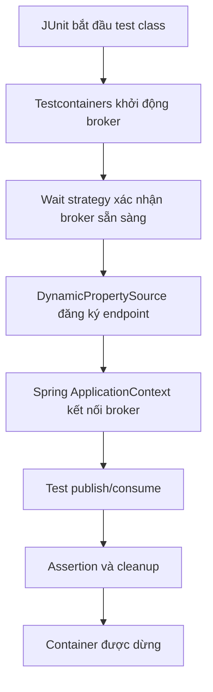
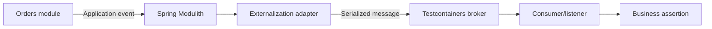

# Testcontainers cho broker

Kiểm thử application event bằng mock có thể xác minh module phát gọi publisher hoặc adapter gửi đúng object. Tuy nhiên, mock không chạy broker thật nên không chứng minh message được serialize đúng, exchange/topic định tuyến đúng, consumer nhận được message, acknowledgement hoạt động hay cấu hình retry/dead-letter được áp dụng.

**Testcontainers** cho phép khởi chạy dependency thật trong container dùng riêng cho test. Với Spring Modulith, có thể dùng Kafka hoặc RabbitMQ container để kiểm tra đường đi từ event adapter tới broker và consumer. Cách này tạo bằng chứng gần với môi trường vận hành hơn, đồng thời giúp test có topology và dữ liệu độc lập, có thể tự khởi tạo và dọn dẹp.

## 1. Khi nào cần Testcontainers?

Chọn test layer theo hành vi cần chứng minh:

| Loại kiểm thử | Điều kiểm tra được | Điều không chứng minh được |
|---|---|---|
| Unit test với mock | Mapping event, gọi adapter, xử lý nhánh code | Broker nhận, route hoặc lưu message |
| Spring module test | Event nội bộ, listener và ranh giới module | Kafka/RabbitMQ protocol và topology thực |
| Test với embedded broker | Một phần hành vi broker trong tiến trình test | Môi trường broker/container gần production ở mọi cấu hình |
| Testcontainers | Broker thật, serializer, routing, consumer, ack và topology | Toàn bộ độ tin cậy của production cluster hoặc mọi lỗi mạng thực tế |
| End-to-end trên môi trường tích hợp | Tương tác nhiều service và hạ tầng gần production | Mọi tình huống lỗi có thể xảy ra trong production |

Testcontainers phù hợp khi test cần xác minh:

- Producer kết nối và publish được tới broker.
- Topic, exchange, queue, binding và routing key được cấu hình đúng.
- Key, headers, content type và payload được serialize đúng.
- Consumer nhận và deserialize được message.
- Consumer group, partition hoặc queue subscription hoạt động như mong đợi.
- Publisher confirm/return, acknowledgement, redelivery, retry và dead-letter được cấu hình đúng.
- Ứng dụng khởi động với broker endpoint động do container cung cấp.

Không cần khởi chạy broker cho mọi unit test. Dùng container ở những test cần chứng minh semantics của broker hoặc wiring giữa Spring và broker. Các phép kiểm tra thuần mapping vẫn nên chạy nhanh ở tầng unit.

## 2. Testcontainers hoạt động như thế nào?

Testcontainers dùng Docker để tạo container trong vòng đời test. Test thường khởi động container, chờ dịch vụ sẵn sàng, cung cấp host/port động cho Spring Boot, chạy assertion rồi dừng và xóa container.



Endpoint thường được cấp động. Không hardcode `localhost:9092` hoặc `localhost:5672` trong test vì Docker có thể ánh xạ port khác nhau trên mỗi lần chạy. Hãy lấy địa chỉ từ container và đưa vào Spring Environment trước khi application context tạo connection factory.

## 3. Chuẩn bị dependency test

Các dependency thường cần:

| Thành phần | Mục đích |
|---|---|
| Testcontainers JUnit Jupiter | Tích hợp lifecycle container với JUnit 5 |
| Testcontainers Kafka module | Khởi chạy Kafka container |
| Testcontainers RabbitMQ module | Khởi chạy RabbitMQ container |
| Spring Kafka hoặc Spring AMQP | Producer, consumer và listener của ứng dụng |
| Awaitility | Chờ kết quả bất đồng bộ với timeout |
| AssertJ/JUnit | Assertion và tổ chức test |

Ví dụ Maven dependency cho test scope (cần đồng bộ phiên bản Testcontainers qua BOM hoặc dependency management của dự án):

```xml
<dependency>
    <groupId>org.testcontainers</groupId>
    <artifactId>junit-jupiter</artifactId>
    <scope>test</scope>
</dependency>
<dependency>
    <groupId>org.testcontainers</groupId>
    <artifactId>kafka</artifactId>
    <scope>test</scope>
</dependency>
<dependency>
    <groupId>org.testcontainers</groupId>
    <artifactId>rabbitmq</artifactId>
    <scope>test</scope>
</dependency>
<dependency>
    <groupId>org.awaitility</groupId>
    <artifactId>awaitility</artifactId>
    <scope>test</scope>
</dependency>
```

Nếu module chỉ kiểm thử Kafka hoặc chỉ kiểm thử RabbitMQ, chỉ thêm module container tương ứng. Tên artifact, package class và API container phụ thuộc phiên bản Testcontainers; dùng cùng một dòng phiên bản được quản lý trong build. Không trộn Testcontainers 1.x và 2.x tùy tiện.

Máy chạy test cần Docker daemon khả dụng. Trong CI, runner phải có quyền truy cập Docker socket hoặc môi trường container runtime tương thích. Testcontainers không tự cài Docker và không thể chạy nếu môi trường CI không cấp quyền tạo container.

## 4. Khởi chạy Kafka container

Ví dụ dưới đây dùng Kafka container từ Testcontainers và `@DynamicPropertySource` để đưa bootstrap server vào Spring Boot:

```java
import org.junit.jupiter.api.Test;
import org.springframework.boot.test.context.SpringBootTest;
import org.springframework.test.context.DynamicPropertyRegistry;
import org.springframework.test.context.DynamicPropertySource;
import org.testcontainers.containers.KafkaContainer;
import org.testcontainers.junit.jupiter.Container;
import org.testcontainers.junit.jupiter.Testcontainers;
import org.testcontainers.utility.DockerImageName;

@Testcontainers
@SpringBootTest
class KafkaBrokerIntegrationTest {

    @Container
    static final KafkaContainer kafka = new KafkaContainer(
        DockerImageName.parse("confluentinc/cp-kafka:7.6.1")
    );

    @DynamicPropertySource
    static void kafkaProperties(DynamicPropertyRegistry registry) {
        registry.add("spring.kafka.bootstrap-servers", kafka::getBootstrapServers);
    }

    @Test
    void applicationContextConnectsToKafka() {
        // Thực hiện assertion qua KafkaTemplate hoặc consumer của ứng dụng.
    }
}
```

Ví dụ minh họa API KafkaContainer thuộc dòng Testcontainers 1.x. Ở phiên bản mới hơn, package hoặc class container có thể chuyển sang module Kafka chuyên biệt và image Kafka khác; hãy dùng class tương ứng với dependency đã khóa trong dự án. Điều quan trọng là lấy bootstrap address từ container, không tự đoán port.

`@Container` static được chia sẻ trong một test class và dừng khi class kết thúc. Nếu dùng container instance field, JUnit extension có thể khởi động/dừng container cho từng test method, làm test chậm hơn nhưng tăng mức cô lập. Chọn lifecycle theo nhu cầu test và chi phí khởi động broker.

## 5. Cấu hình Spring Boot bằng endpoint động

`@DynamicPropertySource` đăng ký property trước khi Spring tạo bean cần kết nối broker. Với Kafka, property thường là `spring.kafka.bootstrap-servers`. Không khai báo địa chỉ container bằng một port cố định trong `application-test.yml`.

Ví dụ khi cần cấu hình thêm consumer group và serializer:

```java
@DynamicPropertySource
static void kafkaProperties(DynamicPropertyRegistry registry) {
    registry.add("spring.kafka.bootstrap-servers", kafka::getBootstrapServers);
    registry.add("spring.kafka.consumer.auto-offset-reset", () -> "earliest");
    registry.add("spring.kafka.consumer.group-id", () -> "broker-it-group");
}
```

Các property được thêm vào ví dụ phải phù hợp với cấu hình ứng dụng. Consumer group dùng chung có thể làm test ảnh hưởng nhau; trong test song song, hãy tạo group/topic riêng hoặc namespace riêng cho từng test.

Spring Boot có thể hỗ trợ service connection cho một số container và phiên bản tương ứng. `@DynamicPropertySource` là lựa chọn tường minh, dễ nhìn thấy property được map và hữu ích khi container module chưa có service connection phù hợp.

## 6. Tạo topic và kiểm tra Kafka producer

Không nên dựa vào auto topic creation nếu test cần xác minh topology cụ thể. Có thể khai báo `NewTopic` qua Spring Kafka hoặc tạo topic bằng AdminClient trong setup.

Ví dụ cấu hình topic:

```java
@TestConfiguration
class KafkaTestTopology {

    @Bean
    NewTopic ordersTopic() {
        return TopicBuilder.name("orders.events.it")
            .partitions(1)
            .replicas(1)
            .build();
    }
}
```

Với một broker test, replication factor thường phải là 1. Cấu hình replication cao hơn số broker sẽ khiến topic không được tạo như mong muốn. Test topology production nhiều broker cần một môi trường riêng có đủ broker.

Test producer nên xác minh message thực tế tới broker, không chỉ kiểm tra `KafkaTemplate.send()` được gọi:

```java
@SpringBootTest
@Testcontainers
class OrderKafkaPublisherTest {

    @Container
    static final KafkaContainer kafka = new KafkaContainer(
        DockerImageName.parse("confluentinc/cp-kafka:7.6.1")
    );

    @DynamicPropertySource
    static void properties(DynamicPropertyRegistry registry) {
        registry.add("spring.kafka.bootstrap-servers", kafka::getBootstrapServers);
    }

    @Autowired
    KafkaTemplate<String, OrderPlaced> kafkaTemplate;

    @Test
    void publishesOrderEvent() throws Exception {
        var event = TestEvents.orderPlaced();

        kafkaTemplate.send("orders.events.it", event.orderId().toString(), event)
            .get(10, TimeUnit.SECONDS);

        // Consumer test hoặc AdminClient kiểm tra record thực tế đã được ghi.
    }
}
```

Đây là ví dụ rút gọn. Nếu test cần xác minh serializer và payload, hãy consume record từ topic bằng consumer được cấu hình như consumer thật rồi assert key, value, headers và metadata. Chờ future hoàn tất chỉ kiểm tra kết quả producer theo acknowledgement configuration; nó chưa chứng minh consumer đã xử lý message.

## 7. Kiểm tra Kafka consumer và listener bất đồng bộ

Consumer thường chạy trên thread riêng. Test cần chờ message được xử lý bằng điều kiện có timeout, không dùng `Thread.sleep()` với thời gian cố định.

Một cách là dùng `BlockingQueue` làm probe trong test:

```java
@Component
class OrderEventProbe {

    private final BlockingQueue<OrderPlaced> received = new LinkedBlockingQueue<>();

    @KafkaListener(
        topics = "orders.events.it",
        groupId = "orders-events-it"
    )
    void receive(OrderPlaced event) {
        received.add(event);
    }

    OrderPlaced awaitEvent(Duration timeout) throws InterruptedException {
        return received.poll(timeout.toMillis(), TimeUnit.MILLISECONDS);
    }
}
```

Trong test, publish event rồi lấy kết quả từ probe và assert:

```java
var received = probe.awaitEvent(Duration.ofSeconds(10));

assertThat(received).isNotNull();
assertThat(received.eventId()).isEqualTo(event.eventId());
assertThat(received.orderId()).isEqualTo(event.orderId());
```

Probe là test component, không phải business listener. Nếu test nhiều message hoặc chạy song song, cần làm sạch queue probe hoặc tạo probe/topic/group riêng cho từng test để không lấy nhầm message cũ.

## 8. Kiểm tra key, partition và headers của Kafka

Kafka broker integration test có thể xác minh:

- Key sau serialize có đúng giá trị mong đợi.
- Record được ghi vào topic và partition hợp lệ.
- Event ID, correlation ID, event type và schema version có mặt trong headers nếu contract yêu cầu.
- Consumer đọc được payload bằng serializer/deserializer thực tế.
- Các event cùng aggregate có key ổn định để partitioner định tuyến theo quy ước.

Nếu cần kiểm tra metadata broker, dùng `ConsumerRecord` hoặc `RecordMetadata` để assert topic, partition, offset, key, value và headers. Đừng giả định ordering toàn cục giữa nhiều partition; test chỉ nên khẳng định ordering trong phạm vi partition được thiết kế.

Với test ordering, tạo topic có partition count phù hợp, gửi nhiều event cùng key và consume theo partition. Nếu test dùng topic một partition, kết quả không chứng minh hành vi phân tải hoặc hot partition của production.

## 9. Khởi chạy RabbitMQ container

RabbitMQ Testcontainers module cung cấp `RabbitMQContainer`. Ví dụ:

```java
import org.testcontainers.containers.RabbitMQContainer;
import org.testcontainers.junit.jupiter.Container;
import org.testcontainers.junit.jupiter.Testcontainers;
import org.testcontainers.utility.DockerImageName;

@Testcontainers
@SpringBootTest
class RabbitBrokerIntegrationTest {

    @Container
    static final RabbitMQContainer rabbit = new RabbitMQContainer(
        DockerImageName.parse("rabbitmq:3.13-management-alpine")
    ).withEnv("RABBITMQ_DEFAULT_USER", "test")
     .withEnv("RABBITMQ_DEFAULT_PASS", "test");

    @DynamicPropertySource
    static void rabbitProperties(DynamicPropertyRegistry registry) {
        registry.add("spring.rabbitmq.host", rabbit::getHost);
        registry.add("spring.rabbitmq.port", rabbit::getAmqpPort);
        registry.add("spring.rabbitmq.username", () -> "test");
        registry.add("spring.rabbitmq.password", () -> "test");
    }
}
```

Image tag cần được pin theo phiên bản broker mà ứng dụng hỗ trợ. Các image RabbitMQ mới có thể thay đổi phiên bản Erlang hoặc cấu hình mặc định; hãy dùng image đã được xác nhận tương thích với dependency Spring AMQP của dự án. Container cung cấp port mapping động qua `getAmqpPort()`.

`RABBITMQ_DEFAULT_USER` và `RABBITMQ_DEFAULT_PASS` chỉ là thông tin test. Không tái sử dụng credential production. Nếu test cần plugin hoặc cấu hình broker riêng, dùng image test đã chuẩn bị hoặc mount cấu hình qua cơ chế được kiểm soát.

## 10. Khai báo exchange, queue và binding

RabbitMQ routing phụ thuộc topology. Một test chỉ gửi message và thấy không có exception chưa chứng minh message tới đúng queue. Hãy khai báo exchange, queue và binding như cấu hình ứng dụng hoặc tạo topology rõ ràng trong test.

```java
@TestConfiguration
class RabbitTestTopology {

    @Bean
    DirectExchange ordersExchange() {
        return new DirectExchange("orders.exchange.it", true, false);
    }

    @Bean
    Queue ordersQueue() {
        return QueueBuilder.durable("orders.queue.it").build();
    }

    @Bean
    Binding ordersBinding(
        Queue ordersQueue,
        DirectExchange ordersExchange
    ) {
        return BindingBuilder.bind(ordersQueue)
            .to(ordersExchange)
            .with("order.placed");
    }
}
```

Spring AMQP `RabbitAdmin` có thể tự khai báo các bean `Queue`, `Exchange` và `Binding` khi connection được thiết lập, tùy cấu hình. Nếu test dùng topology tạo thủ công qua management API, cần bảo đảm cleanup và tên riêng cho test.

Không khai báo lại cùng một queue với arguments khác trong cùng broker. RabbitMQ có thể trả `PRECONDITION_FAILED` khi queue đã tồn tại nhưng durable, exclusive, auto-delete hoặc arguments không khớp.

## 11. Kiểm tra RabbitTemplate và consumer

Producer test có thể gửi message qua `RabbitTemplate`:

```java
@Autowired
RabbitTemplate rabbitTemplate;

@Test
void routesOrderEventToBoundQueue() {
    var event = TestEvents.orderPlaced();

    rabbitTemplate.convertAndSend(
        "orders.exchange.it",
        "order.placed",
        event
    );

    await().atMost(Duration.ofSeconds(10)).untilAsserted(() -> {
        Object received = rabbitTemplate.receiveAndConvert("orders.queue.it");
        assertThat(received).isInstanceOf(OrderPlaced.class);
        assertThat(((OrderPlaced) received).eventId()).isEqualTo(event.eventId());
    });
}
```

Ví dụ giả định message converter của ứng dụng có thể chuyển đổi `OrderPlaced` và queue đã được khai báo. `receiveAndConvert` lấy message khỏi queue; nếu test cần kiểm tra listener thực, hãy dùng `@RabbitListener` probe thay vì tự pull message.

Nếu cần xác minh JSON converter, kiểm tra body bytes, content type và headers. Nếu chỉ assert object sau khi convert, cần chắc chắn test dùng đúng `MessageConverter` như production.

## 12. Kiểm thử publisher confirms và returned messages

Với RabbitMQ, publisher confirm và publisher return trả lời hai câu hỏi khác nhau:

- Confirm cho biết broker đã xác nhận publish theo semantics của publisher confirms.
- Return cho biết message không được route tới queue nào khi publish ở chế độ mandatory.

Test cần cấu hình confirm type và `mandatory` phù hợp, sau đó chờ callback/future hoàn tất bằng timeout. Một confirm ACK không chứng minh consumer đã xử lý message. Một message có thể được broker nhận nhưng không có binding phù hợp; nếu không theo dõi return, test có thể bỏ sót lỗi routing.

Các tình huống nên kiểm tra:

- Publish tới exchange/routing key có binding: message được route.
- Publish với routing key không có binding và mandatory bật: returned message được quan sát.
- Broker NACK hoặc connection failure: lỗi được báo cho publisher.
- Confirm timeout: kết quả có thể không xác định; retry giữ nguyên event ID.
- Consumer ack sau xử lý thành công: message được loại khỏi queue.

Không dùng `RabbitTemplate.convertAndSend()` trả về bình thường làm bằng chứng broker đã xác nhận hoặc consumer đã hoàn tất. Cần quan sát đúng callback và acknowledgement semantics.

## 13. Kiểm thử retry và dead-letter với RabbitMQ

Testcontainers cho phép kiểm tra topology DLX/queue thật. Có thể tạo queue chính, dead-letter exchange và DLQ; sau đó làm listener thất bại theo một số lần xác định.

Một kịch bản kiểm thử:

1. Publish một event hợp lệ vào queue chính.
2. Consumer cố ý ném exception trong các lần đầu.
3. Listener retry theo policy giới hạn.
4. Khi retry hết, message bị reject không requeue.
5. Broker dead-letter message sang DLQ theo queue arguments/policy.
6. Test consume DLQ và kiểm tra event ID, payload cùng metadata lỗi.

Không dùng một `Thread.sleep()` dài để đợi DLQ. Dùng Awaitility chờ số message hoặc probe nhận được message, với timeout rõ ràng. Đảm bảo test không để message cũ trong DLQ làm assertion của test sau pass nhầm.

Test retry cũng cần xác minh message không bị mất khi consumer dừng trước ack và được redeliver theo cấu hình. Broker container đơn lẻ không mô phỏng mọi lỗi cluster hoặc network partition, nhưng có thể xác minh ack/nack và redelivery cơ bản.

## 14. Kết hợp Testcontainers với Spring Modulith

Spring Modulith tổ chức event nội bộ giữa các module. Nếu event được externalize, adapter chuyển event sang Kafka hoặc RabbitMQ. Testcontainers kiểm tra phần broker/transport thật, còn Spring Modulith test support kiểm tra event dispatch và ranh giới module nội bộ.

Một luồng tích hợp có thể là:



Khi dùng externalization integration chính thức hoặc annotation như `@Externalized`, hãy cấu hình theo đúng phiên bản Spring Modulith và broker integration. Nếu dùng adapter tự viết, test contract của adapter một cách tường minh. Không giả định Spring Modulith tự động tạo mọi topic, exchange hoặc binding chỉ vì event được đánh dấu externalized.

Nên tách ba nhóm test:

- Module test: event nội bộ được phát và listener đúng được gọi.
- Broker integration test: adapter gửi message đúng wire contract và broker route tới destination.
- Consumer integration test: consumer deserialize và xử lý message với transaction/idempotency đúng.

Có thể có một số end-to-end test kết nối cả ba nhóm, nhưng không nên biến mọi test thành một ứng dụng lớn khởi động tất cả module và broker. Test càng rộng càng khó xác định nguyên nhân khi thất bại.

## 15. Event Publication Registry và broker là hai lifecycle

Event Publication Registry theo dõi publication tới listener theo persistence implementation của Spring Modulith. Broker quản lý message sau khi adapter publish. Hai lifecycle liên quan nhưng không đồng nhất.

| Thành phần | Điều cần kiểm tra |
|---|---|
| Event Publication Registry | Publication được ghi, listener hoàn tất/thất bại và recovery hoạt động |
| Publisher adapter | Event được map, serialize và gửi đúng destination |
| Broker | Message được route, lưu và giao theo topology/ack policy |
| Consumer | Message được deserialize, xử lý và ack đúng thời điểm |
| Inbox/idempotency | Redelivery hoặc publish retry không lặp tác động nghiệp vụ |

Một broker confirm thành công không chứng minh consumer đã xử lý. Một publication registry hoàn tất cũng không tự chứng minh broker giữ message theo durability policy mong muốn nếu adapter đánh dấu sai lifecycle. Hãy xác định điều kiện hoàn tất publication trong integration đang dùng và kiểm thử riêng.

Nếu broker đã nhận message nhưng ứng dụng dừng trước khi cập nhật publication state, event có thể được gửi lại sau restart. Consumer phải idempotent theo event ID. Test nên mô phỏng hoặc kiểm tra recovery theo API và cấu hình thực tế, không chỉnh trực tiếp bảng registry.

## 16. Isolation giữa các test

Testcontainers tạo broker riêng nhưng không tự động làm mọi dữ liệu test độc lập nếu nhiều test dùng chung container hoặc Spring context.

Các biện pháp cô lập:

- Dùng topic/queue có suffix riêng theo test class hoặc test method khi chạy song song.
- Dùng consumer group ID riêng để tránh consumer khác lấy message.
- Dọn queue/topic hoặc tạo topology mới cho mỗi test suite.
- Dùng event ID xác định và kiểm tra đúng event cần nhận.
- Không chia sẻ mutable probe giữa test chạy đồng thời.
- Tránh dùng cùng tên exchange/queue nhưng khai báo arguments khác nhau.
- Chờ listener hoàn tất trước khi dọn resource.

Kafka topic thường không thể xóa và tạo lại tức thì trong mọi cấu hình broker; nếu cần isolation mạnh, tạo topic duy nhất cho test hoặc dùng container riêng. RabbitMQ queue có thể purge, nhưng purge không thay thế việc chờ consumer xử lý xong và có thể xóa message mà test khác đang cần.

## 17. Container lifecycle và Spring context cache

`@Testcontainers` cùng `@Container` quản lý lifecycle theo JUnit Jupiter. Container static sống trong thời gian test class; container instance thường sống theo test method. Spring TestContext có thể cache application context giữa các test class có cấu hình tương đương.

Điều này tạo ra một số lưu ý:

- Nếu context giữ connection tới container đã dừng, test sau có thể lỗi khi dùng context cache.
- Nếu mỗi class khởi động broker mới nhưng Spring tái sử dụng context cũ với endpoint cũ, connection có thể trỏ sai.
- Nếu container dùng chung, cần bảo vệ topic/queue và consumer group khỏi xung đột.
- `@DirtiesContext` có thể buộc đóng context nhưng làm test chậm; chỉ dùng khi cần thiết.
- Singleton container pattern có thể giảm thời gian khởi động nhưng phải bảo đảm endpoint và lifecycle đồng bộ với context.

Chọn một chiến lược thống nhất: container và context cùng phạm vi class, hoặc container dùng chung với endpoint ổn định trong suốt JVM test. Tránh tự quản lý container lifecycle bằng static initializer khó theo dõi.

## 18. Chờ broker sẵn sàng và tránh flaky test

Container ở trạng thái running không nhất thiết broker đã sẵn sàng nhận request. Testcontainers dùng wait strategy theo health check, log hoặc port; module container thường cung cấp readiness behavior riêng. Nếu ứng dụng khởi động trước khi broker sẵn sàng, Spring connection factory có thể fail hoặc listener container retry khởi động.

Các nguyên tắc:

- Dùng container module chính thức và readiness strategy của nó khi có thể.
- Không tự đặt thời gian sleep cố định sau khi container start.
- Chờ điều kiện nghiệp vụ bằng Awaitility hoặc queue/future có timeout.
- Dùng timeout đủ cho CI chậm nhưng không kéo dài vô hạn.
- Khi lỗi, in container logs và exception gốc để chẩn đoán.
- Không assert message ngay sau publish nếu consumer bất đồng bộ chưa xử lý xong.

Ví dụ Awaitility:

```java
await()
    .atMost(Duration.ofSeconds(15))
    .pollInterval(Duration.ofMillis(100))
    .untilAsserted(() ->
        assertThat(probe.receivedEventIds()).contains(event.eventId())
    );
```

Timeout nên phản ánh SLA của test và môi trường CI. Poll interval quá ngắn có thể tạo tải không cần thiết; timeout quá dài khiến lỗi thật mất nhiều thời gian mới được phát hiện.

## 19. Kiểm thử transaction và acknowledgement

Broker test nên kiểm tra thứ tự xử lý giữa database commit và acknowledgement:

- Consumer cập nhật database rồi ack sau khi transaction commit.
- Nếu business transaction rollback, message không bị ack nhầm.
- Nếu consumer chết sau commit nhưng trước ack, message có thể redeliver và idempotency ngăn tác động lặp.
- Nếu consumer ack trước khi commit, test phải phát hiện nguy cơ message mất khi transaction rollback.

Với Spring Kafka, semantics acknowledgement phụ thuộc listener container, ack mode, offset commit và transaction configuration. Với Spring AMQP, semantics phụ thuộc `AcknowledgeMode`, reject/requeue và transaction manager. Test cần dùng cấu hình giống production cho hành vi đang xác minh.

Không coi `@Transactional` trên test method là đủ để kiểm tra transaction consumer. Test transaction có thể bao ngoài listener hoặc rollback sau khi assertion, làm khác với listener chạy trên thread/container riêng. Hãy để listener thực sự được gọi qua broker và quan sát database từ transaction độc lập.

## 20. Kiểm thử serialization và schema evolution qua broker

Broker integration test có thể xác minh serializer được cấu hình trong Spring gửi payload mà consumer thật đọc được. Nên dùng payload đại diện và kiểm tra:

- Event type và schema version.
- UUID, decimal, enum và timestamp.
- Optional/null fields và default.
- UTF-8 và content type.
- Headers/correlation metadata.
- Consumer tương thích đọc fixture cũ.
- Payload sai schema bị từ chối và xử lý theo error policy.

Testcontainers broker không thay thế schema registry test nếu hệ thống dùng Avro/Protobuf hoặc JSON Schema Registry. Khi cần, khởi chạy thêm schema registry container hoặc dùng test fixture/registry giả lập theo contract; chỉ tích hợp registry thật trong những test cần xác minh tương tác đó.

## 21. Kiểm thử security và broker configuration

Test có thể xác minh ứng dụng dùng credential test, kết nối đúng virtual host/namespace và chỉ publish tới destination được phép theo cấu hình. Nếu production dùng TLS, SASL, ACL hoặc RabbitMQ permission, một container mặc định không tự mô phỏng các chính sách đó.

Các kiểm thử bảo mật nên cân nhắc:

- Broker không cho producer không có credential kết nối khi auth được bật.
- Producer chỉ có quyền publish vào exchange/topic được cấp.
- Consumer chỉ có quyền đọc queue/topic cần thiết.
- Payload không chứa token, password hoặc dữ liệu không được phép.
- Headers không bị dùng để truyền secret.
- TLS/certificate được kiểm tra trong một test environment tương ứng nếu yêu cầu.

Không dùng credential production trong test và không commit secret vào test source. Dùng credential giả lập, scope hẹp và vòng đời ngắn.

## 22. Kiểm thử lỗi và phục hồi

Một số tình huống có thể kiểm tra với broker container đơn:

| Tình huống | Assertion |
|---|---|
| Broker khởi động chậm | Ứng dụng chờ readiness hoặc báo lỗi có thể chẩn đoán |
| Topic/queue thiếu | Provisioning hoặc startup validation phát hiện rõ |
| Routing key sai | Không có message ở queue đích; return/DLX behavior đúng |
| Listener lỗi | Retry/requeue theo policy |
| Retry hết | Message vào DLQ hoặc trạng thái lỗi đã định nghĩa |
| Consumer dừng trước ack | Message được redeliver theo broker semantics |
| Publish timeout | Retry giữ event ID và consumer idempotent |
| Schema không tương thích | Consumer từ chối có kiểm soát, không mất dấu vết |
| Duplicate delivery | Business effect chỉ xảy ra một lần |
| Container restart | Ứng dụng phục hồi connection và xử lý backlog theo policy |

Container đơn không mô phỏng đầy đủ cluster failover, quorum loss, network partition, replication lag hoặc broker rolling upgrade. Những kịch bản đó cần môi trường nhiều node hoặc chaos/infrastructure test riêng.

## 23. Chẩn đoán khi test thất bại

Khi test không nhận được message, không nên tăng timeout ngay lập tức. Kiểm tra theo thứ tự:

1. Container có khởi động và readiness thành công không?
2. Spring có nhận đúng host/port động không?
3. Producer có gửi tới đúng topic/exchange không?
4. Topic/queue và binding đã tồn tại chưa?
5. Serializer có tạo payload đúng không?
6. Consumer group/queue listener có subscribe đúng không?
7. Consumer có lỗi deserialize hoặc exception khi xử lý không?
8. Offset/ack mode có khiến message bị bỏ qua hoặc chưa commit không?
9. Message có nằm ở retry queue hoặc DLQ không?
10. Test có đang đọc nhầm message cũ hoặc dùng chung destination với test khác không?

Container logs, Spring listener logs và broker metadata thường giúp xác định tầng lỗi. Ghi event ID, topic/queue, routing key, correlation ID và consumer group trong test output để điều tra nhanh hơn. Không log toàn bộ payload nhạy cảm.

## 24. Hiệu năng và thời gian chạy test

Khởi động broker container có chi phí đáng kể so với unit test. Có thể giảm thời gian bằng cách:

- Dùng một container cho một nhóm test có cùng cấu hình.
- Chỉ khởi tạo broker khi test thật sự cần.
- Dùng image nhỏ và pin version để tận dụng image cache.
- Hạn chế tạo nhiều Spring context khác nhau.
- Tạo topic/queue theo nhóm thay vì khai báo lại không cần thiết.
- Chạy unit test trước, broker integration test ở stage phù hợp.
- Dọn resource đúng cách để tránh broker tồn dư hoặc port conflict.

Không dùng container reuse toàn cục một cách tùy tiện trong CI. Reuse có thể để lại topic, queue, consumer offset và message từ lần chạy trước, khiến test phụ thuộc trạng thái máy. Nếu bật reuse cho local development, test vẫn phải tự cô lập dữ liệu và không dựa vào trạng thái còn sót.

Testcontainers không phải công cụ benchmark throughput production. Một broker đơn, Docker filesystem và tài nguyên máy developer không đại diện cho cluster production. Dùng performance test chuyên biệt với topology, dữ liệu, tải và môi trường được kiểm soát khi cần đo năng lực.

## 25. Chạy trong CI

Pipeline CI cần chuẩn bị:

- Docker daemon hoặc môi trường container runtime mà Testcontainers hỗ trợ.
- Quyền truy cập socket/daemon cho tiến trình test.
- Khả năng pull image từ registry hoặc image cache đã chuẩn bị.
- Đủ CPU, RAM và disk cho broker cùng application context.
- Timeout phù hợp cho bước start container và listener readiness.
- Cleanup container khi test kết thúc hoặc bị hủy.
- Phiên bản image được pin, tránh `latest` làm kết quả thay đổi bất ngờ.

Nếu CI chạy trong Docker-in-Docker hoặc remote Docker, cần cấu hình host và socket theo nền tảng CI. Không giả định `localhost` trong container test luôn là host broker; Testcontainers cung cấp mapped address để client kết nối đúng.

Khi test thất bại trong CI, lưu log container và report JUnit. Không tắt test vì broker khởi động chậm trước khi xác định đó là thiếu tài nguyên, readiness config hay lỗi thật của ứng dụng.

## 26. Ví dụ chiến lược test theo module

Một module phát application event có thể tổ chức bộ test như sau:

| Test | Hạ tầng | Mục tiêu |
|---|---|---|
| `OrderEventFactoryTest` | Không broker | Mapping payload và semantics |
| `OrdersModuleScenarioTest` | Spring module context | Event nội bộ và listener interaction |
| `OrderKafkaAdapterIT` | Kafka Testcontainers | Topic, key, headers, serializer và publish |
| `OrderRabbitAdapterIT` | RabbitMQ Testcontainers | Exchange, routing key, queue và converter |
| `EventRecoveryIT` | Database + broker nếu cần | Publication/outbox recovery và duplicate delivery |
| `ConsumerFailureIT` | Broker + database | Retry, ack/nack, DLQ và idempotency |

Không cần chạy cả Kafka và RabbitMQ trong cùng một test class nếu ứng dụng chỉ dùng một broker cho use case đó. Mỗi test nên có mục tiêu rõ, setup tối thiểu và assertion ở đúng boundary.

## 27. Checklist Testcontainers cho broker

- [ ] Đã chọn test layer cần broker thật, không dùng container cho mọi unit test.
- [ ] Testcontainers dependency và broker image được pin phiên bản tương thích.
- [ ] CI có Docker/container runtime và quyền truy cập cần thiết.
- [ ] Container readiness được xác nhận trước khi Spring kết nối.
- [ ] Broker endpoint được lấy từ container, không hardcode port.
- [ ] Topic/queue/exchange/binding được tạo rõ ràng.
- [ ] Producer test kiểm tra message thực tế, không chỉ verify mock.
- [ ] Consumer test chờ kết quả async bằng timeout, không dùng fixed sleep.
- [ ] Key, headers, content type và payload được kiểm tra.
- [ ] Publisher confirm/return và consumer ack/requeue được kiểm tra khi có yêu cầu.
- [ ] Retry, redelivery và DLQ có integration test.
- [ ] Event Publication Registry/outbox được kiểm thử riêng với broker lifecycle.
- [ ] Duplicate delivery không lặp business effect.
- [ ] Topic/queue/group và probe được cô lập giữa các test.
- [ ] Container lifecycle đồng bộ với Spring context cache.
- [ ] Container logs được giữ lại khi test thất bại.
- [ ] Test CI pin image, có timeout và cleanup rõ ràng.
- [ ] Không dùng test broker đơn để kết luận về cluster failover hoặc production throughput.

Testcontainers giúp kiểm tra application event đi qua Kafka hoặc RabbitMQ bằng broker thật trong môi trường test có thể tái tạo. Trong Spring Modulith, kết hợp module test cho event nội bộ với broker integration test cho serializer, routing, acknowledgement và consumer sẽ bảo vệ đúng từng ranh giới. Pin image, dùng endpoint động, cô lập topic/queue, chờ bất đồng bộ bằng điều kiện có timeout và kiểm tra cả failure/recovery giúp test đáng tin cậy trên máy phát triển lẫn CI.
