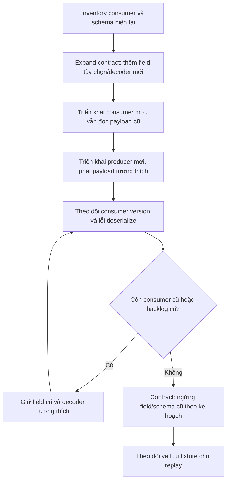
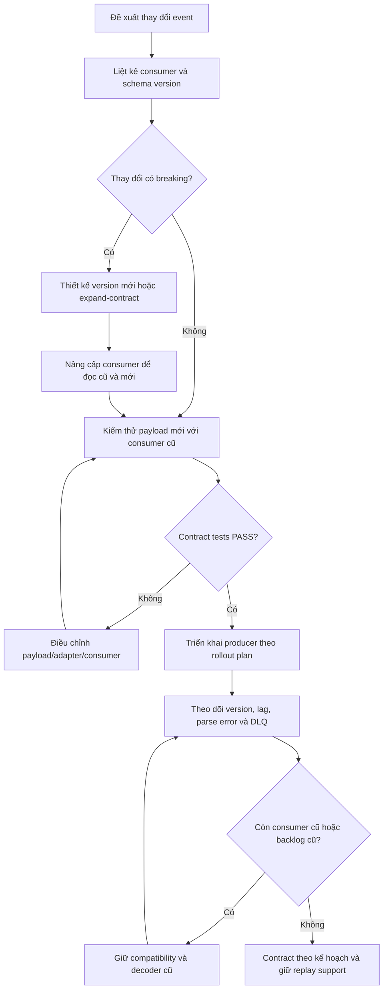

# Consumer cũ

Trong một hệ thống dùng Spring Modulith, module producer có thể được triển khai trước module consumer. Khi event được externalize qua Kafka, RabbitMQ hoặc một transport khác, producer mới có thể gửi message trong lúc một hay nhiều consumer vẫn đang chạy phiên bản cũ. Message có thể nằm trong broker nhiều giờ, consumer có thể bị tạm dừng để bảo trì hoặc một nhóm triển khai theo lịch riêng. Vì vậy, thay đổi event contract cần tính đến consumer cũ vẫn đang đọc message mới.

Consumer cũ (old consumer) là phiên bản consumer chưa được cập nhật để hiểu những thay đổi mới trong event contract. Một thay đổi tưởng như nhỏ ở producer, chẳng hạn đổi tên field, thêm giá trị enum hoặc chuyển đơn vị tiền tệ, có thể khiến consumer cũ lỗi parse hoặc âm thầm xử lý sai nghiệp vụ. Mục tiêu của quản lý phiên bản event là cho phép producer và consumer triển khai độc lập mà vẫn duy trì hợp đồng tương thích trong thời gian chuyển tiếp.

Trong phạm vi `SPRING_MODULITH_APPLICATION_EVENTS`, cần tách event nội bộ giữa các module khỏi integration event được gửi qua ranh giới triển khai. Application event nội bộ có thể được refactor cùng ứng dụng nếu tất cả module được build và triển khai đồng bộ; integration event phải được xem như hợp đồng công khai, có phiên bản, quy tắc tương thích và kế hoạch ngừng hỗ trợ consumer cũ.

## Mục tiêu

Sau bài này, bạn có thể:

- Nhận diện rủi ro khi producer mới gửi event cho consumer cũ.
- Phân biệt backward compatibility, forward compatibility và full compatibility.
- Thiết kế thay đổi additive để consumer cũ tiếp tục xử lý.
- Xử lý field mới, field bị đổi tên, enum mới và thay đổi ngữ nghĩa.
- Dùng DTO integration ổn định và version/schema metadata.
- Triển khai expand-contract để nâng cấp producer và consumer theo từng giai đoạn.
- Kiểm thử payload mới bằng consumer cũ và quản lý backlog trong thời gian chuyển đổi.
- Phân biệt schema compatibility với Event Publication Registry của Spring Modulith.

## 1. Vì sao consumer cũ là một vấn đề?

Giả sử producer phát event `OrderConfirmed` cho consumer của kho hàng. Phiên bản đầu có payload:

```json
{
  "eventId": "evt-1001",
  "orderId": "ord-42",
  "sku": "SKU-42",
  "quantity": 2
}
```

Sau một lần phát hành, producer bổ sung thông tin kho dự kiến:

```json
{
  "eventId": "evt-1001",
  "orderId": "ord-42",
  "sku": "SKU-42",
  "quantity": 2,
  "warehouseCode": "HCM-01"
}
```

Consumer cũ có thể tiếp tục xử lý nếu parser bỏ qua field chưa biết và logic nghiệp vụ không yêu cầu field đó. Nhưng nếu producer đổi `quantity` thành `requestedQuantity`, consumer cũ có thể không đọc được số lượng. Nếu producer đổi ý nghĩa `quantity` từ “số sản phẩm” sang “số thùng”, consumer cũ có thể parse thành công nhưng tạo reservation sai.

Rủi ro không chỉ đến từ lỗi parse. Một consumer cũ có thể:

- Bị lỗi deserialize vì field bắt buộc bị xóa hoặc đổi kiểu.
- Không hiểu enum value mới và từ chối message.
- Dùng default value sai khi field mới không tồn tại trong payload cũ.
- Hiểu sai đơn vị, quy tắc làm tròn hoặc ý nghĩa nghiệp vụ đã thay đổi.
- Không xác minh được schema version hoặc không hỗ trợ loại event mới.
- Xử lý lại message cũ sau khi được nâng cấp và tạo kết quả khác với lần xử lý trước.

Vì message có thể tồn tại trong broker hoặc được retry sau khi producer đã triển khai, tương thích cần được đánh giá theo cả payload mới và payload cũ, cũng như theo phiên bản consumer đang thực sự chạy.

## 2. Phân biệt các loại tương thích

Các thuật ngữ compatibility mô tả khả năng đọc schema giữa producer và consumer ở những thời điểm khác nhau. Cần thống nhất góc nhìn trước khi chọn chính sách.

| Loại tương thích | Ý nghĩa thường dùng | Tình huống điển hình |
|---|---|---|
| Backward compatibility | Consumer mới đọc được message được tạo theo schema cũ | Consumer được nâng cấp trước producer |
| Forward compatibility | Consumer cũ đọc được message theo schema mới | Producer được nâng cấp trước consumer |
| Full compatibility | Schema mới và cũ có thể đọc message của nhau theo quy tắc của format | Triển khai hai phía theo thứ tự linh hoạt |

Với tình huống consumer cũ, câu hỏi trọng tâm là forward compatibility: producer mới có thể gửi payload mới mà consumer cũ vẫn hiểu và xử lý đúng không? Câu trả lời phụ thuộc serialization format, cấu hình parser và logic nghiệp vụ của consumer.

JSON không tự định nghĩa một chính sách compatibility hoàn chỉnh. Một parser có thể bỏ qua field lạ, nhưng một parser khác có thể từ chối. Avro, Protobuf và các format có schema cung cấp quy tắc tương thích rõ hơn, nhưng vẫn cần cấu hình và kiểm tra theo schema evolution policy của hệ thống. Đừng suy luận khả năng tương thích chỉ từ việc payload là JSON hoặc từ việc một test deserialize đơn giản đã pass.

## 3. Nguyên tắc an toàn khi producer thay đổi event

Khi consumer cũ còn tồn tại, ưu tiên các thay đổi không làm thay đổi cách consumer cũ diễn giải payload.

Các thay đổi thường an toàn hơn:

- Thêm field tùy chọn, có default hợp lý ở consumer mới.
- Thêm metadata không làm thay đổi ý nghĩa của field hiện có.
- Mở rộng nội dung mô tả hoặc trace metadata mà consumer cũ có thể bỏ qua.
- Tạo một event type mới cho một hành vi nghiệp vụ mới, giữ event cũ cho consumer cũ trong thời gian chuyển tiếp.

Các thay đổi có nguy cơ phá vỡ consumer cũ:

- Xóa hoặc đổi tên field đang được consumer sử dụng.
- Đổi kiểu dữ liệu, format hoặc đơn vị của field.
- Thay đổi ý nghĩa nghiệp vụ nhưng giữ nguyên tên field.
- Thêm enum value mà consumer cũ không có nhánh xử lý.
- Chuyển field nullable thành bắt buộc mà consumer cũ không gửi.
- Thay đổi cấu trúc object lồng nhau hoặc cách biểu diễn số/ngày giờ.

Quy tắc quan trọng: một thay đổi additive chỉ an toàn khi consumer cũ thực sự bỏ qua field mới và không phụ thuộc vào schema đóng. Đồng thời, field mới không được làm thay đổi cách hiểu các field cũ. Nếu parser hoặc contract cũ từ chối unknown field, cần kiểm thử hoặc dùng phiên bản event mới thay vì giả định consumer sẽ bỏ qua.

## 4. Thêm field mới mà không phá consumer cũ

Giả sử event cũ chỉ có `orderId` và `quantity`. Producer muốn thêm `warehouseCode` để hỗ trợ định tuyến kho. Cách thay đổi an toàn thường là giữ nguyên field cũ, thêm field mới theo dạng tùy chọn và xác định rõ hành vi khi consumer chưa biết field đó.

```java
import java.util.UUID;

public record OrderConfirmedV2(
    UUID eventId,
    UUID orderId,
    String sku,
    int quantity,
    String warehouseCode
) {}
```

Nếu dùng JSON với Jackson, consumer mới có thể cho phép bỏ qua field chưa biết:

```java
import com.fasterxml.jackson.annotation.JsonIgnoreProperties;
import java.util.UUID;

@JsonIgnoreProperties(ignoreUnknown = true)
public record OrderConfirmedV1(
    UUID eventId,
    UUID orderId,
    String sku,
    int quantity
) {}
```

Annotation `@JsonIgnoreProperties(ignoreUnknown = true)` minh họa chính sách tolerant reader cho Jackson. Cần xác nhận cấu hình `ObjectMapper` thực tế của ứng dụng; một cấu hình toàn cục hoặc custom deserializer có thể thay đổi hành vi. Chỉ bỏ qua field lạ khi việc đó an toàn về nghiệp vụ. Nếu field mới chứa thông tin cần thiết để consumer xử lý đúng, bỏ qua nó sẽ không tạo ra compatibility thực sự.

Nếu consumer mới cần hỗ trợ cả message cũ không có `warehouseCode`, có thể dùng kiểu nullable hoặc giá trị mặc định có ý nghĩa:

```java
String effectiveWarehouse = event.warehouseCode() != null
    ? event.warehouseCode()
    : warehousePolicy.defaultFor(event.orderId());
```

Không tự chọn default như `"DEFAULT"` hoặc kho đầu tiên nếu lựa chọn đó có thể làm sai phân bổ hàng. Default phải được quy định bởi nghiệp vụ, có thể truy vết và có hành vi rõ ràng khi không tìm được giá trị.

## 5. Đổi tên hoặc thay kiểu field bằng expand-contract

Đổi tên field là thay đổi phá vỡ consumer cũ nếu consumer vẫn đọc tên cũ. Thay vì đổi ngay, dùng quy trình expand-contract:

1. **Expand:** producer bắt đầu phát cả field cũ và field mới với cùng một ý nghĩa.
2. Nâng cấp consumer để đọc field mới, nhưng vẫn chấp nhận field cũ trong giai đoạn chuyển tiếp.
3. Theo dõi consumer cũ và xác nhận không còn instance nào phụ thuộc field cũ.
4. **Contract:** ngừng phát field cũ sau khi mọi consumer đã chuyển đổi và backlog cũ đã được xử lý hoặc có chiến lược tương thích.

Ví dụ payload trong giai đoạn chuyển tiếp:

```json
{
  "eventId": "evt-1001",
  "orderId": "ord-42",
  "quantity": 2,
  "requestedQuantity": 2
}
```

Consumer mới có thể ưu tiên `requestedQuantity`, đồng thời fallback về `quantity` khi message đến từ producer cũ. Producer mới giữ cả hai field trong thời gian cần thiết. Khi field cũ bị loại bỏ, phải có bằng chứng từ telemetry hoặc consumer inventory rằng không còn consumer được hỗ trợ nào cần nó.

Không phát đồng thời hai field nếu chúng có thể chứa giá trị khác nhau mà không có quy tắc ưu tiên. Điều đó tạo ra ambiguity và có thể dẫn tới hai consumer hiểu cùng message theo hai cách. Nếu thay đổi kiểu hoặc đơn vị, đặt tên field mới thể hiện rõ đơn vị, ví dụ `amountMinorUnits` thay cho `amount`, và ghi rõ currency/scale.

## 6. Enum mới và giá trị chưa biết

Consumer cũ thường giả định enum chỉ có một tập giá trị cố định. Producer mới thêm `PARTIALLY_FULFILLED`, trong khi consumer cũ chỉ biết `CONFIRMED` và `CANCELLED`. Với một số serializer, giá trị enum lạ gây lỗi deserialize; với cách biểu diễn string, code có thể vẫn parse nhưng switch không có nhánh phù hợp.

Khi thiết kế event contract có khả năng mở rộng:

- Cân nhắc biểu diễn trạng thái mở dưới dạng string và có nhánh xử lý unknown value.
- Không dùng default nghiệp vụ nguy hiểm cho giá trị chưa biết.
- Nếu consumer không thể xử lý trạng thái mới một cách an toàn, dùng event type/version mới hoặc định tuyến tới consumer đã nâng cấp.
- Thêm test fixture chứa enum value tương lai để kiểm tra hành vi consumer cũ.

Ví dụ xử lý enum theo hướng tường minh:

```java
switch (event.fulfillmentStatus()) {
    case "CONFIRMED" -> confirm(event);
    case "CANCELLED" -> cancel(event);
    default -> recordUnsupportedStatus(event);
}
```

`recordUnsupportedStatus` không nên âm thầm đánh dấu nghiệp vụ thành công. Tùy loại event, consumer có thể quarantine message, phát cảnh báo, từ chối có kiểm soát hoặc lưu lại để xử lý sau khi nâng cấp. Với event tài chính hoặc tồn kho, bỏ qua trạng thái chưa biết có thể gây sai lệch dữ liệu.

## 7. Giữ integration event ổn định qua DTO

Không nên externalize trực tiếp entity, aggregate hoặc class nội bộ của module. Khi producer đổi cấu trúc domain, class nội bộ có thể thay đổi vì nhu cầu refactor, trong khi consumer bên ngoài vẫn cần contract ổn định.

Tách domain model khỏi integration DTO:

```java
public record OrderConfirmedV1(
    String eventId,
    String orderId,
    String sku,
    int quantity
) {}

public record OrderConfirmedV2(
    String eventId,
    String orderId,
    String sku,
    int quantity,
    String warehouseCode,
    int schemaVersion
) {}
```

Mapping từ domain event sang integration DTO đặt ở ranh giới externalization:

```java
OrderConfirmedV2 toIntegrationEvent(OrderConfirmed event) {
    return new OrderConfirmedV2(
        event.eventId().toString(),
        event.orderId().toString(),
        event.sku(),
        event.quantity(),
        event.warehouseCode().orElse(null),
        2
    );
}
```

Đây là ví dụ mapping minh họa; API externalization thực tế cần dùng cơ chế mapping và target tương ứng với phiên bản Spring Modulith đang dùng. Ý tưởng chính là giữ DTO tích hợp ổn định và có thể version độc lập với class nội bộ. Consumer cũ không nên phụ thuộc vào package, tên class Java hoặc entity của producer.

## 8. Quản lý schema version và event type

Một envelope có thể mang `eventType`, `schemaVersion`, `eventId`, `occurredAt` và payload. `schemaVersion` giúp consumer chọn decoder hoặc upcaster phù hợp; `eventType` mô tả sự kiện nghiệp vụ. Không nên dùng mỗi tên class Java làm schema contract nếu tên class có thể đổi khi refactor.

Ví dụ envelope:

```json
{
  "eventType": "orders.order-confirmed",
  "schemaVersion": 2,
  "eventId": "evt-1001",
  "occurredAt": "2026-11-25T10:15:30Z",
  "payload": {
    "orderId": "ord-42",
    "sku": "SKU-42",
    "quantity": 2,
    "warehouseCode": "HCM-01"
  }
}
```

Consumer có thể hỗ trợ nhiều schema version bằng decoder riêng:

```java
OrderConfirmed toCurrentModel(ExternalEvent envelope) {
    return switch (envelope.schemaVersion()) {
        case 1 -> mapV1(envelope.payload());
        case 2 -> mapV2(envelope.payload());
        default -> throw new UnsupportedEventSchemaException(
            envelope.eventType(), envelope.schemaVersion()
        );
    };
}
```

Không mặc định rằng consumer cũ có thể đọc `schemaVersion` mới chỉ vì version được đặt trong envelope. Consumer cũ có thể bỏ qua metadata nhưng vẫn gặp lỗi ở payload. Versioning chỉ hữu ích khi có quy tắc tương thích và decoder tương ứng.

Nếu dùng schema registry cho Avro, Protobuf hoặc JSON Schema, bật compatibility rule phù hợp với thứ tự triển khai. Schema registry có thể từ chối schema phá vỡ chính sách trước khi producer phát message, nhưng không tự nâng cấp consumer hoặc bảo đảm logic nghiệp vụ của consumer hiểu đúng dữ liệu.

## 9. Dùng upcaster hoặc adapter để hỗ trợ payload cũ

Khi consumer mới phải đọc message cũ đã tồn tại trong broker hoặc kho lưu trữ, có thể chuyển payload version cũ sang model hiện tại trước khi xử lý nghiệp vụ. Thành phần chuyển đổi này thường được gọi là upcaster hoặc compatibility adapter.

```java
CurrentOrderConfirmed upcast(ExternalEvent event) {
    return switch (event.schemaVersion()) {
        case 1 -> {
            var v1 = decodeV1(event.payload());
            yield new CurrentOrderConfirmed(
                v1.orderId(),
                v1.sku(),
                v1.quantity(),
                defaultWarehouseFor(v1.orderId())
            );
        }
        case 2 -> decodeV2(event.payload()).toCurrentModel();
        default -> throw new UnsupportedEventSchemaException(
            event.eventType(), event.schemaVersion()
        );
    };
}
```

Upcaster chỉ nên điền default nếu có thể suy ra đúng theo quy tắc nghiệp vụ. Nếu không thể suy ra `warehouseCode` từ message cũ, cần tra cứu nguồn dữ liệu có thẩm quyền hoặc chuyển message sang xử lý thủ công. Không tạo dữ liệu giả để khiến quá trình deserialize thành công.

Upcaster cần có test fixture cho từng schema version được hỗ trợ. Khi thay đổi mapping, giữ lại fixture payload cũ để phát hiện hồi quy. Nếu payload có thể được replay sau nhiều tháng, thời gian hỗ trợ schema cũ phải phù hợp với retention và chính sách replay của hệ thống.

## 10. Triển khai producer và consumer theo thứ tự an toàn

Một quy trình nâng cấp thường dùng là expand-contract:



Thứ tự triển khai phụ thuộc thay đổi. Với thay đổi additive, thường có thể triển khai consumer mới trước, sau đó producer mới. Với thay đổi cần producer phát dữ liệu mới để consumer mới hoạt động, có thể cần một giai đoạn producer phát cả hai dạng hoặc một adapter chuyển đổi. Luôn xác định phiên bản nào có thể giao tiếp với phiên bản nào trước khi triển khai.

Một checklist rollout:

1. Liệt kê tất cả consumer của event, bao gồm job replay, consumer batch và ứng dụng đối tác.
2. Xác định phiên bản/schema mà từng consumer hỗ trợ.
3. Phân loại thay đổi là additive hay breaking theo parser và ngữ nghĩa nghiệp vụ.
4. Thêm decoder/field hỗ trợ mới ở consumer trước khi producer phụ thuộc vào nó.
5. Triển khai consumer và quan sát lỗi parse, lag, DLQ.
6. Triển khai producer theo contract tương thích.
7. Chờ backlog của schema cũ được xử lý hoặc có đường upcast.
8. Chỉ loại bỏ field hoặc schema cũ sau khi có bằng chứng không còn consumer cần nó.

Không dùng thời điểm deploy thành công làm bằng chứng mọi consumer đã nâng cấp. Cần inventory hoặc telemetry theo consumer identity/version để biết consumer nào vẫn đang chạy bản cũ.

## 11. Consumer cũ khi có backlog và replay

Broker có thể giữ message được producer phát từ nhiều ngày trước. Consumer mới có thể đọc payload cũ sau khi nâng cấp; ngược lại, consumer cũ có thể đọc payload mới nếu producer đã triển khai trước. Vì vậy, compatibility cần xét cả hai hướng thời gian.

Các tình huống cần tính đến:

- Consumer cũ đang chạy trong khi producer mới phát message.
- Consumer mới đọc backlog được tạo bởi producer cũ.
- Consumer restart và đọc lại message đã xử lý một phần.
- DLQ được redrive sau khi schema đã thay đổi.
- Một batch replay đọc dữ liệu lưu trữ từ nhiều schema version.
- Hai consumer group có lịch nâng cấp khác nhau cùng đọc một event type.

Giữ schema decoder cũ đủ lâu cho retention, retry và replay window. Nếu xóa decoder v1 ngay sau khi consumer chính được nâng cấp, một message v1 trong DLQ được redrive vài tuần sau có thể không còn xử lý được.

Khi replay, cần idempotency theo event ID hoặc business key. Một consumer mới có thể đọc lại message đã được consumer cũ xử lý; không để replay tạo tác động tài chính hoặc nghiệp vụ trùng. Nếu consumer mới thay đổi cách diễn giải message cũ, cần xác định liệu replay có được phép tái tạo kết quả khác hay phải dùng dữ liệu đã lưu làm nguồn sự thật.

## 12. Event versioning trong Spring Modulith

Trong cùng một ứng dụng Modulith, application event nội bộ có thể được các module tiêu thụ qua Java type. Nếu các module được build và triển khai cùng nhau, thay đổi type có thể được phát hiện ở compile time và cập nhật đồng bộ. Tuy nhiên, khi event được externalize, payload trở thành contract giữa các tiến trình hoặc tổ chức có vòng đời triển khai độc lập.

Spring Modulith hỗ trợ chọn và mapping event để externalize. Hãy dùng integration DTO và mapping tại ranh giới này để giữ event contract ổn định. Event Publication Registry theo dõi publication của externalizer/listener và hỗ trợ phục hồi publication chưa hoàn tất; registry không phải schema registry và không tự chuyển đổi payload v1 sang v2.

Khi một event được externalize tới broker:

1. Producer publish application event nội bộ.
2. Cấu hình externalization chọn event và mapping sang integration payload.
3. Adapter serialize và gửi message theo target.
4. Consumer ngoài đọc envelope, xác định event type/schema version và decode payload.
5. Consumer cũ phải bỏ qua phần mở rộng an toàn hoặc từ chối message có kiểm soát nếu schema/semantics không được hỗ trợ.

Không để consumer ngoài phụ thuộc trực tiếp vào class Java nội bộ của producer. Nếu dùng cùng thư viện contract, phát hành artifact versioned và kiểm tra compatibility; tuy nhiên, chia sẻ thư viện không thay thế việc quản lý schema và rollout vì các consumer vẫn có thể triển khai ở thời điểm khác nhau.

## 13. Kiểm thử tương thích với consumer cũ

Kiểm thử compatibility cần dùng payload thực tế theo từng schema version và decoder của consumer tương ứng. Một test chỉ serialize DTO mới rồi deserialize bằng cùng DTO mới không chứng minh consumer cũ đọc được message mới.

| Kịch bản | Điều cần xác nhận |
|---|---|
| Producer mới thêm field tùy chọn | Consumer cũ parse được và bỏ qua field nếu policy cho phép |
| Producer mới bỏ field cũ | Test consumer cũ phải phát hiện lỗi hoặc xác nhận field không còn được dùng |
| Đổi tên field theo expand-contract | Consumer cũ đọc field cũ; consumer mới đọc cả hai trong giai đoạn chuyển tiếp |
| Thêm enum value | Consumer cũ có hành vi unknown value rõ ràng, không xử lý sai |
| Đổi kiểu hoặc đơn vị | Compatibility test phát hiện breaking change |
| Consumer mới đọc payload cũ | Decoder/upcaster tạo model hiện tại đúng |
| Replay từ DLQ | Payload cũ vẫn được decode và xử lý idempotently |
| Schema version không hỗ trợ | Message bị quarantine hoặc xử lý lỗi có kiểm soát |
| Producer và consumer triển khai lệch phiên bản | Contract test xác nhận các cặp phiên bản được hỗ trợ |

Nên lưu golden fixture cho payload v1, v2 và các phiên bản còn nằm trong replay window. Chạy consumer cũ với payload do producer mới tạo; chạy consumer mới với payload cũ. Nếu có schema registry, kiểm tra schema mới bị từ chối khi vi phạm compatibility rule.

Contract test có thể chạy trong pipeline producer và consumer riêng. Producer xác minh payload phát ra tương thích với schema đã công bố; consumer xác minh tất cả fixture còn được hỗ trợ. Điều này giảm nguy cơ chỉ phát hiện breaking change sau khi một nhóm đã triển khai production.

## 14. Những lỗi thường gặp

| Lỗi | Hệ quả | Cách khắc phục |
|---|---|---|
| Đổi tên field ngay trong một lần deploy | Consumer cũ không tìm thấy dữ liệu | Expand-contract, phát cả tên cũ và mới trong thời gian chuyển tiếp |
| Thêm field bắt buộc không có default | Consumer cũ hoặc payload cũ không deserialize được | Dùng field optional và quy tắc fallback an toàn |
| Thêm enum nhưng không có nhánh unknown | Consumer cũ lỗi hoặc xử lý sai trạng thái | Xử lý unknown value rõ ràng hoặc dùng event version mới |
| Giữ tên field nhưng đổi đơn vị/ngữ nghĩa | Parse thành công nhưng nghiệp vụ sai | Dùng field mới, tên rõ đơn vị và schema version |
| Cho rằng JSON luôn bỏ qua field lạ | Parser strict có thể từ chối payload | Kiểm thử đúng serializer/configuration của consumer cũ |
| Xóa decoder cũ sau khi deploy consumer mới | Replay/backlog cũ không xử lý được | Giữ decoder theo retention và replay window |
| Dùng Event Publication Registry như schema registry | Publication được theo dõi nhưng payload vẫn không tương thích | Quản lý schema/DTO riêng và kiểm thử contract |
| Không inventory consumer | Bỏ sót consumer cũ hoặc consumer ít chạy | Theo dõi consumer identity/version và lịch sử tiêu thụ |
| Không idempotent khi replay | Message cũ tạo tác động trùng | Deduplication theo event ID và transaction phù hợp |

## 15. Quy trình hỗ trợ consumer cũ



Hỗ trợ consumer cũ là một phần của thiết kế event contract, không phải công việc dọn dẹp sau khi producer đã triển khai. Hãy ưu tiên thay đổi additive, giữ ý nghĩa field ổn định, version hóa integration DTO khi cần và triển khai theo expand-contract. Kiểm thử cả consumer cũ với payload mới lẫn consumer mới với payload cũ, theo dõi backlog và chỉ ngừng hỗ trợ schema cũ khi đã xác nhận không còn consumer hoặc message replay cần nó.

## Tài liệu tham khảo

- [Spring Modulith — Working with Application Events](https://docs.spring.io/spring-modulith/reference/events.html)
- [Confluent — Schema Evolution and Compatibility](https://docs.confluent.io/platform/current/schema-registry/fundamentals/schema-evolution.html)
- [Protocol Buffers — Updating A Message Type](https://protobuf.dev/programming-guides/proto3/#updating)
- [Apache Avro — Schema Resolution](https://avro.apache.org/docs/current/specification/#schema-resolution)
