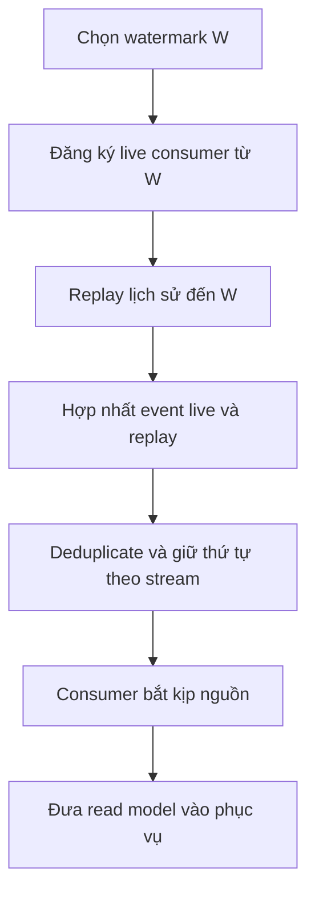

# Consumer mới khi hợp đồng event đã tồn tại

Khi một hệ thống đã phát application event trong thời gian dài, việc bổ sung một consumer mới không đơn giản là tạo listener rồi chờ event tiếp theo. Consumer mới có thể cần đọc các event đã phát trước khi nó được triển khai, phải hiểu nhiều phiên bản payload đang tồn tại và cần xử lý duplicate hoặc event đến sai thứ tự trong quá trình bắt kịp dữ liệu. Nếu không xác định rõ nguồn lịch sử và chính sách tương thích, read model mới có thể thiếu dữ liệu hoặc consumer có thể diễn giải sai hợp đồng cũ.

Trong Spring Modulith, application event giúp các module cộng tác qua publisher và listener; `@Externalized` có thể đưa event ra broker để consumer độc lập nhận. Khi thêm consumer, cần phân biệt listener nội bộ được đăng ký trong application context với consumer mới đọc từ broker hoặc event store. Event Publication Registry theo dõi publication tới listener theo cấu hình tại thời điểm phát; nó không mặc định là kho lịch sử để một listener mới replay mọi event đã hoàn tất. Vì vậy, kế hoạch triển khai consumer mới phải bao gồm hợp đồng dữ liệu, nguồn backfill, điểm bắt đầu đọc, idempotency và cách xác nhận consumer đã bắt kịp nguồn.

## 1. Consumer mới gặp những vấn đề gì?

Giả sử module `orders` đã phát `OrderCompleted` trong nhiều tháng. Hiện tại có consumer `shipping` và `billing`. Nhóm phát triển bổ sung consumer `analytics` để xây dựng read model mới. Consumer này cần biết các đơn hàng đã hoàn tất trước ngày triển khai để có số liệu đầy đủ, đồng thời phải tiếp tục nhận event mới trong lúc backfill diễn ra.

Các câu hỏi cần trả lời trước khi triển khai:

- Consumer mới chỉ cần event phát sinh từ hôm nay hay cần lịch sử từ một mốc trước đó?
- Nguồn nào còn giữ event cũ: Kafka retention, event store, database nghiệp vụ, snapshot hay một bản export?
- Consumer có thể đọc payload được phát bởi các phiên bản producer trước không?
- Event cũ có trường mà consumer mới cần nhưng producer trước đây chưa phát không?
- Consumer mới có thể nhận duplicate khi replay hoặc khi broker redeliver không?
- Cần giữ thứ tự theo aggregate, partition hay một workflow cụ thể?
- Làm sao biết backfill hoàn tất và consumer đã theo kịp luồng mới?

Một consumer mới có thể bắt đầu ở một trong ba trạng thái:

| Trạng thái | Ý nghĩa | Hành động |
| --- | --- | --- |
| Chỉ nhận event mới | Không cần lịch sử trước thời điểm triển khai | Bắt đầu từ offset/cursor mới theo chính sách đã chọn |
| Đọc lại lịch sử | Cần dựng read model từ dữ liệu cũ | Chọn nguồn replay và điểm bắt đầu rõ ràng |
| Backfill đồng thời với live traffic | Cần lịch sử và không được bỏ event mới trong lúc dựng dữ liệu | Dùng watermark/cursor, chạy replay và live ingestion có cơ chế hợp nhất |

Không nên triển khai consumer mới trước khi xác định trường hợp nào áp dụng. Một queue/topic có thể giữ message cũ, nhưng retention và topology không tự bảo đảm consumer mới sẽ nhận được toàn bộ lịch sử.

## 2. Listener nội bộ và consumer broker không giống nhau

Trong cùng application context, Spring Modulith có thể phát một application event tới các listener đã đăng ký. `@ApplicationModuleListener` thường được dùng để xử lý event theo cơ chế module listener, bao gồm transaction phase và xử lý bất đồng bộ theo cấu hình.

Consumer mới được thêm vào ứng dụng nội bộ có thể bắt đầu nhận những event được publish sau khi listener được đăng ký. Tuy nhiên, không nên giả định nó tự nhận lại các event đã phát trước đó. Event Publication Registry ghi nhận publication cho các listener cần nhận event ở thời điểm publish; registry chủ yếu theo dõi trạng thái giao event và phục hồi publication chưa hoàn tất. Nó không phải một event store tổng quát cho phép đăng ký listener mới rồi phát lại toàn bộ lịch sử đã hoàn tất.

Với consumer độc lập qua broker, hành vi phụ thuộc broker:

| Nguồn | Consumer mới có thể đọc lịch sử không? | Điều kiện cần kiểm tra |
| --- | --- | --- |
| Spring application event nội bộ | Không tự động replay lịch sử đã phát | Phải có nguồn event/snapshot hoặc quy trình backfill riêng |
| Spring Modulith Event Publication Registry | Có thể phục hồi publication chưa hoàn tất của listener đã được theo dõi | Không coi các publication đã hoàn tất là event history để consumer mới đọc lại |
| Kafka | Có thể đọc lại các record còn trong retention | Consumer group, offset reset policy, partition và retention phải được chọn rõ |
| RabbitMQ queue | Queue nhận message theo binding tồn tại khi message được publish | Queue mới không tự nhận các message đã đi qua exchange trước khi queue/binding tồn tại |
| Event store | Thường có thể đọc stream từ vị trí xác định | Cần quyền truy cập, cursor, retention và schema cũ |
| Database snapshot/export | Có thể tạo baseline lịch sử | Phải xác định watermark và đồng bộ với event mới |

Đối với một consumer mới, câu hỏi quan trọng là nguồn lịch sử nào có thể cung cấp dữ liệu. Đừng dùng trạng thái `COMPLETED` của publication registry làm bằng chứng rằng event cũ còn có thể được replay cho một listener vừa được thêm.

## 3. Xác định hợp đồng event trước khi viết consumer

Consumer nên phụ thuộc vào hợp đồng event được công bố, không phụ thuộc vào entity hoặc cấu trúc persistence nội bộ của producer. Hợp đồng cần mô tả ít nhất:

- Tên event và ý nghĩa nghiệp vụ.
- Event type ổn định và schema version.
- Các trường bắt buộc, tùy chọn và quy tắc null.
- Định dạng thời gian, tiền tệ, số thập phân và định danh.
- Ý nghĩa của từng trường, đơn vị đo và miền giá trị.
- Quy tắc tương thích khi thêm, bỏ hoặc đổi trường.
- Quy tắc thứ tự, duplicate, replay và idempotency.
- Phạm vi dữ liệu cá nhân và quyền sử dụng payload.

Ví dụ một hợp đồng `OrderCompleted`:

```json
{
  "eventId": "8d5bca4c-35d8-4c3c-8d42-8c7a32c8b7aa",
  "eventType": "com.example.orders.OrderCompleted",
  "schemaVersion": 2,
  "orderId": "ord-1042",
  "completedAt": "2026-11-25T10:15:30Z",
  "currency": "VND",
  "totalAmount": 1250000.00,
  "customerReference": "analytics-customer-9F3A"
}
```

`eventType` xác định loại sự kiện; `schemaVersion` xác định phiên bản cấu trúc payload. Hai khái niệm này nên được quản lý riêng. Nếu đổi cấu trúc nhưng vẫn giữ cùng ý nghĩa nghiệp vụ, schema version có thể tăng. Nếu ý nghĩa nghiệp vụ thay đổi đáng kể, có thể cần event type mới thay vì chỉ tăng version.

Consumer mới cần biết trường nào thực sự bắt buộc để xử lý. Ví dụ `customerReference` có thể chỉ phục vụ liên kết dữ liệu analytics; consumer vận chuyển không nên phụ thuộc vào trường này nếu không có nhu cầu.

## 4. Thiết kế consumer chịu được phiên bản cũ và mới

Trong thời gian triển khai, broker hoặc event store có thể chứa payload được tạo bởi nhiều phiên bản producer. Consumer mới cần có chiến lược đọc các payload đó.

Một payload cũ có thể thiếu trường mới. Ví dụ version 1:

```json
{
  "eventId": "8d5bca4c-35d8-4c3c-8d42-8c7a32c8b7aa",
  "eventType": "OrderCompleted",
  "schemaVersion": 1,
  "orderId": "ord-1042",
  "completedAt": "2026-11-25T10:15:30Z"
}
```

Version 2 thêm `currency` và `totalAmount`. Consumer mới không được mặc định rằng các trường đó tồn tại trong mọi record lịch sử. Có thể áp dụng một trong các cách:

- Trường mới là optional và consumer xử lý trường hợp thiếu theo quy tắc nghiệp vụ rõ ràng.
- Consumer chuyển payload cũ sang một canonical model bằng upcaster/adapter.
- Consumer đọc dữ liệu bổ sung từ API hoặc snapshot nếu trường đó không thể suy ra từ event cũ.
- Nếu không thể xử lý an toàn, consumer cách ly record và báo lỗi thay vì gán giá trị mặc định sai.

Không dùng giá trị mặc định tùy tiện cho dữ liệu có ý nghĩa nghiệp vụ. Ví dụ, nếu `currency` bị thiếu, tự gán `VND` chỉ đúng khi hợp đồng cũ quy định mọi giao dịch đều dùng VND. Nếu hệ thống từng hỗ trợ nhiều currency, default này có thể làm sai số liệu.

## 5. Tách schema version khỏi event type và producer version

Ba loại version thường bị nhầm lẫn:

| Version | Mô tả | Ví dụ |
| --- | --- | --- |
| Event/schema version | Phiên bản hợp đồng dữ liệu của một loại event | `OrderCompleted` schema 2 |
| Producer application version | Phiên bản ứng dụng đã phát event | `orders-service` release 4.8.1 |
| Consumer application version | Phiên bản ứng dụng đang đọc event | `analytics-consumer` release 2.3.0 |

Producer version không thể thay thế schema version. Một phiên bản ứng dụng có thể phát nhiều event type với các schema version khác nhau. Consumer cũng có thể được nâng cấp độc lập với producer.

Nên lưu schema version trong payload hoặc metadata được định nghĩa rõ và có thể đọc lại khi replay. Không suy luận version chỉ từ thời điểm publish hoặc tên package Java. Timestamp có thể không chính xác với dữ liệu replay, còn package có thể đổi khi refactor mà không thay đổi hợp đồng.

## 6. Consumer tolerant reader và giới hạn của nó

Tolerant reader là cách thiết kế consumer có thể bỏ qua những trường không biết và xử lý những trường tùy chọn theo hợp đồng. Điều này giúp producer thêm trường mới mà không làm consumer cũ thất bại, với điều kiện serializer/deserializer và schema policy cho phép.

Với JSON và Jackson, một DTO có thể khai báo trường mà consumer cần:

```java
public record OrderCompletedV2(
        UUID eventId,
        String orderId,
        Instant completedAt,
        String currency,
        BigDecimal totalAmount
) {}
```

Nếu payload có thêm trường `customerReference` mà DTO không dùng, cấu hình deserializer có thể được thiết lập để bỏ qua unknown property. Tuy nhiên, không nên bật bỏ qua mọi lỗi một cách vô điều kiện: trường sai kiểu, thiếu trường bắt buộc hoặc schema không hợp lệ vẫn cần được phát hiện.

Tolerant reader không có nghĩa là consumer chấp nhận mọi payload. Cần phân biệt:

- **Unknown optional field:** có thể bỏ qua nếu không ảnh hưởng logic.
- **Missing optional field:** dùng quy tắc fallback đã công bố.
- **Missing required field:** từ chối hoặc cách ly payload.
- **Unknown enum value:** cần chiến lược fallback hoặc cách ly; không giả định enum chỉ có các giá trị hiện tại.
- **Changed field meaning:** phải coi là thay đổi hợp đồng, dù tên và kiểu dữ liệu không đổi.
- **Invalid type/format:** báo lỗi dữ liệu, không âm thầm chuyển đổi nếu có thể làm sai nghĩa.

Một consumer mới nên kiểm tra schema trước khi đưa payload vào domain model. Có thể dùng DTO riêng theo version rồi chuyển về model nội bộ thống nhất.

## 7. Upcaster và canonical event model

Khi consumer cần hỗ trợ nhiều schema version, có thể tách bước đọc payload khỏi logic nghiệp vụ bằng adapter hoặc upcaster. Mục tiêu là chuyển các phiên bản cũ sang một canonical model mà phần xử lý phía sau hiểu được.

Ví dụ:

```java
sealed interface OrderCompletedPayload {
    UUID eventId();
    String orderId();
}

record OrderCompletedV1(
        UUID eventId,
        String orderId,
        Instant completedAt
) implements OrderCompletedPayload {}

record OrderCompletedV2(
        UUID eventId,
        String orderId,
        Instant completedAt,
        String currency,
        BigDecimal totalAmount
) implements OrderCompletedPayload {}

record CanonicalOrderCompleted(
        UUID eventId,
        String orderId,
        Instant completedAt,
        Optional<String> currency,
        Optional<BigDecimal> totalAmount
) {}
```

Adapter chuyển payload:

```java
CanonicalOrderCompleted upcast(OrderCompletedPayload payload) {
    return switch (payload) {
        case OrderCompletedV1 v1 -> new CanonicalOrderCompleted(
                v1.eventId(),
                v1.orderId(),
                v1.completedAt(),
                Optional.empty(),
                Optional.empty()
        );
        case OrderCompletedV2 v2 -> new CanonicalOrderCompleted(
                v2.eventId(),
                v2.orderId(),
                v2.completedAt(),
                Optional.of(v2.currency()),
                Optional.of(v2.totalAmount())
        );
    };
}
```

Ví dụ chỉ minh họa mô hình chuyển đổi. Nếu consumer cần tổng tiền để tạo báo cáo tài chính, version 1 không có `totalAmount` thì không thể tự suy ra; consumer phải lấy dữ liệu từ nguồn khác hoặc đánh dấu dữ liệu lịch sử không đầy đủ. `Optional.empty()` không được biến thành số 0 nếu điều đó làm thay đổi ý nghĩa nghiệp vụ.

Upcaster nên là hàm xác định, có thể kiểm thử bằng fixture payload. Tránh gọi mạng hoặc thay đổi database trong bước chuyển schema. Logic enrichment thuộc một bước riêng có timeout, quyền truy cập và khả năng retry rõ ràng.

## 8. Schema registry và định dạng có schema

Khi có nhiều producer và consumer độc lập, việc quản lý schema bằng tài liệu rời rạc dễ dẫn tới drift. Schema registry hoặc kho hợp đồng có version giúp producer công bố schema và consumer kiểm tra tính tương thích trước khi triển khai.

Các định dạng thường gặp:

| Định dạng | Cách quản lý schema | Điểm cần lưu ý cho consumer mới |
| --- | --- | --- |
| JSON | JSON Schema hoặc hợp đồng OpenAPI/AsyncAPI tương ứng | Quy tắc required/optional, unknown fields, null và format phải rõ |
| Avro | Schema gắn với record và thường được quản lý qua registry | Reader/writer schema resolution và default value cần được kiểm tra |
| Protocol Buffers | File `.proto`, field number và generated code | Không tái sử dụng field number đã xóa; giữ quy tắc tương thích wire format |
| CloudEvents envelope | Metadata event chuẩn hóa bên ngoài data payload | Phân biệt metadata envelope với schema của `data` |

Schema registry không tự làm cho consumer tương thích. Chính sách compatibility cần được chọn theo cách triển khai:

- **Backward compatibility:** consumer/reader mới có thể đọc dữ liệu được tạo theo schema cũ.
- **Forward compatibility:** reader cũ có thể xử lý dữ liệu theo schema mới trong phạm vi quy tắc cho phép.
- **Full compatibility:** hỗ trợ cả hai chiều theo chính sách của registry.
- **Transitive compatibility:** kiểm tra tương thích với nhiều phiên bản trước đó, không chỉ phiên bản ngay trước.

Tên và cách áp dụng chính sách phụ thuộc schema registry cụ thể. Hãy kiểm tra đúng semantics của công cụ đang dùng. Với consumer mới phải replay dữ liệu lâu năm, transitive compatibility hoặc bộ upcaster có thể quan trọng hơn kiểm tra chỉ với schema liền kề.

## 9. Quy tắc tiến hóa schema an toàn

Khi producer tiếp tục thay đổi event trong lúc consumer mới được triển khai, cần có quy tắc rõ:

- Thêm trường optional thường an toàn hơn thêm trường required.
- Giữ kiểu dữ liệu và ý nghĩa của trường đã công bố.
- Không đổi tên enum value đang tồn tại trong payload lịch sử nếu chưa có migration.
- Không đổi đơn vị đo hoặc currency semantics mà vẫn giữ tên trường cũ.
- Khi bỏ trường, duy trì khả năng đọc payload cũ trong thời gian retention/replay.
- Khi đổi ý nghĩa nghiệp vụ, tạo event type hoặc schema mới với migration có chủ đích.
- Không tái sử dụng field number của Protocol Buffers đã xóa.
- Kiểm thử reader mới với fixture từ mọi version còn nằm trong thời gian có thể replay.

Một thay đổi có thể tương thích về cấu trúc nhưng phá vỡ ngữ nghĩa. Ví dụ `totalAmount` trước đây là số tiền trước thuế, sau đó bị đổi thành số tiền sau thuế mà tên và kiểu vẫn giữ nguyên. Consumer mới sẽ đọc được payload nhưng hiểu sai dữ liệu. Vì vậy, hợp đồng cần mô tả ý nghĩa, đơn vị, thời điểm và quy tắc làm tròn.

## 10. Backfill lịch sử cho consumer mới

Nếu consumer cần dựng read model từ lịch sử, phải xác định nguồn có thể replay. Một số lựa chọn:

- Event store có thể đọc theo stream và cursor.
- Kafka topic còn giữ record theo retention và consumer group có thể bắt đầu từ offset đã chọn.
- Snapshot hoặc export từ database nghiệp vụ.
- API của module sở hữu dữ liệu, có phân trang và watermark ổn định.
- Một bản lưu trữ event được thiết kế riêng cho mục đích replay.

RabbitMQ queue thường không phải nguồn lịch sử chung cho consumer mới. Khi queue/binding được tạo sau khi message đã publish, queue mới không tự nhận các message cũ đã đi qua exchange. Muốn backfill, cần một nguồn lưu lịch sử hoặc cơ chế replay riêng.

Spring Modulith Event Publication Registry cũng không nên được xem như event store. Registry hỗ trợ theo dõi và phục hồi publication chưa hoàn tất của listener đã được ghi nhận. Nếu consumer mới cần event đã hoàn tất từ trước, cần một nguồn lịch sử khác hoặc một quy trình dựng baseline từ dữ liệu nghiệp vụ.

## 11. Backfill đồng thời với live traffic

Một thách thức phổ biến là không thể dừng producer trong lúc consumer mới replay lịch sử. Nếu consumer replay tới thời điểm T nhưng event mới phát sinh trong lúc backfill không được theo dõi, read model có thể thiếu một khoảng dữ liệu.

Một quy trình dùng watermark có thể là:

1. Xác định watermark `W` trong nguồn event hoặc snapshot.
2. Bắt đầu giữ live stream từ vị trí `W` hoặc một vị trí có thể bao phủ toàn bộ event phát sinh sau W.
3. Backfill dữ liệu lịch sử đến W.
4. Áp dụng live event sau W, có xử lý duplicate nếu khoảng dữ liệu bị chồng lấn.
5. Xác nhận consumer đã bắt kịp head hiện tại và backlog về mức chấp nhận được.



Thứ tự thao tác cụ thể phụ thuộc nguồn. Với Kafka, có thể lưu offset ban đầu theo từng partition rồi replay và tiếp tục live từ offset tương ứng. Với event store, cần cursor có semantics nhất quán. Với snapshot database, cần transaction snapshot hoặc watermark có thể liên kết với event stream.

Không dùng một timestamp tùy ý làm watermark nếu event time có thể đến muộn hoặc đồng hồ giữa producer lệch nhau. Ưu tiên offset, sequence hoặc cursor do nguồn cấp. Nếu chỉ có timestamp, cần quy tắc overlap và dedup để xử lý event đến muộn.

## 12. Kafka consumer mới và offset strategy

Với Kafka, consumer group mới có thể bắt đầu đọc từ offset đầu tiên còn được giữ hoặc từ offset cuối theo cấu hình `auto.offset.reset` khi group chưa có committed offset. Lựa chọn `earliest` có thể đọc lại các record còn trong retention; `latest` chỉ nhận record mới sau thời điểm consumer bắt đầu theo semantics của partition assignment.

Một số điểm cần quyết định:

- Tạo consumer group ID mới hay tham gia group hiện có.
- Bắt đầu từ `earliest`, `latest` hay offset được quản lý riêng.
- Có cần backfill tất cả partition hay chỉ một tập partition.
- Cách commit offset sau khi read model đã commit.
- Cách xử lý rebalance, duplicate và consumer restart.
- Retention của topic có đủ dài cho thời gian backfill không.

Consumer group mới với `earliest` không có nghĩa đọc được mọi event từ trước tới nay; nó chỉ đọc những record còn tồn tại trong retention hoặc tiered storage mà cluster cung cấp. Nếu dữ liệu cũ đã hết hạn, phải dùng nguồn khác.

Nếu consumer cập nhật database, thường cần commit database trước rồi mới commit offset để tránh mất cập nhật khi tiến trình dừng. Điều này có thể tạo duplicate nếu database commit xong nhưng offset chưa commit; vì vậy consumer cần idempotent bằng `eventId`, business key hoặc checkpoint theo partition.

## 13. RabbitMQ consumer mới và queue binding

Với RabbitMQ, consumer nhận message từ queue. Exchange định tuyến message tới các queue đang có binding phù hợp tại thời điểm publish. Nếu tạo queue mới sau khi event đã được publish, queue mới không tự nhận các message cũ chỉ vì nó bind vào cùng exchange.

Khi triển khai consumer mới, cần:

- Tạo queue và binding trước khi bắt đầu phụ thuộc vào event live.
- Chọn durable queue và message persistence theo yêu cầu lưu trữ.
- Xác định retry queue, dead-letter exchange và TTL.
- Nếu cần lịch sử, tạo backfill từ event store/database hoặc một nguồn replay khác.
- Dùng consumer idempotent vì redelivery vẫn có thể xảy ra.
- Xác định prefetch và concurrency để không làm đảo thứ tự hoàn tất nếu nghiệp vụ cần thứ tự.

Nếu consumer mới chỉ cần event mới, hãy tạo topology trước khi bật publisher routing hoặc trước khi chuyển consumer sang trạng thái sẵn sàng. Với luồng cần backfill, phải kết hợp nguồn lịch sử và queue live theo watermark để không có khoảng trống.

## 14. Tích hợp consumer mới với Spring Modulith

Trong cùng ứng dụng Spring Modulith, listener mới có thể được khai báo để nhận event contract:

```java
@Component
class AnalyticsOnOrderCompleted {

    private final OrderAnalytics analytics;

    AnalyticsOnOrderCompleted(OrderAnalytics analytics) {
        this.analytics = analytics;
    }

    @ApplicationModuleListener
    void on(OrderCompleted event) {
        analytics.recordCompletion(event);
    }
}
```

Ví dụ này cho thấy listener mới xử lý event được phát sau khi listener được đăng ký. Nếu cần dữ liệu trước thời điểm triển khai, phải xây dựng backfill riêng cho `OrderAnalytics`; không có bảo đảm rằng thêm bean listener sẽ làm registry phát lại tất cả publication đã hoàn tất.

Nếu event được externalize:

```java
@Externalized("orders.events::order.completed")
public record OrderCompleted(
        UUID eventId,
        String orderId,
        Instant completedAt,
        int schemaVersion
) {}
```

Consumer ngoài ứng dụng cần dùng đúng hợp đồng serialization, routing và schema. Không phụ thuộc trực tiếp vào class Java nội bộ của module phát event. Với integration event, nên có DTO/hợp đồng được công bố ổn định và có chiến lược versioning độc lập với cấu trúc entity.

## 15. Idempotency khi replay và bắt kịp live event

Backfill và live stream có thể chồng lấn. Broker cũng có thể redeliver khi consumer chưa acknowledge hoặc offset chưa commit. Vì vậy, consumer mới cần xử lý event lặp.

Một inbox table có thể dùng khóa `(consumer_name, event_id)`:

```sql
CREATE TABLE consumer_inbox (
    consumer_name VARCHAR(120) NOT NULL,
    event_id       VARCHAR(100) NOT NULL,
    processed_at   TIMESTAMP NOT NULL,
    PRIMARY KEY (consumer_name, event_id)
);
```

Trong transaction xử lý:

1. Thử insert inbox entry.
2. Nếu key đã tồn tại, bỏ qua event như duplicate.
3. Nếu insert thành công, cập nhật read model.
4. Commit inbox và read model cùng nhau.

Unique constraint phải bảo vệ race condition khi nhiều instance xử lý cùng event. Không chỉ thực hiện `SELECT` rồi `INSERT` mà không có ràng buộc nguyên tử.

Nếu producer phát hai event khác `eventId` nhưng cùng đại diện cho một hành động logic, inbox theo event ID chưa đủ. Khi đó cần business operation key hoặc sequence của aggregate. Consumer mới cần xác định cả hai dạng duplicate: giao lại cùng event và hai event khác ID nhưng cùng hành động nghiệp vụ.

## 16. Giữ thứ tự và xử lý event cũ

Khi backfill và live ingestion chạy đồng thời, event có thể đến không đúng thứ tự mong đợi. Consumer cần biết thứ tự được bảo đảm ở phạm vi nào:

- Theo aggregate version.
- Theo Kafka partition offset.
- Theo event store stream position.
- Theo workflow/correlation nếu có process manager điều phối.

Không dùng một offset duy nhất cho nhiều Kafka partition. Không so sánh version của hai aggregate khác nhau. Nếu consumer nhận sequence 12 sau khi đã xử lý tới 10, cần xác định event 11 bị thiếu hay sequence không liên tục theo hợp đồng.

Có thể lưu checkpoint theo `(consumer, stream_id)` hoặc `(consumer, partition)` và cập nhật cùng read model. Với event cũ hơn checkpoint, bỏ qua nếu đã được áp dụng. Với gap, giữ event chờ hoặc khôi phục dữ liệu thiếu; không tiến checkpoint qua gap nếu nguồn yêu cầu sequence liên tục.

Nếu event chỉ mang trạng thái tuyệt đối, một số consumer có thể chấp nhận event cũ nhưng cần điều kiện version để không ghi đè trạng thái mới hơn. Với event mang delta như `QuantityReserved(+2)`, phải deduplicate trước khi cộng dồn.

## 17. Triển khai consumer mới an toàn theo từng bước

Một kế hoạch rollout thực tế có thể gồm các giai đoạn:

### Giai đoạn 1: Chuẩn bị hợp đồng

- Liệt kê event type mà consumer cần.
- Thu thập các schema version còn có thể xuất hiện trong replay.
- Xác định trường bắt buộc, optional, null và unknown enum.
- Chuẩn bị fixture payload của producer cũ.
- Xác định nguồn lịch sử và retention.

### Giai đoạn 2: Chuẩn bị consumer

- Triển khai parser/DTO tương thích với các schema version cần hỗ trợ.
- Thêm upcaster nếu cần chuyển payload cũ sang canonical model.
- Tạo inbox/checkpoint và unique constraint.
- Kiểm thử event cũ, event mới, duplicate và event thiếu trường.
- Cấu hình quyền truy cập, logging và metric.

### Giai đoạn 3: Bật nhận event

- Với Kafka, tạo group và chọn offset strategy rõ ràng.
- Với RabbitMQ, khai báo queue/binding trước khi phụ thuộc vào live traffic.
- Với listener nội bộ, triển khai listener và xác định rõ event chỉ nhận từ thời điểm đăng ký.
- Nếu cần backfill, chụp watermark và bắt đầu giữ live stream để tránh mất khoảng dữ liệu.

### Giai đoạn 4: Backfill và bắt kịp

- Replay lịch sử theo cursor/offset đã xác định.
- Hợp nhất dữ liệu replay với live traffic bằng idempotency.
- Theo dõi backlog, lỗi deserialize, gap và tốc độ xử lý.
- So sánh số lượng hoặc tổng kiểm tra với nguồn chuẩn.

### Giai đoạn 5: Đưa vào phục vụ

- Chỉ chuyển read traffic khi consumer đạt watermark mục tiêu.
- Xác nhận độ trễ và dữ liệu thiếu nằm trong giới hạn chấp nhận.
- Giữ khả năng rollback/cutover về nguồn cũ nếu phát hiện sai lệch.
- Duy trì fixture và compatibility tests cho các schema version còn trong retention.

## 18. Kiểm thử consumer mới

Một consumer mới cần được kiểm thử với nhiều thế hệ payload và trạng thái vận hành khác nhau.

| Test | Điều cần xác nhận |
| --- | --- |
| Payload version hiện tại | Consumer đọc và xử lý đúng schema mới |
| Payload version cũ | Consumer mới đọc được hoặc cách ly theo chính sách đã định |
| Trường mới không biết | Consumer cũ bỏ qua nếu hợp đồng cho phép |
| Trường optional bị thiếu | Fallback đúng ý nghĩa nghiệp vụ |
| Trường required bị thiếu | Không âm thầm tạo dữ liệu sai |
| Unknown enum value | Có fallback hoặc quarantine rõ ràng |
| Event duplicate | Read model không cập nhật hai lần |
| Backfill/live overlap | Không bỏ sót hoặc nhân đôi event |
| Event sai thứ tự/gap | Checkpoint không tiến qua dữ liệu thiếu |
| Kafka group mới | Offset bắt đầu đúng chính sách và retention |
| RabbitMQ queue mới | Queue nhận event sau khi binding có hiệu lực; backfill dùng nguồn riêng |
| Consumer restart | Resume từ offset/checkpoint đã commit |
| Schema incompatibility | Triển khai bị chặn hoặc payload được cách ly trước khi gây sai dữ liệu |

Nên lưu payload fixture cho mỗi schema version trong thời gian còn có thể replay. Contract test cần kiểm tra cả cấu trúc và ý nghĩa trường dữ liệu. Integration test với broker cần xác nhận offset, binding, acknowledgement và redelivery; unit test parser không chứng minh được semantics broker.

## 19. Quan sát consumer mới trong quá trình rollout

Trong backfill, cần theo dõi:

- Số event đã đọc theo schema version.
- Số event xử lý thành công, duplicate, bị bỏ qua và bị quarantine.
- Số lỗi deserialize theo event type/version.
- Backfill cursor hoặc offset hiện tại và watermark đích.
- Consumer lag và tốc độ xử lý live traffic.
- Số sequence gap và event đến muộn.
- Tuổi event cũ nhất còn pending.
- Thời điểm consumer bắt kịp nguồn.
- Sai lệch giữa read model mới và nguồn dữ liệu chuẩn.

Không đưa `eventId`, `orderId`, email hoặc customer ID vào label metric có cardinality cao. Dùng label hữu hạn như consumer name, event type, schema version và result. Định danh cụ thể nên nằm trong log/trace có quyền truy cập phù hợp.

Alert nên phân biệt lỗi schema với consumer lag. Consumer lag tăng có thể do tốc độ xử lý thấp; lỗi deserialize có thể khiến một số record liên tục thất bại; sequence gap có thể là dấu hiệu thiếu event hoặc sai cursor. Mỗi loại cần runbook riêng.

## 20. Những lỗi thường gặp khi thêm consumer mới

| Lỗi | Hệ quả | Cách xử lý |
| --- | --- | --- |
| Nghĩ listener mới tự nhận lịch sử event nội bộ | Read model mới chỉ có dữ liệu từ lúc triển khai | Xây dựng backfill từ event store, snapshot hoặc database |
| Coi Event Publication Registry là event store | Không thể replay publication đã hoàn tất cho consumer mới | Dùng nguồn lịch sử phù hợp |
| Tạo RabbitMQ queue mới và mong nhận message cũ | Queue không có các message đã publish trước khi binding tồn tại | Backfill từ nguồn khác |
| Dùng Kafka `earliest` nhưng bỏ qua retention | Không đọc được record đã hết hạn | Kiểm tra retention và nguồn lưu trữ dài hạn |
| Chỉ hỗ trợ schema mới nhất | Consumer lỗi khi replay payload cũ | Fixture và upcaster cho mọi version còn tồn tại |
| Gán default tùy tiện cho trường thiếu | Dữ liệu lịch sử bị diễn giải sai | Quy định default theo hợp đồng hoặc cách ly |
| Bỏ qua mọi lỗi deserialize | Payload hỏng có thể bị mất mà không có dấu vết | Phân loại lỗi và quarantine |
| Dùng producer version thay schema version | Không xác định được định dạng từng event | Version hóa từng event contract |
| Backfill không có watermark | Có khoảng trống giữa dữ liệu lịch sử và live traffic | Dùng cursor/offset và overlap có dedup |
| Không idempotent khi replay | Read model bị cộng dồn hoặc tạo bản ghi trùng | Inbox, business key và checkpoint |
| Đưa consumer mới vào phục vụ trước khi catch up | Người dùng thấy dữ liệu thiếu hoặc stale | Chỉ cutover sau khi xác nhận watermark và đối soát |

## 21. Quy trình thiết kế consumer mới

Khi bổ sung một consumer cho event contract đang được sử dụng, hãy thực hiện theo thứ tự:

1. Xác định consumer cần event mới hay cần cả lịch sử.
2. Xác định nguồn replay và retention thực tế; không mặc định registry hoặc queue giữ toàn bộ lịch sử.
3. Thu thập schema version có thể xuất hiện và định nghĩa hợp đồng bắt buộc/optional.
4. Xây dựng DTO theo version hoặc upcaster sang canonical model.
5. Xác định khóa idempotency, checkpoint và thứ tự cần bảo đảm.
6. Chọn offset/group cho Kafka hoặc queue/binding cho RabbitMQ; với listener nội bộ, xác định thời điểm bắt đầu nhận event.
7. Thiết kế watermark để backfill không tạo khoảng trống với live traffic.
8. Kiểm thử payload cũ/mới, duplicate, gap, restart và schema incompatibility.
9. Theo dõi lag, lỗi schema, quarantine và độ đầy đủ dữ liệu trong rollout.
10. Chỉ đưa read model mới vào phục vụ sau khi catch up và đối soát đạt yêu cầu.

Consumer mới cần được triển khai như một thay đổi hợp đồng và dữ liệu có vòng đời, không chỉ là thêm một listener. Khi schema được quản lý theo version, nguồn lịch sử và watermark được xác định, consumer xử lý duplicate an toàn và quá trình catch-up được quan sát, Spring Modulith có thể mở rộng hệ thống bằng consumer mới mà vẫn giữ được tính nhất quán của event và read model.
