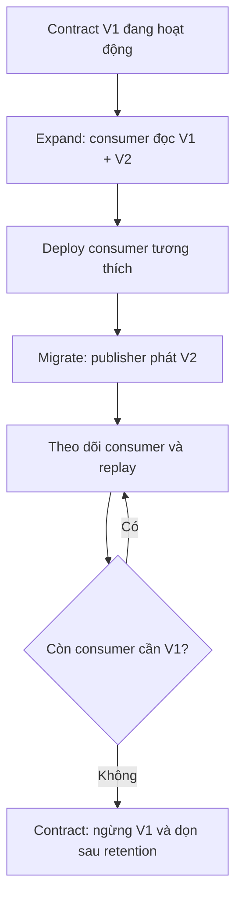

# Thay đổi bắt buộc

## Mục tiêu

Application event là hợp đồng giao tiếp giữa publisher và listener. Khi một module thay đổi cấu trúc hoặc ý nghĩa event, các listener đang chạy ở phiên bản cũ có thể không đọc được payload mới hoặc hiểu sai dữ liệu. Tình huống này đặc biệt quan trọng khi event đã được externalize tới Kafka/RabbitMQ, được lưu để replay hoặc được nhiều ứng dụng tiêu thụ độc lập.

**Thay đổi bắt buộc (breaking change)** là thay đổi khiến ít nhất một consumer hợp lệ trước đó không còn xử lý đúng event theo hợp đồng cũ. Lỗi có thể xuất hiện ngay ở bước deserialize, lúc validate hoặc muộn hơn khi logic nghiệp vụ diễn giải một giá trị theo ý nghĩa mới.

Sau bài học, bạn có thể:

- Nhận diện breaking change ở cấu trúc và ngữ nghĩa event.
- Đánh giá ảnh hưởng dựa trên consumer, phiên bản đang chạy và nhu cầu replay.
- Chọn cách version hóa event type, schema hoặc topic phù hợp.
- Triển khai thay đổi theo chiến lược expand-migrate-contract.
- Dùng adapter/upcaster để chuyển event cũ sang mô hình nội bộ mới.
- Kiểm thử tương thích, dual-read/dual-publish và kế hoạch loại bỏ phiên bản cũ.

## 1. Khi nào một thay đổi trở thành breaking change?

Một thay đổi là breaking khi consumer cũ không thể tiếp tục đọc hoặc giữ đúng ý nghĩa nghiệp vụ. Không phải mọi thay đổi cấu trúc đều phá vỡ tương thích; ngược lại, một thay đổi không làm schema khác đi vẫn có thể phá vỡ consumer.

### Thay đổi cấu trúc thường gây mất tương thích

| Thay đổi | Vì sao có thể phá vỡ consumer |
| --- | --- |
| Xóa field đang được consumer sử dụng | Consumer không còn nhận được dữ liệu cần thiết. |
| Đổi tên field | Consumer tìm tên cũ không còn thấy giá trị. |
| Đổi kiểu dữ liệu không tương thích | Deserializer hoặc code xử lý không thể chuyển kiểu. |
| Thêm field bắt buộc không có default phù hợp | Consumer đọc payload cũ không thể tạo object hợp lệ. |
| Đổi cấu trúc lồng nhau | Đường dẫn field và mapping cũ không còn đúng. |
| Xóa/đổi giá trị enum | Consumer có thể lỗi khi gặp giá trị mới hoặc không còn nhận diện giá trị cũ. |
| Đổi format timestamp, đơn vị tiền hoặc precision | Consumer có thể deserialize được nhưng tính toán sai. |
| Đổi event type/topic/routing key | Consumer đang subscribe địa chỉ cũ không nhận event mới. |

### Thay đổi ngữ nghĩa cũng có thể phá vỡ

Ví dụ `totalAmount` trước đây được tính bằng VND nhưng phiên bản mới dùng đơn vị minor unit; cả hai vẫn có thể là `long`, nhưng consumer sẽ hiểu sai nếu không biết thay đổi. Tương tự:

- `occurredAt` chuyển từ thời điểm nghiệp vụ sang thời điểm message được publish.
- `OrderCancelled` trước đây có nghĩa đơn đã hủy hoàn tất, nay chỉ có nghĩa yêu cầu hủy được tiếp nhận.
- Field `customerId` trước đây là ID nội bộ, nay trở thành ID của hệ thống đối tác.
- Một event snapshot đầy đủ được đổi thành delta chỉ chứa phần thay đổi.
- Một event phát sau commit được đổi thành event phát trước khi transaction hoàn tất.

Schema Registry có thể chấp nhận một số thay đổi kiểu dữ liệu nhưng không thể biết ý nghĩa nghiệp vụ của field. Vì vậy, review contract phải kiểm tra cả cấu trúc lẫn semantics.

### Thay đổi có thể tương thích

Một số thay đổi thường có thể tương thích nếu consumer được thiết kế phù hợp:

- Thêm field optional với default rõ ràng.
- Thêm metadata không bắt buộc mà consumer cũ bỏ qua được.
- Thêm event type mới mà không thay đổi event type cũ.
- Mở rộng enum khi consumer có chiến lược xử lý giá trị chưa biết.

Tuy nhiên, “thêm field” không tự động luôn an toàn. Consumer dùng JSON Schema với `additionalProperties: false`, code deserialize strict hoặc switch enum không có nhánh fallback vẫn có thể thất bại. Hãy kiểm tra hành vi thực tế của serializer, deserializer và consumer.

## 2. Phân biệt hợp đồng nội bộ và hợp đồng tích hợp

Trong Spring Modulith, application event nội bộ giúp các module giao tiếp qua ranh giới module. Khi event được gửi ra broker hoặc hệ thống ngoài, nó trở thành một hợp đồng tích hợp có vòng đời dài hơn và nhiều consumer độc lập hơn.

Nên phân biệt:

| Loại hợp đồng | Phạm vi | Cách quản lý thay đổi |
| --- | --- | --- |
| Domain/application event nội bộ | Các module trong cùng ứng dụng | Có thể tiến hóa cùng ứng dụng, nhưng phải kiểm tra mọi listener và ranh giới module. |
| Integration event | Ứng dụng khác, broker hoặc đối tác | Version hóa rõ, có chính sách compatibility, deprecation và thời gian hỗ trợ. |
| Persistence/event-store representation | Lịch sử event đã lưu | Cần giữ khả năng đọc/replay dữ liệu cũ hoặc có migration/upcasting. |

Không nên dùng trực tiếp entity, aggregate hoặc class nội bộ làm hợp đồng tích hợp lâu dài. Một thay đổi domain model không nên buộc mọi consumer bên ngoài nâng cấp đồng thời.

Ví dụ module Đơn hàng có thể phát `OrderPlaced` nội bộ, sau đó integration adapter map sang DTO `OrderPlacedV1` có schema riêng. Khi domain model thay đổi, mapper chịu trách nhiệm giữ contract V1 ổn định hoặc tạo V2 theo kế hoạch.

## 3. Đánh giá tác động trước khi thay đổi

Trước khi sửa một event contract, cần biết ai đang tiêu thụ event và dữ liệu cũ còn tồn tại bao lâu.

### Lập danh sách consumer

Với mỗi event type, ghi nhận:

- Publisher và module sở hữu event.
- Các listener nội bộ và module phụ thuộc.
- Topic/queue, consumer group và service bên ngoài.
- Phiên bản consumer đang triển khai và thời gian deploy.
- Consumer có đọc event lịch sử, replay hoặc backfill không.
- SLA, deadline và side effect nếu event bị bỏ lỡ hoặc hiểu sai.

Không chỉ tìm các consumer đang hoạt động. Một batch job, data warehouse, báo cáo hoặc đối tác có thể đọc lại dữ liệu cũ sau nhiều tuần. Consumer không được ghi nhận trong catalog vẫn có thể phụ thuộc vào contract.

### Xác định phạm vi tương thích

Đặt các câu hỏi:

1. Consumer mới có đọc được event cũ không?
2. Consumer cũ có đọc được event mới không?
3. Event cũ có còn nằm trong broker retention, archive hoặc event store không?
4. Có cần replay toàn bộ lịch sử bằng code mới không?
5. Có thể triển khai consumer trước producer không?
6. Có thể chạy song song V1 và V2 trong một khoảng thời gian không?
7. Side effect có thể bị lặp nếu publish hai phiên bản không?

Các câu trả lời quyết định chiến lược versioning. Nếu không có consumer inventory hoặc không biết thời gian lưu event, hãy xem phạm vi tương thích là chưa xác định và không loại bỏ contract cũ vội vàng.

## 4. Các chiến lược version hóa

Không có một cách versioning phù hợp cho mọi event. Hãy chọn một quy tắc ổn định và áp dụng nhất quán.

### Version trong event type

Ví dụ:

```text
com.example.orders.order-placed.v1
com.example.orders.order-placed.v2
```

Ưu điểm là consumer có thể subscribe hoặc route rõ theo contract version. Nhược điểm là cần quản lý nhiều event type và mapping song song trong thời gian migration.

### Version trong payload/envelope

Ví dụ:

```json
{
  "eventType": "order-placed",
  "schemaVersion": 2,
  "eventId": "a6f5a62e-63f5-45e9-99e9-c98c1d0bb212",
  "payload": {
    "orderId": "ORD-1001",
    "totalAmountMinor": 125000,
    "currency": "VND"
  }
}
```

Consumer đọc `schemaVersion` để chọn DTO/mapper phù hợp. Cần bảo đảm version có mặt và có quy tắc fallback rõ; không suy đoán version từ việc field nào đó có tồn tại.

### Version trong schema registry

Với Avro, Protobuf hoặc JSON Schema, registry thường quản lý version theo subject. Schema ID/version giúp deserializer tìm đúng schema. Nhưng version schema trong registry không thay thế event type hoặc semantic version của contract. Hai schema khác version vẫn có thể mang cùng tên event nhưng ý nghĩa khác nhau.

### Version trong topic

Ví dụ `orders.events.v1` và `orders.events.v2`. Topic version tạo ranh giới rõ ở broker, dễ cấu hình consumer riêng và rollout song song. Đổi lại, phải quản lý thêm topic, ACL, monitoring, retention và migration dữ liệu.

Không nên tạo topic version mới cho mọi thay đổi nhỏ. Topic version phù hợp khi cần tách luồng, retention hoặc quyền truy cập; schema version/field evolution thường đủ cho thay đổi tương thích.

### Chọn một nguồn version chuẩn

Nếu event type, header, payload và topic đều mang version, hãy định nghĩa trường nào là nguồn chuẩn và cách kiểm tra tính nhất quán. Tránh trường hợp header nói V2 nhưng payload lại khai báo V1. Một quy tắc đơn giản, có tài liệu và được validate tốt hơn nhiều marker version không đồng bộ.

## 5. Chiến lược expand-migrate-contract

Với thay đổi bắt buộc, cách an toàn thường là mở rộng hệ thống để cả hai phiên bản cùng hoạt động, di chuyển consumer/producer, rồi mới loại bỏ phiên bản cũ.

### Giai đoạn 1 — Expand

- Thiết kế contract V2 và kiểm tra compatibility.
- Consumer được nâng cấp để đọc cả V1 và V2.
- Giữ publisher tiếp tục phát V1 trong lúc consumer mới được triển khai.
- Thêm metric để biết consumer nào còn xử lý V1.

### Giai đoạn 2 — Migrate

- Triển khai consumer V2 hoặc adapter hỗ trợ song song.
- Xác minh toàn bộ consumer cần thiết đã đọc được V2.
- Chuyển publisher sang phát V2, hoặc dual-publish trong thời gian có kiểm soát.
- Theo dõi lỗi deserialize, DLQ, lag và kết quả nghiệp vụ.

### Giai đoạn 3 — Contract

- Ngừng phát V1 sau khi không còn consumer cần nó.
- Giữ khả năng đọc V1 trong thời gian replay/retention yêu cầu.
- Chỉ xóa handler, schema và topic V1 khi đã hết thời gian hỗ trợ và có xác nhận từ consumer owner.
- Lưu quyết định deprecation và bằng chứng consumer đã chuyển đổi.



Không đảo thứ tự deploy nếu producer mới có thể gửi payload mà consumer cũ không đọc được. Với thay đổi có nguy cơ làm hỏng consumer đang chạy, ưu tiên triển khai khả năng đọc trước, sau đó mới thay đổi khả năng ghi.

## 6. Ví dụ thay đổi field bắt buộc

Giả sử V1 có `totalAmount` là số nguyên theo đơn vị đồng:

```json
{
  "eventType": "order-placed",
  "schemaVersion": 1,
  "payload": {
    "orderId": "ORD-1001",
    "totalAmount": 125000
  }
}
```

V2 cần thể hiện rõ số tiền và đơn vị tiền tệ:

```json
{
  "eventType": "order-placed",
  "schemaVersion": 2,
  "payload": {
    "orderId": "ORD-1001",
    "totalAmountMinor": 125000,
    "currency": "VND"
  }
}
```

Đổi `totalAmount` thành `totalAmountMinor` và thêm `currency` là thay đổi bắt buộc với consumer V1 nếu chúng không được chuẩn bị trước. Không nên đổi tên field rồi giả định consumer cũ tự hiểu.

### Consumer hỗ trợ hai version

Một adapter có thể chuyển V1 và V2 về một command nội bộ chuẩn:

```java
sealed interface OrderPlacedPayload
        permits OrderPlacedV1, OrderPlacedV2 {}

record OrderPlacedV1(String orderId, long totalAmount) implements OrderPlacedPayload {}

record OrderPlacedV2(
        String orderId,
        long totalAmountMinor,
        String currency) implements OrderPlacedPayload {}

record PlaceOrderReadModel(
        String orderId,
        long amountMinor,
        String currency) {}
```

Mapper:

```java
PlaceOrderReadModel toReadModel(OrderPlacedPayload payload) {
    return switch (payload) {
        case OrderPlacedV1 v1 -> new PlaceOrderReadModel(
                v1.orderId(), v1.totalAmount(), "VND");
        case OrderPlacedV2 v2 -> new PlaceOrderReadModel(
                v2.orderId(), v2.totalAmountMinor(), v2.currency());
    };
}
```

Ví dụ giả định V1 luôn dùng VND; nếu không có căn cứ này, không được tự gán `VND`. Adapter chỉ nên chuyển đổi khi semantics của V1 đã được xác nhận bằng contract/tài liệu. Sau khi chuyển đổi, logic projection chỉ xử lý một mô hình nội bộ chuẩn.

## 7. Upcasting và translation layer

Khi hệ thống lưu event lịch sử hoặc cần replay message cũ, không phải lúc nào cũng có thể sửa dữ liệu cũ. Upcaster chuyển representation cũ thành representation mới trước khi logic hiện tại xử lý.

Ví dụ:

- V1 có `totalAmount` và semantics đã biết là VND.
- V2 có `totalAmountMinor` và `currency`.
- Upcaster V1 tạo representation nội bộ tương đương V2 với currency được suy ra theo contract V1.

Upcaster cần:

- Có version đầu vào/đầu ra rõ ràng.
- Thực hiện chuyển đổi xác định, lặp lại cho cùng dữ liệu sẽ cho cùng kết quả.
- Không tạo side effect nghiệp vụ khi chỉ chuyển đổi schema.
- Ghi nhận lỗi khi thiếu dữ liệu cần thiết; không tự bịa default.
- Có test với payload mẫu của mọi version còn hỗ trợ.

### Upcaster không thay thế migration nghiệp vụ

Upcaster chuyển đổi cấu trúc dữ liệu để consumer đọc được. Nó không nên tự thực hiện thao tác như thu tiền, gửi thông báo hoặc thay đổi trạng thái đơn. Nếu dữ liệu lịch sử thực sự sai, cần một correction event hoặc quy trình migration có audit.

### Translation layer/anti-corruption layer

Với event từ đối tác, adapter có thể map nhiều version ngoài vào một application command ổn định. Điều này giữ thay đổi contract bên ngoài khỏi lan vào module nghiệp vụ.

```text
Partner Event V1 ─┐
                  ├─> Version adapter ─> Internal command
Partner Event V2 ─┘
```

Tương tự, publisher có thể map domain/application event sang integration event V1 hoặc V2. Không để domain model phải mang annotation/version field chỉ để đáp ứng một broker contract nếu adapter có thể đảm nhận việc đó.

## 8. Dual-read và dual-publish

### Dual-read

Consumer nhận cả V1 và V2 trong giai đoạn migration, chuyển chúng về một mô hình nội bộ chung. Cách này hữu ích khi producer và consumer không thể deploy đồng thời.

Rủi ro cần kiểm soát:

- Hai mapper phải tạo cùng ý nghĩa cho cùng một business event.
- Cả hai version phải có idempotency identity nhất quán.
- Không xử lý cùng một event hai lần nếu publisher gửi cả V1 và V2.
- Cần metric phân biệt số event theo version và lỗi từng mapper.

### Dual-publish

Publisher gửi cả V1 và V2 để consumer chuyển đổi dần. Cách này có thể hữu ích khi nhiều consumer không thể nâng cấp cùng lúc, nhưng tạo hai message cho cùng một thay đổi nghiệp vụ.

Nếu dùng dual-publish:

- Giữ chung `eventId`/business event identity hoặc có `causationId` liên kết hai representation.
- Consumer phải deduplicate theo business event, không chỉ theo message ID nếu hai bản có ID khác nhau.
- Có thời hạn kết thúc dual-publish và metric chứng minh consumer V1 đã ngừng.
- Xác định thứ tự publish và hành vi khi một version gửi thành công còn version kia thất bại.
- Tránh để hai version kích hoạt cùng side effect ở cùng một consumer.

Dual-publish không phải lựa chọn mặc định. Nếu có thể triển khai consumer dual-read trước, sau đó đổi publisher một lần, quy trình thường đơn giản hơn.

## 9. Thay đổi bắt buộc với Kafka và Schema Registry

Khi event đi qua Kafka, breaking change có thể ảnh hưởng tới schema subject, topic, consumer group và message lịch sử.

### Schema compatibility

Schema Registry có thể áp dụng các chế độ như BACKWARD, FORWARD, FULL và các biến thể TRANSITIVE. Chế độ cụ thể phụ thuộc định dạng và implementation registry. Hãy xác định hướng tương thích theo cách deploy:

- Consumer mới đọc dữ liệu cũ: cần backward compatibility.
- Consumer cũ đọc dữ liệu mới: cần forward compatibility.
- Cần hỗ trợ cả hai chiều: cân nhắc full compatibility.
- Cần tương thích với toàn bộ lịch sử subject: dùng chế độ transitive phù hợp.

Registry chỉ kiểm tra các quy tắc schema mà nó hiểu. Nó không xác minh business meaning, topic routing, idempotency hoặc side effect. Contract test vẫn cần thiết.

### Topic V1 và V2

Nếu dùng topic riêng, ví dụ `orders.events.v1` và `orders.events.v2`, hãy chuẩn bị:

- ACL/permission cho producer và consumer.
- Partition count, retention, replication và cleanup policy.
- Consumer group và lag dashboard riêng.
- Quy trình backfill/replay và thời điểm dừng topic cũ.
- Mapping correlation/event ID giữa hai luồng.

Nếu giữ cùng topic nhưng đổi schema, consumer cần đọc schema ID/version chính xác và xử lý payload cũ/new theo serializer contract. Không thay đổi subject naming strategy giữa chừng nếu chưa đánh giá ảnh hưởng tới compatibility history.

## 10. Thay đổi bắt buộc trong Spring Modulith

Spring Modulith giúp module giao tiếp qua application events và có thể externalize event tới broker. Khi thay đổi contract, cần xác định ranh giới nào bị ảnh hưởng:

1. Event nội bộ có listener trong cùng ứng dụng.
2. Event được listener module khác tiêu thụ.
3. Event được externalize qua integration adapter.
4. Event đã được lưu trong publication/outbox/event store hoặc broker để replay.

### Giữ application event nội bộ ổn định

Nếu thay đổi chỉ phục vụ integration contract, hãy tạo DTO bên ngoài riêng và map từ application event. Khi cần V2, adapter có thể phát integration event V2 mà không bắt buộc đổi mọi listener nội bộ.

### Xử lý listener cũ

Nếu thay đổi application event nội bộ, tìm mọi listener trong các module và cập nhật theo cùng một migration plan. `ApplicationModules.verify()` có thể giúp kiểm tra dependency rule, nhưng không tự phát hiện mọi semantic incompatibility của event payload. Cần test compile, module test và contract test tương ứng.

### Event Publication Registry và event history

Event Publication Registry theo dõi trạng thái publication tới listener; nó không mặc định là kho lưu toàn bộ lịch sử event đã hoàn tất. Nếu publication chưa hoàn tất được resubmit sau khi deploy V2, listener phải còn khả năng xử lý payload version cũ hoặc có upcaster tương ứng.

Nếu cần replay toàn bộ event lịch sử, phải có nguồn lưu trữ event phù hợp như broker retention, archive hoặc event store. Xác định thời gian hỗ trợ V1 dựa trên retention và yêu cầu replay, không chỉ dựa trên thời điểm producer ngừng phát V1.

## 11. Deprecation và loại bỏ phiên bản cũ

Deprecation là giai đoạn thông báo và ngừng khuyến khích dùng phiên bản cũ trước khi xóa. Một chính sách rõ ràng cần nêu:

- Version bị deprecate và version thay thế.
- Ngày bắt đầu deprecation và ngày ngừng hỗ trợ dự kiến.
- Consumer owner cần hành động.
- Cách đo consumer còn dùng V1.
- Thời gian giữ schema/topic/payload cũ để replay.
- Quy trình xin gia hạn hoặc xử lý consumer không thể nâng cấp.

Không xóa V1 chỉ vì không còn thấy message mới. Một consumer có thể cần replay dữ liệu cũ sau sự cố hoặc backfill. Trước khi contract, kiểm tra cả traffic hiện tại lẫn retention/replay window.

## 12. Kiểm thử breaking change

Một thay đổi bắt buộc cần test cả tương thích kỹ thuật và kết quả nghiệp vụ.

| Loại test | Điều cần xác minh |
| --- | --- |
| Schema compatibility test | Schema mới tuân theo policy của registry hoặc thay đổi được đánh dấu breaking có chủ đích. |
| Historical payload test | Consumer mới đọc được payload V1 còn hỗ trợ. |
| Consumer contract test | Consumer V1/V2 hiểu đúng field, unit, enum và semantics. |
| Upcaster test | Payload cũ chuyển sang mô hình mới đúng và không tạo side effect. |
| Dual-read test | Cùng business event ở V1/V2 cho kết quả nội bộ tương đương. |
| Dual-publish test | Hai representation không tạo side effect trùng. |
| Rollout test | Consumer mới chạy trước producer mới; không có khoảng thời gian message không đọc được. |
| Replay test | Event cũ được xử lý sau deploy mới và vẫn giữ idempotency. |
| Deprecation test/monitor | Metric nhận diện consumer V1 còn hoạt động và xác nhận điều kiện loại bỏ. |

### Ví dụ test upcaster

```java
@Test
void convertsVersionOneAmountUsingDocumentedCurrency() {
    OrderPlacedV1 oldEvent = new OrderPlacedV1("ORD-1001", 125000L);

    PlaceOrderReadModel result = mapper.toReadModel(oldEvent);

    assertThat(result.orderId()).isEqualTo("ORD-1001");
    assertThat(result.amountMinor()).isEqualTo(125000L);
    assertThat(result.currency()).isEqualTo("VND");
}
```

Test này chỉ đúng nếu contract V1 quy định rõ đơn vị tiền là VND. Nếu V1 cho phép nhiều currency hoặc không định nghĩa đơn vị, mapper không được tự đặt VND; cần lấy dữ liệu từ nguồn authoritative hoặc từ chối chuyển đổi.

### Kiểm thử event lịch sử và thứ tự

Test fixture nên lưu payload đại diện cho từng version đã phát hành. Chạy consumer mới trên tất cả fixture còn hỗ trợ, gồm event tối thiểu, event có field optional, enum cũ và dữ liệu biên. Với event có aggregate version, kiểm tra replay không ghi đè state mới hơn hoặc áp dụng delta sai thứ tự.

## 13. Những lỗi thiết kế thường gặp

| Lỗi | Hậu quả | Cách xử lý |
| --- | --- | --- |
| Đổi field/type rồi deploy producer trước | Consumer cũ không đọc được message mới. | Triển khai consumer tương thích trước. |
| Chỉ kiểm tra schema, bỏ qua semantics | Consumer deserialize thành công nhưng tính sai dữ liệu. | Review unit, timezone, meaning và business behavior. |
| Dùng domain class làm integration contract | Thay đổi nội bộ buộc consumer ngoài nâng cấp. | Tách integration DTO và mapper. |
| Dual-publish không có identity chung | Một business event tạo side effect hai lần. | Dùng event identity/causation và deduplicate. |
| Xóa V1 ngay khi ngừng publish | Không replay được dữ liệu lịch sử hoặc publication cũ. | Chờ hết retention và replay window. |
| Upcaster tự sửa dữ liệu nghiệp vụ | Mất audit và có thể tạo trạng thái sai. | Chỉ chuyển schema; correction dùng event/quy trình riêng. |
| Không có consumer inventory | Bỏ sót batch, báo cáo hoặc đối tác vẫn đọc V1. | Catalog consumer và owner trước khi migration. |
| Version xuất hiện ở nhiều nơi không nhất quán | Consumer chọn sai mapper. | Chọn một nguồn version chuẩn và validate marker còn lại. |

## 14. Quy trình áp dụng

Khi thực hiện một thay đổi bắt buộc cho application event:

1. Xác định thay đổi cấu trúc và ngữ nghĩa; ghi rõ vì sao contract cũ không còn đáp ứng.
2. Liệt kê publisher, listener, consumer ngoài, topic/subject và dữ liệu lịch sử cần replay.
3. Chọn versioning strategy: event type, envelope/schema hoặc topic; xác định nguồn version chuẩn.
4. Thiết kế V2 và kiểm tra compatibility theo hướng consumer/producer deploy thực tế.
5. Xây mapper/upcaster từ V1 sang mô hình nội bộ mới nếu cần giữ lịch sử.
6. Triển khai consumer đọc V1 và V2 trước khi producer phát V2.
7. Dual-publish chỉ khi cần, với event identity, deduplication và thời hạn kết thúc rõ.
8. Theo dõi traffic/version, lỗi deserialize, DLQ, consumer lag và kết quả nghiệp vụ.
9. Giữ V1 trong thời gian retention/replay; chỉ loại bỏ khi consumer owner xác nhận đã chuyển đổi.
10. Lưu contract fixture, migration decision, deprecation notice và audit cho lần thay đổi sau.

Thay đổi bắt buộc cần được triển khai như một quá trình chuyển đổi có kiểm soát giữa các phiên bản producer và consumer. Khi có consumer inventory, version rõ ràng, adapter chuyển đổi, rollout theo expand-migrate-contract và thời gian hỗ trợ lịch sử phù hợp, các module Spring Modulith có thể tiến hóa hợp đồng event mà không làm gián đoạn những hệ thống đang tiêu thụ event.
