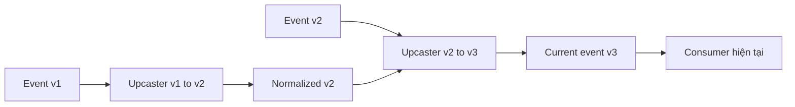
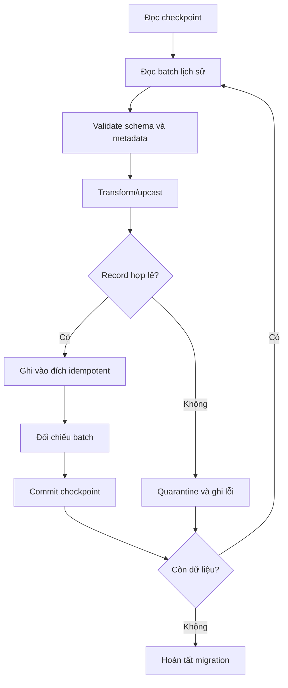
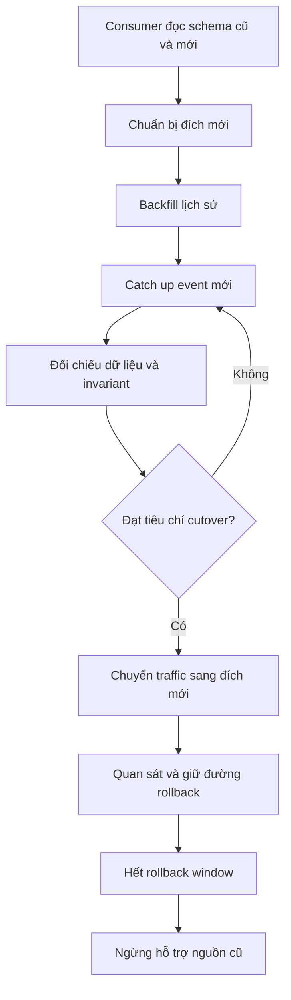

# Di trú dữ liệu lịch sử

Khi event contract thay đổi, hệ thống thường phải xử lý những event đã được lưu từ trước: record còn trong Kafka, message trong archive, payload trong outbox hoặc publication chưa hoàn tất của Spring Modulith. Nếu chỉ nâng cấp class event và serializer cho dữ liệu mới, ứng dụng có thể đọc được event vừa phát nhưng thất bại khi replay hoặc retry dữ liệu lịch sử.

Di trú dữ liệu lịch sử là quá trình đưa event cũ về một cấu trúc hoặc cách lưu trữ mới mà vẫn giữ đúng ý nghĩa nghiệp vụ, định danh, thứ tự và khả năng kiểm toán. Với Spring Modulith, cần phân biệt event lịch sử được lưu trong một event store/outbox do ứng dụng sở hữu với dữ liệu trạng thái nội bộ của Event Publication Registry. Hai loại dữ liệu này có mục đích và quy tắc vòng đời khác nhau.

## 1. Vì sao phải di trú event lịch sử?

Một event `OrderPlaced` phiên bản 1 có thể chứa `orderId`, `occurredAt` và `totalAmount`. Phiên bản 2 bổ sung `currencyCode`, đổi cách biểu diễn địa chỉ hoặc tách thông tin khách hàng thành một object. Producer mới phát payload v2, trong khi topic, archive hoặc database vẫn còn payload v1.

Các tình huống thường gặp:

- Consumer mới cần đọc lại dữ liệu được phát bởi phiên bản ứng dụng cũ.
- Projection cần được xây dựng lại từ event lịch sử sau khi thay đổi mô hình đọc.
- Dữ liệu outbox chưa được publish còn chứa payload theo schema cũ.
- Message nằm trong retry topic hoặc DLT cần được xử lý sau khi đã sửa lỗi.
- Event archive phải được chuyển sang định dạng lưu trữ mới.
- Hệ thống cần chuyển broker, topic, schema registry hoặc nền tảng lưu trữ.
- Quy tắc dữ liệu thay đổi, chẳng hạn chuẩn hóa tiền tệ, múi giờ hoặc mã trạng thái.

Nếu không có kế hoạch di trú, ứng dụng có thể gặp lỗi deserialize, bỏ sót event, xử lý trùng hoặc diễn giải sai dữ liệu cũ. Một payload vẫn deserialize được cũng chưa chắc còn đúng về ngữ nghĩa; ví dụ `totalAmount` đổi từ tổng trước thuế sang tổng sau thuế có thể khiến báo cáo lịch sử sai dù kiểu dữ liệu không đổi.

## 2. Kiểm kê nguồn dữ liệu trước khi di trú

Trước khi chuyển đổi, hãy lập danh sách mọi nơi có thể còn giữ event cũ. Không nên giả định chỉ topic chính mới chứa dữ liệu lịch sử.

| Nguồn | Dữ liệu có thể còn tồn tại | Cần xác định |
| --- | --- | --- |
| Kafka topic chính | Record chưa hết retention hoặc compacted record. | Topic, partition, offset, key, timestamp và retention. |
| Retry topic/DLT | Message thất bại đang chờ xử lý hoặc điều tra. | Số lượng, nguyên nhân lỗi, header retry và chính sách replay. |
| Outbox do ứng dụng sở hữu | Event đã ghi nhưng chưa gửi hoặc còn giữ để audit. | Trạng thái gửi, payload, event ID và cơ chế cleanup. |
| Event store/archive | Lịch sử event dùng cho replay, audit hoặc rebuild. | Định dạng, schema version, thứ tự và retention. |
| Event Publication Registry | Publication tới transactional listener chưa hoàn tất. | Listener đích, payload lưu trữ và khả năng đọc lại sau deploy. |
| Backup/export | Bản sao dữ liệu được dùng cho phục hồi hoặc phân tích. | Thời điểm snapshot, format và quy trình khôi phục. |

Với mỗi nguồn, cần biết ai sở hữu dữ liệu, ai có quyền ghi/xóa, thời gian lưu, cách đọc và cách khôi phục. Ghi lại số lượng record theo event type/schema version, khoảng thời gian, partition hoặc tenant nếu có. Số liệu ban đầu là baseline để so sánh sau migration.

Không nhầm Event Publication Registry với event store tổng quát. Registry theo dõi trạng thái publication tới transactional listener; nó không mặc nhiên lưu toàn bộ lịch sử event đã hoàn tất để phục vụ replay lâu dài. Nếu cần lịch sử đầy đủ, ứng dụng phải có nguồn event log, outbox archive hoặc hệ thống lưu trữ được thiết kế cho mục tiêu đó.

## 3. Phân biệt event contract với trạng thái publication

Event payload mô tả một sự kiện nghiệp vụ đã xảy ra. Publication record mô tả việc giao event đó tới một listener cụ thể và trạng thái hoàn tất của lần giao.

| Dữ liệu | Ví dụ | Cách xử lý khi migration |
| --- | --- | --- |
| Event contract | `OrderPlaced` v1/v2, event ID và payload. | Chuyển đổi theo schema/semantic migration đã định nghĩa. |
| Outbox record | Event chờ gửi tới broker. | Giữ liên kết với event gốc và trạng thái gửi; tránh publish trùng khi chuyển đổi. |
| Publication registry record | Publication tới `InventoryListener` chưa hoàn tất. | Bảo đảm framework/serializer còn đọc được; không tự ý sửa trạng thái nội bộ. |
| Consumer offset | Vị trí consumer group đã đọc. | Lập kế hoạch riêng khi replay hoặc chuyển topic; không coi là event payload. |

Với Event Publication Registry của Spring Modulith, publication còn pending có thể được xử lý lại sau khi ứng dụng deploy phiên bản mới. Nếu serializer phụ thuộc tên class, package hoặc cấu trúc Java, thay đổi class event có thể khiến payload cũ không deserialize được. Hãy kiểm tra khả năng tương thích trước khi deploy và dùng API/cơ chế được hỗ trợ bởi phiên bản framework đang chạy.

Không cập nhật trực tiếp bảng nội bộ của registry để biến publication pending thành completed hoặc để thay payload. Điều đó có thể làm sai trạng thái giao event và phá vỡ khả năng recovery.

## 4. Chọn chiến lược di trú phù hợp

Không phải mọi event cũ đều cần được rewrite ngay. Chọn chiến lược theo số lượng dữ liệu, tần suất replay, khả năng tương thích và yêu cầu audit.

| Chiến lược | Cách làm | Phù hợp khi |
| --- | --- | --- |
| Upcast khi đọc | Giữ payload gốc; chuyển schema cũ sang model hiện tại lúc đọc. | Dữ liệu lớn, cần giữ nguyên bản gốc hoặc ít được đọc lại. |
| Batch rewrite | Đọc theo lô, chuyển đổi rồi ghi vào kho mới hoặc cập nhật theo quy trình an toàn. | Muốn chuẩn hóa dữ liệu lưu trữ trước khi chuyển hệ thống. |
| Replay/rebuild | Đọc event lịch sử và áp dụng vào projection hoặc read model mới. | Cần xây dựng lại trạng thái đọc từ nguồn event có thể phát lại. |
| Dual-read | Consumer tạm thời hiểu cả schema cũ và mới. | Rolling deployment khi producer và consumer khác phiên bản. |
| Dual-write/dual-publish | Trong giai đoạn chuyển tiếp, ghi sang cả đích cũ và mới theo cơ chế kiểm soát. | Chuyển broker/topic hoặc hệ thống downstream cần thời gian cutover. |
| Snapshot + delta | Nạp snapshot tại một watermark rồi áp dụng event sau watermark. | Lịch sử lớn, không muốn replay toàn bộ từ đầu. |

Upcast khi đọc thường giảm rủi ro vì dữ liệu gốc không bị sửa. Batch rewrite có thể làm đơn giản đường đọc về sau nhưng cần backup, kiểm tra và kế hoạch rollback. Replay phù hợp với projection có thể tái tạo, nhưng chỉ an toàn khi event lịch sử đầy đủ và có quy tắc thứ tự rõ.

## 5. Xây dựng schema đích và quy tắc chuyển đổi

Trước khi viết migration, hãy định nghĩa schema đích, ý nghĩa từng field, kiểu dữ liệu, đơn vị, nullability và giá trị mặc định. Mỗi chuyển đổi phải có quy tắc rõ ràng cho dữ liệu thiếu hoặc không hợp lệ.

Ví dụ event v1:

```json
{
  "eventType": "orders.order-placed",
  "schemaVersion": 1,
  "eventId": "5c3e9b0d-6a74-4d3d-9a63-8f3c8a3e2f10",
  "data": {
    "orderId": "e2a1c5a4-3d62-4d0e-8e65-2a7a2c7a9c10",
    "totalAmount": 149.90
  }
}
```

Schema v2 bổ sung tiền tệ:

```json
{
  "eventType": "orders.order-placed",
  "schemaVersion": 2,
  "eventId": "5c3e9b0d-6a74-4d3d-9a63-8f3c8a3e2f10",
  "data": {
    "orderId": "e2a1c5a4-3d62-4d0e-8e65-2a7a2c7a9c10",
    "totalAmount": 149.90,
    "currencyCode": "VND"
  }
}
```

Không được tự suy ra `VND` nếu dữ liệu lịch sử có thể thuộc loại tiền tệ khác. Nếu không xác định được currency, cần tra cứu nguồn có thẩm quyền hoặc đưa record vào quarantine để xử lý. Gán default sai giúp migration chạy hết nhưng làm hỏng ý nghĩa dữ liệu.

Một schema đích nên có metadata ổn định như `eventId`, `eventType`, `schemaVersion`, `occurredAt`, `producer`, `correlationId`, `causationId` và aggregate version nếu nghiệp vụ cần. Giữ nguyên event ID và thời điểm nghiệp vụ gốc khi chuyển đổi; thời điểm migration nên được lưu ở metadata riêng.

## 6. Upcasting theo chuỗi phiên bản

Upcasting chuyển payload cũ thành biểu diễn hiện tại khi đọc. Nên chia migration thành các bước nhỏ, ví dụ v1 → v2 và v2 → v3, thay vì viết một đoạn chuyển đổi lớn khó kiểm tra.



Ví dụ minh họa một upcaster JSON do ứng dụng sở hữu:

```java
import com.fasterxml.jackson.databind.JsonNode;
import com.fasterxml.jackson.databind.node.ObjectNode;

class OrderPlacedV1ToV2 {

    ObjectNode upcast(JsonNode source) {
        ObjectNode target = source.deepCopy();
        JsonNode dataNode = target.get("data");

        if (!(dataNode instanceof ObjectNode data)) {
            throw new InvalidHistoricalEventException("Missing event data");
        }

        if (!data.hasNonNull("currencyCode")) {
            throw new MissingCurrencyException(
                    target.path("eventId").asText());
        }

        target.put("schemaVersion", 2);
        return target;
    }
}
```

Đây là ví dụ minh họa, không phải API upcaster tự động của Spring Modulith. Trong thực tế cần xác thực schema version, từ chối version không hỗ trợ, kiểm tra kiểu dữ liệu và giữ nguyên payload gốc. Nếu cần tra cứu dữ liệu bổ sung, hãy dùng một nguồn có thẩm quyền và ghi rõ nguồn/phiên bản dữ liệu đã dùng.

Upcaster nên có tính xác định: cùng payload và cùng quy tắc phải tạo ra cùng kết quả. Tránh gọi API phụ thuộc trạng thái hiện tại hoặc dùng `Instant.now()` để thay thế thời điểm nghiệp vụ cũ, vì replay ở thời điểm khác sẽ tạo kết quả khác.

## 7. Giữ nguyên định danh, thứ tự và metadata

Migration không nên tạo ra một event nghiệp vụ mới nếu mục tiêu chỉ là thay đổi cách biểu diễn event cũ. Giữ nguyên các metadata cần thiết:

- `eventId`: giữ nguyên để idempotency và đối chiếu lịch sử.
- `eventType`: giữ định danh nghiệp vụ hoặc ánh xạ qua bảng tên có phiên bản nếu event type đổi.
- `occurredAt`: giữ thời điểm nghiệp vụ ban đầu.
- `aggregateId` và `aggregateVersion`: giữ thứ tự thay đổi của aggregate.
- `correlationId` và `causationId`: giữ liên kết nhân quả giữa các event.
- Partition key: giữ quy tắc định tuyến để event cùng aggregate không bị tách luồng ngoài dự kiến.
- Tenant/business scope: giữ ranh giới dữ liệu giữa các khách hàng hoặc tổ chức.

Thêm `migratedAt`, `migrationRunId`, `sourceSchemaVersion` hoặc `transformVersion` vào metadata riêng để truy vết quá trình chuyển đổi. Không ghi đè `occurredAt` bằng thời gian migration.

Với Kafka, thứ tự chỉ được bảo đảm trong một partition. Nếu di trú sang topic mới, cần giữ key và xem xét cách partitioner ánh xạ key khi số partition thay đổi. Offset cũ không thể được dùng như offset mới của topic đích; cần một checkpoint ánh xạ theo partition/offset nguồn hoặc theo event ID/aggregate version.

## 8. Batch migration có checkpoint

Với dữ liệu lớn, không nên tải toàn bộ event vào bộ nhớ rồi chuyển đổi một lần. Hãy xử lý theo batch có giới hạn và lưu checkpoint sau khi batch được ghi nhận thành công.

Một quy trình tổng quát:

1. Chọn khoảng dữ liệu hoặc vị trí bắt đầu rõ ràng.
2. Đọc một batch theo thứ tự ổn định.
3. Kiểm tra schema version và tính hợp lệ của từng record.
4. Chuyển đổi payload theo phiên bản nguồn.
5. Ghi kết quả vào đích với event ID/idempotency key được giữ nguyên.
6. Xác minh số lượng và kết quả ghi.
7. Commit checkpoint sau khi dữ liệu của batch đã bền vững.
8. Tiếp tục batch kế tiếp.



Checkpoint phải phản ánh dữ liệu đã ghi bền vững. Nếu cập nhật checkpoint trước khi ghi đích hoàn tất, tiến trình có thể bỏ qua record khi restart. Nếu ghi đích xong nhưng checkpoint chưa commit, batch có thể chạy lại; vì vậy thao tác ghi phải idempotent.

Với Kafka, checkpoint có thể gồm topic, partition và offset nguồn. Với database, có thể dùng khóa tăng dần hoặc cursor ổn định. Không dùng offset của broker nguồn để seek trực tiếp trên topic đích.

## 9. Idempotency và xử lý chạy lại

Migration cần chịu được restart, timeout và chạy lại một batch. Một record có thể được xử lý lại nếu tiến trình dừng sau khi ghi đích nhưng trước khi lưu checkpoint.

Các cách làm:

- Dùng `eventId` làm khóa duy nhất ở đích.
- Lưu `sourceLocation` như topic/partition/offset hoặc archive key để truy vết.
- Dùng unique constraint cho event ID và transform version.
- Ghi kết quả chuyển đổi cùng trạng thái migration trong transaction nếu cùng database.
- Với broker khác nhau, dùng write idempotent và checkpoint theo thứ tự rõ ràng.
- Không tạo event ID mới khi chỉ retry migration của cùng record.

Ví dụ bảng theo dõi migration:

```sql
CREATE TABLE event_migration_record (
    migration_run_id VARCHAR(100) NOT NULL,
    event_id UUID NOT NULL,
    source_version INTEGER NOT NULL,
    target_version INTEGER NOT NULL,
    source_location VARCHAR(500) NOT NULL,
    migrated_at TIMESTAMP NOT NULL,
    PRIMARY KEY (migration_run_id, event_id)
);
```

Schema này chỉ minh họa. Nếu cùng một event có thể đi qua nhiều migration run, cần quy định unique key phù hợp với mục tiêu: chống chuyển đổi lặp trong một run hay ngăn ghi trùng vào kho đích qua mọi run. Lưu cả transform version giúp biết record đã được chuyển đổi bằng quy tắc nào.

## 10. Quarantine record không thể chuyển đổi

Không nên dừng toàn bộ batch chỉ vì một record lỗi, nhưng cũng không được âm thầm bỏ qua record đó. Tạo một luồng quarantine để giữ payload gốc và lý do thất bại.

Thông tin cần lưu:

- Event ID và event type nếu đọc được.
- Vị trí nguồn: topic/partition/offset, database key hoặc archive location.
- Schema version nguồn.
- Transform version và migration run ID.
- Error category, exception type và thông tin chẩn đoán đã lọc dữ liệu nhạy cảm.
- Payload gốc hoặc tham chiếu tới nơi lưu an toàn.
- Trạng thái xử lý thủ công và thời điểm giải quyết.

Các loại lỗi thường gặp:

| Lỗi | Cách xử lý |
| --- | --- |
| Schema version không hỗ trợ | Bổ sung upcaster hoặc giữ record chờ phiên bản xử lý phù hợp. |
| Field bắt buộc bị thiếu | Tra cứu nguồn có thẩm quyền hoặc yêu cầu xử lý thủ công. |
| Giá trị enum không biết | Ánh xạ theo quy tắc nghiệp vụ được phê duyệt hoặc quarantine. |
| Payload hỏng | Giữ bản gốc, điều tra nguồn tạo dữ liệu và không tự sửa đoán. |
| Vi phạm invariant | Đối chiếu aggregate history và nguồn dữ liệu chuẩn. |

Quarantine không phải nơi xóa lỗi khỏi tầm nhìn. Cần metric số record, tuổi record cũ nhất, quy trình xử lý và cảnh báo khi có record tồn đọng.

## 11. Di trú để rebuild projection/read model

Một lý do phổ biến để đọc lại lịch sử event là xây dựng projection mới hoặc sửa projection hiện tại. Trước khi replay, xác định nguồn lịch sử có đầy đủ event cần thiết và schema cũ còn có thể chuyển đổi.

Hai cách thường dùng:

**Replay toàn bộ:** tạo projection rỗng, đọc event theo thứ tự cần thiết từ đầu và áp dụng từng event. Cách này dễ hiểu nếu lịch sử không quá lớn và event đầy đủ.

**Snapshot + delta:** nạp snapshot của write model tại watermark `W`, sau đó replay event sau `W`. Cách này giảm thời gian xử lý nhưng cần watermark nhất quán để không bỏ sót hoặc áp dụng trùng thay đổi.

Một quy trình rebuild có thể dùng bảng projection mới:

1. Tạo bảng/namespace projection phiên bản mới.
2. Chọn snapshot và watermark nguồn.
3. Backfill snapshot hoặc replay event tới watermark.
4. Bắt các event mới phát sinh sau watermark.
5. Áp dụng delta theo aggregate version và idempotency key.
6. So sánh dữ liệu projection mới với nguồn có thẩm quyền.
7. Chuyển query service sang projection mới sau khi đạt tiêu chí.
8. Giữ projection cũ trong khoảng rollback đã định nghĩa.

Không rebuild trực tiếp lên bảng đang phục vụ production nếu chưa có cách tránh query nhìn thấy trạng thái nửa cũ nửa mới. Shadow table hoặc versioned projection giúp cutover rõ hơn.

## 12. Di trú event giữa broker hoặc topic

Khi chuyển từ topic/broker cũ sang topic/broker mới, cần quản lý cả dữ liệu lịch sử lẫn event mới phát trong lúc migration.

Một chiến lược có thể là:

1. Tạo topic/namespace đích và cấu hình schema/ACL/retention.
2. Bắt đầu copy lịch sử theo checkpoint.
3. Đồng thời ghi nhận event mới phát sinh sau watermark hoặc dùng outbox/dual-publish có kiểm soát.
4. Xác minh số record, key, header, schema và thứ tự theo aggregate.
5. Chuyển consumer sang đích mới theo nhóm và theo dõi lag.
6. Dừng producer/consumer cũ sau khi đích mới đã bắt kịp.
7. Giữ nguồn cũ trong thời gian rollback rồi mới ngừng hỗ trợ.

Dual-publish có thể tạo duplicate nếu cùng event được gửi tới cả hai đích hoặc một lần gửi thành công còn lần kia thất bại. Consumer cần idempotency theo event ID; quy trình cutover cần xác định đích nào là authoritative ở từng thời điểm.

Với Kafka, offset nguồn và offset đích thuộc hai log độc lập. Không sao chép offset số học một cách máy móc. Dùng checkpoint migration hoặc mapping theo event ID/aggregate version để xác định dữ liệu đã được chuyển và consumer đích cần bắt đầu ở đâu.

## 13. Expand-contract và cutover an toàn

Di trú dữ liệu lịch sử thường cần phối hợp với việc nâng cấp producer và consumer. Một trình tự expand-contract giảm rủi ro khi nhiều phiên bản cùng chạy:

1. **Expand reader:** triển khai consumer đọc được schema cũ và schema mới.
2. **Prepare target:** tạo topic/table/schema đích và quyền truy cập.
3. **Backfill:** chuyển dữ liệu lịch sử theo batch và checkpoint.
4. **Catch up:** chuyển các event mới phát sinh sau watermark.
5. **Validate:** đối chiếu count, sequence, business invariant và trạng thái projection.
6. **Cut over:** chuyển reader/producer sang đích mới theo kế hoạch.
7. **Observe:** theo dõi lỗi deserialize, lag, duplicate, quarantine và publication pending.
8. **Contract:** chỉ ngừng schema/đích cũ sau khi hết thời hạn rollback và replay.



Đặt tiêu chí cutover trước khi chạy, ví dụ: không còn record thiếu, số lượng theo partition khớp, aggregate version không có gap ngoài dự kiến, quarantine đã được xử lý hoặc chấp nhận, consumer lag dưới ngưỡng và các luồng nghiệp vụ mẫu cho kết quả giống nguồn.

## 14. Xác minh kết quả migration

Không chỉ kiểm tra job đã chạy hết. Cần xác minh dữ liệu đích tương đương về số lượng và ý nghĩa nghiệp vụ.

Các lớp kiểm tra:

- **Count reconciliation:** số record đọc, chuyển thành công, quarantine và ghi đích phải đối chiếu được.
- **Identity reconciliation:** event ID không bị mất hoặc tạo mới ngoài quy tắc.
- **Position reconciliation:** checkpoint nguồn không bỏ qua khoảng dữ liệu; partition/offset hoặc cursor đã được ghi nhận.
- **Schema validation:** mọi payload đích tuân theo schema version đích.
- **Sequence validation:** aggregate version/sequence không có gap hoặc đảo thứ tự ngoài chính sách.
- **Semantic validation:** tiền tệ, đơn vị, trạng thái, timestamp và nullability giữ đúng ý nghĩa.
- **Projection comparison:** tổng số đơn, số dư, trạng thái hoặc chỉ số nghiệp vụ khớp với nguồn có thẩm quyền.
- **Replay validation:** một số luồng mẫu có thể đọc lại và tạo ra cùng kết quả mong đợi.

Hash payload chỉ hữu ích khi so sánh cùng một biểu diễn canonical. Khi schema thay đổi, hash của JSON có thể khác do thứ tự field hoặc format mà không đồng nghĩa dữ liệu nghiệp vụ khác. Hãy so sánh theo field chuẩn hóa và invariant nghiệp vụ.

Lưu báo cáo migration theo run ID, thời điểm, transform version, source range, target location, count và kết quả reconciliation. Báo cáo này giúp điều tra hoặc tiếp tục migration sau khi tiến trình bị dừng.

## 15. Rollback và phục hồi khi migration lỗi

Trước khi bắt đầu, cần biết có thể quay lại đâu và dữ liệu nào đã bị thay đổi. Nếu chỉ upcast khi đọc, rollback thường là triển khai reader cũ tương thích với dữ liệu gốc. Nếu đã rewrite dữ liệu tại chỗ, rollback cần bản sao hoặc log thay đổi đủ để khôi phục.

Một số nguyên tắc:

- Giữ bản gốc hoặc backup có thể phục hồi trước khi rewrite.
- Ghi checkpoint và transform version để xác định phạm vi đã chuyển.
- Không xóa nguồn cũ ngay sau khi copy thành công.
- Dùng shadow table/topic để có thể chuyển reader về nguồn cũ.
- Nếu đã dual-publish, xác định cách xử lý event phát sinh trong thời gian hai đích cùng hoạt động.
- Kiểm tra duplicate và idempotency trước khi chạy lại sau rollback.
- Chỉ tiếp tục từ checkpoint sau khi xác nhận dữ liệu đích của batch trước đã bền vững.

Rollback code không tự đảo ngược dữ liệu đã ghi vào broker hoặc database. Có thể cần một migration ngược riêng, restore backup hoặc rebuild lại projection từ nguồn có thẩm quyền. Không xóa event mới chỉ để làm cho offset trông giống trước migration.

## 16. Bảo mật, quyền riêng tư và retention

Event lịch sử có thể chứa dữ liệu cá nhân hoặc thông tin giao dịch đã thay đổi theo chính sách lưu trữ. Migration là cơ hội kiểm tra lại dữ liệu nào thực sự cần giữ và ai được phép đọc.

- Chỉ đọc và ghi các field cần thiết cho contract đích.
- Mask hoặc loại bỏ dữ liệu nhạy cảm theo chính sách được phê duyệt.
- Giữ nguyên audit metadata cần thiết nhưng không sao chép credential hoặc secret.
- Bảo vệ file export, staging table, quarantine và backup như dữ liệu gốc.
- Giới hạn quyền truy cập và thời gian lưu của dữ liệu trung gian.
- Ghi nhận ai chạy migration, thời điểm, phạm vi và kết quả.
- Xác định cách thực hiện yêu cầu xóa dữ liệu trên cả nguồn, đích, archive và bản sao theo quy định áp dụng.

Không ghi payload đầy đủ vào log migration nếu chỉ event ID, source location và error category đã đủ để điều tra. Payload quarantine cần được bảo vệ và có retention riêng.

## 17. Vận hành và quan sát migration

Migration có thể chạy hàng giờ hoặc hàng ngày. Cần metric để biết tiến độ, tốc độ và lỗi, đồng thời log đủ chi tiết để xử lý từng record.

| Chỉ số | Mục đích |
| --- | --- |
| Records scanned | Tổng record đã đọc từ nguồn. |
| Records transformed | Tổng record chuyển đổi thành công. |
| Records written | Tổng record đã ghi bền vững vào đích. |
| Quarantine count | Record không thể chuyển đổi tự động. |
| Batch duration/throughput | Tốc độ và hiệu quả xử lý. |
| Checkpoint position | Tiến độ nguồn đã được xác nhận. |
| Retry/error count | Lỗi tạm thời và lỗi chuyển đổi. |
| Source/target lag | Khoảng cách giữa dữ liệu mới nhất ở nguồn và đích. |
| Reconciliation mismatch | Chênh lệch count hoặc invariant nghiệp vụ. |

Log nên có `migrationRunId`, `transformVersion`, `eventId`, source location, schema version nguồn/đích, batch ID và outcome. Không đưa event ID hoặc aggregate ID vào metric label nếu cardinality cao; dùng log để truy vấn từng record và metric để tổng hợp theo run, event type hoặc partition.

Đặt cảnh báo cho migration không tiến triển, checkpoint đứng yên, quarantine tăng nhanh, lỗi ghi đích hoặc mismatch reconciliation. Một job còn chạy nhưng không ghi thêm record cũng cần được nhận biết.

## 18. Kiểm thử migration trước khi chạy thật

Trước khi chuyển dữ liệu production, hãy kiểm thử trên bản sao đại diện và fixture của các phiên bản event còn được lưu.

Các kịch bản cần có:

- Đọc và chuyển payload của mọi schema version còn được hỗ trợ.
- Xử lý field thiếu, enum lạ, payload hỏng và version không hỗ trợ.
- Chạy cùng một batch hai lần mà không tạo duplicate.
- Dừng tiến trình giữa lúc ghi và cập nhật checkpoint rồi chạy lại.
- Xác minh event ID, occurredAt, aggregate version và partition key được giữ đúng.
- Kiểm tra replay tạo ra projection đúng theo invariant nghiệp vụ.
- Mô phỏng target broker/database tạm thời không khả dụng.
- Kiểm tra quarantine và khả năng tiếp tục sau khi record lỗi được xử lý.
- Đối chiếu dữ liệu đích với nguồn trên các mẫu và aggregate quan trọng.
- Kiểm tra rollback hoặc chuyển query về nguồn cũ.

Test migration nên dùng dữ liệu ẩn danh hoặc fixture tổng hợp nếu payload lịch sử chứa dữ liệu nhạy cảm. Không dùng môi trường production làm nơi thử logic chuyển đổi.

## 19. Những sai lầm thường gặp

- Chỉ di trú topic chính mà quên retry topic, DLT, outbox và archive.
- Coi Event Publication Registry là event store chứa toàn bộ lịch sử.
- Sửa trực tiếp bảng nội bộ của Spring Modulith để chuyển payload hoặc ép publication hoàn tất.
- Tạo event ID mới cho record lịch sử, làm mất idempotency và khả năng đối chiếu.
- Dùng thời điểm migration thay cho `occurredAt` gốc.
- Gán default tùy tiện cho field không biết, khiến dữ liệu sai ngữ nghĩa.
- Chạy migration toàn bộ dữ liệu trong một transaction hoặc nạp tất cả vào bộ nhớ.
- Commit checkpoint trước khi dữ liệu đích được ghi bền vững.
- Không thiết kế idempotency nên batch chạy lại tạo record trùng.
- Copy event sang topic mới nhưng dùng offset cũ như offset đích.
- Dual-publish mà không có quy tắc authoritative và chống duplicate.
- Xóa nguồn cũ trước khi hết thời gian rollback/replay.
- Chỉ so sánh số lượng mà không kiểm tra sequence và invariant nghiệp vụ.

## Checklist di trú dữ liệu lịch sử

- [ ] Đã kiểm kê topic, retry/DLT, outbox, archive, registry pending và backup.
- [ ] Đã xác định owner, retention, quyền đọc/ghi và nguồn có thẩm quyền.
- [ ] Schema đích và quy tắc chuyển đổi có tài liệu rõ ràng.
- [ ] Chọn upcast, batch rewrite, replay hoặc snapshot + delta theo yêu cầu.
- [ ] Giữ event ID, occurredAt, aggregate version và metadata nhân quả.
- [ ] Migration có batch size, checkpoint và idempotency.
- [ ] Record lỗi được quarantine, không bị bỏ qua âm thầm.
- [ ] Event Publication Registry được xử lý qua cơ chế tương thích/API được hỗ trợ.
- [ ] Đã đánh giá partition key, ordering và offset khi chuyển broker/topic.
- [ ] Có expand-contract, cutover criteria và rollback plan.
- [ ] Có reconciliation về count, identity, sequence và invariant nghiệp vụ.
- [ ] Dữ liệu trung gian, backup và quarantine được bảo vệ theo chính sách.
- [ ] Có metric/log cho tiến độ, checkpoint, lỗi và mismatch.
- [ ] Đã thử migration trên dữ liệu đại diện và kiểm tra khả năng chạy lại.

Di trú dữ liệu lịch sử là một thay đổi dữ liệu có vòng đời dài, không chỉ là chuyển đổi JSON. Khi nguồn được kiểm kê đầy đủ, quy tắc schema và ngữ nghĩa rõ ràng, batch có checkpoint/idempotency, cutover có thể kiểm chứng và dữ liệu gốc được bảo toàn trong thời gian cần thiết, hệ thống Spring Modulith có thể tiếp tục đọc, retry và replay event cũ một cách đáng tin cậy sau nhiều lần nâng cấp.
