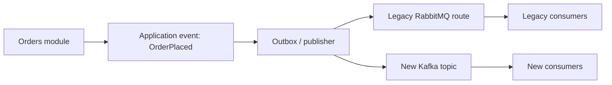
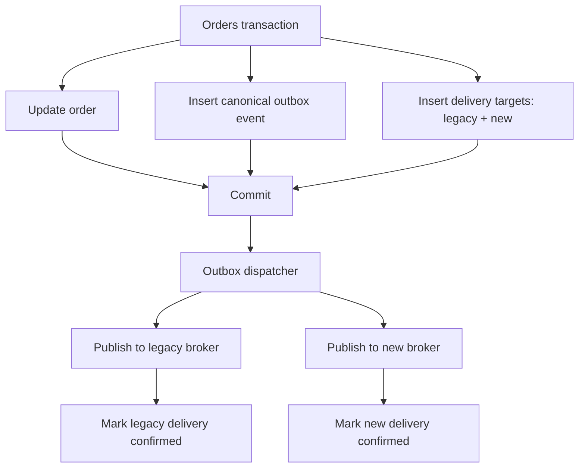
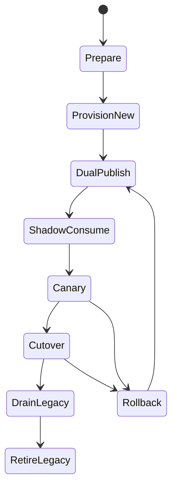

# Dual publish

Khi chuyển hệ thống event từ một broker, topic, exchange hoặc contract cũ sang đích mới, producer và consumer thường không thể được triển khai đồng thời. Một số consumer vẫn cần nhận event từ đường cũ trong khi consumer mới đã sẵn sàng ở đường mới. **Dual publish** là chiến lược tạm thời phát cùng một sự kiện nghiệp vụ tới cả hai đích trong giai đoạn chuyển đổi, để hai thế hệ tích hợp có thể hoạt động song song.

Trong ứng dụng Spring Modulith, module nghiệp vụ nên tiếp tục phát một application event theo contract có ý nghĩa ổn định. Lớp externalization hoặc outbox chịu trách nhiệm chuyển event đó tới các destination cần thiết. Nhờ vậy, logic nghiệp vụ không phải biết chi tiết broker cũ, broker mới hay trạng thái rollout. Dual publish là một chiến lược migration có thời hạn; nó cần quy tắc về nguồn dữ liệu có thẩm quyền, chống trùng, ordering, quan sát và thời điểm kết thúc rõ ràng.

## 1. Khi nào cần dual publish?

Dual publish hữu ích khi cần chuyển đổi mà không dừng toàn bộ luồng event. Ví dụ:

- Chuyển từ RabbitMQ sang Kafka trong khi consumer cũ chưa thể chuyển ngay.
- Đổi topic/exchange hoặc routing convention nhưng cần thời gian nâng cấp từng consumer.
- Chuyển event contract từ schema cũ sang envelope mới.
- Chuyển từ một hệ thống tích hợp cũ sang event platform mới.
- Chuyển consumer sang một read model mới và cần so sánh kết quả trước cutover.

Giả sử module Orders phát `OrderPlaced`. Hệ thống cũ nhận event qua RabbitMQ exchange `legacy.orders`; hệ thống mới nhận qua Kafka topic `orders.v2`. Trong thời gian migration, cùng một thay đổi đơn hàng cần được đưa tới cả hai đường.



Hai đường nhận cùng một sự kiện nghiệp vụ nhưng có thể dùng envelope, routing key hoặc wire schema khác nhau. Chúng cần giữ được một định danh nghiệp vụ chung để truy vết và deduplicate.

## 2. Phân biệt dual publish với dual write

Các khái niệm gần nhau nhưng có rủi ro khác nhau:

| Khái niệm | Ý nghĩa | Rủi ro chính |
|---|---|---|
| Dual publish | Phát cùng một event tới hai destination event | Một destination thành công, destination kia thất bại |
| Dual write | Ghi cùng thay đổi vào hai hệ thống dữ liệu độc lập | Hai hệ thống có thể lệch trạng thái khi một lần ghi thất bại |
| Outbox | Ghi intent gửi event cùng transaction dữ liệu nguồn | Dispatcher có thể gửi lại sau khi kết quả publish không xác định |
| Shadow consume | Consumer mới nhận event nhưng chưa tạo side effect có thẩm quyền | Tốn tài nguyên và cần so sánh kết quả đúng cách |

Không nên thực hiện hai lệnh publish trực tiếp trong service nghiệp vụ rồi giả định cả hai cùng thành công. Nếu publish tới broker cũ thành công nhưng broker mới lỗi, lần gọi tiếp theo có thể gửi trùng tới broker cũ. Nếu đánh dấu toàn bộ event đã gửi sau khi chỉ một đích xác nhận, đích còn lại có thể mất event.

Dual publish cần được mô hình hóa như hai delivery độc lập của cùng một event. Mỗi destination có trạng thái riêng, retry riêng và số liệu quan sát riêng.

## 3. Giữ một nguồn sự thật cho sự kiện nghiệp vụ

Trong suốt migration, module sở hữu nghiệp vụ vẫn là nguồn có thẩm quyền cho thay đổi. Không tạo hai event nghiệp vụ độc lập chỉ vì có hai broker. Producer nên tạo một event với `eventId` ổn định, sau đó adapter chuyển event tới từng destination.

Ví dụ contract:

```java
public record OrderPlaced(
    UUID eventId,
    UUID orderId,
    long aggregateVersion,
    Instant occurredAt,
    List<OrderLineData> lines
) {}
```

Khi chuyển đổi:

- `eventId` giữ nguyên trên cả đường cũ và đường mới.
- `orderId` và `aggregateVersion` nhận diện aggregate cùng thứ tự thay đổi.
- `occurredAt` biểu diễn thời điểm nghiệp vụ, không phải thời điểm từng broker nhận message.
- Adapter có thể map cùng event sang hai envelope khác nhau nhưng phải giữ được identity và semantics.

Không phát một `OrderPlacedLegacy` và một `OrderPlacedV2` với hai event ID ngẫu nhiên nếu chúng cùng biểu diễn một lần tạo đơn. Consumer sẽ khó nhận ra hai message là bản sao của cùng một hành động. Nếu wire contract cần ID riêng, hãy mang thêm `eventId` gốc hoặc `canonicalEventId` để liên kết chúng.

## 4. Kiến trúc dual publish với transactional outbox

Một cách triển khai an toàn là ghi thay đổi nghiệp vụ và outbox row trong cùng transaction database. Dispatcher đọc outbox và gửi tới từng destination. Trạng thái giao nhận được lưu riêng cho mỗi đích.



Nếu transaction rollback, thay đổi đơn hàng và outbox intent cùng rollback. Nếu commit, dispatcher có thể tiếp tục gửi sau khi ứng dụng restart. Khi legacy thành công nhưng new thất bại, chỉ delivery của new cần retry.

Một mô hình dữ liệu minh họa:

```sql
CREATE TABLE event_outbox (
    event_id UUID PRIMARY KEY,
    event_type VARCHAR(160) NOT NULL,
    aggregate_id VARCHAR(200) NOT NULL,
    aggregate_version BIGINT NOT NULL,
    occurred_at TIMESTAMP NOT NULL,
    payload JSON NOT NULL
);

CREATE TABLE event_outbox_delivery (
    event_id UUID NOT NULL,
    destination VARCHAR(80) NOT NULL,
    status VARCHAR(24) NOT NULL,
    attempt_count INTEGER NOT NULL DEFAULT 0,
    last_error_code VARCHAR(120),
    published_at TIMESTAMP,
    PRIMARY KEY (event_id, destination),
    FOREIGN KEY (event_id) REFERENCES event_outbox(event_id)
);
```

Schema chỉ minh họa ý tưởng. Kiểu JSON, timestamp, claim/lease, retry time, error metadata, index và cleanup cần được thiết kế theo database cùng throughput. Có thể lưu payload một lần ở bảng outbox và có một delivery row cho mỗi destination để tránh nhân bản payload.

## 5. Theo dõi trạng thái từng destination

Không nên chỉ có một cột `published=true` cho event dual publish. Trạng thái chung đó không thể diễn tả trường hợp một đích đã nhận còn đích kia chưa nhận.

Một state model đơn giản:

| Destination | Trạng thái | Ý nghĩa |
|---|---|---|
| Legacy | `PENDING` | Chưa gửi hoặc chưa claim |
| Legacy | `IN_FLIGHT` | Dispatcher đang gửi |
| Legacy | `CONFIRMED` | Broker đã xác nhận theo semantics đã chọn |
| Legacy | `RETRY` | Gửi thất bại tạm thời, chờ retry |
| Legacy | `FAILED` | Vượt ngưỡng hoặc cần can thiệp |
| New | Các trạng thái tương tự | Theo dõi độc lập với Legacy |

Event chỉ hoàn tất toàn bộ dual publish khi mọi destination bắt buộc đạt trạng thái thành công theo policy. Nếu một destination bị vô hiệu hóa có chủ đích trong rollout, việc bỏ qua cần là một quyết định có ghi nhận, không tự suy ra từ timeout.

`CONFIRMED` cũng cần định nghĩa chính xác. Với Kafka, producer acknowledgement thường xác nhận broker đã nhận record theo `acks` configuration. Với RabbitMQ, publisher confirm xác nhận broker xử lý publish theo semantics confirm. Cả hai không chứng minh consumer cuối đã xử lý nghiệp vụ.

## 6. Tại sao publish tuần tự trong service dễ gây lỗi?

Ví dụ đơn giản sau có thể tạo partial success:

```java
public void publish(OrderPlaced event) {
    legacyPublisher.publish(event);
    newPublisher.publish(event);
}
```

Nếu `legacyPublisher` thành công và `newPublisher` ném exception, caller chỉ thấy lỗi tổng thể. Lần retry có thể gửi lại legacy event. Nếu caller bắt exception rồi tiếp tục, new event có thể bị mất. Nếu service đánh dấu event đã publish sau dòng đầu tiên, trạng thái cũng không phản ánh đủ hai đích.

Nếu vẫn dùng publisher trực tiếp, tối thiểu phải có:

- Event ID ổn định để consumer deduplicate.
- Kết quả và trạng thái riêng cho từng destination.
- Retry độc lập cho từng destination.
- Quy tắc rõ về lỗi tạm thời và lỗi không thể phục hồi.
- Durable state để biết destination nào đã nhận sau restart.

Trong phần lớn hệ thống cần độ tin cậy cao, outbox với delivery state riêng dễ phục hồi và quan sát hơn việc giữ trạng thái chỉ trong bộ nhớ của service.

## 7. Adapter giữ module nghiệp vụ độc lập với broker

Module Orders nên phát application event theo contract nghiệp vụ. Một adapter hoặc module integration chịu trách nhiệm map event sang transport cụ thể.

```java
@Component
class OrderEventDualPublisher {

    private final LegacyOrderPublisher legacy;
    private final NewOrderPublisher modern;

    OrderEventDualPublisher(
        LegacyOrderPublisher legacy,
        NewOrderPublisher modern
    ) {
        this.legacy = legacy;
        this.modern = modern;
    }

    public DeliveryResult publish(OrderPlaced event) {
        var legacyResult = legacy.publish(event);
        var modernResult = modern.publish(event);
        return new DeliveryResult(legacyResult, modernResult);
    }
}
```

Đây là ví dụ về tách adapter, chưa phải implementation bền vững: nếu process dừng giữa hai lời gọi thì kết quả không được lưu. Trong triển khai production, adapter thường được gọi bởi outbox dispatcher và cập nhật delivery state sau khi nhận confirm. Module nghiệp vụ không nên import KafkaTemplate, RabbitTemplate hoặc tên topic/exchange.

Với Spring Modulith, application event và module listener giúp giữ ranh giới trong modular monolith. Event Publication Registry theo dõi publication tới listener được quản lý; nó không tự động tạo mô hình hai destination broker với trạng thái độc lập. Nếu cần dual publish ra broker, hãy dùng externalization integration được hỗ trợ hoặc adapter/outbox có lifecycle rõ ràng. Không giả định một annotation externalization đơn lẻ tự bảo đảm atomic delivery tới hai broker.

## 8. Dual publish khi dùng Spring Modulith externalization

Spring Modulith hỗ trợ externalize application event qua các integration phù hợp với phiên bản. Event có thể mang metadata định tuyến để adapter chuyển tới destination. Khi migration cần đồng thời hai destination, cần xác định adapter hỗ trợ nhiều route hay phải có dispatcher riêng.

Trước khi triển khai, trả lời:

1. Event nào được externalize và destination nào nhận event?
2. Hai destination có dùng cùng payload hay cần hai mapper/version khác nhau?
3. Delivery state được theo dõi độc lập ở đâu?
4. Khi một broker thành công và broker kia lỗi, retry bắt đầu từ đâu?
5. Sau restart, hệ thống biết destination nào còn pending bằng cách nào?
6. Khi ngừng legacy route, cấu hình nào xác nhận không còn event mới gửi tới đó?

Nếu dùng `@Externalized` hoặc route metadata, hãy kiểm tra behavior của đúng Spring Modulith version và extension đang sử dụng. Nếu một event chỉ được ánh xạ tới một external destination trong cấu hình hiện tại, không nhân đôi annotation hoặc giả định framework sẽ fan-out. Một outbox dispatcher có nhiều delivery target là lựa chọn rõ ràng khi cần điều phối nhiều đích.

## 9. Consumer mới nên bắt đầu ở chế độ shadow

Trong giai đoạn đầu, consumer mới thường nên chạy ở chế độ shadow: nhận event, deserialize, validate và tính kết quả nhưng không thực hiện side effect có thẩm quyền.

Ví dụ, consumer mới xây read model đơn hàng song song với consumer cũ. Hệ thống có thể so sánh:

- Số event nhận được theo event type.
- Số order ID được xử lý.
- Trạng thái cuối cùng của cùng một order.
- Tổng tiền, số lượng và các field quan trọng.
- Độ trễ từ `occurredAt` tới khi projection cập nhật.
- Event bị từ chối, lỗi schema hoặc bị bỏ qua.

Shadow consumer không nên gửi email, charge payment, tạo shipment hoặc cập nhật dữ liệu có thẩm quyền. Nếu cần kiểm tra side effect, dùng sandbox hoặc fake downstream riêng. Nếu hai consumer cùng tạo side effect thật, dual publish có thể biến một hành động thành hai lần thực thi.

## 10. Tránh xử lý nghiệp vụ hai lần

Trong dual publish, cùng event xuất hiện ở hai transport. Nếu cả consumer cũ và mới đều active, chúng có thể cùng thực hiện một hành động. Có ba chiến lược phổ biến:

| Chiến lược | Cách dùng | Khi phù hợp |
|---|---|---|
| Shadow/read-only | Consumer mới chỉ tính toán và so sánh | Xác minh logic mới trước cutover |
| Single active owner | Chỉ một thế hệ consumer được phép tạo side effect | Migration có thể chuyển quyền xử lý theo từng nhóm |
| Idempotent shared effect | Cả hai đường có thể gọi nhưng dùng cùng idempotency key và store | Hai consumer phải cùng hoạt động trong thời gian chuyển tiếp |

Idempotency key nên đại diện cho hành động nghiệp vụ, chẳng hạn `orderId + actionType` hoặc `eventId + consumerPurpose`, tùy semantics. Không dùng cùng key cho hai hành động độc lập. Consumer cũng cần unique constraint/inbox hoặc state guard ở nơi lưu tác động.

Nếu hai phiên bản consumer ghi vào hai database khác nhau, idempotency store riêng không ngăn chúng cùng thực hiện side effect ngoài. Khi đó cần một owner duy nhất hoặc idempotency key được downstream dùng chung.

## 11. Giữ nguyên identity và correlation qua hai đường

Dual publish cần giúp người vận hành biết hai message là bản sao của cùng một event. Giữ lại:

- `eventId`: định danh canonical của sự kiện.
- `aggregateId` và `aggregateVersion`: định danh đối tượng cùng thứ tự thay đổi.
- `correlationId`: liên kết cả luồng xử lý.
- `causationId`: event/command đã gây ra sự kiện nếu có.
- `migrationRoute`: nhãn route như `legacy` hoặc `new` để quan sát.
- `schemaVersion`: version wire contract của từng payload.

Nếu hai destination dùng envelope khác nhau, `eventId` canonical vẫn phải được giữ ở header hoặc field tương ứng. `migrationRoute` không nên được đưa vào logic nghiệp vụ; nó là metadata vận hành.

Không tạo `eventId` mới ở dispatcher mỗi lần gửi. Retry, replay và gửi sang destination thứ hai phải giữ identity gốc. Nếu destination cần message ID riêng, lưu mapping giữa canonical event ID và transport message ID.

## 12. Ordering khi dual publish

Hai broker không có một thứ tự toàn cục chung. Event A có thể đến legacy trước event B, trong khi ở broker mới B đến trước A do batching, partition hoặc retry khác nhau.

Nếu consumer cần ordering theo aggregate:

- Gắn `aggregateVersion` tăng dần trong transaction nguồn.
- Dùng `aggregateId` làm Kafka key hoặc routing key phù hợp.
- Dispatcher claim event theo thứ tự cần thiết.
- Theo dõi sequence ở consumer và phát hiện gap/stale event.
- Không giả định thứ tự giữa hai destination giống nhau.
- Đối soát theo version thay vì timestamp đơn thuần.

Trong thời gian dual publish, có thể cần giữ ordering riêng cho mỗi destination. Nếu event version 12 ở legacy đã được gửi nhưng version 11 ở new còn retry, consumer mới có thể nhận sai thứ tự. Cần thiết kế dispatcher theo aggregate hoặc để consumer phát hiện gap và chờ event còn thiếu.

Không khóa toàn bộ outbox chỉ để giữ thứ tự toàn cục. Chọn đúng phạm vi ordering, thường là theo aggregate hoặc business key, để tránh giảm throughput không cần thiết.

## 13. Quản lý feature flag và rollout

Dual publish nên được bật/tắt bằng cấu hình có kiểm soát. Feature flag có thể điều khiển destination mới, shadow consumer hoặc tỷ lệ canary. Cần phân biệt:

- `publishLegacy`: gửi tới đích cũ.
- `publishNew`: gửi tới đích mới.
- `newConsumerShadow`: consumer mới chỉ so sánh.
- `newConsumerAuthoritative`: consumer mới được phép tạo side effect.

Không nên gộp tất cả thành một cờ `dualPublish` nếu mỗi pha rollout cần chuyển trạng thái độc lập. Cờ cấu hình cần có giá trị mặc định an toàn, audit thay đổi và khả năng quan sát.

Nếu cờ `publishNew` thay đổi trong khi outbox đang có backlog, cần xác định policy cho event đã được ghi trước đó. Có thể lưu danh sách destination tại thời điểm tạo outbox row để bảo đảm intent không thay đổi giữa chừng; hoặc quyết định route khi dispatch và ghi rõ version policy. Không để thay đổi flag khiến một số event không rõ có phải gửi tới đích mới hay không.

## 14. Các giai đoạn migration khuyến nghị

Một rollout thường có thể chia thành các pha:

1. **Chuẩn bị contract:** xác định event identity, schema mapping, compatibility và destination mới.
2. **Provision đích mới:** tạo topic/queue, ACL, schema, consumer group và dashboard.
3. **Deploy adapter:** thêm khả năng ghi delivery target mới, chưa chuyển quyền xử lý.
4. **Dual publish:** gửi mọi event mới tới legacy và new, theo dõi trạng thái riêng.
5. **Shadow consume:** consumer mới nhận và so sánh kết quả, chưa tạo side effect.
6. **Canary:** chuyển một nhóm tenant/aggregate sang consumer mới làm owner.
7. **Cutover:** chuyển toàn bộ traffic phù hợp sang consumer mới và xác minh backlog cũ.
8. **Stop legacy publish:** dừng phát event mới tới đích cũ sau khi consumer cũ đã drain.
9. **Retire:** xóa route, credential, dashboard và hạ tầng cũ sau thời gian rollback đã định.



Mỗi pha cần tiêu chí vào/ra rõ ràng. Không chuyển pha chỉ vì deployment hoàn tất; cần bằng chứng từ metrics, reconciliation, error rate và business outcome.

## 15. Cutover và rollback

Cutover là thời điểm thay đổi consumer có thẩm quyền hoặc nguồn đọc/ghi chính. Trước cutover, xác minh:

- New destination đã nhận đủ event trong khoảng thời gian quan sát.
- Consumer mới không còn lỗi schema hoặc backlog bất thường.
- Kết quả shadow/canary khớp nguồn chuẩn trong ngưỡng chấp nhận.
- Idempotency và ordering được kiểm tra.
- Các side effect chỉ có một owner.
- Có cách quay lại consumer cũ trong thời gian rollback.

Rollback không đơn giản là bật lại publisher cũ nếu consumer mới đã tạo side effect. Cần xác định dữ liệu nào đã được ghi, event nào đã xử lý và consumer nào có quyền tiếp tục. Giữ event ID, aggregate version và audit trail giúp xác định điểm tiếp tục.

Trong giai đoạn rollback, tránh cho cả consumer cũ và mới cùng xử lý authoritative. Có thể dừng consumer mới, chuyển owner về cũ, rồi replay phần event còn thiếu theo sequence. Nếu đã có side effect không thể đảo ngược, cần reconciliation hoặc compensation thay vì phát lại mù quáng.

## 16. Dừng legacy publish an toàn

Không dừng legacy publish ngay sau khi consumer mới bắt đầu nhận event. Cần xác minh:

- Không còn consumer bắt buộc nào chỉ đọc legacy destination.
- Legacy queue/topic đã drain hoặc message tồn đọng được xử lý theo policy.
- Không còn publication/outbox delivery legacy đang `PENDING`, `IN_FLIGHT` hoặc `RETRY`.
- Các producer cũ đã được nâng cấp hoặc bị loại khỏi traffic.
- Dashboard và alert cho legacy đã ghi nhận trạng thái ngừng.
- Rollback window đã kết thúc hoặc có kế hoạch tái kích hoạt rõ.

Sau khi dừng gửi event mới, vẫn có thể cần giữ legacy consumer trong một khoảng thời gian để xử lý backlog. Chỉ retire broker route khi cả producer, consumer, replay tool và quy trình vận hành không còn phụ thuộc.

## 17. Retry và xử lý partial failure

Mỗi destination cần retry độc lập. Một policy minh họa:

| Lỗi | Hành động |
|---|---|
| Timeout, connection reset | Retry với backoff và jitter |
| Broker tạm unavailable | Giữ delivery pending và retry sau khi kết nối phục hồi |
| Authentication/ACL sai | Dừng retry dày đặc, cảnh báo và chờ sửa cấu hình |
| Payload không hợp lệ với một schema | Đưa delivery đó vào quarantine; không làm mất trạng thái destination còn lại |
| Destination đã retire có chủ ý | Đánh dấu skipped theo quyết định rollout có audit |
| Confirm timeout, kết quả không rõ | Có thể gửi lại cùng event ID; consumer deduplicate |

Không retry toàn bộ dual publish nếu chỉ một đích thất bại. Làm vậy sẽ tạo duplicate không cần thiết ở đích đã thành công. Lưu trạng thái delivery theo destination và retry đúng phần còn thiếu.

Nếu retry vượt ngưỡng, không xóa outbox row. Chuyển delivery sang trạng thái cần can thiệp, giữ event ID/payload đủ để replay và cảnh báo người vận hành.

## 18. Đối soát hai luồng event

Trong giai đoạn dual publish, cần biết hai destination có nhận cùng tập sự kiện hay không. Có thể đối soát theo:

- Event ID theo khoảng thời gian hoặc partition.
- Aggregate ID và aggregate version.
- Event type và schema version.
- Số event được xác nhận tại từng destination.
- Số event consumer đã xử lý và trạng thái cuối cùng.
- Checksum của payload canonical nếu cần phát hiện sai lệch mapping.

Không chỉ so sánh tổng số message. Hai destination có thể cùng có 1.000 message nhưng thiếu/thừa những event khác nhau. Đối soát theo event ID và version sẽ phát hiện chính xác hơn.

Nếu payload legacy và new khác schema, chuẩn hóa về một canonical model trước khi so sánh. Chênh lệch field có thể do mapping hợp lệ; chênh lệch semantics như tổng tiền, trạng thái hoặc version cần được điều tra.

## 19. Observability cho dual publish

Dashboard migration nên hiển thị số liệu riêng theo destination:

- Số event được tạo trong outbox.
- Số delivery `PENDING`, `IN_FLIGHT`, `CONFIRMED`, `RETRY`, `FAILED`.
- Tuổi delivery pending lâu nhất.
- Publish latency và confirm latency.
- Retry count, timeout và lỗi authentication/routing.
- Consumer lag, throughput và processing failure của từng đường.
- Số duplicate được deduplicate.
- Số event/version thiếu khi reconciliation.
- Tỷ lệ kết quả khác nhau giữa shadow consumer và legacy consumer.

Log và trace cần mang canonical `eventId`, destination, aggregate ID/version, correlation ID và attempt. Không đưa event ID hoặc aggregate ID có cardinality cao vào metric label; dùng log/trace cho định danh chi tiết và metric label cho destination, event type hoặc error category có tập giá trị giới hạn.

Đặt alert khi một destination không nhận event mới, backlog tăng, tỷ lệ lỗi vượt ngưỡng, hoặc chênh lệch đối soát kéo dài. Một dashboard tổng hợp duy nhất có thể che giấu việc legacy khỏe nhưng new đang mất message.

## 20. Kiểm thử dual publish

Kiểm thử cần bao phủ cả hai đích và các trạng thái partial failure:

| Tình huống | Kết quả mong đợi |
|---|---|
| Cả hai destination hoạt động | Cùng canonical event ID xuất hiện ở cả hai |
| Legacy thành công, new thất bại | Legacy không bị gửi lại không cần thiết; new được retry |
| New thành công, legacy thất bại | New giữ trạng thái confirmed; legacy được retry |
| Cả hai thất bại | Hai delivery vẫn pending/retry theo policy |
| Process dừng giữa hai lần gửi | Sau restart, dispatcher tiếp tục đúng destination còn thiếu |
| Confirm bị mất | Có thể gửi lại cùng ID; consumer idempotent |
| Payload mapping khác nhau | Hai schema biểu diễn cùng business semantics |
| Event đến sai thứ tự | Consumer phát hiện sequence gap hoặc xử lý theo policy |
| Shadow consumer khác kết quả | Có metric/log đối soát, không tạo side effect authoritative |
| Cutover/rollback | Chỉ một consumer owner tạo side effect |
| Legacy route bị tắt | Không có delivery mới ngoài policy đã định |

Unit test kiểm tra route decision và mapping. Integration test với broker kiểm tra publish thật, routing, confirm và consumer. Test với database kiểm tra outbox transaction, delivery state và recovery. Test end-to-end migration xác minh một số luồng đại diện qua cả hai destination.

## 21. Ví dụ kiểm thử partial failure

Ở tầng unit, có thể giả lập kết quả riêng của từng publisher để xác minh dispatcher không đánh dấu nhầm cả hai đích:

```java
@Test
void retriesOnlyDestinationThatFailed() {
    var event = TestEvents.orderPlaced();
    legacyPublisher.confirm(event.eventId());
    newPublisher.failOnce(event.eventId());

    dispatcher.dispatch(event.eventId());

    assertThat(deliveries.status(event.eventId(), "legacy"))
        .isEqualTo(DeliveryStatus.CONFIRMED);
    assertThat(deliveries.status(event.eventId(), "new"))
        .isEqualTo(DeliveryStatus.RETRY);

    newPublisher.confirm(event.eventId());
    dispatcher.retryPending(event.eventId());

    assertThat(legacyPublisher.countFor(event.eventId())).isEqualTo(1);
    assertThat(newPublisher.countFor(event.eventId())).isEqualTo(2);
}
```

Đây là pseudocode thể hiện assertion mong muốn, không phải API chuẩn. Integration test cần thay fake publisher bằng broker container và xác minh record/message thực tế. Nếu broker confirm timeout nhưng broker đã nhận message, số lần gửi có thể lớn hơn một; consumer vẫn phải deduplicate theo event ID.

## 22. Kiểm thử bằng Testcontainers và Spring Modulith

Có thể kết hợp:

- Spring Modulith `@ApplicationModuleTest` hoặc `Scenario` để xác minh event nội bộ được phát.
- Database test để xác minh business state và outbox row commit nguyên tử.
- Kafka/RabbitMQ Testcontainers để xác minh delivery tới hai broker/destination.
- Consumer integration test để xác minh schema, idempotency và side effect.
- Recovery test để mô phỏng một destination lỗi rồi phục hồi.

Nếu migration là RabbitMQ sang Kafka, không nhất thiết phải dùng hai broker trong mọi test. Có thể có test nhỏ cho từng adapter và một số test dual publish tích hợp cả hai. Test cần dùng destination riêng để tránh ảnh hưởng giữa các lần chạy.

Event Publication Registry của Spring Modulith và outbox dispatcher có thể cùng xuất hiện trong kiến trúc, nhưng cần tránh hai tầng retry không có quy tắc. Xác định rõ registry theo dõi listener nào, outbox quản lý destination nào và điều kiện nào đánh dấu từng bước hoàn tất.

## 23. Các lỗi thiết kế thường gặp

- **Một cột published chung:** không biết destination nào còn pending.
- **Publish tuần tự không lưu state:** process dừng giữa chừng làm mất thông tin partial success.
- **Tạo event ID mới cho mỗi broker:** khó deduplicate và đối soát cùng sự kiện.
- **Retry cả hai đích:** tạo duplicate ở destination đã thành công.
- **Hai consumer cùng side effect:** gửi email, charge hoặc tạo shipment hai lần.
- **Shadow consumer ghi dữ liệu thật:** so sánh kết quả làm thay đổi hệ thống.
- **Không giữ aggregate version:** khó phát hiện thiếu hoặc sai thứ tự event.
- **Dừng legacy quá sớm:** consumer cũ còn backlog hoặc replay dependency.
- **Không có rollback plan:** cutover xong không xác định được owner khi quay lại.
- **Chỉ so sánh message count:** bỏ sót event thiếu/thừa khác nhau.
- **Không đặt thời hạn dual publish:** migration tạm thời trở thành hai hệ thống vĩnh viễn.

## 24. Checklist trước khi bật dual publish

- [ ] Mục tiêu migration và ngày/điều kiện kết thúc được xác định.
- [ ] Một canonical event contract và event ID ổn định được xác định.
- [ ] Mapping legacy/new giữ nguyên business semantics.
- [ ] Source of truth và owner của từng side effect được chỉ rõ.
- [ ] Outbox/delivery state theo dõi riêng từng destination.
- [ ] Retry một destination không gửi lại destination đã confirmed.
- [ ] Consumer idempotent và dedup key được thống nhất.
- [ ] Ordering theo aggregate/version được xác định.
- [ ] Shadow consumer không tạo side effect có thẩm quyền.
- [ ] Feature flags tách publish, shadow và authoritative consumer.
- [ ] Có dashboard, alert và reconciliation theo event ID/version.
- [ ] Có test partial failure, restart, confirm timeout và duplicate delivery.
- [ ] Cutover, rollback, drain backlog và stop legacy có tiêu chí rõ.
- [ ] Có người chịu trách nhiệm quyết định retire destination cũ.

Dual publish cho phép chuyển hệ thống event từng bước mà vẫn duy trì tích hợp cũ trong khi đường mới được kiểm chứng. Trong Spring Modulith, module nghiệp vụ nên phát một application event canonical; outbox/adapter quản lý delivery riêng cho từng destination. Kết hợp event identity ổn định, idempotent consumer, shadow mode, đối soát, quan sát partial failure và kế hoạch cutover/rollback giúp migration có thể kiểm soát và kết thúc an toàn.
